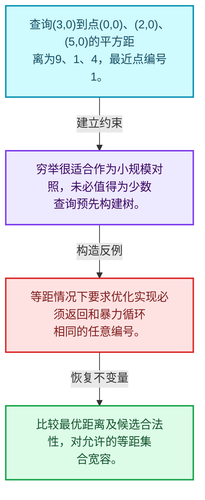
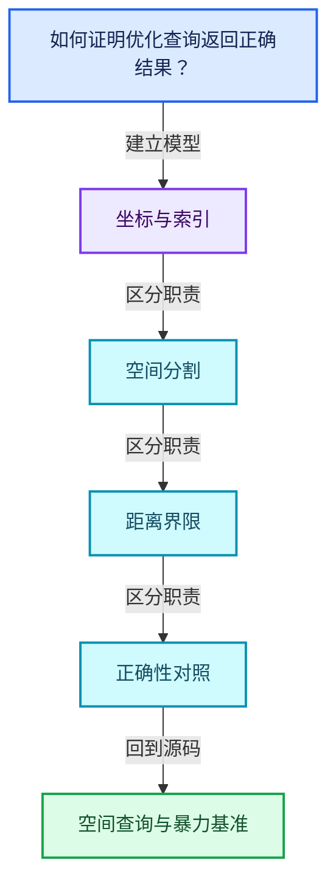
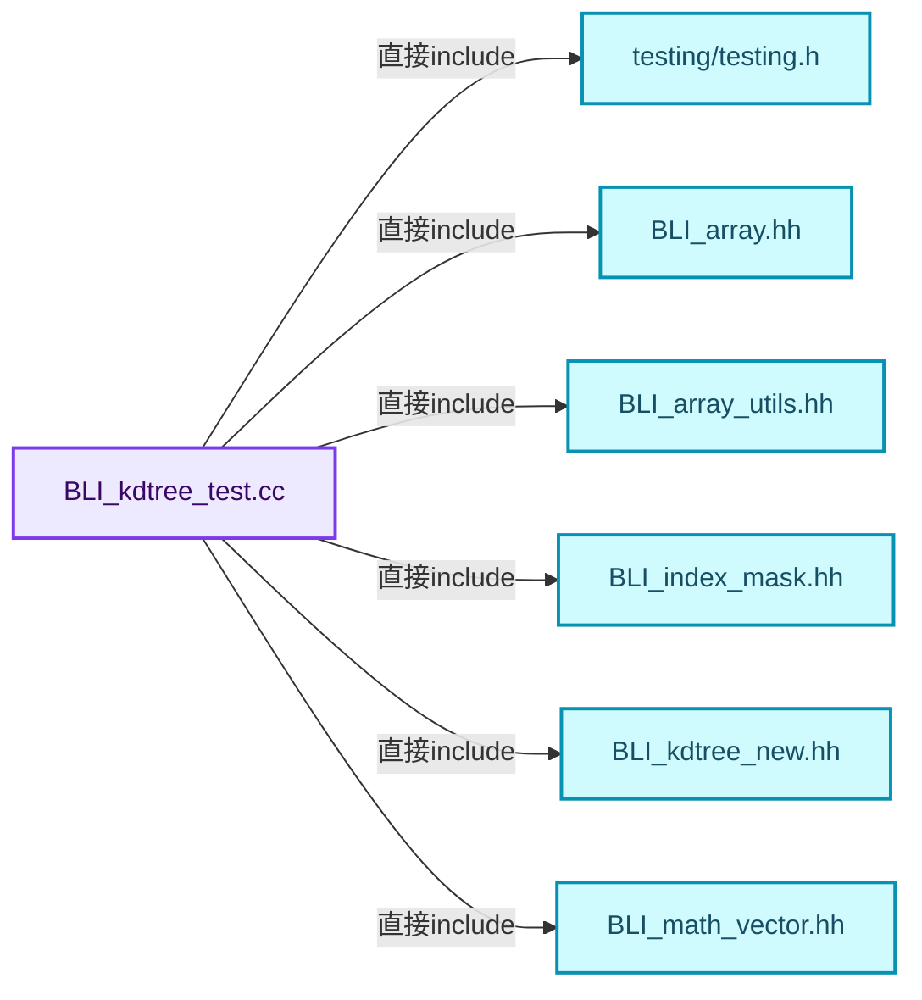
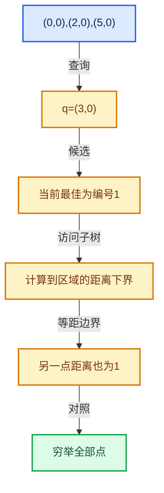

# 12-01 空间查询与暴力基准

[方向导航](README.md) · [总目录](../README.md) · [覆盖索引](../%E6%BA%90%E7%A0%81%E7%89%88%E6%9C%AC%E4%B8%8E%E8%A6%86%E7%9B%96%E7%B4%A2%E5%BC%95.md)

> 阅读顺序：问题与数据模型 → 语法与类型 → 源码逐行 → 调用线索 → 历史与取舍 → 推演和练习。

- 基准 HEAD：`cbda6b96c26c0dee3c3b5cbb93960c4ac06a6b30`。
- 记录日期：2026-10-14。
- 教学示例状态：正文中的推演不是本机性能实测；已运行练习见验收报告。

## 一、从问题到设计

如何证明优化查询返回正确结果？

先用穷举距离建立可信对照；等距结果可能不唯一，验证距离和合法集合比固定某个编号更稳健。

本篇把语法、数据语义和系统取舍连接起来。先证明距离下界与返回身份，再讨论布局优化和并行构建。

### 本篇独立模型与设计推理

查询(3,0)到点(0,0)、(2,0)、(5,0)的平方距离为9、1、4，最近点编号1。

设计取舍：穷举很适合作为小规模对照，未必值得为少数查询预先构建树。

最小反例：等距情况下要求优化实现必须返回和暴力循环相同的任意编号。

推导与处理：比较最优距离及候选合法性，对允许的等距集合宽容。



### 源码范围与相邻篇章

| 文件 | 本篇逐行范围 | 基准SHA-256 |
|---|---|---|
| [source/blender/blenlib/tests/BLI_kdtree_test.cc](../../../../../source/blender/blenlib/tests/BLI_kdtree_test.cc) | L1—L656 | `8da6af416bd1b401043e6fbae2c0eead19df7482a460dd60836fb31349f2ef99` |

同一主讲文件可能分多篇覆盖；超出本篇范围的符号通过覆盖索引定位。空行与纯注释保留在源码摘录中，逐行表解释有效语句与语法边界；许可证头统一保留。

后篇：[KDTreeNew节点布局](02-KDTreeNew%E8%8A%82%E7%82%B9%E5%B8%83%E5%B1%80.md).

## 二、类型、数据与阅读地图



这是概念依赖图，边表示阅读关系，不声称是运行时调用顺序。

### 直接编译依赖



箭头只表示头文件包含关系；完整调用线索见后面的符号定位表。

## 三、关键词、语法与类型角色

### 只读限定 const

const约束当前访问路径可做的修改。const指针、指向const的指针、const视图对象、const元素是不同位置的限定；其他别名可能仍可修改原对象。

具体检查：分别写T* const、const T*与const T* const，并画出不可修改的层次。

### 覆写检查 override

override要求函数确实覆盖基类虚函数，可捕获参数类型和const限定不匹配。它不改变基类规定的生命周期或线程约束。

具体检查：故意改变一个参数或const，观察编译器如何拒绝误写的新函数。

### 类型别名 using

类型别名为已有类型建立名字，不创建运行期对象。它常把模板内部使用的类型统一暴露给泛型调用者。

具体检查：展开别名直到基础类型，区分类型别名和变量声明。

## 四、真实源码与逐行讲解

源码块保持原行内容，原始行号由小节标题及逐行表给出。表中的调用定位是静态阅读辅助；重载、模板实例化、宏展开和虚调用需结合完整声明，不能仅凭词法出现证明动态调用。

### BLI_kdtree_test.cc：L1—L47

<!-- source:source/blender/blenlib/tests/BLI_kdtree_test.cc:1:47 -->

```cpp
/* SPDX-FileCopyrightText: 2026 Blender Authors
 *
 * SPDX-License-Identifier: Apache-2.0 */

#include <algorithm>
#include <string>

#include "testing/testing.h"

#include "BLI_array.hh"
#include "BLI_array_utils.hh"
#include "BLI_index_mask.hh"
#include "BLI_kdtree_new.hh"
#include "BLI_math_vector.hh"
#include "BLI_rand.hh"
#include "BLI_task_c.hh"
#include "BLI_threads.hh"
#include "BLI_vector.hh"

namespace blender::tests {

using Nearest = KDTreeNew<float3>::Nearest;

static Array<float3> random_points(const int points_num, const int seed = 0)
{
  RandomNumberGenerator random(seed);
  Array<float3> positions(points_num);
  for (const int i : positions.index_range()) {
    positions[i] = float3(random.get_float(), random.get_float(), random.get_float());
  }
  return positions;
}

/** Reference implementation used to check the results of the tree. */
static Vector<Nearest> brute_force_sorted(const Span<float3> positions,
                                          const Span<int> indices,
                                          const float3 &position)
{
  Vector<Nearest> result;
  for (const int i : indices) {
    result.append({i, math::distance_squared(positions[i], position)});
  }
  std::ranges::sort(result, [](const Nearest &a, const Nearest &b) {
    return a.distance_sq < b.distance_sq || (a.distance_sq == b.distance_sq && a.index < b.index);
  });
  return result;
}
```

本段语义重点：

- `distance_sq`：平方距离，可避免开方，但阈值也必须使用一致单位。

| 原始行 | 语义、约束与检查 |
|---|---|
| L5 | 引入编译依赖 <algorithm>；这是声明可见性关系，不表示运行时一定调用该文件的所有接口。 |
| L6 | 引入编译依赖 <string>；这是声明可见性关系，不表示运行时一定调用该文件的所有接口。 |
| L8 | 引入编译依赖 "testing/testing.h"；这是声明可见性关系，不表示运行时一定调用该文件的所有接口。 |
| L10 | 引入编译依赖 "BLI_array.hh"；这是声明可见性关系，不表示运行时一定调用该文件的所有接口。 |
| L11 | 引入编译依赖 "BLI_array_utils.hh"；这是声明可见性关系，不表示运行时一定调用该文件的所有接口。 |
| L12 | 引入编译依赖 "BLI_index_mask.hh"；这是声明可见性关系，不表示运行时一定调用该文件的所有接口。 |
| L13 | 引入编译依赖 "BLI_kdtree_new.hh"；这是声明可见性关系，不表示运行时一定调用该文件的所有接口。 |
| L14 | 引入编译依赖 "BLI_math_vector.hh"；这是声明可见性关系，不表示运行时一定调用该文件的所有接口。 |
| L15 | 引入编译依赖 "BLI_rand.hh"；这是声明可见性关系，不表示运行时一定调用该文件的所有接口。 |
| L16 | 引入编译依赖 "BLI_task_c.hh"；这是声明可见性关系，不表示运行时一定调用该文件的所有接口。 |
| L17 | 引入编译依赖 "BLI_threads.hh"；这是声明可见性关系，不表示运行时一定调用该文件的所有接口。 |
| L18 | 引入编译依赖 "BLI_vector.hh"；这是声明可见性关系，不表示运行时一定调用该文件的所有接口。 |
| L20 | 把后续声明放入 blender::tests 命名空间，影响名称查找和符号归属，不创建运行时对象。 |
| L22 | 定义类型别名 `using Nearest = KDTreeNew<float3>::Nearest`，为模板接口或内部实现统一命名；本行不分配该类型对象。 |
| L24 | 把右侧 `0)` 用于初始化或更新左侧 `static Array<float3> random_points(const int points_num, const int seed`。声明初始化与已有对象赋值应按上下文区分；有资源的类型会调用相应特殊成员。 |
| L25 | 连接上一行的声明或控制结构与其语句块；后续行在这个作用域中执行或声明。 |
| L26 | 出现调用或函数声明 `random`，对应表达式为 `RandomNumberGenerator random(seed);`。参数求值、返回类型与重载需结合前后完整语句；静态文本引用不能证明动态目标。 |
| L27 | 出现调用或函数声明 `positions`，对应表达式为 `Array<float3> positions(points_num);`。参数求值、返回类型与重载需结合前后完整语句；静态文本引用不能证明动态目标。 |
| L28 | 按 `for (const int i : positions.index_range())` 指定的范围或条件重复执行。对照循环变量与真实元素编号；循环内调用成本乘以实际迭代次数。 |
| L29 | 把右侧 `float3(random.get_float(), random.get_float(), random.get_float())` 用于初始化或更新左侧 `positions[i]`。声明初始化与已有对象赋值应按上下文区分；有资源的类型会调用相应特殊成员。 |
| L30 | 结束当前语法单元。局部自动对象在离开其作用域时按规则销毁；这不等于所有被引用的外部数据也被释放。 |
| L31 | 返回表达式 `positions`。 |
| L32 | 结束当前语法单元。局部自动对象在离开其作用域时按规则销毁；这不等于所有被引用的外部数据也被释放。 |
| L35 | 出现调用或函数声明 `brute_force_sorted`，对应表达式为 `static Vector<Nearest> brute_force_sorted(const Span<float3> positions,`。参数求值、返回类型与重载需结合前后完整语句；静态文本引用不能证明动态目标。 |
| L36 | 本行是连续声明或表达式的一部分：`const Span<int> indices,`。与本段前后行合读；逗号、括号和限定符决定它属于参数、初始化列表还是实际计算。 |
| L37 | 本行是连续声明或表达式的一部分：`const float3 &position)`。与本段前后行合读；逗号、括号和限定符决定它属于参数、初始化列表还是实际计算。 |
| L38 | 连接上一行的声明或控制结构与其语句块；后续行在这个作用域中执行或声明。 |
| L39 | 声明成员、局部对象或完成语句 `Vector<Nearest> result`。若为指针或引用，它本身不说明拥有；若为值对象，其构造析构由所在作用域或外层对象管理。 |
| L40 | 按 `for (const int i : indices)` 指定的范围或条件重复执行。对照循环变量与真实元素编号；循环内调用成本乘以实际迭代次数。 |
| L41 | 出现调用或函数声明 `append`，对应表达式为 `result.append({i, math::distance_squared(positions[i], position)});`。参数求值、返回类型与重载需结合前后完整语句；静态文本引用不能证明动态目标。 |
| L42 | 结束当前语法单元。局部自动对象在离开其作用域时按规则销毁；这不等于所有被引用的外部数据也被释放。 |
| L43 | 出现调用或函数声明 `std::ranges::sort`，对应表达式为 `std::ranges::sort(result, [](const Nearest &a, const Nearest &b) {`。参数求值、返回类型与重载需结合前后完整语句；静态文本引用不能证明动态目标。 |
| L44 | 返回表达式 `a.distance_sq < b.distance_sq &#124;&#124; (a.distance_sq == b.distance_sq && a.index < b.index)`。结合函数声明检查返回值是否借用原存储，借用值不会自动延长其寿命。 |
| L45 | 结束当前语法单元。局部自动对象在离开其作用域时按规则销毁；这不等于所有被引用的外部数据也被释放。 |
| L46 | 返回表达式 `result`。 |
| L47 | 结束当前语法单元。局部自动对象在离开其作用域时按规则销毁；这不等于所有被引用的外部数据也被释放。 |

### BLI_kdtree_test.cc：L48—L100

<!-- source:source/blender/blenlib/tests/BLI_kdtree_test.cc:48:100 -->

```cpp

/** A grid of unit spaced points, so that distances land exactly on whole numbers. */
static Array<float3> grid_points(const int side)
{
  Array<float3> positions(side * side * side);
  int i = 0;
  for (const int x : IndexRange(side)) {
    for (const int y : IndexRange(side)) {
      for (const int z : IndexRange(side)) {
        positions[i++] = float3(float(x), float(y), float(z));
      }
    }
  }
  return positions;
}

static Vector<int> all_indices(const int points_num)
{
  Vector<int> indices(points_num);
  array_utils::fill_index_range(indices.as_mutable_span());
  return indices;
}

TEST(kdtree, Empty)
{
  const Array<float3> positions(0);
  const KDTreeNew<float3> tree(positions);
  EXPECT_TRUE(tree.is_empty());
  EXPECT_EQ(tree.size(), 0);
  EXPECT_EQ(tree.find_nearest(float3(0.0f)), -1);
  EXPECT_EQ(tree.count_in_radius(float3(0.0f), 100.0f), 0);

  Array<Nearest> nearest(4);
  EXPECT_EQ(tree.find_nearest_n(float3(0.0f), nearest), 0);

  Vector<Nearest> in_radius;
  EXPECT_EQ(tree.find_in_radius(float3(0.0f), 100.0f, in_radius), 0);
}

TEST(kdtree, SinglePoint)
{
  const Array<float3> positions = {float3(1.0f, 2.0f, 3.0f)};
  const KDTreeNew<float3> tree(positions);
  EXPECT_EQ(tree.size(), 1);

  float distance_sq = -1.0f;
  EXPECT_EQ(tree.find_nearest(float3(1.0f, 2.0f, 4.0f), &distance_sq), 0);
  EXPECT_FLOAT_EQ(distance_sq, 1.0f);

  /* The only point is filtered out. */
  EXPECT_EQ(tree.find_nearest_filtered(float3(0.0f), [](const int /*index*/) { return false; }),
            -1);
}
```

本段语义重点：

- `find_nearest`：最近邻查询入口；返回索引归属和距离单位按实际API确认。
- `distance_sq`：平方距离，可避免开方，但阈值也必须使用一致单位。

| 原始行 | 语义、约束与检查 |
|---|---|
| L50 | 出现调用或函数声明 `grid_points`，对应表达式为 `static Array<float3> grid_points(const int side)`。参数求值、返回类型与重载需结合前后完整语句；静态文本引用不能证明动态目标。 |
| L51 | 连接上一行的声明或控制结构与其语句块；后续行在这个作用域中执行或声明。 |
| L52 | 出现调用或函数声明 `positions`，对应表达式为 `Array<float3> positions(side * side * side);`。参数求值、返回类型与重载需结合前后完整语句；静态文本引用不能证明动态目标。 |
| L53 | 把右侧 `0` 用于初始化或更新左侧 `int i`。声明初始化与已有对象赋值应按上下文区分；有资源的类型会调用相应特殊成员。 |
| L54 | 按 `for (const int x : IndexRange(side))` 指定的范围或条件重复执行。对照循环变量与真实元素编号；循环内调用成本乘以实际迭代次数。 |
| L55 | 按 `for (const int y : IndexRange(side))` 指定的范围或条件重复执行。对照循环变量与真实元素编号；循环内调用成本乘以实际迭代次数。 |
| L56 | 按 `for (const int z : IndexRange(side))` 指定的范围或条件重复执行。对照循环变量与真实元素编号；循环内调用成本乘以实际迭代次数。 |
| L57 | 把右侧 `float3(float(x), float(y), float(z))` 用于初始化或更新左侧 `positions[i++]`。声明初始化与已有对象赋值应按上下文区分；有资源的类型会调用相应特殊成员。 |
| L58 | 结束当前语法单元。局部自动对象在离开其作用域时按规则销毁；这不等于所有被引用的外部数据也被释放。 |
| L59 | 结束当前语法单元。局部自动对象在离开其作用域时按规则销毁；这不等于所有被引用的外部数据也被释放。 |
| L60 | 结束当前语法单元。局部自动对象在离开其作用域时按规则销毁；这不等于所有被引用的外部数据也被释放。 |
| L61 | 返回表达式 `positions`。 |
| L62 | 结束当前语法单元。局部自动对象在离开其作用域时按规则销毁；这不等于所有被引用的外部数据也被释放。 |
| L64 | 出现调用或函数声明 `all_indices`，对应表达式为 `static Vector<int> all_indices(const int points_num)`。参数求值、返回类型与重载需结合前后完整语句；静态文本引用不能证明动态目标。 |
| L65 | 连接上一行的声明或控制结构与其语句块；后续行在这个作用域中执行或声明。 |
| L66 | 出现调用或函数声明 `indices`，对应表达式为 `Vector<int> indices(points_num);`。参数求值、返回类型与重载需结合前后完整语句；静态文本引用不能证明动态目标。 |
| L67 | 出现调用或函数声明 `array_utils::fill_index_range`，对应表达式为 `array_utils::fill_index_range(indices.as_mutable_span());`。参数求值、返回类型与重载需结合前后完整语句；静态文本引用不能证明动态目标。 |
| L68 | 返回表达式 `indices`。 |
| L69 | 结束当前语法单元。局部自动对象在离开其作用域时按规则销毁；这不等于所有被引用的外部数据也被释放。 |
| L71 | 出现调用或函数声明 `TEST`，对应表达式为 `TEST(kdtree, Empty)`。参数求值、返回类型与重载需结合前后完整语句；静态文本引用不能证明动态目标。 |
| L72 | 连接上一行的声明或控制结构与其语句块；后续行在这个作用域中执行或声明。 |
| L73 | 声明接口 `const Array<float3> positions(0)`，本行没有对应函数体；返回类型、参数限定和const/noexcept共同组成调用契约，实际行为需继续定位实现。 |
| L74 | 声明接口 `const KDTreeNew<float3> tree(positions)`，本行没有对应函数体；返回类型、参数限定和const/noexcept共同组成调用契约，实际行为需继续定位实现。 |
| L75 | 出现调用或函数声明 `EXPECT_TRUE`，对应表达式为 `EXPECT_TRUE(tree.is_empty());`。参数求值、返回类型与重载需结合前后完整语句；静态文本引用不能证明动态目标。 |
| L76 | 出现调用或函数声明 `EXPECT_EQ`，对应表达式为 `EXPECT_EQ(tree.size(), 0);`。参数求值、返回类型与重载需结合前后完整语句；静态文本引用不能证明动态目标。 |
| L77 | 本行使用 `find_nearest`：最近邻查询入口；返回索引归属和距离单位按实际API确认。 |
| L78 | 出现调用或函数声明 `EXPECT_EQ`，对应表达式为 `EXPECT_EQ(tree.count_in_radius(float3(0.0f), 100.0f), 0);`。参数求值、返回类型与重载需结合前后完整语句；静态文本引用不能证明动态目标。 |
| L80 | 出现调用或函数声明 `nearest`，对应表达式为 `Array<Nearest> nearest(4);`。参数求值、返回类型与重载需结合前后完整语句；静态文本引用不能证明动态目标。 |
| L81 | 出现调用或函数声明 `EXPECT_EQ`，对应表达式为 `EXPECT_EQ(tree.find_nearest_n(float3(0.0f), nearest), 0);`。参数求值、返回类型与重载需结合前后完整语句；静态文本引用不能证明动态目标。 |
| L83 | 声明成员、局部对象或完成语句 `Vector<Nearest> in_radius`。若为指针或引用，它本身不说明拥有；若为值对象，其构造析构由所在作用域或外层对象管理。 |
| L84 | 出现调用或函数声明 `EXPECT_EQ`，对应表达式为 `EXPECT_EQ(tree.find_in_radius(float3(0.0f), 100.0f, in_radius), 0);`。参数求值、返回类型与重载需结合前后完整语句；静态文本引用不能证明动态目标。 |
| L85 | 结束当前语法单元。局部自动对象在离开其作用域时按规则销毁；这不等于所有被引用的外部数据也被释放。 |
| L87 | 出现调用或函数声明 `TEST`，对应表达式为 `TEST(kdtree, SinglePoint)`。参数求值、返回类型与重载需结合前后完整语句；静态文本引用不能证明动态目标。 |
| L88 | 连接上一行的声明或控制结构与其语句块；后续行在这个作用域中执行或声明。 |
| L89 | 把右侧 `{float3(1.0f, 2.0f, 3.0f)}` 用于初始化或更新左侧 `const Array<float3> positions`。声明初始化与已有对象赋值应按上下文区分；有资源的类型会调用相应特殊成员。 |
| L90 | 声明接口 `const KDTreeNew<float3> tree(positions)`，本行没有对应函数体；返回类型、参数限定和const/noexcept共同组成调用契约，实际行为需继续定位实现。 |
| L91 | 出现调用或函数声明 `EXPECT_EQ`，对应表达式为 `EXPECT_EQ(tree.size(), 1);`。参数求值、返回类型与重载需结合前后完整语句；静态文本引用不能证明动态目标。 |
| L93 | 建立或更新 `distance_sq`：平方距离，可避免开方，但阈值也必须使用一致单位。本行的具体值关系为 `float distance_sq = -1.0f`；对照更新前后相应范围或状态是否一致。 |
| L94 | 本行使用 `find_nearest`：最近邻查询入口；返回索引归属和距离单位按实际API确认。 |
| L95 | 本行涉及 `distance_sq`：平方距离，可避免开方，但阈值也必须使用一致单位。按此语义解读 `EXPECT_FLOAT_EQ(distance_sq, 1.0f)`，不要把地址、数量或状态混用。 |
| L98 | 出现调用或函数声明 `EXPECT_EQ`，对应表达式为 `EXPECT_EQ(tree.find_nearest_filtered(float3(0.0f), [](const int ) { return false; }),`。参数求值、返回类型与重载需结合前后完整语句；静态文本引用不能证明动态目标。 |
| L99 | 声明成员、局部对象或完成语句 `-1)`。若为指针或引用，它本身不说明拥有；若为值对象，其构造析构由所在作用域或外层对象管理。 |
| L100 | 结束当前语法单元。局部自动对象在离开其作用域时按规则销毁；这不等于所有被引用的外部数据也被释放。 |

### BLI_kdtree_test.cc：L101—L146

<!-- source:source/blender/blenlib/tests/BLI_kdtree_test.cc:101:146 -->

```cpp

TEST(kdtree, FindNearest)
{
  const Array<float3> positions = random_points(1000);
  const KDTreeNew<float3> tree(positions);
  EXPECT_EQ(tree.size(), 1000);

  const Vector<int> indices = all_indices(positions.size());
  const Array<float3> queries = random_points(50, 1);
  for (const float3 &query : queries) {
    const Vector<Nearest> expected = brute_force_sorted(positions, indices, query);
    float distance_sq = -1.0f;
    const int index = tree.find_nearest(query, &distance_sq);
    EXPECT_EQ(index, expected.first().index);
    EXPECT_FLOAT_EQ(distance_sq, expected.first().distance_sq);
  }
}

TEST(kdtree, FindNearestFiltered)
{
  const Array<float3> positions = random_points(500);
  const KDTreeNew<float3> tree(positions);
  const Vector<int> indices = all_indices(positions.size());

  /* Skipping the search point itself is the common use of the filter. */
  for (const int i : positions.index_range()) {
    const Vector<Nearest> expected = brute_force_sorted(positions, indices, positions[i]);
    ASSERT_EQ(expected.first().index, i);
    const int index = tree.find_nearest_filtered(positions[i],
                                                 [&](const int other) { return other != i; });
    EXPECT_EQ(index, expected[1].index);
  }

  /* Only even indices are accepted. */
  const int index = tree.find_nearest_filtered(positions[3],
                                               [](const int other) { return other % 2 == 0; });
  ASSERT_GE(index, 0);
  EXPECT_EQ(index % 2, 0);
  const Vector<Nearest> expected = brute_force_sorted(positions, indices, positions[3]);
  for (const Nearest &nearest : expected) {
    if (nearest.index % 2 == 0) {
      EXPECT_EQ(nearest.index, index);
      break;
    }
  }
}
```

本段语义重点：

- `find_nearest`：最近邻查询入口；返回索引归属和距离单位按实际API确认。
- `distance_sq`：平方距离，可避免开方，但阈值也必须使用一致单位。

| 原始行 | 语义、约束与检查 |
|---|---|
| L102 | 出现调用或函数声明 `TEST`，对应表达式为 `TEST(kdtree, FindNearest)`。参数求值、返回类型与重载需结合前后完整语句；静态文本引用不能证明动态目标。 |
| L103 | 连接上一行的声明或控制结构与其语句块；后续行在这个作用域中执行或声明。 |
| L104 | 把右侧 `random_points(1000)` 用于初始化或更新左侧 `const Array<float3> positions`。声明初始化与已有对象赋值应按上下文区分；有资源的类型会调用相应特殊成员。 |
| L105 | 声明接口 `const KDTreeNew<float3> tree(positions)`，本行没有对应函数体；返回类型、参数限定和const/noexcept共同组成调用契约，实际行为需继续定位实现。 |
| L106 | 出现调用或函数声明 `EXPECT_EQ`，对应表达式为 `EXPECT_EQ(tree.size(), 1000);`。参数求值、返回类型与重载需结合前后完整语句；静态文本引用不能证明动态目标。 |
| L108 | 把右侧 `all_indices(positions.size())` 用于初始化或更新左侧 `const Vector<int> indices`。声明初始化与已有对象赋值应按上下文区分；有资源的类型会调用相应特殊成员。 |
| L109 | 把右侧 `random_points(50, 1)` 用于初始化或更新左侧 `const Array<float3> queries`。声明初始化与已有对象赋值应按上下文区分；有资源的类型会调用相应特殊成员。 |
| L110 | 按 `for (const float3 &query : queries)` 指定的范围或条件重复执行。对照循环变量与真实元素编号；循环内调用成本乘以实际迭代次数。 |
| L111 | 把右侧 `brute_force_sorted(positions, indices, query)` 用于初始化或更新左侧 `const Vector<Nearest> expected`。声明初始化与已有对象赋值应按上下文区分；有资源的类型会调用相应特殊成员。 |
| L112 | 建立或更新 `distance_sq`：平方距离，可避免开方，但阈值也必须使用一致单位。本行的具体值关系为 `float distance_sq = -1.0f`；对照更新前后相应范围或状态是否一致。 |
| L113 | 本行使用 `find_nearest`：最近邻查询入口；返回索引归属和距离单位按实际API确认。 |
| L114 | 出现调用或函数声明 `EXPECT_EQ`，对应表达式为 `EXPECT_EQ(index, expected.first().index);`。参数求值、返回类型与重载需结合前后完整语句；静态文本引用不能证明动态目标。 |
| L115 | 本行涉及 `distance_sq`：平方距离，可避免开方，但阈值也必须使用一致单位。按此语义解读 `EXPECT_FLOAT_EQ(distance_sq, expected.first().distance_sq)`，不要把地址、数量或状态混用。 |
| L116 | 结束当前语法单元。局部自动对象在离开其作用域时按规则销毁；这不等于所有被引用的外部数据也被释放。 |
| L117 | 结束当前语法单元。局部自动对象在离开其作用域时按规则销毁；这不等于所有被引用的外部数据也被释放。 |
| L119 | 出现调用或函数声明 `TEST`，对应表达式为 `TEST(kdtree, FindNearestFiltered)`。参数求值、返回类型与重载需结合前后完整语句；静态文本引用不能证明动态目标。 |
| L120 | 连接上一行的声明或控制结构与其语句块；后续行在这个作用域中执行或声明。 |
| L121 | 把右侧 `random_points(500)` 用于初始化或更新左侧 `const Array<float3> positions`。声明初始化与已有对象赋值应按上下文区分；有资源的类型会调用相应特殊成员。 |
| L122 | 声明接口 `const KDTreeNew<float3> tree(positions)`，本行没有对应函数体；返回类型、参数限定和const/noexcept共同组成调用契约，实际行为需继续定位实现。 |
| L123 | 把右侧 `all_indices(positions.size())` 用于初始化或更新左侧 `const Vector<int> indices`。声明初始化与已有对象赋值应按上下文区分；有资源的类型会调用相应特殊成员。 |
| L126 | 按 `for (const int i : positions.index_range())` 指定的范围或条件重复执行。对照循环变量与真实元素编号；循环内调用成本乘以实际迭代次数。 |
| L127 | 把右侧 `brute_force_sorted(positions, indices, positions[i])` 用于初始化或更新左侧 `const Vector<Nearest> expected`。声明初始化与已有对象赋值应按上下文区分；有资源的类型会调用相应特殊成员。 |
| L128 | 出现调用或函数声明 `ASSERT_EQ`，对应表达式为 `ASSERT_EQ(expected.first().index, i);`。参数求值、返回类型与重载需结合前后完整语句；静态文本引用不能证明动态目标。 |
| L129 | 把右侧 `tree.find_nearest_filtered(positions[i],` 用于初始化或更新左侧 `const int index`。声明初始化与已有对象赋值应按上下文区分；有资源的类型会调用相应特殊成员。 |
| L130 | 声明成员、局部对象或完成语句 `[&](const int other) { return other != i; })`。若为指针或引用，它本身不说明拥有；若为值对象，其构造析构由所在作用域或外层对象管理。 |
| L131 | 出现调用或函数声明 `EXPECT_EQ`，对应表达式为 `EXPECT_EQ(index, expected[1].index);`。参数求值、返回类型与重载需结合前后完整语句；静态文本引用不能证明动态目标。 |
| L132 | 结束当前语法单元。局部自动对象在离开其作用域时按规则销毁；这不等于所有被引用的外部数据也被释放。 |
| L135 | 把右侧 `tree.find_nearest_filtered(positions[3],` 用于初始化或更新左侧 `const int index`。声明初始化与已有对象赋值应按上下文区分；有资源的类型会调用相应特殊成员。 |
| L136 | 纯虚接口声明：`[](const int other) { return other % 2 == 0; });`。等号零标记抽象接口，需要按继承约定提供覆写；不表示执行函数并把结果设为零。 |
| L137 | 出现调用或函数声明 `ASSERT_GE`，对应表达式为 `ASSERT_GE(index, 0);`。参数求值、返回类型与重载需结合前后完整语句；静态文本引用不能证明动态目标。 |
| L138 | 出现调用或函数声明 `EXPECT_EQ`，对应表达式为 `EXPECT_EQ(index % 2, 0);`。参数求值、返回类型与重载需结合前后完整语句；静态文本引用不能证明动态目标。 |
| L139 | 把右侧 `brute_force_sorted(positions, indices, positions[3])` 用于初始化或更新左侧 `const Vector<Nearest> expected`。声明初始化与已有对象赋值应按上下文区分；有资源的类型会调用相应特殊成员。 |
| L140 | 按 `for (const Nearest &nearest : expected)` 指定的范围或条件重复执行。对照循环变量与真实元素编号；循环内调用成本乘以实际迭代次数。 |
| L141 | 判断 `nearest.index % 2 == 0`，成立时进入本分支，否则继续后续路径。 |
| L142 | 出现调用或函数声明 `EXPECT_EQ`，对应表达式为 `EXPECT_EQ(nearest.index, index);`。参数求值、返回类型与重载需结合前后完整语句；静态文本引用不能证明动态目标。 |
| L143 | 离开最近的循环或switch；不是离开整个函数，后续清理和提交代码可能仍会执行。 |
| L144 | 结束当前语法单元。局部自动对象在离开其作用域时按规则销毁；这不等于所有被引用的外部数据也被释放。 |
| L145 | 结束当前语法单元。局部自动对象在离开其作用域时按规则销毁；这不等于所有被引用的外部数据也被释放。 |
| L146 | 结束当前语法单元。局部自动对象在离开其作用域时按规则销毁；这不等于所有被引用的外部数据也被释放。 |

### BLI_kdtree_test.cc：L147—L176

<!-- source:source/blender/blenlib/tests/BLI_kdtree_test.cc:147:176 -->

```cpp

TEST(kdtree, FindNearestN)
{
  const Array<float3> positions = random_points(400);
  const KDTreeNew<float3> tree(positions);
  const Vector<int> indices = all_indices(positions.size());
  const Array<float3> queries = random_points(20, 2);

  for (const float3 &query : queries) {
    const Vector<Nearest> expected = brute_force_sorted(positions, indices, query);
    Array<Nearest> nearest(7);
    const int found = tree.find_nearest_n(query, nearest);
    ASSERT_EQ(found, 7);
    for (const int i : IndexRange(found)) {
      EXPECT_EQ(nearest[i].index, expected[i].index);
      EXPECT_FLOAT_EQ(nearest[i].distance_sq, expected[i].distance_sq);
      if (i > 0) {
        EXPECT_LE(nearest[i - 1].distance_sq, nearest[i].distance_sq);
      }
    }
  }
}

TEST(kdtree, FindNearestNMoreThanSize)
{
  const Array<float3> positions = random_points(5);
  const KDTreeNew<float3> tree(positions);
  Array<Nearest> nearest(10);
  EXPECT_EQ(tree.find_nearest_n(float3(0.5f), nearest), 5);
}
```

本段语义重点：

- `find_nearest`：最近邻查询入口；返回索引归属和距离单位按实际API确认。
- `distance_sq`：平方距离，可避免开方，但阈值也必须使用一致单位。

| 原始行 | 语义、约束与检查 |
|---|---|
| L148 | 出现调用或函数声明 `TEST`，对应表达式为 `TEST(kdtree, FindNearestN)`。参数求值、返回类型与重载需结合前后完整语句；静态文本引用不能证明动态目标。 |
| L149 | 连接上一行的声明或控制结构与其语句块；后续行在这个作用域中执行或声明。 |
| L150 | 把右侧 `random_points(400)` 用于初始化或更新左侧 `const Array<float3> positions`。声明初始化与已有对象赋值应按上下文区分；有资源的类型会调用相应特殊成员。 |
| L151 | 声明接口 `const KDTreeNew<float3> tree(positions)`，本行没有对应函数体；返回类型、参数限定和const/noexcept共同组成调用契约，实际行为需继续定位实现。 |
| L152 | 把右侧 `all_indices(positions.size())` 用于初始化或更新左侧 `const Vector<int> indices`。声明初始化与已有对象赋值应按上下文区分；有资源的类型会调用相应特殊成员。 |
| L153 | 把右侧 `random_points(20, 2)` 用于初始化或更新左侧 `const Array<float3> queries`。声明初始化与已有对象赋值应按上下文区分；有资源的类型会调用相应特殊成员。 |
| L155 | 按 `for (const float3 &query : queries)` 指定的范围或条件重复执行。对照循环变量与真实元素编号；循环内调用成本乘以实际迭代次数。 |
| L156 | 把右侧 `brute_force_sorted(positions, indices, query)` 用于初始化或更新左侧 `const Vector<Nearest> expected`。声明初始化与已有对象赋值应按上下文区分；有资源的类型会调用相应特殊成员。 |
| L157 | 出现调用或函数声明 `nearest`，对应表达式为 `Array<Nearest> nearest(7);`。参数求值、返回类型与重载需结合前后完整语句；静态文本引用不能证明动态目标。 |
| L158 | 把右侧 `tree.find_nearest_n(query, nearest)` 用于初始化或更新左侧 `const int found`。声明初始化与已有对象赋值应按上下文区分；有资源的类型会调用相应特殊成员。 |
| L159 | 出现调用或函数声明 `ASSERT_EQ`，对应表达式为 `ASSERT_EQ(found, 7);`。参数求值、返回类型与重载需结合前后完整语句；静态文本引用不能证明动态目标。 |
| L160 | 按 `for (const int i : IndexRange(found))` 指定的范围或条件重复执行。对照循环变量与真实元素编号；循环内调用成本乘以实际迭代次数。 |
| L161 | 出现调用或函数声明 `EXPECT_EQ`，对应表达式为 `EXPECT_EQ(nearest[i].index, expected[i].index);`。参数求值、返回类型与重载需结合前后完整语句；静态文本引用不能证明动态目标。 |
| L162 | 本行涉及 `distance_sq`：平方距离，可避免开方，但阈值也必须使用一致单位。按此语义解读 `EXPECT_FLOAT_EQ(nearest[i].distance_sq, expected[i].distance_sq)`，不要把地址、数量或状态混用。 |
| L163 | 判断 `i > 0`，成立时进入本分支，否则继续后续路径。 |
| L164 | 本行涉及 `distance_sq`：平方距离，可避免开方，但阈值也必须使用一致单位。按此语义解读 `EXPECT_LE(nearest[i - 1].distance_sq, nearest[i].distance_sq)`，不要把地址、数量或状态混用。 |
| L165 | 结束当前语法单元。局部自动对象在离开其作用域时按规则销毁；这不等于所有被引用的外部数据也被释放。 |
| L166 | 结束当前语法单元。局部自动对象在离开其作用域时按规则销毁；这不等于所有被引用的外部数据也被释放。 |
| L167 | 结束当前语法单元。局部自动对象在离开其作用域时按规则销毁；这不等于所有被引用的外部数据也被释放。 |
| L168 | 结束当前语法单元。局部自动对象在离开其作用域时按规则销毁；这不等于所有被引用的外部数据也被释放。 |
| L170 | 出现调用或函数声明 `TEST`，对应表达式为 `TEST(kdtree, FindNearestNMoreThanSize)`。参数求值、返回类型与重载需结合前后完整语句；静态文本引用不能证明动态目标。 |
| L171 | 连接上一行的声明或控制结构与其语句块；后续行在这个作用域中执行或声明。 |
| L172 | 把右侧 `random_points(5)` 用于初始化或更新左侧 `const Array<float3> positions`。声明初始化与已有对象赋值应按上下文区分；有资源的类型会调用相应特殊成员。 |
| L173 | 声明接口 `const KDTreeNew<float3> tree(positions)`，本行没有对应函数体；返回类型、参数限定和const/noexcept共同组成调用契约，实际行为需继续定位实现。 |
| L174 | 出现调用或函数声明 `nearest`，对应表达式为 `Array<Nearest> nearest(10);`。参数求值、返回类型与重载需结合前后完整语句；静态文本引用不能证明动态目标。 |
| L175 | 出现调用或函数声明 `EXPECT_EQ`，对应表达式为 `EXPECT_EQ(tree.find_nearest_n(float3(0.5f), nearest), 5);`。参数求值、返回类型与重载需结合前后完整语句；静态文本引用不能证明动态目标。 |
| L176 | 结束当前语法单元。局部自动对象在离开其作用域时按规则销毁；这不等于所有被引用的外部数据也被释放。 |

### BLI_kdtree_test.cc：L177—L218

<!-- source:source/blender/blenlib/tests/BLI_kdtree_test.cc:177:218 -->

```cpp

TEST(kdtree, Radius)
{
  const Array<float3> positions = random_points(600);
  const KDTreeNew<float3> tree(positions);
  const Vector<int> indices = all_indices(positions.size());
  const Array<float3> queries = random_points(20, 3);

  for (const float3 &query : queries) {
    for (const float radius : {0.05f, 0.2f, 2.0f}) {
      Vector<Nearest> expected;
      for (const Nearest &nearest : brute_force_sorted(positions, indices, query)) {
        if (nearest.distance_sq <= radius * radius) {
          expected.append(nearest);
        }
      }

      Vector<Nearest> found;
      EXPECT_EQ(tree.find_in_radius(query, radius, found), expected.size());
      for (const int i : expected.index_range()) {
        EXPECT_EQ(found[i].index, expected[i].index);
        EXPECT_FLOAT_EQ(found[i].distance_sq, expected[i].distance_sq);
      }

      EXPECT_EQ(tree.count_in_radius(query, radius), expected.size());

      Vector<int> visited;
      tree.foreach_in_radius(query, radius, [&](const int index, const float distance_sq) {
        EXPECT_FLOAT_EQ(distance_sq, math::distance_squared(positions[index], query));
        visited.append(index);
      });
      std::ranges::sort(visited);
      ASSERT_EQ(visited.size(), expected.size());
      Vector<int> expected_indices;
      for (const Nearest &nearest : expected) {
        expected_indices.append(nearest.index);
      }
      std::ranges::sort(expected_indices);
      EXPECT_EQ(visited, expected_indices);
    }
  }
}
```

本段语义重点：

- `distance_sq`：平方距离，可避免开方，但阈值也必须使用一致单位。

| 原始行 | 语义、约束与检查 |
|---|---|
| L178 | 出现调用或函数声明 `TEST`，对应表达式为 `TEST(kdtree, Radius)`。参数求值、返回类型与重载需结合前后完整语句；静态文本引用不能证明动态目标。 |
| L179 | 连接上一行的声明或控制结构与其语句块；后续行在这个作用域中执行或声明。 |
| L180 | 把右侧 `random_points(600)` 用于初始化或更新左侧 `const Array<float3> positions`。声明初始化与已有对象赋值应按上下文区分；有资源的类型会调用相应特殊成员。 |
| L181 | 声明接口 `const KDTreeNew<float3> tree(positions)`，本行没有对应函数体；返回类型、参数限定和const/noexcept共同组成调用契约，实际行为需继续定位实现。 |
| L182 | 把右侧 `all_indices(positions.size())` 用于初始化或更新左侧 `const Vector<int> indices`。声明初始化与已有对象赋值应按上下文区分；有资源的类型会调用相应特殊成员。 |
| L183 | 把右侧 `random_points(20, 3)` 用于初始化或更新左侧 `const Array<float3> queries`。声明初始化与已有对象赋值应按上下文区分；有资源的类型会调用相应特殊成员。 |
| L185 | 按 `for (const float3 &query : queries)` 指定的范围或条件重复执行。对照循环变量与真实元素编号；循环内调用成本乘以实际迭代次数。 |
| L186 | 按 `for (const float radius : {0.05f, 0.2f, 2.0f})` 指定的范围或条件重复执行。对照循环变量与真实元素编号；循环内调用成本乘以实际迭代次数。 |
| L187 | 声明成员、局部对象或完成语句 `Vector<Nearest> expected`。若为指针或引用，它本身不说明拥有；若为值对象，其构造析构由所在作用域或外层对象管理。 |
| L188 | 按 `for (const Nearest &nearest : brute_force_sorted(positions, indices, query))` 指定的范围或条件重复执行。对照循环变量与真实元素编号；循环内调用成本乘以实际迭代次数。 |
| L189 | 判断 `nearest.distance_sq <= radius * radius`，成立时进入本分支，否则继续后续路径。 |
| L190 | 出现调用或函数声明 `append`，对应表达式为 `expected.append(nearest);`。参数求值、返回类型与重载需结合前后完整语句；静态文本引用不能证明动态目标。 |
| L191 | 结束当前语法单元。局部自动对象在离开其作用域时按规则销毁；这不等于所有被引用的外部数据也被释放。 |
| L192 | 结束当前语法单元。局部自动对象在离开其作用域时按规则销毁；这不等于所有被引用的外部数据也被释放。 |
| L194 | 声明成员、局部对象或完成语句 `Vector<Nearest> found`。若为指针或引用，它本身不说明拥有；若为值对象，其构造析构由所在作用域或外层对象管理。 |
| L195 | 出现调用或函数声明 `EXPECT_EQ`，对应表达式为 `EXPECT_EQ(tree.find_in_radius(query, radius, found), expected.size());`。参数求值、返回类型与重载需结合前后完整语句；静态文本引用不能证明动态目标。 |
| L196 | 按 `for (const int i : expected.index_range())` 指定的范围或条件重复执行。对照循环变量与真实元素编号；循环内调用成本乘以实际迭代次数。 |
| L197 | 出现调用或函数声明 `EXPECT_EQ`，对应表达式为 `EXPECT_EQ(found[i].index, expected[i].index);`。参数求值、返回类型与重载需结合前后完整语句；静态文本引用不能证明动态目标。 |
| L198 | 本行涉及 `distance_sq`：平方距离，可避免开方，但阈值也必须使用一致单位。按此语义解读 `EXPECT_FLOAT_EQ(found[i].distance_sq, expected[i].distance_sq)`，不要把地址、数量或状态混用。 |
| L199 | 结束当前语法单元。局部自动对象在离开其作用域时按规则销毁；这不等于所有被引用的外部数据也被释放。 |
| L201 | 出现调用或函数声明 `EXPECT_EQ`，对应表达式为 `EXPECT_EQ(tree.count_in_radius(query, radius), expected.size());`。参数求值、返回类型与重载需结合前后完整语句；静态文本引用不能证明动态目标。 |
| L203 | 声明成员、局部对象或完成语句 `Vector<int> visited`。若为指针或引用，它本身不说明拥有；若为值对象，其构造析构由所在作用域或外层对象管理。 |
| L204 | 本行涉及 `distance_sq`：平方距离，可避免开方，但阈值也必须使用一致单位。按此语义解读 `tree.foreach_in_radius(query, radius, [&](const int index, const float distance_sq) {`，不要把地址、数量或状态混用。 |
| L205 | 本行涉及 `distance_sq`：平方距离，可避免开方，但阈值也必须使用一致单位。按此语义解读 `EXPECT_FLOAT_EQ(distance_sq, math::distance_squared(positions[index], query))`，不要把地址、数量或状态混用。 |
| L206 | 出现调用或函数声明 `append`，对应表达式为 `visited.append(index);`。参数求值、返回类型与重载需结合前后完整语句；静态文本引用不能证明动态目标。 |
| L207 | 结束当前语法单元。局部自动对象在离开其作用域时按规则销毁；这不等于所有被引用的外部数据也被释放。 |
| L208 | 出现调用或函数声明 `std::ranges::sort`，对应表达式为 `std::ranges::sort(visited);`。参数求值、返回类型与重载需结合前后完整语句；静态文本引用不能证明动态目标。 |
| L209 | 出现调用或函数声明 `ASSERT_EQ`，对应表达式为 `ASSERT_EQ(visited.size(), expected.size());`。参数求值、返回类型与重载需结合前后完整语句；静态文本引用不能证明动态目标。 |
| L210 | 声明成员、局部对象或完成语句 `Vector<int> expected_indices`。若为指针或引用，它本身不说明拥有；若为值对象，其构造析构由所在作用域或外层对象管理。 |
| L211 | 按 `for (const Nearest &nearest : expected)` 指定的范围或条件重复执行。对照循环变量与真实元素编号；循环内调用成本乘以实际迭代次数。 |
| L212 | 出现调用或函数声明 `append`，对应表达式为 `expected_indices.append(nearest.index);`。参数求值、返回类型与重载需结合前后完整语句；静态文本引用不能证明动态目标。 |
| L213 | 结束当前语法单元。局部自动对象在离开其作用域时按规则销毁；这不等于所有被引用的外部数据也被释放。 |
| L214 | 出现调用或函数声明 `std::ranges::sort`，对应表达式为 `std::ranges::sort(expected_indices);`。参数求值、返回类型与重载需结合前后完整语句；静态文本引用不能证明动态目标。 |
| L215 | 出现调用或函数声明 `EXPECT_EQ`，对应表达式为 `EXPECT_EQ(visited, expected_indices);`。参数求值、返回类型与重载需结合前后完整语句；静态文本引用不能证明动态目标。 |
| L216 | 结束当前语法单元。局部自动对象在离开其作用域时按规则销毁；这不等于所有被引用的外部数据也被释放。 |
| L217 | 结束当前语法单元。局部自动对象在离开其作用域时按规则销毁；这不等于所有被引用的外部数据也被释放。 |
| L218 | 结束当前语法单元。局部自动对象在离开其作用域时按规则销毁；这不等于所有被引用的外部数据也被释放。 |

### BLI_kdtree_test.cc：L219—L260

<!-- source:source/blender/blenlib/tests/BLI_kdtree_test.cc:219:260 -->

```cpp

TEST(kdtree, RadiusIsInclusive)
{
  /* A point exactly the radius away is inside it, matching #blender::kdtree_range_search_cb. */
  const Array<float3> positions = grid_points(3);
  const KDTreeNew<float3> tree(positions);
  const float3 center(1.0f, 1.0f, 1.0f);

  /* Only the point on the center itself. */
  EXPECT_EQ(tree.count_in_radius(center, 0.0f), 1);
  /* The center and the six points one unit away along an axis. */
  EXPECT_EQ(tree.count_in_radius(center, 1.0f), 7);
  /* Every point, the furthest being a corner a bit over 1.7 away. */
  EXPECT_EQ(tree.count_in_radius(center, 2.0f), 27);
  /* A radius just short of one leaves everything but the center out. */
  EXPECT_EQ(tree.count_in_radius(center, std::nextafter(1.0f, 0.0f)), 1);

  Vector<Nearest> found;
  EXPECT_EQ(tree.find_in_radius(center, 1.0f, found), 7);
  for (const Nearest &nearest : found.as_span().drop_front(1)) {
    EXPECT_FLOAT_EQ(nearest.distance_sq, 1.0f);
  }
}

TEST(kdtree, FindNearestWithEqualDistances)
{
  /* Points equally far away never displace the one already found, however the search is pruned. */
  const Array<float3> positions = grid_points(3);
  const KDTreeNew<float3> tree(positions);

  float distance_sq;
  const int nearest = tree.find_nearest(float3(1.5f, 1.0f, 1.0f), &distance_sq);
  EXPECT_FLOAT_EQ(distance_sq, 0.25f);
  /* Two points are exactly as close, so it must be one of them. */
  EXPECT_TRUE(nearest == 4 || nearest == 13) << "found point " << nearest;

  Array<Nearest> nearest_n(2);
  EXPECT_EQ(tree.find_nearest_n(float3(1.5f, 1.0f, 1.0f), nearest_n), 2);
  EXPECT_FLOAT_EQ(nearest_n[0].distance_sq, 0.25f);
  EXPECT_FLOAT_EQ(nearest_n[1].distance_sq, 0.25f);
  EXPECT_NE(nearest_n[0].index, nearest_n[1].index);
}
```

本段语义重点：

- `find_nearest`：最近邻查询入口；返回索引归属和距离单位按实际API确认。
- `distance_sq`：平方距离，可避免开方，但阈值也必须使用一致单位。

| 原始行 | 语义、约束与检查 |
|---|---|
| L220 | 出现调用或函数声明 `TEST`，对应表达式为 `TEST(kdtree, RadiusIsInclusive)`。参数求值、返回类型与重载需结合前后完整语句；静态文本引用不能证明动态目标。 |
| L221 | 连接上一行的声明或控制结构与其语句块；后续行在这个作用域中执行或声明。 |
| L223 | 把右侧 `grid_points(3)` 用于初始化或更新左侧 `const Array<float3> positions`。声明初始化与已有对象赋值应按上下文区分；有资源的类型会调用相应特殊成员。 |
| L224 | 声明接口 `const KDTreeNew<float3> tree(positions)`，本行没有对应函数体；返回类型、参数限定和const/noexcept共同组成调用契约，实际行为需继续定位实现。 |
| L225 | 声明接口 `const float3 center(1.0f, 1.0f, 1.0f)`，本行没有对应函数体；返回类型、参数限定和const/noexcept共同组成调用契约，实际行为需继续定位实现。 |
| L228 | 出现调用或函数声明 `EXPECT_EQ`，对应表达式为 `EXPECT_EQ(tree.count_in_radius(center, 0.0f), 1);`。参数求值、返回类型与重载需结合前后完整语句；静态文本引用不能证明动态目标。 |
| L230 | 出现调用或函数声明 `EXPECT_EQ`，对应表达式为 `EXPECT_EQ(tree.count_in_radius(center, 1.0f), 7);`。参数求值、返回类型与重载需结合前后完整语句；静态文本引用不能证明动态目标。 |
| L232 | 出现调用或函数声明 `EXPECT_EQ`，对应表达式为 `EXPECT_EQ(tree.count_in_radius(center, 2.0f), 27);`。参数求值、返回类型与重载需结合前后完整语句；静态文本引用不能证明动态目标。 |
| L234 | 出现调用或函数声明 `EXPECT_EQ`，对应表达式为 `EXPECT_EQ(tree.count_in_radius(center, std::nextafter(1.0f, 0.0f)), 1);`。参数求值、返回类型与重载需结合前后完整语句；静态文本引用不能证明动态目标。 |
| L236 | 声明成员、局部对象或完成语句 `Vector<Nearest> found`。若为指针或引用，它本身不说明拥有；若为值对象，其构造析构由所在作用域或外层对象管理。 |
| L237 | 出现调用或函数声明 `EXPECT_EQ`，对应表达式为 `EXPECT_EQ(tree.find_in_radius(center, 1.0f, found), 7);`。参数求值、返回类型与重载需结合前后完整语句；静态文本引用不能证明动态目标。 |
| L238 | 按 `for (const Nearest &nearest : found.as_span().drop_front(1))` 指定的范围或条件重复执行。对照循环变量与真实元素编号；循环内调用成本乘以实际迭代次数。 |
| L239 | 本行涉及 `distance_sq`：平方距离，可避免开方，但阈值也必须使用一致单位。按此语义解读 `EXPECT_FLOAT_EQ(nearest.distance_sq, 1.0f)`，不要把地址、数量或状态混用。 |
| L240 | 结束当前语法单元。局部自动对象在离开其作用域时按规则销毁；这不等于所有被引用的外部数据也被释放。 |
| L241 | 结束当前语法单元。局部自动对象在离开其作用域时按规则销毁；这不等于所有被引用的外部数据也被释放。 |
| L243 | 出现调用或函数声明 `TEST`，对应表达式为 `TEST(kdtree, FindNearestWithEqualDistances)`。参数求值、返回类型与重载需结合前后完整语句；静态文本引用不能证明动态目标。 |
| L244 | 连接上一行的声明或控制结构与其语句块；后续行在这个作用域中执行或声明。 |
| L246 | 把右侧 `grid_points(3)` 用于初始化或更新左侧 `const Array<float3> positions`。声明初始化与已有对象赋值应按上下文区分；有资源的类型会调用相应特殊成员。 |
| L247 | 声明接口 `const KDTreeNew<float3> tree(positions)`，本行没有对应函数体；返回类型、参数限定和const/noexcept共同组成调用契约，实际行为需继续定位实现。 |
| L249 | 本行涉及 `distance_sq`：平方距离，可避免开方，但阈值也必须使用一致单位。按此语义解读 `float distance_sq`，不要把地址、数量或状态混用。 |
| L250 | 本行使用 `find_nearest`：最近邻查询入口；返回索引归属和距离单位按实际API确认。 |
| L251 | 本行涉及 `distance_sq`：平方距离，可避免开方，但阈值也必须使用一致单位。按此语义解读 `EXPECT_FLOAT_EQ(distance_sq, 0.25f)`，不要把地址、数量或状态混用。 |
| L253 | 出现调用或函数声明 `EXPECT_TRUE`，对应表达式为 `EXPECT_TRUE(nearest == 4 &#124;&#124; nearest == 13) << "found point " << nearest;`。参数求值、返回类型与重载需结合前后完整语句；静态文本引用不能证明动态目标。 |
| L255 | 出现调用或函数声明 `nearest_n`，对应表达式为 `Array<Nearest> nearest_n(2);`。参数求值、返回类型与重载需结合前后完整语句；静态文本引用不能证明动态目标。 |
| L256 | 出现调用或函数声明 `EXPECT_EQ`，对应表达式为 `EXPECT_EQ(tree.find_nearest_n(float3(1.5f, 1.0f, 1.0f), nearest_n), 2);`。参数求值、返回类型与重载需结合前后完整语句；静态文本引用不能证明动态目标。 |
| L257 | 本行涉及 `distance_sq`：平方距离，可避免开方，但阈值也必须使用一致单位。按此语义解读 `EXPECT_FLOAT_EQ(nearest_n[0].distance_sq, 0.25f)`，不要把地址、数量或状态混用。 |
| L258 | 本行涉及 `distance_sq`：平方距离，可避免开方，但阈值也必须使用一致单位。按此语义解读 `EXPECT_FLOAT_EQ(nearest_n[1].distance_sq, 0.25f)`，不要把地址、数量或状态混用。 |
| L259 | 出现调用或函数声明 `EXPECT_NE`，对应表达式为 `EXPECT_NE(nearest_n[0].index, nearest_n[1].index);`。参数求值、返回类型与重载需结合前后完整语句；静态文本引用不能证明动态目标。 |
| L260 | 结束当前语法单元。局部自动对象在离开其作用域时按规则销毁；这不等于所有被引用的外部数据也被释放。 |

### BLI_kdtree_test.cc：L261—L309

<!-- source:source/blender/blenlib/tests/BLI_kdtree_test.cc:261:309 -->

```cpp

TEST(kdtree, MaskedBuild)
{
  const Array<float3> positions = random_points(300);
  IndexMaskMemory memory;
  const IndexMask mask = IndexMask::from_predicate(
      positions.index_range(), memory, [](const int64_t i) { return i % 3 == 0; });
  const KDTreeNew<float3> tree(positions, mask);
  EXPECT_EQ(tree.size(), mask.size());

  const Vector<int> indices = mask.to_indices<int>();
  const Array<float3> queries = random_points(20, 4);
  for (const float3 &query : queries) {
    const Vector<Nearest> expected = brute_force_sorted(positions, indices, query);

    /* Results are indices into the original array, not positions in the mask. */
    float distance_sq = -1.0f;
    const int index = tree.find_nearest(query, &distance_sq);
    EXPECT_EQ(index, expected.first().index);
    EXPECT_EQ(index % 3, 0);
    EXPECT_FLOAT_EQ(distance_sq, expected.first().distance_sq);

    Array<Nearest> nearest(4);
    ASSERT_EQ(tree.find_nearest_n(query, nearest), 4);
    for (const int i : IndexRange(4)) {
      EXPECT_EQ(nearest[i].index, expected[i].index);
    }

    Vector<Nearest> found;
    tree.find_in_radius(query, 0.3f, found);
    for (const Nearest &nearest : found) {
      EXPECT_EQ(nearest.index % 3, 0);
      EXPECT_LE(nearest.distance_sq, 0.3f * 0.3f);
    }
  }

  const int filtered = tree.find_nearest_filtered(positions[0],
                                                  [](const int index) { return index != 0; });
  EXPECT_NE(filtered, 0);
  EXPECT_EQ(filtered % 3, 0);
}

TEST(kdtree, MaskedBuildFullRange)
{
  const Array<float3> positions = random_points(100);
  const KDTreeNew<float3> tree(positions, IndexMask(positions.index_range()));
  EXPECT_EQ(tree.size(), 100);
  EXPECT_EQ(tree.find_nearest(positions[42]), 42);
}
```

本段语义重点：

- `find_nearest`：最近邻查询入口；返回索引归属和距离单位按实际API确认。
- `distance_sq`：平方距离，可避免开方，但阈值也必须使用一致单位。

| 原始行 | 语义、约束与检查 |
|---|---|
| L262 | 出现调用或函数声明 `TEST`，对应表达式为 `TEST(kdtree, MaskedBuild)`。参数求值、返回类型与重载需结合前后完整语句；静态文本引用不能证明动态目标。 |
| L263 | 连接上一行的声明或控制结构与其语句块；后续行在这个作用域中执行或声明。 |
| L264 | 把右侧 `random_points(300)` 用于初始化或更新左侧 `const Array<float3> positions`。声明初始化与已有对象赋值应按上下文区分；有资源的类型会调用相应特殊成员。 |
| L265 | 声明成员、局部对象或完成语句 `IndexMaskMemory memory`。若为指针或引用，它本身不说明拥有；若为值对象，其构造析构由所在作用域或外层对象管理。 |
| L266 | 把右侧 `IndexMask::from_predicate(` 用于初始化或更新左侧 `const IndexMask mask`。声明初始化与已有对象赋值应按上下文区分；有资源的类型会调用相应特殊成员。 |
| L267 | 纯虚接口声明：`positions.index_range(), memory, [](const int64_t i) { return i % 3 == 0; });`。等号零标记抽象接口，需要按继承约定提供覆写；不表示执行函数并把结果设为零。 |
| L268 | 声明接口 `const KDTreeNew<float3> tree(positions, mask)`，本行没有对应函数体；返回类型、参数限定和const/noexcept共同组成调用契约，实际行为需继续定位实现。 |
| L269 | 出现调用或函数声明 `EXPECT_EQ`，对应表达式为 `EXPECT_EQ(tree.size(), mask.size());`。参数求值、返回类型与重载需结合前后完整语句；静态文本引用不能证明动态目标。 |
| L271 | 把右侧 `mask.to_indices<int>()` 用于初始化或更新左侧 `const Vector<int> indices`。声明初始化与已有对象赋值应按上下文区分；有资源的类型会调用相应特殊成员。 |
| L272 | 把右侧 `random_points(20, 4)` 用于初始化或更新左侧 `const Array<float3> queries`。声明初始化与已有对象赋值应按上下文区分；有资源的类型会调用相应特殊成员。 |
| L273 | 按 `for (const float3 &query : queries)` 指定的范围或条件重复执行。对照循环变量与真实元素编号；循环内调用成本乘以实际迭代次数。 |
| L274 | 把右侧 `brute_force_sorted(positions, indices, query)` 用于初始化或更新左侧 `const Vector<Nearest> expected`。声明初始化与已有对象赋值应按上下文区分；有资源的类型会调用相应特殊成员。 |
| L277 | 建立或更新 `distance_sq`：平方距离，可避免开方，但阈值也必须使用一致单位。本行的具体值关系为 `float distance_sq = -1.0f`；对照更新前后相应范围或状态是否一致。 |
| L278 | 本行使用 `find_nearest`：最近邻查询入口；返回索引归属和距离单位按实际API确认。 |
| L279 | 出现调用或函数声明 `EXPECT_EQ`，对应表达式为 `EXPECT_EQ(index, expected.first().index);`。参数求值、返回类型与重载需结合前后完整语句；静态文本引用不能证明动态目标。 |
| L280 | 出现调用或函数声明 `EXPECT_EQ`，对应表达式为 `EXPECT_EQ(index % 3, 0);`。参数求值、返回类型与重载需结合前后完整语句；静态文本引用不能证明动态目标。 |
| L281 | 本行涉及 `distance_sq`：平方距离，可避免开方，但阈值也必须使用一致单位。按此语义解读 `EXPECT_FLOAT_EQ(distance_sq, expected.first().distance_sq)`，不要把地址、数量或状态混用。 |
| L283 | 出现调用或函数声明 `nearest`，对应表达式为 `Array<Nearest> nearest(4);`。参数求值、返回类型与重载需结合前后完整语句；静态文本引用不能证明动态目标。 |
| L284 | 出现调用或函数声明 `ASSERT_EQ`，对应表达式为 `ASSERT_EQ(tree.find_nearest_n(query, nearest), 4);`。参数求值、返回类型与重载需结合前后完整语句；静态文本引用不能证明动态目标。 |
| L285 | 按 `for (const int i : IndexRange(4))` 指定的范围或条件重复执行。对照循环变量与真实元素编号；循环内调用成本乘以实际迭代次数。 |
| L286 | 出现调用或函数声明 `EXPECT_EQ`，对应表达式为 `EXPECT_EQ(nearest[i].index, expected[i].index);`。参数求值、返回类型与重载需结合前后完整语句；静态文本引用不能证明动态目标。 |
| L287 | 结束当前语法单元。局部自动对象在离开其作用域时按规则销毁；这不等于所有被引用的外部数据也被释放。 |
| L289 | 声明成员、局部对象或完成语句 `Vector<Nearest> found`。若为指针或引用，它本身不说明拥有；若为值对象，其构造析构由所在作用域或外层对象管理。 |
| L290 | 出现调用或函数声明 `find_in_radius`，对应表达式为 `tree.find_in_radius(query, 0.3f, found);`。参数求值、返回类型与重载需结合前后完整语句；静态文本引用不能证明动态目标。 |
| L291 | 按 `for (const Nearest &nearest : found)` 指定的范围或条件重复执行。对照循环变量与真实元素编号；循环内调用成本乘以实际迭代次数。 |
| L292 | 出现调用或函数声明 `EXPECT_EQ`，对应表达式为 `EXPECT_EQ(nearest.index % 3, 0);`。参数求值、返回类型与重载需结合前后完整语句；静态文本引用不能证明动态目标。 |
| L293 | 本行涉及 `distance_sq`：平方距离，可避免开方，但阈值也必须使用一致单位。按此语义解读 `EXPECT_LE(nearest.distance_sq, 0.3f * 0.3f)`，不要把地址、数量或状态混用。 |
| L294 | 结束当前语法单元。局部自动对象在离开其作用域时按规则销毁；这不等于所有被引用的外部数据也被释放。 |
| L295 | 结束当前语法单元。局部自动对象在离开其作用域时按规则销毁；这不等于所有被引用的外部数据也被释放。 |
| L297 | 把右侧 `tree.find_nearest_filtered(positions[0],` 用于初始化或更新左侧 `const int filtered`。声明初始化与已有对象赋值应按上下文区分；有资源的类型会调用相应特殊成员。 |
| L298 | 纯虚接口声明：`[](const int index) { return index != 0; });`。等号零标记抽象接口，需要按继承约定提供覆写；不表示执行函数并把结果设为零。 |
| L299 | 出现调用或函数声明 `EXPECT_NE`，对应表达式为 `EXPECT_NE(filtered, 0);`。参数求值、返回类型与重载需结合前后完整语句；静态文本引用不能证明动态目标。 |
| L300 | 出现调用或函数声明 `EXPECT_EQ`，对应表达式为 `EXPECT_EQ(filtered % 3, 0);`。参数求值、返回类型与重载需结合前后完整语句；静态文本引用不能证明动态目标。 |
| L301 | 结束当前语法单元。局部自动对象在离开其作用域时按规则销毁；这不等于所有被引用的外部数据也被释放。 |
| L303 | 出现调用或函数声明 `TEST`，对应表达式为 `TEST(kdtree, MaskedBuildFullRange)`。参数求值、返回类型与重载需结合前后完整语句；静态文本引用不能证明动态目标。 |
| L304 | 连接上一行的声明或控制结构与其语句块；后续行在这个作用域中执行或声明。 |
| L305 | 把右侧 `random_points(100)` 用于初始化或更新左侧 `const Array<float3> positions`。声明初始化与已有对象赋值应按上下文区分；有资源的类型会调用相应特殊成员。 |
| L306 | 声明接口 `const KDTreeNew<float3> tree(positions, IndexMask(positions.index_range()))`，本行没有对应函数体；返回类型、参数限定和const/noexcept共同组成调用契约，实际行为需继续定位实现。 |
| L307 | 出现调用或函数声明 `EXPECT_EQ`，对应表达式为 `EXPECT_EQ(tree.size(), 100);`。参数求值、返回类型与重载需结合前后完整语句；静态文本引用不能证明动态目标。 |
| L308 | 本行使用 `find_nearest`：最近邻查询入口；返回索引归属和距离单位按实际API确认。 |
| L309 | 结束当前语法单元。局部自动对象在离开其作用域时按规则销毁；这不等于所有被引用的外部数据也被释放。 |

### BLI_kdtree_test.cc：L310—L344

<!-- source:source/blender/blenlib/tests/BLI_kdtree_test.cc:310:344 -->

```cpp

TEST(kdtree, EmptyMask)
{
  const Array<float3> positions = random_points(100);
  const KDTreeNew<float3> tree(positions, IndexMask(0));
  EXPECT_TRUE(tree.is_empty());
  EXPECT_EQ(tree.find_nearest(positions[0]), -1);
}

TEST(kdtree, DuplicatePoints)
{
  /* Many points at the same position is a common degenerate case. */
  Array<float3> positions(100);
  for (const int i : positions.index_range()) {
    positions[i] = i < 60 ? float3(1.0f, 1.0f, 1.0f) : float3(float(i), 0.0f, 0.0f);
  }
  const KDTreeNew<float3> tree(positions);

  EXPECT_LT(tree.find_nearest(float3(1.0f, 1.0f, 1.0f)), 60);
  EXPECT_EQ(tree.count_in_radius(float3(1.0f, 1.0f, 1.0f), 0.001f), 60);

  Array<Nearest> nearest(70);
  EXPECT_EQ(tree.find_nearest_n(float3(1.0f, 1.0f, 1.0f), nearest), 70);
  for (const int i : IndexRange(60)) {
    EXPECT_LT(nearest[i].index, 60);
    EXPECT_FLOAT_EQ(nearest[i].distance_sq, 0.0f);
  }

  Vector<Nearest> found;
  EXPECT_EQ(tree.find_in_radius(float3(1.0f, 1.0f, 1.0f), 0.5f, found), 60);
  /* Equal distances are broken by index, so the order is deterministic. */
  for (const int i : IndexRange(60)) {
    EXPECT_EQ(found[i].index, i);
  }
}
```

本段语义重点：

- `find_nearest`：最近邻查询入口；返回索引归属和距离单位按实际API确认。
- `distance_sq`：平方距离，可避免开方，但阈值也必须使用一致单位。

| 原始行 | 语义、约束与检查 |
|---|---|
| L311 | 出现调用或函数声明 `TEST`，对应表达式为 `TEST(kdtree, EmptyMask)`。参数求值、返回类型与重载需结合前后完整语句；静态文本引用不能证明动态目标。 |
| L312 | 连接上一行的声明或控制结构与其语句块；后续行在这个作用域中执行或声明。 |
| L313 | 把右侧 `random_points(100)` 用于初始化或更新左侧 `const Array<float3> positions`。声明初始化与已有对象赋值应按上下文区分；有资源的类型会调用相应特殊成员。 |
| L314 | 声明接口 `const KDTreeNew<float3> tree(positions, IndexMask(0))`，本行没有对应函数体；返回类型、参数限定和const/noexcept共同组成调用契约，实际行为需继续定位实现。 |
| L315 | 出现调用或函数声明 `EXPECT_TRUE`，对应表达式为 `EXPECT_TRUE(tree.is_empty());`。参数求值、返回类型与重载需结合前后完整语句；静态文本引用不能证明动态目标。 |
| L316 | 本行使用 `find_nearest`：最近邻查询入口；返回索引归属和距离单位按实际API确认。 |
| L317 | 结束当前语法单元。局部自动对象在离开其作用域时按规则销毁；这不等于所有被引用的外部数据也被释放。 |
| L319 | 出现调用或函数声明 `TEST`，对应表达式为 `TEST(kdtree, DuplicatePoints)`。参数求值、返回类型与重载需结合前后完整语句；静态文本引用不能证明动态目标。 |
| L320 | 连接上一行的声明或控制结构与其语句块；后续行在这个作用域中执行或声明。 |
| L322 | 出现调用或函数声明 `positions`，对应表达式为 `Array<float3> positions(100);`。参数求值、返回类型与重载需结合前后完整语句；静态文本引用不能证明动态目标。 |
| L323 | 按 `for (const int i : positions.index_range())` 指定的范围或条件重复执行。对照循环变量与真实元素编号；循环内调用成本乘以实际迭代次数。 |
| L324 | 把右侧 `i < 60 ? float3(1.0f, 1.0f, 1.0f) : float3(float(i), 0.0f, 0.0f)` 用于初始化或更新左侧 `positions[i]`。声明初始化与已有对象赋值应按上下文区分；有资源的类型会调用相应特殊成员。 |
| L325 | 结束当前语法单元。局部自动对象在离开其作用域时按规则销毁；这不等于所有被引用的外部数据也被释放。 |
| L326 | 声明接口 `const KDTreeNew<float3> tree(positions)`，本行没有对应函数体；返回类型、参数限定和const/noexcept共同组成调用契约，实际行为需继续定位实现。 |
| L328 | 本行使用 `find_nearest`：最近邻查询入口；返回索引归属和距离单位按实际API确认。 |
| L329 | 出现调用或函数声明 `EXPECT_EQ`，对应表达式为 `EXPECT_EQ(tree.count_in_radius(float3(1.0f, 1.0f, 1.0f), 0.001f), 60);`。参数求值、返回类型与重载需结合前后完整语句；静态文本引用不能证明动态目标。 |
| L331 | 出现调用或函数声明 `nearest`，对应表达式为 `Array<Nearest> nearest(70);`。参数求值、返回类型与重载需结合前后完整语句；静态文本引用不能证明动态目标。 |
| L332 | 出现调用或函数声明 `EXPECT_EQ`，对应表达式为 `EXPECT_EQ(tree.find_nearest_n(float3(1.0f, 1.0f, 1.0f), nearest), 70);`。参数求值、返回类型与重载需结合前后完整语句；静态文本引用不能证明动态目标。 |
| L333 | 按 `for (const int i : IndexRange(60))` 指定的范围或条件重复执行。对照循环变量与真实元素编号；循环内调用成本乘以实际迭代次数。 |
| L334 | 出现调用或函数声明 `EXPECT_LT`，对应表达式为 `EXPECT_LT(nearest[i].index, 60);`。参数求值、返回类型与重载需结合前后完整语句；静态文本引用不能证明动态目标。 |
| L335 | 本行涉及 `distance_sq`：平方距离，可避免开方，但阈值也必须使用一致单位。按此语义解读 `EXPECT_FLOAT_EQ(nearest[i].distance_sq, 0.0f)`，不要把地址、数量或状态混用。 |
| L336 | 结束当前语法单元。局部自动对象在离开其作用域时按规则销毁；这不等于所有被引用的外部数据也被释放。 |
| L338 | 声明成员、局部对象或完成语句 `Vector<Nearest> found`。若为指针或引用，它本身不说明拥有；若为值对象，其构造析构由所在作用域或外层对象管理。 |
| L339 | 出现调用或函数声明 `EXPECT_EQ`，对应表达式为 `EXPECT_EQ(tree.find_in_radius(float3(1.0f, 1.0f, 1.0f), 0.5f, found), 60);`。参数求值、返回类型与重载需结合前后完整语句；静态文本引用不能证明动态目标。 |
| L341 | 按 `for (const int i : IndexRange(60))` 指定的范围或条件重复执行。对照循环变量与真实元素编号；循环内调用成本乘以实际迭代次数。 |
| L342 | 出现调用或函数声明 `EXPECT_EQ`，对应表达式为 `EXPECT_EQ(found[i].index, i);`。参数求值、返回类型与重载需结合前后完整语句；静态文本引用不能证明动态目标。 |
| L343 | 结束当前语法单元。局部自动对象在离开其作用域时按规则销毁；这不等于所有被引用的外部数据也被释放。 |
| L344 | 结束当前语法单元。局部自动对象在离开其作用域时按规则销毁；这不等于所有被引用的外部数据也被释放。 |

### BLI_kdtree_test.cc：L345—L395

<!-- source:source/blender/blenlib/tests/BLI_kdtree_test.cc:345:395 -->

```cpp

/**
 * Which point of a cluster the others merge into depends on the order the tree happens to store
 * its points in, which is not defined. These are the properties that hold whatever that order is.
 *
 * \param indices: The points in the tree.
 * \param pairwise: Also check that no two points in range were both left unmerged, which is
 * quadratic and so only worth doing for small point counts.
 */
static void check_duplicates(const Span<float3> positions,
                             const Span<int> indices,
                             const float range,
                             const Span<int> duplicates,
                             const int found,
                             const bool pairwise = true)
{
  const float range_sq = range * range;

  int merged_num = 0;
  for (const int i : indices) {
    const int target = duplicates[i];
    if (target == -1 || target == i) {
      continue;
    }
    merged_num++;
    /* A point is only ever merged into a point it is actually within the range of. */
    EXPECT_LE(math::distance_squared(positions[i], positions[target]), range_sq)
        << "point " << i << " merged into " << target << " beyond the range";
    /* Merging is a single step, so what a point merged into is never merged itself. */
    EXPECT_EQ(duplicates[target], target) << "point " << i << " merged into a merged point";
  }
  EXPECT_EQ(found, merged_num);

  if (!pairwise) {
    return;
  }
  /* Two points within the range of each other can never both be left out of a cluster: whichever
   * of them the tree visits first claims the other. */
  for (const int i : indices) {
    if (duplicates[i] != -1) {
      continue;
    }
    for (const int j : indices) {
      if (j == i || duplicates[j] != -1) {
        continue;
      }
      EXPECT_GT(math::distance_squared(positions[i], positions[j]), range_sq)
          << "points " << i << " and " << j << " are in range but neither was merged";
    }
  }
}
```

本段语义重点：

- 分支证据 `target == -1 &#124;&#124; target == i)`：分别推演条件成立与不成立，核对相同出口处的状态。
- 分支证据 `!pairwise)`：分别推演条件成立与不成立，核对相同出口处的状态。

| 原始行 | 语义、约束与检查 |
|---|---|
| L354 | 出现调用或函数声明 `check_duplicates`，对应表达式为 `static void check_duplicates(const Span<float3> positions,`。参数求值、返回类型与重载需结合前后完整语句；静态文本引用不能证明动态目标。 |
| L355 | 本行是连续声明或表达式的一部分：`const Span<int> indices,`。与本段前后行合读；逗号、括号和限定符决定它属于参数、初始化列表还是实际计算。 |
| L356 | 本行是连续声明或表达式的一部分：`const float range,`。与本段前后行合读；逗号、括号和限定符决定它属于参数、初始化列表还是实际计算。 |
| L357 | 本行是连续声明或表达式的一部分：`const Span<int> duplicates,`。与本段前后行合读；逗号、括号和限定符决定它属于参数、初始化列表还是实际计算。 |
| L358 | 本行是连续声明或表达式的一部分：`const int found,`。与本段前后行合读；逗号、括号和限定符决定它属于参数、初始化列表还是实际计算。 |
| L359 | 把右侧 `true)` 用于初始化或更新左侧 `const bool pairwise`。声明初始化与已有对象赋值应按上下文区分；有资源的类型会调用相应特殊成员。 |
| L360 | 连接上一行的声明或控制结构与其语句块；后续行在这个作用域中执行或声明。 |
| L361 | 把右侧 `range * range` 用于初始化或更新左侧 `const float range_sq`。声明初始化与已有对象赋值应按上下文区分；有资源的类型会调用相应特殊成员。 |
| L363 | 把右侧 `0` 用于初始化或更新左侧 `int merged_num`。声明初始化与已有对象赋值应按上下文区分；有资源的类型会调用相应特殊成员。 |
| L364 | 按 `for (const int i : indices)` 指定的范围或条件重复执行。对照循环变量与真实元素编号；循环内调用成本乘以实际迭代次数。 |
| L365 | 把右侧 `duplicates[i]` 用于初始化或更新左侧 `const int target`。声明初始化与已有对象赋值应按上下文区分；有资源的类型会调用相应特殊成员。 |
| L366 | 判断 `target == -1 &#124;&#124; target == i`，成立时进入本分支，否则继续后续路径。 |
| L367 | 结束本轮循环并进入下一轮；核对本轮已经取得的资源是否由作用域或显式代码清理。 |
| L368 | 结束当前语法单元。局部自动对象在离开其作用域时按规则销毁；这不等于所有被引用的外部数据也被释放。 |
| L369 | 递增或递减现有状态：`merged_num++;`。这改变计数或游标；检查边界、计数单位，以及并发访问是否有相应保护。 |
| L371 | 出现调用或函数声明 `EXPECT_LE`，对应表达式为 `EXPECT_LE(math::distance_squared(positions[i], positions[target]), range_sq)`。参数求值、返回类型与重载需结合前后完整语句；静态文本引用不能证明动态目标。 |
| L372 | 声明成员、局部对象或完成语句 `<< "point " << i << " merged into " << target << " beyond the range"`。若为指针或引用，它本身不说明拥有；若为值对象，其构造析构由所在作用域或外层对象管理。 |
| L374 | 出现调用或函数声明 `EXPECT_EQ`，对应表达式为 `EXPECT_EQ(duplicates[target], target) << "point " << i << " merged into a merged point";`。参数求值、返回类型与重载需结合前后完整语句；静态文本引用不能证明动态目标。 |
| L375 | 结束当前语法单元。局部自动对象在离开其作用域时按规则销毁；这不等于所有被引用的外部数据也被释放。 |
| L376 | 出现调用或函数声明 `EXPECT_EQ`，对应表达式为 `EXPECT_EQ(found, merged_num);`。参数求值、返回类型与重载需结合前后完整语句；静态文本引用不能证明动态目标。 |
| L378 | 判断 `!pairwise`，成立时进入本分支，否则继续后续路径。 |
| L379 | 结束当前函数，本路径不再执行后续语句；局部对象按作用域规则清理。 |
| L380 | 结束当前语法单元。局部自动对象在离开其作用域时按规则销毁；这不等于所有被引用的外部数据也被释放。 |
| L383 | 按 `for (const int i : indices)` 指定的范围或条件重复执行。对照循环变量与真实元素编号；循环内调用成本乘以实际迭代次数。 |
| L384 | 判断 `duplicates[i] != -1`，成立时进入本分支，否则继续后续路径。 |
| L385 | 结束本轮循环并进入下一轮；核对本轮已经取得的资源是否由作用域或显式代码清理。 |
| L386 | 结束当前语法单元。局部自动对象在离开其作用域时按规则销毁；这不等于所有被引用的外部数据也被释放。 |
| L387 | 按 `for (const int j : indices)` 指定的范围或条件重复执行。对照循环变量与真实元素编号；循环内调用成本乘以实际迭代次数。 |
| L388 | 判断 `j == i &#124;&#124; duplicates[j] != -1`，成立时进入本分支，否则继续后续路径。 |
| L389 | 结束本轮循环并进入下一轮；核对本轮已经取得的资源是否由作用域或显式代码清理。 |
| L390 | 结束当前语法单元。局部自动对象在离开其作用域时按规则销毁；这不等于所有被引用的外部数据也被释放。 |
| L391 | 出现调用或函数声明 `EXPECT_GT`，对应表达式为 `EXPECT_GT(math::distance_squared(positions[i], positions[j]), range_sq)`。参数求值、返回类型与重载需结合前后完整语句；静态文本引用不能证明动态目标。 |
| L392 | 声明成员、局部对象或完成语句 `<< "points " << i << " and " << j << " are in range but neither was merged"`。若为指针或引用，它本身不说明拥有；若为值对象，其构造析构由所在作用域或外层对象管理。 |
| L393 | 结束当前语法单元。局部自动对象在离开其作用域时按规则销毁；这不等于所有被引用的外部数据也被释放。 |
| L394 | 结束当前语法单元。局部自动对象在离开其作用域时按规则销毁；这不等于所有被引用的外部数据也被释放。 |
| L395 | 结束当前语法单元。局部自动对象在离开其作用域时按规则销毁；这不等于所有被引用的外部数据也被释放。 |

### BLI_kdtree_test.cc：L396—L438

<!-- source:source/blender/blenlib/tests/BLI_kdtree_test.cc:396:438 -->

```cpp

TEST(kdtree, CalcDuplicates)
{
  for (const int points_num : {10, 100, 2000}) {
    const Array<float3> positions = random_points(points_num, 5);
    const Vector<int> indices = all_indices(points_num);
    /* From "no point is close enough" to "everything is one cluster". */
    for (const float range : {0.001f, 0.02f, 0.05f, 0.2f, 5.0f}) {
      const KDTreeNew<float3> tree(positions);
      Array<int> duplicates(points_num, -1);
      const int found = kdtree::calc_duplicates(tree, range, duplicates);
      SCOPED_TRACE(std::to_string(points_num) + " points, range " + std::to_string(range));
      check_duplicates(positions, indices, range, duplicates, found);
    }
  }
}

TEST(kdtree, CalcDuplicatesWithDuplicatePoints)
{
  /* Exactly equal coordinates are the case this is used for in the first place. Ten groups of
   * twenty points, each group a unit apart, so the clusters are the same whatever the order. */
  Array<float3> positions(200);
  for (const int i : positions.index_range()) {
    positions[i] = float3(float(i % 10), 0.0f, 0.0f);
  }
  const Vector<int> indices = all_indices(positions.size());

  const KDTreeNew<float3> tree(positions);
  Array<int> duplicates(positions.size(), -1);
  const int found = kdtree::calc_duplicates(tree, 0.1f, duplicates);
  check_duplicates(positions, indices, 0.1f, duplicates, found);

  /* Every point ends up in the cluster of the points that share its coordinates, and each of the
   * ten clusters has exactly one target that the other nineteen merged into. */
  int targets_num = 0;
  for (const int i : positions.index_range()) {
    ASSERT_NE(duplicates[i], -1) << "point " << i << " was left out of a cluster";
    EXPECT_EQ(duplicates[i] % 10, i % 10);
    targets_num += duplicates[i] == i;
  }
  EXPECT_EQ(targets_num, 10);
  EXPECT_EQ(found, 190);
}
```

| 原始行 | 语义、约束与检查 |
|---|---|
| L397 | 出现调用或函数声明 `TEST`，对应表达式为 `TEST(kdtree, CalcDuplicates)`。参数求值、返回类型与重载需结合前后完整语句；静态文本引用不能证明动态目标。 |
| L398 | 连接上一行的声明或控制结构与其语句块；后续行在这个作用域中执行或声明。 |
| L399 | 按 `for (const int points_num : {10, 100, 2000})` 指定的范围或条件重复执行。对照循环变量与真实元素编号；循环内调用成本乘以实际迭代次数。 |
| L400 | 把右侧 `random_points(points_num, 5)` 用于初始化或更新左侧 `const Array<float3> positions`。声明初始化与已有对象赋值应按上下文区分；有资源的类型会调用相应特殊成员。 |
| L401 | 把右侧 `all_indices(points_num)` 用于初始化或更新左侧 `const Vector<int> indices`。声明初始化与已有对象赋值应按上下文区分；有资源的类型会调用相应特殊成员。 |
| L403 | 按 `for (const float range : {0.001f, 0.02f, 0.05f, 0.2f, 5.0f})` 指定的范围或条件重复执行。对照循环变量与真实元素编号；循环内调用成本乘以实际迭代次数。 |
| L404 | 声明接口 `const KDTreeNew<float3> tree(positions)`，本行没有对应函数体；返回类型、参数限定和const/noexcept共同组成调用契约，实际行为需继续定位实现。 |
| L405 | 出现调用或函数声明 `duplicates`，对应表达式为 `Array<int> duplicates(points_num, -1);`。参数求值、返回类型与重载需结合前后完整语句；静态文本引用不能证明动态目标。 |
| L406 | 把右侧 `kdtree::calc_duplicates(tree, range, duplicates)` 用于初始化或更新左侧 `const int found`。声明初始化与已有对象赋值应按上下文区分；有资源的类型会调用相应特殊成员。 |
| L407 | 出现调用或函数声明 `SCOPED_TRACE`，对应表达式为 `SCOPED_TRACE(std::to_string(points_num) + " points, range " + std::to_string(range));`。参数求值、返回类型与重载需结合前后完整语句；静态文本引用不能证明动态目标。 |
| L408 | 出现调用或函数声明 `check_duplicates`，对应表达式为 `check_duplicates(positions, indices, range, duplicates, found);`。参数求值、返回类型与重载需结合前后完整语句；静态文本引用不能证明动态目标。 |
| L409 | 结束当前语法单元。局部自动对象在离开其作用域时按规则销毁；这不等于所有被引用的外部数据也被释放。 |
| L410 | 结束当前语法单元。局部自动对象在离开其作用域时按规则销毁；这不等于所有被引用的外部数据也被释放。 |
| L411 | 结束当前语法单元。局部自动对象在离开其作用域时按规则销毁；这不等于所有被引用的外部数据也被释放。 |
| L413 | 出现调用或函数声明 `TEST`，对应表达式为 `TEST(kdtree, CalcDuplicatesWithDuplicatePoints)`。参数求值、返回类型与重载需结合前后完整语句；静态文本引用不能证明动态目标。 |
| L414 | 连接上一行的声明或控制结构与其语句块；后续行在这个作用域中执行或声明。 |
| L417 | 出现调用或函数声明 `positions`，对应表达式为 `Array<float3> positions(200);`。参数求值、返回类型与重载需结合前后完整语句；静态文本引用不能证明动态目标。 |
| L418 | 按 `for (const int i : positions.index_range())` 指定的范围或条件重复执行。对照循环变量与真实元素编号；循环内调用成本乘以实际迭代次数。 |
| L419 | 把右侧 `float3(float(i % 10), 0.0f, 0.0f)` 用于初始化或更新左侧 `positions[i]`。声明初始化与已有对象赋值应按上下文区分；有资源的类型会调用相应特殊成员。 |
| L420 | 结束当前语法单元。局部自动对象在离开其作用域时按规则销毁；这不等于所有被引用的外部数据也被释放。 |
| L421 | 把右侧 `all_indices(positions.size())` 用于初始化或更新左侧 `const Vector<int> indices`。声明初始化与已有对象赋值应按上下文区分；有资源的类型会调用相应特殊成员。 |
| L423 | 声明接口 `const KDTreeNew<float3> tree(positions)`，本行没有对应函数体；返回类型、参数限定和const/noexcept共同组成调用契约，实际行为需继续定位实现。 |
| L424 | 出现调用或函数声明 `duplicates`，对应表达式为 `Array<int> duplicates(positions.size(), -1);`。参数求值、返回类型与重载需结合前后完整语句；静态文本引用不能证明动态目标。 |
| L425 | 把右侧 `kdtree::calc_duplicates(tree, 0.1f, duplicates)` 用于初始化或更新左侧 `const int found`。声明初始化与已有对象赋值应按上下文区分；有资源的类型会调用相应特殊成员。 |
| L426 | 出现调用或函数声明 `check_duplicates`，对应表达式为 `check_duplicates(positions, indices, 0.1f, duplicates, found);`。参数求值、返回类型与重载需结合前后完整语句；静态文本引用不能证明动态目标。 |
| L430 | 把右侧 `0` 用于初始化或更新左侧 `int targets_num`。声明初始化与已有对象赋值应按上下文区分；有资源的类型会调用相应特殊成员。 |
| L431 | 按 `for (const int i : positions.index_range())` 指定的范围或条件重复执行。对照循环变量与真实元素编号；循环内调用成本乘以实际迭代次数。 |
| L432 | 出现调用或函数声明 `ASSERT_NE`，对应表达式为 `ASSERT_NE(duplicates[i], -1) << "point " << i << " was left out of a cluster";`。参数求值、返回类型与重载需结合前后完整语句；静态文本引用不能证明动态目标。 |
| L433 | 出现调用或函数声明 `EXPECT_EQ`，对应表达式为 `EXPECT_EQ(duplicates[i] % 10, i % 10);`。参数求值、返回类型与重载需结合前后完整语句；静态文本引用不能证明动态目标。 |
| L434 | 复合更新 `targets_num += duplicates[i] == i`：读取左侧现有值，与右侧按`+=`对应操作组合后写回。检查数值边界、位掩码或共享状态保护；它不是新对象的构造。 |
| L435 | 结束当前语法单元。局部自动对象在离开其作用域时按规则销毁；这不等于所有被引用的外部数据也被释放。 |
| L436 | 出现调用或函数声明 `EXPECT_EQ`，对应表达式为 `EXPECT_EQ(targets_num, 10);`。参数求值、返回类型与重载需结合前后完整语句；静态文本引用不能证明动态目标。 |
| L437 | 出现调用或函数声明 `EXPECT_EQ`，对应表达式为 `EXPECT_EQ(found, 190);`。参数求值、返回类型与重载需结合前后完整语句；静态文本引用不能证明动态目标。 |
| L438 | 结束当前语法单元。局部自动对象在离开其作用域时按规则销毁；这不等于所有被引用的外部数据也被释放。 |

### BLI_kdtree_test.cc：L439—L492

<!-- source:source/blender/blenlib/tests/BLI_kdtree_test.cc:439:492 -->

```cpp

TEST(kdtree, CalcDuplicatesExactRange)
{
  /* The range is inclusive, so points exactly that far apart are merged. A zero range still
   * merges the points that share a position exactly. */
  Array<float3> positions(60);
  for (const int i : positions.index_range()) {
    positions[i] = float3(float(i % 3), 0.0f, 0.0f);
  }
  const Vector<int> indices = all_indices(positions.size());
  const KDTreeNew<float3> tree(positions);

  Array<int> duplicates(positions.size(), -1);
  EXPECT_EQ(kdtree::calc_duplicates(tree, 0.0f, duplicates), 57);
  check_duplicates(positions, indices, 0.0f, duplicates, 57);

  /* At exactly the spacing of the groups, the first point claims the first two of them, and the
   * first point of the third group claims what is left. */
  duplicates.fill(-1);
  EXPECT_EQ(kdtree::calc_duplicates(tree, 1.0f, duplicates), 58);
  check_duplicates(positions, indices, 1.0f, duplicates, 58);
  EXPECT_EQ(duplicates[0], 0);
  EXPECT_EQ(duplicates[1], 0);
  EXPECT_EQ(duplicates[2], 2);
}

TEST(kdtree, CalcDuplicatesMasked)
{
  const Array<float3> positions = random_points(500, 6);
  IndexMaskMemory memory;
  const IndexMask mask = IndexMask::from_predicate(
      positions.index_range(), memory, [](const int64_t i) { return i % 4 != 0; });
  const Vector<int> indices = mask.to_indices<int>();

  const KDTreeNew<float3> tree(positions, mask);
  Array<int> duplicates(positions.size(), -1);
  const int found = kdtree::calc_duplicates(tree, 0.1f, duplicates);
  check_duplicates(positions, indices, 0.1f, duplicates, found);

  /* Points outside the mask are never touched. */
  for (const int i : positions.index_range()) {
    if (i % 4 == 0) {
      EXPECT_EQ(duplicates[i], -1);
    }
  }

  /* Building from an index array must give the same tree as building from the mask, and so the
   * same clusters down to which point of each is the target. */
  const KDTreeNew<float3> tree_from_indices(positions, indices.as_span());
  Array<int> from_indices(positions.size(), -1);
  const int found_from_indices = kdtree::calc_duplicates(tree_from_indices, 0.1f, from_indices);
  EXPECT_EQ(Span<int>(from_indices), Span<int>(duplicates));
  EXPECT_EQ(found_from_indices, found);
}
```

本段语义重点：

- 分支证据 `i % 4 == 0)`：分别推演条件成立与不成立，核对相同出口处的状态。

| 原始行 | 语义、约束与检查 |
|---|---|
| L440 | 出现调用或函数声明 `TEST`，对应表达式为 `TEST(kdtree, CalcDuplicatesExactRange)`。参数求值、返回类型与重载需结合前后完整语句；静态文本引用不能证明动态目标。 |
| L441 | 连接上一行的声明或控制结构与其语句块；后续行在这个作用域中执行或声明。 |
| L444 | 出现调用或函数声明 `positions`，对应表达式为 `Array<float3> positions(60);`。参数求值、返回类型与重载需结合前后完整语句；静态文本引用不能证明动态目标。 |
| L445 | 按 `for (const int i : positions.index_range())` 指定的范围或条件重复执行。对照循环变量与真实元素编号；循环内调用成本乘以实际迭代次数。 |
| L446 | 把右侧 `float3(float(i % 3), 0.0f, 0.0f)` 用于初始化或更新左侧 `positions[i]`。声明初始化与已有对象赋值应按上下文区分；有资源的类型会调用相应特殊成员。 |
| L447 | 结束当前语法单元。局部自动对象在离开其作用域时按规则销毁；这不等于所有被引用的外部数据也被释放。 |
| L448 | 把右侧 `all_indices(positions.size())` 用于初始化或更新左侧 `const Vector<int> indices`。声明初始化与已有对象赋值应按上下文区分；有资源的类型会调用相应特殊成员。 |
| L449 | 声明接口 `const KDTreeNew<float3> tree(positions)`，本行没有对应函数体；返回类型、参数限定和const/noexcept共同组成调用契约，实际行为需继续定位实现。 |
| L451 | 出现调用或函数声明 `duplicates`，对应表达式为 `Array<int> duplicates(positions.size(), -1);`。参数求值、返回类型与重载需结合前后完整语句；静态文本引用不能证明动态目标。 |
| L452 | 出现调用或函数声明 `EXPECT_EQ`，对应表达式为 `EXPECT_EQ(kdtree::calc_duplicates(tree, 0.0f, duplicates), 57);`。参数求值、返回类型与重载需结合前后完整语句；静态文本引用不能证明动态目标。 |
| L453 | 出现调用或函数声明 `check_duplicates`，对应表达式为 `check_duplicates(positions, indices, 0.0f, duplicates, 57);`。参数求值、返回类型与重载需结合前后完整语句；静态文本引用不能证明动态目标。 |
| L457 | 出现调用或函数声明 `fill`，对应表达式为 `duplicates.fill(-1);`。参数求值、返回类型与重载需结合前后完整语句；静态文本引用不能证明动态目标。 |
| L458 | 出现调用或函数声明 `EXPECT_EQ`，对应表达式为 `EXPECT_EQ(kdtree::calc_duplicates(tree, 1.0f, duplicates), 58);`。参数求值、返回类型与重载需结合前后完整语句；静态文本引用不能证明动态目标。 |
| L459 | 出现调用或函数声明 `check_duplicates`，对应表达式为 `check_duplicates(positions, indices, 1.0f, duplicates, 58);`。参数求值、返回类型与重载需结合前后完整语句；静态文本引用不能证明动态目标。 |
| L460 | 出现调用或函数声明 `EXPECT_EQ`，对应表达式为 `EXPECT_EQ(duplicates[0], 0);`。参数求值、返回类型与重载需结合前后完整语句；静态文本引用不能证明动态目标。 |
| L461 | 出现调用或函数声明 `EXPECT_EQ`，对应表达式为 `EXPECT_EQ(duplicates[1], 0);`。参数求值、返回类型与重载需结合前后完整语句；静态文本引用不能证明动态目标。 |
| L462 | 出现调用或函数声明 `EXPECT_EQ`，对应表达式为 `EXPECT_EQ(duplicates[2], 2);`。参数求值、返回类型与重载需结合前后完整语句；静态文本引用不能证明动态目标。 |
| L463 | 结束当前语法单元。局部自动对象在离开其作用域时按规则销毁；这不等于所有被引用的外部数据也被释放。 |
| L465 | 出现调用或函数声明 `TEST`，对应表达式为 `TEST(kdtree, CalcDuplicatesMasked)`。参数求值、返回类型与重载需结合前后完整语句；静态文本引用不能证明动态目标。 |
| L466 | 连接上一行的声明或控制结构与其语句块；后续行在这个作用域中执行或声明。 |
| L467 | 把右侧 `random_points(500, 6)` 用于初始化或更新左侧 `const Array<float3> positions`。声明初始化与已有对象赋值应按上下文区分；有资源的类型会调用相应特殊成员。 |
| L468 | 声明成员、局部对象或完成语句 `IndexMaskMemory memory`。若为指针或引用，它本身不说明拥有；若为值对象，其构造析构由所在作用域或外层对象管理。 |
| L469 | 把右侧 `IndexMask::from_predicate(` 用于初始化或更新左侧 `const IndexMask mask`。声明初始化与已有对象赋值应按上下文区分；有资源的类型会调用相应特殊成员。 |
| L470 | 纯虚接口声明：`positions.index_range(), memory, [](const int64_t i) { return i % 4 != 0; });`。等号零标记抽象接口，需要按继承约定提供覆写；不表示执行函数并把结果设为零。 |
| L471 | 把右侧 `mask.to_indices<int>()` 用于初始化或更新左侧 `const Vector<int> indices`。声明初始化与已有对象赋值应按上下文区分；有资源的类型会调用相应特殊成员。 |
| L473 | 声明接口 `const KDTreeNew<float3> tree(positions, mask)`，本行没有对应函数体；返回类型、参数限定和const/noexcept共同组成调用契约，实际行为需继续定位实现。 |
| L474 | 出现调用或函数声明 `duplicates`，对应表达式为 `Array<int> duplicates(positions.size(), -1);`。参数求值、返回类型与重载需结合前后完整语句；静态文本引用不能证明动态目标。 |
| L475 | 把右侧 `kdtree::calc_duplicates(tree, 0.1f, duplicates)` 用于初始化或更新左侧 `const int found`。声明初始化与已有对象赋值应按上下文区分；有资源的类型会调用相应特殊成员。 |
| L476 | 出现调用或函数声明 `check_duplicates`，对应表达式为 `check_duplicates(positions, indices, 0.1f, duplicates, found);`。参数求值、返回类型与重载需结合前后完整语句；静态文本引用不能证明动态目标。 |
| L479 | 按 `for (const int i : positions.index_range())` 指定的范围或条件重复执行。对照循环变量与真实元素编号；循环内调用成本乘以实际迭代次数。 |
| L480 | 判断 `i % 4 == 0`，成立时进入本分支，否则继续后续路径。 |
| L481 | 出现调用或函数声明 `EXPECT_EQ`，对应表达式为 `EXPECT_EQ(duplicates[i], -1);`。参数求值、返回类型与重载需结合前后完整语句；静态文本引用不能证明动态目标。 |
| L482 | 结束当前语法单元。局部自动对象在离开其作用域时按规则销毁；这不等于所有被引用的外部数据也被释放。 |
| L483 | 结束当前语法单元。局部自动对象在离开其作用域时按规则销毁；这不等于所有被引用的外部数据也被释放。 |
| L487 | 声明接口 `const KDTreeNew<float3> tree_from_indices(positions, indices.as_span())`，本行没有对应函数体；返回类型、参数限定和const/noexcept共同组成调用契约，实际行为需继续定位实现。 |
| L488 | 出现调用或函数声明 `from_indices`，对应表达式为 `Array<int> from_indices(positions.size(), -1);`。参数求值、返回类型与重载需结合前后完整语句；静态文本引用不能证明动态目标。 |
| L489 | 把右侧 `kdtree::calc_duplicates(tree_from_indices, 0.1f, from_indices)` 用于初始化或更新左侧 `const int found_from_indices`。声明初始化与已有对象赋值应按上下文区分；有资源的类型会调用相应特殊成员。 |
| L490 | 出现调用或函数声明 `EXPECT_EQ`，对应表达式为 `EXPECT_EQ(Span<int>(from_indices), Span<int>(duplicates));`。参数求值、返回类型与重载需结合前后完整语句；静态文本引用不能证明动态目标。 |
| L491 | 出现调用或函数声明 `EXPECT_EQ`，对应表达式为 `EXPECT_EQ(found_from_indices, found);`。参数求值、返回类型与重载需结合前后完整语句；静态文本引用不能证明动态目标。 |
| L492 | 结束当前语法单元。局部自动对象在离开其作用域时按规则销毁；这不等于所有被引用的外部数据也被释放。 |

### BLI_kdtree_test.cc：L493—L554

<!-- source:source/blender/blenlib/tests/BLI_kdtree_test.cc:493:554 -->

```cpp

TEST(kdtree, CalcDuplicatesPresetTargets)
{
  const Array<float3> positions = random_points(300, 7);
  const Vector<int> indices = all_indices(positions.size());

  /* Points preset to their own index are kept out of any cluster but can still be targets. */
  Array<int> duplicates(positions.size(), -1);
  for (const int i : IndexRange(0, 20)) {
    duplicates[i] = i;
  }
  const KDTreeNew<float3> tree(positions);
  const int found = kdtree::calc_duplicates(tree, 0.15f, duplicates);

  for (const int i : IndexRange(0, 20)) {
    EXPECT_EQ(duplicates[i], i) << "preset point " << i << " was merged into another point";
  }
  check_duplicates(positions, indices, 0.15f, duplicates, found);
}

/**
 * Visiting the points in index order keeps the tree's layout out of the result: the target of
 * every cluster is its lowest index, and the same points built into a different tree cluster the
 * same way.
 */
TEST(kdtree, CalcDuplicatesIndexOrder)
{
  const Array<float3> positions = random_points(2000, 10);
  const Vector<int> indices = all_indices(positions.size());

  for (const float range : {0.02f, 0.05f, 0.2f}) {
    SCOPED_TRACE("range " + std::to_string(range));
    const KDTreeNew<float3> tree(positions);
    Array<int> duplicates(positions.size(), -1);
    const int found = kdtree::calc_duplicates(tree, range, indices.as_span(), duplicates);
    check_duplicates(positions, indices, range, duplicates, found);

    /* Every cluster is targeted at its lowest index: a point with a lower index would have been
     * visited first and claimed the target rather than the other way around. */
    for (const int i : positions.index_range()) {
      if (duplicates[i] != -1) {
        EXPECT_GE(i, duplicates[i]) << "point " << i << " merged into a higher index";
      }
    }

    /* The mask overload visits the same points in the same order. */
    IndexMaskMemory memory;
    const IndexMask mask = IndexMask::from_indices<int>(indices, memory);
    Array<int> from_mask(positions.size(), -1);
    const int found_from_mask = kdtree::calc_duplicates(tree, range, mask, from_mask);
    EXPECT_EQ(Span<int>(from_mask), Span<int>(duplicates));
    EXPECT_EQ(found_from_mask, found);

    /* Nothing of the tree reaches the result, so a tree with a different leaf size, which stores
     * the points in a different order, gives exactly the same clusters. */
    const KDTreeNew<float3> other_tree(positions, 4);
    Array<int> other(positions.size(), -1);
    const int other_found = kdtree::calc_duplicates(other_tree, range, indices.as_span(), other);
    EXPECT_EQ(Span<int>(other), Span<int>(duplicates));
    EXPECT_EQ(other_found, found);
  }
}
```

本段语义重点：

- 分支证据 `duplicates[i] != -1)`：分别推演条件成立与不成立，核对相同出口处的状态。

| 原始行 | 语义、约束与检查 |
|---|---|
| L494 | 出现调用或函数声明 `TEST`，对应表达式为 `TEST(kdtree, CalcDuplicatesPresetTargets)`。参数求值、返回类型与重载需结合前后完整语句；静态文本引用不能证明动态目标。 |
| L495 | 连接上一行的声明或控制结构与其语句块；后续行在这个作用域中执行或声明。 |
| L496 | 把右侧 `random_points(300, 7)` 用于初始化或更新左侧 `const Array<float3> positions`。声明初始化与已有对象赋值应按上下文区分；有资源的类型会调用相应特殊成员。 |
| L497 | 把右侧 `all_indices(positions.size())` 用于初始化或更新左侧 `const Vector<int> indices`。声明初始化与已有对象赋值应按上下文区分；有资源的类型会调用相应特殊成员。 |
| L500 | 出现调用或函数声明 `duplicates`，对应表达式为 `Array<int> duplicates(positions.size(), -1);`。参数求值、返回类型与重载需结合前后完整语句；静态文本引用不能证明动态目标。 |
| L501 | 按 `for (const int i : IndexRange(0, 20))` 指定的范围或条件重复执行。对照循环变量与真实元素编号；循环内调用成本乘以实际迭代次数。 |
| L502 | 把右侧 `i` 用于初始化或更新左侧 `duplicates[i]`。声明初始化与已有对象赋值应按上下文区分；有资源的类型会调用相应特殊成员。 |
| L503 | 结束当前语法单元。局部自动对象在离开其作用域时按规则销毁；这不等于所有被引用的外部数据也被释放。 |
| L504 | 声明接口 `const KDTreeNew<float3> tree(positions)`，本行没有对应函数体；返回类型、参数限定和const/noexcept共同组成调用契约，实际行为需继续定位实现。 |
| L505 | 把右侧 `kdtree::calc_duplicates(tree, 0.15f, duplicates)` 用于初始化或更新左侧 `const int found`。声明初始化与已有对象赋值应按上下文区分；有资源的类型会调用相应特殊成员。 |
| L507 | 按 `for (const int i : IndexRange(0, 20))` 指定的范围或条件重复执行。对照循环变量与真实元素编号；循环内调用成本乘以实际迭代次数。 |
| L508 | 出现调用或函数声明 `EXPECT_EQ`，对应表达式为 `EXPECT_EQ(duplicates[i], i) << "preset point " << i << " was merged into another point";`。参数求值、返回类型与重载需结合前后完整语句；静态文本引用不能证明动态目标。 |
| L509 | 结束当前语法单元。局部自动对象在离开其作用域时按规则销毁；这不等于所有被引用的外部数据也被释放。 |
| L510 | 出现调用或函数声明 `check_duplicates`，对应表达式为 `check_duplicates(positions, indices, 0.15f, duplicates, found);`。参数求值、返回类型与重载需结合前后完整语句；静态文本引用不能证明动态目标。 |
| L511 | 结束当前语法单元。局部自动对象在离开其作用域时按规则销毁；这不等于所有被引用的外部数据也被释放。 |
| L518 | 出现调用或函数声明 `TEST`，对应表达式为 `TEST(kdtree, CalcDuplicatesIndexOrder)`。参数求值、返回类型与重载需结合前后完整语句；静态文本引用不能证明动态目标。 |
| L519 | 连接上一行的声明或控制结构与其语句块；后续行在这个作用域中执行或声明。 |
| L520 | 把右侧 `random_points(2000, 10)` 用于初始化或更新左侧 `const Array<float3> positions`。声明初始化与已有对象赋值应按上下文区分；有资源的类型会调用相应特殊成员。 |
| L521 | 把右侧 `all_indices(positions.size())` 用于初始化或更新左侧 `const Vector<int> indices`。声明初始化与已有对象赋值应按上下文区分；有资源的类型会调用相应特殊成员。 |
| L523 | 按 `for (const float range : {0.02f, 0.05f, 0.2f})` 指定的范围或条件重复执行。对照循环变量与真实元素编号；循环内调用成本乘以实际迭代次数。 |
| L524 | 出现调用或函数声明 `SCOPED_TRACE`，对应表达式为 `SCOPED_TRACE("range " + std::to_string(range));`。参数求值、返回类型与重载需结合前后完整语句；静态文本引用不能证明动态目标。 |
| L525 | 声明接口 `const KDTreeNew<float3> tree(positions)`，本行没有对应函数体；返回类型、参数限定和const/noexcept共同组成调用契约，实际行为需继续定位实现。 |
| L526 | 出现调用或函数声明 `duplicates`，对应表达式为 `Array<int> duplicates(positions.size(), -1);`。参数求值、返回类型与重载需结合前后完整语句；静态文本引用不能证明动态目标。 |
| L527 | 把右侧 `kdtree::calc_duplicates(tree, range, indices.as_span(), duplicates)` 用于初始化或更新左侧 `const int found`。声明初始化与已有对象赋值应按上下文区分；有资源的类型会调用相应特殊成员。 |
| L528 | 出现调用或函数声明 `check_duplicates`，对应表达式为 `check_duplicates(positions, indices, range, duplicates, found);`。参数求值、返回类型与重载需结合前后完整语句；静态文本引用不能证明动态目标。 |
| L532 | 按 `for (const int i : positions.index_range())` 指定的范围或条件重复执行。对照循环变量与真实元素编号；循环内调用成本乘以实际迭代次数。 |
| L533 | 判断 `duplicates[i] != -1`，成立时进入本分支，否则继续后续路径。 |
| L534 | 出现调用或函数声明 `EXPECT_GE`，对应表达式为 `EXPECT_GE(i, duplicates[i]) << "point " << i << " merged into a higher index";`。参数求值、返回类型与重载需结合前后完整语句；静态文本引用不能证明动态目标。 |
| L535 | 结束当前语法单元。局部自动对象在离开其作用域时按规则销毁；这不等于所有被引用的外部数据也被释放。 |
| L536 | 结束当前语法单元。局部自动对象在离开其作用域时按规则销毁；这不等于所有被引用的外部数据也被释放。 |
| L539 | 声明成员、局部对象或完成语句 `IndexMaskMemory memory`。若为指针或引用，它本身不说明拥有；若为值对象，其构造析构由所在作用域或外层对象管理。 |
| L540 | 把右侧 `IndexMask::from_indices<int>(indices, memory)` 用于初始化或更新左侧 `const IndexMask mask`。声明初始化与已有对象赋值应按上下文区分；有资源的类型会调用相应特殊成员。 |
| L541 | 出现调用或函数声明 `from_mask`，对应表达式为 `Array<int> from_mask(positions.size(), -1);`。参数求值、返回类型与重载需结合前后完整语句；静态文本引用不能证明动态目标。 |
| L542 | 把右侧 `kdtree::calc_duplicates(tree, range, mask, from_mask)` 用于初始化或更新左侧 `const int found_from_mask`。声明初始化与已有对象赋值应按上下文区分；有资源的类型会调用相应特殊成员。 |
| L543 | 出现调用或函数声明 `EXPECT_EQ`，对应表达式为 `EXPECT_EQ(Span<int>(from_mask), Span<int>(duplicates));`。参数求值、返回类型与重载需结合前后完整语句；静态文本引用不能证明动态目标。 |
| L544 | 出现调用或函数声明 `EXPECT_EQ`，对应表达式为 `EXPECT_EQ(found_from_mask, found);`。参数求值、返回类型与重载需结合前后完整语句；静态文本引用不能证明动态目标。 |
| L548 | 声明接口 `const KDTreeNew<float3> other_tree(positions, 4)`，本行没有对应函数体；返回类型、参数限定和const/noexcept共同组成调用契约，实际行为需继续定位实现。 |
| L549 | 出现调用或函数声明 `other`，对应表达式为 `Array<int> other(positions.size(), -1);`。参数求值、返回类型与重载需结合前后完整语句；静态文本引用不能证明动态目标。 |
| L550 | 把右侧 `kdtree::calc_duplicates(other_tree, range, indices.as_span(), other)` 用于初始化或更新左侧 `const int other_found`。声明初始化与已有对象赋值应按上下文区分；有资源的类型会调用相应特殊成员。 |
| L551 | 出现调用或函数声明 `EXPECT_EQ`，对应表达式为 `EXPECT_EQ(Span<int>(other), Span<int>(duplicates));`。参数求值、返回类型与重载需结合前后完整语句；静态文本引用不能证明动态目标。 |
| L552 | 出现调用或函数声明 `EXPECT_EQ`，对应表达式为 `EXPECT_EQ(other_found, found);`。参数求值、返回类型与重载需结合前后完整语句；静态文本引用不能证明动态目标。 |
| L553 | 结束当前语法单元。局部自动对象在离开其作用域时按规则销毁；这不等于所有被引用的外部数据也被释放。 |
| L554 | 结束当前语法单元。局部自动对象在离开其作用域时按规则销毁；这不等于所有被引用的外部数据也被释放。 |

### BLI_kdtree_test.cc：L555—L589

<!-- source:source/blender/blenlib/tests/BLI_kdtree_test.cc:555:589 -->

```cpp

/** #CalcDuplicatesIndexOrder for a tree covering a subset of the points. */
TEST(kdtree, CalcDuplicatesIndexOrderMasked)
{
  const Array<float3> positions = random_points(500, 11);
  IndexMaskMemory memory;
  const IndexMask mask = IndexMask::from_predicate(
      positions.index_range(), memory, [](const int64_t i) { return i % 4 != 0; });
  const Vector<int> indices = mask.to_indices<int>();

  const KDTreeNew<float3> tree(positions, mask);
  Array<int> duplicates(positions.size(), -1);
  const int found = kdtree::calc_duplicates(tree, 0.1f, mask, duplicates);
  check_duplicates(positions, indices, 0.1f, duplicates, found);

  for (const int i : indices) {
    if (duplicates[i] != -1) {
      EXPECT_GE(i, duplicates[i]) << "point " << i << " merged into a higher index";
    }
  }

  /* Points outside the mask are never touched. */
  for (const int i : positions.index_range()) {
    if (i % 4 == 0) {
      EXPECT_EQ(duplicates[i], -1);
    }
  }

  /* The span overload visits the same points in the same order. */
  Array<int> from_indices(positions.size(), -1);
  const int found_from_indices = kdtree::calc_duplicates(
      tree, 0.1f, indices.as_span(), from_indices);
  EXPECT_EQ(Span<int>(from_indices), Span<int>(duplicates));
  EXPECT_EQ(found_from_indices, found);
}
```

本段语义重点：

- 分支证据 `duplicates[i] != -1)`：分别推演条件成立与不成立，核对相同出口处的状态。
- 分支证据 `i % 4 == 0)`：分别推演条件成立与不成立，核对相同出口处的状态。

| 原始行 | 语义、约束与检查 |
|---|---|
| L557 | 出现调用或函数声明 `TEST`，对应表达式为 `TEST(kdtree, CalcDuplicatesIndexOrderMasked)`。参数求值、返回类型与重载需结合前后完整语句；静态文本引用不能证明动态目标。 |
| L558 | 连接上一行的声明或控制结构与其语句块；后续行在这个作用域中执行或声明。 |
| L559 | 把右侧 `random_points(500, 11)` 用于初始化或更新左侧 `const Array<float3> positions`。声明初始化与已有对象赋值应按上下文区分；有资源的类型会调用相应特殊成员。 |
| L560 | 声明成员、局部对象或完成语句 `IndexMaskMemory memory`。若为指针或引用，它本身不说明拥有；若为值对象，其构造析构由所在作用域或外层对象管理。 |
| L561 | 把右侧 `IndexMask::from_predicate(` 用于初始化或更新左侧 `const IndexMask mask`。声明初始化与已有对象赋值应按上下文区分；有资源的类型会调用相应特殊成员。 |
| L562 | 纯虚接口声明：`positions.index_range(), memory, [](const int64_t i) { return i % 4 != 0; });`。等号零标记抽象接口，需要按继承约定提供覆写；不表示执行函数并把结果设为零。 |
| L563 | 把右侧 `mask.to_indices<int>()` 用于初始化或更新左侧 `const Vector<int> indices`。声明初始化与已有对象赋值应按上下文区分；有资源的类型会调用相应特殊成员。 |
| L565 | 声明接口 `const KDTreeNew<float3> tree(positions, mask)`，本行没有对应函数体；返回类型、参数限定和const/noexcept共同组成调用契约，实际行为需继续定位实现。 |
| L566 | 出现调用或函数声明 `duplicates`，对应表达式为 `Array<int> duplicates(positions.size(), -1);`。参数求值、返回类型与重载需结合前后完整语句；静态文本引用不能证明动态目标。 |
| L567 | 把右侧 `kdtree::calc_duplicates(tree, 0.1f, mask, duplicates)` 用于初始化或更新左侧 `const int found`。声明初始化与已有对象赋值应按上下文区分；有资源的类型会调用相应特殊成员。 |
| L568 | 出现调用或函数声明 `check_duplicates`，对应表达式为 `check_duplicates(positions, indices, 0.1f, duplicates, found);`。参数求值、返回类型与重载需结合前后完整语句；静态文本引用不能证明动态目标。 |
| L570 | 按 `for (const int i : indices)` 指定的范围或条件重复执行。对照循环变量与真实元素编号；循环内调用成本乘以实际迭代次数。 |
| L571 | 判断 `duplicates[i] != -1`，成立时进入本分支，否则继续后续路径。 |
| L572 | 出现调用或函数声明 `EXPECT_GE`，对应表达式为 `EXPECT_GE(i, duplicates[i]) << "point " << i << " merged into a higher index";`。参数求值、返回类型与重载需结合前后完整语句；静态文本引用不能证明动态目标。 |
| L573 | 结束当前语法单元。局部自动对象在离开其作用域时按规则销毁；这不等于所有被引用的外部数据也被释放。 |
| L574 | 结束当前语法单元。局部自动对象在离开其作用域时按规则销毁；这不等于所有被引用的外部数据也被释放。 |
| L577 | 按 `for (const int i : positions.index_range())` 指定的范围或条件重复执行。对照循环变量与真实元素编号；循环内调用成本乘以实际迭代次数。 |
| L578 | 判断 `i % 4 == 0`，成立时进入本分支，否则继续后续路径。 |
| L579 | 出现调用或函数声明 `EXPECT_EQ`，对应表达式为 `EXPECT_EQ(duplicates[i], -1);`。参数求值、返回类型与重载需结合前后完整语句；静态文本引用不能证明动态目标。 |
| L580 | 结束当前语法单元。局部自动对象在离开其作用域时按规则销毁；这不等于所有被引用的外部数据也被释放。 |
| L581 | 结束当前语法单元。局部自动对象在离开其作用域时按规则销毁；这不等于所有被引用的外部数据也被释放。 |
| L584 | 出现调用或函数声明 `from_indices`，对应表达式为 `Array<int> from_indices(positions.size(), -1);`。参数求值、返回类型与重载需结合前后完整语句；静态文本引用不能证明动态目标。 |
| L585 | 把右侧 `kdtree::calc_duplicates(` 用于初始化或更新左侧 `const int found_from_indices`。声明初始化与已有对象赋值应按上下文区分；有资源的类型会调用相应特殊成员。 |
| L586 | 出现调用或函数声明 `as_span`，对应表达式为 `tree, 0.1f, indices.as_span(), from_indices);`。参数求值、返回类型与重载需结合前后完整语句；静态文本引用不能证明动态目标。 |
| L587 | 出现调用或函数声明 `EXPECT_EQ`，对应表达式为 `EXPECT_EQ(Span<int>(from_indices), Span<int>(duplicates));`。参数求值、返回类型与重载需结合前后完整语句；静态文本引用不能证明动态目标。 |
| L588 | 出现调用或函数声明 `EXPECT_EQ`，对应表达式为 `EXPECT_EQ(found_from_indices, found);`。参数求值、返回类型与重载需结合前后完整语句；静态文本引用不能证明动态目标。 |
| L589 | 结束当前语法单元。局部自动对象在离开其作用域时按规则销毁；这不等于所有被引用的外部数据也被释放。 |

### BLI_kdtree_test.cc：L590—L645

<!-- source:source/blender/blenlib/tests/BLI_kdtree_test.cc:590:645 -->

```cpp

/**
 * Trees past a certain size are built with several threads, which has to give exactly the same
 * tree as building it on one. Compares against a brute force search over the same points, and
 * against the same points built with several thread counts.
 *
 * #calc_duplicates walks the points in the order the tree stores them, so its result is the
 * sharpest check available that the trees are identical rather than merely equivalent.
 */
TEST(kdtree, ThreadedBuild)
{
  /* Larger than the point count threading threshold. */
  const Array<float3> positions = random_points(50000, 8);
  const KDTreeNew<float3> tree(positions);
  EXPECT_EQ(tree.size(), 50000);

  const Array<float3> queries = random_points(50, 9);
  for (const float3 &query : queries) {
    int expected_index = -1;
    float expected_distance_sq = FLT_MAX;
    for (const int i : positions.index_range()) {
      const float distance_sq = math::distance_squared(positions[i], query);
      if (distance_sq < expected_distance_sq) {
        expected_distance_sq = distance_sq;
        expected_index = i;
      }
    }

    float distance_sq = -1.0f;
    EXPECT_EQ(tree.find_nearest(query, &distance_sq), expected_index);
    EXPECT_FLOAT_EQ(distance_sq, expected_distance_sq);
  }

  Array<int> duplicates(positions.size(), -1);
  const int found = kdtree::calc_duplicates(tree, 0.02f, duplicates);
  EXPECT_GT(found, 0);
  check_duplicates(positions, all_indices(positions.size()), 0.02f, duplicates, found, false);

  /* However many threads the build is given, including none, the tree and so the clusters have to
   * come out the same. */
  for (const int threads_num : {1, 2, 3, 8}) {
    BLI_system_num_threads_override_set(threads_num);
    BLI_task_scheduler_init();
    Array<int> other(positions.size(), -1);
    int other_found = 0;
    {
      const KDTreeNew<float3> other_tree(positions);
      other_found = kdtree::calc_duplicates(other_tree, 0.02f, other);
    }
    BLI_task_scheduler_exit();
    BLI_system_num_threads_override_set(0);

    EXPECT_EQ(Span<int>(other), Span<int>(duplicates)) << threads_num << " threads";
    EXPECT_EQ(other_found, found) << threads_num << " threads";
  }
}
```

本段语义重点：

- `find_nearest`：最近邻查询入口；返回索引归属和距离单位按实际API确认。
- `distance_sq`：平方距离，可避免开方，但阈值也必须使用一致单位。

| 原始行 | 语义、约束与检查 |
|---|---|
| L599 | 出现调用或函数声明 `TEST`，对应表达式为 `TEST(kdtree, ThreadedBuild)`。参数求值、返回类型与重载需结合前后完整语句；静态文本引用不能证明动态目标。 |
| L600 | 连接上一行的声明或控制结构与其语句块；后续行在这个作用域中执行或声明。 |
| L602 | 把右侧 `random_points(50000, 8)` 用于初始化或更新左侧 `const Array<float3> positions`。声明初始化与已有对象赋值应按上下文区分；有资源的类型会调用相应特殊成员。 |
| L603 | 声明接口 `const KDTreeNew<float3> tree(positions)`，本行没有对应函数体；返回类型、参数限定和const/noexcept共同组成调用契约，实际行为需继续定位实现。 |
| L604 | 出现调用或函数声明 `EXPECT_EQ`，对应表达式为 `EXPECT_EQ(tree.size(), 50000);`。参数求值、返回类型与重载需结合前后完整语句；静态文本引用不能证明动态目标。 |
| L606 | 把右侧 `random_points(50, 9)` 用于初始化或更新左侧 `const Array<float3> queries`。声明初始化与已有对象赋值应按上下文区分；有资源的类型会调用相应特殊成员。 |
| L607 | 按 `for (const float3 &query : queries)` 指定的范围或条件重复执行。对照循环变量与真实元素编号；循环内调用成本乘以实际迭代次数。 |
| L608 | 把右侧 `-1` 用于初始化或更新左侧 `int expected_index`。声明初始化与已有对象赋值应按上下文区分；有资源的类型会调用相应特殊成员。 |
| L609 | 把右侧 `FLT_MAX` 用于初始化或更新左侧 `float expected_distance_sq`。声明初始化与已有对象赋值应按上下文区分；有资源的类型会调用相应特殊成员。 |
| L610 | 按 `for (const int i : positions.index_range())` 指定的范围或条件重复执行。对照循环变量与真实元素编号；循环内调用成本乘以实际迭代次数。 |
| L611 | 建立或更新 `distance_sq`：平方距离，可避免开方，但阈值也必须使用一致单位。本行的具体值关系为 `const float distance_sq = math::distance_squared(positions[i], query)`；对照更新前后相应范围或状态是否一致。 |
| L612 | 判断 `distance_sq < expected_distance_sq`，成立时进入本分支，否则继续后续路径。 |
| L613 | 建立或更新 `distance_sq`：平方距离，可避免开方，但阈值也必须使用一致单位。本行的具体值关系为 `expected_distance_sq = distance_sq`；对照更新前后相应范围或状态是否一致。 |
| L614 | 把右侧 `i` 用于初始化或更新左侧 `expected_index`。声明初始化与已有对象赋值应按上下文区分；有资源的类型会调用相应特殊成员。 |
| L615 | 结束当前语法单元。局部自动对象在离开其作用域时按规则销毁；这不等于所有被引用的外部数据也被释放。 |
| L616 | 结束当前语法单元。局部自动对象在离开其作用域时按规则销毁；这不等于所有被引用的外部数据也被释放。 |
| L618 | 建立或更新 `distance_sq`：平方距离，可避免开方，但阈值也必须使用一致单位。本行的具体值关系为 `float distance_sq = -1.0f`；对照更新前后相应范围或状态是否一致。 |
| L619 | 本行使用 `find_nearest`：最近邻查询入口；返回索引归属和距离单位按实际API确认。 |
| L620 | 本行涉及 `distance_sq`：平方距离，可避免开方，但阈值也必须使用一致单位。按此语义解读 `EXPECT_FLOAT_EQ(distance_sq, expected_distance_sq)`，不要把地址、数量或状态混用。 |
| L621 | 结束当前语法单元。局部自动对象在离开其作用域时按规则销毁；这不等于所有被引用的外部数据也被释放。 |
| L623 | 出现调用或函数声明 `duplicates`，对应表达式为 `Array<int> duplicates(positions.size(), -1);`。参数求值、返回类型与重载需结合前后完整语句；静态文本引用不能证明动态目标。 |
| L624 | 把右侧 `kdtree::calc_duplicates(tree, 0.02f, duplicates)` 用于初始化或更新左侧 `const int found`。声明初始化与已有对象赋值应按上下文区分；有资源的类型会调用相应特殊成员。 |
| L625 | 出现调用或函数声明 `EXPECT_GT`，对应表达式为 `EXPECT_GT(found, 0);`。参数求值、返回类型与重载需结合前后完整语句；静态文本引用不能证明动态目标。 |
| L626 | 出现调用或函数声明 `check_duplicates`，对应表达式为 `check_duplicates(positions, all_indices(positions.size()), 0.02f, duplicates, found, false);`。参数求值、返回类型与重载需结合前后完整语句；静态文本引用不能证明动态目标。 |
| L630 | 按 `for (const int threads_num : {1, 2, 3, 8})` 指定的范围或条件重复执行。对照循环变量与真实元素编号；循环内调用成本乘以实际迭代次数。 |
| L631 | 出现调用或函数声明 `BLI_system_num_threads_override_set`，对应表达式为 `BLI_system_num_threads_override_set(threads_num);`。参数求值、返回类型与重载需结合前后完整语句；静态文本引用不能证明动态目标。 |
| L632 | 出现调用或函数声明 `BLI_task_scheduler_init`，对应表达式为 `BLI_task_scheduler_init();`。参数求值、返回类型与重载需结合前后完整语句；静态文本引用不能证明动态目标。 |
| L633 | 出现调用或函数声明 `other`，对应表达式为 `Array<int> other(positions.size(), -1);`。参数求值、返回类型与重载需结合前后完整语句；静态文本引用不能证明动态目标。 |
| L634 | 把右侧 `0` 用于初始化或更新左侧 `int other_found`。声明初始化与已有对象赋值应按上下文区分；有资源的类型会调用相应特殊成员。 |
| L635 | 连接上一行的声明或控制结构与其语句块；后续行在这个作用域中执行或声明。 |
| L636 | 声明接口 `const KDTreeNew<float3> other_tree(positions)`，本行没有对应函数体；返回类型、参数限定和const/noexcept共同组成调用契约，实际行为需继续定位实现。 |
| L637 | 把右侧 `kdtree::calc_duplicates(other_tree, 0.02f, other)` 用于初始化或更新左侧 `other_found`。声明初始化与已有对象赋值应按上下文区分；有资源的类型会调用相应特殊成员。 |
| L638 | 结束当前语法单元。局部自动对象在离开其作用域时按规则销毁；这不等于所有被引用的外部数据也被释放。 |
| L639 | 出现调用或函数声明 `BLI_task_scheduler_exit`，对应表达式为 `BLI_task_scheduler_exit();`。参数求值、返回类型与重载需结合前后完整语句；静态文本引用不能证明动态目标。 |
| L640 | 出现调用或函数声明 `BLI_system_num_threads_override_set`，对应表达式为 `BLI_system_num_threads_override_set(0);`。参数求值、返回类型与重载需结合前后完整语句；静态文本引用不能证明动态目标。 |
| L642 | 出现调用或函数声明 `EXPECT_EQ`，对应表达式为 `EXPECT_EQ(Span<int>(other), Span<int>(duplicates)) << threads_num << " threads";`。参数求值、返回类型与重载需结合前后完整语句；静态文本引用不能证明动态目标。 |
| L643 | 出现调用或函数声明 `EXPECT_EQ`，对应表达式为 `EXPECT_EQ(other_found, found) << threads_num << " threads";`。参数求值、返回类型与重载需结合前后完整语句；静态文本引用不能证明动态目标。 |
| L644 | 结束当前语法单元。局部自动对象在离开其作用域时按规则销毁；这不等于所有被引用的外部数据也被释放。 |
| L645 | 结束当前语法单元。局部自动对象在离开其作用域时按规则销毁；这不等于所有被引用的外部数据也被释放。 |

### BLI_kdtree_test.cc：L646—L656

<!-- source:source/blender/blenlib/tests/BLI_kdtree_test.cc:646:656 -->

```cpp

TEST(kdtree, Float2)
{
  const Array<float2> positions = {
      float2(0.0f, 0.0f), float2(1.0f, 0.0f), float2(0.0f, 5.0f), float2(4.0f, 4.0f)};
  const KDTreeNew<float2> tree(positions);
  EXPECT_EQ(tree.find_nearest(float2(0.9f, 0.1f)), 1);
  EXPECT_EQ(tree.count_in_radius(float2(0.0f, 0.0f), 1.5f), 2);
}

}  // namespace blender::tests
```

本段语义重点：

- `find_nearest`：最近邻查询入口；返回索引归属和距离单位按实际API确认。

| 原始行 | 语义、约束与检查 |
|---|---|
| L647 | 出现调用或函数声明 `TEST`，对应表达式为 `TEST(kdtree, Float2)`。参数求值、返回类型与重载需结合前后完整语句；静态文本引用不能证明动态目标。 |
| L648 | 连接上一行的声明或控制结构与其语句块；后续行在这个作用域中执行或声明。 |
| L649 | 把右侧 `{` 用于初始化或更新左侧 `const Array<float2> positions`。声明初始化与已有对象赋值应按上下文区分；有资源的类型会调用相应特殊成员。 |
| L650 | 出现调用或函数声明 `float2`，对应表达式为 `float2(0.0f, 0.0f), float2(1.0f, 0.0f), float2(0.0f, 5.0f), float2(4.0f, 4.0f)};`。参数求值、返回类型与重载需结合前后完整语句；静态文本引用不能证明动态目标。 |
| L651 | 声明接口 `const KDTreeNew<float2> tree(positions)`，本行没有对应函数体；返回类型、参数限定和const/noexcept共同组成调用契约，实际行为需继续定位实现。 |
| L652 | 本行使用 `find_nearest`：最近邻查询入口；返回索引归属和距离单位按实际API确认。 |
| L653 | 出现调用或函数声明 `EXPECT_EQ`，对应表达式为 `EXPECT_EQ(tree.count_in_radius(float2(0.0f, 0.0f), 1.5f), 2);`。参数求值、返回类型与重载需结合前后完整语句；静态文本引用不能证明动态目标。 |
| L654 | 结束当前语法单元。局部自动对象在离开其作用域时按规则销毁；这不等于所有被引用的外部数据也被释放。 |
| L656 | 结束当前语法单元。局部自动对象在离开其作用域时按规则销毁；这不等于所有被引用的外部数据也被释放。 |

## 五、接口定位、调用线索与生命周期

### 本篇声明与实现入口

| 源码位置 | 实际声明片段 |
|---|---|
| [BLI_kdtree_test.cc:L24](../../../../../source/blender/blenlib/tests/BLI_kdtree_test.cc#L24) | `static Array<float3> random_points(const int points_num, const int seed = 0)` |
| [BLI_kdtree_test.cc:L26](../../../../../source/blender/blenlib/tests/BLI_kdtree_test.cc#L26) | `RandomNumberGenerator random(seed);` |
| [BLI_kdtree_test.cc:L27](../../../../../source/blender/blenlib/tests/BLI_kdtree_test.cc#L27) | `Array<float3> positions(points_num);` |
| [BLI_kdtree_test.cc:L35](../../../../../source/blender/blenlib/tests/BLI_kdtree_test.cc#L35) | `static Vector<Nearest> brute_force_sorted(const Span<float3> positions,` |
| [BLI_kdtree_test.cc:L50](../../../../../source/blender/blenlib/tests/BLI_kdtree_test.cc#L50) | `static Array<float3> grid_points(const int side)` |
| [BLI_kdtree_test.cc:L52](../../../../../source/blender/blenlib/tests/BLI_kdtree_test.cc#L52) | `Array<float3> positions(side * side * side);` |
| [BLI_kdtree_test.cc:L64](../../../../../source/blender/blenlib/tests/BLI_kdtree_test.cc#L64) | `static Vector<int> all_indices(const int points_num)` |
| [BLI_kdtree_test.cc:L66](../../../../../source/blender/blenlib/tests/BLI_kdtree_test.cc#L66) | `Vector<int> indices(points_num);` |
| [BLI_kdtree_test.cc:L71](../../../../../source/blender/blenlib/tests/BLI_kdtree_test.cc#L71) | `TEST(kdtree, Empty)` |
| [BLI_kdtree_test.cc:L73](../../../../../source/blender/blenlib/tests/BLI_kdtree_test.cc#L73) | `const Array<float3> positions(0);` |
| [BLI_kdtree_test.cc:L74](../../../../../source/blender/blenlib/tests/BLI_kdtree_test.cc#L74) | `const KDTreeNew<float3> tree(positions);` |
| [BLI_kdtree_test.cc:L75](../../../../../source/blender/blenlib/tests/BLI_kdtree_test.cc#L75) | `EXPECT_TRUE(tree.is_empty());` |
| [BLI_kdtree_test.cc:L76](../../../../../source/blender/blenlib/tests/BLI_kdtree_test.cc#L76) | `EXPECT_EQ(tree.size(), 0);` |
| [BLI_kdtree_test.cc:L77](../../../../../source/blender/blenlib/tests/BLI_kdtree_test.cc#L77) | `EXPECT_EQ(tree.find_nearest(float3(0.0f)), -1);` |
| [BLI_kdtree_test.cc:L78](../../../../../source/blender/blenlib/tests/BLI_kdtree_test.cc#L78) | `EXPECT_EQ(tree.count_in_radius(float3(0.0f), 100.0f), 0);` |
| [BLI_kdtree_test.cc:L80](../../../../../source/blender/blenlib/tests/BLI_kdtree_test.cc#L80) | `Array<Nearest> nearest(4);` |
| [BLI_kdtree_test.cc:L81](../../../../../source/blender/blenlib/tests/BLI_kdtree_test.cc#L81) | `EXPECT_EQ(tree.find_nearest_n(float3(0.0f), nearest), 0);` |
| [BLI_kdtree_test.cc:L84](../../../../../source/blender/blenlib/tests/BLI_kdtree_test.cc#L84) | `EXPECT_EQ(tree.find_in_radius(float3(0.0f), 100.0f, in_radius), 0);` |
| [BLI_kdtree_test.cc:L87](../../../../../source/blender/blenlib/tests/BLI_kdtree_test.cc#L87) | `TEST(kdtree, SinglePoint)` |
| [BLI_kdtree_test.cc:L90](../../../../../source/blender/blenlib/tests/BLI_kdtree_test.cc#L90) | `const KDTreeNew<float3> tree(positions);` |
| [BLI_kdtree_test.cc:L91](../../../../../source/blender/blenlib/tests/BLI_kdtree_test.cc#L91) | `EXPECT_EQ(tree.size(), 1);` |
| [BLI_kdtree_test.cc:L94](../../../../../source/blender/blenlib/tests/BLI_kdtree_test.cc#L94) | `EXPECT_EQ(tree.find_nearest(float3(1.0f, 2.0f, 4.0f), &distance_sq), 0);` |
| [BLI_kdtree_test.cc:L95](../../../../../source/blender/blenlib/tests/BLI_kdtree_test.cc#L95) | `EXPECT_FLOAT_EQ(distance_sq, 1.0f);` |
| [BLI_kdtree_test.cc:L98](../../../../../source/blender/blenlib/tests/BLI_kdtree_test.cc#L98) | `EXPECT_EQ(tree.find_nearest_filtered(float3(0.0f), [](const int /*index*/) { return false; }),` |
| [BLI_kdtree_test.cc:L102](../../../../../source/blender/blenlib/tests/BLI_kdtree_test.cc#L102) | `TEST(kdtree, FindNearest)` |
| [BLI_kdtree_test.cc:L105](../../../../../source/blender/blenlib/tests/BLI_kdtree_test.cc#L105) | `const KDTreeNew<float3> tree(positions);` |
| [BLI_kdtree_test.cc:L106](../../../../../source/blender/blenlib/tests/BLI_kdtree_test.cc#L106) | `EXPECT_EQ(tree.size(), 1000);` |
| [BLI_kdtree_test.cc:L114](../../../../../source/blender/blenlib/tests/BLI_kdtree_test.cc#L114) | `EXPECT_EQ(index, expected.first().index);` |
| [BLI_kdtree_test.cc:L115](../../../../../source/blender/blenlib/tests/BLI_kdtree_test.cc#L115) | `EXPECT_FLOAT_EQ(distance_sq, expected.first().distance_sq);` |
| [BLI_kdtree_test.cc:L119](../../../../../source/blender/blenlib/tests/BLI_kdtree_test.cc#L119) | `TEST(kdtree, FindNearestFiltered)` |
| [BLI_kdtree_test.cc:L122](../../../../../source/blender/blenlib/tests/BLI_kdtree_test.cc#L122) | `const KDTreeNew<float3> tree(positions);` |
| [BLI_kdtree_test.cc:L128](../../../../../source/blender/blenlib/tests/BLI_kdtree_test.cc#L128) | `ASSERT_EQ(expected.first().index, i);` |
| [BLI_kdtree_test.cc:L131](../../../../../source/blender/blenlib/tests/BLI_kdtree_test.cc#L131) | `EXPECT_EQ(index, expected[1].index);` |
| [BLI_kdtree_test.cc:L137](../../../../../source/blender/blenlib/tests/BLI_kdtree_test.cc#L137) | `ASSERT_GE(index, 0);` |
| [BLI_kdtree_test.cc:L138](../../../../../source/blender/blenlib/tests/BLI_kdtree_test.cc#L138) | `EXPECT_EQ(index % 2, 0);` |
| [BLI_kdtree_test.cc:L142](../../../../../source/blender/blenlib/tests/BLI_kdtree_test.cc#L142) | `EXPECT_EQ(nearest.index, index);` |
| [BLI_kdtree_test.cc:L148](../../../../../source/blender/blenlib/tests/BLI_kdtree_test.cc#L148) | `TEST(kdtree, FindNearestN)` |
| [BLI_kdtree_test.cc:L151](../../../../../source/blender/blenlib/tests/BLI_kdtree_test.cc#L151) | `const KDTreeNew<float3> tree(positions);` |
| [BLI_kdtree_test.cc:L157](../../../../../source/blender/blenlib/tests/BLI_kdtree_test.cc#L157) | `Array<Nearest> nearest(7);` |
| [BLI_kdtree_test.cc:L159](../../../../../source/blender/blenlib/tests/BLI_kdtree_test.cc#L159) | `ASSERT_EQ(found, 7);` |
| [BLI_kdtree_test.cc:L161](../../../../../source/blender/blenlib/tests/BLI_kdtree_test.cc#L161) | `EXPECT_EQ(nearest[i].index, expected[i].index);` |
| [BLI_kdtree_test.cc:L162](../../../../../source/blender/blenlib/tests/BLI_kdtree_test.cc#L162) | `EXPECT_FLOAT_EQ(nearest[i].distance_sq, expected[i].distance_sq);` |
| [BLI_kdtree_test.cc:L164](../../../../../source/blender/blenlib/tests/BLI_kdtree_test.cc#L164) | `EXPECT_LE(nearest[i - 1].distance_sq, nearest[i].distance_sq);` |
| [BLI_kdtree_test.cc:L170](../../../../../source/blender/blenlib/tests/BLI_kdtree_test.cc#L170) | `TEST(kdtree, FindNearestNMoreThanSize)` |
| [BLI_kdtree_test.cc:L173](../../../../../source/blender/blenlib/tests/BLI_kdtree_test.cc#L173) | `const KDTreeNew<float3> tree(positions);` |
| [BLI_kdtree_test.cc:L174](../../../../../source/blender/blenlib/tests/BLI_kdtree_test.cc#L174) | `Array<Nearest> nearest(10);` |
| [BLI_kdtree_test.cc:L175](../../../../../source/blender/blenlib/tests/BLI_kdtree_test.cc#L175) | `EXPECT_EQ(tree.find_nearest_n(float3(0.5f), nearest), 5);` |
| [BLI_kdtree_test.cc:L178](../../../../../source/blender/blenlib/tests/BLI_kdtree_test.cc#L178) | `TEST(kdtree, Radius)` |
| [BLI_kdtree_test.cc:L181](../../../../../source/blender/blenlib/tests/BLI_kdtree_test.cc#L181) | `const KDTreeNew<float3> tree(positions);` |
| [BLI_kdtree_test.cc:L195](../../../../../source/blender/blenlib/tests/BLI_kdtree_test.cc#L195) | `EXPECT_EQ(tree.find_in_radius(query, radius, found), expected.size());` |
| [BLI_kdtree_test.cc:L197](../../../../../source/blender/blenlib/tests/BLI_kdtree_test.cc#L197) | `EXPECT_EQ(found[i].index, expected[i].index);` |
| [BLI_kdtree_test.cc:L198](../../../../../source/blender/blenlib/tests/BLI_kdtree_test.cc#L198) | `EXPECT_FLOAT_EQ(found[i].distance_sq, expected[i].distance_sq);` |
| [BLI_kdtree_test.cc:L201](../../../../../source/blender/blenlib/tests/BLI_kdtree_test.cc#L201) | `EXPECT_EQ(tree.count_in_radius(query, radius), expected.size());` |
| [BLI_kdtree_test.cc:L205](../../../../../source/blender/blenlib/tests/BLI_kdtree_test.cc#L205) | `EXPECT_FLOAT_EQ(distance_sq, math::distance_squared(positions[index], query));` |
| [BLI_kdtree_test.cc:L209](../../../../../source/blender/blenlib/tests/BLI_kdtree_test.cc#L209) | `ASSERT_EQ(visited.size(), expected.size());` |
| [BLI_kdtree_test.cc:L215](../../../../../source/blender/blenlib/tests/BLI_kdtree_test.cc#L215) | `EXPECT_EQ(visited, expected_indices);` |
| [BLI_kdtree_test.cc:L220](../../../../../source/blender/blenlib/tests/BLI_kdtree_test.cc#L220) | `TEST(kdtree, RadiusIsInclusive)` |
| [BLI_kdtree_test.cc:L224](../../../../../source/blender/blenlib/tests/BLI_kdtree_test.cc#L224) | `const KDTreeNew<float3> tree(positions);` |
| [BLI_kdtree_test.cc:L225](../../../../../source/blender/blenlib/tests/BLI_kdtree_test.cc#L225) | `const float3 center(1.0f, 1.0f, 1.0f);` |
| [BLI_kdtree_test.cc:L228](../../../../../source/blender/blenlib/tests/BLI_kdtree_test.cc#L228) | `EXPECT_EQ(tree.count_in_radius(center, 0.0f), 1);` |
| [BLI_kdtree_test.cc:L230](../../../../../source/blender/blenlib/tests/BLI_kdtree_test.cc#L230) | `EXPECT_EQ(tree.count_in_radius(center, 1.0f), 7);` |
| [BLI_kdtree_test.cc:L232](../../../../../source/blender/blenlib/tests/BLI_kdtree_test.cc#L232) | `EXPECT_EQ(tree.count_in_radius(center, 2.0f), 27);` |
| [BLI_kdtree_test.cc:L234](../../../../../source/blender/blenlib/tests/BLI_kdtree_test.cc#L234) | `EXPECT_EQ(tree.count_in_radius(center, std::nextafter(1.0f, 0.0f)), 1);` |
| [BLI_kdtree_test.cc:L237](../../../../../source/blender/blenlib/tests/BLI_kdtree_test.cc#L237) | `EXPECT_EQ(tree.find_in_radius(center, 1.0f, found), 7);` |
| [BLI_kdtree_test.cc:L239](../../../../../source/blender/blenlib/tests/BLI_kdtree_test.cc#L239) | `EXPECT_FLOAT_EQ(nearest.distance_sq, 1.0f);` |
| [BLI_kdtree_test.cc:L243](../../../../../source/blender/blenlib/tests/BLI_kdtree_test.cc#L243) | `TEST(kdtree, FindNearestWithEqualDistances)` |
| [BLI_kdtree_test.cc:L247](../../../../../source/blender/blenlib/tests/BLI_kdtree_test.cc#L247) | `const KDTreeNew<float3> tree(positions);` |
| [BLI_kdtree_test.cc:L251](../../../../../source/blender/blenlib/tests/BLI_kdtree_test.cc#L251) | `EXPECT_FLOAT_EQ(distance_sq, 0.25f);` |
| [BLI_kdtree_test.cc:L253](../../../../../source/blender/blenlib/tests/BLI_kdtree_test.cc#L253) | `EXPECT_TRUE(nearest == 4 &#124;&#124; nearest == 13) << "found point " << nearest;` |
| [BLI_kdtree_test.cc:L255](../../../../../source/blender/blenlib/tests/BLI_kdtree_test.cc#L255) | `Array<Nearest> nearest_n(2);` |
| [BLI_kdtree_test.cc:L256](../../../../../source/blender/blenlib/tests/BLI_kdtree_test.cc#L256) | `EXPECT_EQ(tree.find_nearest_n(float3(1.5f, 1.0f, 1.0f), nearest_n), 2);` |
| [BLI_kdtree_test.cc:L257](../../../../../source/blender/blenlib/tests/BLI_kdtree_test.cc#L257) | `EXPECT_FLOAT_EQ(nearest_n[0].distance_sq, 0.25f);` |
| [BLI_kdtree_test.cc:L258](../../../../../source/blender/blenlib/tests/BLI_kdtree_test.cc#L258) | `EXPECT_FLOAT_EQ(nearest_n[1].distance_sq, 0.25f);` |
| [BLI_kdtree_test.cc:L259](../../../../../source/blender/blenlib/tests/BLI_kdtree_test.cc#L259) | `EXPECT_NE(nearest_n[0].index, nearest_n[1].index);` |
| [BLI_kdtree_test.cc:L262](../../../../../source/blender/blenlib/tests/BLI_kdtree_test.cc#L262) | `TEST(kdtree, MaskedBuild)` |
| [BLI_kdtree_test.cc:L268](../../../../../source/blender/blenlib/tests/BLI_kdtree_test.cc#L268) | `const KDTreeNew<float3> tree(positions, mask);` |
| [BLI_kdtree_test.cc:L269](../../../../../source/blender/blenlib/tests/BLI_kdtree_test.cc#L269) | `EXPECT_EQ(tree.size(), mask.size());` |
| [BLI_kdtree_test.cc:L279](../../../../../source/blender/blenlib/tests/BLI_kdtree_test.cc#L279) | `EXPECT_EQ(index, expected.first().index);` |
| [BLI_kdtree_test.cc:L280](../../../../../source/blender/blenlib/tests/BLI_kdtree_test.cc#L280) | `EXPECT_EQ(index % 3, 0);` |
| [BLI_kdtree_test.cc:L281](../../../../../source/blender/blenlib/tests/BLI_kdtree_test.cc#L281) | `EXPECT_FLOAT_EQ(distance_sq, expected.first().distance_sq);` |
| [BLI_kdtree_test.cc:L283](../../../../../source/blender/blenlib/tests/BLI_kdtree_test.cc#L283) | `Array<Nearest> nearest(4);` |
| [BLI_kdtree_test.cc:L284](../../../../../source/blender/blenlib/tests/BLI_kdtree_test.cc#L284) | `ASSERT_EQ(tree.find_nearest_n(query, nearest), 4);` |
| [BLI_kdtree_test.cc:L286](../../../../../source/blender/blenlib/tests/BLI_kdtree_test.cc#L286) | `EXPECT_EQ(nearest[i].index, expected[i].index);` |
| [BLI_kdtree_test.cc:L292](../../../../../source/blender/blenlib/tests/BLI_kdtree_test.cc#L292) | `EXPECT_EQ(nearest.index % 3, 0);` |
| [BLI_kdtree_test.cc:L293](../../../../../source/blender/blenlib/tests/BLI_kdtree_test.cc#L293) | `EXPECT_LE(nearest.distance_sq, 0.3f * 0.3f);` |
| [BLI_kdtree_test.cc:L299](../../../../../source/blender/blenlib/tests/BLI_kdtree_test.cc#L299) | `EXPECT_NE(filtered, 0);` |
| [BLI_kdtree_test.cc:L300](../../../../../source/blender/blenlib/tests/BLI_kdtree_test.cc#L300) | `EXPECT_EQ(filtered % 3, 0);` |
| [BLI_kdtree_test.cc:L303](../../../../../source/blender/blenlib/tests/BLI_kdtree_test.cc#L303) | `TEST(kdtree, MaskedBuildFullRange)` |
| [BLI_kdtree_test.cc:L306](../../../../../source/blender/blenlib/tests/BLI_kdtree_test.cc#L306) | `const KDTreeNew<float3> tree(positions, IndexMask(positions.index_range()));` |
| [BLI_kdtree_test.cc:L307](../../../../../source/blender/blenlib/tests/BLI_kdtree_test.cc#L307) | `EXPECT_EQ(tree.size(), 100);` |
| [BLI_kdtree_test.cc:L308](../../../../../source/blender/blenlib/tests/BLI_kdtree_test.cc#L308) | `EXPECT_EQ(tree.find_nearest(positions[42]), 42);` |
| [BLI_kdtree_test.cc:L311](../../../../../source/blender/blenlib/tests/BLI_kdtree_test.cc#L311) | `TEST(kdtree, EmptyMask)` |
| [BLI_kdtree_test.cc:L314](../../../../../source/blender/blenlib/tests/BLI_kdtree_test.cc#L314) | `const KDTreeNew<float3> tree(positions, IndexMask(0));` |
| [BLI_kdtree_test.cc:L315](../../../../../source/blender/blenlib/tests/BLI_kdtree_test.cc#L315) | `EXPECT_TRUE(tree.is_empty());` |
| [BLI_kdtree_test.cc:L316](../../../../../source/blender/blenlib/tests/BLI_kdtree_test.cc#L316) | `EXPECT_EQ(tree.find_nearest(positions[0]), -1);` |
| [BLI_kdtree_test.cc:L319](../../../../../source/blender/blenlib/tests/BLI_kdtree_test.cc#L319) | `TEST(kdtree, DuplicatePoints)` |
| [BLI_kdtree_test.cc:L322](../../../../../source/blender/blenlib/tests/BLI_kdtree_test.cc#L322) | `Array<float3> positions(100);` |
| [BLI_kdtree_test.cc:L326](../../../../../source/blender/blenlib/tests/BLI_kdtree_test.cc#L326) | `const KDTreeNew<float3> tree(positions);` |
| [BLI_kdtree_test.cc:L328](../../../../../source/blender/blenlib/tests/BLI_kdtree_test.cc#L328) | `EXPECT_LT(tree.find_nearest(float3(1.0f, 1.0f, 1.0f)), 60);` |
| [BLI_kdtree_test.cc:L329](../../../../../source/blender/blenlib/tests/BLI_kdtree_test.cc#L329) | `EXPECT_EQ(tree.count_in_radius(float3(1.0f, 1.0f, 1.0f), 0.001f), 60);` |
| [BLI_kdtree_test.cc:L331](../../../../../source/blender/blenlib/tests/BLI_kdtree_test.cc#L331) | `Array<Nearest> nearest(70);` |
| [BLI_kdtree_test.cc:L332](../../../../../source/blender/blenlib/tests/BLI_kdtree_test.cc#L332) | `EXPECT_EQ(tree.find_nearest_n(float3(1.0f, 1.0f, 1.0f), nearest), 70);` |
| [BLI_kdtree_test.cc:L334](../../../../../source/blender/blenlib/tests/BLI_kdtree_test.cc#L334) | `EXPECT_LT(nearest[i].index, 60);` |
| [BLI_kdtree_test.cc:L335](../../../../../source/blender/blenlib/tests/BLI_kdtree_test.cc#L335) | `EXPECT_FLOAT_EQ(nearest[i].distance_sq, 0.0f);` |
| [BLI_kdtree_test.cc:L339](../../../../../source/blender/blenlib/tests/BLI_kdtree_test.cc#L339) | `EXPECT_EQ(tree.find_in_radius(float3(1.0f, 1.0f, 1.0f), 0.5f, found), 60);` |
| [BLI_kdtree_test.cc:L342](../../../../../source/blender/blenlib/tests/BLI_kdtree_test.cc#L342) | `EXPECT_EQ(found[i].index, i);` |
| [BLI_kdtree_test.cc:L354](../../../../../source/blender/blenlib/tests/BLI_kdtree_test.cc#L354) | `static void check_duplicates(const Span<float3> positions,` |
| [BLI_kdtree_test.cc:L371](../../../../../source/blender/blenlib/tests/BLI_kdtree_test.cc#L371) | `EXPECT_LE(math::distance_squared(positions[i], positions[target]), range_sq)` |
| [BLI_kdtree_test.cc:L374](../../../../../source/blender/blenlib/tests/BLI_kdtree_test.cc#L374) | `EXPECT_EQ(duplicates[target], target) << "point " << i << " merged into a merged point";` |
| [BLI_kdtree_test.cc:L376](../../../../../source/blender/blenlib/tests/BLI_kdtree_test.cc#L376) | `EXPECT_EQ(found, merged_num);` |
| [BLI_kdtree_test.cc:L391](../../../../../source/blender/blenlib/tests/BLI_kdtree_test.cc#L391) | `EXPECT_GT(math::distance_squared(positions[i], positions[j]), range_sq)` |
| [BLI_kdtree_test.cc:L397](../../../../../source/blender/blenlib/tests/BLI_kdtree_test.cc#L397) | `TEST(kdtree, CalcDuplicates)` |
| [BLI_kdtree_test.cc:L404](../../../../../source/blender/blenlib/tests/BLI_kdtree_test.cc#L404) | `const KDTreeNew<float3> tree(positions);` |
| [BLI_kdtree_test.cc:L405](../../../../../source/blender/blenlib/tests/BLI_kdtree_test.cc#L405) | `Array<int> duplicates(points_num, -1);` |
| [BLI_kdtree_test.cc:L407](../../../../../source/blender/blenlib/tests/BLI_kdtree_test.cc#L407) | `SCOPED_TRACE(std::to_string(points_num) + " points, range " + std::to_string(range));` |
| [BLI_kdtree_test.cc:L413](../../../../../source/blender/blenlib/tests/BLI_kdtree_test.cc#L413) | `TEST(kdtree, CalcDuplicatesWithDuplicatePoints)` |
| [BLI_kdtree_test.cc:L417](../../../../../source/blender/blenlib/tests/BLI_kdtree_test.cc#L417) | `Array<float3> positions(200);` |
| [BLI_kdtree_test.cc:L423](../../../../../source/blender/blenlib/tests/BLI_kdtree_test.cc#L423) | `const KDTreeNew<float3> tree(positions);` |
| [BLI_kdtree_test.cc:L424](../../../../../source/blender/blenlib/tests/BLI_kdtree_test.cc#L424) | `Array<int> duplicates(positions.size(), -1);` |
| [BLI_kdtree_test.cc:L432](../../../../../source/blender/blenlib/tests/BLI_kdtree_test.cc#L432) | `ASSERT_NE(duplicates[i], -1) << "point " << i << " was left out of a cluster";` |
| [BLI_kdtree_test.cc:L433](../../../../../source/blender/blenlib/tests/BLI_kdtree_test.cc#L433) | `EXPECT_EQ(duplicates[i] % 10, i % 10);` |
| [BLI_kdtree_test.cc:L436](../../../../../source/blender/blenlib/tests/BLI_kdtree_test.cc#L436) | `EXPECT_EQ(targets_num, 10);` |
| [BLI_kdtree_test.cc:L437](../../../../../source/blender/blenlib/tests/BLI_kdtree_test.cc#L437) | `EXPECT_EQ(found, 190);` |
| [BLI_kdtree_test.cc:L440](../../../../../source/blender/blenlib/tests/BLI_kdtree_test.cc#L440) | `TEST(kdtree, CalcDuplicatesExactRange)` |
| [BLI_kdtree_test.cc:L444](../../../../../source/blender/blenlib/tests/BLI_kdtree_test.cc#L444) | `Array<float3> positions(60);` |
| [BLI_kdtree_test.cc:L449](../../../../../source/blender/blenlib/tests/BLI_kdtree_test.cc#L449) | `const KDTreeNew<float3> tree(positions);` |
| [BLI_kdtree_test.cc:L451](../../../../../source/blender/blenlib/tests/BLI_kdtree_test.cc#L451) | `Array<int> duplicates(positions.size(), -1);` |
| [BLI_kdtree_test.cc:L452](../../../../../source/blender/blenlib/tests/BLI_kdtree_test.cc#L452) | `EXPECT_EQ(kdtree::calc_duplicates(tree, 0.0f, duplicates), 57);` |
| [BLI_kdtree_test.cc:L458](../../../../../source/blender/blenlib/tests/BLI_kdtree_test.cc#L458) | `EXPECT_EQ(kdtree::calc_duplicates(tree, 1.0f, duplicates), 58);` |
| [BLI_kdtree_test.cc:L460](../../../../../source/blender/blenlib/tests/BLI_kdtree_test.cc#L460) | `EXPECT_EQ(duplicates[0], 0);` |
| [BLI_kdtree_test.cc:L461](../../../../../source/blender/blenlib/tests/BLI_kdtree_test.cc#L461) | `EXPECT_EQ(duplicates[1], 0);` |
| [BLI_kdtree_test.cc:L462](../../../../../source/blender/blenlib/tests/BLI_kdtree_test.cc#L462) | `EXPECT_EQ(duplicates[2], 2);` |
| [BLI_kdtree_test.cc:L465](../../../../../source/blender/blenlib/tests/BLI_kdtree_test.cc#L465) | `TEST(kdtree, CalcDuplicatesMasked)` |
| [BLI_kdtree_test.cc:L473](../../../../../source/blender/blenlib/tests/BLI_kdtree_test.cc#L473) | `const KDTreeNew<float3> tree(positions, mask);` |
| [BLI_kdtree_test.cc:L474](../../../../../source/blender/blenlib/tests/BLI_kdtree_test.cc#L474) | `Array<int> duplicates(positions.size(), -1);` |
| [BLI_kdtree_test.cc:L481](../../../../../source/blender/blenlib/tests/BLI_kdtree_test.cc#L481) | `EXPECT_EQ(duplicates[i], -1);` |
| [BLI_kdtree_test.cc:L487](../../../../../source/blender/blenlib/tests/BLI_kdtree_test.cc#L487) | `const KDTreeNew<float3> tree_from_indices(positions, indices.as_span());` |
| [BLI_kdtree_test.cc:L488](../../../../../source/blender/blenlib/tests/BLI_kdtree_test.cc#L488) | `Array<int> from_indices(positions.size(), -1);` |
| [BLI_kdtree_test.cc:L490](../../../../../source/blender/blenlib/tests/BLI_kdtree_test.cc#L490) | `EXPECT_EQ(Span<int>(from_indices), Span<int>(duplicates));` |
| [BLI_kdtree_test.cc:L491](../../../../../source/blender/blenlib/tests/BLI_kdtree_test.cc#L491) | `EXPECT_EQ(found_from_indices, found);` |
| [BLI_kdtree_test.cc:L494](../../../../../source/blender/blenlib/tests/BLI_kdtree_test.cc#L494) | `TEST(kdtree, CalcDuplicatesPresetTargets)` |
| [BLI_kdtree_test.cc:L500](../../../../../source/blender/blenlib/tests/BLI_kdtree_test.cc#L500) | `Array<int> duplicates(positions.size(), -1);` |
| [BLI_kdtree_test.cc:L504](../../../../../source/blender/blenlib/tests/BLI_kdtree_test.cc#L504) | `const KDTreeNew<float3> tree(positions);` |
| [BLI_kdtree_test.cc:L508](../../../../../source/blender/blenlib/tests/BLI_kdtree_test.cc#L508) | `EXPECT_EQ(duplicates[i], i) << "preset point " << i << " was merged into another point";` |
| [BLI_kdtree_test.cc:L518](../../../../../source/blender/blenlib/tests/BLI_kdtree_test.cc#L518) | `TEST(kdtree, CalcDuplicatesIndexOrder)` |
| [BLI_kdtree_test.cc:L524](../../../../../source/blender/blenlib/tests/BLI_kdtree_test.cc#L524) | `SCOPED_TRACE("range " + std::to_string(range));` |
| [BLI_kdtree_test.cc:L525](../../../../../source/blender/blenlib/tests/BLI_kdtree_test.cc#L525) | `const KDTreeNew<float3> tree(positions);` |
| [BLI_kdtree_test.cc:L526](../../../../../source/blender/blenlib/tests/BLI_kdtree_test.cc#L526) | `Array<int> duplicates(positions.size(), -1);` |
| [BLI_kdtree_test.cc:L534](../../../../../source/blender/blenlib/tests/BLI_kdtree_test.cc#L534) | `EXPECT_GE(i, duplicates[i]) << "point " << i << " merged into a higher index";` |
| [BLI_kdtree_test.cc:L541](../../../../../source/blender/blenlib/tests/BLI_kdtree_test.cc#L541) | `Array<int> from_mask(positions.size(), -1);` |
| [BLI_kdtree_test.cc:L543](../../../../../source/blender/blenlib/tests/BLI_kdtree_test.cc#L543) | `EXPECT_EQ(Span<int>(from_mask), Span<int>(duplicates));` |
| [BLI_kdtree_test.cc:L544](../../../../../source/blender/blenlib/tests/BLI_kdtree_test.cc#L544) | `EXPECT_EQ(found_from_mask, found);` |
| [BLI_kdtree_test.cc:L548](../../../../../source/blender/blenlib/tests/BLI_kdtree_test.cc#L548) | `const KDTreeNew<float3> other_tree(positions, 4);` |
| [BLI_kdtree_test.cc:L549](../../../../../source/blender/blenlib/tests/BLI_kdtree_test.cc#L549) | `Array<int> other(positions.size(), -1);` |
| [BLI_kdtree_test.cc:L551](../../../../../source/blender/blenlib/tests/BLI_kdtree_test.cc#L551) | `EXPECT_EQ(Span<int>(other), Span<int>(duplicates));` |
| [BLI_kdtree_test.cc:L552](../../../../../source/blender/blenlib/tests/BLI_kdtree_test.cc#L552) | `EXPECT_EQ(other_found, found);` |
| [BLI_kdtree_test.cc:L557](../../../../../source/blender/blenlib/tests/BLI_kdtree_test.cc#L557) | `TEST(kdtree, CalcDuplicatesIndexOrderMasked)` |
| [BLI_kdtree_test.cc:L565](../../../../../source/blender/blenlib/tests/BLI_kdtree_test.cc#L565) | `const KDTreeNew<float3> tree(positions, mask);` |
| [BLI_kdtree_test.cc:L566](../../../../../source/blender/blenlib/tests/BLI_kdtree_test.cc#L566) | `Array<int> duplicates(positions.size(), -1);` |
| [BLI_kdtree_test.cc:L572](../../../../../source/blender/blenlib/tests/BLI_kdtree_test.cc#L572) | `EXPECT_GE(i, duplicates[i]) << "point " << i << " merged into a higher index";` |
| [BLI_kdtree_test.cc:L579](../../../../../source/blender/blenlib/tests/BLI_kdtree_test.cc#L579) | `EXPECT_EQ(duplicates[i], -1);` |
| [BLI_kdtree_test.cc:L584](../../../../../source/blender/blenlib/tests/BLI_kdtree_test.cc#L584) | `Array<int> from_indices(positions.size(), -1);` |
| [BLI_kdtree_test.cc:L587](../../../../../source/blender/blenlib/tests/BLI_kdtree_test.cc#L587) | `EXPECT_EQ(Span<int>(from_indices), Span<int>(duplicates));` |
| [BLI_kdtree_test.cc:L588](../../../../../source/blender/blenlib/tests/BLI_kdtree_test.cc#L588) | `EXPECT_EQ(found_from_indices, found);` |
| [BLI_kdtree_test.cc:L599](../../../../../source/blender/blenlib/tests/BLI_kdtree_test.cc#L599) | `TEST(kdtree, ThreadedBuild)` |
| [BLI_kdtree_test.cc:L603](../../../../../source/blender/blenlib/tests/BLI_kdtree_test.cc#L603) | `const KDTreeNew<float3> tree(positions);` |
| [BLI_kdtree_test.cc:L604](../../../../../source/blender/blenlib/tests/BLI_kdtree_test.cc#L604) | `EXPECT_EQ(tree.size(), 50000);` |
| [BLI_kdtree_test.cc:L619](../../../../../source/blender/blenlib/tests/BLI_kdtree_test.cc#L619) | `EXPECT_EQ(tree.find_nearest(query, &distance_sq), expected_index);` |
| [BLI_kdtree_test.cc:L620](../../../../../source/blender/blenlib/tests/BLI_kdtree_test.cc#L620) | `EXPECT_FLOAT_EQ(distance_sq, expected_distance_sq);` |
| [BLI_kdtree_test.cc:L623](../../../../../source/blender/blenlib/tests/BLI_kdtree_test.cc#L623) | `Array<int> duplicates(positions.size(), -1);` |
| [BLI_kdtree_test.cc:L625](../../../../../source/blender/blenlib/tests/BLI_kdtree_test.cc#L625) | `EXPECT_GT(found, 0);` |
| [BLI_kdtree_test.cc:L631](../../../../../source/blender/blenlib/tests/BLI_kdtree_test.cc#L631) | `BLI_system_num_threads_override_set(threads_num);` |
| [BLI_kdtree_test.cc:L632](../../../../../source/blender/blenlib/tests/BLI_kdtree_test.cc#L632) | `BLI_task_scheduler_init();` |
| [BLI_kdtree_test.cc:L633](../../../../../source/blender/blenlib/tests/BLI_kdtree_test.cc#L633) | `Array<int> other(positions.size(), -1);` |
| [BLI_kdtree_test.cc:L636](../../../../../source/blender/blenlib/tests/BLI_kdtree_test.cc#L636) | `const KDTreeNew<float3> other_tree(positions);` |
| [BLI_kdtree_test.cc:L639](../../../../../source/blender/blenlib/tests/BLI_kdtree_test.cc#L639) | `BLI_task_scheduler_exit();` |
| [BLI_kdtree_test.cc:L640](../../../../../source/blender/blenlib/tests/BLI_kdtree_test.cc#L640) | `BLI_system_num_threads_override_set(0);` |
| [BLI_kdtree_test.cc:L642](../../../../../source/blender/blenlib/tests/BLI_kdtree_test.cc#L642) | `EXPECT_EQ(Span<int>(other), Span<int>(duplicates)) << threads_num << " threads";` |
| [BLI_kdtree_test.cc:L643](../../../../../source/blender/blenlib/tests/BLI_kdtree_test.cc#L643) | `EXPECT_EQ(other_found, found) << threads_num << " threads";` |
| [BLI_kdtree_test.cc:L647](../../../../../source/blender/blenlib/tests/BLI_kdtree_test.cc#L647) | `TEST(kdtree, Float2)` |
| [BLI_kdtree_test.cc:L651](../../../../../source/blender/blenlib/tests/BLI_kdtree_test.cc#L651) | `const KDTreeNew<float2> tree(positions);` |
| [BLI_kdtree_test.cc:L652](../../../../../source/blender/blenlib/tests/BLI_kdtree_test.cc#L652) | `EXPECT_EQ(tree.find_nearest(float2(0.9f, 0.1f)), 1);` |
| [BLI_kdtree_test.cc:L653](../../../../../source/blender/blenlib/tests/BLI_kdtree_test.cc#L653) | `EXPECT_EQ(tree.count_in_radius(float2(0.0f, 0.0f), 1.5f), 2);` |

### 同名符号出现位置

以下表提供跨文件阅读入口，包含声明、调用或测试使用；没有经过完整C++名称解析，不把它命名为已证明的运行时调用图。

| 符号 | 位置 | 文本证据 |
|---|---|---|
| `random` | [index_mask.cc:L1278](../../../../../source/blender/blenlib/intern/index_mask.cc#L1278) | `Array<bool> random(universe_size, false);` |
| `positions` | [BKE_curves.hh:L234](../../../../../source/blender/blenkernel/BKE_curves.hh#L234) | `Span<float3> positions() const;` |
| `positions` | [BKE_curves.hh:L552](../../../../../source/blender/blenkernel/BKE_curves.hh#L552) | `std::optional<Span<float3>> positions() const;` |
| `positions` | [bvhutils.cc:L804](../../../../../source/blender/blenkernel/intern/bvhutils.cc#L804) | `const Span<float3> positions = this->positions();` |
| `indices` | [BLI_index_mask.hh:L1131](../../../../../source/blender/blenlib/BLI_index_mask.hh#L1131) | `Vector<T> indices(indices_num_);` |
| `indices` | [index_mask.cc:L106](../../../../../source/blender/blenlib/intern/index_mask.cc#L106) | `Array<int64_t> indices(mask.size());` |
| `indices` | [lazy_function.cc:L43](../../../../../source/blender/functions/intern/lazy_function.cc#L43) | `Vector<int, 16> indices(inputs_.size());` |
| `TEST` | [BLI_kdtree_performance_test.cc:L316](../../../../../source/blender/blenlib/tests/performance/BLI_kdtree_performance_test.cc#L316) | `TEST(kdtree_performance, Build)` |
| `TEST` | [BLI_kdtree_performance_test.cc:L331](../../../../../source/blender/blenlib/tests/performance/BLI_kdtree_performance_test.cc#L331) | `TEST(kdtree_performance, FindNearest)` |
| `TEST` | [BLI_kdtree_performance_test.cc:L357](../../../../../source/blender/blenlib/tests/performance/BLI_kdtree_performance_test.cc#L357) | `TEST(kdtree_performance, FindNearestSkipSelf)` |
| `tree` | [BLI_kdtree_performance_test.cc:L327](../../../../../source/blender/blenlib/tests/performance/BLI_kdtree_performance_test.cc#L327) | `return run_iterations(points_num, [&]() { KDTreeNew<float3> tree(positions); });` |
| `tree` | [BLI_kdtree_performance_test.cc:L348](../../../../../source/blender/blenlib/tests/performance/BLI_kdtree_performance_test.cc#L348) | `const KDTreeNew<float3> tree(positions);` |
| `tree` | [BLI_kdtree_performance_test.cc:L390](../../../../../source/blender/blenlib/tests/performance/BLI_kdtree_performance_test.cc#L390) | `const KDTreeNew<float3> tree(positions);` |
| `EXPECT_EQ` | [FN_lazy_function_test.cc:L82](../../../../../source/blender/functions/tests/FN_lazy_function_test.cc#L82) | `EXPECT_EQ(result, 35);` |
| `EXPECT_EQ` | [FN_lazy_function_test.cc:L118](../../../../../source/blender/functions/tests/FN_lazy_function_test.cc#L118) | `EXPECT_EQ(dst1, 15);` |
| `EXPECT_EQ` | [FN_lazy_function_test.cc:L119](../../../../../source/blender/functions/tests/FN_lazy_function_test.cc#L119) | `EXPECT_EQ(dst2, 105);` |
| `nearest` | [BLI_kdtree_performance_test.cc:L412](../../../../../source/blender/blenlib/tests/performance/BLI_kdtree_performance_test.cc#L412) | `Array<KDTreeNearest<float3>> nearest(NEAREST_N);` |
| `nearest` | [BLI_kdtree_performance_test.cc:L420](../../../../../source/blender/blenlib/tests/performance/BLI_kdtree_performance_test.cc#L420) | `Array<KDTreeNew<float3>::Nearest> nearest(NEAREST_N);` |
| `nearest` | [BLI_kdtree_performance_test.cc:L713](../../../../../source/blender/blenlib/tests/performance/BLI_kdtree_performance_test.cc#L713) | `Array<KDTreeNew<float3>::Nearest> nearest(NEAREST_N);` |
| `center` | [mesh.cc:L886](../../../../../source/blender/blenkernel/intern/mesh.cc#L886) | `face_centers[face] = bounds.center();` |
| `center` | [BLI_bounds.hh:L538](../../../../../source/blender/blenlib/BLI_bounds.hh#L538) | `template<typename T> inline T Bounds<T>::center() const` |
| `center` | [BLI_bounds.hh:L556](../../../../../source/blender/blenlib/BLI_bounds.hh#L556) | `const T center = this->center();` |
| `EXPECT_GT` | [BLI_kdtree_performance_test.cc:L352](../../../../../source/blender/blenlib/tests/performance/BLI_kdtree_performance_test.cc#L352) | `EXPECT_GT(index_sum, 0);` |
| `EXPECT_GT` | [BLI_kdtree_performance_test.cc:L397](../../../../../source/blender/blenlib/tests/performance/BLI_kdtree_performance_test.cc#L397) | `EXPECT_GT(index_sum, 0);` |
| `EXPECT_GT` | [BLI_kdtree_performance_test.cc:L425](../../../../../source/blender/blenlib/tests/performance/BLI_kdtree_performance_test.cc#L425) | `EXPECT_GT(found_sum, 0);` |
| `duplicates` | [BLI_kdtree_performance_test.cc:L474](../../../../../source/blender/blenlib/tests/performance/BLI_kdtree_performance_test.cc#L474) | `Array<int> duplicates(points_num);` |
| `duplicates` | [BLI_kdtree_performance_test.cc:L659](../../../../../source/blender/blenlib/tests/performance/BLI_kdtree_performance_test.cc#L659) | `Array<int> duplicates(points_num);` |
| `from_indices` | [BLI_index_mask.hh:L228](../../../../../source/blender/blenlib/BLI_index_mask.hh#L228) | `template<typename T> static IndexMask from_indices(Span<T> indices, LinearAllocator<> &memory);` |
| `from_indices` | [index_mask.cc:L415](../../../../../source/blender/blenlib/intern/index_mask.cc#L415) | `IndexMask IndexMask::from_indices(const Span<T> indices, LinearAllocator<> &memory)` |
| `from_indices` | [index_mask.cc:L763](../../../../../source/blender/blenlib/intern/index_mask.cc#L763) | `return IndexMask::from_indices(values_vec.as_span(), memory);` |

### 生命周期推理图


这是审查生命周期的通用模型。具体类是否拥有数据由本篇成员、构造、析构和调用者一起证明；任何箭头都不自动代表shared_ptr。

## 六、把代码放进具体数据中推演

本方向的共同数值模型如下。本篇的专门检查是：随机小点集逐个查询，对照暴力最近邻。

| 步骤 | 数据或状态 | 为什么需要这一步 |
|---|---|---|
| 点集 | (0,0),(2,0),(5,0) | 原始编号0,1,2 |
| 查询 | q=(3,0) | 平方距离9,1,4 |
| 候选 | 当前最佳为编号1 | 最佳平方距离1 |
| 访问子树 | 计算到区域的距离下界 | 下界大于上界时可剪枝 |
| 等距边界 | 另一点距离也为1 | 允许结果集合按接口有多个合法答案 |
| 对照 | 穷举全部点 | 确认最优距离与筛选条件一致 |



图是教学推演模型；精确分支与状态更新以本篇摘录及调用契约为准。

### 本篇独立练习与参考思路

随机小点集逐个查询，对照暴力最近邻。

参考思路：先用穷举距离建立可信对照；等距结果可能不唯一，验证距离和合法集合比固定某个编号更稳健。

将输入、预期结果和资源责任分成三张清单。先用最直接的实现给出可核对的答案，再替换成对应源码使用的表示；比较结果不变的条件，而不是只比较接口名字。

验收依据：返回点属于允许子集；距离不大于任何合法候选；等距按集合或距离验证，不能强制任意固定编号。

## 七、复杂度、设计取舍与其他基础库

与nanoflann比较查询模型与来源，与BVH比较划分对象和原语，与暴力搜索比较构建成本是否值得；Blender实现有独立修改和借用契约。

本篇的具体取舍：先用穷举距离建立可信对照；等距结果可能不唯一，验证距离和合法集合比固定某个编号更稳健。

| 观察维度 | 从源码取得证据的方法 | 本篇要避免的误判 |
|---|---|---|
| 时间 | 对循环次数、分派次数和重建频率分别计数 | 看到单次常数操作就断定整个操作序列是常数成本 |
| 内存 | 区分对象本体、容量存储、间接资源和共享控制块 | 用sizeof代替总内存 |
| 安全 | 沿构造、失败回滚、销毁与失效逐路径检查 | 把断言或非空指针当作完整安全证明 |
| 并发 | 逐字段确认锁、发布顺序和借用寿命 | 把引用计数线程安全等同数据读写线程安全 |

相关一手资料：

- [C++公开工作草案](https://eel.is/c++draft/)：持续更新的工作草案；语言与标准库语义以相应章节为准。
- [nanoflann官方源码](https://github.com/jlblancoc/nanoflann)：上游仓库入口；Blender实现的来源以本地版权头及提交说明为准。

资料用于核对契约和进一步阅读；这里没有声称外部库与Blender实现相同，也没有把上游性能数字当作本机实测。

## 八、历史提交与设计演化

### 2026-09-17 · Hans Goudey

[BLI: New KDTree implementation with better performance](https://projects.blender.org/blender/blender/commit/d94ff69e386aebe06ed536f363a9c7f3c3c36e8e)

完整哈希：`d94ff69e386aebe06ed536f363a9c7f3c3c36e8e`。提交标题与作者日期来自本地Git对象。

提交说明原文（历史证据，不能直接作为当前API说明）：

```text
BLI: New KDTree implementation with better performance

This PR adds a new KD-tree implementation that is much faster to build
and has much faster lookup performance. It's a new implementation
because the API is different, and the heritage of the code is completely
separate. The code structure is derived from the nanoflann library [0],
but heavily modified to work better with Blender code and to further
improve performance, by a large amount in some cases.

The provided API is a bit opinionated: it forgoes the separate "insert"
and "balance" steps with a single "build" step, making the caller build
their own coordinate array that can then be referenced by the caller.
Optionally, a subset of the coordinates can be referenced by an index
span or an IndexMask.

A few bounding box calculation functions are also improved to use
pipelining to reduce the cost of dependent writes. For some cases that
can be a 3-5x performance improvement as well.

Overall performance is a significant improvement. In a test of 1 million
points on a Ryzen 7950X:

|                   | BLI_kdtree | nanoflann |        |
| ----------------- | ---------- | --------- | ------ |
| Build (random)    |     204 ms |    5.5 ms |  37.2x |
| Build (grid-like) |     168 ms |    4.4 ms |  38.2x |
| Find nearest      |    4.49 us |    479 ns |   9.4x |
| Find 8 nearest    |    8.27 us |   1.40 us |  5.91x |
| Memory            |    26.7 MB |    6.5 MB |  0.24x |

For more performance numbers, see the pull request.

For this initial commit, I only changed usage in three Geometry Nodes
files. After that, incrementally switching in separate commits should be
a much better process.

[0]: https://github.com/jlblancoc/nanoflann

Pull Request: https://projects.blender.org/blender/blender/pulls/163778

---------

Co-authored-by: Brecht Van Lommel <brecht@blender.org>
```

阅读任务：先根据说明复述旧问题，提出一个自己的修复方案，再对照diff。结合本篇重点“如何证明优化查询返回正确结果？”判断方案改变的是表示、接口、生命周期还是调度。

## 九、反例、测试入口与掌握标准

需要实际构造的反例：

- 空输入或没有结果需求：确认接口允许的空状态与不允许访问的操作。
- 边界位置和退化结构：把长度为1、末尾位置、重复值或深链代入真实分支。
- 生命周期结束或修改之后：检查保存的指针、引用、结果视图是否仍有效。
- 与本篇核心不变量相冲突的输入：随机小点集逐个查询，对照暴力最近邻。

### 可运行的教学参考程序

[reference_exercises.cc](../_tools/reference_exercises.cc)包含独立于Blender的C++20参考检查：视图、简化SmallVector、异常回滚、哈希碰撞与删除、偏移数组、拓扑映射、共享缓存、表达式、惰性分支、闭包和暴力最近邻。

参考程序有意省略生产实现的完整能力。例如SmallVector禁止复制移动容器，不支持只能移动的元素，并禁止append参数别名到自身元素；TinyMap固定8槽，不提供增长。程序通过不能替代Blender实现测试。实际运行结果、编译器与命令见验收报告。

掌握标准：离开源码解释“如何证明优化查询返回正确结果？”；独立完成上述练习；能指出一个会破坏坐标与索引相关约束的最小反例，并用具体代码行说明检查或修复应放在哪里。
