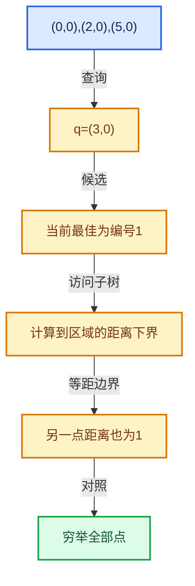

# 12-02 KDTreeNew节点布局

[方向导航](README.md) · [总目录](../README.md) · [实现索引](../00-课程指南/02-源码与提交索引/符号依赖与实现索引.md)

## 从问题到实现

树节点怎样在空间和查询之间取舍？

内部节点和叶节点保存不同信息；借用坐标避免复制但要求原数组存活且使用期间不变。

**数据模型**

节点通过联合表示内部划分或叶范围，坐标通常由外部Span提供。

**设计取舍**

借用避免复制，原数组改变会破坏构建时空间界限。

**最小反例**

构建后移动或扩容坐标Vector，再使用旧树。

**推导**

保证坐标地址与内容在树使用期间不变，修改后重建。

## 阅读地图与执行推演




图中的数值推演是本方向的教学模型；实际函数之间的调用边与概念分析边分别标注，不能把概念关系当作运行时调度顺序。

## 完整源码单元与就地讲解

中文讲解直接放在相关代码旁，复杂机制在代码下展开。原文折叠区保留基准行号；不需要在行号表和函数之间来回查找。类布局可分段展示，函数实现不按固定行数切开。

### 类型布局、声明与编译条件 · BLI_kdtree_new.hh L1—L291

<a id="t-6b4fb89f4be1"></a>

`Node`在这里声明的数据成员：

- `Node children`
- `int dim`

<a id="t-7589bd4ce082"></a>

`KDTreeNew`在这里声明的数据成员：

- `int dimensions`
- `int LEAF_SIZE_DEFAULT`
- `T points_`：保存外部坐标入口；树节点拥有关系不延长该坐标数组寿命。
- `int tree_indices_`：保存树内间接索引，结果身份仍需对应原坐标数组。
- `Bounds<T> bounds_`
- `Node root_`：提交构建得到的根节点入口。
- `void owned_buffer_`
- `int size_`
- `LinearAllocator<> make_allocator`
- `int size`
- `bool is_empty`
- `T points`
- `Span<int> tree_indices`
- `int find_nearest`
- `int find_nearest_n`
- `int find_in_radius`
- `int count_in_radius`
- `void build`

<a id="t-6fe268e7547d"></a>

`Nearest`在这里声明的数据成员：

- `int index`
- `value_type distance_sq`

<a id="t-eceec7bc35b6"></a>

`NearestQuery`在这里声明的数据成员：

- `int index_`
- `ValueT distance_sq_`
- `bool inclusive`

<!-- annotated:afe079de9ccc06 -->

```cpp
/* SPDX-FileCopyrightText: 2008-2009 Marius Muja, David G. Lowe.
 * SPDX-FileCopyrightText: 2011-2026 Jose Luis Blanco-Claraco.
 * SPDX-FileCopyrightText: 2026 Blender Authors.
 *
 * SPDX-License-Identifier: BSD-2-Clause */

#pragma once

#include <algorithm>
#include <concepts>
#include <limits>

#include "BLI_bounds_types.hh"
#include "BLI_index_mask_fwd.hh"
#include "BLI_linear_allocator.hh"
#include "BLI_math_vector.hh"
#include "BLI_span.hh"
#include "BLI_utility_mixins.hh"
#include "BLI_vector.hh"

namespace blender {

namespace kdtree {

/** A node of a #KDTreeNew. */
template<typename ValueT> struct Node {
  /**
   * Two children, allocated next to each other for better cache utilization. Null for a leaf node.
   */
  Node *children;
  union {
    /** Leaf: the range of the tree's indices the node covers in #KDTreeNew::indices_. */
    struct {
      int start;
      int end;
    } leaf;
    /**
     * Interior: the highest coordinate of the left child and the lowest of the right one, in
     * #dim. Points do not exist in the gap in between, which lets a search skip that gap.
     */
    struct {
      ValueT low;
      ValueT high;
    } split;
  };
  /** Dimension an interior node splits. */
  int dim;
};

/** A callable usable as the predicate for #KDTreeNew::find_nearest_filtered. */
template<typename Filter>
concept FilterFn = std::predicate<Filter, int>;

/**
 * A type usable as the \a Query for #KDTreeNew::search, responsible for storing results and
 * telling the search when to continue. See #NearestResult and the others beside it.
 */
template<typename Query, typename ValueT>
concept QueryType = requires(Query &query, const ValueT distance_sq, const int index) {
  {
    /** Tells the search whether points exactly #max_distance_sq away should be processed. */
    Query::inclusive
  } -> std::convertible_to<bool>;
  {
    /** Optionally store a result index and tell the search when to continue. */
    query.add_point(distance_sq, index)
  } -> std::convertible_to<bool>;
  {
    /** Return the distance below which the search will stop. */
    query.max_distance_sq()
  } -> std::convertible_to<ValueT>;
};

}  // namespace kdtree

/**
 * A KD-tree for nearest neighbor search. References a subset of values in a #Span. Results are
 * indices into that span, so data attached to the points can be referenced sparsely with this
 * level of indirection.
 *
 * Differences from #blender::KDTree in `BLI_kdtree.hh`:
 * - The tree references the caller's coordinate array instead of storing a copy of it. The array
 *   must stay alive and unchanged for as long as the tree is used.
 * - Points are added when the tree is built, there is no separate insert and balance step.
 * - Distances are squared, since that's what the searches compute anyway.
 * - Results don't include coordinates which are instead found in #points with the returned index.
 * - Performance and memory usage are much better.
 */
template<typename T> class KDTreeNew : NonMovable, NonCopyable {
 public:
  using value_type = typename T::base_type;
  static constexpr int dimensions = T::type_length;

  /** A single search result. */
  struct Nearest {
    /** Index of the point in #points. */
    int index;
    /** Squared distance between the point and the search position. */
    value_type distance_sq;
  };

  /**
   * Indices in a leaf node are searched linearly. Larger values build faster and use less memory
   * whereas smaller values make queries visit fewer points.
   *
   * 32 was measured to be the best tradeoff between build time and memory usage for float3 point
   * clouds, building 1.3-2x faster than a leaf size of 10 and halving the memory the nodes use
   * (6.5 MB vs. 12.6 MB for a million points). See `BLI_kdtree_performance_test`.
   */
  static constexpr int LEAF_SIZE_DEFAULT = 32;

 private:
  using Node = kdtree::Node<value_type>;

  /**
   * The coordinates the tree was built from, which outlive it. Only the pointer is kept: the
   * tree never looks past the indices it built, and #build checks in a debug build that they are
   * all in range.
   */
  const T *points_ = nullptr;
  /**
   * Indices into #points_, in the order the tree visits them. Written by the build, read by
   * every search afterwards, and owned by whichever allocator the build used.
   */
  const int *tree_indices_ = nullptr;
  /** Bounds of every point in the tree, which a search starts from. */
  Bounds<T> bounds_ = Bounds<T>(T(0));
  Node *root_ = nullptr;
  /**
   * The buffer the allocator the tree made for itself lives at the start of, which is all the
   * destructor needs to give both back. Null when the caller passed an allocator, which the tree
   * only borrows and does not free. Nothing else is kept: the leaf size and the allocator are
   * only needed while building.
   */
  void *owned_buffer_ = nullptr;
  int size_ = 0;

  /**
   * Allocate a buffer, construct a #LinearAllocator at the start of it and give it the rest,
   * sized so that the indices and the first nodes of a tree over \a points_num points fit. The
   * buffer is reported through \a r_owned so that the destructor can give it back.
   */
  static LinearAllocator<> &make_allocator(int points_num, int leaf_size, void *&r_owned);

 public:
  /**
   * Build a tree containing every point in \a points.
   * \note \a points must outlive the tree.
   */
  explicit KDTreeNew(Span<T> points, int leaf_size = LEAF_SIZE_DEFAULT);

  /**
   * Build a tree containing the points selected by \a mask. Results are still indices into
   * \a points rather than positions in the mask.
   * \note \a points must outlive the tree, \a mask does not have to.
   */
  KDTreeNew(Span<T> points, const IndexMask &mask, int leaf_size = LEAF_SIZE_DEFAULT);

  /**
   * Build a tree containing the points at \a indices. Results are indices into \a points, not
   * positions in \a indices.
   * \note \a points must outlive the tree, \a indices does not have to.
   */
  KDTreeNew(Span<T> points, Span<int> indices, int leaf_size = LEAF_SIZE_DEFAULT);

  /**
   * The same constructors reusing an existing #LinearAllocator rather. This can be used to avoid
   * heap allocations when building a tree for a small number of points.
   * \note \a allocator must outlive the tree.
   */
  KDTreeNew(Span<T> points, LinearAllocator<> &allocator, int leaf_size = LEAF_SIZE_DEFAULT);
  KDTreeNew(Span<T> points,
            const IndexMask &mask,
            LinearAllocator<> &allocator,
            int leaf_size = LEAF_SIZE_DEFAULT);
  KDTreeNew(Span<T> points,
            Span<int> indices,
            LinearAllocator<> &allocator,
            int leaf_size = LEAF_SIZE_DEFAULT);

  ~KDTreeNew();

  /** The number of points, which may be less than the size of #points for a masked tree. */
  int size() const;

  bool is_empty() const;

  /**
   * The coordinates the tree was built from, which every index it returns refers to. Only the
   * start of the array is known, since the tree may cover a subset of it.
   */
  const T *points() const;

  /**
   * The indices of the points in the tree, in the order it stores them. Points close together in
   * space are closer in this order, which can utilized for more optimal cache usage.
   *
   * \note The order is deterministic, but it follows from the coordinates and from how the tree
   * is built. It changes when unrelated points move and when the build is tuned, so results that
   * have to stay the same as geometry is edited or animated should not depend on it.
   */
  Span<int> tree_indices() const;

  /**
   * Find the point closest to \a position.
   * \return Its index, or -1 if the tree is empty.
   */
  int find_nearest(const T &position, value_type *r_distance_sq = nullptr) const;

  /**
   * Find the point closest to \a position for which \a filter returns true. Useful to skip the
   * search position itself when finding the neighbors of points that are in the tree.
   *
   * \note \a filter is called for candidate points in an unspecified order.
   *
   * \return The index of the closest accepted point, or -1 if there is none.
   */
  template<typename Filter>
  int find_nearest_filtered(const T &position,
                            Filter &&filter,
                            value_type *r_distance_sq = nullptr) const
    requires kdtree::FilterFn<Filter>;

  /**
   * Find the closest points to \a position, in order of increasing distance.
   * \param r_nearest: Filled with at most `r_nearest.size()` results.
   * \return The number of results written, which is smaller when the tree has fewer points.
   */
  int find_nearest_n(const T &position, MutableSpan<Nearest> r_nearest) const;

  /** Call \a fn for every point within \a radius of \a position, in an unspecified order. */
  template<typename Fn>
  void foreach_in_radius(const T &position, const value_type radius, Fn &&fn) const;

  /**
   * Find every point within \a radius of \a position.
   * \param r_nearest: Cleared, then filled with the results in order of increasing distance.
   * Passing in the same vector for many searches avoids reallocating it every time.
   * \return The number of results.
   */
  int find_in_radius(const T &position, const value_type radius, Vector<Nearest> &r_nearest) const;

  /** The number of points within \a radius of \a position. */
  int count_in_radius(const T &position, const value_type radius) const;

  /**
   * Visit the points that could be closer to \a position than the query has accepted so
   * far, reporting each of them to it. The query decides what to keep and how far the
   * search still has to look. See #NearestResult and the others beside it.
   */
  template<typename Query>
  void search(Query &query, const T &position) const
    requires kdtree::QueryType<Query, value_type>;

 private:
  /**
   * Build the tree, optionally with a subset of indices. Defined in the implementation file to
   * avoid transitive includes of heavier headers.
   */
  void build(Span<T> points,
             Span<int> indices,
             const IndexMask *mask,
             int size,
             int leaf_size,
             LinearAllocator<> &allocator);

  /**
   * \param distance_sq: Squared distance from \a position to the space covered by \a node.
   * \param offsets: Squared distance to the node per dimension.
   * \return False when the query has seen enough and the search should stop.
   */
  template<typename Query>
  bool search_node(Query &query,
                   const T &position,
                   const Node *node,
                   const value_type distance_sq,
                   T &offsets) const
    requires kdtree::QueryType<Query, value_type>;
};

namespace kdtree {

/** A search for the single closest point. */
template<typename ValueT> class NearestQuery {
 private:
  int index_ = -1;
  ValueT distance_sq_ = std::numeric_limits<ValueT>::max();

 public:
  static constexpr bool inclusive = false;

```

<details>
<summary>核对原始源码：source/blender/blenlib/BLI_kdtree_new.hh · L1—L291</summary>

<!-- original:afe079de9ccc06:source/blender/blenlib/BLI_kdtree_new.hh:1:291 -->

```cpp
/* SPDX-FileCopyrightText: 2008-2009 Marius Muja, David G. Lowe.
 * SPDX-FileCopyrightText: 2011-2026 Jose Luis Blanco-Claraco.
 * SPDX-FileCopyrightText: 2026 Blender Authors.
 *
 * SPDX-License-Identifier: BSD-2-Clause */

#pragma once

#include <algorithm>
#include <concepts>
#include <limits>

#include "BLI_bounds_types.hh"
#include "BLI_index_mask_fwd.hh"
#include "BLI_linear_allocator.hh"
#include "BLI_math_vector.hh"
#include "BLI_span.hh"
#include "BLI_utility_mixins.hh"
#include "BLI_vector.hh"

namespace blender {

namespace kdtree {

/** A node of a #KDTreeNew. */
template<typename ValueT> struct Node {
  /**
   * Two children, allocated next to each other for better cache utilization. Null for a leaf node.
   */
  Node *children;
  union {
    /** Leaf: the range of the tree's indices the node covers in #KDTreeNew::indices_. */
    struct {
      int start;
      int end;
    } leaf;
    /**
     * Interior: the highest coordinate of the left child and the lowest of the right one, in
     * #dim. Points do not exist in the gap in between, which lets a search skip that gap.
     */
    struct {
      ValueT low;
      ValueT high;
    } split;
  };
  /** Dimension an interior node splits. */
  int dim;
};

/** A callable usable as the predicate for #KDTreeNew::find_nearest_filtered. */
template<typename Filter>
concept FilterFn = std::predicate<Filter, int>;

/**
 * A type usable as the \a Query for #KDTreeNew::search, responsible for storing results and
 * telling the search when to continue. See #NearestResult and the others beside it.
 */
template<typename Query, typename ValueT>
concept QueryType = requires(Query &query, const ValueT distance_sq, const int index) {
  {
    /** Tells the search whether points exactly #max_distance_sq away should be processed. */
    Query::inclusive
  } -> std::convertible_to<bool>;
  {
    /** Optionally store a result index and tell the search when to continue. */
    query.add_point(distance_sq, index)
  } -> std::convertible_to<bool>;
  {
    /** Return the distance below which the search will stop. */
    query.max_distance_sq()
  } -> std::convertible_to<ValueT>;
};

}  // namespace kdtree

/**
 * A KD-tree for nearest neighbor search. References a subset of values in a #Span. Results are
 * indices into that span, so data attached to the points can be referenced sparsely with this
 * level of indirection.
 *
 * Differences from #blender::KDTree in `BLI_kdtree.hh`:
 * - The tree references the caller's coordinate array instead of storing a copy of it. The array
 *   must stay alive and unchanged for as long as the tree is used.
 * - Points are added when the tree is built, there is no separate insert and balance step.
 * - Distances are squared, since that's what the searches compute anyway.
 * - Results don't include coordinates which are instead found in #points with the returned index.
 * - Performance and memory usage are much better.
 */
template<typename T> class KDTreeNew : NonMovable, NonCopyable {
 public:
  using value_type = typename T::base_type;
  static constexpr int dimensions = T::type_length;

  /** A single search result. */
  struct Nearest {
    /** Index of the point in #points. */
    int index;
    /** Squared distance between the point and the search position. */
    value_type distance_sq;
  };

  /**
   * Indices in a leaf node are searched linearly. Larger values build faster and use less memory
   * whereas smaller values make queries visit fewer points.
   *
   * 32 was measured to be the best tradeoff between build time and memory usage for float3 point
   * clouds, building 1.3-2x faster than a leaf size of 10 and halving the memory the nodes use
   * (6.5 MB vs. 12.6 MB for a million points). See `BLI_kdtree_performance_test`.
   */
  static constexpr int LEAF_SIZE_DEFAULT = 32;

 private:
  using Node = kdtree::Node<value_type>;

  /**
   * The coordinates the tree was built from, which outlive it. Only the pointer is kept: the
   * tree never looks past the indices it built, and #build checks in a debug build that they are
   * all in range.
   */
  const T *points_ = nullptr;
  /**
   * Indices into #points_, in the order the tree visits them. Written by the build, read by
   * every search afterwards, and owned by whichever allocator the build used.
   */
  const int *tree_indices_ = nullptr;
  /** Bounds of every point in the tree, which a search starts from. */
  Bounds<T> bounds_ = Bounds<T>(T(0));
  Node *root_ = nullptr;
  /**
   * The buffer the allocator the tree made for itself lives at the start of, which is all the
   * destructor needs to give both back. Null when the caller passed an allocator, which the tree
   * only borrows and does not free. Nothing else is kept: the leaf size and the allocator are
   * only needed while building.
   */
  void *owned_buffer_ = nullptr;
  int size_ = 0;

  /**
   * Allocate a buffer, construct a #LinearAllocator at the start of it and give it the rest,
   * sized so that the indices and the first nodes of a tree over \a points_num points fit. The
   * buffer is reported through \a r_owned so that the destructor can give it back.
   */
  static LinearAllocator<> &make_allocator(int points_num, int leaf_size, void *&r_owned);

 public:
  /**
   * Build a tree containing every point in \a points.
   * \note \a points must outlive the tree.
   */
  explicit KDTreeNew(Span<T> points, int leaf_size = LEAF_SIZE_DEFAULT);

  /**
   * Build a tree containing the points selected by \a mask. Results are still indices into
   * \a points rather than positions in the mask.
   * \note \a points must outlive the tree, \a mask does not have to.
   */
  KDTreeNew(Span<T> points, const IndexMask &mask, int leaf_size = LEAF_SIZE_DEFAULT);

  /**
   * Build a tree containing the points at \a indices. Results are indices into \a points, not
   * positions in \a indices.
   * \note \a points must outlive the tree, \a indices does not have to.
   */
  KDTreeNew(Span<T> points, Span<int> indices, int leaf_size = LEAF_SIZE_DEFAULT);

  /**
   * The same constructors reusing an existing #LinearAllocator rather. This can be used to avoid
   * heap allocations when building a tree for a small number of points.
   * \note \a allocator must outlive the tree.
   */
  KDTreeNew(Span<T> points, LinearAllocator<> &allocator, int leaf_size = LEAF_SIZE_DEFAULT);
  KDTreeNew(Span<T> points,
            const IndexMask &mask,
            LinearAllocator<> &allocator,
            int leaf_size = LEAF_SIZE_DEFAULT);
  KDTreeNew(Span<T> points,
            Span<int> indices,
            LinearAllocator<> &allocator,
            int leaf_size = LEAF_SIZE_DEFAULT);

  ~KDTreeNew();

  /** The number of points, which may be less than the size of #points for a masked tree. */
  int size() const;

  bool is_empty() const;

  /**
   * The coordinates the tree was built from, which every index it returns refers to. Only the
   * start of the array is known, since the tree may cover a subset of it.
   */
  const T *points() const;

  /**
   * The indices of the points in the tree, in the order it stores them. Points close together in
   * space are closer in this order, which can utilized for more optimal cache usage.
   *
   * \note The order is deterministic, but it follows from the coordinates and from how the tree
   * is built. It changes when unrelated points move and when the build is tuned, so results that
   * have to stay the same as geometry is edited or animated should not depend on it.
   */
  Span<int> tree_indices() const;

  /**
   * Find the point closest to \a position.
   * \return Its index, or -1 if the tree is empty.
   */
  int find_nearest(const T &position, value_type *r_distance_sq = nullptr) const;

  /**
   * Find the point closest to \a position for which \a filter returns true. Useful to skip the
   * search position itself when finding the neighbors of points that are in the tree.
   *
   * \note \a filter is called for candidate points in an unspecified order.
   *
   * \return The index of the closest accepted point, or -1 if there is none.
   */
  template<typename Filter>
  int find_nearest_filtered(const T &position,
                            Filter &&filter,
                            value_type *r_distance_sq = nullptr) const
    requires kdtree::FilterFn<Filter>;

  /**
   * Find the closest points to \a position, in order of increasing distance.
   * \param r_nearest: Filled with at most `r_nearest.size()` results.
   * \return The number of results written, which is smaller when the tree has fewer points.
   */
  int find_nearest_n(const T &position, MutableSpan<Nearest> r_nearest) const;

  /** Call \a fn for every point within \a radius of \a position, in an unspecified order. */
  template<typename Fn>
  void foreach_in_radius(const T &position, const value_type radius, Fn &&fn) const;

  /**
   * Find every point within \a radius of \a position.
   * \param r_nearest: Cleared, then filled with the results in order of increasing distance.
   * Passing in the same vector for many searches avoids reallocating it every time.
   * \return The number of results.
   */
  int find_in_radius(const T &position, const value_type radius, Vector<Nearest> &r_nearest) const;

  /** The number of points within \a radius of \a position. */
  int count_in_radius(const T &position, const value_type radius) const;

  /**
   * Visit the points that could be closer to \a position than the query has accepted so
   * far, reporting each of them to it. The query decides what to keep and how far the
   * search still has to look. See #NearestResult and the others beside it.
   */
  template<typename Query>
  void search(Query &query, const T &position) const
    requires kdtree::QueryType<Query, value_type>;

 private:
  /**
   * Build the tree, optionally with a subset of indices. Defined in the implementation file to
   * avoid transitive includes of heavier headers.
   */
  void build(Span<T> points,
             Span<int> indices,
             const IndexMask *mask,
             int size,
             int leaf_size,
             LinearAllocator<> &allocator);

  /**
   * \param distance_sq: Squared distance from \a position to the space covered by \a node.
   * \param offsets: Squared distance to the node per dimension.
   * \return False when the query has seen enough and the search should stop.
   */
  template<typename Query>
  bool search_node(Query &query,
                   const T &position,
                   const Node *node,
                   const value_type distance_sq,
                   T &offsets) const
    requires kdtree::QueryType<Query, value_type>;
};

namespace kdtree {

/** A search for the single closest point. */
template<typename ValueT> class NearestQuery {
 private:
  int index_ = -1;
  ValueT distance_sq_ = std::numeric_limits<ValueT>::max();

 public:
  static constexpr bool inclusive = false;

```

</details>

## 语法与相关类型

### 模板 template

模板把类型或常量作为生成实现的参数。读声明时先列出类型参数、非类型参数和默认值，再看使用者实际实例化了什么。模板声明本身不意味着每种T都支持其全部成员。

把T替换为int、string、只能移动的类型，分别检查每个被调用操作是否成立。

### 依赖名称 typename

typename既可引入类型模板参数，也可告诉编译器某个依赖名称是类型。它不创建运行时对象；解析期确认语法类别与实例化期检查具体类型是不同阶段。

区分typename T::value_type和T::size()，前者标记类型，后者是表达式。

### 约束 requires

requires表达式或requires子句限制模板参与重载的条件。它提供编译期可用性检查，不是运行时if，不能指望输入到达程序后再被这一机制验证。

构造满足和不满足约束的两个类型，观察候选被排除而不是在函数内返回错误。

### 常量求值 constexpr

constexpr声明允许相应实体参与常量求值，但constexpr函数仍可以在运行时执行。是否常量求值由调用场景和表达式合法性共同决定。

比较constexpr变量初始化和从运行时输入调用同一函数。

### 只读限定 const

const约束当前访问路径可做的修改。const指针、指向const的指针、const视图对象、const元素是不同位置的限定；其他别名可能仍可修改原对象。

分别写T* const、const T*与const T* const，并画出不可修改的层次。

### 异常边界 try与catch

try定义异常传播的局部边界。失败路径需要销毁已经成功构造的部分并释放相应存储；未构造的对象不能被析构。

在第k次构造失败，列出已经存在的对象集合与待释放缓冲。

### 联合体 union

联合体成员共享存储，需要由活动成员约定决定合法读取方式。结合enum或其他判别信息阅读，不能把所有成员都当作同时存在。

检查叶节点与内部节点分别使用哪些联合成员。

### 类型别名 using

类型别名为已有类型建立名字，不创建运行期对象。它常把模板内部使用的类型统一暴露给泛型调用者。

展开别名直到基础类型，区分类型别名和变量声明。

## 实现练习与验证

画出坐标数组、索引数组和节点之间的引用。

参考推理：保证坐标地址与内容在树使用期间不变，修改后重建。

返回点属于允许子集；距离不大于任何合法候选；等距按集合或距离验证，不能强制任意固定编号。

## 历史、跨库比较与证据

与nanoflann比较查询模型与来源，与BVH比较划分对象和原语，与暴力搜索比较构建成本是否值得；Blender实现有独立修改和借用契约。

[历史提交索引](../00-课程指南/02-源码与提交索引/历史提交与设计演化索引.md) · [源码基准](../00-课程指南/02-源码与提交索引/源码版本与覆盖索引.md) · [验收报告](../00-课程指南/03-验收报告/验收报告.md)
