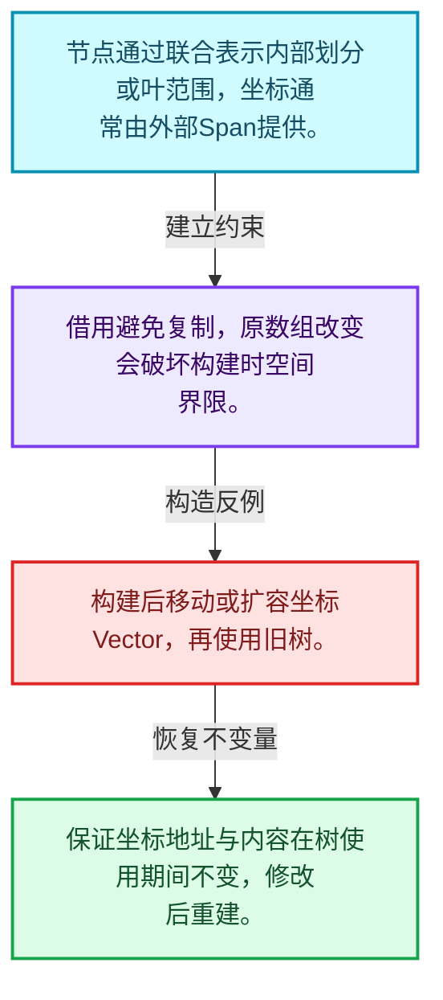
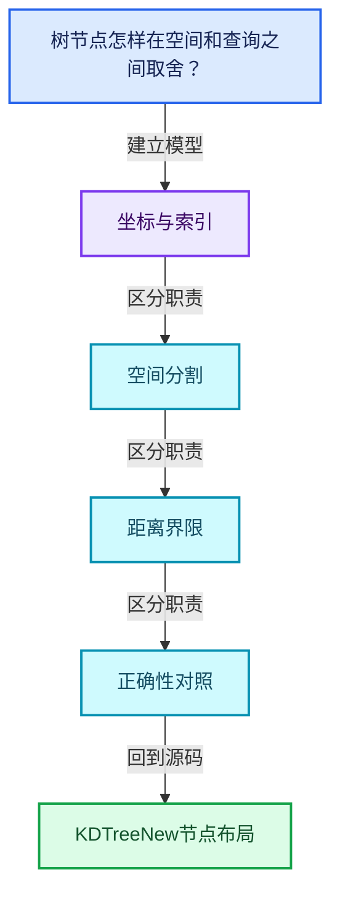
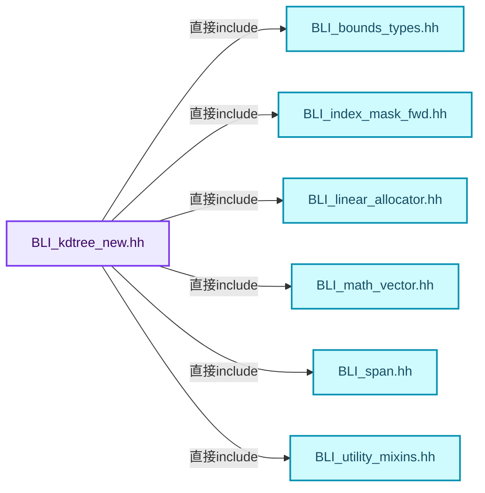
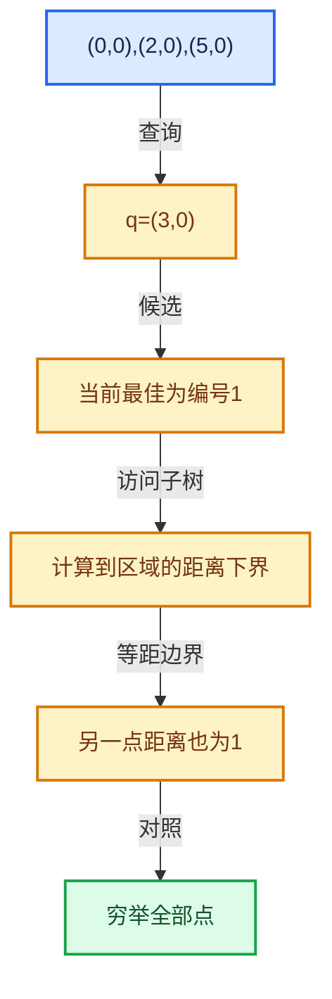

# 12-02 KDTreeNew节点布局

[方向导航](README.md) · [总目录](../README.md) · [覆盖索引](../%E6%BA%90%E7%A0%81%E7%89%88%E6%9C%AC%E4%B8%8E%E8%A6%86%E7%9B%96%E7%B4%A2%E5%BC%95.md)

> 阅读顺序：问题与数据模型 → 语法与类型 → 源码逐行 → 调用线索 → 历史与取舍 → 推演和练习。

- 基准 HEAD：`cbda6b96c26c0dee3c3b5cbb93960c4ac06a6b30`。
- 记录日期：2026-10-14。
- 教学示例状态：正文中的推演不是本机性能实测；已运行练习见验收报告。

## 一、从问题到设计

树节点怎样在空间和查询之间取舍？

内部节点和叶节点保存不同信息；借用坐标避免复制但要求原数组存活且使用期间不变。

本篇把语法、数据语义和系统取舍连接起来。先证明距离下界与返回身份，再讨论布局优化和并行构建。

### 本篇独立模型与设计推理

节点通过联合表示内部划分或叶范围，坐标通常由外部Span提供。

设计取舍：借用避免复制，原数组改变会破坏构建时空间界限。

最小反例：构建后移动或扩容坐标Vector，再使用旧树。

推导与处理：保证坐标地址与内容在树使用期间不变，修改后重建。



### 源码范围与相邻篇章

| 文件 | 本篇逐行范围 | 基准SHA-256 |
|---|---|---|
| [source/blender/blenlib/BLI_kdtree_new.hh](../../../../../source/blender/blenlib/BLI_kdtree_new.hh) | L1—L136 | `b94b92497ea97b794042524c44573cd3d88d01c1fc9aa86c60a8940f6be04159` |

同一主讲文件可能分多篇覆盖；超出本篇范围的符号通过覆盖索引定位。空行与纯注释保留在源码摘录中，逐行表解释有效语句与语法边界；许可证头统一保留。

前篇：[空间查询与暴力基准](01-%E7%A9%BA%E9%97%B4%E6%9F%A5%E8%AF%A2%E4%B8%8E%E6%9A%B4%E5%8A%9B%E5%9F%BA%E5%87%86.md).

后篇：[KDTreeNew构建](03-KDTreeNew%E6%9E%84%E5%BB%BA.md).

## 二、类型、数据与阅读地图



这是概念依赖图，边表示阅读关系，不声称是运行时调用顺序。

### 直接编译依赖



箭头只表示头文件包含关系；完整调用线索见后面的符号定位表。

## 三、关键词、语法与类型角色

### 模板 template

模板把类型或常量作为生成实现的参数。读声明时先列出类型参数、非类型参数和默认值，再看使用者实际实例化了什么。模板声明本身不意味着每种T都支持其全部成员。

具体检查：把T替换为int、string、只能移动的类型，分别检查每个被调用操作是否成立。

### 依赖名称 typename

typename既可引入类型模板参数，也可告诉编译器某个依赖名称是类型。它不创建运行时对象；解析期确认语法类别与实例化期检查具体类型是不同阶段。

具体检查：区分typename T::value_type和T::size()，前者标记类型，后者是表达式。

### 约束 requires

requires表达式或requires子句限制模板参与重载的条件。它提供编译期可用性检查，不是运行时if，不能指望输入到达程序后再被这一机制验证。

具体检查：构造满足和不满足约束的两个类型，观察候选被排除而不是在函数内返回错误。

### 常量求值 constexpr

constexpr声明允许相应实体参与常量求值，但constexpr函数仍可以在运行时执行。是否常量求值由调用场景和表达式合法性共同决定。

具体检查：比较constexpr变量初始化和从运行时输入调用同一函数。

### 只读限定 const

const约束当前访问路径可做的修改。const指针、指向const的指针、const视图对象、const元素是不同位置的限定；其他别名可能仍可修改原对象。

具体检查：分别写T* const、const T*与const T* const，并画出不可修改的层次。

### 联合体 union

联合体成员共享存储，需要由活动成员约定决定合法读取方式。结合enum或其他判别信息阅读，不能把所有成员都当作同时存在。

具体检查：检查叶节点与内部节点分别使用哪些联合成员。

### 类型别名 using

类型别名为已有类型建立名字，不创建运行期对象。它常把模板内部使用的类型统一暴露给泛型调用者。

具体检查：展开别名直到基础类型，区分类型别名和变量声明。

## 四、真实源码与逐行讲解

源码块保持原行内容，原始行号由小节标题及逐行表给出。表中的调用定位是静态阅读辅助；重载、模板实例化、宏展开和虚调用需结合完整声明，不能仅凭词法出现证明动态调用。

### BLI_kdtree_new.hh：L1—L48

<!-- source:source/blender/blenlib/BLI_kdtree_new.hh:1:48 -->

```cpp
/* SPDX-FileCopyrightText: 2008-2009 Marius Muja, David G. Lowe.
 * SPDX-FileCopyrightText: 2011-2026 Jose Luis Blanco-Claraco.
 * SPDX-FileCopyrightText: 2026 Blender Authors.
 *
 * SPDX-License-Identifier: BSD-2-Clause */

#pragma once

#include <algorithm>
#include <concepts>
#include <limits>

#include "BLI_bounds_types.hh"
#include "BLI_index_mask_fwd.hh"
#include "BLI_linear_allocator.hh"
#include "BLI_math_vector.hh"
#include "BLI_span.hh"
#include "BLI_utility_mixins.hh"
#include "BLI_vector.hh"

namespace blender {

namespace kdtree {

/** A node of a #KDTreeNew. */
template<typename ValueT> struct Node {
  /**
   * Two children, allocated next to each other for better cache utilization. Null for a leaf node.
   */
  Node *children;
  union {
    /** Leaf: the range of the tree's indices the node covers in #KDTreeNew::indices_. */
    struct {
      int start;
      int end;
    } leaf;
    /**
     * Interior: the highest coordinate of the left child and the lowest of the right one, in
     * #dim. Points do not exist in the gap in between, which lets a search skip that gap.
     */
    struct {
      ValueT low;
      ValueT high;
    } split;
  };
  /** Dimension an interior node splits. */
  int dim;
};
```

本段语义重点：

- `children`：子节点入口，叶节点与内部节点按判别信息采用不同解释。

| 原始行 | 语义、约束与检查 |
|---|---|
| L7 | 防止同一头文件在一个翻译单元中重复展开；不控制多个源文件之间的链接或对象寿命。 |
| L9 | 引入编译依赖 <algorithm>；这是声明可见性关系，不表示运行时一定调用该文件的所有接口。 |
| L10 | 引入编译依赖 <concepts>；这是声明可见性关系，不表示运行时一定调用该文件的所有接口。 |
| L11 | 引入编译依赖 <limits>；这是声明可见性关系，不表示运行时一定调用该文件的所有接口。 |
| L13 | 引入编译依赖 "BLI_bounds_types.hh"；这是声明可见性关系，不表示运行时一定调用该文件的所有接口。 |
| L14 | 引入编译依赖 "BLI_index_mask_fwd.hh"；这是声明可见性关系，不表示运行时一定调用该文件的所有接口。 |
| L15 | 引入编译依赖 "BLI_linear_allocator.hh"；这是声明可见性关系，不表示运行时一定调用该文件的所有接口。 |
| L16 | 引入编译依赖 "BLI_math_vector.hh"；这是声明可见性关系，不表示运行时一定调用该文件的所有接口。 |
| L17 | 引入编译依赖 "BLI_span.hh"；这是声明可见性关系，不表示运行时一定调用该文件的所有接口。 |
| L18 | 引入编译依赖 "BLI_utility_mixins.hh"；这是声明可见性关系，不表示运行时一定调用该文件的所有接口。 |
| L19 | 引入编译依赖 "BLI_vector.hh"；这是声明可见性关系，不表示运行时一定调用该文件的所有接口。 |
| L21 | 把后续声明放入 blender 命名空间，影响名称查找和符号归属，不创建运行时对象。 |
| L23 | 把后续声明放入 kdtree 命名空间，影响名称查找和符号归属，不创建运行时对象。 |
| L26 | 声明模板参数 `template<typename ValueT> struct Node {`。类型参数决定生成操作的类型，非类型参数可决定内嵌容量或编译期分支。 |
| L30 | 本行涉及 `children`：子节点入口，叶节点与内部节点按判别信息采用不同解释。按此语义解读 `Node *children`，不要把地址、数量或状态混用。 |
| L31 | 声明或定义类型 `union`。结合继承、访问权限和成员布局确认接口与拥有关系；前向声明本身没有完整对象布局。 |
| L33 | 声明或定义类型 `struct`。结合继承、访问权限和成员布局确认接口与拥有关系；前向声明本身没有完整对象布局。 |
| L34 | 声明成员、局部对象或完成语句 `int start`。若为指针或引用，它本身不说明拥有；若为值对象，其构造析构由所在作用域或外层对象管理。 |
| L35 | 声明成员、局部对象或完成语句 `int end`。若为指针或引用，它本身不说明拥有；若为值对象，其构造析构由所在作用域或外层对象管理。 |
| L36 | 声明成员、局部对象或完成语句 `} leaf`。若为指针或引用，它本身不说明拥有；若为值对象，其构造析构由所在作用域或外层对象管理。 |
| L41 | 声明或定义类型 `struct`。结合继承、访问权限和成员布局确认接口与拥有关系；前向声明本身没有完整对象布局。 |
| L42 | 声明成员、局部对象或完成语句 `ValueT low`。若为指针或引用，它本身不说明拥有；若为值对象，其构造析构由所在作用域或外层对象管理。 |
| L43 | 声明成员、局部对象或完成语句 `ValueT high`。若为指针或引用，它本身不说明拥有；若为值对象，其构造析构由所在作用域或外层对象管理。 |
| L44 | 声明成员、局部对象或完成语句 `} split`。若为指针或引用，它本身不说明拥有；若为值对象，其构造析构由所在作用域或外层对象管理。 |
| L45 | 结束当前语法单元。局部自动对象在离开其作用域时按规则销毁；这不等于所有被引用的外部数据也被释放。 |
| L47 | 声明成员、局部对象或完成语句 `int dim`。若为指针或引用，它本身不说明拥有；若为值对象，其构造析构由所在作用域或外层对象管理。 |
| L48 | 结束当前语法单元。局部自动对象在离开其作用域时按规则销毁；这不等于所有被引用的外部数据也被释放。 |

### BLI_kdtree_new.hh：L49—L97

<!-- source:source/blender/blenlib/BLI_kdtree_new.hh:49:97 -->

```cpp

/** A callable usable as the predicate for #KDTreeNew::find_nearest_filtered. */
template<typename Filter>
concept FilterFn = std::predicate<Filter, int>;

/**
 * A type usable as the \a Query for #KDTreeNew::search, responsible for storing results and
 * telling the search when to continue. See #NearestResult and the others beside it.
 */
template<typename Query, typename ValueT>
concept QueryType = requires(Query &query, const ValueT distance_sq, const int index) {
  {
    /** Tells the search whether points exactly #max_distance_sq away should be processed. */
    Query::inclusive
  } -> std::convertible_to<bool>;
  {
    /** Optionally store a result index and tell the search when to continue. */
    query.add_point(distance_sq, index)
  } -> std::convertible_to<bool>;
  {
    /** Return the distance below which the search will stop. */
    query.max_distance_sq()
  } -> std::convertible_to<ValueT>;
};

}  // namespace kdtree

/**
 * A KD-tree for nearest neighbor search. References a subset of values in a #Span. Results are
 * indices into that span, so data attached to the points can be referenced sparsely with this
 * level of indirection.
 *
 * Differences from #blender::KDTree in `BLI_kdtree.hh`:
 * - The tree references the caller's coordinate array instead of storing a copy of it. The array
 *   must stay alive and unchanged for as long as the tree is used.
 * - Points are added when the tree is built, there is no separate insert and balance step.
 * - Distances are squared, since that's what the searches compute anyway.
 * - Results don't include coordinates which are instead found in #points with the returned index.
 * - Performance and memory usage are much better.
 */
template<typename T> class KDTreeNew : NonMovable, NonCopyable {
 public:
  using value_type = typename T::base_type;
  static constexpr int dimensions = T::type_length;

  /** A single search result. */
  struct Nearest {
    /** Index of the point in #points. */
    int index;
```

本段语义重点：

- `distance_sq`：平方距离，可避免开方，但阈值也必须使用一致单位。
- `max_distance_sq`：当前允许或最优平方距离上界，影响剪枝是否正确。

| 原始行 | 语义、约束与检查 |
|---|---|
| L51 | 声明模板参数 `template<typename Filter>`。类型参数决定生成操作的类型，非类型参数可决定内嵌容量或编译期分支。 |
| L52 | 把右侧 `std::predicate<Filter, int>` 用于初始化或更新左侧 `concept FilterFn`。声明初始化与已有对象赋值应按上下文区分；有资源的类型会调用相应特殊成员。 |
| L58 | 声明模板参数 `template<typename Query, typename ValueT>`。类型参数决定生成操作的类型，非类型参数可决定内嵌容量或编译期分支。 |
| L59 | 约束模板可用性：`concept QueryType = requires(Query &query, const ValueT distance_sq, const int index) {`。条件在编译期检查，不替代运行期的地址、长度和类型一致性验证。 |
| L60 | 连接上一行的声明或控制结构与其语句块；后续行在这个作用域中执行或声明。 |
| L62 | 本行是连续声明或表达式的一部分：`Query::inclusive`。与本段前后行合读；逗号、括号和限定符决定它属于参数、初始化列表还是实际计算。 |
| L63 | 声明成员、局部对象或完成语句 `} -> std::convertible_to<bool>`。若为指针或引用，它本身不说明拥有；若为值对象，其构造析构由所在作用域或外层对象管理。 |
| L64 | 连接上一行的声明或控制结构与其语句块；后续行在这个作用域中执行或声明。 |
| L66 | 本行涉及 `distance_sq`：平方距离，可避免开方，但阈值也必须使用一致单位。按此语义解读 `query.add_point(distance_sq, index)`，不要把地址、数量或状态混用。 |
| L67 | 声明成员、局部对象或完成语句 `} -> std::convertible_to<bool>`。若为指针或引用，它本身不说明拥有；若为值对象，其构造析构由所在作用域或外层对象管理。 |
| L68 | 连接上一行的声明或控制结构与其语句块；后续行在这个作用域中执行或声明。 |
| L70 | 本行涉及 `max_distance_sq`：当前允许或最优平方距离上界，影响剪枝是否正确。按此语义解读 `query.max_distance_sq()`，不要把地址、数量或状态混用。 |
| L71 | 声明成员、局部对象或完成语句 `} -> std::convertible_to<ValueT>`。若为指针或引用，它本身不说明拥有；若为值对象，其构造析构由所在作用域或外层对象管理。 |
| L72 | 结束当前语法单元。局部自动对象在离开其作用域时按规则销毁；这不等于所有被引用的外部数据也被释放。 |
| L74 | 结束当前语法单元。局部自动对象在离开其作用域时按规则销毁；这不等于所有被引用的外部数据也被释放。 |
| L89 | 声明模板参数 `template<typename T> class KDTreeNew : NonMovable, NonCopyable {`。类型参数决定生成操作的类型，非类型参数可决定内嵌容量或编译期分支。 |
| L90 | 切换成员访问权限为 public；它是编译期接口边界，不是线程同步或内存保护。 |
| L91 | 定义类型别名 `using value_type = typename T::base_type`，为模板接口或内部实现统一命名；本行不分配该类型对象。 |
| L92 | 把右侧 `T::type_length` 用于初始化或更新左侧 `static constexpr int dimensions`。声明初始化与已有对象赋值应按上下文区分；有资源的类型会调用相应特殊成员。 |
| L95 | 声明或定义类型 `struct Nearest`。结合继承、访问权限和成员布局确认接口与拥有关系；前向声明本身没有完整对象布局。 |
| L97 | 声明成员、局部对象或完成语句 `int index`。若为指针或引用，它本身不说明拥有；若为值对象，其构造析构由所在作用域或外层对象管理。 |

### BLI_kdtree_new.hh：L98—L136

<!-- source:source/blender/blenlib/BLI_kdtree_new.hh:98:136 -->

```cpp
    /** Squared distance between the point and the search position. */
    value_type distance_sq;
  };

  /**
   * Indices in a leaf node are searched linearly. Larger values build faster and use less memory
   * whereas smaller values make queries visit fewer points.
   *
   * 32 was measured to be the best tradeoff between build time and memory usage for float3 point
   * clouds, building 1.3-2x faster than a leaf size of 10 and halving the memory the nodes use
   * (6.5 MB vs. 12.6 MB for a million points). See `BLI_kdtree_performance_test`.
   */
  static constexpr int LEAF_SIZE_DEFAULT = 32;

 private:
  using Node = kdtree::Node<value_type>;

  /**
   * The coordinates the tree was built from, which outlive it. Only the pointer is kept: the
   * tree never looks past the indices it built, and #build checks in a debug build that they are
   * all in range.
   */
  const T *points_ = nullptr;
  /**
   * Indices into #points_, in the order the tree visits them. Written by the build, read by
   * every search afterwards, and owned by whichever allocator the build used.
   */
  const int *tree_indices_ = nullptr;
  /** Bounds of every point in the tree, which a search starts from. */
  Bounds<T> bounds_ = Bounds<T>(T(0));
  Node *root_ = nullptr;
  /**
   * The buffer the allocator the tree made for itself lives at the start of, which is all the
   * destructor needs to give both back. Null when the caller passed an allocator, which the tree
   * only borrows and does not free. Nothing else is kept: the leaf size and the allocator are
   * only needed while building.
   */
  void *owned_buffer_ = nullptr;
  int size_ = 0;
```

本段语义重点：

- `size_`：该对象记录的元素数或长度，不能直接当作容量。
- `owned_buffer_`：由对象负责释放的缓冲，不能和外部借用坐标混为一谈。
- `points_`：查询或构建使用的点坐标视图，使用期间必须满足借用契约。
- `distance_sq`：平方距离，可避免开方，但阈值也必须使用一致单位。

| 原始行 | 语义、约束与检查 |
|---|---|
| L99 | 本行涉及 `distance_sq`：平方距离，可避免开方，但阈值也必须使用一致单位。按此语义解读 `value_type distance_sq`，不要把地址、数量或状态混用。 |
| L100 | 结束当前语法单元。局部自动对象在离开其作用域时按规则销毁；这不等于所有被引用的外部数据也被释放。 |
| L110 | 把右侧 `32` 用于初始化或更新左侧 `static constexpr int LEAF_SIZE_DEFAULT`。声明初始化与已有对象赋值应按上下文区分；有资源的类型会调用相应特殊成员。 |
| L112 | 切换成员访问权限为 private；它是编译期接口边界，不是线程同步或内存保护。 |
| L113 | 定义类型别名 `using Node = kdtree::Node<value_type>`，为模板接口或内部实现统一命名；本行不分配该类型对象。 |
| L120 | 建立或更新 `points_`：查询或构建使用的点坐标视图，使用期间必须满足借用契约。本行的具体值关系为 `const T *points_ = nullptr`；对照更新前后相应范围或状态是否一致。 |
| L125 | 把右侧 `nullptr` 用于初始化或更新左侧 `const int *tree_indices_`。声明初始化与已有对象赋值应按上下文区分；有资源的类型会调用相应特殊成员。 |
| L127 | 把右侧 `Bounds<T>(T(0))` 用于初始化或更新左侧 `Bounds<T> bounds_`。声明初始化与已有对象赋值应按上下文区分；有资源的类型会调用相应特殊成员。 |
| L128 | 把右侧 `nullptr` 用于初始化或更新左侧 `Node *root_`。声明初始化与已有对象赋值应按上下文区分；有资源的类型会调用相应特殊成员。 |
| L135 | 建立或更新 `owned_buffer_`：由对象负责释放的缓冲，不能和外部借用坐标混为一谈。本行的具体值关系为 `void *owned_buffer_ = nullptr`；对照更新前后相应范围或状态是否一致。 |
| L136 | 建立或更新 `size_`：该对象记录的元素数或长度，不能直接当作容量。本行的具体值关系为 `int size_ = 0`；对照更新前后相应范围或状态是否一致。 |

## 五、接口定位、调用线索与生命周期

### 本篇声明与实现入口

| 源码位置 | 实际声明片段 |
|---|---|
| [BLI_kdtree_new.hh:L26](../../../../../source/blender/blenlib/BLI_kdtree_new.hh#L26) | `template<typename ValueT> struct Node` |
| [BLI_kdtree_new.hh:L89](../../../../../source/blender/blenlib/BLI_kdtree_new.hh#L89) | `template<typename T> class KDTreeNew : NonMovable, NonCopyable` |
| [BLI_kdtree_new.hh:L95](../../../../../source/blender/blenlib/BLI_kdtree_new.hh#L95) | `struct Nearest` |

### 同名符号出现位置

以下表提供跨文件阅读入口，包含声明、调用或测试使用；没有经过完整C++名称解析，不把它命名为已证明的运行时调用图。

| 符号 | 位置 | 文本证据 |
|---|---|---|
| 本段无跨主讲文件的同名入口 | — | 沿直接include与所在类接口继续定位 |

### 生命周期推理图


这是审查生命周期的通用模型。具体类是否拥有数据由本篇成员、构造、析构和调用者一起证明；任何箭头都不自动代表shared_ptr。

## 六、把代码放进具体数据中推演

本方向的共同数值模型如下。本篇的专门检查是：画出坐标数组、索引数组和节点之间的引用。

| 步骤 | 数据或状态 | 为什么需要这一步 |
|---|---|---|
| 点集 | (0,0),(2,0),(5,0) | 原始编号0,1,2 |
| 查询 | q=(3,0) | 平方距离9,1,4 |
| 候选 | 当前最佳为编号1 | 最佳平方距离1 |
| 访问子树 | 计算到区域的距离下界 | 下界大于上界时可剪枝 |
| 等距边界 | 另一点距离也为1 | 允许结果集合按接口有多个合法答案 |
| 对照 | 穷举全部点 | 确认最优距离与筛选条件一致 |



图是教学推演模型；精确分支与状态更新以本篇摘录及调用契约为准。

### 本篇独立练习与参考思路

画出坐标数组、索引数组和节点之间的引用。

参考思路：内部节点和叶节点保存不同信息；借用坐标避免复制但要求原数组存活且使用期间不变。

将输入、预期结果和资源责任分成三张清单。先用最直接的实现给出可核对的答案，再替换成对应源码使用的表示；比较结果不变的条件，而不是只比较接口名字。

验收依据：返回点属于允许子集；距离不大于任何合法候选；等距按集合或距离验证，不能强制任意固定编号。

## 七、复杂度、设计取舍与其他基础库

与nanoflann比较查询模型与来源，与BVH比较划分对象和原语，与暴力搜索比较构建成本是否值得；Blender实现有独立修改和借用契约。

本篇的具体取舍：内部节点和叶节点保存不同信息；借用坐标避免复制但要求原数组存活且使用期间不变。

| 观察维度 | 从源码取得证据的方法 | 本篇要避免的误判 |
|---|---|---|
| 时间 | 对循环次数、分派次数和重建频率分别计数 | 看到单次常数操作就断定整个操作序列是常数成本 |
| 内存 | 区分对象本体、容量存储、间接资源和共享控制块 | 用sizeof代替总内存 |
| 安全 | 沿构造、失败回滚、销毁与失效逐路径检查 | 把断言或非空指针当作完整安全证明 |
| 并发 | 逐字段确认锁、发布顺序和借用寿命 | 把引用计数线程安全等同数据读写线程安全 |

相关一手资料：

- [C++公开工作草案](https://eel.is/c++draft/)：持续更新的工作草案；语言与标准库语义以相应章节为准。
- [nanoflann官方源码](https://github.com/jlblancoc/nanoflann)：上游仓库入口；Blender实现的来源以本地版权头及提交说明为准。

资料用于核对契约和进一步阅读；这里没有声称外部库与Blender实现相同，也没有把上游性能数字当作本机实测。

## 八、历史提交与设计演化

### 2026-09-17 · Hans Goudey

[BLI: New KDTree implementation with better performance](https://projects.blender.org/blender/blender/commit/d94ff69e386aebe06ed536f363a9c7f3c3c36e8e)

完整哈希：`d94ff69e386aebe06ed536f363a9c7f3c3c36e8e`。提交标题与作者日期来自本地Git对象。

提交说明原文（历史证据，不能直接作为当前API说明）：

```text
BLI: New KDTree implementation with better performance

This PR adds a new KD-tree implementation that is much faster to build
and has much faster lookup performance. It's a new implementation
because the API is different, and the heritage of the code is completely
separate. The code structure is derived from the nanoflann library [0],
but heavily modified to work better with Blender code and to further
improve performance, by a large amount in some cases.

The provided API is a bit opinionated: it forgoes the separate "insert"
and "balance" steps with a single "build" step, making the caller build
their own coordinate array that can then be referenced by the caller.
Optionally, a subset of the coordinates can be referenced by an index
span or an IndexMask.

A few bounding box calculation functions are also improved to use
pipelining to reduce the cost of dependent writes. For some cases that
can be a 3-5x performance improvement as well.

Overall performance is a significant improvement. In a test of 1 million
points on a Ryzen 7950X:

|                   | BLI_kdtree | nanoflann |        |
| ----------------- | ---------- | --------- | ------ |
| Build (random)    |     204 ms |    5.5 ms |  37.2x |
| Build (grid-like) |     168 ms |    4.4 ms |  38.2x |
| Find nearest      |    4.49 us |    479 ns |   9.4x |
| Find 8 nearest    |    8.27 us |   1.40 us |  5.91x |
| Memory            |    26.7 MB |    6.5 MB |  0.24x |

For more performance numbers, see the pull request.

For this initial commit, I only changed usage in three Geometry Nodes
files. After that, incrementally switching in separate commits should be
a much better process.

[0]: https://github.com/jlblancoc/nanoflann

Pull Request: https://projects.blender.org/blender/blender/pulls/163778

---------

Co-authored-by: Brecht Van Lommel <brecht@blender.org>
```

阅读任务：先根据说明复述旧问题，提出一个自己的修复方案，再对照diff。结合本篇重点“树节点怎样在空间和查询之间取舍？”判断方案改变的是表示、接口、生命周期还是调度。

## 九、反例、测试入口与掌握标准

需要实际构造的反例：

- 空输入或没有结果需求：确认接口允许的空状态与不允许访问的操作。
- 边界位置和退化结构：把长度为1、末尾位置、重复值或深链代入真实分支。
- 生命周期结束或修改之后：检查保存的指针、引用、结果视图是否仍有效。
- 与本篇核心不变量相冲突的输入：画出坐标数组、索引数组和节点之间的引用。

### 可运行的教学参考程序

[reference_exercises.cc](../_tools/reference_exercises.cc)包含独立于Blender的C++20参考检查：视图、简化SmallVector、异常回滚、哈希碰撞与删除、偏移数组、拓扑映射、共享缓存、表达式、惰性分支、闭包和暴力最近邻。

参考程序有意省略生产实现的完整能力。例如SmallVector禁止复制移动容器，不支持只能移动的元素，并禁止append参数别名到自身元素；TinyMap固定8槽，不提供增长。程序通过不能替代Blender实现测试。实际运行结果、编译器与命令见验收报告。

掌握标准：离开源码解释“树节点怎样在空间和查询之间取舍？”；独立完成上述练习；能指出一个会破坏坐标与索引相关约束的最小反例，并用具体代码行说明检查或修复应放在哪里。
