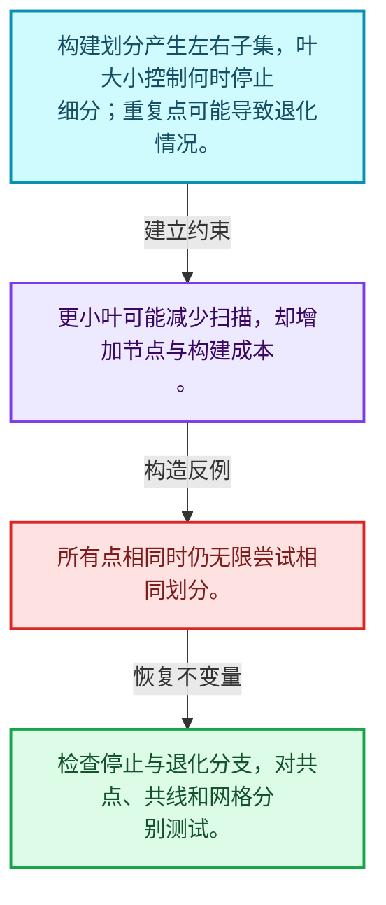
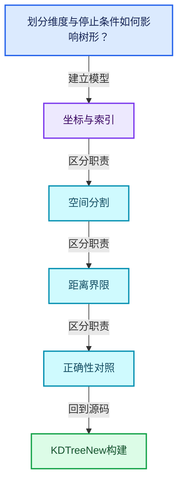
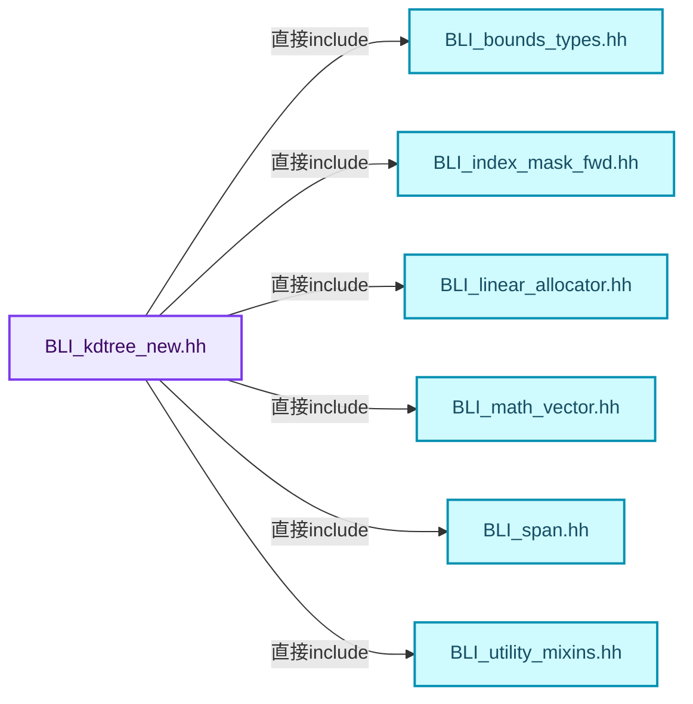
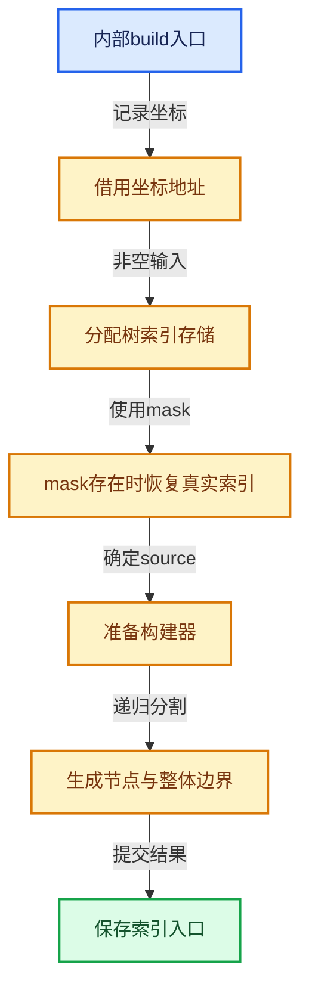
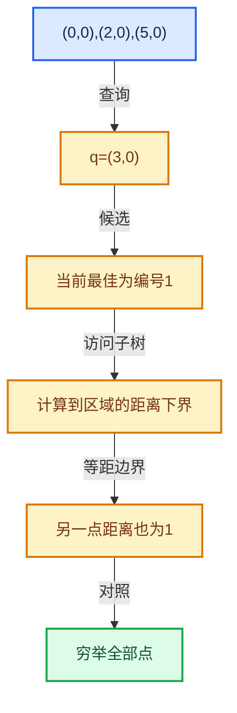

# 12-03 KDTreeNew构建

[方向导航](README.md) · [总目录](../README.md) · [覆盖索引](../%E6%BA%90%E7%A0%81%E7%89%88%E6%9C%AC%E4%B8%8E%E8%A6%86%E7%9B%96%E7%B4%A2%E5%BC%95.md)

> 阅读顺序：问题与数据模型 → 语法与类型 → 源码逐行 → 调用线索 → 历史与取舍 → 推演和练习。

- 基准 HEAD：`cbda6b96c26c0dee3c3b5cbb93960c4ac06a6b30`。
- 记录日期：2026-10-14。
- 教学示例状态：正文中的推演不是本机性能实测；已运行练习见验收报告。

## 一、从问题到设计

划分维度与停止条件如何影响树形？

递归分割组织候选点，叶大小影响构建成本和查询扫描；退化分布不能假定均匀平衡。

本篇把语法、数据语义和系统取舍连接起来。先证明距离下界与返回身份，再讨论布局优化和并行构建。

### 本篇独立模型与设计推理

构建划分产生左右子集，叶大小控制何时停止细分；重复点可能导致退化情况。

设计取舍：更小叶可能减少扫描，却增加节点与构建成本。

最小反例：所有点相同时仍无限尝试相同划分。

推导与处理：检查停止与退化分支，对共点、共线和网格分别测试。



### 源码范围与相邻篇章

| 文件 | 本篇逐行范围 | 基准SHA-256 |
|---|---|---|
| [source/blender/blenlib/BLI_kdtree_new.hh](../../../../../source/blender/blenlib/BLI_kdtree_new.hh) | L137—L278 | `b94b92497ea97b794042524c44573cd3d88d01c1fc9aa86c60a8940f6be04159` |
| [source/blender/blenlib/intern/kdtree.cc](../../../../../source/blender/blenlib/intern/kdtree.cc) | L1—L216 | `039dbc5c16d992dd0c468586cb3de58c161d4f327ecdd0909ea377342d038a90` |

同一主讲文件可能分多篇覆盖；超出本篇范围的符号通过覆盖索引定位。空行与纯注释保留在源码摘录中，逐行表解释有效语句与语法边界；许可证头统一保留。

前篇：[KDTreeNew节点布局](02-KDTreeNew%E8%8A%82%E7%82%B9%E5%B8%83%E5%B1%80.md).

后篇：[最近邻搜索与剪枝](04-%E6%9C%80%E8%BF%91%E9%82%BB%E6%90%9C%E7%B4%A2%E4%B8%8E%E5%89%AA%E6%9E%9D.md).

## 二、类型、数据与阅读地图



这是概念依赖图，边表示阅读关系，不声称是运行时调用顺序。

### 直接编译依赖



箭头只表示头文件包含关系；完整调用线索见后面的符号定位表。

## 三、关键词、语法与类型角色

### 模板 template

模板把类型或常量作为生成实现的参数。读声明时先列出类型参数、非类型参数和默认值，再看使用者实际实例化了什么。模板声明本身不意味着每种T都支持其全部成员。

具体检查：把T替换为int、string、只能移动的类型，分别检查每个被调用操作是否成立。

### 依赖名称 typename

typename既可引入类型模板参数，也可告诉编译器某个依赖名称是类型。它不创建运行时对象；解析期确认语法类别与实例化期检查具体类型是不同阶段。

具体检查：区分typename T::value_type和T::size()，前者标记类型，后者是表达式。

### 约束 requires

requires表达式或requires子句限制模板参与重载的条件。它提供编译期可用性检查，不是运行时if，不能指望输入到达程序后再被这一机制验证。

具体检查：构造满足和不满足约束的两个类型，观察候选被排除而不是在函数内返回错误。

### 常量求值 constexpr

constexpr声明允许相应实体参与常量求值，但constexpr函数仍可以在运行时执行。是否常量求值由调用场景和表达式合法性共同决定。

具体检查：比较constexpr变量初始化和从运行时输入调用同一函数。

### 只读限定 const

const约束当前访问路径可做的修改。const指针、指向const的指针、const视图对象、const元素是不同位置的限定；其他别名可能仍可修改原对象。

具体检查：分别写T* const、const T*与const T* const，并画出不可修改的层次。

### 异常边界 try与catch

try定义异常传播的局部边界。失败路径需要销毁已经成功构造的部分并释放相应存储；未构造的对象不能被析构。

具体检查：在第k次构造失败，列出已经存在的对象集合与待释放缓冲。

### 可选值 optional

optional把不存在与存在的T区分开，T的构造和析构跟随engaged状态变化。访问前应由has_value或条件分支证明存在。

具体检查：把空Field状态与合法常量零区分，不能用某个普通值代替不存在。

### 内部断言 assert

断言表达开发者预期成立的内部契约，发布构建可能关闭。它不能替代对不可信输入的完整错误处理，也不保证后续操作被运行时保护。

具体检查：对每条断言构造违反条件的输入，区分调用者错误与应向用户报告的错误。

### 类型别名 using

类型别名为已有类型建立名字，不创建运行期对象。它常把模板内部使用的类型统一暴露给泛型调用者。

具体检查：展开别名直到基础类型，区分类型别名和变量声明。

## 四、真实源码与逐行讲解

源码块保持原行内容，原始行号由小节标题及逐行表给出。表中的调用定位是静态阅读辅助；重载、模板实例化、宏展开和虚调用需结合完整声明，不能仅凭词法出现证明动态调用。

### BLI_kdtree_new.hh：L137—L184

<!-- source:source/blender/blenlib/BLI_kdtree_new.hh:137:184 -->

```cpp

  /**
   * Allocate a buffer, construct a #LinearAllocator at the start of it and give it the rest,
   * sized so that the indices and the first nodes of a tree over \a points_num points fit. The
   * buffer is reported through \a r_owned so that the destructor can give it back.
   */
  static LinearAllocator<> &make_allocator(int points_num, int leaf_size, void *&r_owned);

 public:
  /**
   * Build a tree containing every point in \a points.
   * \note \a points must outlive the tree.
   */
  explicit KDTreeNew(Span<T> points, int leaf_size = LEAF_SIZE_DEFAULT);

  /**
   * Build a tree containing the points selected by \a mask. Results are still indices into
   * \a points rather than positions in the mask.
   * \note \a points must outlive the tree, \a mask does not have to.
   */
  KDTreeNew(Span<T> points, const IndexMask &mask, int leaf_size = LEAF_SIZE_DEFAULT);

  /**
   * Build a tree containing the points at \a indices. Results are indices into \a points, not
   * positions in \a indices.
   * \note \a points must outlive the tree, \a indices does not have to.
   */
  KDTreeNew(Span<T> points, Span<int> indices, int leaf_size = LEAF_SIZE_DEFAULT);

  /**
   * The same constructors reusing an existing #LinearAllocator rather. This can be used to avoid
   * heap allocations when building a tree for a small number of points.
   * \note \a allocator must outlive the tree.
   */
  KDTreeNew(Span<T> points, LinearAllocator<> &allocator, int leaf_size = LEAF_SIZE_DEFAULT);
  KDTreeNew(Span<T> points,
            const IndexMask &mask,
            LinearAllocator<> &allocator,
            int leaf_size = LEAF_SIZE_DEFAULT);
  KDTreeNew(Span<T> points,
            Span<int> indices,
            LinearAllocator<> &allocator,
            int leaf_size = LEAF_SIZE_DEFAULT);

  ~KDTreeNew();

  /** The number of points, which may be less than the size of #points for a masked tree. */
  int size() const;
```

| 原始行 | 语义、约束与检查 |
|---|---|
| L143 | 声明接口 `static LinearAllocator<> &make_allocator(int points_num, int leaf_size, void *&r_owned)`，本行没有对应函数体；返回类型、参数限定和const/noexcept共同组成调用契约，实际行为需继续定位实现。 |
| L145 | 切换成员访问权限为 public；它是编译期接口边界，不是线程同步或内存保护。 |
| L150 | 把右侧 `LEAF_SIZE_DEFAULT)` 用于初始化或更新左侧 `explicit KDTreeNew(Span<T> points, int leaf_size`。声明初始化与已有对象赋值应按上下文区分；有资源的类型会调用相应特殊成员。 |
| L157 | 把右侧 `LEAF_SIZE_DEFAULT)` 用于初始化或更新左侧 `KDTreeNew(Span<T> points, const IndexMask &mask, int leaf_size`。声明初始化与已有对象赋值应按上下文区分；有资源的类型会调用相应特殊成员。 |
| L164 | 把右侧 `LEAF_SIZE_DEFAULT)` 用于初始化或更新左侧 `KDTreeNew(Span<T> points, Span<int> indices, int leaf_size`。声明初始化与已有对象赋值应按上下文区分；有资源的类型会调用相应特殊成员。 |
| L171 | 把右侧 `LEAF_SIZE_DEFAULT)` 用于初始化或更新左侧 `KDTreeNew(Span<T> points, LinearAllocator<> &allocator, int leaf_size`。声明初始化与已有对象赋值应按上下文区分；有资源的类型会调用相应特殊成员。 |
| L172 | 出现调用或函数声明 `KDTreeNew`，对应表达式为 `KDTreeNew(Span<T> points,`。参数求值、返回类型与重载需结合前后完整语句；静态文本引用不能证明动态目标。 |
| L173 | 本行是连续声明或表达式的一部分：`const IndexMask &mask,`。与本段前后行合读；逗号、括号和限定符决定它属于参数、初始化列表还是实际计算。 |
| L174 | 本行是连续声明或表达式的一部分：`LinearAllocator<> &allocator,`。与本段前后行合读；逗号、括号和限定符决定它属于参数、初始化列表还是实际计算。 |
| L175 | 把右侧 `LEAF_SIZE_DEFAULT)` 用于初始化或更新左侧 `int leaf_size`。声明初始化与已有对象赋值应按上下文区分；有资源的类型会调用相应特殊成员。 |
| L176 | 出现调用或函数声明 `KDTreeNew`，对应表达式为 `KDTreeNew(Span<T> points,`。参数求值、返回类型与重载需结合前后完整语句；静态文本引用不能证明动态目标。 |
| L177 | 本行是连续声明或表达式的一部分：`Span<int> indices,`。与本段前后行合读；逗号、括号和限定符决定它属于参数、初始化列表还是实际计算。 |
| L178 | 本行是连续声明或表达式的一部分：`LinearAllocator<> &allocator,`。与本段前后行合读；逗号、括号和限定符决定它属于参数、初始化列表还是实际计算。 |
| L179 | 把右侧 `LEAF_SIZE_DEFAULT)` 用于初始化或更新左侧 `int leaf_size`。声明初始化与已有对象赋值应按上下文区分；有资源的类型会调用相应特殊成员。 |
| L181 | 涉及析构接口或显式析构：`~KDTreeNew();`。检查目标对象已成功构造，且资源不会在另一条清理路径再次销毁。 |
| L184 | 声明接口 `int size() const`，本行没有对应函数体；返回类型、参数限定和const/noexcept共同组成调用契约，实际行为需继续定位实现。 |

### BLI_kdtree_new.hh：L185—L233

<!-- source:source/blender/blenlib/BLI_kdtree_new.hh:185:233 -->

```cpp

  bool is_empty() const;

  /**
   * The coordinates the tree was built from, which every index it returns refers to. Only the
   * start of the array is known, since the tree may cover a subset of it.
   */
  const T *points() const;

  /**
   * The indices of the points in the tree, in the order it stores them. Points close together in
   * space are closer in this order, which can utilized for more optimal cache usage.
   *
   * \note The order is deterministic, but it follows from the coordinates and from how the tree
   * is built. It changes when unrelated points move and when the build is tuned, so results that
   * have to stay the same as geometry is edited or animated should not depend on it.
   */
  Span<int> tree_indices() const;

  /**
   * Find the point closest to \a position.
   * \return Its index, or -1 if the tree is empty.
   */
  int find_nearest(const T &position, value_type *r_distance_sq = nullptr) const;

  /**
   * Find the point closest to \a position for which \a filter returns true. Useful to skip the
   * search position itself when finding the neighbors of points that are in the tree.
   *
   * \note \a filter is called for candidate points in an unspecified order.
   *
   * \return The index of the closest accepted point, or -1 if there is none.
   */
  template<typename Filter>
  int find_nearest_filtered(const T &position,
                            Filter &&filter,
                            value_type *r_distance_sq = nullptr) const
    requires kdtree::FilterFn<Filter>;

  /**
   * Find the closest points to \a position, in order of increasing distance.
   * \param r_nearest: Filled with at most `r_nearest.size()` results.
   * \return The number of results written, which is smaller when the tree has fewer points.
   */
  int find_nearest_n(const T &position, MutableSpan<Nearest> r_nearest) const;

  /** Call \a fn for every point within \a radius of \a position, in an unspecified order. */
  template<typename Fn>
  void foreach_in_radius(const T &position, const value_type radius, Fn &&fn) const;
```

本段语义重点：

- `find_nearest`：最近邻查询入口；返回索引归属和距离单位按实际API确认。

| 原始行 | 语义、约束与检查 |
|---|---|
| L186 | 声明接口 `bool is_empty() const`，本行没有对应函数体；返回类型、参数限定和const/noexcept共同组成调用契约，实际行为需继续定位实现。 |
| L192 | 声明接口 `const T *points() const`，本行没有对应函数体；返回类型、参数限定和const/noexcept共同组成调用契约，实际行为需继续定位实现。 |
| L202 | 声明接口 `Span<int> tree_indices() const`，本行没有对应函数体；返回类型、参数限定和const/noexcept共同组成调用契约，实际行为需继续定位实现。 |
| L208 | 把右侧 `nullptr) const` 用于初始化或更新左侧 `int find_nearest(const T &position, value_type *r_distance_sq`。声明初始化与已有对象赋值应按上下文区分；有资源的类型会调用相应特殊成员。 |
| L218 | 声明模板参数 `template<typename Filter>`。类型参数决定生成操作的类型，非类型参数可决定内嵌容量或编译期分支。 |
| L219 | 出现调用或函数声明 `find_nearest_filtered`，对应表达式为 `int find_nearest_filtered(const T &position,`。参数求值、返回类型与重载需结合前后完整语句；静态文本引用不能证明动态目标。 |
| L220 | 本行是连续声明或表达式的一部分：`Filter &&filter,`。与本段前后行合读；逗号、括号和限定符决定它属于参数、初始化列表还是实际计算。 |
| L221 | 把右侧 `nullptr) const` 用于初始化或更新左侧 `value_type *r_distance_sq`。声明初始化与已有对象赋值应按上下文区分；有资源的类型会调用相应特殊成员。 |
| L222 | 约束模板可用性：`requires kdtree::FilterFn<Filter>;`。条件在编译期检查，不替代运行期的地址、长度和类型一致性验证。 |
| L229 | 声明接口 `int find_nearest_n(const T &position, MutableSpan<Nearest> r_nearest) const`，本行没有对应函数体；返回类型、参数限定和const/noexcept共同组成调用契约，实际行为需继续定位实现。 |
| L232 | 声明模板参数 `template<typename Fn>`。类型参数决定生成操作的类型，非类型参数可决定内嵌容量或编译期分支。 |
| L233 | 声明接口 `void foreach_in_radius(const T &position, const value_type radius, Fn &&fn) const`，本行没有对应函数体；返回类型、参数限定和const/noexcept共同组成调用契约，实际行为需继续定位实现。 |

### BLI_kdtree_new.hh：L234—L278

<!-- source:source/blender/blenlib/BLI_kdtree_new.hh:234:278 -->

```cpp

  /**
   * Find every point within \a radius of \a position.
   * \param r_nearest: Cleared, then filled with the results in order of increasing distance.
   * Passing in the same vector for many searches avoids reallocating it every time.
   * \return The number of results.
   */
  int find_in_radius(const T &position, const value_type radius, Vector<Nearest> &r_nearest) const;

  /** The number of points within \a radius of \a position. */
  int count_in_radius(const T &position, const value_type radius) const;

  /**
   * Visit the points that could be closer to \a position than the query has accepted so
   * far, reporting each of them to it. The query decides what to keep and how far the
   * search still has to look. See #NearestResult and the others beside it.
   */
  template<typename Query>
  void search(Query &query, const T &position) const
    requires kdtree::QueryType<Query, value_type>;

 private:
  /**
   * Build the tree, optionally with a subset of indices. Defined in the implementation file to
   * avoid transitive includes of heavier headers.
   */
  void build(Span<T> points,
             Span<int> indices,
             const IndexMask *mask,
             int size,
             int leaf_size,
             LinearAllocator<> &allocator);

  /**
   * \param distance_sq: Squared distance from \a position to the space covered by \a node.
   * \param offsets: Squared distance to the node per dimension.
   * \return False when the query has seen enough and the search should stop.
   */
  template<typename Query>
  bool search_node(Query &query,
                   const T &position,
                   const Node *node,
                   const value_type distance_sq,
                   T &offsets) const
    requires kdtree::QueryType<Query, value_type>;
```

本段语义重点：

- `search_node`：访问一个空间子树；剪枝条件必须用正确的距离下界。
- `distance_sq`：平方距离，可避免开方，但阈值也必须使用一致单位。

| 原始行 | 语义、约束与检查 |
|---|---|
| L241 | 声明接口 `int find_in_radius(const T &position, const value_type radius, Vector<Nearest> &r_nearest) const`，本行没有对应函数体；返回类型、参数限定和const/noexcept共同组成调用契约，实际行为需继续定位实现。 |
| L244 | 声明接口 `int count_in_radius(const T &position, const value_type radius) const`，本行没有对应函数体；返回类型、参数限定和const/noexcept共同组成调用契约，实际行为需继续定位实现。 |
| L251 | 声明模板参数 `template<typename Query>`。类型参数决定生成操作的类型，非类型参数可决定内嵌容量或编译期分支。 |
| L252 | 出现调用或函数声明 `search`，对应表达式为 `void search(Query &query, const T &position) const`。参数求值、返回类型与重载需结合前后完整语句；静态文本引用不能证明动态目标。 |
| L253 | 约束模板可用性：`requires kdtree::QueryType<Query, value_type>;`。条件在编译期检查，不替代运行期的地址、长度和类型一致性验证。 |
| L255 | 切换成员访问权限为 private；它是编译期接口边界，不是线程同步或内存保护。 |
| L260 | 出现调用或函数声明 `build`，对应表达式为 `void build(Span<T> points,`。参数求值、返回类型与重载需结合前后完整语句；静态文本引用不能证明动态目标。 |
| L261 | 本行是连续声明或表达式的一部分：`Span<int> indices,`。与本段前后行合读；逗号、括号和限定符决定它属于参数、初始化列表还是实际计算。 |
| L262 | 本行是连续声明或表达式的一部分：`const IndexMask *mask,`。与本段前后行合读；逗号、括号和限定符决定它属于参数、初始化列表还是实际计算。 |
| L263 | 本行是连续声明或表达式的一部分：`int size,`。与本段前后行合读；逗号、括号和限定符决定它属于参数、初始化列表还是实际计算。 |
| L264 | 本行是连续声明或表达式的一部分：`int leaf_size,`。与本段前后行合读；逗号、括号和限定符决定它属于参数、初始化列表还是实际计算。 |
| L265 | 声明成员、局部对象或完成语句 `LinearAllocator<> &allocator)`。若为指针或引用，它本身不说明拥有；若为值对象，其构造析构由所在作用域或外层对象管理。 |
| L272 | 声明模板参数 `template<typename Query>`。类型参数决定生成操作的类型，非类型参数可决定内嵌容量或编译期分支。 |
| L273 | 出现调用或函数声明 `search_node`，对应表达式为 `bool search_node(Query &query,`。参数求值、返回类型与重载需结合前后完整语句；静态文本引用不能证明动态目标。 |
| L274 | 本行是连续声明或表达式的一部分：`const T &position,`。与本段前后行合读；逗号、括号和限定符决定它属于参数、初始化列表还是实际计算。 |
| L275 | 本行是连续声明或表达式的一部分：`const Node *node,`。与本段前后行合读；逗号、括号和限定符决定它属于参数、初始化列表还是实际计算。 |
| L276 | 本行涉及 `distance_sq`：平方距离，可避免开方，但阈值也必须使用一致单位。按此语义解读 `const value_type distance_sq,`，不要把地址、数量或状态混用。 |
| L277 | 本行是连续声明或表达式的一部分：`T &offsets) const`。与本段前后行合读；逗号、括号和限定符决定它属于参数、初始化列表还是实际计算。 |
| L278 | 约束模板可用性：`requires kdtree::QueryType<Query, value_type>;`。条件在编译期检查，不替代运行期的地址、长度和类型一致性验证。 |

### kdtree.cc：L1—L48

<!-- source:source/blender/blenlib/intern/kdtree.cc:1:48 -->

```cpp
/* SPDX-FileCopyrightText: 2008-2009 Marius Muja, David G. Lowe.
 * SPDX-FileCopyrightText: 2011-2026 Jose Luis Blanco-Claraco.
 * SPDX-FileCopyrightText: 2026 Blender Authors.
 *
 * SPDX-License-Identifier: BSD-2-Clause */

/** \file
 * \ingroup bli
 *
 * A KD-tree for nearest neighbor search, which started from the nanoflann library and has since
 * been rewritten around Blender's own containers, threading and math. The node layout and the way
 * a search walks it are still recognizably nanoflann's, which is where the copyright above comes
 * from.
 */

#include <algorithm>
#include <bit>
#include <cmath>
#include <numeric>
#include <optional>

#include "BLI_array.hh"
#include "BLI_bounds.hh"
#include "BLI_enumerable_thread_specific.hh"
#include "BLI_index_mask.hh"
#include "BLI_kdtree_new.hh"
#include "BLI_linear_allocator.hh"
#include "BLI_math_vector.hh"
#include "BLI_task.hh"
#include "BLI_threads.hh"

namespace blender {

/* -------------------------------------------------------------------- */
/** \name Build Tuning
 * \{ */

/** Tree size that makes building with more than one thread worthwhile. */
static constexpr int PARALLEL_BUILD_THRESHOLD = 10000;

/** Threads used to build a tree of #PARALLEL_BUILD_THRESHOLD points. */
static constexpr int PARALLEL_BUILD_THRESHOLD_THREADS = 4;

/** Subtrees smaller than this are built in one task, which is cheaper than handing them over. */
static constexpr int PARALLEL_SUBTREE_GRAIN = 4096;

/** Points that make a block worth giving a thread of its own within a single node. */
static constexpr int NODE_BLOCK_SIZE = 8192;
```

| 原始行 | 语义、约束与检查 |
|---|---|
| L16 | 引入编译依赖 <algorithm>；这是声明可见性关系，不表示运行时一定调用该文件的所有接口。 |
| L17 | 引入编译依赖 <bit>；这是声明可见性关系，不表示运行时一定调用该文件的所有接口。 |
| L18 | 引入编译依赖 <cmath>；这是声明可见性关系，不表示运行时一定调用该文件的所有接口。 |
| L19 | 引入编译依赖 <numeric>；这是声明可见性关系，不表示运行时一定调用该文件的所有接口。 |
| L20 | 引入编译依赖 <optional>；这是声明可见性关系，不表示运行时一定调用该文件的所有接口。 |
| L22 | 引入编译依赖 "BLI_array.hh"；这是声明可见性关系，不表示运行时一定调用该文件的所有接口。 |
| L23 | 引入编译依赖 "BLI_bounds.hh"；这是声明可见性关系，不表示运行时一定调用该文件的所有接口。 |
| L24 | 引入编译依赖 "BLI_enumerable_thread_specific.hh"；这是声明可见性关系，不表示运行时一定调用该文件的所有接口。 |
| L25 | 引入编译依赖 "BLI_index_mask.hh"；这是声明可见性关系，不表示运行时一定调用该文件的所有接口。 |
| L26 | 引入编译依赖 "BLI_kdtree_new.hh"；这是声明可见性关系，不表示运行时一定调用该文件的所有接口。 |
| L27 | 引入编译依赖 "BLI_linear_allocator.hh"；这是声明可见性关系，不表示运行时一定调用该文件的所有接口。 |
| L28 | 引入编译依赖 "BLI_math_vector.hh"；这是声明可见性关系，不表示运行时一定调用该文件的所有接口。 |
| L29 | 引入编译依赖 "BLI_task.hh"；这是声明可见性关系，不表示运行时一定调用该文件的所有接口。 |
| L30 | 引入编译依赖 "BLI_threads.hh"；这是声明可见性关系，不表示运行时一定调用该文件的所有接口。 |
| L32 | 把后续声明放入 blender 命名空间，影响名称查找和符号归属，不创建运行时对象。 |
| L39 | 把右侧 `10000` 用于初始化或更新左侧 `static constexpr int PARALLEL_BUILD_THRESHOLD`。声明初始化与已有对象赋值应按上下文区分；有资源的类型会调用相应特殊成员。 |
| L42 | 把右侧 `4` 用于初始化或更新左侧 `static constexpr int PARALLEL_BUILD_THRESHOLD_THREADS`。声明初始化与已有对象赋值应按上下文区分；有资源的类型会调用相应特殊成员。 |
| L45 | 把右侧 `4096` 用于初始化或更新左侧 `static constexpr int PARALLEL_SUBTREE_GRAIN`。声明初始化与已有对象赋值应按上下文区分；有资源的类型会调用相应特殊成员。 |
| L48 | 把右侧 `8192` 用于初始化或更新左侧 `static constexpr int NODE_BLOCK_SIZE`。声明初始化与已有对象赋值应按上下文区分；有资源的类型会调用相应特殊成员。 |

### kdtree.cc：L49—L96

<!-- source:source/blender/blenlib/intern/kdtree.cc:49:96 -->

```cpp

/** Upper bound on those blocks, so that the bookkeeping fits on the stack. */
static constexpr int NODE_MAX_BLOCKS = 64;

/**
 * Nodes holding more than this fraction of the tree are split a block at a time, which is what a
 * threaded build spreads over its threads. Below that there are enough subtrees to keep the
 * threads busy on their own, and the blocks and the fix up they need are only extra work.
 */
static constexpr int NODE_BLOCK_FRACTION = 8;

/**
 * Points a partition works on at a time. An offset within a block has to fit in a #uint8_t, and
 * two blocks have to fit in a range for the block path to be used at all.
 */
static constexpr int PARTITION_BLOCK_SIZE = 128;

/**
 * The best number of threads to build a tree depends on the memory bandwidth relative to the
 * amount of computational work necessary. Building repeatedly reorders coordinates and indices so
 * it is heavily bottlenecked by memory bandwidth at high point counts. We want to be relatively
 * conservative with the thread count as well; the CPU may be better off spending time on other
 * less memory-bound tasks.
 *
 * This fourth root relationship between increases in point count and threads used is tuned for a
 * 16 core Ryzen 7950X: a million point build takes 25 ms on one thread and 3.5 ms on eight, past
 * which it stops improving, while the processor time it uses keeps growing with every thread. See
 * `BLI_kdtree_performance_test`.
 */
static int parallel_build_threads(const int64_t points_num)
{
  const double growth = std::sqrt(
      std::sqrt(double(points_num) / double(PARALLEL_BUILD_THRESHOLD)));
  return std::max(int(std::round(double(PARALLEL_BUILD_THRESHOLD_THREADS) * growth)), 1);
}

/** \} */

/* -------------------------------------------------------------------- */
/** \name Tree
 * \{ */

template<typename T> class TreeBuilder {
 public:
  using value_type = typename T::base_type;
  static constexpr int dimensions = T::type_length;

 private:
```

本段语义重点：

- `std::max`：取较大值，在容量计算中常用于同时满足请求量和增长策略。

| 原始行 | 语义、约束与检查 |
|---|---|
| L51 | 把右侧 `64` 用于初始化或更新左侧 `static constexpr int NODE_MAX_BLOCKS`。声明初始化与已有对象赋值应按上下文区分；有资源的类型会调用相应特殊成员。 |
| L58 | 把右侧 `8` 用于初始化或更新左侧 `static constexpr int NODE_BLOCK_FRACTION`。声明初始化与已有对象赋值应按上下文区分；有资源的类型会调用相应特殊成员。 |
| L64 | 把右侧 `128` 用于初始化或更新左侧 `static constexpr int PARTITION_BLOCK_SIZE`。声明初始化与已有对象赋值应按上下文区分；有资源的类型会调用相应特殊成员。 |
| L78 | 出现调用或函数声明 `parallel_build_threads`，对应表达式为 `static int parallel_build_threads(const int64_t points_num)`。参数求值、返回类型与重载需结合前后完整语句；静态文本引用不能证明动态目标。 |
| L79 | 连接上一行的声明或控制结构与其语句块；后续行在这个作用域中执行或声明。 |
| L80 | 把右侧 `std::sqrt(` 用于初始化或更新左侧 `const double growth`。声明初始化与已有对象赋值应按上下文区分；有资源的类型会调用相应特殊成员。 |
| L81 | 出现调用或函数声明 `std::sqrt`，对应表达式为 `std::sqrt(double(points_num) / double(PARALLEL_BUILD_THRESHOLD)));`。参数求值、返回类型与重载需结合前后完整语句；静态文本引用不能证明动态目标。 |
| L82 | 返回表达式 `std::max(int(std::round(double(PARALLEL_BUILD_THRESHOLD_THREADS) * growth)), 1)`。 |
| L83 | 结束当前语法单元。局部自动对象在离开其作用域时按规则销毁；这不等于所有被引用的外部数据也被释放。 |
| L91 | 声明模板参数 `template<typename T> class TreeBuilder {`。类型参数决定生成操作的类型，非类型参数可决定内嵌容量或编译期分支。 |
| L92 | 切换成员访问权限为 public；它是编译期接口边界，不是线程同步或内存保护。 |
| L93 | 定义类型别名 `using value_type = typename T::base_type`，为模板接口或内部实现统一命名；本行不分配该类型对象。 |
| L94 | 把右侧 `T::type_length` 用于初始化或更新左侧 `static constexpr int dimensions`。声明初始化与已有对象赋值应按上下文区分；有资源的类型会调用相应特殊成员。 |
| L96 | 切换成员访问权限为 private；它是编译期接口边界，不是线程同步或内存保护。 |

### kdtree.cc：L97—L143

<!-- source:source/blender/blenlib/intern/kdtree.cc:97:143 -->

```cpp
  /**
   * A point as the build holds it: its coordinates, and its index in #points_ in the element
   * after them.
   */
  using BuildPoint = VecBase<value_type, dimensions + 1>;

  using Node = kdtree::Node<value_type>;

  /**
   * Nodes are handed out from batches, so that a walk down the tree stays within a few
   * allocations. A linear allocator packs small allocations into buffers of a few kilobytes at
   * most, which for a tree of any size means nodes scattered over many of them.
   */
  struct NodeAllocator {
    /**
     * Most nodes per batch, and so the most that can go unused per thread that built a subtree.
     * The first batch of a build is sized from the number of points instead, so that a small tree
     * does not reserve room for a large one. See #node_batch_size.
     */
    static constexpr int BATCH_SIZE_MAX = 256;

    int batch_size = BATCH_SIZE_MAX;
    /**
     * Where the batches come from. A pool that a thread of its own fills has to have one to
     * itself, while the pool of a build that stays on one thread takes them straight from the
     * tree's allocator, so that its nodes land in the same buffer as its indices.
     */
    LinearAllocator<> owned_allocator;
    LinearAllocator<> *allocator = &owned_allocator;
    MutableSpan<Node> batch;
    /* Equal to the (empty) batch size, so that the first allocation starts a batch. */
    int used = 0;

    /** A node, or the two children of one, which have to be next to each other. */
    Node *allocate(const int num)
    {
      if (used + num > batch.size()) {
        this->batch = this->allocator->allocate_array<Node>(batch_size);
        this->used = 0;
        /* Only the first batch is sized for the tree, the rest are full size. */
        this->batch_size = BATCH_SIZE_MAX;
      }
      Node *nodes = &this->batch[used];
      this->used += num;
      return nodes;
    }
  };
```

本段语义重点：

- 分支证据 `used + num > batch.size())`：分别推演条件成立与不成立，核对相同出口处的状态。

| 原始行 | 语义、约束与检查 |
|---|---|
| L101 | 定义类型别名 `using BuildPoint = VecBase<value_type, dimensions + 1>`，为模板接口或内部实现统一命名；本行不分配该类型对象。 |
| L103 | 定义类型别名 `using Node = kdtree::Node<value_type>`，为模板接口或内部实现统一命名；本行不分配该类型对象。 |
| L110 | 声明或定义类型 `struct NodeAllocator`。结合继承、访问权限和成员布局确认接口与拥有关系；前向声明本身没有完整对象布局。 |
| L116 | 把右侧 `256` 用于初始化或更新左侧 `static constexpr int BATCH_SIZE_MAX`。声明初始化与已有对象赋值应按上下文区分；有资源的类型会调用相应特殊成员。 |
| L118 | 把右侧 `BATCH_SIZE_MAX` 用于初始化或更新左侧 `int batch_size`。声明初始化与已有对象赋值应按上下文区分；有资源的类型会调用相应特殊成员。 |
| L124 | 声明成员、局部对象或完成语句 `LinearAllocator<> owned_allocator`。若为指针或引用，它本身不说明拥有；若为值对象，其构造析构由所在作用域或外层对象管理。 |
| L125 | 把右侧 `&owned_allocator` 用于初始化或更新左侧 `LinearAllocator<> *allocator`。声明初始化与已有对象赋值应按上下文区分；有资源的类型会调用相应特殊成员。 |
| L126 | 声明成员、局部对象或完成语句 `MutableSpan<Node> batch`。若为指针或引用，它本身不说明拥有；若为值对象，其构造析构由所在作用域或外层对象管理。 |
| L128 | 把右侧 `0` 用于初始化或更新左侧 `int used`。声明初始化与已有对象赋值应按上下文区分；有资源的类型会调用相应特殊成员。 |
| L131 | 出现调用或函数声明 `allocate`，对应表达式为 `Node *allocate(const int num)`。参数求值、返回类型与重载需结合前后完整语句；静态文本引用不能证明动态目标。 |
| L132 | 连接上一行的声明或控制结构与其语句块；后续行在这个作用域中执行或声明。 |
| L133 | 判断 `used + num > batch.size()`，成立时进入本分支，否则继续后续路径。该边界影响可访问元素或可用容量，两者要按各变量的定义区分。 |
| L134 | 把右侧 `this->allocator->allocate_array<Node>(batch_size)` 用于初始化或更新左侧 `this->batch`。声明初始化与已有对象赋值应按上下文区分；有资源的类型会调用相应特殊成员。 |
| L135 | 把右侧 `0` 用于初始化或更新左侧 `this->used`。声明初始化与已有对象赋值应按上下文区分；有资源的类型会调用相应特殊成员。 |
| L137 | 把右侧 `BATCH_SIZE_MAX` 用于初始化或更新左侧 `this->batch_size`。声明初始化与已有对象赋值应按上下文区分；有资源的类型会调用相应特殊成员。 |
| L138 | 结束当前语法单元。局部自动对象在离开其作用域时按规则销毁；这不等于所有被引用的外部数据也被释放。 |
| L139 | 把右侧 `&this->batch[used]` 用于初始化或更新左侧 `Node *nodes`。声明初始化与已有对象赋值应按上下文区分；有资源的类型会调用相应特殊成员。 |
| L140 | 复合更新 `this->used += num`：读取左侧现有值，与右侧按`+=`对应操作组合后写回。检查数值边界、位掩码或共享状态保护；它不是新对象的构造。 |
| L141 | 返回表达式 `nodes`。 |
| L142 | 结束当前语法单元。局部自动对象在离开其作用域时按规则销毁；这不等于所有被引用的外部数据也被释放。 |
| L143 | 结束当前语法单元。局部自动对象在离开其作用域时按规则销毁；这不等于所有被引用的外部数据也被释放。 |

### kdtree.cc：L144—L189

<!-- source:source/blender/blenlib/intern/kdtree.cc:144:189 -->

```cpp

 public:
  /**
   * The approximate number of nodes a tree with \a points_num points takes. Leaves hold a bit over
   * two thirds of #leaf_size_ points on average, and a tree has one interior node fewer than it
   * has leaves. Measured at 22.6 points per leaf for a leaf size of 32. See
   * `BLI_kdtree_performance_test`.
   */
  static int node_batch_size(const int points_num, const int leaf_size)
  {
    const int64_t leaves = std::max<int64_t>(1, points_num * 3 / (int64_t(leaf_size) * 2));
    return int(std::min<int64_t>(2 * leaves + 1, NodeAllocator::BATCH_SIZE_MAX));
  }

 private:
  const Span<T> points_;
  /** Filled with the indices of the points, in the order the tree visits them. */
  const MutableSpan<int> indices_;
  const int leaf_size_;
  /** The buffers the nodes end up in, which the pools below hand theirs to. */
  LinearAllocator<> &allocator_;

  /**
   * The points being reordered, which #indices_ is taken from once the tree is built. Only set
   * while #build_nodes runs, which is the only thing that needs it.
   */
  MutableSpan<BuildPoint> build_points_;
  /** The pool of a build that stays on one thread. */
  NodeAllocator pool_;
  /**
   * A pool per thread that takes part in a threaded build. One pool behind a mutex would put
   * every node in the tree through it, while a pool per subtree leaves a partly used batch
   * behind for each of them and spreads the nodes of a subtree over several pools. Only built
   * when there are threads to give pools to: reaching into thread local storage costs more than
   * building a tree of a few points does.
   */
  std::optional<threading::EnumerableThreadSpecific<NodeAllocator>> thread_allocators_;

 public:
  TreeBuilder(const Span<T> points,
              const MutableSpan<int> indices,
              const int leaf_size,
              LinearAllocator<> &allocator)
      : points_(points), indices_(indices), leaf_size_(leaf_size), allocator_(allocator)
  {
  }
```

本段语义重点：

- `std::max`：取较大值，在容量计算中常用于同时满足请求量和增长策略。
- `std::min`：取较小值，常用于截断范围；还要检查负值、溢出和空范围。
- `allocator_`：提供存储的分配策略对象，释放必须与分配策略匹配。
- `indices_`：间接索引存储；区分数组内位置与指向的原始元素编号。
- `points_`：查询或构建使用的点坐标视图，使用期间必须满足借用契约。

| 原始行 | 语义、约束与检查 |
|---|---|
| L145 | 切换成员访问权限为 public；它是编译期接口边界，不是线程同步或内存保护。 |
| L152 | 出现调用或函数声明 `node_batch_size`，对应表达式为 `static int node_batch_size(const int points_num, const int leaf_size)`。参数求值、返回类型与重载需结合前后完整语句；静态文本引用不能证明动态目标。 |
| L153 | 连接上一行的声明或控制结构与其语句块；后续行在这个作用域中执行或声明。 |
| L154 | 本行使用 `std::max`：取较大值，在容量计算中常用于同时满足请求量和增长策略。 |
| L155 | 本行使用 `std::min`：取较小值，常用于截断范围；还要检查负值、溢出和空范围。 |
| L156 | 结束当前语法单元。局部自动对象在离开其作用域时按规则销毁；这不等于所有被引用的外部数据也被释放。 |
| L158 | 切换成员访问权限为 private；它是编译期接口边界，不是线程同步或内存保护。 |
| L159 | 本行涉及 `points_`：查询或构建使用的点坐标视图，使用期间必须满足借用契约。按此语义解读 `const Span<T> points_`，不要把地址、数量或状态混用。 |
| L161 | 本行涉及 `indices_`：间接索引存储；区分数组内位置与指向的原始元素编号。按此语义解读 `const MutableSpan<int> indices_`，不要把地址、数量或状态混用。 |
| L162 | 声明成员、局部对象或完成语句 `const int leaf_size_`。若为指针或引用，它本身不说明拥有；若为值对象，其构造析构由所在作用域或外层对象管理。 |
| L164 | 本行涉及 `allocator_`：提供存储的分配策略对象，释放必须与分配策略匹配。按此语义解读 `LinearAllocator<> &allocator_`，不要把地址、数量或状态混用。 |
| L170 | 声明成员、局部对象或完成语句 `MutableSpan<BuildPoint> build_points_`。若为指针或引用，它本身不说明拥有；若为值对象，其构造析构由所在作用域或外层对象管理。 |
| L172 | 声明成员、局部对象或完成语句 `NodeAllocator pool_`。若为指针或引用，它本身不说明拥有；若为值对象，其构造析构由所在作用域或外层对象管理。 |
| L180 | 声明成员、局部对象或完成语句 `std::optional<threading::EnumerableThreadSpecific<NodeAllocator>> thread_allocators_`。若为指针或引用，它本身不说明拥有；若为值对象，其构造析构由所在作用域或外层对象管理。 |
| L182 | 切换成员访问权限为 public；它是编译期接口边界，不是线程同步或内存保护。 |
| L183 | 出现调用或函数声明 `TreeBuilder`，对应表达式为 `TreeBuilder(const Span<T> points,`。参数求值、返回类型与重载需结合前后完整语句；静态文本引用不能证明动态目标。 |
| L184 | 本行是连续声明或表达式的一部分：`const MutableSpan<int> indices,`。与本段前后行合读；逗号、括号和限定符决定它属于参数、初始化列表还是实际计算。 |
| L185 | 本行是连续声明或表达式的一部分：`const int leaf_size,`。与本段前后行合读；逗号、括号和限定符决定它属于参数、初始化列表还是实际计算。 |
| L186 | 本行是连续声明或表达式的一部分：`LinearAllocator<> &allocator)`。与本段前后行合读；逗号、括号和限定符决定它属于参数、初始化列表还是实际计算。 |
| L187 | 本行涉及 `allocator_`：提供存储的分配策略对象，释放必须与分配策略匹配。按此语义解读 `: points_(points), indices_(indices), leaf_size_(leaf_size), allocator_(allocator)`，不要把地址、数量或状态混用。 |
| L188 | 连接上一行的声明或控制结构与其语句块；后续行在这个作用域中执行或声明。 |
| L189 | 结束当前语法单元。局部自动对象在离开其作用域时按规则销毁；这不等于所有被引用的外部数据也被释放。 |

### kdtree.cc：L190—L216

<!-- source:source/blender/blenlib/intern/kdtree.cc:190:216 -->

```cpp

  Node *build(const Span<int> indices, Bounds<T> &r_bounds)
  {
    const int size = int(indices_.size());
    BLI_assert(size > 0);

    /* A tree that is a single leaf has nothing to split, and copying the coordinates aside would
     * cost more than the rest of its build. */
    if (size <= leaf_size_) {
      return this->build_single_leaf(indices, r_bounds);
    }

    /* Splitting the build into tasks costs something even when there is no second thread to run
     * them, so only ask for it when there is one. */
    const bool threaded = size >= PARALLEL_BUILD_THRESHOLD && BLI_system_thread_count() > 1;
    Node *root = nullptr;
    if (threaded) {
      threading::max_threads_task(parallel_build_threads(size),
                                  [&]() { root = this->build_nodes(indices, r_bounds, true); });
    }
    else {
      root = this->build_nodes(indices, r_bounds, false);
    }
    return root;
  }

 private:
```

本段语义重点：

- `indices_`：间接索引存储；区分数组内位置与指向的原始元素编号。

| 原始行 | 语义、约束与检查 |
|---|---|
| L191 | 出现调用或函数声明 `build`，对应表达式为 `Node *build(const Span<int> indices, Bounds<T> &r_bounds)`。参数求值、返回类型与重载需结合前后完整语句；静态文本引用不能证明动态目标。 |
| L192 | 连接上一行的声明或控制结构与其语句块；后续行在这个作用域中执行或声明。 |
| L193 | 建立或更新 `indices_`：间接索引存储；区分数组内位置与指向的原始元素编号。本行的具体值关系为 `const int size = int(indices_.size())`；对照更新前后相应范围或状态是否一致。 |
| L194 | 断言约束 `BLI_assert(size > 0);`。条件是后续访问的内部前置条件；发布构建可能不执行，不能把断言当作输入修复。 |
| L198 | 判断 `size <= leaf_size_`，成立时进入本分支，否则继续后续路径。该边界影响可访问元素或可用容量，两者要按各变量的定义区分。 |
| L199 | 返回表达式 `this->build_single_leaf(indices, r_bounds)`。 |
| L200 | 结束当前语法单元。局部自动对象在离开其作用域时按规则销毁；这不等于所有被引用的外部数据也被释放。 |
| L204 | 把右侧 `size >= PARALLEL_BUILD_THRESHOLD && BLI_system_thread_count() > 1` 用于初始化或更新左侧 `const bool threaded`。声明初始化与已有对象赋值应按上下文区分；有资源的类型会调用相应特殊成员。 |
| L205 | 把右侧 `nullptr` 用于初始化或更新左侧 `Node *root`。声明初始化与已有对象赋值应按上下文区分；有资源的类型会调用相应特殊成员。 |
| L206 | 判断 `threaded`，成立时进入本分支，否则继续后续路径。 |
| L207 | 出现调用或函数声明 `threading::max_threads_task`，对应表达式为 `threading::max_threads_task(parallel_build_threads(size),`。参数求值、返回类型与重载需结合前后完整语句；静态文本引用不能证明动态目标。 |
| L208 | 把右侧 `this->build_nodes(indices, r_bounds, true); })` 用于初始化或更新左侧 `[&]() { root`。声明初始化与已有对象赋值应按上下文区分；有资源的类型会调用相应特殊成员。 |
| L209 | 结束当前语法单元。局部自动对象在离开其作用域时按规则销毁；这不等于所有被引用的外部数据也被释放。 |
| L210 | 处理前一条件不成立的互补路径。比较两条路径最后是否恢复同一不变量，以及是否产生不同的资源责任。 |
| L211 | 把右侧 `this->build_nodes(indices, r_bounds, false)` 用于初始化或更新左侧 `root`。声明初始化与已有对象赋值应按上下文区分；有资源的类型会调用相应特殊成员。 |
| L212 | 结束当前语法单元。局部自动对象在离开其作用域时按规则销毁；这不等于所有被引用的外部数据也被释放。 |
| L213 | 返回表达式 `root`。 |
| L214 | 结束当前语法单元。局部自动对象在离开其作用域时按规则销毁；这不等于所有被引用的外部数据也被释放。 |
| L216 | 切换成员访问权限为 private；它是编译期接口边界，不是线程同步或内存保护。 |

## 五、接口定位、调用线索与生命周期

### KDTreeNew构建的输入与索引



没有mask时source来自传入indices，具体全量与子集构造器负责准备参数；size为零会提前返回。坐标数据不会因为树拥有节点缓冲就变成树拥有。

| 阶段 | 源码证据位置 | 实际语句定位 |
|---|---|---|
| 内部build入口 | kdtree.cc [L690](../../../../../source/blender/blenlib/intern/kdtree.cc#L690) | `void KDTreeNew<T>::build(` |
| 借用坐标地址 | kdtree.cc [L697](../../../../../source/blender/blenlib/intern/kdtree.cc#L697) | `points_ = points.data()` |
| 分配树索引存储 | kdtree.cc [L701](../../../../../source/blender/blenlib/intern/kdtree.cc#L701) | `allocator.allocate_array<int>(size)` |
| mask存在时恢复真实索引 | kdtree.cc [L705](../../../../../source/blender/blenlib/intern/kdtree.cc#L705) | `mask->to_indices<int>(tree_indices)` |
| 准备构建器 | kdtree.cc [L712](../../../../../source/blender/blenlib/intern/kdtree.cc#L712) | `TreeBuilder<T> builder(points, tree_indices` |
| 生成节点与整体边界 | kdtree.cc [L713](../../../../../source/blender/blenlib/intern/kdtree.cc#L713) | `root_ = builder.build(source, bounds_)` |
| 保存索引入口 | kdtree.cc [L714](../../../../../source/blender/blenlib/intern/kdtree.cc#L714) | `tree_indices_ = tree_indices.data()` |

图中的条件边必须与对应if、异常路径和提前返回合读；不把未展示分支当作不存在。

### 本篇声明与实现入口

| 源码位置 | 实际声明片段 |
|---|---|
| [BLI_kdtree_new.hh:L143](../../../../../source/blender/blenlib/BLI_kdtree_new.hh#L143) | `static LinearAllocator<> &make_allocator(int points_num, int leaf_size, void *&r_owned);` |
| [BLI_kdtree_new.hh:L150](../../../../../source/blender/blenlib/BLI_kdtree_new.hh#L150) | `explicit KDTreeNew(Span<T> points, int leaf_size = LEAF_SIZE_DEFAULT);` |
| [BLI_kdtree_new.hh:L157](../../../../../source/blender/blenlib/BLI_kdtree_new.hh#L157) | `KDTreeNew(Span<T> points, const IndexMask &mask, int leaf_size = LEAF_SIZE_DEFAULT);` |
| [BLI_kdtree_new.hh:L164](../../../../../source/blender/blenlib/BLI_kdtree_new.hh#L164) | `KDTreeNew(Span<T> points, Span<int> indices, int leaf_size = LEAF_SIZE_DEFAULT);` |
| [BLI_kdtree_new.hh:L171](../../../../../source/blender/blenlib/BLI_kdtree_new.hh#L171) | `KDTreeNew(Span<T> points, LinearAllocator<> &allocator, int leaf_size = LEAF_SIZE_DEFAULT);` |
| [BLI_kdtree_new.hh:L172](../../../../../source/blender/blenlib/BLI_kdtree_new.hh#L172) | `KDTreeNew(Span<T> points,` |
| [BLI_kdtree_new.hh:L176](../../../../../source/blender/blenlib/BLI_kdtree_new.hh#L176) | `KDTreeNew(Span<T> points,` |
| [BLI_kdtree_new.hh:L184](../../../../../source/blender/blenlib/BLI_kdtree_new.hh#L184) | `int size() const;` |
| [BLI_kdtree_new.hh:L186](../../../../../source/blender/blenlib/BLI_kdtree_new.hh#L186) | `bool is_empty() const;` |
| [BLI_kdtree_new.hh:L192](../../../../../source/blender/blenlib/BLI_kdtree_new.hh#L192) | `const T *points() const;` |
| [BLI_kdtree_new.hh:L202](../../../../../source/blender/blenlib/BLI_kdtree_new.hh#L202) | `Span<int> tree_indices() const;` |
| [BLI_kdtree_new.hh:L208](../../../../../source/blender/blenlib/BLI_kdtree_new.hh#L208) | `int find_nearest(const T &position, value_type *r_distance_sq = nullptr) const;` |
| [BLI_kdtree_new.hh:L219](../../../../../source/blender/blenlib/BLI_kdtree_new.hh#L219) | `int find_nearest_filtered(const T &position,` |
| [BLI_kdtree_new.hh:L229](../../../../../source/blender/blenlib/BLI_kdtree_new.hh#L229) | `int find_nearest_n(const T &position, MutableSpan<Nearest> r_nearest) const;` |
| [BLI_kdtree_new.hh:L233](../../../../../source/blender/blenlib/BLI_kdtree_new.hh#L233) | `void foreach_in_radius(const T &position, const value_type radius, Fn &&fn) const;` |
| [BLI_kdtree_new.hh:L241](../../../../../source/blender/blenlib/BLI_kdtree_new.hh#L241) | `int find_in_radius(const T &position, const value_type radius, Vector<Nearest> &r_nearest) const;` |
| [BLI_kdtree_new.hh:L244](../../../../../source/blender/blenlib/BLI_kdtree_new.hh#L244) | `int count_in_radius(const T &position, const value_type radius) const;` |
| [BLI_kdtree_new.hh:L252](../../../../../source/blender/blenlib/BLI_kdtree_new.hh#L252) | `void search(Query &query, const T &position) const` |
| [BLI_kdtree_new.hh:L260](../../../../../source/blender/blenlib/BLI_kdtree_new.hh#L260) | `void build(Span<T> points,` |
| [BLI_kdtree_new.hh:L273](../../../../../source/blender/blenlib/BLI_kdtree_new.hh#L273) | `bool search_node(Query &query,` |
| [kdtree.cc:L78](../../../../../source/blender/blenlib/intern/kdtree.cc#L78) | `static int parallel_build_threads(const int64_t points_num)` |
| [kdtree.cc:L91](../../../../../source/blender/blenlib/intern/kdtree.cc#L91) | `template<typename T> class TreeBuilder` |
| [kdtree.cc:L110](../../../../../source/blender/blenlib/intern/kdtree.cc#L110) | `struct NodeAllocator` |
| [kdtree.cc:L131](../../../../../source/blender/blenlib/intern/kdtree.cc#L131) | `Node *allocate(const int num)` |
| [kdtree.cc:L152](../../../../../source/blender/blenlib/intern/kdtree.cc#L152) | `static int node_batch_size(const int points_num, const int leaf_size)` |
| [kdtree.cc:L183](../../../../../source/blender/blenlib/intern/kdtree.cc#L183) | `TreeBuilder(const Span<T> points,` |
| [kdtree.cc:L187](../../../../../source/blender/blenlib/intern/kdtree.cc#L187) | `: points_(points), indices_(indices), leaf_size_(leaf_size), allocator_(allocator)` |
| [kdtree.cc:L191](../../../../../source/blender/blenlib/intern/kdtree.cc#L191) | `Node *build(const Span<int> indices, Bounds<T> &r_bounds)` |

### 同名符号出现位置

以下表提供跨文件阅读入口，包含声明、调用或测试使用；没有经过完整C++名称解析，不把它命名为已证明的运行时调用图。

| 符号 | 位置 | 文本证据 |
|---|---|---|
| `make_allocator` | [kdtree.cc:L727](../../../../../source/blender/blenlib/intern/kdtree.cc#L727) | `LinearAllocator<> &KDTreeNew<T>::make_allocator(const int points_num,` |
| `make_allocator` | [kdtree.cc:L796](../../../../../source/blender/blenlib/intern/kdtree.cc#L796) | `make_allocator(int(points.size()), std::max(leaf_size, 1), owned_buffer_));` |
| `make_allocator` | [kdtree.cc:L809](../../../../../source/blender/blenlib/intern/kdtree.cc#L809) | `make_allocator(int(mask.size()), std::max(leaf_size, 1), owned_buffer_));` |
| `KDTreeNew` | [kdtree.cc:L747](../../../../../source/blender/blenlib/intern/kdtree.cc#L747) | `template<typename T> KDTreeNew<T>::~KDTreeNew()` |
| `KDTreeNew` | [kdtree.cc:L758](../../../../../source/blender/blenlib/intern/kdtree.cc#L758) | `KDTreeNew<T>::KDTreeNew(const Span<T> points, LinearAllocator<> &allocator, const int leaf_size)` |
| `KDTreeNew` | [kdtree.cc:L764](../../../../../source/blender/blenlib/intern/kdtree.cc#L764) | `KDTreeNew<T>::KDTreeNew(const Span<T> points,` |
| `size` | [BKE_curves.hh:L599](../../../../../source/blender/blenkernel/BKE_curves.hh#L599) | `return {curve_index + points.start(), points.size() + 1};` |
| `size` | [BKE_curves.hh:L1085](../../../../../source/blender/blenkernel/BKE_curves.hh#L1085) | `return {start, curves::segments_num(points.size(), cyclic)};` |
| `size` | [BKE_mesh.hh:L308](../../../../../source/blender/blenkernel/BKE_mesh.hh#L308) | `return corner - 1 + (corner == face.start()) * face.size();` |
| `is_empty` | [BKE_attribute.hh:L780](../../../../../source/blender/blenkernel/BKE_attribute.hh#L780) | `if (name.is_empty()) {` |
| `is_empty` | [BKE_attribute.hh:L798](../../../../../source/blender/blenkernel/BKE_attribute.hh#L798) | `if (name.is_empty()) {` |
| `is_empty` | [BKE_curves.hh:L185](../../../../../source/blender/blenkernel/BKE_curves.hh#L185) | `bool is_empty() const;` |
| `points` | [kdtree.cc:L841](../../../../../source/blender/blenlib/intern/kdtree.cc#L841) | `const T *points = tree.points();` |
| `find_nearest` | [BLI_kdtree_test.cc:L77](../../../../../source/blender/blenlib/tests/BLI_kdtree_test.cc#L77) | `EXPECT_EQ(tree.find_nearest(float3(0.0f)), -1);` |
| `find_nearest` | [BLI_kdtree_test.cc:L94](../../../../../source/blender/blenlib/tests/BLI_kdtree_test.cc#L94) | `EXPECT_EQ(tree.find_nearest(float3(1.0f, 2.0f, 4.0f), &distance_sq), 0);` |
| `find_nearest` | [BLI_kdtree_test.cc:L113](../../../../../source/blender/blenlib/tests/BLI_kdtree_test.cc#L113) | `const int index = tree.find_nearest(query, &distance_sq);` |
| `find_nearest_filtered` | [BLI_kdtree_test.cc:L98](../../../../../source/blender/blenlib/tests/BLI_kdtree_test.cc#L98) | `EXPECT_EQ(tree.find_nearest_filtered(float3(0.0f), [](const int ) { return false; }),` |
| `find_nearest_filtered` | [BLI_kdtree_test.cc:L129](../../../../../source/blender/blenlib/tests/BLI_kdtree_test.cc#L129) | `const int index = tree.find_nearest_filtered(positions[i],` |
| `find_nearest_filtered` | [BLI_kdtree_test.cc:L135](../../../../../source/blender/blenlib/tests/BLI_kdtree_test.cc#L135) | `const int index = tree.find_nearest_filtered(positions[3],` |
| `find_nearest_n` | [BLI_kdtree_test.cc:L81](../../../../../source/blender/blenlib/tests/BLI_kdtree_test.cc#L81) | `EXPECT_EQ(tree.find_nearest_n(float3(0.0f), nearest), 0);` |
| `find_nearest_n` | [BLI_kdtree_test.cc:L158](../../../../../source/blender/blenlib/tests/BLI_kdtree_test.cc#L158) | `const int found = tree.find_nearest_n(query, nearest);` |
| `find_nearest_n` | [BLI_kdtree_test.cc:L175](../../../../../source/blender/blenlib/tests/BLI_kdtree_test.cc#L175) | `EXPECT_EQ(tree.find_nearest_n(float3(0.5f), nearest), 5);` |
| `foreach_in_radius` | [kdtree.cc:L851](../../../../../source/blender/blenlib/intern/kdtree.cc#L851) | `tree.foreach_in_radius(` |
| `foreach_in_radius` | [BLI_kdtree_test.cc:L204](../../../../../source/blender/blenlib/tests/BLI_kdtree_test.cc#L204) | `tree.foreach_in_radius(query, radius, [&](const int index, const float distance_sq) {` |
| `foreach_in_radius` | [BLI_kdtree_performance_test.cc:L456](../../../../../source/blender/blenlib/tests/performance/BLI_kdtree_performance_test.cc#L456) | `tree.foreach_in_radius(` |
| `find_in_radius` | [BLI_kdtree_test.cc:L84](../../../../../source/blender/blenlib/tests/BLI_kdtree_test.cc#L84) | `EXPECT_EQ(tree.find_in_radius(float3(0.0f), 100.0f, in_radius), 0);` |
| `find_in_radius` | [BLI_kdtree_test.cc:L195](../../../../../source/blender/blenlib/tests/BLI_kdtree_test.cc#L195) | `EXPECT_EQ(tree.find_in_radius(query, radius, found), expected.size());` |
| `find_in_radius` | [BLI_kdtree_test.cc:L237](../../../../../source/blender/blenlib/tests/BLI_kdtree_test.cc#L237) | `EXPECT_EQ(tree.find_in_radius(center, 1.0f, found), 7);` |
| `count_in_radius` | [BLI_kdtree_test.cc:L78](../../../../../source/blender/blenlib/tests/BLI_kdtree_test.cc#L78) | `EXPECT_EQ(tree.count_in_radius(float3(0.0f), 100.0f), 0);` |
| `count_in_radius` | [BLI_kdtree_test.cc:L201](../../../../../source/blender/blenlib/tests/BLI_kdtree_test.cc#L201) | `EXPECT_EQ(tree.count_in_radius(query, radius), expected.size());` |
| `count_in_radius` | [BLI_kdtree_test.cc:L228](../../../../../source/blender/blenlib/tests/BLI_kdtree_test.cc#L228) | `EXPECT_EQ(tree.count_in_radius(center, 0.0f), 1);` |

### 生命周期推理图


这是审查生命周期的通用模型。具体类是否拥有数据由本篇成员、构造、析构和调用者一起证明；任何箭头都不自动代表shared_ptr。

## 六、把代码放进具体数据中推演

本方向的共同数值模型如下。本篇的专门检查是：对共线、重复和规则网格点分别观察划分。

| 步骤 | 数据或状态 | 为什么需要这一步 |
|---|---|---|
| 点集 | (0,0),(2,0),(5,0) | 原始编号0,1,2 |
| 查询 | q=(3,0) | 平方距离9,1,4 |
| 候选 | 当前最佳为编号1 | 最佳平方距离1 |
| 访问子树 | 计算到区域的距离下界 | 下界大于上界时可剪枝 |
| 等距边界 | 另一点距离也为1 | 允许结果集合按接口有多个合法答案 |
| 对照 | 穷举全部点 | 确认最优距离与筛选条件一致 |



图是教学推演模型；精确分支与状态更新以本篇摘录及调用契约为准。

### 本篇独立练习与参考思路

对共线、重复和规则网格点分别观察划分。

参考思路：递归分割组织候选点，叶大小影响构建成本和查询扫描；退化分布不能假定均匀平衡。

将输入、预期结果和资源责任分成三张清单。先用最直接的实现给出可核对的答案，再替换成对应源码使用的表示；比较结果不变的条件，而不是只比较接口名字。

验收依据：返回点属于允许子集；距离不大于任何合法候选；等距按集合或距离验证，不能强制任意固定编号。

## 七、复杂度、设计取舍与其他基础库

与nanoflann比较查询模型与来源，与BVH比较划分对象和原语，与暴力搜索比较构建成本是否值得；Blender实现有独立修改和借用契约。

本篇的具体取舍：递归分割组织候选点，叶大小影响构建成本和查询扫描；退化分布不能假定均匀平衡。

| 观察维度 | 从源码取得证据的方法 | 本篇要避免的误判 |
|---|---|---|
| 时间 | 对循环次数、分派次数和重建频率分别计数 | 看到单次常数操作就断定整个操作序列是常数成本 |
| 内存 | 区分对象本体、容量存储、间接资源和共享控制块 | 用sizeof代替总内存 |
| 安全 | 沿构造、失败回滚、销毁与失效逐路径检查 | 把断言或非空指针当作完整安全证明 |
| 并发 | 逐字段确认锁、发布顺序和借用寿命 | 把引用计数线程安全等同数据读写线程安全 |

相关一手资料：

- [C++公开工作草案](https://eel.is/c++draft/)：持续更新的工作草案；语言与标准库语义以相应章节为准。
- [nanoflann官方源码](https://github.com/jlblancoc/nanoflann)：上游仓库入口；Blender实现的来源以本地版权头及提交说明为准。

资料用于核对契约和进一步阅读；这里没有声称外部库与Blender实现相同，也没有把上游性能数字当作本机实测。

## 八、历史提交与设计演化

### 2026-09-17 · Hans Goudey

[BLI: New KDTree implementation with better performance](https://projects.blender.org/blender/blender/commit/d94ff69e386aebe06ed536f363a9c7f3c3c36e8e)

完整哈希：`d94ff69e386aebe06ed536f363a9c7f3c3c36e8e`。提交标题与作者日期来自本地Git对象。

提交说明原文（历史证据，不能直接作为当前API说明）：

```text
BLI: New KDTree implementation with better performance

This PR adds a new KD-tree implementation that is much faster to build
and has much faster lookup performance. It's a new implementation
because the API is different, and the heritage of the code is completely
separate. The code structure is derived from the nanoflann library [0],
but heavily modified to work better with Blender code and to further
improve performance, by a large amount in some cases.

The provided API is a bit opinionated: it forgoes the separate "insert"
and "balance" steps with a single "build" step, making the caller build
their own coordinate array that can then be referenced by the caller.
Optionally, a subset of the coordinates can be referenced by an index
span or an IndexMask.

A few bounding box calculation functions are also improved to use
pipelining to reduce the cost of dependent writes. For some cases that
can be a 3-5x performance improvement as well.

Overall performance is a significant improvement. In a test of 1 million
points on a Ryzen 7950X:

|                   | BLI_kdtree | nanoflann |        |
| ----------------- | ---------- | --------- | ------ |
| Build (random)    |     204 ms |    5.5 ms |  37.2x |
| Build (grid-like) |     168 ms |    4.4 ms |  38.2x |
| Find nearest      |    4.49 us |    479 ns |   9.4x |
| Find 8 nearest    |    8.27 us |   1.40 us |  5.91x |
| Memory            |    26.7 MB |    6.5 MB |  0.24x |

For more performance numbers, see the pull request.

For this initial commit, I only changed usage in three Geometry Nodes
files. After that, incrementally switching in separate commits should be
a much better process.

[0]: https://github.com/jlblancoc/nanoflann

Pull Request: https://projects.blender.org/blender/blender/pulls/163778

---------

Co-authored-by: Brecht Van Lommel <brecht@blender.org>
```

阅读任务：先根据说明复述旧问题，提出一个自己的修复方案，再对照diff。结合本篇重点“划分维度与停止条件如何影响树形？”判断方案改变的是表示、接口、生命周期还是调度。

## 九、反例、测试入口与掌握标准

需要实际构造的反例：

- 空输入或没有结果需求：确认接口允许的空状态与不允许访问的操作。
- 边界位置和退化结构：把长度为1、末尾位置、重复值或深链代入真实分支。
- 生命周期结束或修改之后：检查保存的指针、引用、结果视图是否仍有效。
- 与本篇核心不变量相冲突的输入：对共线、重复和规则网格点分别观察划分。

### 可运行的教学参考程序

[reference_exercises.cc](../_tools/reference_exercises.cc)包含独立于Blender的C++20参考检查：视图、简化SmallVector、异常回滚、哈希碰撞与删除、偏移数组、拓扑映射、共享缓存、表达式、惰性分支、闭包和暴力最近邻。

参考程序有意省略生产实现的完整能力。例如SmallVector禁止复制移动容器，不支持只能移动的元素，并禁止append参数别名到自身元素；TinyMap固定8槽，不提供增长。程序通过不能替代Blender实现测试。实际运行结果、编译器与命令见验收报告。

掌握标准：离开源码解释“划分维度与停止条件如何影响树形？”；独立完成上述练习；能指出一个会破坏坐标与索引相关约束的最小反例，并用具体代码行说明检查或修复应放在哪里。
