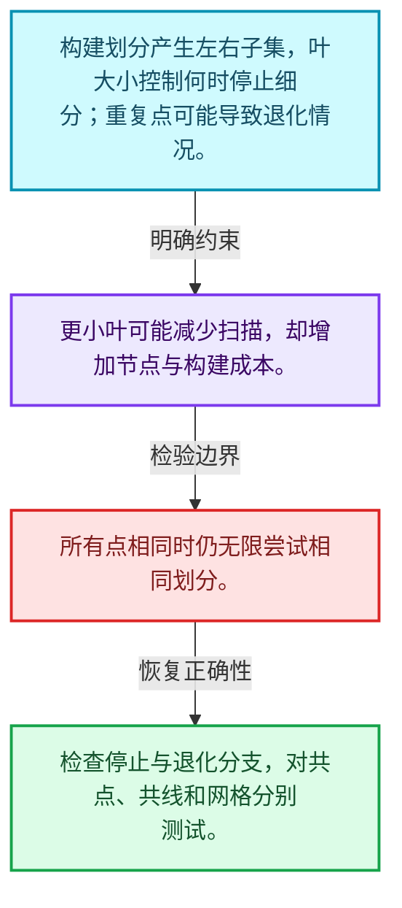
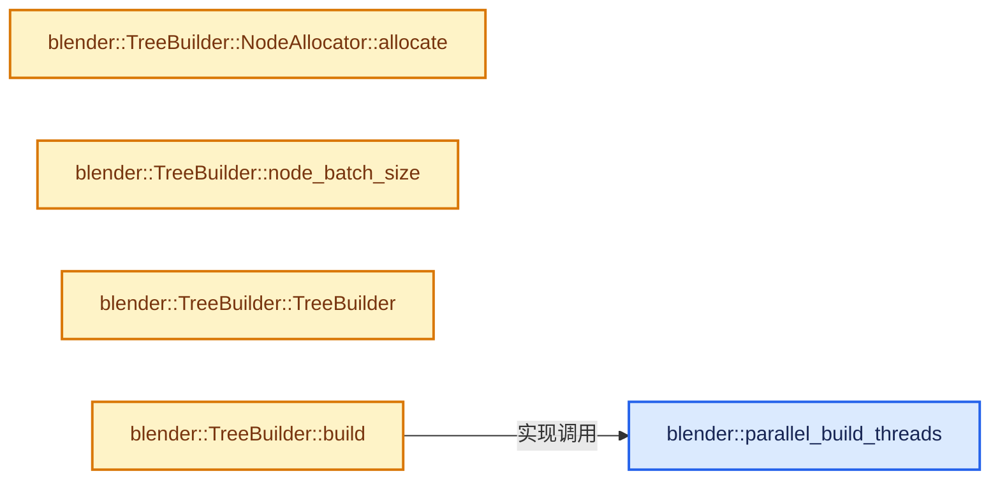
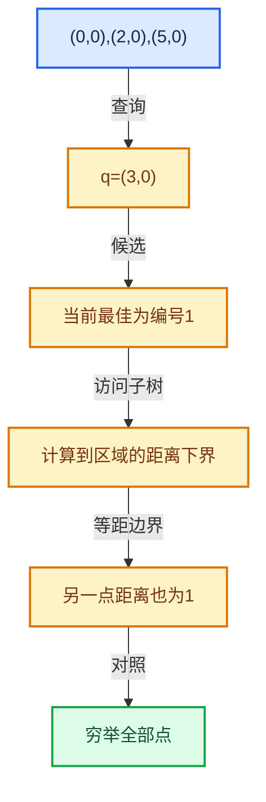

# 12-03 KDTreeNew构建

[方向导航](README.md) · [总目录](../README.md) · [实现索引](../00-课程指南/02-源码与提交索引/符号依赖与实现索引.md)

## 从问题到实现

划分维度与停止条件如何影响树形？

递归分割组织候选点，叶大小影响构建成本和查询扫描；退化分布不能假定均匀平衡。

**数据模型**

构建划分产生左右子集，叶大小控制何时停止细分；重复点可能导致退化情况。

**设计取舍**

更小叶可能减少扫描，却增加节点与构建成本。

**最小反例**

所有点相同时仍无限尝试相同划分。

**推导**

检查停止与退化分支，对共点、共线和网格分别测试。

## 阅读地图与执行推演








图中的数值推演是本方向的教学模型；实际函数之间的调用边与概念分析边分别标注，不能把概念关系当作运行时调度顺序。

## 完整源码单元与就地讲解

中文讲解直接放在相关代码旁，复杂机制在代码下展开。原文折叠区保留基准行号；不需要在行号表和函数之间来回查找。类布局可分段展示，函数实现不按固定行数切开。

### 类型布局、声明与编译条件 · kdtree.cc L1—L77

<!-- annotated:d9b1a7bef0c0fc -->

```cpp
/* SPDX-FileCopyrightText: 2008-2009 Marius Muja, David G. Lowe.
 * SPDX-FileCopyrightText: 2011-2026 Jose Luis Blanco-Claraco.
 * SPDX-FileCopyrightText: 2026 Blender Authors.
 *
 * SPDX-License-Identifier: BSD-2-Clause */

/** \file
 * \ingroup bli
 *
 * A KD-tree for nearest neighbor search, which started from the nanoflann library and has since
 * been rewritten around Blender's own containers, threading and math. The node layout and the way
 * a search walks it are still recognizably nanoflann's, which is where the copyright above comes
 * from.
 */

#include <algorithm>
#include <bit>
#include <cmath>
#include <numeric>
#include <optional>

#include "BLI_array.hh"
#include "BLI_bounds.hh"
#include "BLI_enumerable_thread_specific.hh"
#include "BLI_index_mask.hh"
#include "BLI_kdtree_new.hh"
#include "BLI_linear_allocator.hh"
#include "BLI_math_vector.hh"
#include "BLI_task.hh"
#include "BLI_threads.hh"

namespace blender {

/* -------------------------------------------------------------------- */
/** \name Build Tuning
 * \{ */

/** Tree size that makes building with more than one thread worthwhile. */
static constexpr int PARALLEL_BUILD_THRESHOLD = 10000;

/** Threads used to build a tree of #PARALLEL_BUILD_THRESHOLD points. */
static constexpr int PARALLEL_BUILD_THRESHOLD_THREADS = 4;

/** Subtrees smaller than this are built in one task, which is cheaper than handing them over. */
static constexpr int PARALLEL_SUBTREE_GRAIN = 4096;

/** Points that make a block worth giving a thread of its own within a single node. */
static constexpr int NODE_BLOCK_SIZE = 8192;

/** Upper bound on those blocks, so that the bookkeeping fits on the stack. */
static constexpr int NODE_MAX_BLOCKS = 64;

/**
 * Nodes holding more than this fraction of the tree are split a block at a time, which is what a
 * threaded build spreads over its threads. Below that there are enough subtrees to keep the
 * threads busy on their own, and the blocks and the fix up they need are only extra work.
 */
static constexpr int NODE_BLOCK_FRACTION = 8;

/**
 * Points a partition works on at a time. An offset within a block has to fit in a #uint8_t, and
 * two blocks have to fit in a range for the block path to be used at all.
 */
static constexpr int PARTITION_BLOCK_SIZE = 128;

/**
 * The best number of threads to build a tree depends on the memory bandwidth relative to the
 * amount of computational work necessary. Building repeatedly reorders coordinates and indices so
 * it is heavily bottlenecked by memory bandwidth at high point counts. We want to be relatively
 * conservative with the thread count as well; the CPU may be better off spending time on other
 * less memory-bound tasks.
 *
 * This fourth root relationship between increases in point count and threads used is tuned for a
 * 16 core Ryzen 7950X: a million point build takes 25 ms on one thread and 3.5 ms on eight, past
 * which it stops improving, while the processor time it uses keeps growing with every thread. See
 * `BLI_kdtree_performance_test`.
 */
```

<details>
<summary>核对原始源码：source/blender/blenlib/intern/kdtree.cc · L1—L77</summary>

<!-- original:d9b1a7bef0c0fc:source/blender/blenlib/intern/kdtree.cc:1:77 -->

```cpp
/* SPDX-FileCopyrightText: 2008-2009 Marius Muja, David G. Lowe.
 * SPDX-FileCopyrightText: 2011-2026 Jose Luis Blanco-Claraco.
 * SPDX-FileCopyrightText: 2026 Blender Authors.
 *
 * SPDX-License-Identifier: BSD-2-Clause */

/** \file
 * \ingroup bli
 *
 * A KD-tree for nearest neighbor search, which started from the nanoflann library and has since
 * been rewritten around Blender's own containers, threading and math. The node layout and the way
 * a search walks it are still recognizably nanoflann's, which is where the copyright above comes
 * from.
 */

#include <algorithm>
#include <bit>
#include <cmath>
#include <numeric>
#include <optional>

#include "BLI_array.hh"
#include "BLI_bounds.hh"
#include "BLI_enumerable_thread_specific.hh"
#include "BLI_index_mask.hh"
#include "BLI_kdtree_new.hh"
#include "BLI_linear_allocator.hh"
#include "BLI_math_vector.hh"
#include "BLI_task.hh"
#include "BLI_threads.hh"

namespace blender {

/* -------------------------------------------------------------------- */
/** \name Build Tuning
 * \{ */

/** Tree size that makes building with more than one thread worthwhile. */
static constexpr int PARALLEL_BUILD_THRESHOLD = 10000;

/** Threads used to build a tree of #PARALLEL_BUILD_THRESHOLD points. */
static constexpr int PARALLEL_BUILD_THRESHOLD_THREADS = 4;

/** Subtrees smaller than this are built in one task, which is cheaper than handing them over. */
static constexpr int PARALLEL_SUBTREE_GRAIN = 4096;

/** Points that make a block worth giving a thread of its own within a single node. */
static constexpr int NODE_BLOCK_SIZE = 8192;

/** Upper bound on those blocks, so that the bookkeeping fits on the stack. */
static constexpr int NODE_MAX_BLOCKS = 64;

/**
 * Nodes holding more than this fraction of the tree are split a block at a time, which is what a
 * threaded build spreads over its threads. Below that there are enough subtrees to keep the
 * threads busy on their own, and the blocks and the fix up they need are only extra work.
 */
static constexpr int NODE_BLOCK_FRACTION = 8;

/**
 * Points a partition works on at a time. An offset within a block has to fit in a #uint8_t, and
 * two blocks have to fit in a range for the block path to be used at all.
 */
static constexpr int PARTITION_BLOCK_SIZE = 128;

/**
 * The best number of threads to build a tree depends on the memory bandwidth relative to the
 * amount of computational work necessary. Building repeatedly reorders coordinates and indices so
 * it is heavily bottlenecked by memory bandwidth at high point counts. We want to be relatively
 * conservative with the thread count as well; the CPU may be better off spending time on other
 * less memory-bound tasks.
 *
 * This fourth root relationship between increases in point count and threads used is tuned for a
 * 16 core Ryzen 7950X: a million point build takes 25 ms on one thread and 3.5 ms on eight, past
 * which it stops improving, while the processor time it uses keeps growing with every thread. See
 * `BLI_kdtree_performance_test`.
 */
```

</details>

<a id="f-496105406e762ca6"></a>

### `blender::parallel_build_threads`

实现位置：[source/blender/blenlib/intern/kdtree.cc](../../../../../source/blender/blenlib/intern/kdtree.cc) · L78—L83。

接口参数：

- `const int64_t points_num`

**教学注释版**

<!-- annotated:321a7466847ed9 -->

```cpp
static int parallel_build_threads(const int64_t points_num)
{
  const double growth = std::sqrt(
      std::sqrt(double(points_num) / double(PARALLEL_BUILD_THRESHOLD)));
  // [讲解] std::max：按比较关系选取较大值。本讲解中的增长公式同时满足最低请求和几何增长；若保存返回引用，还需注意实参寿命。
  return std::max(int(std::round(double(PARALLEL_BUILD_THRESHOLD_THREADS) * growth)), 1);
}
```

<details>
<summary>核对原始源码：source/blender/blenlib/intern/kdtree.cc · L78—L83</summary>

<!-- original:321a7466847ed9:source/blender/blenlib/intern/kdtree.cc:78:83 -->

```cpp
static int parallel_build_threads(const int64_t points_num)
{
  const double growth = std::sqrt(
      std::sqrt(double(points_num) / double(PARALLEL_BUILD_THRESHOLD)));
  return std::max(int(std::round(double(PARALLEL_BUILD_THRESHOLD_THREADS) * growth)), 1);
}
```

</details>

**结果出口**

- `return std::max(int(std::round(double(PARALLEL_BUILD_THRESHOLD_THREADS) * growth)), 1);`

**继续追踪实现**

- `std::sqrt` → [外部契约](https://eel.is/c++draft/)：这个边界按实际表达式及所属类型核对参数、返回值、寿命与失败行为。这里提供接口入口，不声称已解释该第三方版本的内部实现。
- `std::max` → [外部契约](https://eel.is/c++draft/alg.min.max)：按比较关系选取较大值。本讲解中的增长公式同时满足最低请求和几何增长；若保存返回引用，还需注意实参寿命。
- `std::round` → [外部契约](https://eel.is/c++draft/)：这个边界按实际表达式及所属类型核对参数、返回值、寿命与失败行为。这里提供接口入口，不声称已解释该第三方版本的内部实现。

### 类型布局、声明与编译条件 · kdtree.cc L84—L130

<a id="t-ef8fe4eacd58"></a>

`TreeBuilder`在这里声明的数据成员：

- `int dimensions`

<a id="t-197e98b94900"></a>

`NodeAllocator`在这里声明的数据成员：

- `int BATCH_SIZE_MAX`
- `int batch_size`
- `LinearAllocator<> owned_allocator`
- `LinearAllocator<> allocator`
- `MutableSpan<Node> batch`
- `int used`

<!-- annotated:96bbe1caf43aa8 -->

```cpp

/** \} */

/* -------------------------------------------------------------------- */
/** \name Tree
 * \{ */

template<typename T> class TreeBuilder {
 public:
  using value_type = typename T::base_type;
  static constexpr int dimensions = T::type_length;

 private:
  /**
   * A point as the build holds it: its coordinates, and its index in #points_ in the element
   * after them.
   */
  using BuildPoint = VecBase<value_type, dimensions + 1>;

  using Node = kdtree::Node<value_type>;

  /**
   * Nodes are handed out from batches, so that a walk down the tree stays within a few
   * allocations. A linear allocator packs small allocations into buffers of a few kilobytes at
   * most, which for a tree of any size means nodes scattered over many of them.
   */
  struct NodeAllocator {
    /**
     * Most nodes per batch, and so the most that can go unused per thread that built a subtree.
     * The first batch of a build is sized from the number of points instead, so that a small tree
     * does not reserve room for a large one. See #node_batch_size.
     */
    static constexpr int BATCH_SIZE_MAX = 256;

    int batch_size = BATCH_SIZE_MAX;
    /**
     * Where the batches come from. A pool that a thread of its own fills has to have one to
     * itself, while the pool of a build that stays on one thread takes them straight from the
     * tree's allocator, so that its nodes land in the same buffer as its indices.
     */
    LinearAllocator<> owned_allocator;
    LinearAllocator<> *allocator = &owned_allocator;
    MutableSpan<Node> batch;
    /* Equal to the (empty) batch size, so that the first allocation starts a batch. */
    int used = 0;

    /** A node, or the two children of one, which have to be next to each other. */
```

<details>
<summary>核对原始源码：source/blender/blenlib/intern/kdtree.cc · L84—L130</summary>

<!-- original:96bbe1caf43aa8:source/blender/blenlib/intern/kdtree.cc:84:130 -->

```cpp

/** \} */

/* -------------------------------------------------------------------- */
/** \name Tree
 * \{ */

template<typename T> class TreeBuilder {
 public:
  using value_type = typename T::base_type;
  static constexpr int dimensions = T::type_length;

 private:
  /**
   * A point as the build holds it: its coordinates, and its index in #points_ in the element
   * after them.
   */
  using BuildPoint = VecBase<value_type, dimensions + 1>;

  using Node = kdtree::Node<value_type>;

  /**
   * Nodes are handed out from batches, so that a walk down the tree stays within a few
   * allocations. A linear allocator packs small allocations into buffers of a few kilobytes at
   * most, which for a tree of any size means nodes scattered over many of them.
   */
  struct NodeAllocator {
    /**
     * Most nodes per batch, and so the most that can go unused per thread that built a subtree.
     * The first batch of a build is sized from the number of points instead, so that a small tree
     * does not reserve room for a large one. See #node_batch_size.
     */
    static constexpr int BATCH_SIZE_MAX = 256;

    int batch_size = BATCH_SIZE_MAX;
    /**
     * Where the batches come from. A pool that a thread of its own fills has to have one to
     * itself, while the pool of a build that stays on one thread takes them straight from the
     * tree's allocator, so that its nodes land in the same buffer as its indices.
     */
    LinearAllocator<> owned_allocator;
    LinearAllocator<> *allocator = &owned_allocator;
    MutableSpan<Node> batch;
    /* Equal to the (empty) batch size, so that the first allocation starts a batch. */
    int used = 0;

    /** A node, or the two children of one, which have to be next to each other. */
```

</details>

<a id="f-b20ae1e189f03d83"></a>

### `blender::TreeBuilder::NodeAllocator::allocate`

实现位置：[source/blender/blenlib/intern/kdtree.cc](../../../../../source/blender/blenlib/intern/kdtree.cc) · L131—L142。

接口参数：

- `const int num`

**教学注释版**

<!-- annotated:e548081c586f8d -->

```cpp
    Node *allocate(const int num)
    {
      // [讲解] batch.size：查询视图长度或生成对应有效索引区间。
      if (used + num > batch.size()) {
        this->batch = this->allocator->allocate_array<Node>(batch_size);
        this->used = 0;
        /* Only the first batch is sized for the tree, the rest are full size. */
        this->batch_size = BATCH_SIZE_MAX;
      }
      Node *nodes = &this->batch[used];
      this->used += num;
      return nodes;
    }
```

<details>
<summary>核对原始源码：source/blender/blenlib/intern/kdtree.cc · L131—L142</summary>

<!-- original:e548081c586f8d:source/blender/blenlib/intern/kdtree.cc:131:142 -->

```cpp
    Node *allocate(const int num)
    {
      if (used + num > batch.size()) {
        this->batch = this->allocator->allocate_array<Node>(batch_size);
        this->used = 0;
        /* Only the first batch is sized for the tree, the rest are full size. */
        this->batch_size = BATCH_SIZE_MAX;
      }
      Node *nodes = &this->batch[used];
      this->used += num;
      return nodes;
    }
```

</details>

**沿实际写入检查状态**

- `this->batch = this->allocator->allocate_array<Node>(batch_size);`
- `this->used = 0;`
- `this->batch_size = BATCH_SIZE_MAX;`
- `this->used += num;`

**结果出口**

- `return nodes;`

**继续追踪实现**

- `batch.size` → [blender::MutableSpan::size · L499](../01-基础容器与现代CPP/06-MutableSpan可写视图.md#f-1de6a66839c304a8)；[blender::gpu::shader::parser::MutableSpan::size · L87](../90-实现依赖专题/08-其他Blender模块/gpu/shader_tool/utils.hh.md#f-5e684af6ee7990e9)。同名重载需按实参类型选择。
- `this->allocator->allocate_array<Node>` → [调用协议](../00-课程指南/01-路线与规范/模板宏与动态分派协议.md)：接收对象类型依赖auto、返回值或模板实例；不按同名猜测目标。调用位置L134。

### 类型布局、声明与编译条件 · kdtree.cc L143—L151

<!-- annotated:a7e7612b4e4487 -->

```cpp
  };

 public:
  /**
   * The approximate number of nodes a tree with \a points_num points takes. Leaves hold a bit over
   * two thirds of #leaf_size_ points on average, and a tree has one interior node fewer than it
   * has leaves. Measured at 22.6 points per leaf for a leaf size of 32. See
   * `BLI_kdtree_performance_test`.
   */
```

<details>
<summary>核对原始源码：source/blender/blenlib/intern/kdtree.cc · L143—L151</summary>

<!-- original:a7e7612b4e4487:source/blender/blenlib/intern/kdtree.cc:143:151 -->

```cpp
  };

 public:
  /**
   * The approximate number of nodes a tree with \a points_num points takes. Leaves hold a bit over
   * two thirds of #leaf_size_ points on average, and a tree has one interior node fewer than it
   * has leaves. Measured at 22.6 points per leaf for a leaf size of 32. See
   * `BLI_kdtree_performance_test`.
   */
```

</details>

<a id="f-ee365f41997d9839"></a>

### `blender::TreeBuilder::node_batch_size`

实现位置：[source/blender/blenlib/intern/kdtree.cc](../../../../../source/blender/blenlib/intern/kdtree.cc) · L152—L156。

接口参数：

- `const int points_num`
- `const int leaf_size`

**教学注释版**

<!-- annotated:a81982ffc531c4 -->

```cpp
  static int node_batch_size(const int points_num, const int leaf_size)
  {
    // [讲解] std::max<int64_t>：按比较关系选取较大值。本讲解中的增长公式同时满足最低请求和几何增长；若保存返回引用，还需注意实参寿命。
    const int64_t leaves = std::max<int64_t>(1, points_num * 3 / (int64_t(leaf_size) * 2));
    // [讲解] std::min<int64_t>：按比较关系选取较小值；截断范围时还需先满足非负和可表示范围，min本身不会证明边界安全。
    return int(std::min<int64_t>(2 * leaves + 1, NodeAllocator::BATCH_SIZE_MAX));
  }
```

<details>
<summary>核对原始源码：source/blender/blenlib/intern/kdtree.cc · L152—L156</summary>

<!-- original:a81982ffc531c4:source/blender/blenlib/intern/kdtree.cc:152:156 -->

```cpp
  static int node_batch_size(const int points_num, const int leaf_size)
  {
    const int64_t leaves = std::max<int64_t>(1, points_num * 3 / (int64_t(leaf_size) * 2));
    return int(std::min<int64_t>(2 * leaves + 1, NodeAllocator::BATCH_SIZE_MAX));
  }
```

</details>

**结果出口**

- `return int(std::min<int64_t>(2 * leaves + 1, NodeAllocator::BATCH_SIZE_MAX));`

**继续追踪实现**

- `std::max<int64_t>` → [外部契约](https://eel.is/c++draft/alg.min.max)：按比较关系选取较大值。本讲解中的增长公式同时满足最低请求和几何增长；若保存返回引用，还需注意实参寿命。
- `std::min<int64_t>` → [外部契约](https://eel.is/c++draft/alg.min.max)：按比较关系选取较小值；截断范围时还需先满足非负和可表示范围，min本身不会证明边界安全。

### 类型布局、声明与编译条件 · kdtree.cc L157—L182

<!-- annotated:01936e8c958222 -->

```cpp

 private:
  const Span<T> points_;
  /** Filled with the indices of the points, in the order the tree visits them. */
  const MutableSpan<int> indices_;
  const int leaf_size_;
  /** The buffers the nodes end up in, which the pools below hand theirs to. */
  LinearAllocator<> &allocator_;

  /**
   * The points being reordered, which #indices_ is taken from once the tree is built. Only set
   * while #build_nodes runs, which is the only thing that needs it.
   */
  MutableSpan<BuildPoint> build_points_;
  /** The pool of a build that stays on one thread. */
  NodeAllocator pool_;
  /**
   * A pool per thread that takes part in a threaded build. One pool behind a mutex would put
   * every node in the tree through it, while a pool per subtree leaves a partly used batch
   * behind for each of them and spreads the nodes of a subtree over several pools. Only built
   * when there are threads to give pools to: reaching into thread local storage costs more than
   * building a tree of a few points does.
   */
  std::optional<threading::EnumerableThreadSpecific<NodeAllocator>> thread_allocators_;

 public:
```

<details>
<summary>核对原始源码：source/blender/blenlib/intern/kdtree.cc · L157—L182</summary>

<!-- original:01936e8c958222:source/blender/blenlib/intern/kdtree.cc:157:182 -->

```cpp

 private:
  const Span<T> points_;
  /** Filled with the indices of the points, in the order the tree visits them. */
  const MutableSpan<int> indices_;
  const int leaf_size_;
  /** The buffers the nodes end up in, which the pools below hand theirs to. */
  LinearAllocator<> &allocator_;

  /**
   * The points being reordered, which #indices_ is taken from once the tree is built. Only set
   * while #build_nodes runs, which is the only thing that needs it.
   */
  MutableSpan<BuildPoint> build_points_;
  /** The pool of a build that stays on one thread. */
  NodeAllocator pool_;
  /**
   * A pool per thread that takes part in a threaded build. One pool behind a mutex would put
   * every node in the tree through it, while a pool per subtree leaves a partly used batch
   * behind for each of them and spreads the nodes of a subtree over several pools. Only built
   * when there are threads to give pools to: reaching into thread local storage costs more than
   * building a tree of a few points does.
   */
  std::optional<threading::EnumerableThreadSpecific<NodeAllocator>> thread_allocators_;

 public:
```

</details>

<a id="f-569fef2a33fa8074"></a>

### `blender::TreeBuilder::TreeBuilder`

实现位置：[source/blender/blenlib/intern/kdtree.cc](../../../../../source/blender/blenlib/intern/kdtree.cc) · L183—L189。

接口参数：

- `const Span<T> points`
- `const MutableSpan<int> indices`
- `const int leaf_size`
- `LinearAllocator<> &allocator`

**教学注释版**

<!-- annotated:def0180242b02c -->

```cpp
  TreeBuilder(const Span<T> points,
              const MutableSpan<int> indices,
              const int leaf_size,
              LinearAllocator<> &allocator)
      : points_(points), indices_(indices), leaf_size_(leaf_size), allocator_(allocator)
  {
  }
```

<details>
<summary>核对原始源码：source/blender/blenlib/intern/kdtree.cc · L183—L189</summary>

<!-- original:def0180242b02c:source/blender/blenlib/intern/kdtree.cc:183:189 -->

```cpp
  TreeBuilder(const Span<T> points,
              const MutableSpan<int> indices,
              const int leaf_size,
              LinearAllocator<> &allocator)
      : points_(points), indices_(indices), leaf_size_(leaf_size), allocator_(allocator)
  {
  }
```

</details>

**继续追踪实现**

本实现没有需要继续展开的显式调用；检查返回表达式、对象转换和调用者前置条件。

<!-- annotated:c4dc9b6c56f236 -->

```cpp

```

<details>
<summary>核对原始源码：source/blender/blenlib/intern/kdtree.cc · L190—L190</summary>

<!-- original:c4dc9b6c56f236:source/blender/blenlib/intern/kdtree.cc:190:190 -->

```cpp

```

</details>

<a id="f-1aeedf8a897736f1"></a>

### `blender::TreeBuilder::build`

实现位置：[source/blender/blenlib/intern/kdtree.cc](../../../../../source/blender/blenlib/intern/kdtree.cc) · L191—L214。

接口参数：

- `const Span<int> indices`
- `Bounds<T> &r_bounds`

**教学注释版**

<!-- annotated:0ec49cc375c1b5 -->

```cpp
  Node *build(const Span<int> indices, Bounds<T> &r_bounds)
  {
    // [讲解] indices_.size：查询视图长度或生成对应有效索引区间。
    const int size = int(indices_.size());
    BLI_assert(size > 0);

    /* A tree that is a single leaf has nothing to split, and copying the coordinates aside would
     * cost more than the rest of its build. */
    if (size <= leaf_size_) {
      return this->build_single_leaf(indices, r_bounds);
    }

    /* Splitting the build into tasks costs something even when there is no second thread to run
     * them, so only ask for it when there is one. */
    const bool threaded = size >= PARALLEL_BUILD_THRESHOLD && BLI_system_thread_count() > 1;
    Node *root = nullptr;
    if (threaded) {
      threading::max_threads_task(parallel_build_threads(size),
                                  [&]() { root = this->build_nodes(indices, r_bounds, true); });
    }
    else {
      root = this->build_nodes(indices, r_bounds, false);
    }
    return root;
  }
```

<details>
<summary>核对原始源码：source/blender/blenlib/intern/kdtree.cc · L191—L214</summary>

<!-- original:0ec49cc375c1b5:source/blender/blenlib/intern/kdtree.cc:191:214 -->

```cpp
  Node *build(const Span<int> indices, Bounds<T> &r_bounds)
  {
    const int size = int(indices_.size());
    BLI_assert(size > 0);

    /* A tree that is a single leaf has nothing to split, and copying the coordinates aside would
     * cost more than the rest of its build. */
    if (size <= leaf_size_) {
      return this->build_single_leaf(indices, r_bounds);
    }

    /* Splitting the build into tasks costs something even when there is no second thread to run
     * them, so only ask for it when there is one. */
    const bool threaded = size >= PARALLEL_BUILD_THRESHOLD && BLI_system_thread_count() > 1;
    Node *root = nullptr;
    if (threaded) {
      threading::max_threads_task(parallel_build_threads(size),
                                  [&]() { root = this->build_nodes(indices, r_bounds, true); });
    }
    else {
      root = this->build_nodes(indices, r_bounds, false);
    }
    return root;
  }
```

</details>

**沿实际写入检查状态**

- `root = this->build_nodes(indices, r_bounds, false);`

**结果出口**

- `return this->build_single_leaf(indices, r_bounds);`
- `return root;`

**继续追踪实现**

- `indices_.size` → [blender::MutableSpan::size · L499](../01-基础容器与现代CPP/06-MutableSpan可写视图.md#f-1de6a66839c304a8)；[blender::gpu::shader::parser::MutableSpan::size · L87](../90-实现依赖专题/08-其他Blender模块/gpu/shader_tool/utils.hh.md#f-5e684af6ee7990e9)。同名重载需按实参类型选择。
- `BLI_assert` → [BLI_assert · L48](../90-实现依赖专题/01-BLI基础库/BLI_assert.hh.md#m-57a88495704d)；[BLI_assert · L63](../90-实现依赖专题/01-BLI基础库/BLI_assert.hh.md#m-d07050020cb5)。宏定义由构建条件选择。
- `this->build_single_leaf` → [blender::TreeBuilder::build_single_leaf · L221](04-最近邻搜索与剪枝.md#f-81e455968e8b4fd4)。
- `BLI_system_thread_count` → [BLI_system_thread_count · L258](../90-实现依赖专题/01-BLI基础库/intern/threads.cc.md#f-12aff71a24fecec4)。
- `threading::max_threads_task` → [blender::threading::max_threads_task · L238](../11-Depsgraph与并行任务系统/07-任务池与TBB接入.md#f-caf66416559a5d62)。
- `parallel_build_threads` → [blender::parallel_build_threads · L78](03-KDTreeNew构建.md#f-496105406e762ca6)。
- `this->build_nodes` → [blender::TreeBuilder::build_nodes · L242](04-最近邻搜索与剪枝.md#f-4c26235c83d52682)。

### 类型布局、声明与编译条件 · kdtree.cc L215—L220

<!-- annotated:1eedee0bc6c090 -->

```cpp

 private:
  /* -------------------------------------------------------------------- */
  /** \name Build
   * \{ */

```

<details>
<summary>核对原始源码：source/blender/blenlib/intern/kdtree.cc · L215—L220</summary>

<!-- original:1eedee0bc6c090:source/blender/blenlib/intern/kdtree.cc:215:220 -->

```cpp

 private:
  /* -------------------------------------------------------------------- */
  /** \name Build
   * \{ */

```

</details>

## 语法与相关类型

### 模板 template

模板把类型或常量作为生成实现的参数。读声明时先列出类型参数、非类型参数和默认值，再看使用者实际实例化了什么。模板声明本身不意味着每种T都支持其全部成员。

把T替换为int、string、只能移动的类型，分别检查每个被调用操作是否成立。

### 依赖名称 typename

typename既可引入类型模板参数，也可告诉编译器某个依赖名称是类型。它不创建运行时对象；解析期确认语法类别与实例化期检查具体类型是不同阶段。

区分typename T::value_type和T::size()，前者标记类型，后者是表达式。

### 常量求值 constexpr

constexpr声明允许相应实体参与常量求值，但constexpr函数仍可以在运行时执行。是否常量求值由调用场景和表达式合法性共同决定。

比较constexpr变量初始化和从运行时输入调用同一函数。

### 只读限定 const

const约束当前访问路径可做的修改。const指针、指向const的指针、const视图对象、const元素是不同位置的限定；其他别名可能仍可修改原对象。

分别写T* const、const T*与const T* const，并画出不可修改的层次。

### 可选值 optional

optional把不存在与存在的T区分开，T的构造和析构跟随engaged状态变化。访问前应由has_value或条件分支证明存在。

把空Field状态与合法常量零区分，不能用某个普通值代替不存在。

### 内部断言 assert

断言表达开发者预期成立的内部契约，发布构建可能关闭。它不能替代对不可信输入的完整错误处理，也不保证后续操作被运行时保护。

对每条断言构造违反条件的输入，区分调用者错误与应向用户报告的错误。

### 类型别名 using

类型别名为已有类型建立名字，不创建运行期对象。它常把模板内部使用的类型统一暴露给泛型调用者。

展开别名直到基础类型，区分类型别名和变量声明。

## 实现练习与验证

对共线、重复和规则网格点分别观察划分。

参考推理：检查停止与退化分支，对共点、共线和网格分别测试。

返回点属于允许子集；距离不大于任何合法候选；等距按集合或距离验证，不能强制任意固定编号。

## 历史、跨库比较与证据

与nanoflann比较查询模型与来源，与BVH比较划分对象和原语，与暴力搜索比较构建成本是否值得；Blender实现有独立修改和借用契约。

[历史提交索引](../00-课程指南/02-源码与提交索引/历史提交与设计演化索引.md) · [源码基准](../00-课程指南/02-源码与提交索引/源码版本与覆盖索引.md) · [验收报告](../00-课程指南/03-验收报告/验收报告.md)
