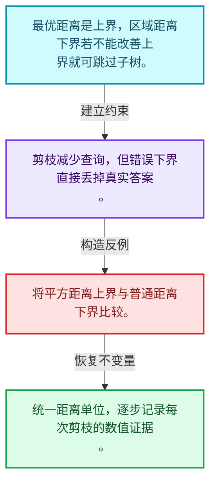
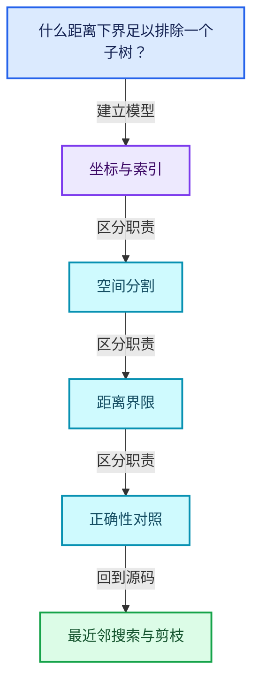
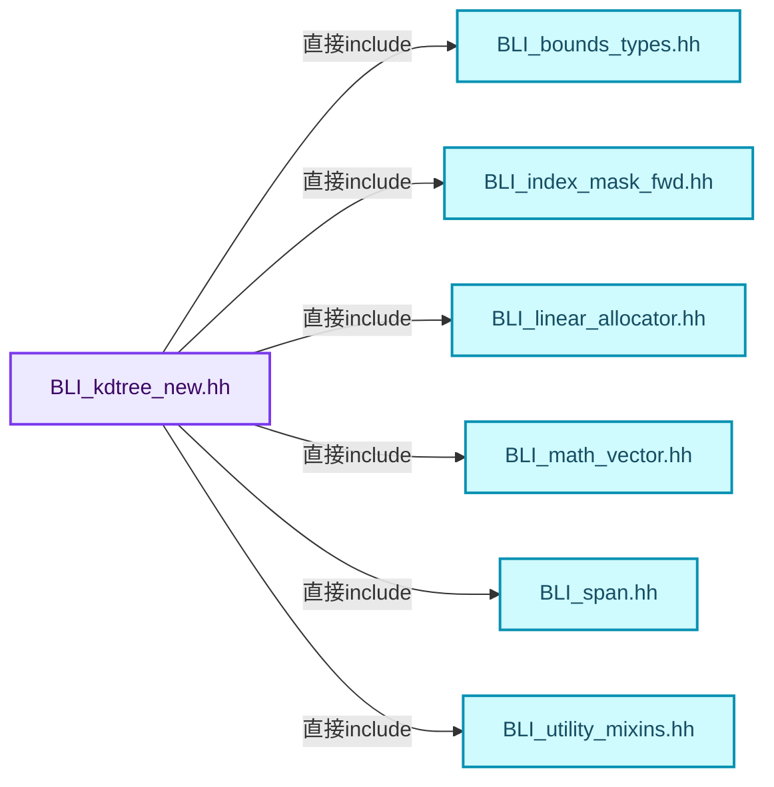
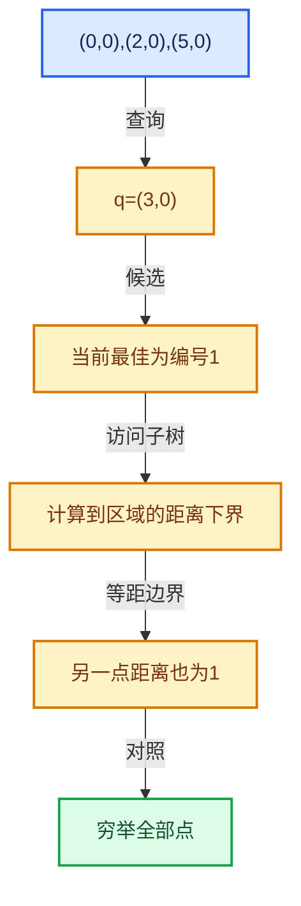

# 12-04 最近邻搜索与剪枝

[方向导航](README.md) · [总目录](../README.md) · [覆盖索引](../%E6%BA%90%E7%A0%81%E7%89%88%E6%9C%AC%E4%B8%8E%E8%A6%86%E7%9B%96%E7%B4%A2%E5%BC%95.md)

> 阅读顺序：问题与数据模型 → 语法与类型 → 源码逐行 → 调用线索 → 历史与取舍 → 推演和练习。

- 基准 HEAD：`cbda6b96c26c0dee3c3b5cbb93960c4ac06a6b30`。
- 记录日期：2026-10-14。
- 教学示例状态：正文中的推演不是本机性能实测；已运行练习见验收报告。

## 一、从问题到设计

什么距离下界足以排除一个子树？

当前最优距离是上界，分割或包围界提供下界；只有证明不可能改善结果时才能剪枝。

本篇把语法、数据语义和系统取舍连接起来。先证明距离下界与返回身份，再讨论布局优化和并行构建。

### 本篇独立模型与设计推理

最优距离是上界，区域距离下界若不能改善上界就可跳过子树。

设计取舍：剪枝减少查询，但错误下界直接丢掉真实答案。

最小反例：将平方距离上界与普通距离下界比较。

推导与处理：统一距离单位，逐步记录每次剪枝的数值证据。



### 源码范围与相邻篇章

| 文件 | 本篇逐行范围 | 基准SHA-256 |
|---|---|---|
| [source/blender/blenlib/BLI_kdtree_new.hh](../../../../../source/blender/blenlib/BLI_kdtree_new.hh) | L279—L410 | `b94b92497ea97b794042524c44573cd3d88d01c1fc9aa86c60a8940f6be04159` |
| [source/blender/blenlib/intern/kdtree.cc](../../../../../source/blender/blenlib/intern/kdtree.cc) | L217—L455 | `039dbc5c16d992dd0c468586cb3de58c161d4f327ecdd0909ea377342d038a90` |

同一主讲文件可能分多篇覆盖；超出本篇范围的符号通过覆盖索引定位。空行与纯注释保留在源码摘录中，逐行表解释有效语句与语法边界；许可证头统一保留。

前篇：[KDTreeNew构建](03-KDTreeNew%E6%9E%84%E5%BB%BA.md).

后篇：[K近邻与范围查询](05-K%E8%BF%91%E9%82%BB%E4%B8%8E%E8%8C%83%E5%9B%B4%E6%9F%A5%E8%AF%A2.md).

## 二、类型、数据与阅读地图



这是概念依赖图，边表示阅读关系，不声称是运行时调用顺序。

### 直接编译依赖



箭头只表示头文件包含关系；完整调用线索见后面的符号定位表。

## 三、关键词、语法与类型角色

### 模板 template

模板把类型或常量作为生成实现的参数。读声明时先列出类型参数、非类型参数和默认值，再看使用者实际实例化了什么。模板声明本身不意味着每种T都支持其全部成员。

具体检查：把T替换为int、string、只能移动的类型，分别检查每个被调用操作是否成立。

### 依赖名称 typename

typename既可引入类型模板参数，也可告诉编译器某个依赖名称是类型。它不创建运行时对象；解析期确认语法类别与实例化期检查具体类型是不同阶段。

具体检查：区分typename T::value_type和T::size()，前者标记类型，后者是表达式。

### 常量求值 constexpr

constexpr声明允许相应实体参与常量求值，但constexpr函数仍可以在运行时执行。是否常量求值由调用场景和表达式合法性共同决定。

具体检查：比较constexpr变量初始化和从运行时输入调用同一函数。

### 只读限定 const

const约束当前访问路径可做的修改。const指针、指向const的指针、const视图对象、const元素是不同位置的限定；其他别名可能仍可修改原对象。

具体检查：分别写T* const、const T*与const T* const，并画出不可修改的层次。

### 构造与new表达式

普通new可能分配并构造；placement new在给定地址构造，存储由其他机制提供。失败回滚应区分两类责任。

具体检查：追踪地址来自哪里、构造何时成功、由谁析构、由谁释放。

## 四、真实源码与逐行讲解

源码块保持原行内容，原始行号由小节标题及逐行表给出。表中的调用定位是静态阅读辅助；重载、模板实例化、宏展开和虚调用需结合完整声明，不能仅凭词法出现证明动态调用。

### BLI_kdtree_new.hh：L279—L324

<!-- source:source/blender/blenlib/BLI_kdtree_new.hh:279:324 -->

```cpp
};

namespace kdtree {

/** A search for the single closest point. */
template<typename ValueT> class NearestQuery {
 private:
  int index_ = -1;
  ValueT distance_sq_ = std::numeric_limits<ValueT>::max();

 public:
  static constexpr bool inclusive = false;

  int index() const
  {
    return index_;
  }
  ValueT distance_sq() const
  {
    return distance_sq_;
  }

  bool add_point(const ValueT distance_sq, const int index)
  {
    distance_sq_ = distance_sq;
    index_ = index;
    return true;
  }

  ValueT max_distance_sq() const
  {
    return distance_sq_;
  }
};

/** Like #NearestQuery, but only the points accepted by a filter shrink the search radius. */
template<typename ValueT, typename Filter> class FilteredNearestQuery {
 private:
  Filter filter_;
  int index_ = -1;
  ValueT distance_sq_ = std::numeric_limits<ValueT>::max();

 public:
  static constexpr bool inclusive = false;

  explicit FilteredNearestQuery(Filter filter) : filter_(filter) {}
```

本段语义重点：

- `distance_sq`：平方距离，可避免开方，但阈值也必须使用一致单位。
- `max_distance_sq`：当前允许或最优平方距离上界，影响剪枝是否正确。

| 原始行 | 语义、约束与检查 |
|---|---|
| L279 | 结束当前语法单元。局部自动对象在离开其作用域时按规则销毁；这不等于所有被引用的外部数据也被释放。 |
| L281 | 把后续声明放入 kdtree 命名空间，影响名称查找和符号归属，不创建运行时对象。 |
| L284 | 声明模板参数 `template<typename ValueT> class NearestQuery {`。类型参数决定生成操作的类型，非类型参数可决定内嵌容量或编译期分支。 |
| L285 | 切换成员访问权限为 private；它是编译期接口边界，不是线程同步或内存保护。 |
| L286 | 把右侧 `-1` 用于初始化或更新左侧 `int index_`。声明初始化与已有对象赋值应按上下文区分；有资源的类型会调用相应特殊成员。 |
| L287 | 把右侧 `std::numeric_limits<ValueT>::max()` 用于初始化或更新左侧 `ValueT distance_sq_`。声明初始化与已有对象赋值应按上下文区分；有资源的类型会调用相应特殊成员。 |
| L289 | 切换成员访问权限为 public；它是编译期接口边界，不是线程同步或内存保护。 |
| L290 | 把右侧 `false` 用于初始化或更新左侧 `static constexpr bool inclusive`。声明初始化与已有对象赋值应按上下文区分；有资源的类型会调用相应特殊成员。 |
| L292 | 出现调用或函数声明 `index`，对应表达式为 `int index() const`。参数求值、返回类型与重载需结合前后完整语句；静态文本引用不能证明动态目标。 |
| L293 | 连接上一行的声明或控制结构与其语句块；后续行在这个作用域中执行或声明。 |
| L294 | 返回表达式 `index_`。 |
| L295 | 结束当前语法单元。局部自动对象在离开其作用域时按规则销毁；这不等于所有被引用的外部数据也被释放。 |
| L296 | 本行涉及 `distance_sq`：平方距离，可避免开方，但阈值也必须使用一致单位。按此语义解读 `ValueT distance_sq() const`，不要把地址、数量或状态混用。 |
| L297 | 连接上一行的声明或控制结构与其语句块；后续行在这个作用域中执行或声明。 |
| L298 | 返回表达式 `distance_sq_`。 |
| L299 | 结束当前语法单元。局部自动对象在离开其作用域时按规则销毁；这不等于所有被引用的外部数据也被释放。 |
| L301 | 本行涉及 `distance_sq`：平方距离，可避免开方，但阈值也必须使用一致单位。按此语义解读 `bool add_point(const ValueT distance_sq, const int index)`，不要把地址、数量或状态混用。 |
| L302 | 连接上一行的声明或控制结构与其语句块；后续行在这个作用域中执行或声明。 |
| L303 | 建立或更新 `distance_sq`：平方距离，可避免开方，但阈值也必须使用一致单位。本行的具体值关系为 `distance_sq_ = distance_sq`；对照更新前后相应范围或状态是否一致。 |
| L304 | 把右侧 `index` 用于初始化或更新左侧 `index_`。声明初始化与已有对象赋值应按上下文区分；有资源的类型会调用相应特殊成员。 |
| L305 | 返回表达式 `true`。这是本路径的布尔结果，具体成功、存在或状态含义由函数接口规定。 |
| L306 | 结束当前语法单元。局部自动对象在离开其作用域时按规则销毁；这不等于所有被引用的外部数据也被释放。 |
| L308 | 本行涉及 `max_distance_sq`：当前允许或最优平方距离上界，影响剪枝是否正确。按此语义解读 `ValueT max_distance_sq() const`，不要把地址、数量或状态混用。 |
| L309 | 连接上一行的声明或控制结构与其语句块；后续行在这个作用域中执行或声明。 |
| L310 | 返回表达式 `distance_sq_`。 |
| L311 | 结束当前语法单元。局部自动对象在离开其作用域时按规则销毁；这不等于所有被引用的外部数据也被释放。 |
| L312 | 结束当前语法单元。局部自动对象在离开其作用域时按规则销毁；这不等于所有被引用的外部数据也被释放。 |
| L315 | 声明模板参数 `template<typename ValueT, typename Filter> class FilteredNearestQuery {`。类型参数决定生成操作的类型，非类型参数可决定内嵌容量或编译期分支。 |
| L316 | 切换成员访问权限为 private；它是编译期接口边界，不是线程同步或内存保护。 |
| L317 | 声明成员、局部对象或完成语句 `Filter filter_`。若为指针或引用，它本身不说明拥有；若为值对象，其构造析构由所在作用域或外层对象管理。 |
| L318 | 把右侧 `-1` 用于初始化或更新左侧 `int index_`。声明初始化与已有对象赋值应按上下文区分；有资源的类型会调用相应特殊成员。 |
| L319 | 把右侧 `std::numeric_limits<ValueT>::max()` 用于初始化或更新左侧 `ValueT distance_sq_`。声明初始化与已有对象赋值应按上下文区分；有资源的类型会调用相应特殊成员。 |
| L321 | 切换成员访问权限为 public；它是编译期接口边界，不是线程同步或内存保护。 |
| L322 | 把右侧 `false` 用于初始化或更新左侧 `static constexpr bool inclusive`。声明初始化与已有对象赋值应按上下文区分；有资源的类型会调用相应特殊成员。 |
| L324 | 出现调用或函数声明 `FilteredNearestQuery`，对应表达式为 `explicit FilteredNearestQuery(Filter filter) : filter_(filter) {}`。参数求值、返回类型与重载需结合前后完整语句；静态文本引用不能证明动态目标。 |

### BLI_kdtree_new.hh：L325—L364

<!-- source:source/blender/blenlib/BLI_kdtree_new.hh:325:364 -->

```cpp

  int index() const
  {
    return index_;
  }
  ValueT distance_sq() const
  {
    return distance_sq_;
  }

  bool add_point(const ValueT distance_sq, const int index)
  {
    if (filter_(index)) {
      distance_sq_ = distance_sq;
      index_ = index;
    }
    return true;
  }

  ValueT max_distance_sq() const
  {
    return distance_sq_;
  }
};

/** Keeps the closest points, in order, up to the size of the span it was given. */
template<typename NearestT, typename ValueT> class NearestNQuery {
 private:
  MutableSpan<NearestT> nearest_;
  int count_ = 0;

 public:
  static constexpr bool inclusive = false;

  explicit NearestNQuery(MutableSpan<NearestT> nearest) : nearest_(nearest) {}

  int count() const
  {
    return count_;
  }
```

本段语义重点：

- `distance_sq`：平方距离，可避免开方，但阈值也必须使用一致单位。
- `max_distance_sq`：当前允许或最优平方距离上界，影响剪枝是否正确。

| 原始行 | 语义、约束与检查 |
|---|---|
| L326 | 出现调用或函数声明 `index`，对应表达式为 `int index() const`。参数求值、返回类型与重载需结合前后完整语句；静态文本引用不能证明动态目标。 |
| L327 | 连接上一行的声明或控制结构与其语句块；后续行在这个作用域中执行或声明。 |
| L328 | 返回表达式 `index_`。 |
| L329 | 结束当前语法单元。局部自动对象在离开其作用域时按规则销毁；这不等于所有被引用的外部数据也被释放。 |
| L330 | 本行涉及 `distance_sq`：平方距离，可避免开方，但阈值也必须使用一致单位。按此语义解读 `ValueT distance_sq() const`，不要把地址、数量或状态混用。 |
| L331 | 连接上一行的声明或控制结构与其语句块；后续行在这个作用域中执行或声明。 |
| L332 | 返回表达式 `distance_sq_`。 |
| L333 | 结束当前语法单元。局部自动对象在离开其作用域时按规则销毁；这不等于所有被引用的外部数据也被释放。 |
| L335 | 本行涉及 `distance_sq`：平方距离，可避免开方，但阈值也必须使用一致单位。按此语义解读 `bool add_point(const ValueT distance_sq, const int index)`，不要把地址、数量或状态混用。 |
| L336 | 连接上一行的声明或控制结构与其语句块；后续行在这个作用域中执行或声明。 |
| L337 | 判断 `filter_(index)`，成立时进入本分支，否则继续后续路径。 |
| L338 | 建立或更新 `distance_sq`：平方距离，可避免开方，但阈值也必须使用一致单位。本行的具体值关系为 `distance_sq_ = distance_sq`；对照更新前后相应范围或状态是否一致。 |
| L339 | 把右侧 `index` 用于初始化或更新左侧 `index_`。声明初始化与已有对象赋值应按上下文区分；有资源的类型会调用相应特殊成员。 |
| L340 | 结束当前语法单元。局部自动对象在离开其作用域时按规则销毁；这不等于所有被引用的外部数据也被释放。 |
| L341 | 返回表达式 `true`。这是本路径的布尔结果，具体成功、存在或状态含义由函数接口规定。 |
| L342 | 结束当前语法单元。局部自动对象在离开其作用域时按规则销毁；这不等于所有被引用的外部数据也被释放。 |
| L344 | 本行涉及 `max_distance_sq`：当前允许或最优平方距离上界，影响剪枝是否正确。按此语义解读 `ValueT max_distance_sq() const`，不要把地址、数量或状态混用。 |
| L345 | 连接上一行的声明或控制结构与其语句块；后续行在这个作用域中执行或声明。 |
| L346 | 返回表达式 `distance_sq_`。 |
| L347 | 结束当前语法单元。局部自动对象在离开其作用域时按规则销毁；这不等于所有被引用的外部数据也被释放。 |
| L348 | 结束当前语法单元。局部自动对象在离开其作用域时按规则销毁；这不等于所有被引用的外部数据也被释放。 |
| L351 | 声明模板参数 `template<typename NearestT, typename ValueT> class NearestNQuery {`。类型参数决定生成操作的类型，非类型参数可决定内嵌容量或编译期分支。 |
| L352 | 切换成员访问权限为 private；它是编译期接口边界，不是线程同步或内存保护。 |
| L353 | 声明成员、局部对象或完成语句 `MutableSpan<NearestT> nearest_`。若为指针或引用，它本身不说明拥有；若为值对象，其构造析构由所在作用域或外层对象管理。 |
| L354 | 把右侧 `0` 用于初始化或更新左侧 `int count_`。声明初始化与已有对象赋值应按上下文区分；有资源的类型会调用相应特殊成员。 |
| L356 | 切换成员访问权限为 public；它是编译期接口边界，不是线程同步或内存保护。 |
| L357 | 把右侧 `false` 用于初始化或更新左侧 `static constexpr bool inclusive`。声明初始化与已有对象赋值应按上下文区分；有资源的类型会调用相应特殊成员。 |
| L359 | 出现调用或函数声明 `NearestNQuery`，对应表达式为 `explicit NearestNQuery(MutableSpan<NearestT> nearest) : nearest_(nearest) {}`。参数求值、返回类型与重载需结合前后完整语句；静态文本引用不能证明动态目标。 |
| L361 | 出现调用或函数声明 `count`，对应表达式为 `int count() const`。参数求值、返回类型与重载需结合前后完整语句；静态文本引用不能证明动态目标。 |
| L362 | 连接上一行的声明或控制结构与其语句块；后续行在这个作用域中执行或声明。 |
| L363 | 返回表达式 `count_`。 |
| L364 | 结束当前语法单元。局部自动对象在离开其作用域时按规则销毁；这不等于所有被引用的外部数据也被释放。 |

### BLI_kdtree_new.hh：L365—L410

<!-- source:source/blender/blenlib/BLI_kdtree_new.hh:365:410 -->

```cpp

  bool add_point(const ValueT distance_sq, const int index)
  {
    /* Insert the new index at the sorted point in the list. */
    const int capacity = int(nearest_.size());
    int i;
    for (i = count_; i > 0; i--) {
      if (nearest_[i - 1].distance_sq <= distance_sq) {
        break;
      }
      if (i < capacity) {
        nearest_[i] = nearest_[i - 1];
      }
    }
    if (i < capacity) {
      nearest_[i] = {index, distance_sq};
    }
    if (count_ < capacity) {
      count_++;
    }
    return true;
  }

  ValueT max_distance_sq() const
  {
    if (count_ < int(nearest_.size())) {
      return std::numeric_limits<ValueT>::max();
    }
    return nearest_[count_ - 1].distance_sq;
  }
};

/**
 * Passes every point in the radius to a callback.
 * \note The radius is inclusive, matching #blender::kdtree_range_search_cb.
 */
template<typename ValueT, typename Fn> class RadiusQuery {
 private:
  ValueT radius_sq_;
  Fn fn_;
  int count_ = 0;

 public:
  static constexpr bool inclusive = true;

  RadiusQuery(const ValueT radius_sq, Fn fn) : radius_sq_(radius_sq), fn_(fn) {}
```

本段语义重点：

- `distance_sq`：平方距离，可避免开方，但阈值也必须使用一致单位。
- `max_distance_sq`：当前允许或最优平方距离上界，影响剪枝是否正确。

| 原始行 | 语义、约束与检查 |
|---|---|
| L366 | 本行涉及 `distance_sq`：平方距离，可避免开方，但阈值也必须使用一致单位。按此语义解读 `bool add_point(const ValueT distance_sq, const int index)`，不要把地址、数量或状态混用。 |
| L367 | 连接上一行的声明或控制结构与其语句块；后续行在这个作用域中执行或声明。 |
| L369 | 把右侧 `int(nearest_.size())` 用于初始化或更新左侧 `const int capacity`。声明初始化与已有对象赋值应按上下文区分；有资源的类型会调用相应特殊成员。 |
| L370 | 声明成员、局部对象或完成语句 `int i`。若为指针或引用，它本身不说明拥有；若为值对象，其构造析构由所在作用域或外层对象管理。 |
| L371 | 按 `for (i = count_; i > 0; i--)` 指定的范围或条件重复执行。对照循环变量与真实元素编号；循环内调用成本乘以实际迭代次数。 |
| L372 | 判断 `nearest_[i - 1].distance_sq <= distance_sq`，成立时进入本分支，否则继续后续路径。 |
| L373 | 离开最近的循环或switch；不是离开整个函数，后续清理和提交代码可能仍会执行。 |
| L374 | 结束当前语法单元。局部自动对象在离开其作用域时按规则销毁；这不等于所有被引用的外部数据也被释放。 |
| L375 | 判断 `i < capacity`，成立时进入本分支，否则继续后续路径。该边界影响可访问元素或可用容量，两者要按各变量的定义区分。 |
| L376 | 把右侧 `nearest_[i - 1]` 用于初始化或更新左侧 `nearest_[i]`。声明初始化与已有对象赋值应按上下文区分；有资源的类型会调用相应特殊成员。 |
| L377 | 结束当前语法单元。局部自动对象在离开其作用域时按规则销毁；这不等于所有被引用的外部数据也被释放。 |
| L378 | 结束当前语法单元。局部自动对象在离开其作用域时按规则销毁；这不等于所有被引用的外部数据也被释放。 |
| L379 | 判断 `i < capacity`，成立时进入本分支，否则继续后续路径。该边界影响可访问元素或可用容量，两者要按各变量的定义区分。 |
| L380 | 建立或更新 `distance_sq`：平方距离，可避免开方，但阈值也必须使用一致单位。本行的具体值关系为 `nearest_[i] = {index, distance_sq}`；对照更新前后相应范围或状态是否一致。 |
| L381 | 结束当前语法单元。局部自动对象在离开其作用域时按规则销毁；这不等于所有被引用的外部数据也被释放。 |
| L382 | 判断 `count_ < capacity`，成立时进入本分支，否则继续后续路径。该边界影响可访问元素或可用容量，两者要按各变量的定义区分。 |
| L383 | 递增或递减现有状态：`count_++;`。这改变计数或游标；检查边界、计数单位，以及并发访问是否有相应保护。 |
| L384 | 结束当前语法单元。局部自动对象在离开其作用域时按规则销毁；这不等于所有被引用的外部数据也被释放。 |
| L385 | 返回表达式 `true`。这是本路径的布尔结果，具体成功、存在或状态含义由函数接口规定。 |
| L386 | 结束当前语法单元。局部自动对象在离开其作用域时按规则销毁；这不等于所有被引用的外部数据也被释放。 |
| L388 | 本行涉及 `max_distance_sq`：当前允许或最优平方距离上界，影响剪枝是否正确。按此语义解读 `ValueT max_distance_sq() const`，不要把地址、数量或状态混用。 |
| L389 | 连接上一行的声明或控制结构与其语句块；后续行在这个作用域中执行或声明。 |
| L390 | 判断 `count_ < int(nearest_.size())`，成立时进入本分支，否则继续后续路径。该边界影响可访问元素或可用容量，两者要按各变量的定义区分。 |
| L391 | 返回表达式 `std::numeric_limits<ValueT>::max()`。 |
| L392 | 结束当前语法单元。局部自动对象在离开其作用域时按规则销毁；这不等于所有被引用的外部数据也被释放。 |
| L393 | 返回表达式 `nearest_[count_ - 1].distance_sq`。 |
| L394 | 结束当前语法单元。局部自动对象在离开其作用域时按规则销毁；这不等于所有被引用的外部数据也被释放。 |
| L395 | 结束当前语法单元。局部自动对象在离开其作用域时按规则销毁；这不等于所有被引用的外部数据也被释放。 |
| L401 | 声明模板参数 `template<typename ValueT, typename Fn> class RadiusQuery {`。类型参数决定生成操作的类型，非类型参数可决定内嵌容量或编译期分支。 |
| L402 | 切换成员访问权限为 private；它是编译期接口边界，不是线程同步或内存保护。 |
| L403 | 声明成员、局部对象或完成语句 `ValueT radius_sq_`。若为指针或引用，它本身不说明拥有；若为值对象，其构造析构由所在作用域或外层对象管理。 |
| L404 | 声明成员、局部对象或完成语句 `Fn fn_`。若为指针或引用，它本身不说明拥有；若为值对象，其构造析构由所在作用域或外层对象管理。 |
| L405 | 把右侧 `0` 用于初始化或更新左侧 `int count_`。声明初始化与已有对象赋值应按上下文区分；有资源的类型会调用相应特殊成员。 |
| L407 | 切换成员访问权限为 public；它是编译期接口边界，不是线程同步或内存保护。 |
| L408 | 把右侧 `true` 用于初始化或更新左侧 `static constexpr bool inclusive`。声明初始化与已有对象赋值应按上下文区分；有资源的类型会调用相应特殊成员。 |
| L410 | 出现调用或函数声明 `RadiusQuery`，对应表达式为 `RadiusQuery(const ValueT radius_sq, Fn fn) : radius_sq_(radius_sq), fn_(fn) {}`。参数求值、返回类型与重载需结合前后完整语句；静态文本引用不能证明动态目标。 |

### kdtree.cc：L217—L276

<!-- source:source/blender/blenlib/intern/kdtree.cc:217:276 -->

```cpp
  /* -------------------------------------------------------------------- */
  /** \name Build
   * \{ */

  Node *build_single_leaf(const Span<int> indices, Bounds<T> &r_bounds)
  {
    if (indices.is_empty()) {
      std::iota(indices_.begin(), indices_.end(), 0);
    }
    else if (indices.data() != indices_.data()) {
      indices_.copy_from(indices);
    }

    r_bounds = Bounds<T>(points_[indices_.first()]);
    for (const int index : indices_) {
      math::min_max(points_[index], r_bounds.min, r_bounds.max);
    }

    Node *root = allocator_.allocate<Node>();
    root->children = nullptr;
    root->leaf.start = 0;
    root->leaf.end = int(indices_.size());
    return root;
  }

  Node *build_nodes(const Span<int> indices, Bounds<T> &r_bounds, const bool threaded)
  {
    const int size = int(indices_.size());
    Array<BuildPoint, 256> build_points(size);

    build_points_ = build_points.as_mutable_span();
    const Bounds<BuildPoint> bounds = this->init_points(indices, threaded);

    pool_.batch_size = node_batch_size(size, leaf_size_);
    pool_.allocator = &allocator_;
    if (threaded) {
      thread_allocators_.emplace();
    }
    NodeAllocator &allocator = threaded ? thread_allocators_->local() : pool_;
    Node *root = allocator.allocate(1);
    this->build_node(root, 0, size, bounds, allocator, threaded);

    /* The pool of the build itself took its batches from #allocator_ already, only the ones the
     * threads filled have buffers of their own to hand over. */
    if (thread_allocators_.has_value()) {
      for (NodeAllocator &allocator : *thread_allocators_) {
        allocator_.transfer_ownership_from(allocator.owned_allocator);
      }
    }

    for (const int dim : IndexRange(dimensions)) {
      r_bounds.min[dim] = bounds.min[dim];
      r_bounds.max[dim] = bounds.max[dim];
    }

    /* The points are in the order the tree visits them now, so the indices they carry are the
     * order to keep. The coordinates are not, since a search reads #points_. */
    this->collect_indices(threaded);
    return root;
  }
```

本段语义重点：

- `allocator_`：提供存储的分配策略对象，释放必须与分配策略匹配。
- `indices_`：间接索引存储；区分数组内位置与指向的原始元素编号。
- `points_`：查询或构建使用的点坐标视图，使用期间必须满足借用契约。
- `children`：子节点入口，叶节点与内部节点按判别信息采用不同解释。

| 原始行 | 语义、约束与检查 |
|---|---|
| L221 | 出现调用或函数声明 `build_single_leaf`，对应表达式为 `Node *build_single_leaf(const Span<int> indices, Bounds<T> &r_bounds)`。参数求值、返回类型与重载需结合前后完整语句；静态文本引用不能证明动态目标。 |
| L222 | 连接上一行的声明或控制结构与其语句块；后续行在这个作用域中执行或声明。 |
| L223 | 判断 `indices.is_empty()`，成立时进入本分支，否则继续后续路径。 |
| L224 | 本行涉及 `indices_`：间接索引存储；区分数组内位置与指向的原始元素编号。按此语义解读 `std::iota(indices_.begin(), indices_.end(), 0)`，不要把地址、数量或状态混用。 |
| L225 | 结束当前语法单元。局部自动对象在离开其作用域时按规则销毁；这不等于所有被引用的外部数据也被释放。 |
| L226 | 判断 `indices.data() != indices_.data()`，成立时进入本分支，否则继续后续路径。 |
| L227 | 本行涉及 `indices_`：间接索引存储；区分数组内位置与指向的原始元素编号。按此语义解读 `indices_.copy_from(indices)`，不要把地址、数量或状态混用。 |
| L228 | 结束当前语法单元。局部自动对象在离开其作用域时按规则销毁；这不等于所有被引用的外部数据也被释放。 |
| L230 | 建立或更新 `indices_`：间接索引存储；区分数组内位置与指向的原始元素编号。本行的具体值关系为 `r_bounds = Bounds<T>(points_[indices_.first()])`；对照更新前后相应范围或状态是否一致。 |
| L231 | 按 `for (const int index : indices_)` 指定的范围或条件重复执行。对照循环变量与真实元素编号；循环内调用成本乘以实际迭代次数。 |
| L232 | 本行涉及 `points_`：查询或构建使用的点坐标视图，使用期间必须满足借用契约。按此语义解读 `math::min_max(points_[index], r_bounds.min, r_bounds.max)`，不要把地址、数量或状态混用。 |
| L233 | 结束当前语法单元。局部自动对象在离开其作用域时按规则销毁；这不等于所有被引用的外部数据也被释放。 |
| L235 | 建立或更新 `allocator_`：提供存储的分配策略对象，释放必须与分配策略匹配。本行的具体值关系为 `Node *root = allocator_.allocate<Node>()`；对照更新前后相应范围或状态是否一致。 |
| L236 | 建立或更新 `children`：子节点入口，叶节点与内部节点按判别信息采用不同解释。本行的具体值关系为 `root->children = nullptr`；对照更新前后相应范围或状态是否一致。 |
| L237 | 把右侧 `0` 用于初始化或更新左侧 `root->leaf.start`。声明初始化与已有对象赋值应按上下文区分；有资源的类型会调用相应特殊成员。 |
| L238 | 建立或更新 `indices_`：间接索引存储；区分数组内位置与指向的原始元素编号。本行的具体值关系为 `root->leaf.end = int(indices_.size())`；对照更新前后相应范围或状态是否一致。 |
| L239 | 返回表达式 `root`。 |
| L240 | 结束当前语法单元。局部自动对象在离开其作用域时按规则销毁；这不等于所有被引用的外部数据也被释放。 |
| L242 | 出现调用或函数声明 `build_nodes`，对应表达式为 `Node *build_nodes(const Span<int> indices, Bounds<T> &r_bounds, const bool threaded)`。参数求值、返回类型与重载需结合前后完整语句；静态文本引用不能证明动态目标。 |
| L243 | 连接上一行的声明或控制结构与其语句块；后续行在这个作用域中执行或声明。 |
| L244 | 建立或更新 `indices_`：间接索引存储；区分数组内位置与指向的原始元素编号。本行的具体值关系为 `const int size = int(indices_.size())`；对照更新前后相应范围或状态是否一致。 |
| L245 | 出现调用或函数声明 `build_points`，对应表达式为 `Array<BuildPoint, 256> build_points(size);`。参数求值、返回类型与重载需结合前后完整语句；静态文本引用不能证明动态目标。 |
| L247 | 把右侧 `build_points.as_mutable_span()` 用于初始化或更新左侧 `build_points_`。声明初始化与已有对象赋值应按上下文区分；有资源的类型会调用相应特殊成员。 |
| L248 | 把右侧 `this->init_points(indices, threaded)` 用于初始化或更新左侧 `const Bounds<BuildPoint> bounds`。声明初始化与已有对象赋值应按上下文区分；有资源的类型会调用相应特殊成员。 |
| L250 | 把右侧 `node_batch_size(size, leaf_size_)` 用于初始化或更新左侧 `pool_.batch_size`。声明初始化与已有对象赋值应按上下文区分；有资源的类型会调用相应特殊成员。 |
| L251 | 建立或更新 `allocator_`：提供存储的分配策略对象，释放必须与分配策略匹配。本行的具体值关系为 `pool_.allocator = &allocator_`；对照更新前后相应范围或状态是否一致。 |
| L252 | 判断 `threaded`，成立时进入本分支，否则继续后续路径。 |
| L253 | 出现调用或函数声明 `emplace`，对应表达式为 `thread_allocators_.emplace();`。参数求值、返回类型与重载需结合前后完整语句；静态文本引用不能证明动态目标。 |
| L254 | 结束当前语法单元。局部自动对象在离开其作用域时按规则销毁；这不等于所有被引用的外部数据也被释放。 |
| L255 | 把右侧 `threaded ? thread_allocators_->local() : pool_` 用于初始化或更新左侧 `NodeAllocator &allocator`。声明初始化与已有对象赋值应按上下文区分；有资源的类型会调用相应特殊成员。 |
| L256 | 把右侧 `allocator.allocate(1)` 用于初始化或更新左侧 `Node *root`。声明初始化与已有对象赋值应按上下文区分；有资源的类型会调用相应特殊成员。 |
| L257 | 出现调用或函数声明 `build_node`，对应表达式为 `this->build_node(root, 0, size, bounds, allocator, threaded);`。参数求值、返回类型与重载需结合前后完整语句；静态文本引用不能证明动态目标。 |
| L261 | 判断 `thread_allocators_.has_value()`，成立时进入本分支，否则继续后续路径。 |
| L262 | 按 `for (NodeAllocator &allocator : *thread_allocators_)` 指定的范围或条件重复执行。对照循环变量与真实元素编号；循环内调用成本乘以实际迭代次数。 |
| L263 | 本行涉及 `allocator_`：提供存储的分配策略对象，释放必须与分配策略匹配。按此语义解读 `allocator_.transfer_ownership_from(allocator.owned_allocator)`，不要把地址、数量或状态混用。 |
| L264 | 结束当前语法单元。局部自动对象在离开其作用域时按规则销毁；这不等于所有被引用的外部数据也被释放。 |
| L265 | 结束当前语法单元。局部自动对象在离开其作用域时按规则销毁；这不等于所有被引用的外部数据也被释放。 |
| L267 | 按 `for (const int dim : IndexRange(dimensions))` 指定的范围或条件重复执行。对照循环变量与真实元素编号；循环内调用成本乘以实际迭代次数。 |
| L268 | 把右侧 `bounds.min[dim]` 用于初始化或更新左侧 `r_bounds.min[dim]`。声明初始化与已有对象赋值应按上下文区分；有资源的类型会调用相应特殊成员。 |
| L269 | 把右侧 `bounds.max[dim]` 用于初始化或更新左侧 `r_bounds.max[dim]`。声明初始化与已有对象赋值应按上下文区分；有资源的类型会调用相应特殊成员。 |
| L270 | 结束当前语法单元。局部自动对象在离开其作用域时按规则销毁；这不等于所有被引用的外部数据也被释放。 |
| L274 | 出现调用或函数声明 `collect_indices`，对应表达式为 `this->collect_indices(threaded);`。参数求值、返回类型与重载需结合前后完整语句；静态文本引用不能证明动态目标。 |
| L275 | 返回表达式 `root`。 |
| L276 | 结束当前语法单元。局部自动对象在离开其作用域时按规则销毁；这不等于所有被引用的外部数据也被释放。 |

### kdtree.cc：L277—L322

<!-- source:source/blender/blenlib/intern/kdtree.cc:277:322 -->

```cpp

  /**
   * The build reorders a copy of the coordinates rather than an array of indices. That makes every
   * pass over a node sequential, and lets subtrees become cache resident as soon as they are small
   * enough. Each point carries its index in the element after its coordinates, so reordering the
   * points reorders the indices with them, in the same cache lines rather than in a second array.
   */
  Bounds<BuildPoint> init_points(const Span<int> indices, const bool threaded)
  {
    const int size = int(indices_.size());
    const auto fill = [&](const int start, const int end) {
      Bounds<BuildPoint> bounds(this->build_point(indices, start));
      for (const int i : IndexRange(start, end - start)) {
        const BuildPoint point = this->build_point(indices, i);
        build_points_[i] = point;
        bounds.min = math::min(bounds.min, point);
        bounds.max = math::max(bounds.max, point);
      }
      return bounds;
    };

    const int blocks = threaded ? block_num(size) : 0;
    if (blocks < 2) {
      return fill(0, size);
    }

    Array<Bounds<BuildPoint>, NODE_MAX_BLOCKS> block_bounds(blocks);
    threading::parallel_for(IndexRange(blocks), 1, [&](const IndexRange range) {
      for (const int block : range) {
        block_bounds[block] = fill(block_begin(size, blocks, block),
                                   block_begin(size, blocks, block + 1));
      }
    });
    return merge_bounds(block_bounds);
  }

  BuildPoint build_point(const Span<int> indices, const int i) const
  {
    const int index = indices.is_empty() ? i : indices[i];
    BuildPoint point;
    for (const int dim : IndexRange(dimensions)) {
      point[dim] = points_[index][dim];
    }
    point[dimensions] = std::bit_cast<value_type>(index);
    return point;
  }
```

本段语义重点：

- `indices_`：间接索引存储；区分数组内位置与指向的原始元素编号。
- `points_`：查询或构建使用的点坐标视图，使用期间必须满足借用契约。

| 原始行 | 语义、约束与检查 |
|---|---|
| L284 | 出现调用或函数声明 `init_points`，对应表达式为 `Bounds<BuildPoint> init_points(const Span<int> indices, const bool threaded)`。参数求值、返回类型与重载需结合前后完整语句；静态文本引用不能证明动态目标。 |
| L285 | 连接上一行的声明或控制结构与其语句块；后续行在这个作用域中执行或声明。 |
| L286 | 建立或更新 `indices_`：间接索引存储；区分数组内位置与指向的原始元素编号。本行的具体值关系为 `const int size = int(indices_.size())`；对照更新前后相应范围或状态是否一致。 |
| L287 | 把右侧 `[&](const int start, const int end) {` 用于初始化或更新左侧 `const auto fill`。声明初始化与已有对象赋值应按上下文区分；有资源的类型会调用相应特殊成员。 |
| L288 | 出现调用或函数声明 `bounds`，对应表达式为 `Bounds<BuildPoint> bounds(this->build_point(indices, start));`。参数求值、返回类型与重载需结合前后完整语句；静态文本引用不能证明动态目标。 |
| L289 | 按 `for (const int i : IndexRange(start, end - start))` 指定的范围或条件重复执行。对照循环变量与真实元素编号；循环内调用成本乘以实际迭代次数。 |
| L290 | 把右侧 `this->build_point(indices, i)` 用于初始化或更新左侧 `const BuildPoint point`。声明初始化与已有对象赋值应按上下文区分；有资源的类型会调用相应特殊成员。 |
| L291 | 把右侧 `point` 用于初始化或更新左侧 `build_points_[i]`。声明初始化与已有对象赋值应按上下文区分；有资源的类型会调用相应特殊成员。 |
| L292 | 把右侧 `math::min(bounds.min, point)` 用于初始化或更新左侧 `bounds.min`。声明初始化与已有对象赋值应按上下文区分；有资源的类型会调用相应特殊成员。 |
| L293 | 把右侧 `math::max(bounds.max, point)` 用于初始化或更新左侧 `bounds.max`。声明初始化与已有对象赋值应按上下文区分；有资源的类型会调用相应特殊成员。 |
| L294 | 结束当前语法单元。局部自动对象在离开其作用域时按规则销毁；这不等于所有被引用的外部数据也被释放。 |
| L295 | 返回表达式 `bounds`。 |
| L296 | 结束当前语法单元。局部自动对象在离开其作用域时按规则销毁；这不等于所有被引用的外部数据也被释放。 |
| L298 | 把右侧 `threaded ? block_num(size) : 0` 用于初始化或更新左侧 `const int blocks`。声明初始化与已有对象赋值应按上下文区分；有资源的类型会调用相应特殊成员。 |
| L299 | 判断 `blocks < 2`，成立时进入本分支，否则继续后续路径。 |
| L300 | 返回表达式 `fill(0, size)`。 |
| L301 | 结束当前语法单元。局部自动对象在离开其作用域时按规则销毁；这不等于所有被引用的外部数据也被释放。 |
| L303 | 出现调用或函数声明 `block_bounds`，对应表达式为 `Array<Bounds<BuildPoint>, NODE_MAX_BLOCKS> block_bounds(blocks);`。参数求值、返回类型与重载需结合前后完整语句；静态文本引用不能证明动态目标。 |
| L304 | 出现调用或函数声明 `threading::parallel_for`，对应表达式为 `threading::parallel_for(IndexRange(blocks), 1, [&](const IndexRange range) {`。参数求值、返回类型与重载需结合前后完整语句；静态文本引用不能证明动态目标。 |
| L305 | 按 `for (const int block : range)` 指定的范围或条件重复执行。对照循环变量与真实元素编号；循环内调用成本乘以实际迭代次数。 |
| L306 | 把右侧 `fill(block_begin(size, blocks, block),` 用于初始化或更新左侧 `block_bounds[block]`。声明初始化与已有对象赋值应按上下文区分；有资源的类型会调用相应特殊成员。 |
| L307 | 出现调用或函数声明 `block_begin`，对应表达式为 `block_begin(size, blocks, block + 1));`。参数求值、返回类型与重载需结合前后完整语句；静态文本引用不能证明动态目标。 |
| L308 | 结束当前语法单元。局部自动对象在离开其作用域时按规则销毁；这不等于所有被引用的外部数据也被释放。 |
| L309 | 结束当前语法单元。局部自动对象在离开其作用域时按规则销毁；这不等于所有被引用的外部数据也被释放。 |
| L310 | 返回表达式 `merge_bounds(block_bounds)`。 |
| L311 | 结束当前语法单元。局部自动对象在离开其作用域时按规则销毁；这不等于所有被引用的外部数据也被释放。 |
| L313 | 出现调用或函数声明 `build_point`，对应表达式为 `BuildPoint build_point(const Span<int> indices, const int i) const`。参数求值、返回类型与重载需结合前后完整语句；静态文本引用不能证明动态目标。 |
| L314 | 连接上一行的声明或控制结构与其语句块；后续行在这个作用域中执行或声明。 |
| L315 | 把右侧 `indices.is_empty() ? i : indices[i]` 用于初始化或更新左侧 `const int index`。声明初始化与已有对象赋值应按上下文区分；有资源的类型会调用相应特殊成员。 |
| L316 | 声明成员、局部对象或完成语句 `BuildPoint point`。若为指针或引用，它本身不说明拥有；若为值对象，其构造析构由所在作用域或外层对象管理。 |
| L317 | 按 `for (const int dim : IndexRange(dimensions))` 指定的范围或条件重复执行。对照循环变量与真实元素编号；循环内调用成本乘以实际迭代次数。 |
| L318 | 建立或更新 `points_`：查询或构建使用的点坐标视图，使用期间必须满足借用契约。本行的具体值关系为 `point[dim] = points_[index][dim]`；对照更新前后相应范围或状态是否一致。 |
| L319 | 结束当前语法单元。局部自动对象在离开其作用域时按规则销毁；这不等于所有被引用的外部数据也被释放。 |
| L320 | 把右侧 `std::bit_cast<value_type>(index)` 用于初始化或更新左侧 `point[dimensions]`。声明初始化与已有对象赋值应按上下文区分；有资源的类型会调用相应特殊成员。 |
| L321 | 返回表达式 `point`。 |
| L322 | 结束当前语法单元。局部自动对象在离开其作用域时按规则销毁；这不等于所有被引用的外部数据也被释放。 |

### kdtree.cc：L323—L420

<!-- source:source/blender/blenlib/intern/kdtree.cc:323:420 -->

```cpp

  /** Take the index each point carries, in the order the build left them in. */
  void collect_indices(const bool threaded)
  {
    const int size = int(indices_.size());
    const auto fill = [&](const int start, const int end) {
      for (const int i : IndexRange(start, end - start)) {
        indices_[i] = std::bit_cast<int>(build_points_[i][dimensions]);
      }
    };

    const int blocks = threaded ? block_num(size) : 0;
    if (blocks < 2) {
      fill(0, size);
      return;
    }
    threading::parallel_for(IndexRange(blocks), 1, [&](const IndexRange range) {
      for (const int block : range) {
        fill(block_begin(size, blocks, block), block_begin(size, blocks, block + 1));
      }
    });
  }

  /**
   * Build the node covering [start, end), of whose points \a bounds must be the exact bounds.
   * Splitting around the middle of those rather than of a cell that can be much larger keeps the
   * tree shallow where the points are unevenly spread.
   */
  void build_node(Node *node,
                  const int start,
                  const int end,
                  const Bounds<BuildPoint> &bounds,
                  NodeAllocator &allocator,
                  const bool threaded)
  {
    if (end - start <= leaf_size_) {
      node->children = nullptr;
      node->leaf.start = start;
      node->leaf.end = end;
      return;
    }

    /* Split the widest extent of the points in half. */
    const BuildPoint extent = bounds.max - bounds.min;
    int dim = 0;
    for (const int other : IndexRange(1, dimensions - 1)) {
      if (extent[other] > extent[dim]) {
        dim = other;
      }
    }
    const value_type split_value = bounds.min[dim] + extent[dim] / 2;

    /* Split the node a block at a time, which a threaded build spreads over its threads. For
     * determinism, only the range size is used to check whether to use the blocked partitioning,
     * not whether threading happens to be enabled. Below this size there are enough subtrees to
     * keep the threads busy on their own, and the blocks would only be extra work. */
    const bool split_blocks = int64_t(end - start) * NODE_BLOCK_FRACTION > build_points_.size();

    int middle = split_blocks ? this->partition_points_in_blocks(start, end, dim, split_value) :
                                partition_points(build_points_, start, end, dim, split_value);
    if (middle == start || middle == end) {
      /* Everything ended up on one side, which means the coordinates of the points are within
       * rounding distance of each other in every dimension. Split them in the middle so that the
       * recursion still terminates. */
      middle = start + (end - start) / 2;
    }

    Bounds<BuildPoint> left_bounds, right_bounds;
    if (split_blocks) {
      left_bounds = this->compute_bounds_in_blocks(start, middle);
      right_bounds = this->compute_bounds_in_blocks(middle, end);
    }
    else {
      left_bounds = compute_bounds(build_points_, start, middle);
      right_bounds = compute_bounds(build_points_, middle, end);
    }

    node->dim = dim;
    node->children = allocator.allocate(2);
    if (threaded && end - start > PARALLEL_SUBTREE_GRAIN) {
      threading::parallel_invoke(
          [&]() {
            this->build_node(
                &node->children[0], start, middle, left_bounds, thread_allocators_->local(), true);
          },
          [&]() {
            this->build_node(
                &node->children[1], middle, end, right_bounds, thread_allocators_->local(), true);
          });
    }
    else {
      this->build_node(&node->children[0], start, middle, left_bounds, allocator, false);
      this->build_node(&node->children[1], middle, end, right_bounds, allocator, false);
    }

    node->split.low = left_bounds.max[dim];
    node->split.high = right_bounds.min[dim];
  }
```

本段语义重点：

- `indices_`：间接索引存储；区分数组内位置与指向的原始元素编号。
- `children`：子节点入口，叶节点与内部节点按判别信息采用不同解释。

| 原始行 | 语义、约束与检查 |
|---|---|
| L325 | 出现调用或函数声明 `collect_indices`，对应表达式为 `void collect_indices(const bool threaded)`。参数求值、返回类型与重载需结合前后完整语句；静态文本引用不能证明动态目标。 |
| L326 | 连接上一行的声明或控制结构与其语句块；后续行在这个作用域中执行或声明。 |
| L327 | 建立或更新 `indices_`：间接索引存储；区分数组内位置与指向的原始元素编号。本行的具体值关系为 `const int size = int(indices_.size())`；对照更新前后相应范围或状态是否一致。 |
| L328 | 把右侧 `[&](const int start, const int end) {` 用于初始化或更新左侧 `const auto fill`。声明初始化与已有对象赋值应按上下文区分；有资源的类型会调用相应特殊成员。 |
| L329 | 按 `for (const int i : IndexRange(start, end - start))` 指定的范围或条件重复执行。对照循环变量与真实元素编号；循环内调用成本乘以实际迭代次数。 |
| L330 | 建立或更新 `indices_`：间接索引存储；区分数组内位置与指向的原始元素编号。本行的具体值关系为 `indices_[i] = std::bit_cast<int>(build_points_[i][dimensions])`；对照更新前后相应范围或状态是否一致。 |
| L331 | 结束当前语法单元。局部自动对象在离开其作用域时按规则销毁；这不等于所有被引用的外部数据也被释放。 |
| L332 | 结束当前语法单元。局部自动对象在离开其作用域时按规则销毁；这不等于所有被引用的外部数据也被释放。 |
| L334 | 把右侧 `threaded ? block_num(size) : 0` 用于初始化或更新左侧 `const int blocks`。声明初始化与已有对象赋值应按上下文区分；有资源的类型会调用相应特殊成员。 |
| L335 | 判断 `blocks < 2`，成立时进入本分支，否则继续后续路径。 |
| L336 | 出现调用或函数声明 `fill`，对应表达式为 `fill(0, size);`。参数求值、返回类型与重载需结合前后完整语句；静态文本引用不能证明动态目标。 |
| L337 | 结束当前函数，本路径不再执行后续语句；局部对象按作用域规则清理。 |
| L338 | 结束当前语法单元。局部自动对象在离开其作用域时按规则销毁；这不等于所有被引用的外部数据也被释放。 |
| L339 | 出现调用或函数声明 `threading::parallel_for`，对应表达式为 `threading::parallel_for(IndexRange(blocks), 1, [&](const IndexRange range) {`。参数求值、返回类型与重载需结合前后完整语句；静态文本引用不能证明动态目标。 |
| L340 | 按 `for (const int block : range)` 指定的范围或条件重复执行。对照循环变量与真实元素编号；循环内调用成本乘以实际迭代次数。 |
| L341 | 出现调用或函数声明 `fill`，对应表达式为 `fill(block_begin(size, blocks, block), block_begin(size, blocks, block + 1));`。参数求值、返回类型与重载需结合前后完整语句；静态文本引用不能证明动态目标。 |
| L342 | 结束当前语法单元。局部自动对象在离开其作用域时按规则销毁；这不等于所有被引用的外部数据也被释放。 |
| L343 | 结束当前语法单元。局部自动对象在离开其作用域时按规则销毁；这不等于所有被引用的外部数据也被释放。 |
| L344 | 结束当前语法单元。局部自动对象在离开其作用域时按规则销毁；这不等于所有被引用的外部数据也被释放。 |
| L351 | 出现调用或函数声明 `build_node`，对应表达式为 `void build_node(Node *node,`。参数求值、返回类型与重载需结合前后完整语句；静态文本引用不能证明动态目标。 |
| L352 | 本行是连续声明或表达式的一部分：`const int start,`。与本段前后行合读；逗号、括号和限定符决定它属于参数、初始化列表还是实际计算。 |
| L353 | 本行是连续声明或表达式的一部分：`const int end,`。与本段前后行合读；逗号、括号和限定符决定它属于参数、初始化列表还是实际计算。 |
| L354 | 本行是连续声明或表达式的一部分：`const Bounds<BuildPoint> &bounds,`。与本段前后行合读；逗号、括号和限定符决定它属于参数、初始化列表还是实际计算。 |
| L355 | 本行是连续声明或表达式的一部分：`NodeAllocator &allocator,`。与本段前后行合读；逗号、括号和限定符决定它属于参数、初始化列表还是实际计算。 |
| L356 | 本行是连续声明或表达式的一部分：`const bool threaded)`。与本段前后行合读；逗号、括号和限定符决定它属于参数、初始化列表还是实际计算。 |
| L357 | 连接上一行的声明或控制结构与其语句块；后续行在这个作用域中执行或声明。 |
| L358 | 判断 `end - start <= leaf_size_`，成立时进入本分支，否则继续后续路径。该边界影响可访问元素或可用容量，两者要按各变量的定义区分。 |
| L359 | 建立或更新 `children`：子节点入口，叶节点与内部节点按判别信息采用不同解释。本行的具体值关系为 `node->children = nullptr`；对照更新前后相应范围或状态是否一致。 |
| L360 | 把右侧 `start` 用于初始化或更新左侧 `node->leaf.start`。声明初始化与已有对象赋值应按上下文区分；有资源的类型会调用相应特殊成员。 |
| L361 | 把右侧 `end` 用于初始化或更新左侧 `node->leaf.end`。声明初始化与已有对象赋值应按上下文区分；有资源的类型会调用相应特殊成员。 |
| L362 | 结束当前函数，本路径不再执行后续语句；局部对象按作用域规则清理。 |
| L363 | 结束当前语法单元。局部自动对象在离开其作用域时按规则销毁；这不等于所有被引用的外部数据也被释放。 |
| L366 | 把右侧 `bounds.max - bounds.min` 用于初始化或更新左侧 `const BuildPoint extent`。声明初始化与已有对象赋值应按上下文区分；有资源的类型会调用相应特殊成员。 |
| L367 | 把右侧 `0` 用于初始化或更新左侧 `int dim`。声明初始化与已有对象赋值应按上下文区分；有资源的类型会调用相应特殊成员。 |
| L368 | 按 `for (const int other : IndexRange(1, dimensions - 1))` 指定的范围或条件重复执行。对照循环变量与真实元素编号；循环内调用成本乘以实际迭代次数。 |
| L369 | 判断 `extent[other] > extent[dim]`，成立时进入本分支，否则继续后续路径。 |
| L370 | 把右侧 `other` 用于初始化或更新左侧 `dim`。声明初始化与已有对象赋值应按上下文区分；有资源的类型会调用相应特殊成员。 |
| L371 | 结束当前语法单元。局部自动对象在离开其作用域时按规则销毁；这不等于所有被引用的外部数据也被释放。 |
| L372 | 结束当前语法单元。局部自动对象在离开其作用域时按规则销毁；这不等于所有被引用的外部数据也被释放。 |
| L373 | 把右侧 `bounds.min[dim] + extent[dim] / 2` 用于初始化或更新左侧 `const value_type split_value`。声明初始化与已有对象赋值应按上下文区分；有资源的类型会调用相应特殊成员。 |
| L379 | 把右侧 `int64_t(end - start) * NODE_BLOCK_FRACTION > build_points_.size()` 用于初始化或更新左侧 `const bool split_blocks`。声明初始化与已有对象赋值应按上下文区分；有资源的类型会调用相应特殊成员。 |
| L381 | 把右侧 `split_blocks ? this->partition_points_in_blocks(start, end, dim, split_value) :` 用于初始化或更新左侧 `int middle`。声明初始化与已有对象赋值应按上下文区分；有资源的类型会调用相应特殊成员。 |
| L382 | 出现调用或函数声明 `partition_points`，对应表达式为 `partition_points(build_points_, start, end, dim, split_value);`。参数求值、返回类型与重载需结合前后完整语句；静态文本引用不能证明动态目标。 |
| L383 | 判断 `middle == start &#124;&#124; middle == end`，成立时进入本分支，否则继续后续路径。 |
| L387 | 把右侧 `start + (end - start) / 2` 用于初始化或更新左侧 `middle`。声明初始化与已有对象赋值应按上下文区分；有资源的类型会调用相应特殊成员。 |
| L388 | 结束当前语法单元。局部自动对象在离开其作用域时按规则销毁；这不等于所有被引用的外部数据也被释放。 |
| L390 | 声明成员、局部对象或完成语句 `Bounds<BuildPoint> left_bounds, right_bounds`。若为指针或引用，它本身不说明拥有；若为值对象，其构造析构由所在作用域或外层对象管理。 |
| L391 | 判断 `split_blocks`，成立时进入本分支，否则继续后续路径。 |
| L392 | 把右侧 `this->compute_bounds_in_blocks(start, middle)` 用于初始化或更新左侧 `left_bounds`。声明初始化与已有对象赋值应按上下文区分；有资源的类型会调用相应特殊成员。 |
| L393 | 把右侧 `this->compute_bounds_in_blocks(middle, end)` 用于初始化或更新左侧 `right_bounds`。声明初始化与已有对象赋值应按上下文区分；有资源的类型会调用相应特殊成员。 |
| L394 | 结束当前语法单元。局部自动对象在离开其作用域时按规则销毁；这不等于所有被引用的外部数据也被释放。 |
| L395 | 处理前一条件不成立的互补路径。比较两条路径最后是否恢复同一不变量，以及是否产生不同的资源责任。 |
| L396 | 把右侧 `compute_bounds(build_points_, start, middle)` 用于初始化或更新左侧 `left_bounds`。声明初始化与已有对象赋值应按上下文区分；有资源的类型会调用相应特殊成员。 |
| L397 | 把右侧 `compute_bounds(build_points_, middle, end)` 用于初始化或更新左侧 `right_bounds`。声明初始化与已有对象赋值应按上下文区分；有资源的类型会调用相应特殊成员。 |
| L398 | 结束当前语法单元。局部自动对象在离开其作用域时按规则销毁；这不等于所有被引用的外部数据也被释放。 |
| L400 | 把右侧 `dim` 用于初始化或更新左侧 `node->dim`。声明初始化与已有对象赋值应按上下文区分；有资源的类型会调用相应特殊成员。 |
| L401 | 建立或更新 `children`：子节点入口，叶节点与内部节点按判别信息采用不同解释。本行的具体值关系为 `node->children = allocator.allocate(2)`；对照更新前后相应范围或状态是否一致。 |
| L402 | 判断 `threaded && end - start > PARALLEL_SUBTREE_GRAIN`，成立时进入本分支，否则继续后续路径。 |
| L403 | 出现调用或函数声明 `threading::parallel_invoke`，对应表达式为 `threading::parallel_invoke(`。参数求值、返回类型与重载需结合前后完整语句；静态文本引用不能证明动态目标。 |
| L404 | 本行是连续声明或表达式的一部分：`[&]() {`。与本段前后行合读；逗号、括号和限定符决定它属于参数、初始化列表还是实际计算。 |
| L405 | 出现调用或函数声明 `build_node`，对应表达式为 `this->build_node(`。参数求值、返回类型与重载需结合前后完整语句；静态文本引用不能证明动态目标。 |
| L406 | 本行涉及 `children`：子节点入口，叶节点与内部节点按判别信息采用不同解释。按此语义解读 `&node->children[0], start, middle, left_bounds, thread_allocators_->local(), true)`，不要把地址、数量或状态混用。 |
| L407 | 结束当前语法单元。局部自动对象在离开其作用域时按规则销毁；这不等于所有被引用的外部数据也被释放。 |
| L408 | 本行是连续声明或表达式的一部分：`[&]() {`。与本段前后行合读；逗号、括号和限定符决定它属于参数、初始化列表还是实际计算。 |
| L409 | 出现调用或函数声明 `build_node`，对应表达式为 `this->build_node(`。参数求值、返回类型与重载需结合前后完整语句；静态文本引用不能证明动态目标。 |
| L410 | 本行涉及 `children`：子节点入口，叶节点与内部节点按判别信息采用不同解释。按此语义解读 `&node->children[1], middle, end, right_bounds, thread_allocators_->local(), true)`，不要把地址、数量或状态混用。 |
| L411 | 结束当前语法单元。局部自动对象在离开其作用域时按规则销毁；这不等于所有被引用的外部数据也被释放。 |
| L412 | 结束当前语法单元。局部自动对象在离开其作用域时按规则销毁；这不等于所有被引用的外部数据也被释放。 |
| L413 | 处理前一条件不成立的互补路径。比较两条路径最后是否恢复同一不变量，以及是否产生不同的资源责任。 |
| L414 | 本行涉及 `children`：子节点入口，叶节点与内部节点按判别信息采用不同解释。按此语义解读 `this->build_node(&node->children[0], start, middle, left_bounds, allocator, false)`，不要把地址、数量或状态混用。 |
| L415 | 本行涉及 `children`：子节点入口，叶节点与内部节点按判别信息采用不同解释。按此语义解读 `this->build_node(&node->children[1], middle, end, right_bounds, allocator, false)`，不要把地址、数量或状态混用。 |
| L416 | 结束当前语法单元。局部自动对象在离开其作用域时按规则销毁；这不等于所有被引用的外部数据也被释放。 |
| L418 | 把右侧 `left_bounds.max[dim]` 用于初始化或更新左侧 `node->split.low`。声明初始化与已有对象赋值应按上下文区分；有资源的类型会调用相应特殊成员。 |
| L419 | 把右侧 `right_bounds.min[dim]` 用于初始化或更新左侧 `node->split.high`。声明初始化与已有对象赋值应按上下文区分；有资源的类型会调用相应特殊成员。 |
| L420 | 结束当前语法单元。局部自动对象在离开其作用域时按规则销毁；这不等于所有被引用的外部数据也被释放。 |

### kdtree.cc：L421—L455

<!-- source:source/blender/blenlib/intern/kdtree.cc:421:455 -->

```cpp

  /** \} */

  /* -------------------------------------------------------------------- */
  /** \name Bounds
   * \{ */

  static Bounds<BuildPoint> compute_bounds(const Span<BuildPoint> points,
                                           const int start,
                                           const int end)
  {
    /* Straight to the loop rather than through #bounds::min_max: this runs twice per interior
     * node, and the profiler scope that one opens costs more than the bounds of a small node. */
    return bounds::detail::min_max_lanes(points.slice(start, end - start));
  }

  /** #compute_bounds with the range measured a block at a time, which threads can share. */
  Bounds<BuildPoint> compute_bounds_in_blocks(const int start, const int end)
  {
    const int count = end - start;
    const int blocks = block_num(count);
    if (blocks < 2) {
      return compute_bounds(build_points_, start, end);
    }

    Array<Bounds<BuildPoint>, NODE_MAX_BLOCKS> block_bounds(blocks);
    threading::parallel_for(IndexRange(blocks), 1, [&](const IndexRange range) {
      for (const int block : range) {
        block_bounds[block] = compute_bounds(build_points_,
                                             start + block_begin(count, blocks, block),
                                             start + block_begin(count, blocks, block + 1));
      }
    });
    return merge_bounds(block_bounds);
  }
```

本段语义重点：

- 分支证据 `blocks < 2)`：分别推演条件成立与不成立，核对相同出口处的状态。

| 原始行 | 语义、约束与检查 |
|---|---|
| L428 | 出现调用或函数声明 `compute_bounds`，对应表达式为 `static Bounds<BuildPoint> compute_bounds(const Span<BuildPoint> points,`。参数求值、返回类型与重载需结合前后完整语句；静态文本引用不能证明动态目标。 |
| L429 | 本行是连续声明或表达式的一部分：`const int start,`。与本段前后行合读；逗号、括号和限定符决定它属于参数、初始化列表还是实际计算。 |
| L430 | 本行是连续声明或表达式的一部分：`const int end)`。与本段前后行合读；逗号、括号和限定符决定它属于参数、初始化列表还是实际计算。 |
| L431 | 连接上一行的声明或控制结构与其语句块；后续行在这个作用域中执行或声明。 |
| L434 | 返回表达式 `bounds::detail::min_max_lanes(points.slice(start, end - start))`。 |
| L435 | 结束当前语法单元。局部自动对象在离开其作用域时按规则销毁；这不等于所有被引用的外部数据也被释放。 |
| L438 | 出现调用或函数声明 `compute_bounds_in_blocks`，对应表达式为 `Bounds<BuildPoint> compute_bounds_in_blocks(const int start, const int end)`。参数求值、返回类型与重载需结合前后完整语句；静态文本引用不能证明动态目标。 |
| L439 | 连接上一行的声明或控制结构与其语句块；后续行在这个作用域中执行或声明。 |
| L440 | 把右侧 `end - start` 用于初始化或更新左侧 `const int count`。声明初始化与已有对象赋值应按上下文区分；有资源的类型会调用相应特殊成员。 |
| L441 | 把右侧 `block_num(count)` 用于初始化或更新左侧 `const int blocks`。声明初始化与已有对象赋值应按上下文区分；有资源的类型会调用相应特殊成员。 |
| L442 | 判断 `blocks < 2`，成立时进入本分支，否则继续后续路径。 |
| L443 | 返回表达式 `compute_bounds(build_points_, start, end)`。 |
| L444 | 结束当前语法单元。局部自动对象在离开其作用域时按规则销毁；这不等于所有被引用的外部数据也被释放。 |
| L446 | 出现调用或函数声明 `block_bounds`，对应表达式为 `Array<Bounds<BuildPoint>, NODE_MAX_BLOCKS> block_bounds(blocks);`。参数求值、返回类型与重载需结合前后完整语句；静态文本引用不能证明动态目标。 |
| L447 | 出现调用或函数声明 `threading::parallel_for`，对应表达式为 `threading::parallel_for(IndexRange(blocks), 1, [&](const IndexRange range) {`。参数求值、返回类型与重载需结合前后完整语句；静态文本引用不能证明动态目标。 |
| L448 | 按 `for (const int block : range)` 指定的范围或条件重复执行。对照循环变量与真实元素编号；循环内调用成本乘以实际迭代次数。 |
| L449 | 把右侧 `compute_bounds(build_points_,` 用于初始化或更新左侧 `block_bounds[block]`。声明初始化与已有对象赋值应按上下文区分；有资源的类型会调用相应特殊成员。 |
| L450 | 出现调用或函数声明 `block_begin`，对应表达式为 `start + block_begin(count, blocks, block),`。参数求值、返回类型与重载需结合前后完整语句；静态文本引用不能证明动态目标。 |
| L451 | 出现调用或函数声明 `block_begin`，对应表达式为 `start + block_begin(count, blocks, block + 1));`。参数求值、返回类型与重载需结合前后完整语句；静态文本引用不能证明动态目标。 |
| L452 | 结束当前语法单元。局部自动对象在离开其作用域时按规则销毁；这不等于所有被引用的外部数据也被释放。 |
| L453 | 结束当前语法单元。局部自动对象在离开其作用域时按规则销毁；这不等于所有被引用的外部数据也被释放。 |
| L454 | 返回表达式 `merge_bounds(block_bounds)`。 |
| L455 | 结束当前语法单元。局部自动对象在离开其作用域时按规则销毁；这不等于所有被引用的外部数据也被释放。 |

## 五、接口定位、调用线索与生命周期

### 本篇声明与实现入口

| 源码位置 | 实际声明片段 |
|---|---|
| [BLI_kdtree_new.hh:L284](../../../../../source/blender/blenlib/BLI_kdtree_new.hh#L284) | `template<typename ValueT> class NearestQuery` |
| [BLI_kdtree_new.hh:L292](../../../../../source/blender/blenlib/BLI_kdtree_new.hh#L292) | `int index() const` |
| [BLI_kdtree_new.hh:L296](../../../../../source/blender/blenlib/BLI_kdtree_new.hh#L296) | `ValueT distance_sq() const` |
| [BLI_kdtree_new.hh:L301](../../../../../source/blender/blenlib/BLI_kdtree_new.hh#L301) | `bool add_point(const ValueT distance_sq, const int index)` |
| [BLI_kdtree_new.hh:L308](../../../../../source/blender/blenlib/BLI_kdtree_new.hh#L308) | `ValueT max_distance_sq() const` |
| [BLI_kdtree_new.hh:L315](../../../../../source/blender/blenlib/BLI_kdtree_new.hh#L315) | `template<typename ValueT, typename Filter> class FilteredNearestQuery` |
| [BLI_kdtree_new.hh:L324](../../../../../source/blender/blenlib/BLI_kdtree_new.hh#L324) | `explicit FilteredNearestQuery(Filter filter) : filter_(filter) {}` |
| [BLI_kdtree_new.hh:L326](../../../../../source/blender/blenlib/BLI_kdtree_new.hh#L326) | `int index() const` |
| [BLI_kdtree_new.hh:L330](../../../../../source/blender/blenlib/BLI_kdtree_new.hh#L330) | `ValueT distance_sq() const` |
| [BLI_kdtree_new.hh:L335](../../../../../source/blender/blenlib/BLI_kdtree_new.hh#L335) | `bool add_point(const ValueT distance_sq, const int index)` |
| [BLI_kdtree_new.hh:L344](../../../../../source/blender/blenlib/BLI_kdtree_new.hh#L344) | `ValueT max_distance_sq() const` |
| [BLI_kdtree_new.hh:L351](../../../../../source/blender/blenlib/BLI_kdtree_new.hh#L351) | `template<typename NearestT, typename ValueT> class NearestNQuery` |
| [BLI_kdtree_new.hh:L359](../../../../../source/blender/blenlib/BLI_kdtree_new.hh#L359) | `explicit NearestNQuery(MutableSpan<NearestT> nearest) : nearest_(nearest) {}` |
| [BLI_kdtree_new.hh:L361](../../../../../source/blender/blenlib/BLI_kdtree_new.hh#L361) | `int count() const` |
| [BLI_kdtree_new.hh:L366](../../../../../source/blender/blenlib/BLI_kdtree_new.hh#L366) | `bool add_point(const ValueT distance_sq, const int index)` |
| [BLI_kdtree_new.hh:L388](../../../../../source/blender/blenlib/BLI_kdtree_new.hh#L388) | `ValueT max_distance_sq() const` |
| [BLI_kdtree_new.hh:L401](../../../../../source/blender/blenlib/BLI_kdtree_new.hh#L401) | `template<typename ValueT, typename Fn> class RadiusQuery` |
| [BLI_kdtree_new.hh:L410](../../../../../source/blender/blenlib/BLI_kdtree_new.hh#L410) | `RadiusQuery(const ValueT radius_sq, Fn fn) : radius_sq_(radius_sq), fn_(fn) {}` |
| [kdtree.cc:L221](../../../../../source/blender/blenlib/intern/kdtree.cc#L221) | `Node *build_single_leaf(const Span<int> indices, Bounds<T> &r_bounds)` |
| [kdtree.cc:L226](../../../../../source/blender/blenlib/intern/kdtree.cc#L226) | `else if (indices.data() != indices_.data())` |
| [kdtree.cc:L242](../../../../../source/blender/blenlib/intern/kdtree.cc#L242) | `Node *build_nodes(const Span<int> indices, Bounds<T> &r_bounds, const bool threaded)` |
| [kdtree.cc:L284](../../../../../source/blender/blenlib/intern/kdtree.cc#L284) | `Bounds<BuildPoint> init_points(const Span<int> indices, const bool threaded)` |
| [kdtree.cc:L288](../../../../../source/blender/blenlib/intern/kdtree.cc#L288) | `Bounds<BuildPoint> bounds(this->build_point(indices, start));` |
| [kdtree.cc:L313](../../../../../source/blender/blenlib/intern/kdtree.cc#L313) | `BuildPoint build_point(const Span<int> indices, const int i) const` |
| [kdtree.cc:L325](../../../../../source/blender/blenlib/intern/kdtree.cc#L325) | `void collect_indices(const bool threaded)` |
| [kdtree.cc:L351](../../../../../source/blender/blenlib/intern/kdtree.cc#L351) | `void build_node(Node *node,` |
| [kdtree.cc:L428](../../../../../source/blender/blenlib/intern/kdtree.cc#L428) | `static Bounds<BuildPoint> compute_bounds(const Span<BuildPoint> points,` |
| [kdtree.cc:L438](../../../../../source/blender/blenlib/intern/kdtree.cc#L438) | `Bounds<BuildPoint> compute_bounds_in_blocks(const int start, const int end)` |

### 同名符号出现位置

以下表提供跨文件阅读入口，包含声明、调用或测试使用；没有经过完整C++名称解析，不把它命名为已证明的运行时调用图。

| 符号 | 位置 | 文本证据 |
|---|---|---|
| `index` | [BKE_attribute_storage.hh:L309](../../../../../source/blender/blenkernel/BKE_attribute_storage.hh#L309) | `return AttrStorageType(data_.index());` |
| `index` | [BKE_node_tree_reference_lifetimes.hh:L76](../../../../../source/blender/blenkernel/BKE_node_tree_reference_lifetimes.hh#L76) | `ReferenceSetInfo(ReferenceSetType type, const int index) : type(type), index(index)` |
| `index` | [node_tree_reference_lifetimes.cc:L171](../../../../../source/blender/blenkernel/intern/node_tree_reference_lifetimes.cc#L171) | `relations.available_relations.append({other_output->index(), socket->index()});` |
| `count` | [BKE_attribute_storage.hh:L150](../../../../../source/blender/blenkernel/BKE_attribute_storage.hh#L150) | `int count() const;` |
| `count` | [BLI_span.hh:L304](../../../../../source/blender/blenlib/BLI_span.hh#L304) | `constexpr int64_t count(const T &value) const` |
| `count` | [BLI_span.hh:L706](../../../../../source/blender/blenlib/BLI_span.hh#L706) | `constexpr int64_t count(const T &value) const` |
| `bounds` | [BLI_index_mask.hh:L345](../../../../../source/blender/blenlib/BLI_index_mask.hh#L345) | `IndexRange bounds() const;` |
| `bounds` | [BLI_index_mask.hh:L758](../../../../../source/blender/blenlib/BLI_index_mask.hh#L758) | `inline IndexRange IndexMask::bounds() const` |
| `bounds` | [index_mask.cc:L1041](../../../../../source/blender/blenlib/intern/index_mask.cc#L1041) | `const IndexRange bounds = mask_to_repeat.bounds();` |

### 生命周期推理图


这是审查生命周期的通用模型。具体类是否拥有数据由本篇成员、构造、析构和调用者一起证明；任何箭头都不自动代表shared_ptr。

## 六、把代码放进具体数据中推演

本方向的共同数值模型如下。本篇的专门检查是：在二维点集手算访问顺序与跳过的区域。

| 步骤 | 数据或状态 | 为什么需要这一步 |
|---|---|---|
| 点集 | (0,0),(2,0),(5,0) | 原始编号0,1,2 |
| 查询 | q=(3,0) | 平方距离9,1,4 |
| 候选 | 当前最佳为编号1 | 最佳平方距离1 |
| 访问子树 | 计算到区域的距离下界 | 下界大于上界时可剪枝 |
| 等距边界 | 另一点距离也为1 | 允许结果集合按接口有多个合法答案 |
| 对照 | 穷举全部点 | 确认最优距离与筛选条件一致 |



图是教学推演模型；精确分支与状态更新以本篇摘录及调用契约为准。

### 本篇独立练习与参考思路

在二维点集手算访问顺序与跳过的区域。

参考思路：当前最优距离是上界，分割或包围界提供下界；只有证明不可能改善结果时才能剪枝。

将输入、预期结果和资源责任分成三张清单。先用最直接的实现给出可核对的答案，再替换成对应源码使用的表示；比较结果不变的条件，而不是只比较接口名字。

验收依据：返回点属于允许子集；距离不大于任何合法候选；等距按集合或距离验证，不能强制任意固定编号。

## 七、复杂度、设计取舍与其他基础库

与nanoflann比较查询模型与来源，与BVH比较划分对象和原语，与暴力搜索比较构建成本是否值得；Blender实现有独立修改和借用契约。

本篇的具体取舍：当前最优距离是上界，分割或包围界提供下界；只有证明不可能改善结果时才能剪枝。

| 观察维度 | 从源码取得证据的方法 | 本篇要避免的误判 |
|---|---|---|
| 时间 | 对循环次数、分派次数和重建频率分别计数 | 看到单次常数操作就断定整个操作序列是常数成本 |
| 内存 | 区分对象本体、容量存储、间接资源和共享控制块 | 用sizeof代替总内存 |
| 安全 | 沿构造、失败回滚、销毁与失效逐路径检查 | 把断言或非空指针当作完整安全证明 |
| 并发 | 逐字段确认锁、发布顺序和借用寿命 | 把引用计数线程安全等同数据读写线程安全 |

相关一手资料：

- [C++公开工作草案](https://eel.is/c++draft/)：持续更新的工作草案；语言与标准库语义以相应章节为准。
- [nanoflann官方源码](https://github.com/jlblancoc/nanoflann)：上游仓库入口；Blender实现的来源以本地版权头及提交说明为准。

资料用于核对契约和进一步阅读；这里没有声称外部库与Blender实现相同，也没有把上游性能数字当作本机实测。

## 八、历史提交与设计演化

### 2026-09-17 · Hans Goudey

[BLI: New KDTree implementation with better performance](https://projects.blender.org/blender/blender/commit/d94ff69e386aebe06ed536f363a9c7f3c3c36e8e)

完整哈希：`d94ff69e386aebe06ed536f363a9c7f3c3c36e8e`。提交标题与作者日期来自本地Git对象。

提交说明原文（历史证据，不能直接作为当前API说明）：

```text
BLI: New KDTree implementation with better performance

This PR adds a new KD-tree implementation that is much faster to build
and has much faster lookup performance. It's a new implementation
because the API is different, and the heritage of the code is completely
separate. The code structure is derived from the nanoflann library [0],
but heavily modified to work better with Blender code and to further
improve performance, by a large amount in some cases.

The provided API is a bit opinionated: it forgoes the separate "insert"
and "balance" steps with a single "build" step, making the caller build
their own coordinate array that can then be referenced by the caller.
Optionally, a subset of the coordinates can be referenced by an index
span or an IndexMask.

A few bounding box calculation functions are also improved to use
pipelining to reduce the cost of dependent writes. For some cases that
can be a 3-5x performance improvement as well.

Overall performance is a significant improvement. In a test of 1 million
points on a Ryzen 7950X:

|                   | BLI_kdtree | nanoflann |        |
| ----------------- | ---------- | --------- | ------ |
| Build (random)    |     204 ms |    5.5 ms |  37.2x |
| Build (grid-like) |     168 ms |    4.4 ms |  38.2x |
| Find nearest      |    4.49 us |    479 ns |   9.4x |
| Find 8 nearest    |    8.27 us |   1.40 us |  5.91x |
| Memory            |    26.7 MB |    6.5 MB |  0.24x |

For more performance numbers, see the pull request.

For this initial commit, I only changed usage in three Geometry Nodes
files. After that, incrementally switching in separate commits should be
a much better process.

[0]: https://github.com/jlblancoc/nanoflann

Pull Request: https://projects.blender.org/blender/blender/pulls/163778

---------

Co-authored-by: Brecht Van Lommel <brecht@blender.org>
```

阅读任务：先根据说明复述旧问题，提出一个自己的修复方案，再对照diff。结合本篇重点“什么距离下界足以排除一个子树？”判断方案改变的是表示、接口、生命周期还是调度。

## 九、反例、测试入口与掌握标准

需要实际构造的反例：

- 空输入或没有结果需求：确认接口允许的空状态与不允许访问的操作。
- 边界位置和退化结构：把长度为1、末尾位置、重复值或深链代入真实分支。
- 生命周期结束或修改之后：检查保存的指针、引用、结果视图是否仍有效。
- 与本篇核心不变量相冲突的输入：在二维点集手算访问顺序与跳过的区域。

### 可运行的教学参考程序

[reference_exercises.cc](../_tools/reference_exercises.cc)包含独立于Blender的C++20参考检查：视图、简化SmallVector、异常回滚、哈希碰撞与删除、偏移数组、拓扑映射、共享缓存、表达式、惰性分支、闭包和暴力最近邻。

参考程序有意省略生产实现的完整能力。例如SmallVector禁止复制移动容器，不支持只能移动的元素，并禁止append参数别名到自身元素；TinyMap固定8槽，不提供增长。程序通过不能替代Blender实现测试。实际运行结果、编译器与命令见验收报告。

掌握标准：离开源码解释“什么距离下界足以排除一个子树？”；独立完成上述练习；能指出一个会破坏坐标与索引相关约束的最小反例，并用具体代码行说明检查或修复应放在哪里。
