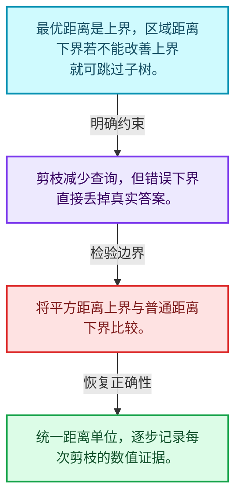
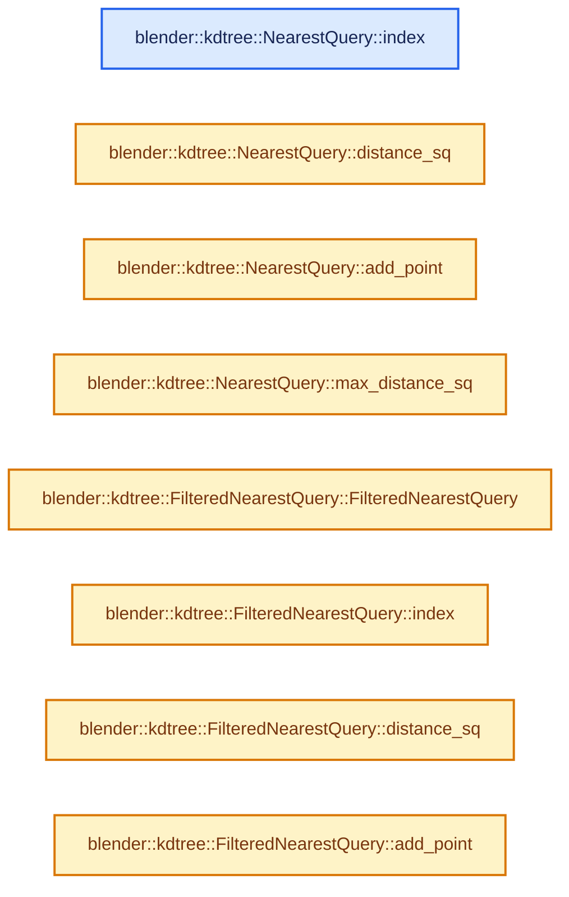
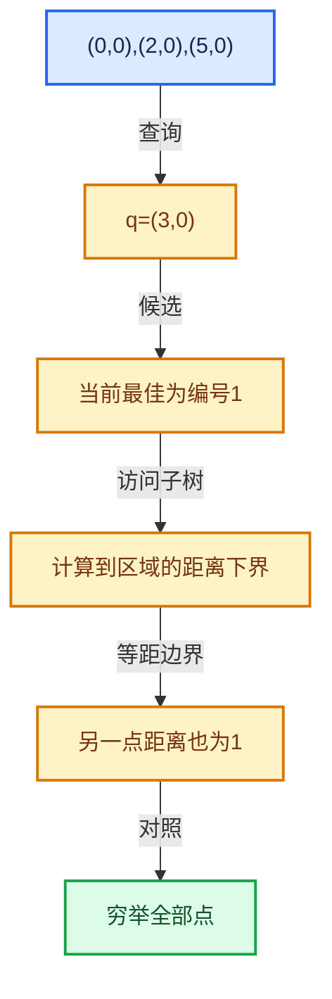

# 12-04 最近邻搜索与剪枝

[方向导航](README.md) · [总目录](../README.md) · [实现索引](../%E7%AC%A6%E5%8F%B7%E4%BE%9D%E8%B5%96%E4%B8%8E%E5%AE%9E%E7%8E%B0%E7%B4%A2%E5%BC%95.md)

## 从问题到实现

什么距离下界足以排除一个子树？

当前最优距离是上界，分割或包围界提供下界；只有证明不可能改善结果时才能剪枝。

**数据模型**

最优距离是上界，区域距离下界若不能改善上界就可跳过子树。

**设计取舍**

剪枝减少查询，但错误下界直接丢掉真实答案。

**最小反例**

将平方距离上界与普通距离下界比较。

**推导**

统一距离单位，逐步记录每次剪枝的数值证据。

## 阅读地图与执行推演








图中的数值推演是本方向的教学模型；实际函数之间的调用边与概念分析边分别标注，不能把概念关系当作运行时调度顺序。

## 完整源码单元与就地讲解

中文讲解直接放在相关代码旁，复杂机制在代码下展开。原文折叠区保留基准行号；不需要在行号表和函数之间来回查找。类布局可分段展示，函数实现不按固定行数切开。

<a id="f-8d4612e78793f66f"></a>

### `blender::kdtree::NearestQuery::index`

实现位置：[source/blender/blenlib/BLI_kdtree_new.hh](../../../../../source/blender/blenlib/BLI_kdtree_new.hh) · L292—L295。

**教学注释版**

<!-- annotated:1ab2a07b9ba489 -->

```cpp
  int index() const
  {
    return index_;
  }
```

<details>
<summary>核对原始源码：source/blender/blenlib/BLI_kdtree_new.hh · L292—L295</summary>

<!-- original:1ab2a07b9ba489:source/blender/blenlib/BLI_kdtree_new.hh:292:295 -->

```cpp
  int index() const
  {
    return index_;
  }
```

</details>

**结果出口**

- `return index_;`

**继续追踪实现**

本实现没有需要继续展开的显式调用；检查返回表达式、对象转换和调用者前置条件。

<a id="f-977a9f870200ecd7"></a>

### `blender::kdtree::NearestQuery::distance_sq`

实现位置：[source/blender/blenlib/BLI_kdtree_new.hh](../../../../../source/blender/blenlib/BLI_kdtree_new.hh) · L296—L299。

**教学注释版**

<!-- annotated:d2df0cc1af6780 -->

```cpp
  ValueT distance_sq() const
  {
    return distance_sq_;
  }
```

<details>
<summary>核对原始源码：source/blender/blenlib/BLI_kdtree_new.hh · L296—L299</summary>

<!-- original:d2df0cc1af6780:source/blender/blenlib/BLI_kdtree_new.hh:296:299 -->

```cpp
  ValueT distance_sq() const
  {
    return distance_sq_;
  }
```

</details>

**结果出口**

- `return distance_sq_;`

**继续追踪实现**

本实现没有需要继续展开的显式调用；检查返回表达式、对象转换和调用者前置条件。

<!-- annotated:54c4d35dbae0c1 -->

```cpp

```

<details>
<summary>核对原始源码：source/blender/blenlib/BLI_kdtree_new.hh · L300—L300</summary>

<!-- original:54c4d35dbae0c1:source/blender/blenlib/BLI_kdtree_new.hh:300:300 -->

```cpp

```

</details>

<a id="f-7610cf7d3d7f674e"></a>

### `blender::kdtree::NearestQuery::add_point`

实现位置：[source/blender/blenlib/BLI_kdtree_new.hh](../../../../../source/blender/blenlib/BLI_kdtree_new.hh) · L301—L306。

接口参数：

- `const ValueT distance_sq`
- `const int index`

**教学注释版**

<!-- annotated:7652ed835bb60f -->

```cpp
  bool add_point(const ValueT distance_sq, const int index)
  {
    distance_sq_ = distance_sq;
    index_ = index;
    return true;
  }
```

<details>
<summary>核对原始源码：source/blender/blenlib/BLI_kdtree_new.hh · L301—L306</summary>

<!-- original:7652ed835bb60f:source/blender/blenlib/BLI_kdtree_new.hh:301:306 -->

```cpp
  bool add_point(const ValueT distance_sq, const int index)
  {
    distance_sq_ = distance_sq;
    index_ = index;
    return true;
  }
```

</details>

**沿实际写入检查状态**

- `distance_sq_ = distance_sq;`
- `index_ = index;`

**结果出口**

- `return true;`

**继续追踪实现**

本实现没有需要继续展开的显式调用；检查返回表达式、对象转换和调用者前置条件。

<!-- annotated:2f87b331eb62b4 -->

```cpp

```

<details>
<summary>核对原始源码：source/blender/blenlib/BLI_kdtree_new.hh · L307—L307</summary>

<!-- original:2f87b331eb62b4:source/blender/blenlib/BLI_kdtree_new.hh:307:307 -->

```cpp

```

</details>

<a id="f-45916eafc1581b6e"></a>

### `blender::kdtree::NearestQuery::max_distance_sq`

实现位置：[source/blender/blenlib/BLI_kdtree_new.hh](../../../../../source/blender/blenlib/BLI_kdtree_new.hh) · L308—L311。

**教学注释版**

<!-- annotated:8e14cebeae33ae -->

```cpp
  ValueT max_distance_sq() const
  {
    return distance_sq_;
  }
```

<details>
<summary>核对原始源码：source/blender/blenlib/BLI_kdtree_new.hh · L308—L311</summary>

<!-- original:8e14cebeae33ae:source/blender/blenlib/BLI_kdtree_new.hh:308:311 -->

```cpp
  ValueT max_distance_sq() const
  {
    return distance_sq_;
  }
```

</details>

**结果出口**

- `return distance_sq_;`

**继续追踪实现**

本实现没有需要继续展开的显式调用；检查返回表达式、对象转换和调用者前置条件。

### 类型布局、声明与编译条件 · BLI_kdtree_new.hh L312—L323

<a id="t-2d3bdb36e3fd"></a>

`FilteredNearestQuery`在这里声明的数据成员：

- `Filter filter_`
- `int index_`
- `ValueT distance_sq_`
- `bool inclusive`

<!-- annotated:699a86ab18a11d -->

```cpp
};

/** Like #NearestQuery, but only the points accepted by a filter shrink the search radius. */
template<typename ValueT, typename Filter> class FilteredNearestQuery {
 private:
  Filter filter_;
  int index_ = -1;
  ValueT distance_sq_ = std::numeric_limits<ValueT>::max();

 public:
  static constexpr bool inclusive = false;

```

<details>
<summary>核对原始源码：source/blender/blenlib/BLI_kdtree_new.hh · L312—L323</summary>

<!-- original:699a86ab18a11d:source/blender/blenlib/BLI_kdtree_new.hh:312:323 -->

```cpp
};

/** Like #NearestQuery, but only the points accepted by a filter shrink the search radius. */
template<typename ValueT, typename Filter> class FilteredNearestQuery {
 private:
  Filter filter_;
  int index_ = -1;
  ValueT distance_sq_ = std::numeric_limits<ValueT>::max();

 public:
  static constexpr bool inclusive = false;

```

</details>

<a id="f-a12257c227376b5e"></a>

### `blender::kdtree::FilteredNearestQuery::FilteredNearestQuery`

实现位置：[source/blender/blenlib/BLI_kdtree_new.hh](../../../../../source/blender/blenlib/BLI_kdtree_new.hh) · L324—L324。

接口参数：

- `Filter filter`

**教学注释版**

<!-- annotated:1d54642bb82c51 -->

```cpp
  explicit FilteredNearestQuery(Filter filter) : filter_(filter) {}
```

<details>
<summary>核对原始源码：source/blender/blenlib/BLI_kdtree_new.hh · L324—L324</summary>

<!-- original:1d54642bb82c51:source/blender/blenlib/BLI_kdtree_new.hh:324:324 -->

```cpp
  explicit FilteredNearestQuery(Filter filter) : filter_(filter) {}
```

</details>

**继续追踪实现**

本实现没有需要继续展开的显式调用；检查返回表达式、对象转换和调用者前置条件。

<!-- annotated:f7e23275229d64 -->

```cpp

```

<details>
<summary>核对原始源码：source/blender/blenlib/BLI_kdtree_new.hh · L325—L325</summary>

<!-- original:f7e23275229d64:source/blender/blenlib/BLI_kdtree_new.hh:325:325 -->

```cpp

```

</details>

<a id="f-17a76e90286f4788"></a>

### `blender::kdtree::FilteredNearestQuery::index`

实现位置：[source/blender/blenlib/BLI_kdtree_new.hh](../../../../../source/blender/blenlib/BLI_kdtree_new.hh) · L326—L329。

**教学注释版**

<!-- annotated:86d9d33a2e6cfa -->

```cpp
  int index() const
  {
    return index_;
  }
```

<details>
<summary>核对原始源码：source/blender/blenlib/BLI_kdtree_new.hh · L326—L329</summary>

<!-- original:86d9d33a2e6cfa:source/blender/blenlib/BLI_kdtree_new.hh:326:329 -->

```cpp
  int index() const
  {
    return index_;
  }
```

</details>

**结果出口**

- `return index_;`

**继续追踪实现**

本实现没有需要继续展开的显式调用；检查返回表达式、对象转换和调用者前置条件。

<a id="f-6cde8eacea689b32"></a>

### `blender::kdtree::FilteredNearestQuery::distance_sq`

实现位置：[source/blender/blenlib/BLI_kdtree_new.hh](../../../../../source/blender/blenlib/BLI_kdtree_new.hh) · L330—L333。

**教学注释版**

<!-- annotated:fe77c78a876b5e -->

```cpp
  ValueT distance_sq() const
  {
    return distance_sq_;
  }
```

<details>
<summary>核对原始源码：source/blender/blenlib/BLI_kdtree_new.hh · L330—L333</summary>

<!-- original:fe77c78a876b5e:source/blender/blenlib/BLI_kdtree_new.hh:330:333 -->

```cpp
  ValueT distance_sq() const
  {
    return distance_sq_;
  }
```

</details>

**结果出口**

- `return distance_sq_;`

**继续追踪实现**

本实现没有需要继续展开的显式调用；检查返回表达式、对象转换和调用者前置条件。

<!-- annotated:7b1b6282ccbec2 -->

```cpp

```

<details>
<summary>核对原始源码：source/blender/blenlib/BLI_kdtree_new.hh · L334—L334</summary>

<!-- original:7b1b6282ccbec2:source/blender/blenlib/BLI_kdtree_new.hh:334:334 -->

```cpp

```

</details>

<a id="f-8a0781a8fc2d1f08"></a>

### `blender::kdtree::FilteredNearestQuery::add_point`

实现位置：[source/blender/blenlib/BLI_kdtree_new.hh](../../../../../source/blender/blenlib/BLI_kdtree_new.hh) · L335—L342。

接口参数：

- `const ValueT distance_sq`
- `const int index`

**教学注释版**

<!-- annotated:7a1ab900116ff2 -->

```cpp
  bool add_point(const ValueT distance_sq, const int index)
  {
    if (filter_(index)) {
      distance_sq_ = distance_sq;
      index_ = index;
    }
    return true;
  }
```

<details>
<summary>核对原始源码：source/blender/blenlib/BLI_kdtree_new.hh · L335—L342</summary>

<!-- original:7a1ab900116ff2:source/blender/blenlib/BLI_kdtree_new.hh:335:342 -->

```cpp
  bool add_point(const ValueT distance_sq, const int index)
  {
    if (filter_(index)) {
      distance_sq_ = distance_sq;
      index_ = index;
    }
    return true;
  }
```

</details>

**沿实际写入检查状态**

- `distance_sq_ = distance_sq;`
- `index_ = index;`

**结果出口**

- `return true;`

**继续追踪实现**

- `filter_` → [调用协议](../%E6%A8%A1%E6%9D%BF%E5%AE%8F%E4%B8%8E%E5%8A%A8%E6%80%81%E5%88%86%E6%B4%BE%E5%8D%8F%E8%AE%AE.md)：函数指针、局部可调用对象或未展开的宏；必须结合调用者环境。调用位置L337。

<!-- annotated:fc3e9c110812d7 -->

```cpp

```

<details>
<summary>核对原始源码：source/blender/blenlib/BLI_kdtree_new.hh · L343—L343</summary>

<!-- original:fc3e9c110812d7:source/blender/blenlib/BLI_kdtree_new.hh:343:343 -->

```cpp

```

</details>

<a id="f-8623425385c0b670"></a>

### `blender::kdtree::FilteredNearestQuery::max_distance_sq`

实现位置：[source/blender/blenlib/BLI_kdtree_new.hh](../../../../../source/blender/blenlib/BLI_kdtree_new.hh) · L344—L347。

**教学注释版**

<!-- annotated:e13fb6311a7715 -->

```cpp
  ValueT max_distance_sq() const
  {
    return distance_sq_;
  }
```

<details>
<summary>核对原始源码：source/blender/blenlib/BLI_kdtree_new.hh · L344—L347</summary>

<!-- original:e13fb6311a7715:source/blender/blenlib/BLI_kdtree_new.hh:344:347 -->

```cpp
  ValueT max_distance_sq() const
  {
    return distance_sq_;
  }
```

</details>

**结果出口**

- `return distance_sq_;`

**继续追踪实现**

本实现没有需要继续展开的显式调用；检查返回表达式、对象转换和调用者前置条件。

### 类型布局、声明与编译条件 · BLI_kdtree_new.hh L348—L358

<a id="t-62fee89ad389"></a>

`NearestNQuery`在这里声明的数据成员：

- `MutableSpan<NearestT> nearest_`
- `int count_`
- `bool inclusive`

<!-- annotated:4bbe9f2241fbab -->

```cpp
};

/** Keeps the closest points, in order, up to the size of the span it was given. */
template<typename NearestT, typename ValueT> class NearestNQuery {
 private:
  MutableSpan<NearestT> nearest_;
  int count_ = 0;

 public:
  static constexpr bool inclusive = false;

```

<details>
<summary>核对原始源码：source/blender/blenlib/BLI_kdtree_new.hh · L348—L358</summary>

<!-- original:4bbe9f2241fbab:source/blender/blenlib/BLI_kdtree_new.hh:348:358 -->

```cpp
};

/** Keeps the closest points, in order, up to the size of the span it was given. */
template<typename NearestT, typename ValueT> class NearestNQuery {
 private:
  MutableSpan<NearestT> nearest_;
  int count_ = 0;

 public:
  static constexpr bool inclusive = false;

```

</details>

<a id="f-219f683b37df3b5c"></a>

### `blender::kdtree::NearestNQuery::NearestNQuery`

实现位置：[source/blender/blenlib/BLI_kdtree_new.hh](../../../../../source/blender/blenlib/BLI_kdtree_new.hh) · L359—L359。

接口参数：

- `MutableSpan<NearestT> nearest`

**教学注释版**

<!-- annotated:f3e0df214eb01a -->

```cpp
  explicit NearestNQuery(MutableSpan<NearestT> nearest) : nearest_(nearest) {}
```

<details>
<summary>核对原始源码：source/blender/blenlib/BLI_kdtree_new.hh · L359—L359</summary>

<!-- original:f3e0df214eb01a:source/blender/blenlib/BLI_kdtree_new.hh:359:359 -->

```cpp
  explicit NearestNQuery(MutableSpan<NearestT> nearest) : nearest_(nearest) {}
```

</details>

**继续追踪实现**

本实现没有需要继续展开的显式调用；检查返回表达式、对象转换和调用者前置条件。

<!-- annotated:41f744653a91fb -->

```cpp

```

<details>
<summary>核对原始源码：source/blender/blenlib/BLI_kdtree_new.hh · L360—L360</summary>

<!-- original:41f744653a91fb:source/blender/blenlib/BLI_kdtree_new.hh:360:360 -->

```cpp

```

</details>

<a id="f-6f49dd5add550d6d"></a>

### `blender::kdtree::NearestNQuery::count`

实现位置：[source/blender/blenlib/BLI_kdtree_new.hh](../../../../../source/blender/blenlib/BLI_kdtree_new.hh) · L361—L364。

**教学注释版**

<!-- annotated:845cab351882e2 -->

```cpp
  int count() const
  {
    return count_;
  }
```

<details>
<summary>核对原始源码：source/blender/blenlib/BLI_kdtree_new.hh · L361—L364</summary>

<!-- original:845cab351882e2:source/blender/blenlib/BLI_kdtree_new.hh:361:364 -->

```cpp
  int count() const
  {
    return count_;
  }
```

</details>

**结果出口**

- `return count_;`

**继续追踪实现**

本实现没有需要继续展开的显式调用；检查返回表达式、对象转换和调用者前置条件。

<!-- annotated:c3770723ee0baa -->

```cpp

```

<details>
<summary>核对原始源码：source/blender/blenlib/BLI_kdtree_new.hh · L365—L365</summary>

<!-- original:c3770723ee0baa:source/blender/blenlib/BLI_kdtree_new.hh:365:365 -->

```cpp

```

</details>

<a id="f-ec885808278320e2"></a>

### `blender::kdtree::NearestNQuery::add_point`

实现位置：[source/blender/blenlib/BLI_kdtree_new.hh](../../../../../source/blender/blenlib/BLI_kdtree_new.hh) · L366—L386。

接口参数：

- `const ValueT distance_sq`
- `const int index`

**教学注释版**

<!-- annotated:0830f3e2964e72 -->

```cpp
  bool add_point(const ValueT distance_sq, const int index)
  {
    /* Insert the new index at the sorted point in the list. */
    // [讲解] nearest_.size：查询视图长度或生成对应有效索引区间。
    const int capacity = int(nearest_.size());
    int i;
    for (i = count_; i > 0; i--) {
      if (nearest_[i - 1].distance_sq <= distance_sq) {
        break;
      }
      if (i < capacity) {
        nearest_[i] = nearest_[i - 1];
      }
    }
    if (i < capacity) {
      nearest_[i] = {index, distance_sq};
    }
    if (count_ < capacity) {
      count_++;
    }
    return true;
  }
```

<details>
<summary>核对原始源码：source/blender/blenlib/BLI_kdtree_new.hh · L366—L386</summary>

<!-- original:0830f3e2964e72:source/blender/blenlib/BLI_kdtree_new.hh:366:386 -->

```cpp
  bool add_point(const ValueT distance_sq, const int index)
  {
    /* Insert the new index at the sorted point in the list. */
    const int capacity = int(nearest_.size());
    int i;
    for (i = count_; i > 0; i--) {
      if (nearest_[i - 1].distance_sq <= distance_sq) {
        break;
      }
      if (i < capacity) {
        nearest_[i] = nearest_[i - 1];
      }
    }
    if (i < capacity) {
      nearest_[i] = {index, distance_sq};
    }
    if (count_ < capacity) {
      count_++;
    }
    return true;
  }
```

</details>

**沿实际写入检查状态**

- `nearest_[i] = nearest_[i - 1];`
- `nearest_[i] = {index, distance_sq};`

**结果出口**

- `return true;`

**继续追踪实现**

- `nearest_.size` → [blender::MutableSpan::size · L499](../01-%E5%9F%BA%E7%A1%80%E5%AE%B9%E5%99%A8%E4%B8%8E%E7%8E%B0%E4%BB%A3CPP/06-MutableSpan%E5%8F%AF%E5%86%99%E8%A7%86%E5%9B%BE.md#f-1de6a66839c304a8)。

<!-- annotated:7ad639d34ff540 -->

```cpp

```

<details>
<summary>核对原始源码：source/blender/blenlib/BLI_kdtree_new.hh · L387—L387</summary>

<!-- original:7ad639d34ff540:source/blender/blenlib/BLI_kdtree_new.hh:387:387 -->

```cpp

```

</details>

<a id="f-c67d8e70f1ee6294"></a>

### `blender::kdtree::NearestNQuery::max_distance_sq`

实现位置：[source/blender/blenlib/BLI_kdtree_new.hh](../../../../../source/blender/blenlib/BLI_kdtree_new.hh) · L388—L394。

**教学注释版**

<!-- annotated:62e7e309231b25 -->

```cpp
  ValueT max_distance_sq() const
  {
    // [讲解] nearest_.size：查询视图长度或生成对应有效索引区间。
    if (count_ < int(nearest_.size())) {
      // [讲解] std::numeric_limits<ValueT>::max：按比较关系选取较大值。本讲解中的增长公式同时满足最低请求和几何增长；若保存返回引用，还需注意实参寿命。
      return std::numeric_limits<ValueT>::max();
    }
    return nearest_[count_ - 1].distance_sq;
  }
```

<details>
<summary>核对原始源码：source/blender/blenlib/BLI_kdtree_new.hh · L388—L394</summary>

<!-- original:62e7e309231b25:source/blender/blenlib/BLI_kdtree_new.hh:388:394 -->

```cpp
  ValueT max_distance_sq() const
  {
    if (count_ < int(nearest_.size())) {
      return std::numeric_limits<ValueT>::max();
    }
    return nearest_[count_ - 1].distance_sq;
  }
```

</details>

**结果出口**

- `return std::numeric_limits<ValueT>::max();`
- `return nearest_[count_ - 1].distance_sq;`

**继续追踪实现**

- `nearest_.size` → [blender::MutableSpan::size · L499](../01-%E5%9F%BA%E7%A1%80%E5%AE%B9%E5%99%A8%E4%B8%8E%E7%8E%B0%E4%BB%A3CPP/06-MutableSpan%E5%8F%AF%E5%86%99%E8%A7%86%E5%9B%BE.md#f-1de6a66839c304a8)。
- `std::numeric_limits<ValueT>::max` → [外部契约](https://eel.is/c++draft/alg.min.max)：按比较关系选取较大值。本讲解中的增长公式同时满足最低请求和几何增长；若保存返回引用，还需注意实参寿命。

### 类型布局、声明与编译条件 · BLI_kdtree_new.hh L395—L409

<a id="t-f8eb07a6bcaa"></a>

`RadiusQuery`在这里声明的数据成员：

- `ValueT radius_sq_`
- `Fn fn_`
- `int count_`
- `bool inclusive`

<!-- annotated:26969f890e619f -->

```cpp
};

/**
 * Passes every point in the radius to a callback.
 * \note The radius is inclusive, matching #blender::kdtree_range_search_cb.
 */
template<typename ValueT, typename Fn> class RadiusQuery {
 private:
  ValueT radius_sq_;
  Fn fn_;
  int count_ = 0;

 public:
  static constexpr bool inclusive = true;

```

<details>
<summary>核对原始源码：source/blender/blenlib/BLI_kdtree_new.hh · L395—L409</summary>

<!-- original:26969f890e619f:source/blender/blenlib/BLI_kdtree_new.hh:395:409 -->

```cpp
};

/**
 * Passes every point in the radius to a callback.
 * \note The radius is inclusive, matching #blender::kdtree_range_search_cb.
 */
template<typename ValueT, typename Fn> class RadiusQuery {
 private:
  ValueT radius_sq_;
  Fn fn_;
  int count_ = 0;

 public:
  static constexpr bool inclusive = true;

```

</details>

<a id="f-512b8ac1f2890093"></a>

### `blender::kdtree::RadiusQuery::RadiusQuery`

实现位置：[source/blender/blenlib/BLI_kdtree_new.hh](../../../../../source/blender/blenlib/BLI_kdtree_new.hh) · L410—L410。

接口参数：

- `const ValueT radius_sq`
- `Fn fn`

**教学注释版**

<!-- annotated:ff12e4a99524f3 -->

```cpp
  RadiusQuery(const ValueT radius_sq, Fn fn) : radius_sq_(radius_sq), fn_(fn) {}
```

<details>
<summary>核对原始源码：source/blender/blenlib/BLI_kdtree_new.hh · L410—L410</summary>

<!-- original:ff12e4a99524f3:source/blender/blenlib/BLI_kdtree_new.hh:410:410 -->

```cpp
  RadiusQuery(const ValueT radius_sq, Fn fn) : radius_sq_(radius_sq), fn_(fn) {}
```

</details>

**继续追踪实现**

本实现没有需要继续展开的显式调用；检查返回表达式、对象转换和调用者前置条件。

<a id="f-81e455968e8b4fd4"></a>

### `blender::TreeBuilder::build_single_leaf`

实现位置：[source/blender/blenlib/intern/kdtree.cc](../../../../../source/blender/blenlib/intern/kdtree.cc) · L221—L240。

接口参数：

- `const Span<int> indices`
- `Bounds<T> &r_bounds`

**教学注释版**

<!-- annotated:586b06b50c4ebf -->

```cpp
  Node *build_single_leaf(const Span<int> indices, Bounds<T> &r_bounds)
  {
    // [讲解] indices.is_empty：查询视图长度或生成对应有效索引区间。
    if (indices.is_empty()) {
      // [讲解] indices_.begin：返回借用范围的地址。
      std::iota(indices_.begin(), indices_.end(), 0);
    }
    // [讲解] indices.data：返回借用范围的地址。
    else if (indices.data() != indices_.data()) {
      // [讲解] indices_.copy_from：修改已有目标元素，不改变底层容器长度。
      indices_.copy_from(indices);
    }

    // [讲解] indices_.first：按视图边界访问元素。
    r_bounds = Bounds<T>(points_[indices_.first()]);
    for (const int index : indices_) {
      math::min_max(points_[index], r_bounds.min, r_bounds.max);
    }

    Node *root = allocator_.allocate<Node>();
    root->children = nullptr;
    root->leaf.start = 0;
    // [讲解] indices_.size：查询视图长度或生成对应有效索引区间。
    root->leaf.end = int(indices_.size());
    return root;
  }
```

<details>
<summary>核对原始源码：source/blender/blenlib/intern/kdtree.cc · L221—L240</summary>

<!-- original:586b06b50c4ebf:source/blender/blenlib/intern/kdtree.cc:221:240 -->

```cpp
  Node *build_single_leaf(const Span<int> indices, Bounds<T> &r_bounds)
  {
    if (indices.is_empty()) {
      std::iota(indices_.begin(), indices_.end(), 0);
    }
    else if (indices.data() != indices_.data()) {
      indices_.copy_from(indices);
    }

    r_bounds = Bounds<T>(points_[indices_.first()]);
    for (const int index : indices_) {
      math::min_max(points_[index], r_bounds.min, r_bounds.max);
    }

    Node *root = allocator_.allocate<Node>();
    root->children = nullptr;
    root->leaf.start = 0;
    root->leaf.end = int(indices_.size());
    return root;
  }
```

</details>

**沿实际写入检查状态**

- `r_bounds = Bounds<T>(points_[indices_.first()]);`
- `root->children = nullptr;`
- `root->leaf.start = 0;`
- `root->leaf.end = int(indices_.size());`

**结果出口**

- `return root;`

**继续追踪实现**

- `indices.is_empty` → [blender::Span::is_empty · L264](../01-%E5%9F%BA%E7%A1%80%E5%AE%B9%E5%99%A8%E4%B8%8E%E7%8E%B0%E4%BB%A3CPP/05-Span%E5%8F%AA%E8%AF%BB%E8%BF%9E%E7%BB%AD%E8%A7%86%E5%9B%BE.md#f-8cc1d7ba8feb50e6)。
- `std::iota` → [外部契约](https://eel.is/c++draft/)：这个边界按实际表达式及所属类型核对参数、返回值、寿命与失败行为。这里提供接口入口，不声称已解释该第三方版本的内部实现。
- `indices_.begin` → [blender::MutableSpan::begin · L550](../01-%E5%9F%BA%E7%A1%80%E5%AE%B9%E5%99%A8%E4%B8%8E%E7%8E%B0%E4%BB%A3CPP/06-MutableSpan%E5%8F%AF%E5%86%99%E8%A7%86%E5%9B%BE.md#f-02a6b28889d59da1)；[blender::gpu::shader::parser::MutableSpan::begin · L97](../05-%E5%87%A0%E4%BD%95%E5%AD%98%E5%82%A8%E4%B8%8E%E6%8B%93%E6%89%91%E6%98%A0%E5%B0%84/%E4%BE%9D%E8%B5%96-utils-06433d.md#f-707ab8fcbd90899b)；[blender::gpu::shader::parser::MutableSpan::begin · L106](../05-%E5%87%A0%E4%BD%95%E5%AD%98%E5%82%A8%E4%B8%8E%E6%8B%93%E6%89%91%E6%98%A0%E5%B0%84/%E4%BE%9D%E8%B5%96-utils-06433d.md#f-24291c7b5f37860b)。同名重载需按实参类型选择。
- `indices_.end` → [blender::MutableSpan::end · L554](../01-%E5%9F%BA%E7%A1%80%E5%AE%B9%E5%99%A8%E4%B8%8E%E7%8E%B0%E4%BB%A3CPP/06-MutableSpan%E5%8F%AF%E5%86%99%E8%A7%86%E5%9B%BE.md#f-4bf60034b9ddbc44)；[blender::gpu::shader::parser::MutableSpan::end · L101](../05-%E5%87%A0%E4%BD%95%E5%AD%98%E5%82%A8%E4%B8%8E%E6%8B%93%E6%89%91%E6%98%A0%E5%B0%84/%E4%BE%9D%E8%B5%96-utils-06433d.md#f-21cd00bb95944779)；[blender::gpu::shader::parser::MutableSpan::end · L110](../05-%E5%87%A0%E4%BD%95%E5%AD%98%E5%82%A8%E4%B8%8E%E6%8B%93%E6%89%91%E6%98%A0%E5%B0%84/%E4%BE%9D%E8%B5%96-utils-06433d.md#f-b75205cae5a07f2c)。同名重载需按实参类型选择。
- `indices.data` → [blender::Span::data · L219](../01-%E5%9F%BA%E7%A1%80%E5%AE%B9%E5%99%A8%E4%B8%8E%E7%8E%B0%E4%BB%A3CPP/05-Span%E5%8F%AA%E8%AF%BB%E8%BF%9E%E7%BB%AD%E8%A7%86%E5%9B%BE.md#f-10c5889198935800)。
- `indices_.data` → [blender::MutableSpan::data · L545](../01-%E5%9F%BA%E7%A1%80%E5%AE%B9%E5%99%A8%E4%B8%8E%E7%8E%B0%E4%BB%A3CPP/06-MutableSpan%E5%8F%AF%E5%86%99%E8%A7%86%E5%9B%BE.md#f-eb45a6e4d8211efd)；[blender::gpu::shader::parser::MutableSpan::data · L82](../05-%E5%87%A0%E4%BD%95%E5%AD%98%E5%82%A8%E4%B8%8E%E6%8B%93%E6%89%91%E6%98%A0%E5%B0%84/%E4%BE%9D%E8%B5%96-utils-06433d.md#f-ad0a09cec9741c65)。同名重载需按实参类型选择。
- `indices_.copy_from` → [blender::MutableSpan::copy_from · L745](../01-%E5%9F%BA%E7%A1%80%E5%AE%B9%E5%99%A8%E4%B8%8E%E7%8E%B0%E4%BB%A3CPP/06-MutableSpan%E5%8F%AF%E5%86%99%E8%A7%86%E5%9B%BE.md#f-e4f099b1497adddb)。
- `Bounds<T>` → [blender::Bounds](%E4%BE%9D%E8%B5%96-BLI_bounds_types-fbc701.md#t-034e001bc6d9)；[blender::Bounds](../05-%E5%87%A0%E4%BD%95%E5%AD%98%E5%82%A8%E4%B8%8E%E6%8B%93%E6%89%91%E6%98%A0%E5%B0%84/%E4%BE%9D%E8%B5%96-usd_writer_abstract-2d4373.md#t-c611d2724544)；[blender::Bounds](../05-%E5%87%A0%E4%BD%95%E5%AD%98%E5%82%A8%E4%B8%8E%E6%8B%93%E6%89%91%E6%98%A0%E5%B0%84/%E4%BE%9D%E8%B5%96-DNA_mesh_types-81f02e.md#t-3124dc634817)；[blender::draw::overlay::Bounds](../05-%E5%87%A0%E4%BD%95%E5%AD%98%E5%82%A8%E4%B8%8E%E6%8B%93%E6%89%91%E6%98%A0%E5%B0%84/%E4%BE%9D%E8%B5%96-overlay_bounds-5e4545.md#t-1e10f8dc8848)。
- `indices_.first` → [blender::MutableSpan::first · L685](../01-%E5%9F%BA%E7%A1%80%E5%AE%B9%E5%99%A8%E4%B8%8E%E7%8E%B0%E4%BB%A3CPP/06-MutableSpan%E5%8F%AF%E5%86%99%E8%A7%86%E5%9B%BE.md#f-3126bab9f43cee1c)。
- `math::min_max` → [blender::math::min_max · L331](%E4%BE%9D%E8%B5%96-BLI_math_vector-906a87.md#f-d0ca25e982d9489c)；[blender::math::min_max · L99](%E4%BE%9D%E8%B5%96-BLI_math_base-0728eb.md#f-d076aca4030981e7)。同名重载需按实参类型选择。
- `allocator_.allocate<Node>` → [blender::LinearAllocator::allocate · L66](../03-%E5%86%85%E5%AD%98%E5%88%86%E9%85%8D%E4%B8%8E%E8%BF%90%E8%A1%8C%E6%97%B6%E7%B1%BB%E5%9E%8B/02-LinearAllocator%E5%B8%83%E5%B1%80.md#f-26209c6a21e04bc0)；[blender::LinearAllocator::allocate · L99](../03-%E5%86%85%E5%AD%98%E5%88%86%E9%85%8D%E4%B8%8E%E8%BF%90%E8%A1%8C%E6%97%B6%E7%B1%BB%E5%9E%8B/02-LinearAllocator%E5%B8%83%E5%B1%80.md#f-b34ac68f2e3d66f1)；[blender::LinearAllocator::allocate · L105](../03-%E5%86%85%E5%AD%98%E5%88%86%E9%85%8D%E4%B8%8E%E8%BF%90%E8%A1%8C%E6%97%B6%E7%B1%BB%E5%9E%8B/02-LinearAllocator%E5%B8%83%E5%B1%80.md#f-96480f78749ba1c7)。同名重载需按实参类型选择。
- `indices_.size` → [blender::MutableSpan::size · L499](../01-%E5%9F%BA%E7%A1%80%E5%AE%B9%E5%99%A8%E4%B8%8E%E7%8E%B0%E4%BB%A3CPP/06-MutableSpan%E5%8F%AF%E5%86%99%E8%A7%86%E5%9B%BE.md#f-1de6a66839c304a8)；[blender::gpu::shader::parser::MutableSpan::size · L87](../05-%E5%87%A0%E4%BD%95%E5%AD%98%E5%82%A8%E4%B8%8E%E6%8B%93%E6%89%91%E6%98%A0%E5%B0%84/%E4%BE%9D%E8%B5%96-utils-06433d.md#f-5e684af6ee7990e9)。同名重载需按实参类型选择。

<!-- annotated:9683fb9b9136ff -->

```cpp

```

<details>
<summary>核对原始源码：source/blender/blenlib/intern/kdtree.cc · L241—L241</summary>

<!-- original:9683fb9b9136ff:source/blender/blenlib/intern/kdtree.cc:241:241 -->

```cpp

```

</details>

<a id="f-4c26235c83d52682"></a>

### `blender::TreeBuilder::build_nodes`

实现位置：[source/blender/blenlib/intern/kdtree.cc](../../../../../source/blender/blenlib/intern/kdtree.cc) · L242—L276。

接口参数：

- `const Span<int> indices`
- `Bounds<T> &r_bounds`
- `const bool threaded`

**教学注释版**

<!-- annotated:8d3438b0f0134c -->

```cpp
  Node *build_nodes(const Span<int> indices, Bounds<T> &r_bounds, const bool threaded)
  {
    // [讲解] indices_.size：查询视图长度或生成对应有效索引区间。
    const int size = int(indices_.size());
    Array<BuildPoint, 256> build_points(size);

    // [讲解] build_points.as_mutable_span：提供数组的借用访问入口。
    build_points_ = build_points.as_mutable_span();
    const Bounds<BuildPoint> bounds = this->init_points(indices, threaded);

    pool_.batch_size = node_batch_size(size, leaf_size_);
    pool_.allocator = &allocator_;
    if (threaded) {
      thread_allocators_.emplace();
    }
    NodeAllocator &allocator = threaded ? thread_allocators_->local() : pool_;
    Node *root = allocator.allocate(1);
    this->build_node(root, 0, size, bounds, allocator, threaded);

    /* The pool of the build itself took its batches from #allocator_ already, only the ones the
     * threads filled have buffers of their own to hand over. */
    if (thread_allocators_.has_value()) {
      for (NodeAllocator &allocator : *thread_allocators_) {
        allocator_.transfer_ownership_from(allocator.owned_allocator);
      }
    }

    for (const int dim : IndexRange(dimensions)) {
      r_bounds.min[dim] = bounds.min[dim];
      r_bounds.max[dim] = bounds.max[dim];
    }

    /* The points are in the order the tree visits them now, so the indices they carry are the
     * order to keep. The coordinates are not, since a search reads #points_. */
    this->collect_indices(threaded);
    return root;
  }
```

<details>
<summary>核对原始源码：source/blender/blenlib/intern/kdtree.cc · L242—L276</summary>

<!-- original:8d3438b0f0134c:source/blender/blenlib/intern/kdtree.cc:242:276 -->

```cpp
  Node *build_nodes(const Span<int> indices, Bounds<T> &r_bounds, const bool threaded)
  {
    const int size = int(indices_.size());
    Array<BuildPoint, 256> build_points(size);

    build_points_ = build_points.as_mutable_span();
    const Bounds<BuildPoint> bounds = this->init_points(indices, threaded);

    pool_.batch_size = node_batch_size(size, leaf_size_);
    pool_.allocator = &allocator_;
    if (threaded) {
      thread_allocators_.emplace();
    }
    NodeAllocator &allocator = threaded ? thread_allocators_->local() : pool_;
    Node *root = allocator.allocate(1);
    this->build_node(root, 0, size, bounds, allocator, threaded);

    /* The pool of the build itself took its batches from #allocator_ already, only the ones the
     * threads filled have buffers of their own to hand over. */
    if (thread_allocators_.has_value()) {
      for (NodeAllocator &allocator : *thread_allocators_) {
        allocator_.transfer_ownership_from(allocator.owned_allocator);
      }
    }

    for (const int dim : IndexRange(dimensions)) {
      r_bounds.min[dim] = bounds.min[dim];
      r_bounds.max[dim] = bounds.max[dim];
    }

    /* The points are in the order the tree visits them now, so the indices they carry are the
     * order to keep. The coordinates are not, since a search reads #points_. */
    this->collect_indices(threaded);
    return root;
  }
```

</details>

**沿实际写入检查状态**

- `build_points_ = build_points.as_mutable_span();`
- `pool_.batch_size = node_batch_size(size, leaf_size_);`
- `pool_.allocator = &allocator_;`
- `r_bounds.min[dim] = bounds.min[dim];`
- `r_bounds.max[dim] = bounds.max[dim];`

**结果出口**

- `return root;`

**继续追踪实现**

- `indices_.size` → [blender::MutableSpan::size · L499](../01-%E5%9F%BA%E7%A1%80%E5%AE%B9%E5%99%A8%E4%B8%8E%E7%8E%B0%E4%BB%A3CPP/06-MutableSpan%E5%8F%AF%E5%86%99%E8%A7%86%E5%9B%BE.md#f-1de6a66839c304a8)；[blender::gpu::shader::parser::MutableSpan::size · L87](../05-%E5%87%A0%E4%BD%95%E5%AD%98%E5%82%A8%E4%B8%8E%E6%8B%93%E6%89%91%E6%98%A0%E5%B0%84/%E4%BE%9D%E8%B5%96-utils-06433d.md#f-5e684af6ee7990e9)。同名重载需按实参类型选择。
- `build_points.as_mutable_span` → [blender::Array::as_mutable_span · L259](../01-%E5%9F%BA%E7%A1%80%E5%AE%B9%E5%99%A8%E4%B8%8E%E7%8E%B0%E4%BB%A3CPP/08-Array%E5%A4%8D%E5%88%B6%E7%A7%BB%E5%8A%A8%E4%B8%8E%E9%94%80%E6%AF%81.md#f-4e91de9f1337c144)。
- `this->init_points` → [blender::TreeBuilder::init_points · L284](04-%E6%9C%80%E8%BF%91%E9%82%BB%E6%90%9C%E7%B4%A2%E4%B8%8E%E5%89%AA%E6%9E%9D.md#f-c296467746797bdc)。
- `node_batch_size` → [blender::TreeBuilder::node_batch_size · L152](03-KDTreeNew%E6%9E%84%E5%BB%BA.md#f-ee365f41997d9839)。
- `thread_allocators_.emplace` → [外部契约](https://eel.is/c++draft/)：这个边界按实际表达式及所属类型核对参数、返回值、寿命与失败行为。这里提供接口入口，不声称已解释该第三方版本的内部实现。
- `thread_allocators_->local` → [外部契约](https://eel.is/c++draft/)：这个边界按实际表达式及所属类型核对参数、返回值、寿命与失败行为。这里提供接口入口，不声称已解释该第三方版本的内部实现。
- `allocator.allocate` → [blender::TreeBuilder::NodeAllocator::allocate · L131](03-KDTreeNew%E6%9E%84%E5%BB%BA.md#f-b20ae1e189f03d83)。
- `this->build_node` → [blender::TreeBuilder::build_node · L351](04-%E6%9C%80%E8%BF%91%E9%82%BB%E6%90%9C%E7%B4%A2%E4%B8%8E%E5%89%AA%E6%9E%9D.md#f-f1e48dd374ab2f94)。
- `thread_allocators_.has_value` → [外部契约](https://eel.is/c++draft/)：这个边界按实际表达式及所属类型核对参数、返回值、寿命与失败行为。这里提供接口入口，不声称已解释该第三方版本的内部实现。
- `allocator_.transfer_ownership_from` → [blender::LinearAllocator::transfer_ownership_from · L269](../03-%E5%86%85%E5%AD%98%E5%88%86%E9%85%8D%E4%B8%8E%E8%BF%90%E8%A1%8C%E6%97%B6%E7%B1%BB%E5%9E%8B/03-LinearAllocator%E5%88%86%E9%85%8D%E4%B8%8E%E6%89%A9%E5%B1%95.md#f-a434086fde13dfa2)。
- `IndexRange` → [blender::IndexRange](../01-%E5%9F%BA%E7%A1%80%E5%AE%B9%E5%99%A8%E4%B8%8E%E7%8E%B0%E4%BB%A3CPP/%E4%BE%9D%E8%B5%96-BLI_index_range-7d7cc5.md#t-caa3466d6776)；[blender::gpu::shader::parser::IndexRange](../05-%E5%87%A0%E4%BD%95%E5%AD%98%E5%82%A8%E4%B8%8E%E6%8B%93%E6%89%91%E6%98%A0%E5%B0%84/%E4%BE%9D%E8%B5%96-utils-06433d.md#t-82d2bd4ea71c)；[blender::IndexRange](../05-%E5%87%A0%E4%BD%95%E5%AD%98%E5%82%A8%E4%B8%8E%E6%8B%93%E6%89%91%E6%98%A0%E5%B0%84/%E4%BE%9D%E8%B5%96-DNA_node_types-6708b9.md#t-0448cc889d39)。
- `this->collect_indices` → [blender::TreeBuilder::collect_indices · L325](04-%E6%9C%80%E8%BF%91%E9%82%BB%E6%90%9C%E7%B4%A2%E4%B8%8E%E5%89%AA%E6%9E%9D.md#f-0f401eb41849f12c)。

### 类型布局、声明与编译条件 · kdtree.cc L277—L283

<!-- annotated:13c1b46751813d -->

```cpp

  /**
   * The build reorders a copy of the coordinates rather than an array of indices. That makes every
   * pass over a node sequential, and lets subtrees become cache resident as soon as they are small
   * enough. Each point carries its index in the element after its coordinates, so reordering the
   * points reorders the indices with them, in the same cache lines rather than in a second array.
   */
```

<details>
<summary>核对原始源码：source/blender/blenlib/intern/kdtree.cc · L277—L283</summary>

<!-- original:13c1b46751813d:source/blender/blenlib/intern/kdtree.cc:277:283 -->

```cpp

  /**
   * The build reorders a copy of the coordinates rather than an array of indices. That makes every
   * pass over a node sequential, and lets subtrees become cache resident as soon as they are small
   * enough. Each point carries its index in the element after its coordinates, so reordering the
   * points reorders the indices with them, in the same cache lines rather than in a second array.
   */
```

</details>

<a id="f-c296467746797bdc"></a>

### `blender::TreeBuilder::init_points`

实现位置：[source/blender/blenlib/intern/kdtree.cc](../../../../../source/blender/blenlib/intern/kdtree.cc) · L284—L311。

接口参数：

- `const Span<int> indices`
- `const bool threaded`

**教学注释版**

<!-- annotated:8c63a4f1465274 -->

```cpp
  Bounds<BuildPoint> init_points(const Span<int> indices, const bool threaded)
  {
    // [讲解] indices_.size：查询视图长度或生成对应有效索引区间。
    const int size = int(indices_.size());
    const auto fill = [&](const int start, const int end) {
      Bounds<BuildPoint> bounds(this->build_point(indices, start));
      for (const int i : IndexRange(start, end - start)) {
        const BuildPoint point = this->build_point(indices, i);
        build_points_[i] = point;
        bounds.min = math::min(bounds.min, point);
        bounds.max = math::max(bounds.max, point);
      }
      return bounds;
    };

    const int blocks = threaded ? block_num(size) : 0;
    if (blocks < 2) {
      return fill(0, size);
    }

    Array<Bounds<BuildPoint>, NODE_MAX_BLOCKS> block_bounds(blocks);
    threading::parallel_for(IndexRange(blocks), 1, [&](const IndexRange range) {
      for (const int block : range) {
        block_bounds[block] = fill(block_begin(size, blocks, block),
                                   block_begin(size, blocks, block + 1));
      }
    });
    return merge_bounds(block_bounds);
  }
```

<details>
<summary>核对原始源码：source/blender/blenlib/intern/kdtree.cc · L284—L311</summary>

<!-- original:8c63a4f1465274:source/blender/blenlib/intern/kdtree.cc:284:311 -->

```cpp
  Bounds<BuildPoint> init_points(const Span<int> indices, const bool threaded)
  {
    const int size = int(indices_.size());
    const auto fill = [&](const int start, const int end) {
      Bounds<BuildPoint> bounds(this->build_point(indices, start));
      for (const int i : IndexRange(start, end - start)) {
        const BuildPoint point = this->build_point(indices, i);
        build_points_[i] = point;
        bounds.min = math::min(bounds.min, point);
        bounds.max = math::max(bounds.max, point);
      }
      return bounds;
    };

    const int blocks = threaded ? block_num(size) : 0;
    if (blocks < 2) {
      return fill(0, size);
    }

    Array<Bounds<BuildPoint>, NODE_MAX_BLOCKS> block_bounds(blocks);
    threading::parallel_for(IndexRange(blocks), 1, [&](const IndexRange range) {
      for (const int block : range) {
        block_bounds[block] = fill(block_begin(size, blocks, block),
                                   block_begin(size, blocks, block + 1));
      }
    });
    return merge_bounds(block_bounds);
  }
```

</details>

**沿实际写入检查状态**

- `build_points_[i] = point;`
- `bounds.min = math::min(bounds.min, point);`
- `bounds.max = math::max(bounds.max, point);`
- `block_bounds[block] = fill(block_begin(size, blocks, block),`

**结果出口**

- `return bounds;`
- `return fill(0, size);`
- `return merge_bounds(block_bounds);`

**继续追踪实现**

- `indices_.size` → [blender::MutableSpan::size · L499](../01-%E5%9F%BA%E7%A1%80%E5%AE%B9%E5%99%A8%E4%B8%8E%E7%8E%B0%E4%BB%A3CPP/06-MutableSpan%E5%8F%AF%E5%86%99%E8%A7%86%E5%9B%BE.md#f-1de6a66839c304a8)；[blender::gpu::shader::parser::MutableSpan::size · L87](../05-%E5%87%A0%E4%BD%95%E5%AD%98%E5%82%A8%E4%B8%8E%E6%8B%93%E6%89%91%E6%98%A0%E5%B0%84/%E4%BE%9D%E8%B5%96-utils-06433d.md#f-5e684af6ee7990e9)。同名重载需按实参类型选择。
- `this->build_point` → [blender::TreeBuilder::build_point · L313](04-%E6%9C%80%E8%BF%91%E9%82%BB%E6%90%9C%E7%B4%A2%E4%B8%8E%E5%89%AA%E6%9E%9D.md#f-680694f1b4b2a553)。
- `IndexRange` → [blender::IndexRange](../01-%E5%9F%BA%E7%A1%80%E5%AE%B9%E5%99%A8%E4%B8%8E%E7%8E%B0%E4%BB%A3CPP/%E4%BE%9D%E8%B5%96-BLI_index_range-7d7cc5.md#t-caa3466d6776)；[blender::gpu::shader::parser::IndexRange](../05-%E5%87%A0%E4%BD%95%E5%AD%98%E5%82%A8%E4%B8%8E%E6%8B%93%E6%89%91%E6%98%A0%E5%B0%84/%E4%BE%9D%E8%B5%96-utils-06433d.md#t-82d2bd4ea71c)；[blender::IndexRange](../05-%E5%87%A0%E4%BD%95%E5%AD%98%E5%82%A8%E4%B8%8E%E6%8B%93%E6%89%91%E6%98%A0%E5%B0%84/%E4%BE%9D%E8%B5%96-DNA_node_types-6708b9.md#t-0448cc889d39)。
- `math::min` → [blender::math::min · L56](%E4%BE%9D%E8%B5%96-BLI_math_vector-906a87.md#f-ee6ead51e4bb3364)；[blender::math::min · L65](%E4%BE%9D%E8%B5%96-BLI_math_vector-906a87.md#f-f65ce48b3051cce3)；[blender::math::min · L81](%E4%BE%9D%E8%B5%96-BLI_math_vector-906a87.md#f-9c602d29fab41795)；[blender::math::min · L43](%E4%BE%9D%E8%B5%96-BLI_math_base-0728eb.md#f-72ff0c229e6c09b0)。同名重载需按实参类型选择。
- `math::max` → [blender::math::max · L87](%E4%BE%9D%E8%B5%96-BLI_math_vector-906a87.md#f-9be564a293777d6b)；[blender::math::max · L96](%E4%BE%9D%E8%B5%96-BLI_math_vector-906a87.md#f-ce32dff37d0af3bc)；[blender::math::max · L112](%E4%BE%9D%E8%B5%96-BLI_math_vector-906a87.md#f-668eb1fcf1fa8292)；[blender::math::max · L49](%E4%BE%9D%E8%B5%96-BLI_math_base-0728eb.md#f-a6991ca3d12937e1)。同名重载需按实参类型选择。
- `block_num` → [blender::TreeBuilder::block_num · L670](05-K%E8%BF%91%E9%82%BB%E4%B8%8E%E8%8C%83%E5%9B%B4%E6%9F%A5%E8%AF%A2.md#f-e51408720bbd2ff8)。
- `fill` → [调用协议](../%E6%A8%A1%E6%9D%BF%E5%AE%8F%E4%B8%8E%E5%8A%A8%E6%80%81%E5%88%86%E6%B4%BE%E5%8D%8F%E8%AE%AE.md)：局部可调用对象，须结合其初始化与捕获环境。调用位置L300。
- `threading::parallel_for` → [blender::threading::parallel_for · L68](../11-Depsgraph%E4%B8%8E%E5%B9%B6%E8%A1%8C%E4%BB%BB%E5%8A%A1%E7%B3%BB%E7%BB%9F/07-%E4%BB%BB%E5%8A%A1%E6%B1%A0%E4%B8%8ETBB%E6%8E%A5%E5%85%A5.md#f-838294754c24426c)。
- `block_begin` → [blender::TreeBuilder::block_begin · L675](05-K%E8%BF%91%E9%82%BB%E4%B8%8E%E8%8C%83%E5%9B%B4%E6%9F%A5%E8%AF%A2.md#f-6861ede2cacc364f)。
- `merge_bounds` → [blender::TreeBuilder::merge_bounds · L457](05-K%E8%BF%91%E9%82%BB%E4%B8%8E%E8%8C%83%E5%9B%B4%E6%9F%A5%E8%AF%A2.md#f-c1b3a1b0d3c95da7)。

<!-- annotated:d9856135d2c5cb -->

```cpp

```

<details>
<summary>核对原始源码：source/blender/blenlib/intern/kdtree.cc · L312—L312</summary>

<!-- original:d9856135d2c5cb:source/blender/blenlib/intern/kdtree.cc:312:312 -->

```cpp

```

</details>

<a id="f-680694f1b4b2a553"></a>

### `blender::TreeBuilder::build_point`

实现位置：[source/blender/blenlib/intern/kdtree.cc](../../../../../source/blender/blenlib/intern/kdtree.cc) · L313—L322。

接口参数：

- `const Span<int> indices`
- `const int i`

**教学注释版**

<!-- annotated:af947b5a4d7489 -->

```cpp
  BuildPoint build_point(const Span<int> indices, const int i) const
  {
    // [讲解] indices.is_empty：查询视图长度或生成对应有效索引区间。
    const int index = indices.is_empty() ? i : indices[i];
    BuildPoint point;
    for (const int dim : IndexRange(dimensions)) {
      point[dim] = points_[index][dim];
    }
    point[dimensions] = std::bit_cast<value_type>(index);
    return point;
  }
```

<details>
<summary>核对原始源码：source/blender/blenlib/intern/kdtree.cc · L313—L322</summary>

<!-- original:af947b5a4d7489:source/blender/blenlib/intern/kdtree.cc:313:322 -->

```cpp
  BuildPoint build_point(const Span<int> indices, const int i) const
  {
    const int index = indices.is_empty() ? i : indices[i];
    BuildPoint point;
    for (const int dim : IndexRange(dimensions)) {
      point[dim] = points_[index][dim];
    }
    point[dimensions] = std::bit_cast<value_type>(index);
    return point;
  }
```

</details>

**沿实际写入检查状态**

- `point[dim] = points_[index][dim];`
- `point[dimensions] = std::bit_cast<value_type>(index);`

**结果出口**

- `return point;`

**继续追踪实现**

- `indices.is_empty` → [blender::Span::is_empty · L264](../01-%E5%9F%BA%E7%A1%80%E5%AE%B9%E5%99%A8%E4%B8%8E%E7%8E%B0%E4%BB%A3CPP/05-Span%E5%8F%AA%E8%AF%BB%E8%BF%9E%E7%BB%AD%E8%A7%86%E5%9B%BE.md#f-8cc1d7ba8feb50e6)。
- `IndexRange` → [blender::IndexRange](../01-%E5%9F%BA%E7%A1%80%E5%AE%B9%E5%99%A8%E4%B8%8E%E7%8E%B0%E4%BB%A3CPP/%E4%BE%9D%E8%B5%96-BLI_index_range-7d7cc5.md#t-caa3466d6776)；[blender::gpu::shader::parser::IndexRange](../05-%E5%87%A0%E4%BD%95%E5%AD%98%E5%82%A8%E4%B8%8E%E6%8B%93%E6%89%91%E6%98%A0%E5%B0%84/%E4%BE%9D%E8%B5%96-utils-06433d.md#t-82d2bd4ea71c)；[blender::IndexRange](../05-%E5%87%A0%E4%BD%95%E5%AD%98%E5%82%A8%E4%B8%8E%E6%8B%93%E6%89%91%E6%98%A0%E5%B0%84/%E4%BE%9D%E8%B5%96-DNA_node_types-6708b9.md#t-0448cc889d39)。
- `std::bit_cast<value_type>` → [外部契约](https://eel.is/c++draft/)：这个边界按实际表达式及所属类型核对参数、返回值、寿命与失败行为。这里提供接口入口，不声称已解释该第三方版本的内部实现。

### 类型布局、声明与编译条件 · kdtree.cc L323—L324

<!-- annotated:9ccc92868f8ee5 -->

```cpp

  /** Take the index each point carries, in the order the build left them in. */
```

<details>
<summary>核对原始源码：source/blender/blenlib/intern/kdtree.cc · L323—L324</summary>

<!-- original:9ccc92868f8ee5:source/blender/blenlib/intern/kdtree.cc:323:324 -->

```cpp

  /** Take the index each point carries, in the order the build left them in. */
```

</details>

<a id="f-0f401eb41849f12c"></a>

### `blender::TreeBuilder::collect_indices`

实现位置：[source/blender/blenlib/intern/kdtree.cc](../../../../../source/blender/blenlib/intern/kdtree.cc) · L325—L344。

接口参数：

- `const bool threaded`

**教学注释版**

<!-- annotated:296dc6c5b7dd56 -->

```cpp
  void collect_indices(const bool threaded)
  {
    // [讲解] indices_.size：查询视图长度或生成对应有效索引区间。
    const int size = int(indices_.size());
    const auto fill = [&](const int start, const int end) {
      for (const int i : IndexRange(start, end - start)) {
        indices_[i] = std::bit_cast<int>(build_points_[i][dimensions]);
      }
    };

    const int blocks = threaded ? block_num(size) : 0;
    if (blocks < 2) {
      fill(0, size);
      return;
    }
    threading::parallel_for(IndexRange(blocks), 1, [&](const IndexRange range) {
      for (const int block : range) {
        fill(block_begin(size, blocks, block), block_begin(size, blocks, block + 1));
      }
    });
  }
```

<details>
<summary>核对原始源码：source/blender/blenlib/intern/kdtree.cc · L325—L344</summary>

<!-- original:296dc6c5b7dd56:source/blender/blenlib/intern/kdtree.cc:325:344 -->

```cpp
  void collect_indices(const bool threaded)
  {
    const int size = int(indices_.size());
    const auto fill = [&](const int start, const int end) {
      for (const int i : IndexRange(start, end - start)) {
        indices_[i] = std::bit_cast<int>(build_points_[i][dimensions]);
      }
    };

    const int blocks = threaded ? block_num(size) : 0;
    if (blocks < 2) {
      fill(0, size);
      return;
    }
    threading::parallel_for(IndexRange(blocks), 1, [&](const IndexRange range) {
      for (const int block : range) {
        fill(block_begin(size, blocks, block), block_begin(size, blocks, block + 1));
      }
    });
  }
```

</details>

**沿实际写入检查状态**

- `indices_[i] = std::bit_cast<int>(build_points_[i][dimensions]);`

**继续追踪实现**

- `indices_.size` → [blender::MutableSpan::size · L499](../01-%E5%9F%BA%E7%A1%80%E5%AE%B9%E5%99%A8%E4%B8%8E%E7%8E%B0%E4%BB%A3CPP/06-MutableSpan%E5%8F%AF%E5%86%99%E8%A7%86%E5%9B%BE.md#f-1de6a66839c304a8)；[blender::gpu::shader::parser::MutableSpan::size · L87](../05-%E5%87%A0%E4%BD%95%E5%AD%98%E5%82%A8%E4%B8%8E%E6%8B%93%E6%89%91%E6%98%A0%E5%B0%84/%E4%BE%9D%E8%B5%96-utils-06433d.md#f-5e684af6ee7990e9)。同名重载需按实参类型选择。
- `IndexRange` → [blender::IndexRange](../01-%E5%9F%BA%E7%A1%80%E5%AE%B9%E5%99%A8%E4%B8%8E%E7%8E%B0%E4%BB%A3CPP/%E4%BE%9D%E8%B5%96-BLI_index_range-7d7cc5.md#t-caa3466d6776)；[blender::gpu::shader::parser::IndexRange](../05-%E5%87%A0%E4%BD%95%E5%AD%98%E5%82%A8%E4%B8%8E%E6%8B%93%E6%89%91%E6%98%A0%E5%B0%84/%E4%BE%9D%E8%B5%96-utils-06433d.md#t-82d2bd4ea71c)；[blender::IndexRange](../05-%E5%87%A0%E4%BD%95%E5%AD%98%E5%82%A8%E4%B8%8E%E6%8B%93%E6%89%91%E6%98%A0%E5%B0%84/%E4%BE%9D%E8%B5%96-DNA_node_types-6708b9.md#t-0448cc889d39)。
- `std::bit_cast<int>` → [外部契约](https://eel.is/c++draft/)：这个边界按实际表达式及所属类型核对参数、返回值、寿命与失败行为。这里提供接口入口，不声称已解释该第三方版本的内部实现。
- `block_num` → [blender::TreeBuilder::block_num · L670](05-K%E8%BF%91%E9%82%BB%E4%B8%8E%E8%8C%83%E5%9B%B4%E6%9F%A5%E8%AF%A2.md#f-e51408720bbd2ff8)。
- `fill` → [调用协议](../%E6%A8%A1%E6%9D%BF%E5%AE%8F%E4%B8%8E%E5%8A%A8%E6%80%81%E5%88%86%E6%B4%BE%E5%8D%8F%E8%AE%AE.md)：局部可调用对象，须结合其初始化与捕获环境。调用位置L336。
- `threading::parallel_for` → [blender::threading::parallel_for · L68](../11-Depsgraph%E4%B8%8E%E5%B9%B6%E8%A1%8C%E4%BB%BB%E5%8A%A1%E7%B3%BB%E7%BB%9F/07-%E4%BB%BB%E5%8A%A1%E6%B1%A0%E4%B8%8ETBB%E6%8E%A5%E5%85%A5.md#f-838294754c24426c)。
- `block_begin` → [blender::TreeBuilder::block_begin · L675](05-K%E8%BF%91%E9%82%BB%E4%B8%8E%E8%8C%83%E5%9B%B4%E6%9F%A5%E8%AF%A2.md#f-6861ede2cacc364f)。

### 类型布局、声明与编译条件 · kdtree.cc L345—L350

<!-- annotated:63451d5a5d0bd8 -->

```cpp

  /**
   * Build the node covering [start, end), of whose points \a bounds must be the exact bounds.
   * Splitting around the middle of those rather than of a cell that can be much larger keeps the
   * tree shallow where the points are unevenly spread.
   */
```

<details>
<summary>核对原始源码：source/blender/blenlib/intern/kdtree.cc · L345—L350</summary>

<!-- original:63451d5a5d0bd8:source/blender/blenlib/intern/kdtree.cc:345:350 -->

```cpp

  /**
   * Build the node covering [start, end), of whose points \a bounds must be the exact bounds.
   * Splitting around the middle of those rather than of a cell that can be much larger keeps the
   * tree shallow where the points are unevenly spread.
   */
```

</details>

<a id="f-f1e48dd374ab2f94"></a>

### `blender::TreeBuilder::build_node`

实现位置：[source/blender/blenlib/intern/kdtree.cc](../../../../../source/blender/blenlib/intern/kdtree.cc) · L351—L420。

接口参数：

- `Node *node`
- `const int start`
- `const int end`
- `const Bounds<BuildPoint> &bounds`
- `NodeAllocator &allocator`
- `const bool threaded`

**教学注释版**

<!-- annotated:8e9b5e50a2fa25 -->

```cpp
  void build_node(Node *node,
                  const int start,
                  const int end,
                  const Bounds<BuildPoint> &bounds,
                  NodeAllocator &allocator,
                  const bool threaded)
  {
    if (end - start <= leaf_size_) {
      node->children = nullptr;
      node->leaf.start = start;
      node->leaf.end = end;
      return;
    }

    /* Split the widest extent of the points in half. */
    const BuildPoint extent = bounds.max - bounds.min;
    int dim = 0;
    for (const int other : IndexRange(1, dimensions - 1)) {
      if (extent[other] > extent[dim]) {
        dim = other;
      }
    }
    const value_type split_value = bounds.min[dim] + extent[dim] / 2;

    /* Split the node a block at a time, which a threaded build spreads over its threads. For
     * determinism, only the range size is used to check whether to use the blocked partitioning,
     * not whether threading happens to be enabled. Below this size there are enough subtrees to
     * keep the threads busy on their own, and the blocks would only be extra work. */
    // [讲解] build_points_.size：查询视图长度或生成对应有效索引区间。
    const bool split_blocks = int64_t(end - start) * NODE_BLOCK_FRACTION > build_points_.size();

    int middle = split_blocks ? this->partition_points_in_blocks(start, end, dim, split_value) :
                                partition_points(build_points_, start, end, dim, split_value);
    if (middle == start || middle == end) {
      /* Everything ended up on one side, which means the coordinates of the points are within
       * rounding distance of each other in every dimension. Split them in the middle so that the
       * recursion still terminates. */
      middle = start + (end - start) / 2;
    }

    Bounds<BuildPoint> left_bounds, right_bounds;
    if (split_blocks) {
      left_bounds = this->compute_bounds_in_blocks(start, middle);
      right_bounds = this->compute_bounds_in_blocks(middle, end);
    }
    else {
      left_bounds = compute_bounds(build_points_, start, middle);
      right_bounds = compute_bounds(build_points_, middle, end);
    }

    node->dim = dim;
    node->children = allocator.allocate(2);
    if (threaded && end - start > PARALLEL_SUBTREE_GRAIN) {
      threading::parallel_invoke(
          [&]() {
            this->build_node(
                &node->children[0], start, middle, left_bounds, thread_allocators_->local(), true);
          },
          [&]() {
            this->build_node(
                &node->children[1], middle, end, right_bounds, thread_allocators_->local(), true);
          });
    }
    else {
      this->build_node(&node->children[0], start, middle, left_bounds, allocator, false);
      this->build_node(&node->children[1], middle, end, right_bounds, allocator, false);
    }

    node->split.low = left_bounds.max[dim];
    node->split.high = right_bounds.min[dim];
  }
```

<details>
<summary>核对原始源码：source/blender/blenlib/intern/kdtree.cc · L351—L420</summary>

<!-- original:8e9b5e50a2fa25:source/blender/blenlib/intern/kdtree.cc:351:420 -->

```cpp
  void build_node(Node *node,
                  const int start,
                  const int end,
                  const Bounds<BuildPoint> &bounds,
                  NodeAllocator &allocator,
                  const bool threaded)
  {
    if (end - start <= leaf_size_) {
      node->children = nullptr;
      node->leaf.start = start;
      node->leaf.end = end;
      return;
    }

    /* Split the widest extent of the points in half. */
    const BuildPoint extent = bounds.max - bounds.min;
    int dim = 0;
    for (const int other : IndexRange(1, dimensions - 1)) {
      if (extent[other] > extent[dim]) {
        dim = other;
      }
    }
    const value_type split_value = bounds.min[dim] + extent[dim] / 2;

    /* Split the node a block at a time, which a threaded build spreads over its threads. For
     * determinism, only the range size is used to check whether to use the blocked partitioning,
     * not whether threading happens to be enabled. Below this size there are enough subtrees to
     * keep the threads busy on their own, and the blocks would only be extra work. */
    const bool split_blocks = int64_t(end - start) * NODE_BLOCK_FRACTION > build_points_.size();

    int middle = split_blocks ? this->partition_points_in_blocks(start, end, dim, split_value) :
                                partition_points(build_points_, start, end, dim, split_value);
    if (middle == start || middle == end) {
      /* Everything ended up on one side, which means the coordinates of the points are within
       * rounding distance of each other in every dimension. Split them in the middle so that the
       * recursion still terminates. */
      middle = start + (end - start) / 2;
    }

    Bounds<BuildPoint> left_bounds, right_bounds;
    if (split_blocks) {
      left_bounds = this->compute_bounds_in_blocks(start, middle);
      right_bounds = this->compute_bounds_in_blocks(middle, end);
    }
    else {
      left_bounds = compute_bounds(build_points_, start, middle);
      right_bounds = compute_bounds(build_points_, middle, end);
    }

    node->dim = dim;
    node->children = allocator.allocate(2);
    if (threaded && end - start > PARALLEL_SUBTREE_GRAIN) {
      threading::parallel_invoke(
          [&]() {
            this->build_node(
                &node->children[0], start, middle, left_bounds, thread_allocators_->local(), true);
          },
          [&]() {
            this->build_node(
                &node->children[1], middle, end, right_bounds, thread_allocators_->local(), true);
          });
    }
    else {
      this->build_node(&node->children[0], start, middle, left_bounds, allocator, false);
      this->build_node(&node->children[1], middle, end, right_bounds, allocator, false);
    }

    node->split.low = left_bounds.max[dim];
    node->split.high = right_bounds.min[dim];
  }
```

</details>

**沿实际写入检查状态**

- `node->children = nullptr;`
- `node->leaf.start = start;`
- `node->leaf.end = end;`
- `dim = other;`
- `middle = start + (end - start) / 2;`
- `left_bounds = this->compute_bounds_in_blocks(start, middle);`
- `right_bounds = this->compute_bounds_in_blocks(middle, end);`
- `left_bounds = compute_bounds(build_points_, start, middle);`
- `right_bounds = compute_bounds(build_points_, middle, end);`
- `node->dim = dim;`
- `node->children = allocator.allocate(2);`
- `node->split.low = left_bounds.max[dim];`
- `node->split.high = right_bounds.min[dim];`

**继续追踪实现**

- `IndexRange` → [blender::IndexRange](../01-%E5%9F%BA%E7%A1%80%E5%AE%B9%E5%99%A8%E4%B8%8E%E7%8E%B0%E4%BB%A3CPP/%E4%BE%9D%E8%B5%96-BLI_index_range-7d7cc5.md#t-caa3466d6776)；[blender::gpu::shader::parser::IndexRange](../05-%E5%87%A0%E4%BD%95%E5%AD%98%E5%82%A8%E4%B8%8E%E6%8B%93%E6%89%91%E6%98%A0%E5%B0%84/%E4%BE%9D%E8%B5%96-utils-06433d.md#t-82d2bd4ea71c)；[blender::IndexRange](../05-%E5%87%A0%E4%BD%95%E5%AD%98%E5%82%A8%E4%B8%8E%E6%8B%93%E6%89%91%E6%98%A0%E5%B0%84/%E4%BE%9D%E8%B5%96-DNA_node_types-6708b9.md#t-0448cc889d39)。
- `build_points_.size` → [blender::MutableSpan::size · L499](../01-%E5%9F%BA%E7%A1%80%E5%AE%B9%E5%99%A8%E4%B8%8E%E7%8E%B0%E4%BB%A3CPP/06-MutableSpan%E5%8F%AF%E5%86%99%E8%A7%86%E5%9B%BE.md#f-1de6a66839c304a8)；[blender::gpu::shader::parser::MutableSpan::size · L87](../05-%E5%87%A0%E4%BD%95%E5%AD%98%E5%82%A8%E4%B8%8E%E6%8B%93%E6%89%91%E6%98%A0%E5%B0%84/%E4%BE%9D%E8%B5%96-utils-06433d.md#f-5e684af6ee7990e9)。同名重载需按实参类型选择。
- `this->partition_points_in_blocks` → [blender::TreeBuilder::partition_points_in_blocks · L585](05-K%E8%BF%91%E9%82%BB%E4%B8%8E%E8%8C%83%E5%9B%B4%E6%9F%A5%E8%AF%A2.md#f-1bc1c063fd362097)。
- `partition_points` → [blender::TreeBuilder::partition_points · L483](05-K%E8%BF%91%E9%82%BB%E4%B8%8E%E8%8C%83%E5%9B%B4%E6%9F%A5%E8%AF%A2.md#f-0e810e2ffd5ca073)。
- `this->compute_bounds_in_blocks` → [blender::TreeBuilder::compute_bounds_in_blocks · L438](04-%E6%9C%80%E8%BF%91%E9%82%BB%E6%90%9C%E7%B4%A2%E4%B8%8E%E5%89%AA%E6%9E%9D.md#f-d9101d3608d36f3d)。
- `compute_bounds` → [blender::TreeBuilder::compute_bounds · L428](04-%E6%9C%80%E8%BF%91%E9%82%BB%E6%90%9C%E7%B4%A2%E4%B8%8E%E5%89%AA%E6%9E%9D.md#f-ca9df6e912eb9a22)。
- `allocator.allocate` → [blender::TreeBuilder::NodeAllocator::allocate · L131](03-KDTreeNew%E6%9E%84%E5%BB%BA.md#f-b20ae1e189f03d83)。
- `threading::parallel_invoke` → [blender::threading::parallel_invoke · L197](../11-Depsgraph%E4%B8%8E%E5%B9%B6%E8%A1%8C%E4%BB%BB%E5%8A%A1%E7%B3%BB%E7%BB%9F/07-%E4%BB%BB%E5%8A%A1%E6%B1%A0%E4%B8%8ETBB%E6%8E%A5%E5%85%A5.md#f-82fe32e383788161)；[blender::threading::parallel_invoke · L211](../11-Depsgraph%E4%B8%8E%E5%B9%B6%E8%A1%8C%E4%BB%BB%E5%8A%A1%E7%B3%BB%E7%BB%9F/07-%E4%BB%BB%E5%8A%A1%E6%B1%A0%E4%B8%8ETBB%E6%8E%A5%E5%85%A5.md#f-8600ab96e862d7e4)。同名重载需按实参类型选择。
- `this->build_node` → [blender::TreeBuilder::build_node · L351](04-%E6%9C%80%E8%BF%91%E9%82%BB%E6%90%9C%E7%B4%A2%E4%B8%8E%E5%89%AA%E6%9E%9D.md#f-f1e48dd374ab2f94)。
- `thread_allocators_->local` → [外部契约](https://eel.is/c++draft/)：这个边界按实际表达式及所属类型核对参数、返回值、寿命与失败行为。这里提供接口入口，不声称已解释该第三方版本的内部实现。

### 类型布局、声明与编译条件 · kdtree.cc L421—L427

<!-- annotated:a89cd88bc289ff -->

```cpp

  /** \} */

  /* -------------------------------------------------------------------- */
  /** \name Bounds
   * \{ */

```

<details>
<summary>核对原始源码：source/blender/blenlib/intern/kdtree.cc · L421—L427</summary>

<!-- original:a89cd88bc289ff:source/blender/blenlib/intern/kdtree.cc:421:427 -->

```cpp

  /** \} */

  /* -------------------------------------------------------------------- */
  /** \name Bounds
   * \{ */

```

</details>

<a id="f-ca9df6e912eb9a22"></a>

### `blender::TreeBuilder::compute_bounds`

实现位置：[source/blender/blenlib/intern/kdtree.cc](../../../../../source/blender/blenlib/intern/kdtree.cc) · L428—L435。

接口参数：

- `const Span<BuildPoint> points`
- `const int start`
- `const int end`

**教学注释版**

<!-- annotated:465cb38949334a -->

```cpp
  static Bounds<BuildPoint> compute_bounds(const Span<BuildPoint> points,
                                           const int start,
                                           const int end)
  {
    /* Straight to the loop rather than through #bounds::min_max: this runs twice per interior
     * node, and the profiler scope that one opens costs more than the bounds of a small node. */
    // [讲解] points.slice：建立原连续范围的子视图。
    return bounds::detail::min_max_lanes(points.slice(start, end - start));
  }
```

<details>
<summary>核对原始源码：source/blender/blenlib/intern/kdtree.cc · L428—L435</summary>

<!-- original:465cb38949334a:source/blender/blenlib/intern/kdtree.cc:428:435 -->

```cpp
  static Bounds<BuildPoint> compute_bounds(const Span<BuildPoint> points,
                                           const int start,
                                           const int end)
  {
    /* Straight to the loop rather than through #bounds::min_max: this runs twice per interior
     * node, and the profiler scope that one opens costs more than the bounds of a small node. */
    return bounds::detail::min_max_lanes(points.slice(start, end - start));
  }
```

</details>

**结果出口**

- `return bounds::detail::min_max_lanes(points.slice(start, end - start));`

**继续追踪实现**

- `bounds::detail::min_max_lanes` → [blender::bounds::detail::min_max_lanes · L72](07-Bounds%E4%B8%8EBVH%E5%AF%B9%E6%AF%94.md#f-f7a622f039be3036)。
- `points.slice` → [blender::Span::slice · L141](../01-%E5%9F%BA%E7%A1%80%E5%AE%B9%E5%99%A8%E4%B8%8E%E7%8E%B0%E4%BB%A3CPP/05-Span%E5%8F%AA%E8%AF%BB%E8%BF%9E%E7%BB%AD%E8%A7%86%E5%9B%BE.md#f-380a0e8fdcbd53cc)；[blender::Span::slice · L149](../01-%E5%9F%BA%E7%A1%80%E5%AE%B9%E5%99%A8%E4%B8%8E%E7%8E%B0%E4%BB%A3CPP/05-Span%E5%8F%AA%E8%AF%BB%E8%BF%9E%E7%BB%AD%E8%A7%86%E5%9B%BE.md#f-9b9c15e78dd54eec)。同名重载需按实参类型选择。

### 类型布局、声明与编译条件 · kdtree.cc L436—L437

<!-- annotated:18a0b0f4340a2a -->

```cpp

  /** #compute_bounds with the range measured a block at a time, which threads can share. */
```

<details>
<summary>核对原始源码：source/blender/blenlib/intern/kdtree.cc · L436—L437</summary>

<!-- original:18a0b0f4340a2a:source/blender/blenlib/intern/kdtree.cc:436:437 -->

```cpp

  /** #compute_bounds with the range measured a block at a time, which threads can share. */
```

</details>

<a id="f-d9101d3608d36f3d"></a>

### `blender::TreeBuilder::compute_bounds_in_blocks`

实现位置：[source/blender/blenlib/intern/kdtree.cc](../../../../../source/blender/blenlib/intern/kdtree.cc) · L438—L455。

接口参数：

- `const int start`
- `const int end`

**教学注释版**

<!-- annotated:3c8a1fe1979cfc -->

```cpp
  Bounds<BuildPoint> compute_bounds_in_blocks(const int start, const int end)
  {
    const int count = end - start;
    const int blocks = block_num(count);
    if (blocks < 2) {
      return compute_bounds(build_points_, start, end);
    }

    Array<Bounds<BuildPoint>, NODE_MAX_BLOCKS> block_bounds(blocks);
    threading::parallel_for(IndexRange(blocks), 1, [&](const IndexRange range) {
      for (const int block : range) {
        block_bounds[block] = compute_bounds(build_points_,
                                             start + block_begin(count, blocks, block),
                                             start + block_begin(count, blocks, block + 1));
      }
    });
    return merge_bounds(block_bounds);
  }
```

<details>
<summary>核对原始源码：source/blender/blenlib/intern/kdtree.cc · L438—L455</summary>

<!-- original:3c8a1fe1979cfc:source/blender/blenlib/intern/kdtree.cc:438:455 -->

```cpp
  Bounds<BuildPoint> compute_bounds_in_blocks(const int start, const int end)
  {
    const int count = end - start;
    const int blocks = block_num(count);
    if (blocks < 2) {
      return compute_bounds(build_points_, start, end);
    }

    Array<Bounds<BuildPoint>, NODE_MAX_BLOCKS> block_bounds(blocks);
    threading::parallel_for(IndexRange(blocks), 1, [&](const IndexRange range) {
      for (const int block : range) {
        block_bounds[block] = compute_bounds(build_points_,
                                             start + block_begin(count, blocks, block),
                                             start + block_begin(count, blocks, block + 1));
      }
    });
    return merge_bounds(block_bounds);
  }
```

</details>

**沿实际写入检查状态**

- `block_bounds[block] = compute_bounds(build_points_,`

**结果出口**

- `return compute_bounds(build_points_, start, end);`
- `return merge_bounds(block_bounds);`

**继续追踪实现**

- `block_num` → [blender::TreeBuilder::block_num · L670](05-K%E8%BF%91%E9%82%BB%E4%B8%8E%E8%8C%83%E5%9B%B4%E6%9F%A5%E8%AF%A2.md#f-e51408720bbd2ff8)。
- `compute_bounds` → [blender::TreeBuilder::compute_bounds · L428](04-%E6%9C%80%E8%BF%91%E9%82%BB%E6%90%9C%E7%B4%A2%E4%B8%8E%E5%89%AA%E6%9E%9D.md#f-ca9df6e912eb9a22)。
- `threading::parallel_for` → [blender::threading::parallel_for · L68](../11-Depsgraph%E4%B8%8E%E5%B9%B6%E8%A1%8C%E4%BB%BB%E5%8A%A1%E7%B3%BB%E7%BB%9F/07-%E4%BB%BB%E5%8A%A1%E6%B1%A0%E4%B8%8ETBB%E6%8E%A5%E5%85%A5.md#f-838294754c24426c)。
- `IndexRange` → [blender::IndexRange](../01-%E5%9F%BA%E7%A1%80%E5%AE%B9%E5%99%A8%E4%B8%8E%E7%8E%B0%E4%BB%A3CPP/%E4%BE%9D%E8%B5%96-BLI_index_range-7d7cc5.md#t-caa3466d6776)；[blender::gpu::shader::parser::IndexRange](../05-%E5%87%A0%E4%BD%95%E5%AD%98%E5%82%A8%E4%B8%8E%E6%8B%93%E6%89%91%E6%98%A0%E5%B0%84/%E4%BE%9D%E8%B5%96-utils-06433d.md#t-82d2bd4ea71c)；[blender::IndexRange](../05-%E5%87%A0%E4%BD%95%E5%AD%98%E5%82%A8%E4%B8%8E%E6%8B%93%E6%89%91%E6%98%A0%E5%B0%84/%E4%BE%9D%E8%B5%96-DNA_node_types-6708b9.md#t-0448cc889d39)。
- `block_begin` → [blender::TreeBuilder::block_begin · L675](05-K%E8%BF%91%E9%82%BB%E4%B8%8E%E8%8C%83%E5%9B%B4%E6%9F%A5%E8%AF%A2.md#f-6861ede2cacc364f)。
- `merge_bounds` → [blender::TreeBuilder::merge_bounds · L457](05-K%E8%BF%91%E9%82%BB%E4%B8%8E%E8%8C%83%E5%9B%B4%E6%9F%A5%E8%AF%A2.md#f-c1b3a1b0d3c95da7)。

## 语法与相关类型

### 模板 template

模板把类型或常量作为生成实现的参数。读声明时先列出类型参数、非类型参数和默认值，再看使用者实际实例化了什么。模板声明本身不意味着每种T都支持其全部成员。

把T替换为int、string、只能移动的类型，分别检查每个被调用操作是否成立。

### 依赖名称 typename

typename既可引入类型模板参数，也可告诉编译器某个依赖名称是类型。它不创建运行时对象；解析期确认语法类别与实例化期检查具体类型是不同阶段。

区分typename T::value_type和T::size()，前者标记类型，后者是表达式。

### 常量求值 constexpr

constexpr声明允许相应实体参与常量求值，但constexpr函数仍可以在运行时执行。是否常量求值由调用场景和表达式合法性共同决定。

比较constexpr变量初始化和从运行时输入调用同一函数。

### 只读限定 const

const约束当前访问路径可做的修改。const指针、指向const的指针、const视图对象、const元素是不同位置的限定；其他别名可能仍可修改原对象。

分别写T* const、const T*与const T* const，并画出不可修改的层次。

### 构造与new表达式

普通new可能分配并构造；placement new在给定地址构造，存储由其他机制提供。失败回滚应区分两类责任。

追踪地址来自哪里、构造何时成功、由谁析构、由谁释放。

## 实现练习与验证

在二维点集手算访问顺序与跳过的区域。

参考推理：统一距离单位，逐步记录每次剪枝的数值证据。

返回点属于允许子集；距离不大于任何合法候选；等距按集合或距离验证，不能强制任意固定编号。

## 历史、跨库比较与证据

与nanoflann比较查询模型与来源，与BVH比较划分对象和原语，与暴力搜索比较构建成本是否值得；Blender实现有独立修改和借用契约。

[历史提交索引](../%E5%8E%86%E5%8F%B2%E6%8F%90%E4%BA%A4%E4%B8%8E%E8%AE%BE%E8%AE%A1%E6%BC%94%E5%8C%96%E7%B4%A2%E5%BC%95.md) · [源码基准](../%E6%BA%90%E7%A0%81%E7%89%88%E6%9C%AC%E4%B8%8E%E8%A6%86%E7%9B%96%E7%B4%A2%E5%BC%95.md) · [验收报告](../%E9%AA%8C%E6%94%B6%E6%8A%A5%E5%91%8A.md)
