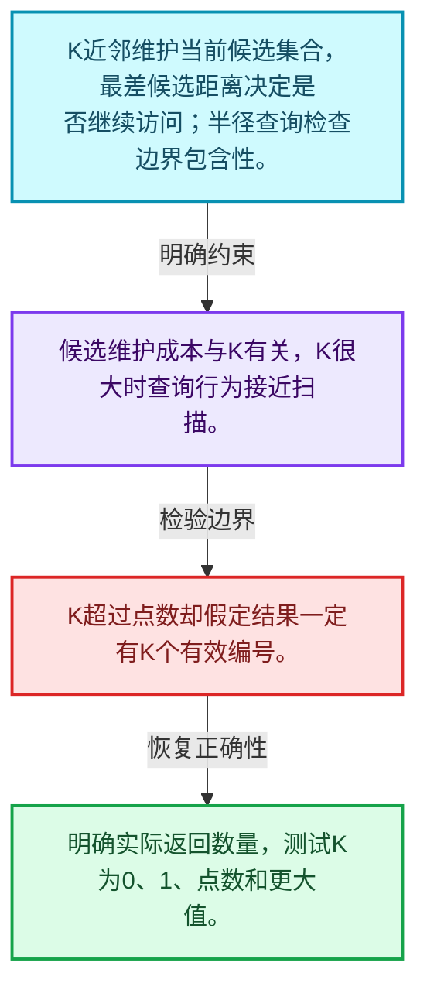
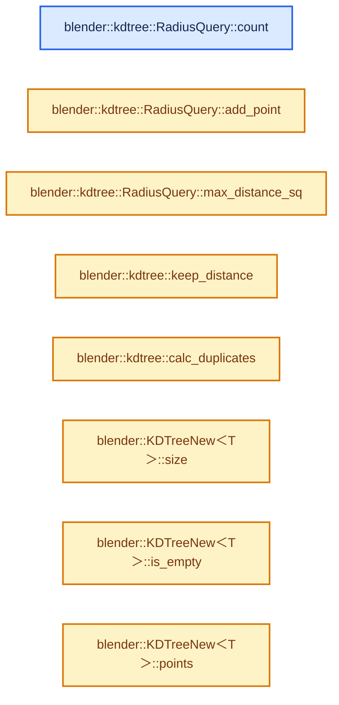
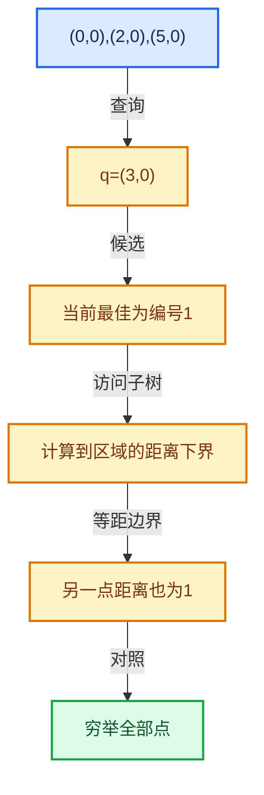

# 12-05 K近邻与范围查询

[方向导航](README.md) · [总目录](../README.md) · [实现索引](../00-课程指南/02-源码与提交索引/符号依赖与实现索引.md)

## 从问题到实现

结果集合怎样改变剪枝阈值？

K近邻需维护当前候选，半径查询阈值固定或受接口约定影响；边界包含性必须明确。

**数据模型**

K近邻维护当前候选集合，最差候选距离决定是否继续访问；半径查询检查边界包含性。

**设计取舍**

候选维护成本与K有关，K很大时查询行为接近扫描。

**最小反例**

K超过点数却假定结果一定有K个有效编号。

**推导**

明确实际返回数量，测试K为0、1、点数和更大值。

## 阅读地图与执行推演








图中的数值推演是本方向的教学模型；实际函数之间的调用边与概念分析边分别标注，不能把概念关系当作运行时调度顺序。

## 完整源码单元与就地讲解

中文讲解直接放在相关代码旁，复杂机制在代码下展开。原文折叠区保留基准行号；不需要在行号表和函数之间来回查找。类布局可分段展示，函数实现不按固定行数切开。

<!-- annotated:7038680fdcc1a7 -->

```cpp

```

<details>
<summary>核对原始源码：source/blender/blenlib/BLI_kdtree_new.hh · L411—L411</summary>

<!-- original:7038680fdcc1a7:source/blender/blenlib/BLI_kdtree_new.hh:411:411 -->

```cpp

```

</details>

<a id="f-7d6dc3ce6d525a96"></a>

### `blender::kdtree::RadiusQuery::count`

实现位置：[source/blender/blenlib/BLI_kdtree_new.hh](../../../../../source/blender/blenlib/BLI_kdtree_new.hh) · L412—L415。

**教学注释版**

<!-- annotated:30c438a06e625c -->

```cpp
  int count() const
  {
    return count_;
  }
```

<details>
<summary>核对原始源码：source/blender/blenlib/BLI_kdtree_new.hh · L412—L415</summary>

<!-- original:30c438a06e625c:source/blender/blenlib/BLI_kdtree_new.hh:412:415 -->

```cpp
  int count() const
  {
    return count_;
  }
```

</details>

**结果出口**

- `return count_;`

**继续追踪实现**

本实现没有需要继续展开的显式调用；检查返回表达式、对象转换和调用者前置条件。

<!-- annotated:53b445f7f66a59 -->

```cpp

```

<details>
<summary>核对原始源码：source/blender/blenlib/BLI_kdtree_new.hh · L416—L416</summary>

<!-- original:53b445f7f66a59:source/blender/blenlib/BLI_kdtree_new.hh:416:416 -->

```cpp

```

</details>

<a id="f-a4b6c726abd99b28"></a>

### `blender::kdtree::RadiusQuery::add_point`

实现位置：[source/blender/blenlib/BLI_kdtree_new.hh](../../../../../source/blender/blenlib/BLI_kdtree_new.hh) · L417—L422。

接口参数：

- `const ValueT distance_sq`
- `const int index`

**教学注释版**

<!-- annotated:8213cb8e0497bc -->

```cpp
  bool add_point(const ValueT distance_sq, const int index)
  {
    count_++;
    fn_(index, distance_sq);
    return true;
  }
```

<details>
<summary>核对原始源码：source/blender/blenlib/BLI_kdtree_new.hh · L417—L422</summary>

<!-- original:8213cb8e0497bc:source/blender/blenlib/BLI_kdtree_new.hh:417:422 -->

```cpp
  bool add_point(const ValueT distance_sq, const int index)
  {
    count_++;
    fn_(index, distance_sq);
    return true;
  }
```

</details>

**结果出口**

- `return true;`

**继续追踪实现**

- `fn_` → [调用协议](../00-课程指南/01-路线与规范/模板宏与动态分派协议.md)：函数指针、局部可调用对象或未展开的宏；必须结合调用者环境。调用位置L420。

### 类型布局、声明与编译条件 · BLI_kdtree_new.hh L423—L424

<!-- annotated:bdaa0db8928966 -->

```cpp

  /** The search never narrows, since every point within the radius is wanted. */
```

<details>
<summary>核对原始源码：source/blender/blenlib/BLI_kdtree_new.hh · L423—L424</summary>

<!-- original:bdaa0db8928966:source/blender/blenlib/BLI_kdtree_new.hh:423:424 -->

```cpp

  /** The search never narrows, since every point within the radius is wanted. */
```

</details>

<a id="f-89db76625fbc3a8f"></a>

### `blender::kdtree::RadiusQuery::max_distance_sq`

实现位置：[source/blender/blenlib/BLI_kdtree_new.hh](../../../../../source/blender/blenlib/BLI_kdtree_new.hh) · L425—L428。

**教学注释版**

<!-- annotated:2fee5747836d62 -->

```cpp
  ValueT max_distance_sq() const
  {
    return radius_sq_;
  }
```

<details>
<summary>核对原始源码：source/blender/blenlib/BLI_kdtree_new.hh · L425—L428</summary>

<!-- original:2fee5747836d62:source/blender/blenlib/BLI_kdtree_new.hh:425:428 -->

```cpp
  ValueT max_distance_sq() const
  {
    return radius_sq_;
  }
```

</details>

**结果出口**

- `return radius_sq_;`

**继续追踪实现**

本实现没有需要继续展开的显式调用；检查返回表达式、对象转换和调用者前置条件。

### 类型布局、声明与编译条件 · BLI_kdtree_new.hh L429—L431

<!-- annotated:de5d9616538468 -->

```cpp
};

/** Whether a distance is close enough for \a Query to still be interested in it. */
```

<details>
<summary>核对原始源码：source/blender/blenlib/BLI_kdtree_new.hh · L429—L431</summary>

<!-- original:de5d9616538468:source/blender/blenlib/BLI_kdtree_new.hh:429:431 -->

```cpp
};

/** Whether a distance is close enough for \a Query to still be interested in it. */
```

</details>

<a id="f-a334a4358d347b43"></a>

### `blender::kdtree::keep_distance`

实现位置：[source/blender/blenlib/BLI_kdtree_new.hh](../../../../../source/blender/blenlib/BLI_kdtree_new.hh) · L432—L441。

接口参数：

- `const ValueT distance_sq`
- `const ValueT max_distance_sq`

**教学注释版**

<!-- annotated:f85e1c9978b3ad -->

```cpp
template<typename Query, typename ValueT>
inline bool keep_distance(const ValueT distance_sq, const ValueT max_distance_sq)
{
  if constexpr (Query::inclusive) {
    return distance_sq <= max_distance_sq;
  }
  else {
    return distance_sq < max_distance_sq;
  }
}
```

<details>
<summary>核对原始源码：source/blender/blenlib/BLI_kdtree_new.hh · L432—L441</summary>

<!-- original:f85e1c9978b3ad:source/blender/blenlib/BLI_kdtree_new.hh:432:441 -->

```cpp
template<typename Query, typename ValueT>
inline bool keep_distance(const ValueT distance_sq, const ValueT max_distance_sq)
{
  if constexpr (Query::inclusive) {
    return distance_sq <= max_distance_sq;
  }
  else {
    return distance_sq < max_distance_sq;
  }
}
```

</details>

**结果出口**

- `return distance_sq <= max_distance_sq;`
- `return distance_sq < max_distance_sq;`

**继续追踪实现**

本实现没有需要继续展开的显式调用；检查返回表达式、对象转换和调用者前置条件。

### 类型布局、声明与编译条件 · BLI_kdtree_new.hh L442—L482

<!-- annotated:97585004c30397 -->

```cpp

/**
 * Group points that are within \a range of each other, favoring speed over quality: each point is
 * merged into the first point that claims it rather than into its closest neighbor. Points are
 * visited in \a visit_order, which must contain every point in the tree.
 *
 * Which point of a cluster the others merge into follows from that order alone, since a point
 * claims every unclaimed point in range of it whatever order the search finds them in. Visiting
 * them in a fixed order, their index order for example, therefore keeps the result from
 * depending on the tree's layout and so on where the points are.
 *
 * \param duplicates: Indexed by point index, so it must be large enough for the largest index in
 * the tree. Points with a value of -1 are candidates to be merged into another point. Presetting
 * a point to its own index keeps it from being merged into anything, though it can still become
 * the target other points merge into. When the function returns, a merged point holds the index
 * of the point it was merged into, and a point that others were merged into holds its own index.
 * Points that are neither are left at -1.
 *
 * \return The number of points that were merged into another point.
 *
 * \note Merging is a single step: a point is never merged into a point that is itself merged into
 * a third point.
 */
template<typename T>
int calc_duplicates(const KDTreeNew<T> &tree,
                    typename T::base_type range,
                    Span<int> visit_order,
                    MutableSpan<int> duplicates);
template<typename T>
int calc_duplicates(const KDTreeNew<T> &tree,
                    typename T::base_type range,
                    const IndexMask &visit_order,
                    MutableSpan<int> duplicates);

/**
 * #calc_duplicates visiting the points in the order the tree stores them, measured to be
 * roughly 1.1x to 1.8x faster than providing a separate visit order as the point count increases
 * to ~ 1 million, though that depends on the spatial contiguity of the original point order. The
 * downside is that this ties the result to the internal layout, so it is only meant for callers
 * that don't care which point of a cluster the others merge into. See #KDTreeNew::indices.
 */
```

<details>
<summary>核对原始源码：source/blender/blenlib/BLI_kdtree_new.hh · L442—L482</summary>

<!-- original:97585004c30397:source/blender/blenlib/BLI_kdtree_new.hh:442:482 -->

```cpp

/**
 * Group points that are within \a range of each other, favoring speed over quality: each point is
 * merged into the first point that claims it rather than into its closest neighbor. Points are
 * visited in \a visit_order, which must contain every point in the tree.
 *
 * Which point of a cluster the others merge into follows from that order alone, since a point
 * claims every unclaimed point in range of it whatever order the search finds them in. Visiting
 * them in a fixed order, their index order for example, therefore keeps the result from
 * depending on the tree's layout and so on where the points are.
 *
 * \param duplicates: Indexed by point index, so it must be large enough for the largest index in
 * the tree. Points with a value of -1 are candidates to be merged into another point. Presetting
 * a point to its own index keeps it from being merged into anything, though it can still become
 * the target other points merge into. When the function returns, a merged point holds the index
 * of the point it was merged into, and a point that others were merged into holds its own index.
 * Points that are neither are left at -1.
 *
 * \return The number of points that were merged into another point.
 *
 * \note Merging is a single step: a point is never merged into a point that is itself merged into
 * a third point.
 */
template<typename T>
int calc_duplicates(const KDTreeNew<T> &tree,
                    typename T::base_type range,
                    Span<int> visit_order,
                    MutableSpan<int> duplicates);
template<typename T>
int calc_duplicates(const KDTreeNew<T> &tree,
                    typename T::base_type range,
                    const IndexMask &visit_order,
                    MutableSpan<int> duplicates);

/**
 * #calc_duplicates visiting the points in the order the tree stores them, measured to be
 * roughly 1.1x to 1.8x faster than providing a separate visit order as the point count increases
 * to ~ 1 million, though that depends on the spatial contiguity of the original point order. The
 * downside is that this ties the result to the internal layout, so it is only meant for callers
 * that don't care which point of a cluster the others merge into. See #KDTreeNew::indices.
 */
```

</details>

<a id="f-1642fa253cb95b93"></a>

### `blender::kdtree::calc_duplicates`

实现位置：[source/blender/blenlib/BLI_kdtree_new.hh](../../../../../source/blender/blenlib/BLI_kdtree_new.hh) · L483—L489。

接口参数：

- `const KDTreeNew<T> &tree`
- `const typename T::base_type range`
- `const MutableSpan<int> duplicates`

**教学注释版**

<!-- annotated:9bf4158897a406 -->

```cpp
template<typename T>
inline int calc_duplicates(const KDTreeNew<T> &tree,
                           const typename T::base_type range,
                           const MutableSpan<int> duplicates)
{
  return calc_duplicates(tree, range, tree.tree_indices(), duplicates);
}
```

<details>
<summary>核对原始源码：source/blender/blenlib/BLI_kdtree_new.hh · L483—L489</summary>

<!-- original:9bf4158897a406:source/blender/blenlib/BLI_kdtree_new.hh:483:489 -->

```cpp
template<typename T>
inline int calc_duplicates(const KDTreeNew<T> &tree,
                           const typename T::base_type range,
                           const MutableSpan<int> duplicates)
{
  return calc_duplicates(tree, range, tree.tree_indices(), duplicates);
}
```

</details>

**结果出口**

- `return calc_duplicates(tree, range, tree.tree_indices(), duplicates);`

**继续追踪实现**

- `calc_duplicates` → [blender::kdtree::calc_duplicates · L483](05-K近邻与范围查询.md#f-1642fa253cb95b93)。
- `tree.tree_indices` → [blender::Span<int> KDTreeNew<T>::tree_indices · L508](05-K近邻与范围查询.md#f-98d9bc641dcb8b2c)。

### 类型布局、声明与编译条件 · BLI_kdtree_new.hh L490—L492

<!-- annotated:0fe7724af3c550 -->

```cpp

}  // namespace kdtree

```

<details>
<summary>核对原始源码：source/blender/blenlib/BLI_kdtree_new.hh · L490—L492</summary>

<!-- original:0fe7724af3c550:source/blender/blenlib/BLI_kdtree_new.hh:490:492 -->

```cpp

}  // namespace kdtree

```

</details>

<a id="f-233c05ce6d5c8d39"></a>

### `blender::KDTreeNew<T>::size`

实现位置：[source/blender/blenlib/BLI_kdtree_new.hh](../../../../../source/blender/blenlib/BLI_kdtree_new.hh) · L493—L496。

**教学注释版**

<!-- annotated:5209c49defb602 -->

```cpp
template<typename T> int KDTreeNew<T>::size() const
{
  return size_;
}
```

<details>
<summary>核对原始源码：source/blender/blenlib/BLI_kdtree_new.hh · L493—L496</summary>

<!-- original:5209c49defb602:source/blender/blenlib/BLI_kdtree_new.hh:493:496 -->

```cpp
template<typename T> int KDTreeNew<T>::size() const
{
  return size_;
}
```

</details>

**结果出口**

- `return size_;`

**继续追踪实现**

本实现没有需要继续展开的显式调用；检查返回表达式、对象转换和调用者前置条件。

<!-- annotated:62c306b7d723b2 -->

```cpp

```

<details>
<summary>核对原始源码：source/blender/blenlib/BLI_kdtree_new.hh · L497—L497</summary>

<!-- original:62c306b7d723b2:source/blender/blenlib/BLI_kdtree_new.hh:497:497 -->

```cpp

```

</details>

<a id="f-67f0ff91cf00b00b"></a>

### `blender::KDTreeNew<T>::is_empty`

实现位置：[source/blender/blenlib/BLI_kdtree_new.hh](../../../../../source/blender/blenlib/BLI_kdtree_new.hh) · L498—L501。

**教学注释版**

<!-- annotated:679c68f162c70a -->

```cpp
template<typename T> bool KDTreeNew<T>::is_empty() const
{
  return size_ == 0;
}
```

<details>
<summary>核对原始源码：source/blender/blenlib/BLI_kdtree_new.hh · L498—L501</summary>

<!-- original:679c68f162c70a:source/blender/blenlib/BLI_kdtree_new.hh:498:501 -->

```cpp
template<typename T> bool KDTreeNew<T>::is_empty() const
{
  return size_ == 0;
}
```

</details>

**结果出口**

- `return size_ == 0;`

**继续追踪实现**

本实现没有需要继续展开的显式调用；检查返回表达式、对象转换和调用者前置条件。

<!-- annotated:307f5ba24ea6e5 -->

```cpp

```

<details>
<summary>核对原始源码：source/blender/blenlib/BLI_kdtree_new.hh · L502—L502</summary>

<!-- original:307f5ba24ea6e5:source/blender/blenlib/BLI_kdtree_new.hh:502:502 -->

```cpp

```

</details>

<a id="f-656b1cc85960b5e1"></a>

### `blender::KDTreeNew<T>::points`

实现位置：[source/blender/blenlib/BLI_kdtree_new.hh](../../../../../source/blender/blenlib/BLI_kdtree_new.hh) · L503—L506。

**教学注释版**

<!-- annotated:c00b6977f0a87a -->

```cpp
template<typename T> const T *KDTreeNew<T>::points() const
{
  return points_;
}
```

<details>
<summary>核对原始源码：source/blender/blenlib/BLI_kdtree_new.hh · L503—L506</summary>

<!-- original:c00b6977f0a87a:source/blender/blenlib/BLI_kdtree_new.hh:503:506 -->

```cpp
template<typename T> const T *KDTreeNew<T>::points() const
{
  return points_;
}
```

</details>

**结果出口**

- `return points_;`

**继续追踪实现**

本实现没有需要继续展开的显式调用；检查返回表达式、对象转换和调用者前置条件。

<!-- annotated:928318ce4295ad -->

```cpp

```

<details>
<summary>核对原始源码：source/blender/blenlib/BLI_kdtree_new.hh · L507—L507</summary>

<!-- original:928318ce4295ad:source/blender/blenlib/BLI_kdtree_new.hh:507:507 -->

```cpp

```

</details>

<a id="f-98d9bc641dcb8b2c"></a>

### `blender::Span<int> KDTreeNew<T>::tree_indices`

实现位置：[source/blender/blenlib/BLI_kdtree_new.hh](../../../../../source/blender/blenlib/BLI_kdtree_new.hh) · L508—L511。

**教学注释版**

<!-- annotated:8e2f198e9f4f13 -->

```cpp
template<typename T> Span<int> KDTreeNew<T>::tree_indices() const
{
  return Span<int>(tree_indices_, size_);
}
```

<details>
<summary>核对原始源码：source/blender/blenlib/BLI_kdtree_new.hh · L508—L511</summary>

<!-- original:8e2f198e9f4f13:source/blender/blenlib/BLI_kdtree_new.hh:508:511 -->

```cpp
template<typename T> Span<int> KDTreeNew<T>::tree_indices() const
{
  return Span<int>(tree_indices_, size_);
}
```

</details>

**结果出口**

- `return Span<int>(tree_indices_, size_);`

**继续追踪实现**

- `Span<int>` → [blender::Span · L214](../01-基础容器与现代CPP/15-StringRef字符串视图.md#f-eea723436ab634ed)。

<!-- annotated:7f3cf1f5c37541 -->

```cpp

```

<details>
<summary>核对原始源码：source/blender/blenlib/BLI_kdtree_new.hh · L512—L512</summary>

<!-- original:7f3cf1f5c37541:source/blender/blenlib/BLI_kdtree_new.hh:512:512 -->

```cpp

```

</details>

<a id="f-2ae1c56f5d4ecf10"></a>

### `blender::KDTreeNew<T>::find_nearest`

在空间界限约束下寻找满足条件的点。

实现位置：[source/blender/blenlib/BLI_kdtree_new.hh](../../../../../source/blender/blenlib/BLI_kdtree_new.hh) · L513—L525。

接口参数：

- `const T &position`
- `value_type *r_distance_sq`

**教学注释版**

<!-- annotated:553a8e19befc62 -->

```cpp
template<typename T>
int KDTreeNew<T>::find_nearest(const T &position, value_type *r_distance_sq) const
{
  if (this->is_empty()) {
    return -1;
  }
  kdtree::NearestQuery<value_type> query;
  // [讲解] this->search：在空间界限约束下寻找满足条件的点。
  this->search(query, position);
  if (query.index() != -1 && r_distance_sq) {
    *r_distance_sq = query.distance_sq();
  }
  return query.index();
}
```

<details>
<summary>核对原始源码：source/blender/blenlib/BLI_kdtree_new.hh · L513—L525</summary>

<!-- original:553a8e19befc62:source/blender/blenlib/BLI_kdtree_new.hh:513:525 -->

```cpp
template<typename T>
int KDTreeNew<T>::find_nearest(const T &position, value_type *r_distance_sq) const
{
  if (this->is_empty()) {
    return -1;
  }
  kdtree::NearestQuery<value_type> query;
  this->search(query, position);
  if (query.index() != -1 && r_distance_sq) {
    *r_distance_sq = query.distance_sq();
  }
  return query.index();
}
```

</details>

**接口与不变量**

返回身份应映射到原坐标数组，距离单位与剪枝上界必须一致。

**结果出口**

- `return -1;`
- `return query.index();`

**继续追踪实现**

- `this->is_empty` → [blender::KDTreeNew<T>::is_empty · L498](05-K近邻与范围查询.md#f-67f0ff91cf00b00b)。
- `this->search` → [blender::KDTreeNew<T>::search · L595](06-筛选与子集查询.md#f-d531d5162b90d15b)。
- `query.index` → [blender::kdtree::NearestQuery::index · L292](04-最近邻搜索与剪枝.md#f-8d4612e78793f66f)。
- `query.distance_sq` → [blender::kdtree::NearestQuery::distance_sq · L296](04-最近邻搜索与剪枝.md#f-977a9f870200ecd7)。

### 类型布局、声明与编译条件 · BLI_kdtree_new.hh L526—L527

<!-- annotated:cd6c2e6951b87e -->

```cpp

template<typename T>
```

<details>
<summary>核对原始源码：source/blender/blenlib/BLI_kdtree_new.hh · L526—L527</summary>

<!-- original:cd6c2e6951b87e:source/blender/blenlib/BLI_kdtree_new.hh:526:527 -->

```cpp

template<typename T>
```

</details>

<a id="f-bfd0ae665ae44a28"></a>

### `blender::KDTreeNew<T>::find_nearest_filtered`

在空间界限约束下寻找满足条件的点。

实现位置：[source/blender/blenlib/BLI_kdtree_new.hh](../../../../../source/blender/blenlib/BLI_kdtree_new.hh) · L528—L544。

接口参数：

- `const T &position`
- `Filter &&filter`
- `value_type *r_distance_sq`

**教学注释版**

<!-- annotated:e1929fb15153ec -->

```cpp
template<typename Filter>
int KDTreeNew<T>::find_nearest_filtered(const T &position,
                                        Filter &&filter,
                                        value_type *r_distance_sq) const
  requires kdtree::FilterFn<Filter>
{
  if (this->is_empty()) {
    return -1;
  }
  kdtree::FilteredNearestQuery<value_type, std::decay_t<Filter>> query(
      std::forward<Filter>(filter));
  // [讲解] this->search：在空间界限约束下寻找满足条件的点。
  this->search(query, position);
  if (query.index() != -1 && r_distance_sq) {
    *r_distance_sq = query.distance_sq();
  }
  return query.index();
}
```

<details>
<summary>核对原始源码：source/blender/blenlib/BLI_kdtree_new.hh · L528—L544</summary>

<!-- original:e1929fb15153ec:source/blender/blenlib/BLI_kdtree_new.hh:528:544 -->

```cpp
template<typename Filter>
int KDTreeNew<T>::find_nearest_filtered(const T &position,
                                        Filter &&filter,
                                        value_type *r_distance_sq) const
  requires kdtree::FilterFn<Filter>
{
  if (this->is_empty()) {
    return -1;
  }
  kdtree::FilteredNearestQuery<value_type, std::decay_t<Filter>> query(
      std::forward<Filter>(filter));
  this->search(query, position);
  if (query.index() != -1 && r_distance_sq) {
    *r_distance_sq = query.distance_sq();
  }
  return query.index();
}
```

</details>

**接口与不变量**

返回身份应映射到原坐标数组，距离单位与剪枝上界必须一致。

**结果出口**

- `return -1;`
- `return query.index();`

**继续追踪实现**

- `this->is_empty` → [blender::KDTreeNew<T>::is_empty · L498](05-K近邻与范围查询.md#f-67f0ff91cf00b00b)。
- `this->search` → [blender::KDTreeNew<T>::search · L595](06-筛选与子集查询.md#f-d531d5162b90d15b)。
- `query.index` → [blender::kdtree::FilteredNearestQuery::index · L326](04-最近邻搜索与剪枝.md#f-17a76e90286f4788)。
- `query.distance_sq` → [blender::kdtree::FilteredNearestQuery::distance_sq · L330](04-最近邻搜索与剪枝.md#f-6cde8eacea689b32)。

<!-- annotated:d5951c4a7fff7a -->

```cpp

```

<details>
<summary>核对原始源码：source/blender/blenlib/intern/kdtree.cc · L456—L456</summary>

<!-- original:d5951c4a7fff7a:source/blender/blenlib/intern/kdtree.cc:456:456 -->

```cpp

```

</details>

<a id="f-c1b3a1b0d3c95da7"></a>

### `blender::TreeBuilder::merge_bounds`

实现位置：[source/blender/blenlib/intern/kdtree.cc](../../../../../source/blender/blenlib/intern/kdtree.cc) · L457—L465。

接口参数：

- `const Span<Bounds<BuildPoint>> block_bounds`

**教学注释版**

<!-- annotated:1f3ebe133af4cd -->

```cpp
  static Bounds<BuildPoint> merge_bounds(const Span<Bounds<BuildPoint>> block_bounds)
  {
    // [讲解] block_bounds.first：按视图边界访问元素。
    Bounds<BuildPoint> bounds = block_bounds.first();
    // [讲解] block_bounds.drop_front：从两端裁去或选取一定数量元素形成新视图。
    for (const Bounds<BuildPoint> &other : block_bounds.drop_front(1)) {
      bounds.min = math::min(bounds.min, other.min);
      bounds.max = math::max(bounds.max, other.max);
    }
    return bounds;
  }
```

<details>
<summary>核对原始源码：source/blender/blenlib/intern/kdtree.cc · L457—L465</summary>

<!-- original:1f3ebe133af4cd:source/blender/blenlib/intern/kdtree.cc:457:465 -->

```cpp
  static Bounds<BuildPoint> merge_bounds(const Span<Bounds<BuildPoint>> block_bounds)
  {
    Bounds<BuildPoint> bounds = block_bounds.first();
    for (const Bounds<BuildPoint> &other : block_bounds.drop_front(1)) {
      bounds.min = math::min(bounds.min, other.min);
      bounds.max = math::max(bounds.max, other.max);
    }
    return bounds;
  }
```

</details>

**沿实际写入检查状态**

- `bounds.min = math::min(bounds.min, other.min);`
- `bounds.max = math::max(bounds.max, other.max);`

**结果出口**

- `return bounds;`

**继续追踪实现**

- `block_bounds.first` → [blender::Span::first · L319](../01-基础容器与现代CPP/05-Span只读连续视图.md#f-d8c9bcc3e9757248)。
- `block_bounds.drop_front` → [blender::Span::drop_front · L175](../01-基础容器与现代CPP/05-Span只读连续视图.md#f-932897accbde3413)。
- `math::min` → [blender::math::min · L56](../90-实现依赖专题/01-BLI基础库/BLI_math_vector.hh.md#f-ee6ead51e4bb3364)；[blender::math::min · L65](../90-实现依赖专题/01-BLI基础库/BLI_math_vector.hh.md#f-f65ce48b3051cce3)；[blender::math::min · L81](../90-实现依赖专题/01-BLI基础库/BLI_math_vector.hh.md#f-9c602d29fab41795)；[blender::math::min · L43](../90-实现依赖专题/01-BLI基础库/BLI_math_base.hh.md#f-72ff0c229e6c09b0)。同名重载需按实参类型选择。
- `math::max` → [blender::math::max · L87](../90-实现依赖专题/01-BLI基础库/BLI_math_vector.hh.md#f-9be564a293777d6b)；[blender::math::max · L96](../90-实现依赖专题/01-BLI基础库/BLI_math_vector.hh.md#f-ce32dff37d0af3bc)；[blender::math::max · L112](../90-实现依赖专题/01-BLI基础库/BLI_math_vector.hh.md#f-668eb1fcf1fa8292)；[blender::math::max · L49](../90-实现依赖专题/01-BLI基础库/BLI_math_base.hh.md#f-a6991ca3d12937e1)。同名重载需按实参类型选择。

### 类型布局、声明与编译条件 · kdtree.cc L466—L482

<!-- annotated:edc255cfcdf419 -->

```cpp

  /** \} */

  /* -------------------------------------------------------------------- */
  /** \name Partitioning
   * \{ */

  /**
   * Reorder the points in [start, end) so that those below \a split_value in \a dim come first,
   * and return where the rest starts.
   *
   * Deciding per point whether to swap it is a branch on the result of the comparison, which for
   * an evenly split node is unpredictable and so mispredicts on about every other point. This
   * collects the offsets of the misplaced points of a block without branching on the comparison,
   * and only then swaps them, which is a loop over exactly as many iterations as there are swaps.
   * Same approach as the partition in BlockQuicksort.
   */
```

<details>
<summary>核对原始源码：source/blender/blenlib/intern/kdtree.cc · L466—L482</summary>

<!-- original:edc255cfcdf419:source/blender/blenlib/intern/kdtree.cc:466:482 -->

```cpp

  /** \} */

  /* -------------------------------------------------------------------- */
  /** \name Partitioning
   * \{ */

  /**
   * Reorder the points in [start, end) so that those below \a split_value in \a dim come first,
   * and return where the rest starts.
   *
   * Deciding per point whether to swap it is a branch on the result of the comparison, which for
   * an evenly split node is unpredictable and so mispredicts on about every other point. This
   * collects the offsets of the misplaced points of a block without branching on the comparison,
   * and only then swaps them, which is a loop over exactly as many iterations as there are swaps.
   * Same approach as the partition in BlockQuicksort.
   */
```

</details>

<a id="f-0e810e2ffd5ca073"></a>

### `blender::TreeBuilder::partition_points`

实现位置：[source/blender/blenlib/intern/kdtree.cc](../../../../../source/blender/blenlib/intern/kdtree.cc) · L483—L532。

接口参数：

- `const MutableSpan<BuildPoint> points`
- `const int start`
- `const int end`
- `const int dim`
- `const value_type split_value`

**教学注释版**

<!-- annotated:17dcecb7968783 -->

```cpp
  static int partition_points(const MutableSpan<BuildPoint> points,
                              const int start,
                              const int end,
                              const int dim,
                              const value_type split_value)
  {
    constexpr int block = PARTITION_BLOCK_SIZE;

    uint8_t offsets_l[block], offsets_r[block];
    int num_l = 0, num_r = 0, first_l = 0, first_r = 0;
    int l = start, r = end;

    while (r - l > 2 * block) {
      /* Offsets of the points of the left block that belong on the right, and the other way
       * around. The store always happens, only the counter advances conditionally. */
      if (num_l == 0) {
        first_l = 0;
        for (const int i : IndexRange(block)) {
          offsets_l[num_l] = uint8_t(i);
          num_l += int(!(points[l + i][dim] < split_value));
        }
      }
      if (num_r == 0) {
        first_r = 0;
        for (const int i : IndexRange(block)) {
          offsets_r[num_r] = uint8_t(i);
          num_r += int(points[r - 1 - i][dim] < split_value);
        }
      }

      // [讲解] std::min：按比较关系选取较小值；截断范围时还需先满足非负和可表示范围，min本身不会证明边界安全。
      const int num = std::min(num_l, num_r);
      for (const int i : IndexRange(num)) {
        std::swap(points[l + offsets_l[first_l + i]], points[r - 1 - offsets_r[first_r + i]]);
      }
      num_l -= num;
      num_r -= num;
      first_l += num;
      first_r += num;

      /* A block is done once none of its points are misplaced any more. */
      if (num_l == 0) {
        l += block;
      }
      if (num_r == 0) {
        r -= block;
      }
    }

    return partition_points_small(points, l, r, dim, split_value);
  }
```

<details>
<summary>核对原始源码：source/blender/blenlib/intern/kdtree.cc · L483—L532</summary>

<!-- original:17dcecb7968783:source/blender/blenlib/intern/kdtree.cc:483:532 -->

```cpp
  static int partition_points(const MutableSpan<BuildPoint> points,
                              const int start,
                              const int end,
                              const int dim,
                              const value_type split_value)
  {
    constexpr int block = PARTITION_BLOCK_SIZE;

    uint8_t offsets_l[block], offsets_r[block];
    int num_l = 0, num_r = 0, first_l = 0, first_r = 0;
    int l = start, r = end;

    while (r - l > 2 * block) {
      /* Offsets of the points of the left block that belong on the right, and the other way
       * around. The store always happens, only the counter advances conditionally. */
      if (num_l == 0) {
        first_l = 0;
        for (const int i : IndexRange(block)) {
          offsets_l[num_l] = uint8_t(i);
          num_l += int(!(points[l + i][dim] < split_value));
        }
      }
      if (num_r == 0) {
        first_r = 0;
        for (const int i : IndexRange(block)) {
          offsets_r[num_r] = uint8_t(i);
          num_r += int(points[r - 1 - i][dim] < split_value);
        }
      }

      const int num = std::min(num_l, num_r);
      for (const int i : IndexRange(num)) {
        std::swap(points[l + offsets_l[first_l + i]], points[r - 1 - offsets_r[first_r + i]]);
      }
      num_l -= num;
      num_r -= num;
      first_l += num;
      first_r += num;

      /* A block is done once none of its points are misplaced any more. */
      if (num_l == 0) {
        l += block;
      }
      if (num_r == 0) {
        r -= block;
      }
    }

    return partition_points_small(points, l, r, dim, split_value);
  }
```

</details>

**沿实际写入检查状态**

- `first_l = 0;`
- `offsets_l[num_l] = uint8_t(i);`
- `num_l += int(!(points[l + i][dim] < split_value));`
- `first_r = 0;`
- `offsets_r[num_r] = uint8_t(i);`
- `num_r += int(points[r - 1 - i][dim] < split_value);`
- `num_l -= num;`
- `num_r -= num;`
- `first_l += num;`
- `first_r += num;`
- `l += block;`
- `r -= block;`

**结果出口**

- `return partition_points_small(points, l, r, dim, split_value);`

**继续追踪实现**

- `IndexRange` → [blender::IndexRange](../90-实现依赖专题/01-BLI基础库/BLI_index_range.hh.md#t-caa3466d6776)；[blender::gpu::shader::parser::IndexRange](../90-实现依赖专题/08-其他Blender模块/gpu/shader_tool/utils.hh.md#t-82d2bd4ea71c)；[blender::IndexRange](../90-实现依赖专题/08-其他Blender模块/makesdna/DNA_node_types.h.md#t-0448cc889d39)。
- `std::min` → [外部契约](https://eel.is/c++draft/alg.min.max)：按比较关系选取较小值；截断范围时还需先满足非负和可表示范围，min本身不会证明边界安全。
- `std::swap` → [外部契约](https://eel.is/c++draft/)：这个边界按实际表达式及所属类型核对参数、返回值、寿命与失败行为。这里提供接口入口，不声称已解释该第三方版本的内部实现。
- `partition_points_small` → [blender::TreeBuilder::partition_points_small · L539](05-K近邻与范围查询.md#f-7a40ad615e53c5ea)。

### 类型布局、声明与编译条件 · kdtree.cc L533—L538

<!-- annotated:f309256b393210 -->

```cpp

  /**
   * #partition_points for a range that fits in a temporary buffer, which is the case for the
   * last levels of the tree. Copying the points out and back in is cheaper than the swaps that
   * staying in place needs, and keeps those levels branchless as well.
   */
```

<details>
<summary>核对原始源码：source/blender/blenlib/intern/kdtree.cc · L533—L538</summary>

<!-- original:f309256b393210:source/blender/blenlib/intern/kdtree.cc:533:538 -->

```cpp

  /**
   * #partition_points for a range that fits in a temporary buffer, which is the case for the
   * last levels of the tree. Copying the points out and back in is cheaper than the swaps that
   * staying in place needs, and keeps those levels branchless as well.
   */
```

</details>

<a id="f-7a40ad615e53c5ea"></a>

### `blender::TreeBuilder::partition_points_small`

实现位置：[source/blender/blenlib/intern/kdtree.cc](../../../../../source/blender/blenlib/intern/kdtree.cc) · L539—L572。

接口参数：

- `const MutableSpan<BuildPoint> points`
- `const int start`
- `const int end`
- `const int dim`
- `const value_type split_value`

**教学注释版**

<!-- annotated:62a86936970eaf -->

```cpp
  static int partition_points_small(const MutableSpan<BuildPoint> points,
                                    const int start,
                                    const int end,
                                    const int dim,
                                    const value_type split_value)
  {
    const int count = end - start;
    BLI_assert(count <= 2 * PARTITION_BLOCK_SIZE);

    std::array<BuildPoint, 2 * PARTITION_BLOCK_SIZE> buffer;
    /* Points below the split fill the buffer from the front, the others from the back. Only the
     * position depends on the comparison, so there is nothing to mispredict. */
    int l = 0, r = count;
    for (const int i : IndexRange(start, count)) {
      /* Read the coordinate from the array rather than from a copy of the point: indexing a
       * vector by a value only known at runtime means it has to be in memory, and a copy would
       * have to be spilled there every iteration. */
      const bool less = points[i][dim] < split_value;
      const BuildPoint point = points[i];
      /* Written to both ends, of which only one is kept. Picking the position instead lets a
       * compiler turn it back into a branch on the comparison, which is the whole thing this
       * avoids, and both ends are a few cache lines apart at most. */
      buffer[l] = point;
      buffer[r - 1] = point;
      l += int(less);
      r -= int(!less);
    }

    // [讲解] points.slice：建立原连续范围的子视图。
    MutableSpan<BuildPoint> range = points.slice(start, count);
    for (const int i : IndexRange(count)) {
      range[i] = buffer[i];
    }
    return start + l;
  }
```

<details>
<summary>核对原始源码：source/blender/blenlib/intern/kdtree.cc · L539—L572</summary>

<!-- original:62a86936970eaf:source/blender/blenlib/intern/kdtree.cc:539:572 -->

```cpp
  static int partition_points_small(const MutableSpan<BuildPoint> points,
                                    const int start,
                                    const int end,
                                    const int dim,
                                    const value_type split_value)
  {
    const int count = end - start;
    BLI_assert(count <= 2 * PARTITION_BLOCK_SIZE);

    std::array<BuildPoint, 2 * PARTITION_BLOCK_SIZE> buffer;
    /* Points below the split fill the buffer from the front, the others from the back. Only the
     * position depends on the comparison, so there is nothing to mispredict. */
    int l = 0, r = count;
    for (const int i : IndexRange(start, count)) {
      /* Read the coordinate from the array rather than from a copy of the point: indexing a
       * vector by a value only known at runtime means it has to be in memory, and a copy would
       * have to be spilled there every iteration. */
      const bool less = points[i][dim] < split_value;
      const BuildPoint point = points[i];
      /* Written to both ends, of which only one is kept. Picking the position instead lets a
       * compiler turn it back into a branch on the comparison, which is the whole thing this
       * avoids, and both ends are a few cache lines apart at most. */
      buffer[l] = point;
      buffer[r - 1] = point;
      l += int(less);
      r -= int(!less);
    }

    MutableSpan<BuildPoint> range = points.slice(start, count);
    for (const int i : IndexRange(count)) {
      range[i] = buffer[i];
    }
    return start + l;
  }
```

</details>

**沿实际写入检查状态**

- `buffer[l] = point;`
- `l += int(less);`
- `r -= int(!less);`
- `range[i] = buffer[i];`

**结果出口**

- `return start + l;`

**继续追踪实现**

- `BLI_assert` → [BLI_assert · L48](../90-实现依赖专题/01-BLI基础库/BLI_assert.hh.md#m-57a88495704d)；[BLI_assert · L63](../90-实现依赖专题/01-BLI基础库/BLI_assert.hh.md#m-d07050020cb5)。宏定义由构建条件选择。
- `IndexRange` → [blender::IndexRange](../90-实现依赖专题/01-BLI基础库/BLI_index_range.hh.md#t-caa3466d6776)；[blender::gpu::shader::parser::IndexRange](../90-实现依赖专题/08-其他Blender模块/gpu/shader_tool/utils.hh.md#t-82d2bd4ea71c)；[blender::IndexRange](../90-实现依赖专题/08-其他Blender模块/makesdna/DNA_node_types.h.md#t-0448cc889d39)。
- `points.slice` → [blender::MutableSpan::slice · L579](../01-基础容器与现代CPP/06-MutableSpan可写视图.md#f-6808b4aefbf58808)；[blender::MutableSpan::slice · L587](../01-基础容器与现代CPP/06-MutableSpan可写视图.md#f-c05b010821861e4f)。同名重载需按实参类型选择。

### 类型布局、声明与编译条件 · kdtree.cc L573—L584

<!-- annotated:ff81f6b0452148 -->

```cpp

  /**
   * #partition_points with the range split a block at a time, which can be spread over threads.
   * Which blocks the range is cut into follows from its size alone, so this leaves the points in
   * the same order however many threads run it.
   *
   * Each block is partitioned on its own, which leaves every block split but the blocks
   * themselves interleaved: points above the split sit in blocks that belong entirely below it,
   * and the other way around. There are as many of one as of the other, so the fix up is to swap
   * them pairwise, which spreads over threads as well. This is how embree partitions primitives
   * when building a BVH.
   */
```

<details>
<summary>核对原始源码：source/blender/blenlib/intern/kdtree.cc · L573—L584</summary>

<!-- original:ff81f6b0452148:source/blender/blenlib/intern/kdtree.cc:573:584 -->

```cpp

  /**
   * #partition_points with the range split a block at a time, which can be spread over threads.
   * Which blocks the range is cut into follows from its size alone, so this leaves the points in
   * the same order however many threads run it.
   *
   * Each block is partitioned on its own, which leaves every block split but the blocks
   * themselves interleaved: points above the split sit in blocks that belong entirely below it,
   * and the other way around. There are as many of one as of the other, so the fix up is to swap
   * them pairwise, which spreads over threads as well. This is how embree partitions primitives
   * when building a BVH.
   */
```

</details>

<a id="f-1bc1c063fd362097"></a>

### `blender::TreeBuilder::partition_points_in_blocks`

实现位置：[source/blender/blenlib/intern/kdtree.cc](../../../../../source/blender/blenlib/intern/kdtree.cc) · L585—L668。

接口参数：

- `const int start`
- `const int end`
- `const int dim`
- `const value_type split_value`

**教学注释版**

<!-- annotated:8af438b1b3dfe4 -->

```cpp
  int partition_points_in_blocks(const int start,
                                 const int end,
                                 const int dim,
                                 const value_type split_value)
  {
    const MutableSpan<BuildPoint> points = build_points_;
    const int count = end - start;
    const int blocks = block_num(count);
    if (blocks < 2) {
      return partition_points(points, start, end, dim, split_value);
    }

    int begin[NODE_MAX_BLOCKS + 1];
    int middle[NODE_MAX_BLOCKS];
    for (const int block : IndexRange(blocks + 1)) {
      begin[block] = start + block_begin(count, blocks, block);
    }

    threading::parallel_for(IndexRange(blocks), 1, [&](const IndexRange range) {
      for (const int block : range) {
        middle[block] = partition_points(points, begin[block], begin[block + 1], dim, split_value);
      }
    });

    /* Where the split ends up once the blocks are put in order. */
    int split = start;
    for (const int block : IndexRange(blocks)) {
      split += middle[block] - begin[block];
    }

    /* The points that are on the wrong side of it. A block lies either before or after the
     * split, so it contributes to one of the two lists at most. */
    IndexRange high[NODE_MAX_BLOCKS], low[NODE_MAX_BLOCKS];
    int high_num = 0, low_num = 0;
    for (const int block : IndexRange(blocks)) {
      if (middle[block] < split) {
        // [讲解] std::min：按比较关系选取较小值；截断范围时还需先满足非负和可表示范围，min本身不会证明边界安全。
        const int last = std::min(begin[block + 1], split);
        if (middle[block] < last) {
          high[high_num++] = IndexRange::from_begin_end(middle[block], last);
        }
      }
      else if (middle[block] > split) {
        // [讲解] std::max：按比较关系选取较大值。本讲解中的增长公式同时满足最低请求和几何增长；若保存返回引用，还需注意实参寿命。
        const int first = std::max(begin[block], split);
        if (first < middle[block]) {
          low[low_num++] = IndexRange::from_begin_end(first, middle[block]);
        }
      }
    }

    /* Pair the two lists up into chunks that can be swapped independently. Each step finishes a
     * range on one side or the other, so there are fewer chunks than there are ranges. */
    struct Swap {
      int from;
      int to;
      int num;
    };
    Swap swaps[2 * NODE_MAX_BLOCKS];
    int swaps_num = 0;
    for (int h = 0, l = 0, h_done = 0, l_done = 0; h < high_num && l < low_num;) {
      const int num = std::min(int(high[h].size()) - h_done, int(low[l].size()) - l_done);
      swaps[swaps_num++] = {int(high[h].start()) + h_done, int(low[l].start()) + l_done, num};
      h_done += num;
      l_done += num;
      if (h_done == int(high[h].size())) {
        h++;
        h_done = 0;
      }
      if (l_done == int(low[l].size())) {
        l++;
        l_done = 0;
      }
    }

    threading::parallel_for(IndexRange(swaps_num), 1, [&](const IndexRange range) {
      for (const int i : range) {
        const Swap &swap = swaps[i];
        for (const int offset : IndexRange(swap.num)) {
          std::swap(points[swap.from + offset], points[swap.to + offset]);
        }
      }
    });

    return split;
  }
```

<details>
<summary>核对原始源码：source/blender/blenlib/intern/kdtree.cc · L585—L668</summary>

<!-- original:8af438b1b3dfe4:source/blender/blenlib/intern/kdtree.cc:585:668 -->

```cpp
  int partition_points_in_blocks(const int start,
                                 const int end,
                                 const int dim,
                                 const value_type split_value)
  {
    const MutableSpan<BuildPoint> points = build_points_;
    const int count = end - start;
    const int blocks = block_num(count);
    if (blocks < 2) {
      return partition_points(points, start, end, dim, split_value);
    }

    int begin[NODE_MAX_BLOCKS + 1];
    int middle[NODE_MAX_BLOCKS];
    for (const int block : IndexRange(blocks + 1)) {
      begin[block] = start + block_begin(count, blocks, block);
    }

    threading::parallel_for(IndexRange(blocks), 1, [&](const IndexRange range) {
      for (const int block : range) {
        middle[block] = partition_points(points, begin[block], begin[block + 1], dim, split_value);
      }
    });

    /* Where the split ends up once the blocks are put in order. */
    int split = start;
    for (const int block : IndexRange(blocks)) {
      split += middle[block] - begin[block];
    }

    /* The points that are on the wrong side of it. A block lies either before or after the
     * split, so it contributes to one of the two lists at most. */
    IndexRange high[NODE_MAX_BLOCKS], low[NODE_MAX_BLOCKS];
    int high_num = 0, low_num = 0;
    for (const int block : IndexRange(blocks)) {
      if (middle[block] < split) {
        const int last = std::min(begin[block + 1], split);
        if (middle[block] < last) {
          high[high_num++] = IndexRange::from_begin_end(middle[block], last);
        }
      }
      else if (middle[block] > split) {
        const int first = std::max(begin[block], split);
        if (first < middle[block]) {
          low[low_num++] = IndexRange::from_begin_end(first, middle[block]);
        }
      }
    }

    /* Pair the two lists up into chunks that can be swapped independently. Each step finishes a
     * range on one side or the other, so there are fewer chunks than there are ranges. */
    struct Swap {
      int from;
      int to;
      int num;
    };
    Swap swaps[2 * NODE_MAX_BLOCKS];
    int swaps_num = 0;
    for (int h = 0, l = 0, h_done = 0, l_done = 0; h < high_num && l < low_num;) {
      const int num = std::min(int(high[h].size()) - h_done, int(low[l].size()) - l_done);
      swaps[swaps_num++] = {int(high[h].start()) + h_done, int(low[l].start()) + l_done, num};
      h_done += num;
      l_done += num;
      if (h_done == int(high[h].size())) {
        h++;
        h_done = 0;
      }
      if (l_done == int(low[l].size())) {
        l++;
        l_done = 0;
      }
    }

    threading::parallel_for(IndexRange(swaps_num), 1, [&](const IndexRange range) {
      for (const int i : range) {
        const Swap &swap = swaps[i];
        for (const int offset : IndexRange(swap.num)) {
          std::swap(points[swap.from + offset], points[swap.to + offset]);
        }
      }
    });

    return split;
  }
```

</details>

**沿实际写入检查状态**

- `begin[block] = start + block_begin(count, blocks, block);`
- `middle[block] = partition_points(points, begin[block], begin[block + 1], dim, split_value);`
- `split += middle[block] - begin[block];`
- `h_done += num;`
- `l_done += num;`
- `h_done = 0;`
- `l_done = 0;`

**结果出口**

- `return partition_points(points, start, end, dim, split_value);`
- `return split;`

**继续追踪实现**

- `block_num` → [blender::TreeBuilder::block_num · L670](05-K近邻与范围查询.md#f-e51408720bbd2ff8)。
- `partition_points` → [blender::TreeBuilder::partition_points · L483](05-K近邻与范围查询.md#f-0e810e2ffd5ca073)。
- `IndexRange` → [blender::IndexRange](../90-实现依赖专题/01-BLI基础库/BLI_index_range.hh.md#t-caa3466d6776)；[blender::gpu::shader::parser::IndexRange](../90-实现依赖专题/08-其他Blender模块/gpu/shader_tool/utils.hh.md#t-82d2bd4ea71c)；[blender::IndexRange](../90-实现依赖专题/08-其他Blender模块/makesdna/DNA_node_types.h.md#t-0448cc889d39)。
- `block_begin` → [blender::TreeBuilder::block_begin · L675](05-K近邻与范围查询.md#f-6861ede2cacc364f)。
- `threading::parallel_for` → [blender::threading::parallel_for · L68](../11-Depsgraph与并行任务系统/07-任务池与TBB接入.md#f-838294754c24426c)。
- `std::min` → [外部契约](https://eel.is/c++draft/alg.min.max)：按比较关系选取较小值；截断范围时还需先满足非负和可表示范围，min本身不会证明边界安全。
- `IndexRange::from_begin_end` → [blender::IndexRange::from_begin_end · L78](../01-基础容器与现代CPP/04-IndexRange连续整数区间.md#f-a523839fb9650253)。
- `std::max` → [外部契约](https://eel.is/c++draft/alg.min.max)：按比较关系选取较大值。本讲解中的增长公式同时满足最低请求和几何增长；若保存返回引用，还需注意实参寿命。
- `high[h].size` → [调用协议](../00-课程指南/01-路线与规范/模板宏与动态分派协议.md)：接收对象类型依赖auto、返回值或模板实例；不按同名猜测目标。调用位置L644。
- `low[l].size` → [调用协议](../00-课程指南/01-路线与规范/模板宏与动态分派协议.md)：接收对象类型依赖auto、返回值或模板实例；不按同名猜测目标。调用位置L644。
- `high[h].start` → [调用协议](../00-课程指南/01-路线与规范/模板宏与动态分派协议.md)：接收对象类型依赖auto、返回值或模板实例；不按同名猜测目标。调用位置L645。
- `low[l].start` → [调用协议](../00-课程指南/01-路线与规范/模板宏与动态分派协议.md)：接收对象类型依赖auto、返回值或模板实例；不按同名猜测目标。调用位置L645。
- `std::swap` → [外部契约](https://eel.is/c++draft/)：这个边界按实际表达式及所属类型核对参数、返回值、寿命与失败行为。这里提供接口入口，不声称已解释该第三方版本的内部实现。

<!-- annotated:2812bffb4f95ef -->

```cpp

```

<details>
<summary>核对原始源码：source/blender/blenlib/intern/kdtree.cc · L669—L669</summary>

<!-- original:2812bffb4f95ef:source/blender/blenlib/intern/kdtree.cc:669:669 -->

```cpp

```

</details>

<a id="f-e51408720bbd2ff8"></a>

### `blender::TreeBuilder::block_num`

实现位置：[source/blender/blenlib/intern/kdtree.cc](../../../../../source/blender/blenlib/intern/kdtree.cc) · L670—L673。

接口参数：

- `const int count`

**教学注释版**

<!-- annotated:287b7721702a33 -->

```cpp
  static int block_num(const int count)
  {
    // [讲解] std::min：按比较关系选取较小值；截断范围时还需先满足非负和可表示范围，min本身不会证明边界安全。
    return std::min(count / NODE_BLOCK_SIZE, NODE_MAX_BLOCKS);
  }
```

<details>
<summary>核对原始源码：source/blender/blenlib/intern/kdtree.cc · L670—L673</summary>

<!-- original:287b7721702a33:source/blender/blenlib/intern/kdtree.cc:670:673 -->

```cpp
  static int block_num(const int count)
  {
    return std::min(count / NODE_BLOCK_SIZE, NODE_MAX_BLOCKS);
  }
```

</details>

**结果出口**

- `return std::min(count / NODE_BLOCK_SIZE, NODE_MAX_BLOCKS);`

**继续追踪实现**

- `std::min` → [外部契约](https://eel.is/c++draft/alg.min.max)：按比较关系选取较小值；截断范围时还需先满足非负和可表示范围，min本身不会证明边界安全。

<!-- annotated:bdf823bd0b65ed -->

```cpp

```

<details>
<summary>核对原始源码：source/blender/blenlib/intern/kdtree.cc · L674—L674</summary>

<!-- original:bdf823bd0b65ed:source/blender/blenlib/intern/kdtree.cc:674:674 -->

```cpp

```

</details>

<a id="f-6861ede2cacc364f"></a>

### `blender::TreeBuilder::block_begin`

实现位置：[source/blender/blenlib/intern/kdtree.cc](../../../../../source/blender/blenlib/intern/kdtree.cc) · L675—L678。

接口参数：

- `const int count`
- `const int blocks`
- `const int block`

**教学注释版**

<!-- annotated:8b82f50977f8e4 -->

```cpp
  static int block_begin(const int count, const int blocks, const int block)
  {
    return int(int64_t(count) * block / blocks);
  }
```

<details>
<summary>核对原始源码：source/blender/blenlib/intern/kdtree.cc · L675—L678</summary>

<!-- original:8b82f50977f8e4:source/blender/blenlib/intern/kdtree.cc:675:678 -->

```cpp
  static int block_begin(const int count, const int blocks, const int block)
  {
    return int(int64_t(count) * block / blocks);
  }
```

</details>

**结果出口**

- `return int(int64_t(count) * block / blocks);`

**继续追踪实现**

本实现没有需要继续展开的显式调用；检查返回表达式、对象转换和调用者前置条件。

### 类型布局、声明与编译条件 · kdtree.cc L679—L688

<!-- annotated:fd014e144b5d9f -->

```cpp

  /** \} */
};

/** \} */

/* -------------------------------------------------------------------- */
/** \name #KDTreeNew
 * \{ */

```

<details>
<summary>核对原始源码：source/blender/blenlib/intern/kdtree.cc · L679—L688</summary>

<!-- original:fd014e144b5d9f:source/blender/blenlib/intern/kdtree.cc:679:688 -->

```cpp

  /** \} */
};

/** \} */

/* -------------------------------------------------------------------- */
/** \name #KDTreeNew
 * \{ */

```

</details>

## 语法与相关类型

### 模板 template

模板把类型或常量作为生成实现的参数。读声明时先列出类型参数、非类型参数和默认值，再看使用者实际实例化了什么。模板声明本身不意味着每种T都支持其全部成员。

把T替换为int、string、只能移动的类型，分别检查每个被调用操作是否成立。

### 依赖名称 typename

typename既可引入类型模板参数，也可告诉编译器某个依赖名称是类型。它不创建运行时对象；解析期确认语法类别与实例化期检查具体类型是不同阶段。

区分typename T::value_type和T::size()，前者标记类型，后者是表达式。

### 约束 requires

requires表达式或requires子句限制模板参与重载的条件。它提供编译期可用性检查，不是运行时if，不能指望输入到达程序后再被这一机制验证。

构造满足和不满足约束的两个类型，观察候选被排除而不是在函数内返回错误。

### 常量求值 constexpr

constexpr声明允许相应实体参与常量求值，但constexpr函数仍可以在运行时执行。是否常量求值由调用场景和表达式合法性共同决定。

比较constexpr变量初始化和从运行时输入调用同一函数。

### 只读限定 const

const约束当前访问路径可做的修改。const指针、指向const的指针、const视图对象、const元素是不同位置的限定；其他别名可能仍可修改原对象。

分别写T* const、const T*与const T* const，并画出不可修改的层次。

### 完美转发 std::forward

std::forward在转发引用模板中恢复调用者原来的值类别。它依赖推导出的模板实参；无条件move会改变左值调用者的语义。

对同一接口分别传入左值、临时对象和const左值，记录实际重载。

### 内部断言 assert

断言表达开发者预期成立的内部契约，发布构建可能关闭。它不能替代对不可信输入的完整错误处理，也不保证后续操作被运行时保护。

对每条断言构造违反条件的输入，区分调用者错误与应向用户报告的错误。

### 编译期分支 if constexpr

条件在实例化时决定被保留的分支，这常用于不同类型的合法操作选择。它与运行时if有不同的实例化检查规则。

找出每个分支依赖哪些类型特征，再使用满足与不满足条件的类型。

## 实现练习与验证

验证K为0、1、大于点数以及恰在半径边界的情况。

参考推理：明确实际返回数量，测试K为0、1、点数和更大值。

返回点属于允许子集；距离不大于任何合法候选；等距按集合或距离验证，不能强制任意固定编号。

## 历史、跨库比较与证据

与nanoflann比较查询模型与来源，与BVH比较划分对象和原语，与暴力搜索比较构建成本是否值得；Blender实现有独立修改和借用契约。

[历史提交索引](../00-课程指南/02-源码与提交索引/历史提交与设计演化索引.md) · [源码基准](../00-课程指南/02-源码与提交索引/源码版本与覆盖索引.md) · [验收报告](../00-课程指南/03-验收报告/验收报告.md)
