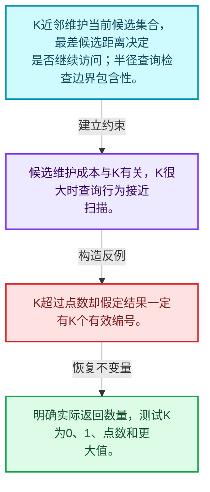
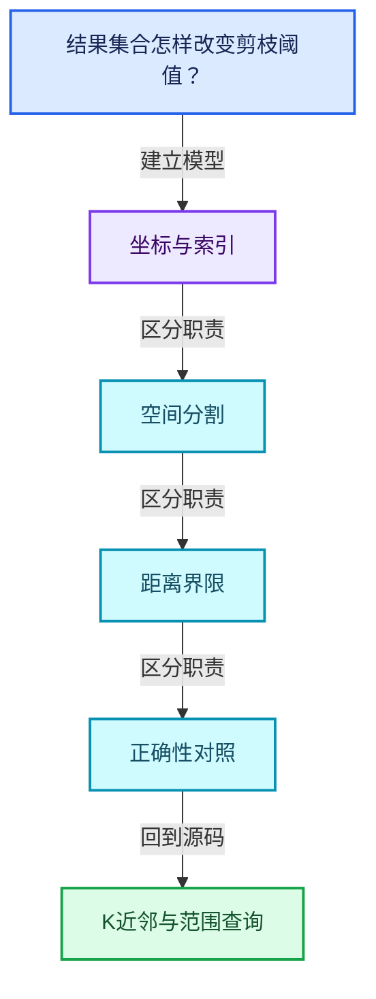
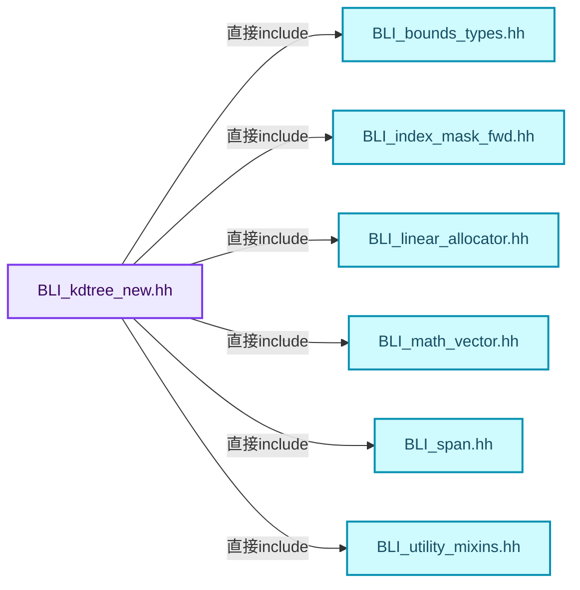
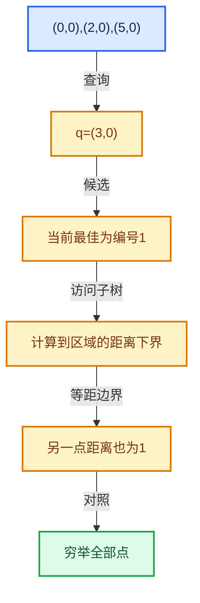

# 12-05 K近邻与范围查询

[方向导航](README.md) · [总目录](../README.md) · [覆盖索引](../%E6%BA%90%E7%A0%81%E7%89%88%E6%9C%AC%E4%B8%8E%E8%A6%86%E7%9B%96%E7%B4%A2%E5%BC%95.md)

> 阅读顺序：问题与数据模型 → 语法与类型 → 源码逐行 → 调用线索 → 历史与取舍 → 推演和练习。

- 基准 HEAD：`cbda6b96c26c0dee3c3b5cbb93960c4ac06a6b30`。
- 记录日期：2026-10-14。
- 教学示例状态：正文中的推演不是本机性能实测；已运行练习见验收报告。

## 一、从问题到设计

结果集合怎样改变剪枝阈值？

K近邻需维护当前候选，半径查询阈值固定或受接口约定影响；边界包含性必须明确。

本篇把语法、数据语义和系统取舍连接起来。先证明距离下界与返回身份，再讨论布局优化和并行构建。

### 本篇独立模型与设计推理

K近邻维护当前候选集合，最差候选距离决定是否继续访问；半径查询检查边界包含性。

设计取舍：候选维护成本与K有关，K很大时查询行为接近扫描。

最小反例：K超过点数却假定结果一定有K个有效编号。

推导与处理：明确实际返回数量，测试K为0、1、点数和更大值。



### 源码范围与相邻篇章

| 文件 | 本篇逐行范围 | 基准SHA-256 |
|---|---|---|
| [source/blender/blenlib/BLI_kdtree_new.hh](../../../../../source/blender/blenlib/BLI_kdtree_new.hh) | L411—L544 | `b94b92497ea97b794042524c44573cd3d88d01c1fc9aa86c60a8940f6be04159` |
| [source/blender/blenlib/intern/kdtree.cc](../../../../../source/blender/blenlib/intern/kdtree.cc) | L456—L681 | `039dbc5c16d992dd0c468586cb3de58c161d4f327ecdd0909ea377342d038a90` |

同一主讲文件可能分多篇覆盖；超出本篇范围的符号通过覆盖索引定位。空行与纯注释保留在源码摘录中，逐行表解释有效语句与语法边界；许可证头统一保留。

前篇：[最近邻搜索与剪枝](04-%E6%9C%80%E8%BF%91%E9%82%BB%E6%90%9C%E7%B4%A2%E4%B8%8E%E5%89%AA%E6%9E%9D.md).

后篇：[筛选与子集查询](06-%E7%AD%9B%E9%80%89%E4%B8%8E%E5%AD%90%E9%9B%86%E6%9F%A5%E8%AF%A2.md).

## 二、类型、数据与阅读地图



这是概念依赖图，边表示阅读关系，不声称是运行时调用顺序。

### 直接编译依赖



箭头只表示头文件包含关系；完整调用线索见后面的符号定位表。

## 三、关键词、语法与类型角色

### 模板 template

模板把类型或常量作为生成实现的参数。读声明时先列出类型参数、非类型参数和默认值，再看使用者实际实例化了什么。模板声明本身不意味着每种T都支持其全部成员。

具体检查：把T替换为int、string、只能移动的类型，分别检查每个被调用操作是否成立。

### 依赖名称 typename

typename既可引入类型模板参数，也可告诉编译器某个依赖名称是类型。它不创建运行时对象；解析期确认语法类别与实例化期检查具体类型是不同阶段。

具体检查：区分typename T::value_type和T::size()，前者标记类型，后者是表达式。

### 约束 requires

requires表达式或requires子句限制模板参与重载的条件。它提供编译期可用性检查，不是运行时if，不能指望输入到达程序后再被这一机制验证。

具体检查：构造满足和不满足约束的两个类型，观察候选被排除而不是在函数内返回错误。

### 常量求值 constexpr

constexpr声明允许相应实体参与常量求值，但constexpr函数仍可以在运行时执行。是否常量求值由调用场景和表达式合法性共同决定。

具体检查：比较constexpr变量初始化和从运行时输入调用同一函数。

### 只读限定 const

const约束当前访问路径可做的修改。const指针、指向const的指针、const视图对象、const元素是不同位置的限定；其他别名可能仍可修改原对象。

具体检查：分别写T* const、const T*与const T* const，并画出不可修改的层次。

### 完美转发 std::forward

std::forward在转发引用模板中恢复调用者原来的值类别。它依赖推导出的模板实参；无条件move会改变左值调用者的语义。

具体检查：对同一接口分别传入左值、临时对象和const左值，记录实际重载。

### 内部断言 assert

断言表达开发者预期成立的内部契约，发布构建可能关闭。它不能替代对不可信输入的完整错误处理，也不保证后续操作被运行时保护。

具体检查：对每条断言构造违反条件的输入，区分调用者错误与应向用户报告的错误。

### 编译期分支 if constexpr

条件在实例化时决定被保留的分支，这常用于不同类型的合法操作选择。它与运行时if有不同的实例化检查规则。

具体检查：找出每个分支依赖哪些类型特征，再使用满足与不满足条件的类型。

## 四、真实源码与逐行讲解

源码块保持原行内容，原始行号由小节标题及逐行表给出。表中的调用定位是静态阅读辅助；重载、模板实例化、宏展开和虚调用需结合完整声明，不能仅凭词法出现证明动态调用。

### BLI_kdtree_new.hh：L411—L469

<!-- source:source/blender/blenlib/BLI_kdtree_new.hh:411:469 -->

```cpp

  int count() const
  {
    return count_;
  }

  bool add_point(const ValueT distance_sq, const int index)
  {
    count_++;
    fn_(index, distance_sq);
    return true;
  }

  /** The search never narrows, since every point within the radius is wanted. */
  ValueT max_distance_sq() const
  {
    return radius_sq_;
  }
};

/** Whether a distance is close enough for \a Query to still be interested in it. */
template<typename Query, typename ValueT>
inline bool keep_distance(const ValueT distance_sq, const ValueT max_distance_sq)
{
  if constexpr (Query::inclusive) {
    return distance_sq <= max_distance_sq;
  }
  else {
    return distance_sq < max_distance_sq;
  }
}

/**
 * Group points that are within \a range of each other, favoring speed over quality: each point is
 * merged into the first point that claims it rather than into its closest neighbor. Points are
 * visited in \a visit_order, which must contain every point in the tree.
 *
 * Which point of a cluster the others merge into follows from that order alone, since a point
 * claims every unclaimed point in range of it whatever order the search finds them in. Visiting
 * them in a fixed order, their index order for example, therefore keeps the result from
 * depending on the tree's layout and so on where the points are.
 *
 * \param duplicates: Indexed by point index, so it must be large enough for the largest index in
 * the tree. Points with a value of -1 are candidates to be merged into another point. Presetting
 * a point to its own index keeps it from being merged into anything, though it can still become
 * the target other points merge into. When the function returns, a merged point holds the index
 * of the point it was merged into, and a point that others were merged into holds its own index.
 * Points that are neither are left at -1.
 *
 * \return The number of points that were merged into another point.
 *
 * \note Merging is a single step: a point is never merged into a point that is itself merged into
 * a third point.
 */
template<typename T>
int calc_duplicates(const KDTreeNew<T> &tree,
                    typename T::base_type range,
                    Span<int> visit_order,
                    MutableSpan<int> duplicates);
```

本段语义重点：

- `distance_sq`：平方距离，可避免开方，但阈值也必须使用一致单位。
- `max_distance_sq`：当前允许或最优平方距离上界，影响剪枝是否正确。

| 原始行 | 语义、约束与检查 |
|---|---|
| L412 | 出现调用或函数声明 `count`，对应表达式为 `int count() const`。参数求值、返回类型与重载需结合前后完整语句；静态文本引用不能证明动态目标。 |
| L413 | 连接上一行的声明或控制结构与其语句块；后续行在这个作用域中执行或声明。 |
| L414 | 返回表达式 `count_`。 |
| L415 | 结束当前语法单元。局部自动对象在离开其作用域时按规则销毁；这不等于所有被引用的外部数据也被释放。 |
| L417 | 本行涉及 `distance_sq`：平方距离，可避免开方，但阈值也必须使用一致单位。按此语义解读 `bool add_point(const ValueT distance_sq, const int index)`，不要把地址、数量或状态混用。 |
| L418 | 连接上一行的声明或控制结构与其语句块；后续行在这个作用域中执行或声明。 |
| L419 | 递增或递减现有状态：`count_++;`。这改变计数或游标；检查边界、计数单位，以及并发访问是否有相应保护。 |
| L420 | 本行涉及 `distance_sq`：平方距离，可避免开方，但阈值也必须使用一致单位。按此语义解读 `fn_(index, distance_sq)`，不要把地址、数量或状态混用。 |
| L421 | 返回表达式 `true`。这是本路径的布尔结果，具体成功、存在或状态含义由函数接口规定。 |
| L422 | 结束当前语法单元。局部自动对象在离开其作用域时按规则销毁；这不等于所有被引用的外部数据也被释放。 |
| L425 | 本行涉及 `max_distance_sq`：当前允许或最优平方距离上界，影响剪枝是否正确。按此语义解读 `ValueT max_distance_sq() const`，不要把地址、数量或状态混用。 |
| L426 | 连接上一行的声明或控制结构与其语句块；后续行在这个作用域中执行或声明。 |
| L427 | 返回表达式 `radius_sq_`。 |
| L428 | 结束当前语法单元。局部自动对象在离开其作用域时按规则销毁；这不等于所有被引用的外部数据也被释放。 |
| L429 | 结束当前语法单元。局部自动对象在离开其作用域时按规则销毁；这不等于所有被引用的外部数据也被释放。 |
| L432 | 声明模板参数 `template<typename Query, typename ValueT>`。类型参数决定生成操作的类型，非类型参数可决定内嵌容量或编译期分支。 |
| L433 | 本行涉及 `distance_sq`：平方距离，可避免开方，但阈值也必须使用一致单位。按此语义解读 `inline bool keep_distance(const ValueT distance_sq, const ValueT max_distance_sq)`，不要把地址、数量或状态混用。 |
| L434 | 连接上一行的声明或控制结构与其语句块；后续行在这个作用域中执行或声明。 |
| L435 | 编译期条件分支 `if constexpr (Query::inclusive)`。按实例化类型选择相应实现；被舍弃分支和运行期if具有不同检查规则，不能当作运行时输入验证。 |
| L436 | 返回表达式 `distance_sq <= max_distance_sq`。 |
| L437 | 结束当前语法单元。局部自动对象在离开其作用域时按规则销毁；这不等于所有被引用的外部数据也被释放。 |
| L438 | 处理前一条件不成立的互补路径。比较两条路径最后是否恢复同一不变量，以及是否产生不同的资源责任。 |
| L439 | 返回表达式 `distance_sq < max_distance_sq`。 |
| L440 | 结束当前语法单元。局部自动对象在离开其作用域时按规则销毁；这不等于所有被引用的外部数据也被释放。 |
| L441 | 结束当前语法单元。局部自动对象在离开其作用域时按规则销毁；这不等于所有被引用的外部数据也被释放。 |
| L465 | 声明模板参数 `template<typename T>`。类型参数决定生成操作的类型，非类型参数可决定内嵌容量或编译期分支。 |
| L466 | 出现调用或函数声明 `calc_duplicates`，对应表达式为 `int calc_duplicates(const KDTreeNew<T> &tree,`。参数求值、返回类型与重载需结合前后完整语句；静态文本引用不能证明动态目标。 |
| L467 | 本行是连续声明或表达式的一部分：`typename T::base_type range,`。与本段前后行合读；逗号、括号和限定符决定它属于参数、初始化列表还是实际计算。 |
| L468 | 本行是连续声明或表达式的一部分：`Span<int> visit_order,`。与本段前后行合读；逗号、括号和限定符决定它属于参数、初始化列表还是实际计算。 |
| L469 | 声明成员、局部对象或完成语句 `MutableSpan<int> duplicates)`。若为指针或引用，它本身不说明拥有；若为值对象，其构造析构由所在作用域或外层对象管理。 |

### BLI_kdtree_new.hh：L470—L511

<!-- source:source/blender/blenlib/BLI_kdtree_new.hh:470:511 -->

```cpp
template<typename T>
int calc_duplicates(const KDTreeNew<T> &tree,
                    typename T::base_type range,
                    const IndexMask &visit_order,
                    MutableSpan<int> duplicates);

/**
 * #calc_duplicates visiting the points in the order the tree stores them, measured to be
 * roughly 1.1x to 1.8x faster than providing a separate visit order as the point count increases
 * to ~ 1 million, though that depends on the spatial contiguity of the original point order. The
 * downside is that this ties the result to the internal layout, so it is only meant for callers
 * that don't care which point of a cluster the others merge into. See #KDTreeNew::indices.
 */
template<typename T>
inline int calc_duplicates(const KDTreeNew<T> &tree,
                           const typename T::base_type range,
                           const MutableSpan<int> duplicates)
{
  return calc_duplicates(tree, range, tree.tree_indices(), duplicates);
}

}  // namespace kdtree

template<typename T> int KDTreeNew<T>::size() const
{
  return size_;
}

template<typename T> bool KDTreeNew<T>::is_empty() const
{
  return size_ == 0;
}

template<typename T> const T *KDTreeNew<T>::points() const
{
  return points_;
}

template<typename T> Span<int> KDTreeNew<T>::tree_indices() const
{
  return Span<int>(tree_indices_, size_);
}
```

本段语义重点：

- `size_`：该对象记录的元素数或长度，不能直接当作容量。
- `points_`：查询或构建使用的点坐标视图，使用期间必须满足借用契约。

| 原始行 | 语义、约束与检查 |
|---|---|
| L470 | 声明模板参数 `template<typename T>`。类型参数决定生成操作的类型，非类型参数可决定内嵌容量或编译期分支。 |
| L471 | 出现调用或函数声明 `calc_duplicates`，对应表达式为 `int calc_duplicates(const KDTreeNew<T> &tree,`。参数求值、返回类型与重载需结合前后完整语句；静态文本引用不能证明动态目标。 |
| L472 | 本行是连续声明或表达式的一部分：`typename T::base_type range,`。与本段前后行合读；逗号、括号和限定符决定它属于参数、初始化列表还是实际计算。 |
| L473 | 本行是连续声明或表达式的一部分：`const IndexMask &visit_order,`。与本段前后行合读；逗号、括号和限定符决定它属于参数、初始化列表还是实际计算。 |
| L474 | 声明成员、局部对象或完成语句 `MutableSpan<int> duplicates)`。若为指针或引用，它本身不说明拥有；若为值对象，其构造析构由所在作用域或外层对象管理。 |
| L483 | 声明模板参数 `template<typename T>`。类型参数决定生成操作的类型，非类型参数可决定内嵌容量或编译期分支。 |
| L484 | 出现调用或函数声明 `calc_duplicates`，对应表达式为 `inline int calc_duplicates(const KDTreeNew<T> &tree,`。参数求值、返回类型与重载需结合前后完整语句；静态文本引用不能证明动态目标。 |
| L485 | 本行是连续声明或表达式的一部分：`const typename T::base_type range,`。与本段前后行合读；逗号、括号和限定符决定它属于参数、初始化列表还是实际计算。 |
| L486 | 本行是连续声明或表达式的一部分：`const MutableSpan<int> duplicates)`。与本段前后行合读；逗号、括号和限定符决定它属于参数、初始化列表还是实际计算。 |
| L487 | 连接上一行的声明或控制结构与其语句块；后续行在这个作用域中执行或声明。 |
| L488 | 返回表达式 `calc_duplicates(tree, range, tree.tree_indices(), duplicates)`。 |
| L489 | 结束当前语法单元。局部自动对象在离开其作用域时按规则销毁；这不等于所有被引用的外部数据也被释放。 |
| L491 | 结束当前语法单元。局部自动对象在离开其作用域时按规则销毁；这不等于所有被引用的外部数据也被释放。 |
| L493 | 声明模板参数 `template<typename T> int KDTreeNew<T>::size() const`。类型参数决定生成操作的类型，非类型参数可决定内嵌容量或编译期分支。 |
| L494 | 连接上一行的声明或控制结构与其语句块；后续行在这个作用域中执行或声明。 |
| L495 | 返回表达式 `size_`。 |
| L496 | 结束当前语法单元。局部自动对象在离开其作用域时按规则销毁；这不等于所有被引用的外部数据也被释放。 |
| L498 | 声明模板参数 `template<typename T> bool KDTreeNew<T>::is_empty() const`。类型参数决定生成操作的类型，非类型参数可决定内嵌容量或编译期分支。 |
| L499 | 连接上一行的声明或控制结构与其语句块；后续行在这个作用域中执行或声明。 |
| L500 | 返回表达式 `size_ == 0`。 |
| L501 | 结束当前语法单元。局部自动对象在离开其作用域时按规则销毁；这不等于所有被引用的外部数据也被释放。 |
| L503 | 声明模板参数 `template<typename T> const T *KDTreeNew<T>::points() const`。类型参数决定生成操作的类型，非类型参数可决定内嵌容量或编译期分支。 |
| L504 | 连接上一行的声明或控制结构与其语句块；后续行在这个作用域中执行或声明。 |
| L505 | 返回表达式 `points_`。 |
| L506 | 结束当前语法单元。局部自动对象在离开其作用域时按规则销毁；这不等于所有被引用的外部数据也被释放。 |
| L508 | 声明模板参数 `template<typename T> Span<int> KDTreeNew<T>::tree_indices() const`。类型参数决定生成操作的类型，非类型参数可决定内嵌容量或编译期分支。 |
| L509 | 连接上一行的声明或控制结构与其语句块；后续行在这个作用域中执行或声明。 |
| L510 | 返回表达式 `Span<int>(tree_indices_, size_)`。 |
| L511 | 结束当前语法单元。局部自动对象在离开其作用域时按规则销毁；这不等于所有被引用的外部数据也被释放。 |

### BLI_kdtree_new.hh：L512—L544

<!-- source:source/blender/blenlib/BLI_kdtree_new.hh:512:544 -->

```cpp

template<typename T>
int KDTreeNew<T>::find_nearest(const T &position, value_type *r_distance_sq) const
{
  if (this->is_empty()) {
    return -1;
  }
  kdtree::NearestQuery<value_type> query;
  this->search(query, position);
  if (query.index() != -1 && r_distance_sq) {
    *r_distance_sq = query.distance_sq();
  }
  return query.index();
}

template<typename T>
template<typename Filter>
int KDTreeNew<T>::find_nearest_filtered(const T &position,
                                        Filter &&filter,
                                        value_type *r_distance_sq) const
  requires kdtree::FilterFn<Filter>
{
  if (this->is_empty()) {
    return -1;
  }
  kdtree::FilteredNearestQuery<value_type, std::decay_t<Filter>> query(
      std::forward<Filter>(filter));
  this->search(query, position);
  if (query.index() != -1 && r_distance_sq) {
    *r_distance_sq = query.distance_sq();
  }
  return query.index();
}
```

本段语义重点：

- `find_nearest`：最近邻查询入口；返回索引归属和距离单位按实际API确认。
- `distance_sq`：平方距离，可避免开方，但阈值也必须使用一致单位。

| 原始行 | 语义、约束与检查 |
|---|---|
| L513 | 声明模板参数 `template<typename T>`。类型参数决定生成操作的类型，非类型参数可决定内嵌容量或编译期分支。 |
| L514 | 本行使用 `find_nearest`：最近邻查询入口；返回索引归属和距离单位按实际API确认。 |
| L515 | 连接上一行的声明或控制结构与其语句块；后续行在这个作用域中执行或声明。 |
| L516 | 判断 `this->is_empty()`，成立时进入本分支，否则继续后续路径。 |
| L517 | 返回表达式 `-1`。 |
| L518 | 结束当前语法单元。局部自动对象在离开其作用域时按规则销毁；这不等于所有被引用的外部数据也被释放。 |
| L519 | 声明成员、局部对象或完成语句 `kdtree::NearestQuery<value_type> query`。若为指针或引用，它本身不说明拥有；若为值对象，其构造析构由所在作用域或外层对象管理。 |
| L520 | 出现调用或函数声明 `search`，对应表达式为 `this->search(query, position);`。参数求值、返回类型与重载需结合前后完整语句；静态文本引用不能证明动态目标。 |
| L521 | 判断 `query.index() != -1 && r_distance_sq`，成立时进入本分支，否则继续后续路径。 |
| L522 | 建立或更新 `distance_sq`：平方距离，可避免开方，但阈值也必须使用一致单位。本行的具体值关系为 `*r_distance_sq = query.distance_sq()`；对照更新前后相应范围或状态是否一致。 |
| L523 | 结束当前语法单元。局部自动对象在离开其作用域时按规则销毁；这不等于所有被引用的外部数据也被释放。 |
| L524 | 返回表达式 `query.index()`。 |
| L525 | 结束当前语法单元。局部自动对象在离开其作用域时按规则销毁；这不等于所有被引用的外部数据也被释放。 |
| L527 | 声明模板参数 `template<typename T>`。类型参数决定生成操作的类型，非类型参数可决定内嵌容量或编译期分支。 |
| L528 | 声明模板参数 `template<typename Filter>`。类型参数决定生成操作的类型，非类型参数可决定内嵌容量或编译期分支。 |
| L529 | 出现调用或函数声明 `::find_nearest_filtered`，对应表达式为 `int KDTreeNew<T>::find_nearest_filtered(const T &position,`。参数求值、返回类型与重载需结合前后完整语句；静态文本引用不能证明动态目标。 |
| L530 | 本行是连续声明或表达式的一部分：`Filter &&filter,`。与本段前后行合读；逗号、括号和限定符决定它属于参数、初始化列表还是实际计算。 |
| L531 | 本行是连续声明或表达式的一部分：`value_type *r_distance_sq) const`。与本段前后行合读；逗号、括号和限定符决定它属于参数、初始化列表还是实际计算。 |
| L532 | 约束模板可用性：`requires kdtree::FilterFn<Filter>`。条件在编译期检查，不替代运行期的地址、长度和类型一致性验证。 |
| L533 | 连接上一行的声明或控制结构与其语句块；后续行在这个作用域中执行或声明。 |
| L534 | 判断 `this->is_empty()`，成立时进入本分支，否则继续后续路径。 |
| L535 | 返回表达式 `-1`。 |
| L536 | 结束当前语法单元。局部自动对象在离开其作用域时按规则销毁；这不等于所有被引用的外部数据也被释放。 |
| L537 | 出现调用或函数声明 `query`，对应表达式为 `kdtree::FilteredNearestQuery<value_type, std::decay_t<Filter>> query(`。参数求值、返回类型与重载需结合前后完整语句；静态文本引用不能证明动态目标。 |
| L538 | 出现调用或函数声明 `std::forward`，对应表达式为 `std::forward<Filter>(filter));`。参数求值、返回类型与重载需结合前后完整语句；静态文本引用不能证明动态目标。 |
| L539 | 出现调用或函数声明 `search`，对应表达式为 `this->search(query, position);`。参数求值、返回类型与重载需结合前后完整语句；静态文本引用不能证明动态目标。 |
| L540 | 判断 `query.index() != -1 && r_distance_sq`，成立时进入本分支，否则继续后续路径。 |
| L541 | 建立或更新 `distance_sq`：平方距离，可避免开方，但阈值也必须使用一致单位。本行的具体值关系为 `*r_distance_sq = query.distance_sq()`；对照更新前后相应范围或状态是否一致。 |
| L542 | 结束当前语法单元。局部自动对象在离开其作用域时按规则销毁；这不等于所有被引用的外部数据也被释放。 |
| L543 | 返回表达式 `query.index()`。 |
| L544 | 结束当前语法单元。局部自动对象在离开其作用域时按规则销毁；这不等于所有被引用的外部数据也被释放。 |

### kdtree.cc：L456—L532

<!-- source:source/blender/blenlib/intern/kdtree.cc:456:532 -->

```cpp

  static Bounds<BuildPoint> merge_bounds(const Span<Bounds<BuildPoint>> block_bounds)
  {
    Bounds<BuildPoint> bounds = block_bounds.first();
    for (const Bounds<BuildPoint> &other : block_bounds.drop_front(1)) {
      bounds.min = math::min(bounds.min, other.min);
      bounds.max = math::max(bounds.max, other.max);
    }
    return bounds;
  }

  /** \} */

  /* -------------------------------------------------------------------- */
  /** \name Partitioning
   * \{ */

  /**
   * Reorder the points in [start, end) so that those below \a split_value in \a dim come first,
   * and return where the rest starts.
   *
   * Deciding per point whether to swap it is a branch on the result of the comparison, which for
   * an evenly split node is unpredictable and so mispredicts on about every other point. This
   * collects the offsets of the misplaced points of a block without branching on the comparison,
   * and only then swaps them, which is a loop over exactly as many iterations as there are swaps.
   * Same approach as the partition in BlockQuicksort.
   */
  static int partition_points(const MutableSpan<BuildPoint> points,
                              const int start,
                              const int end,
                              const int dim,
                              const value_type split_value)
  {
    constexpr int block = PARTITION_BLOCK_SIZE;

    uint8_t offsets_l[block], offsets_r[block];
    int num_l = 0, num_r = 0, first_l = 0, first_r = 0;
    int l = start, r = end;

    while (r - l > 2 * block) {
      /* Offsets of the points of the left block that belong on the right, and the other way
       * around. The store always happens, only the counter advances conditionally. */
      if (num_l == 0) {
        first_l = 0;
        for (const int i : IndexRange(block)) {
          offsets_l[num_l] = uint8_t(i);
          num_l += int(!(points[l + i][dim] < split_value));
        }
      }
      if (num_r == 0) {
        first_r = 0;
        for (const int i : IndexRange(block)) {
          offsets_r[num_r] = uint8_t(i);
          num_r += int(points[r - 1 - i][dim] < split_value);
        }
      }

      const int num = std::min(num_l, num_r);
      for (const int i : IndexRange(num)) {
        std::swap(points[l + offsets_l[first_l + i]], points[r - 1 - offsets_r[first_r + i]]);
      }
      num_l -= num;
      num_r -= num;
      first_l += num;
      first_r += num;

      /* A block is done once none of its points are misplaced any more. */
      if (num_l == 0) {
        l += block;
      }
      if (num_r == 0) {
        r -= block;
      }
    }

    return partition_points_small(points, l, r, dim, split_value);
  }
```

本段语义重点：

- `std::min`：取较小值，常用于截断范围；还要检查负值、溢出和空范围。

| 原始行 | 语义、约束与检查 |
|---|---|
| L457 | 出现调用或函数声明 `merge_bounds`，对应表达式为 `static Bounds<BuildPoint> merge_bounds(const Span<Bounds<BuildPoint>> block_bounds)`。参数求值、返回类型与重载需结合前后完整语句；静态文本引用不能证明动态目标。 |
| L458 | 连接上一行的声明或控制结构与其语句块；后续行在这个作用域中执行或声明。 |
| L459 | 把右侧 `block_bounds.first()` 用于初始化或更新左侧 `Bounds<BuildPoint> bounds`。声明初始化与已有对象赋值应按上下文区分；有资源的类型会调用相应特殊成员。 |
| L460 | 按 `for (const Bounds<BuildPoint> &other : block_bounds.drop_front(1))` 指定的范围或条件重复执行。对照循环变量与真实元素编号；循环内调用成本乘以实际迭代次数。 |
| L461 | 把右侧 `math::min(bounds.min, other.min)` 用于初始化或更新左侧 `bounds.min`。声明初始化与已有对象赋值应按上下文区分；有资源的类型会调用相应特殊成员。 |
| L462 | 把右侧 `math::max(bounds.max, other.max)` 用于初始化或更新左侧 `bounds.max`。声明初始化与已有对象赋值应按上下文区分；有资源的类型会调用相应特殊成员。 |
| L463 | 结束当前语法单元。局部自动对象在离开其作用域时按规则销毁；这不等于所有被引用的外部数据也被释放。 |
| L464 | 返回表达式 `bounds`。 |
| L465 | 结束当前语法单元。局部自动对象在离开其作用域时按规则销毁；这不等于所有被引用的外部数据也被释放。 |
| L483 | 出现调用或函数声明 `partition_points`，对应表达式为 `static int partition_points(const MutableSpan<BuildPoint> points,`。参数求值、返回类型与重载需结合前后完整语句；静态文本引用不能证明动态目标。 |
| L484 | 本行是连续声明或表达式的一部分：`const int start,`。与本段前后行合读；逗号、括号和限定符决定它属于参数、初始化列表还是实际计算。 |
| L485 | 本行是连续声明或表达式的一部分：`const int end,`。与本段前后行合读；逗号、括号和限定符决定它属于参数、初始化列表还是实际计算。 |
| L486 | 本行是连续声明或表达式的一部分：`const int dim,`。与本段前后行合读；逗号、括号和限定符决定它属于参数、初始化列表还是实际计算。 |
| L487 | 本行是连续声明或表达式的一部分：`const value_type split_value)`。与本段前后行合读；逗号、括号和限定符决定它属于参数、初始化列表还是实际计算。 |
| L488 | 连接上一行的声明或控制结构与其语句块；后续行在这个作用域中执行或声明。 |
| L489 | 把右侧 `PARTITION_BLOCK_SIZE` 用于初始化或更新左侧 `constexpr int block`。声明初始化与已有对象赋值应按上下文区分；有资源的类型会调用相应特殊成员。 |
| L491 | 声明成员、局部对象或完成语句 `uint8_t offsets_l[block], offsets_r[block]`。若为指针或引用，它本身不说明拥有；若为值对象，其构造析构由所在作用域或外层对象管理。 |
| L492 | 把右侧 `0, num_r = 0, first_l = 0, first_r = 0` 用于初始化或更新左侧 `int num_l`。声明初始化与已有对象赋值应按上下文区分；有资源的类型会调用相应特殊成员。 |
| L493 | 把右侧 `start, r = end` 用于初始化或更新左侧 `int l`。声明初始化与已有对象赋值应按上下文区分；有资源的类型会调用相应特殊成员。 |
| L495 | 按 `while (r - l > 2 * block)` 指定的范围或条件重复执行。对照循环变量与真实元素编号；循环内调用成本乘以实际迭代次数。 |
| L498 | 判断 `num_l == 0`，成立时进入本分支，否则继续后续路径。 |
| L499 | 把右侧 `0` 用于初始化或更新左侧 `first_l`。声明初始化与已有对象赋值应按上下文区分；有资源的类型会调用相应特殊成员。 |
| L500 | 按 `for (const int i : IndexRange(block))` 指定的范围或条件重复执行。对照循环变量与真实元素编号；循环内调用成本乘以实际迭代次数。 |
| L501 | 把右侧 `uint8_t(i)` 用于初始化或更新左侧 `offsets_l[num_l]`。声明初始化与已有对象赋值应按上下文区分；有资源的类型会调用相应特殊成员。 |
| L502 | 复合更新 `num_l += int(!(points[l + i][dim] < split_value))`：读取左侧现有值，与右侧按`+=`对应操作组合后写回。检查数值边界、位掩码或共享状态保护；它不是新对象的构造。 |
| L503 | 结束当前语法单元。局部自动对象在离开其作用域时按规则销毁；这不等于所有被引用的外部数据也被释放。 |
| L504 | 结束当前语法单元。局部自动对象在离开其作用域时按规则销毁；这不等于所有被引用的外部数据也被释放。 |
| L505 | 判断 `num_r == 0`，成立时进入本分支，否则继续后续路径。 |
| L506 | 把右侧 `0` 用于初始化或更新左侧 `first_r`。声明初始化与已有对象赋值应按上下文区分；有资源的类型会调用相应特殊成员。 |
| L507 | 按 `for (const int i : IndexRange(block))` 指定的范围或条件重复执行。对照循环变量与真实元素编号；循环内调用成本乘以实际迭代次数。 |
| L508 | 把右侧 `uint8_t(i)` 用于初始化或更新左侧 `offsets_r[num_r]`。声明初始化与已有对象赋值应按上下文区分；有资源的类型会调用相应特殊成员。 |
| L509 | 复合更新 `num_r += int(points[r - 1 - i][dim] < split_value)`：读取左侧现有值，与右侧按`+=`对应操作组合后写回。检查数值边界、位掩码或共享状态保护；它不是新对象的构造。 |
| L510 | 结束当前语法单元。局部自动对象在离开其作用域时按规则销毁；这不等于所有被引用的外部数据也被释放。 |
| L511 | 结束当前语法单元。局部自动对象在离开其作用域时按规则销毁；这不等于所有被引用的外部数据也被释放。 |
| L513 | 本行使用 `std::min`：取较小值，常用于截断范围；还要检查负值、溢出和空范围。 |
| L514 | 按 `for (const int i : IndexRange(num))` 指定的范围或条件重复执行。对照循环变量与真实元素编号；循环内调用成本乘以实际迭代次数。 |
| L515 | 出现调用或函数声明 `std::swap`，对应表达式为 `std::swap(points[l + offsets_l[first_l + i]], points[r - 1 - offsets_r[first_r + i]]);`。参数求值、返回类型与重载需结合前后完整语句；静态文本引用不能证明动态目标。 |
| L516 | 结束当前语法单元。局部自动对象在离开其作用域时按规则销毁；这不等于所有被引用的外部数据也被释放。 |
| L517 | 复合更新 `num_l -= num`：读取左侧现有值，与右侧按`-=`对应操作组合后写回。检查数值边界、位掩码或共享状态保护；它不是新对象的构造。 |
| L518 | 复合更新 `num_r -= num`：读取左侧现有值，与右侧按`-=`对应操作组合后写回。检查数值边界、位掩码或共享状态保护；它不是新对象的构造。 |
| L519 | 复合更新 `first_l += num`：读取左侧现有值，与右侧按`+=`对应操作组合后写回。检查数值边界、位掩码或共享状态保护；它不是新对象的构造。 |
| L520 | 复合更新 `first_r += num`：读取左侧现有值，与右侧按`+=`对应操作组合后写回。检查数值边界、位掩码或共享状态保护；它不是新对象的构造。 |
| L523 | 判断 `num_l == 0`，成立时进入本分支，否则继续后续路径。 |
| L524 | 复合更新 `l += block`：读取左侧现有值，与右侧按`+=`对应操作组合后写回。检查数值边界、位掩码或共享状态保护；它不是新对象的构造。 |
| L525 | 结束当前语法单元。局部自动对象在离开其作用域时按规则销毁；这不等于所有被引用的外部数据也被释放。 |
| L526 | 判断 `num_r == 0`，成立时进入本分支，否则继续后续路径。 |
| L527 | 复合更新 `r -= block`：读取左侧现有值，与右侧按`-=`对应操作组合后写回。检查数值边界、位掩码或共享状态保护；它不是新对象的构造。 |
| L528 | 结束当前语法单元。局部自动对象在离开其作用域时按规则销毁；这不等于所有被引用的外部数据也被释放。 |
| L529 | 结束当前语法单元。局部自动对象在离开其作用域时按规则销毁；这不等于所有被引用的外部数据也被释放。 |
| L531 | 返回表达式 `partition_points_small(points, l, r, dim, split_value)`。 |
| L532 | 结束当前语法单元。局部自动对象在离开其作用域时按规则销毁；这不等于所有被引用的外部数据也被释放。 |

### kdtree.cc：L533—L572

<!-- source:source/blender/blenlib/intern/kdtree.cc:533:572 -->

```cpp

  /**
   * #partition_points for a range that fits in a temporary buffer, which is the case for the
   * last levels of the tree. Copying the points out and back in is cheaper than the swaps that
   * staying in place needs, and keeps those levels branchless as well.
   */
  static int partition_points_small(const MutableSpan<BuildPoint> points,
                                    const int start,
                                    const int end,
                                    const int dim,
                                    const value_type split_value)
  {
    const int count = end - start;
    BLI_assert(count <= 2 * PARTITION_BLOCK_SIZE);

    std::array<BuildPoint, 2 * PARTITION_BLOCK_SIZE> buffer;
    /* Points below the split fill the buffer from the front, the others from the back. Only the
     * position depends on the comparison, so there is nothing to mispredict. */
    int l = 0, r = count;
    for (const int i : IndexRange(start, count)) {
      /* Read the coordinate from the array rather than from a copy of the point: indexing a
       * vector by a value only known at runtime means it has to be in memory, and a copy would
       * have to be spilled there every iteration. */
      const bool less = points[i][dim] < split_value;
      const BuildPoint point = points[i];
      /* Written to both ends, of which only one is kept. Picking the position instead lets a
       * compiler turn it back into a branch on the comparison, which is the whole thing this
       * avoids, and both ends are a few cache lines apart at most. */
      buffer[l] = point;
      buffer[r - 1] = point;
      l += int(less);
      r -= int(!less);
    }

    MutableSpan<BuildPoint> range = points.slice(start, count);
    for (const int i : IndexRange(count)) {
      range[i] = buffer[i];
    }
    return start + l;
  }
```

| 原始行 | 语义、约束与检查 |
|---|---|
| L539 | 出现调用或函数声明 `partition_points_small`，对应表达式为 `static int partition_points_small(const MutableSpan<BuildPoint> points,`。参数求值、返回类型与重载需结合前后完整语句；静态文本引用不能证明动态目标。 |
| L540 | 本行是连续声明或表达式的一部分：`const int start,`。与本段前后行合读；逗号、括号和限定符决定它属于参数、初始化列表还是实际计算。 |
| L541 | 本行是连续声明或表达式的一部分：`const int end,`。与本段前后行合读；逗号、括号和限定符决定它属于参数、初始化列表还是实际计算。 |
| L542 | 本行是连续声明或表达式的一部分：`const int dim,`。与本段前后行合读；逗号、括号和限定符决定它属于参数、初始化列表还是实际计算。 |
| L543 | 本行是连续声明或表达式的一部分：`const value_type split_value)`。与本段前后行合读；逗号、括号和限定符决定它属于参数、初始化列表还是实际计算。 |
| L544 | 连接上一行的声明或控制结构与其语句块；后续行在这个作用域中执行或声明。 |
| L545 | 把右侧 `end - start` 用于初始化或更新左侧 `const int count`。声明初始化与已有对象赋值应按上下文区分；有资源的类型会调用相应特殊成员。 |
| L546 | 断言约束 `BLI_assert(count <= 2 * PARTITION_BLOCK_SIZE);`。条件是后续访问的内部前置条件；发布构建可能不执行，不能把断言当作输入修复。 |
| L548 | 声明成员、局部对象或完成语句 `std::array<BuildPoint, 2 * PARTITION_BLOCK_SIZE> buffer`。若为指针或引用，它本身不说明拥有；若为值对象，其构造析构由所在作用域或外层对象管理。 |
| L551 | 把右侧 `0, r = count` 用于初始化或更新左侧 `int l`。声明初始化与已有对象赋值应按上下文区分；有资源的类型会调用相应特殊成员。 |
| L552 | 按 `for (const int i : IndexRange(start, count))` 指定的范围或条件重复执行。对照循环变量与真实元素编号；循环内调用成本乘以实际迭代次数。 |
| L556 | 把右侧 `points[i][dim] < split_value` 用于初始化或更新左侧 `const bool less`。声明初始化与已有对象赋值应按上下文区分；有资源的类型会调用相应特殊成员。 |
| L557 | 把右侧 `points[i]` 用于初始化或更新左侧 `const BuildPoint point`。声明初始化与已有对象赋值应按上下文区分；有资源的类型会调用相应特殊成员。 |
| L561 | 把右侧 `point` 用于初始化或更新左侧 `buffer[l]`。声明初始化与已有对象赋值应按上下文区分；有资源的类型会调用相应特殊成员。 |
| L562 | 把右侧 `point` 用于初始化或更新左侧 `buffer[r - 1]`。声明初始化与已有对象赋值应按上下文区分；有资源的类型会调用相应特殊成员。 |
| L563 | 复合更新 `l += int(less)`：读取左侧现有值，与右侧按`+=`对应操作组合后写回。检查数值边界、位掩码或共享状态保护；它不是新对象的构造。 |
| L564 | 复合更新 `r -= int(!less)`：读取左侧现有值，与右侧按`-=`对应操作组合后写回。检查数值边界、位掩码或共享状态保护；它不是新对象的构造。 |
| L565 | 结束当前语法单元。局部自动对象在离开其作用域时按规则销毁；这不等于所有被引用的外部数据也被释放。 |
| L567 | 把右侧 `points.slice(start, count)` 用于初始化或更新左侧 `MutableSpan<BuildPoint> range`。声明初始化与已有对象赋值应按上下文区分；有资源的类型会调用相应特殊成员。 |
| L568 | 按 `for (const int i : IndexRange(count))` 指定的范围或条件重复执行。对照循环变量与真实元素编号；循环内调用成本乘以实际迭代次数。 |
| L569 | 把右侧 `buffer[i]` 用于初始化或更新左侧 `range[i]`。声明初始化与已有对象赋值应按上下文区分；有资源的类型会调用相应特殊成员。 |
| L570 | 结束当前语法单元。局部自动对象在离开其作用域时按规则销毁；这不等于所有被引用的外部数据也被释放。 |
| L571 | 返回表达式 `start + l`。 |
| L572 | 结束当前语法单元。局部自动对象在离开其作用域时按规则销毁；这不等于所有被引用的外部数据也被释放。 |

### kdtree.cc：L573—L668

<!-- source:source/blender/blenlib/intern/kdtree.cc:573:668 -->

```cpp

  /**
   * #partition_points with the range split a block at a time, which can be spread over threads.
   * Which blocks the range is cut into follows from its size alone, so this leaves the points in
   * the same order however many threads run it.
   *
   * Each block is partitioned on its own, which leaves every block split but the blocks
   * themselves interleaved: points above the split sit in blocks that belong entirely below it,
   * and the other way around. There are as many of one as of the other, so the fix up is to swap
   * them pairwise, which spreads over threads as well. This is how embree partitions primitives
   * when building a BVH.
   */
  int partition_points_in_blocks(const int start,
                                 const int end,
                                 const int dim,
                                 const value_type split_value)
  {
    const MutableSpan<BuildPoint> points = build_points_;
    const int count = end - start;
    const int blocks = block_num(count);
    if (blocks < 2) {
      return partition_points(points, start, end, dim, split_value);
    }

    int begin[NODE_MAX_BLOCKS + 1];
    int middle[NODE_MAX_BLOCKS];
    for (const int block : IndexRange(blocks + 1)) {
      begin[block] = start + block_begin(count, blocks, block);
    }

    threading::parallel_for(IndexRange(blocks), 1, [&](const IndexRange range) {
      for (const int block : range) {
        middle[block] = partition_points(points, begin[block], begin[block + 1], dim, split_value);
      }
    });

    /* Where the split ends up once the blocks are put in order. */
    int split = start;
    for (const int block : IndexRange(blocks)) {
      split += middle[block] - begin[block];
    }

    /* The points that are on the wrong side of it. A block lies either before or after the
     * split, so it contributes to one of the two lists at most. */
    IndexRange high[NODE_MAX_BLOCKS], low[NODE_MAX_BLOCKS];
    int high_num = 0, low_num = 0;
    for (const int block : IndexRange(blocks)) {
      if (middle[block] < split) {
        const int last = std::min(begin[block + 1], split);
        if (middle[block] < last) {
          high[high_num++] = IndexRange::from_begin_end(middle[block], last);
        }
      }
      else if (middle[block] > split) {
        const int first = std::max(begin[block], split);
        if (first < middle[block]) {
          low[low_num++] = IndexRange::from_begin_end(first, middle[block]);
        }
      }
    }

    /* Pair the two lists up into chunks that can be swapped independently. Each step finishes a
     * range on one side or the other, so there are fewer chunks than there are ranges. */
    struct Swap {
      int from;
      int to;
      int num;
    };
    Swap swaps[2 * NODE_MAX_BLOCKS];
    int swaps_num = 0;
    for (int h = 0, l = 0, h_done = 0, l_done = 0; h < high_num && l < low_num;) {
      const int num = std::min(int(high[h].size()) - h_done, int(low[l].size()) - l_done);
      swaps[swaps_num++] = {int(high[h].start()) + h_done, int(low[l].start()) + l_done, num};
      h_done += num;
      l_done += num;
      if (h_done == int(high[h].size())) {
        h++;
        h_done = 0;
      }
      if (l_done == int(low[l].size())) {
        l++;
        l_done = 0;
      }
    }

    threading::parallel_for(IndexRange(swaps_num), 1, [&](const IndexRange range) {
      for (const int i : range) {
        const Swap &swap = swaps[i];
        for (const int offset : IndexRange(swap.num)) {
          std::swap(points[swap.from + offset], points[swap.to + offset]);
        }
      }
    });

    return split;
  }
```

本段语义重点：

- `std::max`：取较大值，在容量计算中常用于同时满足请求量和增长策略。
- `std::min`：取较小值，常用于截断范围；还要检查负值、溢出和空范围。

| 原始行 | 语义、约束与检查 |
|---|---|
| L585 | 出现调用或函数声明 `partition_points_in_blocks`，对应表达式为 `int partition_points_in_blocks(const int start,`。参数求值、返回类型与重载需结合前后完整语句；静态文本引用不能证明动态目标。 |
| L586 | 本行是连续声明或表达式的一部分：`const int end,`。与本段前后行合读；逗号、括号和限定符决定它属于参数、初始化列表还是实际计算。 |
| L587 | 本行是连续声明或表达式的一部分：`const int dim,`。与本段前后行合读；逗号、括号和限定符决定它属于参数、初始化列表还是实际计算。 |
| L588 | 本行是连续声明或表达式的一部分：`const value_type split_value)`。与本段前后行合读；逗号、括号和限定符决定它属于参数、初始化列表还是实际计算。 |
| L589 | 连接上一行的声明或控制结构与其语句块；后续行在这个作用域中执行或声明。 |
| L590 | 把右侧 `build_points_` 用于初始化或更新左侧 `const MutableSpan<BuildPoint> points`。声明初始化与已有对象赋值应按上下文区分；有资源的类型会调用相应特殊成员。 |
| L591 | 把右侧 `end - start` 用于初始化或更新左侧 `const int count`。声明初始化与已有对象赋值应按上下文区分；有资源的类型会调用相应特殊成员。 |
| L592 | 把右侧 `block_num(count)` 用于初始化或更新左侧 `const int blocks`。声明初始化与已有对象赋值应按上下文区分；有资源的类型会调用相应特殊成员。 |
| L593 | 判断 `blocks < 2`，成立时进入本分支，否则继续后续路径。 |
| L594 | 返回表达式 `partition_points(points, start, end, dim, split_value)`。 |
| L595 | 结束当前语法单元。局部自动对象在离开其作用域时按规则销毁；这不等于所有被引用的外部数据也被释放。 |
| L597 | 声明成员、局部对象或完成语句 `int begin[NODE_MAX_BLOCKS + 1]`。若为指针或引用，它本身不说明拥有；若为值对象，其构造析构由所在作用域或外层对象管理。 |
| L598 | 声明成员、局部对象或完成语句 `int middle[NODE_MAX_BLOCKS]`。若为指针或引用，它本身不说明拥有；若为值对象，其构造析构由所在作用域或外层对象管理。 |
| L599 | 按 `for (const int block : IndexRange(blocks + 1))` 指定的范围或条件重复执行。对照循环变量与真实元素编号；循环内调用成本乘以实际迭代次数。 |
| L600 | 把右侧 `start + block_begin(count, blocks, block)` 用于初始化或更新左侧 `begin[block]`。声明初始化与已有对象赋值应按上下文区分；有资源的类型会调用相应特殊成员。 |
| L601 | 结束当前语法单元。局部自动对象在离开其作用域时按规则销毁；这不等于所有被引用的外部数据也被释放。 |
| L603 | 出现调用或函数声明 `threading::parallel_for`，对应表达式为 `threading::parallel_for(IndexRange(blocks), 1, [&](const IndexRange range) {`。参数求值、返回类型与重载需结合前后完整语句；静态文本引用不能证明动态目标。 |
| L604 | 按 `for (const int block : range)` 指定的范围或条件重复执行。对照循环变量与真实元素编号；循环内调用成本乘以实际迭代次数。 |
| L605 | 把右侧 `partition_points(points, begin[block], begin[block + 1], dim, split_value)` 用于初始化或更新左侧 `middle[block]`。声明初始化与已有对象赋值应按上下文区分；有资源的类型会调用相应特殊成员。 |
| L606 | 结束当前语法单元。局部自动对象在离开其作用域时按规则销毁；这不等于所有被引用的外部数据也被释放。 |
| L607 | 结束当前语法单元。局部自动对象在离开其作用域时按规则销毁；这不等于所有被引用的外部数据也被释放。 |
| L610 | 把右侧 `start` 用于初始化或更新左侧 `int split`。声明初始化与已有对象赋值应按上下文区分；有资源的类型会调用相应特殊成员。 |
| L611 | 按 `for (const int block : IndexRange(blocks))` 指定的范围或条件重复执行。对照循环变量与真实元素编号；循环内调用成本乘以实际迭代次数。 |
| L612 | 复合更新 `split += middle[block] - begin[block]`：读取左侧现有值，与右侧按`+=`对应操作组合后写回。检查数值边界、位掩码或共享状态保护；它不是新对象的构造。 |
| L613 | 结束当前语法单元。局部自动对象在离开其作用域时按规则销毁；这不等于所有被引用的外部数据也被释放。 |
| L617 | 声明成员、局部对象或完成语句 `IndexRange high[NODE_MAX_BLOCKS], low[NODE_MAX_BLOCKS]`。若为指针或引用，它本身不说明拥有；若为值对象，其构造析构由所在作用域或外层对象管理。 |
| L618 | 把右侧 `0, low_num = 0` 用于初始化或更新左侧 `int high_num`。声明初始化与已有对象赋值应按上下文区分；有资源的类型会调用相应特殊成员。 |
| L619 | 按 `for (const int block : IndexRange(blocks))` 指定的范围或条件重复执行。对照循环变量与真实元素编号；循环内调用成本乘以实际迭代次数。 |
| L620 | 判断 `middle[block] < split`，成立时进入本分支，否则继续后续路径。 |
| L621 | 本行使用 `std::min`：取较小值，常用于截断范围；还要检查负值、溢出和空范围。 |
| L622 | 判断 `middle[block] < last`，成立时进入本分支，否则继续后续路径。 |
| L623 | 把右侧 `IndexRange::from_begin_end(middle[block], last)` 用于初始化或更新左侧 `high[high_num++]`。声明初始化与已有对象赋值应按上下文区分；有资源的类型会调用相应特殊成员。 |
| L624 | 结束当前语法单元。局部自动对象在离开其作用域时按规则销毁；这不等于所有被引用的外部数据也被释放。 |
| L625 | 结束当前语法单元。局部自动对象在离开其作用域时按规则销毁；这不等于所有被引用的外部数据也被释放。 |
| L626 | 判断 `middle[block] > split`，成立时进入本分支，否则继续后续路径。 |
| L627 | 本行使用 `std::max`：取较大值，在容量计算中常用于同时满足请求量和增长策略。 |
| L628 | 判断 `first < middle[block]`，成立时进入本分支，否则继续后续路径。 |
| L629 | 把右侧 `IndexRange::from_begin_end(first, middle[block])` 用于初始化或更新左侧 `low[low_num++]`。声明初始化与已有对象赋值应按上下文区分；有资源的类型会调用相应特殊成员。 |
| L630 | 结束当前语法单元。局部自动对象在离开其作用域时按规则销毁；这不等于所有被引用的外部数据也被释放。 |
| L631 | 结束当前语法单元。局部自动对象在离开其作用域时按规则销毁；这不等于所有被引用的外部数据也被释放。 |
| L632 | 结束当前语法单元。局部自动对象在离开其作用域时按规则销毁；这不等于所有被引用的外部数据也被释放。 |
| L636 | 声明或定义类型 `struct Swap`。结合继承、访问权限和成员布局确认接口与拥有关系；前向声明本身没有完整对象布局。 |
| L637 | 声明成员、局部对象或完成语句 `int from`。若为指针或引用，它本身不说明拥有；若为值对象，其构造析构由所在作用域或外层对象管理。 |
| L638 | 声明成员、局部对象或完成语句 `int to`。若为指针或引用，它本身不说明拥有；若为值对象，其构造析构由所在作用域或外层对象管理。 |
| L639 | 声明成员、局部对象或完成语句 `int num`。若为指针或引用，它本身不说明拥有；若为值对象，其构造析构由所在作用域或外层对象管理。 |
| L640 | 结束当前语法单元。局部自动对象在离开其作用域时按规则销毁；这不等于所有被引用的外部数据也被释放。 |
| L641 | 声明成员、局部对象或完成语句 `Swap swaps[2 * NODE_MAX_BLOCKS]`。若为指针或引用，它本身不说明拥有；若为值对象，其构造析构由所在作用域或外层对象管理。 |
| L642 | 把右侧 `0` 用于初始化或更新左侧 `int swaps_num`。声明初始化与已有对象赋值应按上下文区分；有资源的类型会调用相应特殊成员。 |
| L643 | 纯虚接口声明：`for (int h = 0, l = 0, h_done = 0, l_done = 0; h < high_num && l < low_num;) {`。等号零标记抽象接口，需要按继承约定提供覆写；不表示执行函数并把结果设为零。 |
| L644 | 本行使用 `std::min`：取较小值，常用于截断范围；还要检查负值、溢出和空范围。 |
| L645 | 把右侧 `{int(high[h].start()) + h_done, int(low[l].start()) + l_done, num}` 用于初始化或更新左侧 `swaps[swaps_num++]`。声明初始化与已有对象赋值应按上下文区分；有资源的类型会调用相应特殊成员。 |
| L646 | 复合更新 `h_done += num`：读取左侧现有值，与右侧按`+=`对应操作组合后写回。检查数值边界、位掩码或共享状态保护；它不是新对象的构造。 |
| L647 | 复合更新 `l_done += num`：读取左侧现有值，与右侧按`+=`对应操作组合后写回。检查数值边界、位掩码或共享状态保护；它不是新对象的构造。 |
| L648 | 判断 `h_done == int(high[h].size())`，成立时进入本分支，否则继续后续路径。该边界影响可访问元素或可用容量，两者要按各变量的定义区分。 |
| L649 | 递增或递减现有状态：`h++;`。这改变计数或游标；检查边界、计数单位，以及并发访问是否有相应保护。 |
| L650 | 把右侧 `0` 用于初始化或更新左侧 `h_done`。声明初始化与已有对象赋值应按上下文区分；有资源的类型会调用相应特殊成员。 |
| L651 | 结束当前语法单元。局部自动对象在离开其作用域时按规则销毁；这不等于所有被引用的外部数据也被释放。 |
| L652 | 判断 `l_done == int(low[l].size())`，成立时进入本分支，否则继续后续路径。该边界影响可访问元素或可用容量，两者要按各变量的定义区分。 |
| L653 | 递增或递减现有状态：`l++;`。这改变计数或游标；检查边界、计数单位，以及并发访问是否有相应保护。 |
| L654 | 把右侧 `0` 用于初始化或更新左侧 `l_done`。声明初始化与已有对象赋值应按上下文区分；有资源的类型会调用相应特殊成员。 |
| L655 | 结束当前语法单元。局部自动对象在离开其作用域时按规则销毁；这不等于所有被引用的外部数据也被释放。 |
| L656 | 结束当前语法单元。局部自动对象在离开其作用域时按规则销毁；这不等于所有被引用的外部数据也被释放。 |
| L658 | 出现调用或函数声明 `threading::parallel_for`，对应表达式为 `threading::parallel_for(IndexRange(swaps_num), 1, [&](const IndexRange range) {`。参数求值、返回类型与重载需结合前后完整语句；静态文本引用不能证明动态目标。 |
| L659 | 按 `for (const int i : range)` 指定的范围或条件重复执行。对照循环变量与真实元素编号；循环内调用成本乘以实际迭代次数。 |
| L660 | 把右侧 `swaps[i]` 用于初始化或更新左侧 `const Swap &swap`。声明初始化与已有对象赋值应按上下文区分；有资源的类型会调用相应特殊成员。 |
| L661 | 按 `for (const int offset : IndexRange(swap.num))` 指定的范围或条件重复执行。对照循环变量与真实元素编号；循环内调用成本乘以实际迭代次数。 |
| L662 | 出现调用或函数声明 `std::swap`，对应表达式为 `std::swap(points[swap.from + offset], points[swap.to + offset]);`。参数求值、返回类型与重载需结合前后完整语句；静态文本引用不能证明动态目标。 |
| L663 | 结束当前语法单元。局部自动对象在离开其作用域时按规则销毁；这不等于所有被引用的外部数据也被释放。 |
| L664 | 结束当前语法单元。局部自动对象在离开其作用域时按规则销毁；这不等于所有被引用的外部数据也被释放。 |
| L665 | 结束当前语法单元。局部自动对象在离开其作用域时按规则销毁；这不等于所有被引用的外部数据也被释放。 |
| L667 | 返回表达式 `split`。 |
| L668 | 结束当前语法单元。局部自动对象在离开其作用域时按规则销毁；这不等于所有被引用的外部数据也被释放。 |

### kdtree.cc：L669—L681

<!-- source:source/blender/blenlib/intern/kdtree.cc:669:681 -->

```cpp

  static int block_num(const int count)
  {
    return std::min(count / NODE_BLOCK_SIZE, NODE_MAX_BLOCKS);
  }

  static int block_begin(const int count, const int blocks, const int block)
  {
    return int(int64_t(count) * block / blocks);
  }

  /** \} */
};
```

本段语义重点：

- `std::min`：取较小值，常用于截断范围；还要检查负值、溢出和空范围。

| 原始行 | 语义、约束与检查 |
|---|---|
| L670 | 出现调用或函数声明 `block_num`，对应表达式为 `static int block_num(const int count)`。参数求值、返回类型与重载需结合前后完整语句；静态文本引用不能证明动态目标。 |
| L671 | 连接上一行的声明或控制结构与其语句块；后续行在这个作用域中执行或声明。 |
| L672 | 返回表达式 `std::min(count / NODE_BLOCK_SIZE, NODE_MAX_BLOCKS)`。 |
| L673 | 结束当前语法单元。局部自动对象在离开其作用域时按规则销毁；这不等于所有被引用的外部数据也被释放。 |
| L675 | 出现调用或函数声明 `block_begin`，对应表达式为 `static int block_begin(const int count, const int blocks, const int block)`。参数求值、返回类型与重载需结合前后完整语句；静态文本引用不能证明动态目标。 |
| L676 | 连接上一行的声明或控制结构与其语句块；后续行在这个作用域中执行或声明。 |
| L677 | 返回表达式 `int(int64_t(count) * block / blocks)`。 |
| L678 | 结束当前语法单元。局部自动对象在离开其作用域时按规则销毁；这不等于所有被引用的外部数据也被释放。 |
| L681 | 结束当前语法单元。局部自动对象在离开其作用域时按规则销毁；这不等于所有被引用的外部数据也被释放。 |

## 五、接口定位、调用线索与生命周期

### 本篇声明与实现入口

| 源码位置 | 实际声明片段 |
|---|---|
| [BLI_kdtree_new.hh:L412](../../../../../source/blender/blenlib/BLI_kdtree_new.hh#L412) | `int count() const` |
| [BLI_kdtree_new.hh:L417](../../../../../source/blender/blenlib/BLI_kdtree_new.hh#L417) | `bool add_point(const ValueT distance_sq, const int index)` |
| [BLI_kdtree_new.hh:L425](../../../../../source/blender/blenlib/BLI_kdtree_new.hh#L425) | `ValueT max_distance_sq() const` |
| [BLI_kdtree_new.hh:L433](../../../../../source/blender/blenlib/BLI_kdtree_new.hh#L433) | `inline bool keep_distance(const ValueT distance_sq, const ValueT max_distance_sq)` |
| [BLI_kdtree_new.hh:L466](../../../../../source/blender/blenlib/BLI_kdtree_new.hh#L466) | `int calc_duplicates(const KDTreeNew<T> &tree,` |
| [BLI_kdtree_new.hh:L471](../../../../../source/blender/blenlib/BLI_kdtree_new.hh#L471) | `int calc_duplicates(const KDTreeNew<T> &tree,` |
| [BLI_kdtree_new.hh:L484](../../../../../source/blender/blenlib/BLI_kdtree_new.hh#L484) | `inline int calc_duplicates(const KDTreeNew<T> &tree,` |
| [kdtree.cc:L457](../../../../../source/blender/blenlib/intern/kdtree.cc#L457) | `static Bounds<BuildPoint> merge_bounds(const Span<Bounds<BuildPoint>> block_bounds)` |
| [kdtree.cc:L483](../../../../../source/blender/blenlib/intern/kdtree.cc#L483) | `static int partition_points(const MutableSpan<BuildPoint> points,` |
| [kdtree.cc:L539](../../../../../source/blender/blenlib/intern/kdtree.cc#L539) | `static int partition_points_small(const MutableSpan<BuildPoint> points,` |
| [kdtree.cc:L585](../../../../../source/blender/blenlib/intern/kdtree.cc#L585) | `int partition_points_in_blocks(const int start,` |
| [kdtree.cc:L626](../../../../../source/blender/blenlib/intern/kdtree.cc#L626) | `else if (middle[block] > split)` |
| [kdtree.cc:L636](../../../../../source/blender/blenlib/intern/kdtree.cc#L636) | `struct Swap` |
| [kdtree.cc:L670](../../../../../source/blender/blenlib/intern/kdtree.cc#L670) | `static int block_num(const int count)` |
| [kdtree.cc:L675](../../../../../source/blender/blenlib/intern/kdtree.cc#L675) | `static int block_begin(const int count, const int blocks, const int block)` |

### 同名符号出现位置

以下表提供跨文件阅读入口，包含声明、调用或测试使用；没有经过完整C++名称解析，不把它命名为已证明的运行时调用图。

| 符号 | 位置 | 文本证据 |
|---|---|---|
| `count` | [BKE_attribute_storage.hh:L150](../../../../../source/blender/blenkernel/BKE_attribute_storage.hh#L150) | `int count() const;` |
| `count` | [BLI_span.hh:L304](../../../../../source/blender/blenlib/BLI_span.hh#L304) | `constexpr int64_t count(const T &value) const` |
| `count` | [BLI_span.hh:L706](../../../../../source/blender/blenlib/BLI_span.hh#L706) | `constexpr int64_t count(const T &value) const` |
| `calc_duplicates` | [kdtree.cc:L867](../../../../../source/blender/blenlib/intern/kdtree.cc#L867) | `int calc_duplicates(const KDTreeNew<T> &tree,` |
| `calc_duplicates` | [kdtree.cc:L881](../../../../../source/blender/blenlib/intern/kdtree.cc#L881) | `int calc_duplicates(const KDTreeNew<T> &tree,` |
| `calc_duplicates` | [kdtree.cc:L892](../../../../../source/blender/blenlib/intern/kdtree.cc#L892) | `template int calc_duplicates(const KDTreeNew<float2> &, float, Span<int>, MutableSpan<int>);` |
| `merge_bounds` | [mesh.cc:L709](../../../../../source/blender/blenkernel/intern/mesh.cc#L709) | `static Bounds<float3> merge_bounds(const Bounds<float3> &a, const Bounds<float3> &b)` |

### 生命周期推理图


这是审查生命周期的通用模型。具体类是否拥有数据由本篇成员、构造、析构和调用者一起证明；任何箭头都不自动代表shared_ptr。

## 六、把代码放进具体数据中推演

本方向的共同数值模型如下。本篇的专门检查是：验证K为0、1、大于点数以及恰在半径边界的情况。

| 步骤 | 数据或状态 | 为什么需要这一步 |
|---|---|---|
| 点集 | (0,0),(2,0),(5,0) | 原始编号0,1,2 |
| 查询 | q=(3,0) | 平方距离9,1,4 |
| 候选 | 当前最佳为编号1 | 最佳平方距离1 |
| 访问子树 | 计算到区域的距离下界 | 下界大于上界时可剪枝 |
| 等距边界 | 另一点距离也为1 | 允许结果集合按接口有多个合法答案 |
| 对照 | 穷举全部点 | 确认最优距离与筛选条件一致 |



图是教学推演模型；精确分支与状态更新以本篇摘录及调用契约为准。

### 本篇独立练习与参考思路

验证K为0、1、大于点数以及恰在半径边界的情况。

参考思路：K近邻需维护当前候选，半径查询阈值固定或受接口约定影响；边界包含性必须明确。

将输入、预期结果和资源责任分成三张清单。先用最直接的实现给出可核对的答案，再替换成对应源码使用的表示；比较结果不变的条件，而不是只比较接口名字。

验收依据：返回点属于允许子集；距离不大于任何合法候选；等距按集合或距离验证，不能强制任意固定编号。

## 七、复杂度、设计取舍与其他基础库

与nanoflann比较查询模型与来源，与BVH比较划分对象和原语，与暴力搜索比较构建成本是否值得；Blender实现有独立修改和借用契约。

本篇的具体取舍：K近邻需维护当前候选，半径查询阈值固定或受接口约定影响；边界包含性必须明确。

| 观察维度 | 从源码取得证据的方法 | 本篇要避免的误判 |
|---|---|---|
| 时间 | 对循环次数、分派次数和重建频率分别计数 | 看到单次常数操作就断定整个操作序列是常数成本 |
| 内存 | 区分对象本体、容量存储、间接资源和共享控制块 | 用sizeof代替总内存 |
| 安全 | 沿构造、失败回滚、销毁与失效逐路径检查 | 把断言或非空指针当作完整安全证明 |
| 并发 | 逐字段确认锁、发布顺序和借用寿命 | 把引用计数线程安全等同数据读写线程安全 |

相关一手资料：

- [C++公开工作草案](https://eel.is/c++draft/)：持续更新的工作草案；语言与标准库语义以相应章节为准。
- [nanoflann官方源码](https://github.com/jlblancoc/nanoflann)：上游仓库入口；Blender实现的来源以本地版权头及提交说明为准。

资料用于核对契约和进一步阅读；这里没有声称外部库与Blender实现相同，也没有把上游性能数字当作本机实测。

## 八、历史提交与设计演化

### 2026-09-17 · Hans Goudey

[BLI: New KDTree implementation with better performance](https://projects.blender.org/blender/blender/commit/d94ff69e386aebe06ed536f363a9c7f3c3c36e8e)

完整哈希：`d94ff69e386aebe06ed536f363a9c7f3c3c36e8e`。提交标题与作者日期来自本地Git对象。

提交说明原文（历史证据，不能直接作为当前API说明）：

```text
BLI: New KDTree implementation with better performance

This PR adds a new KD-tree implementation that is much faster to build
and has much faster lookup performance. It's a new implementation
because the API is different, and the heritage of the code is completely
separate. The code structure is derived from the nanoflann library [0],
but heavily modified to work better with Blender code and to further
improve performance, by a large amount in some cases.

The provided API is a bit opinionated: it forgoes the separate "insert"
and "balance" steps with a single "build" step, making the caller build
their own coordinate array that can then be referenced by the caller.
Optionally, a subset of the coordinates can be referenced by an index
span or an IndexMask.

A few bounding box calculation functions are also improved to use
pipelining to reduce the cost of dependent writes. For some cases that
can be a 3-5x performance improvement as well.

Overall performance is a significant improvement. In a test of 1 million
points on a Ryzen 7950X:

|                   | BLI_kdtree | nanoflann |        |
| ----------------- | ---------- | --------- | ------ |
| Build (random)    |     204 ms |    5.5 ms |  37.2x |
| Build (grid-like) |     168 ms |    4.4 ms |  38.2x |
| Find nearest      |    4.49 us |    479 ns |   9.4x |
| Find 8 nearest    |    8.27 us |   1.40 us |  5.91x |
| Memory            |    26.7 MB |    6.5 MB |  0.24x |

For more performance numbers, see the pull request.

For this initial commit, I only changed usage in three Geometry Nodes
files. After that, incrementally switching in separate commits should be
a much better process.

[0]: https://github.com/jlblancoc/nanoflann

Pull Request: https://projects.blender.org/blender/blender/pulls/163778

---------

Co-authored-by: Brecht Van Lommel <brecht@blender.org>
```

阅读任务：先根据说明复述旧问题，提出一个自己的修复方案，再对照diff。结合本篇重点“结果集合怎样改变剪枝阈值？”判断方案改变的是表示、接口、生命周期还是调度。

## 九、反例、测试入口与掌握标准

需要实际构造的反例：

- 空输入或没有结果需求：确认接口允许的空状态与不允许访问的操作。
- 边界位置和退化结构：把长度为1、末尾位置、重复值或深链代入真实分支。
- 生命周期结束或修改之后：检查保存的指针、引用、结果视图是否仍有效。
- 与本篇核心不变量相冲突的输入：验证K为0、1、大于点数以及恰在半径边界的情况。

### 可运行的教学参考程序

[reference_exercises.cc](../_tools/reference_exercises.cc)包含独立于Blender的C++20参考检查：视图、简化SmallVector、异常回滚、哈希碰撞与删除、偏移数组、拓扑映射、共享缓存、表达式、惰性分支、闭包和暴力最近邻。

参考程序有意省略生产实现的完整能力。例如SmallVector禁止复制移动容器，不支持只能移动的元素，并禁止append参数别名到自身元素；TinyMap固定8槽，不提供增长。程序通过不能替代Blender实现测试。实际运行结果、编译器与命令见验收报告。

掌握标准：离开源码解释“结果集合怎样改变剪枝阈值？”；独立完成上述练习；能指出一个会破坏坐标与索引相关约束的最小反例，并用具体代码行说明检查或修复应放在哪里。
