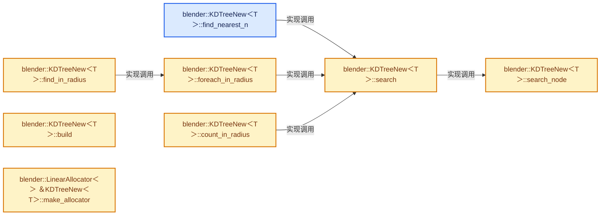
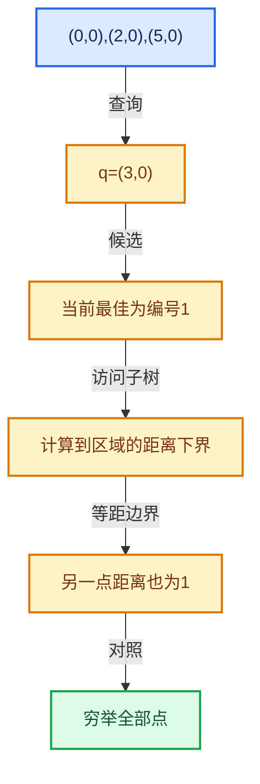

# 12-06 筛选与子集查询

[方向导航](README.md) · [总目录](../README.md) · [实现索引](../%E7%AC%A6%E5%8F%B7%E4%BE%9D%E8%B5%96%E4%B8%8E%E5%AE%9E%E7%8E%B0%E7%B4%A2%E5%BC%95.md)

## 从问题到实现

树索引、原始索引与结果索引怎样对应？

子集构建引入间接索引，筛选条件不得破坏距离证明；结果身份需回到调用者坐标数组。

**数据模型**

子集索引2、7、11对应原数组身份，树内部排序位置不是最终结果编号。

**设计取舍**

间接索引减少坐标复制，增加身份转换需要。

**最小反例**

返回局部编号1而调用者把它当原数组的第1个点。

**推导**

为每条映射标注来源和目标索引空间。

## 阅读地图与执行推演







图中的数值推演是本方向的教学模型；实际函数之间的调用边与概念分析边分别标注，不能把概念关系当作运行时调度顺序。

## 完整源码单元与就地讲解

中文讲解直接放在相关代码旁，复杂机制在代码下展开。原文折叠区保留基准行号；不需要在行号表和函数之间来回查找。类布局可分段展示，函数实现不按固定行数切开。

<!-- annotated:098e6948efd30a -->

```cpp

```

<details>
<summary>核对原始源码：source/blender/blenlib/BLI_kdtree_new.hh · L545—L545</summary>

<!-- original:098e6948efd30a:source/blender/blenlib/BLI_kdtree_new.hh:545:545 -->

```cpp

```

</details>

<a id="f-72a182470129c15b"></a>

### `blender::KDTreeNew<T>::find_nearest_n`

收集半径内或最近K个合法候选。

实现位置：[source/blender/blenlib/BLI_kdtree_new.hh](../../../../../source/blender/blenlib/BLI_kdtree_new.hh) · L546—L555。

接口参数：

- `const T &position`
- `MutableSpan<Nearest> r_nearest`

**教学注释版**

<!-- annotated:f27bcb0c58de20 -->

```cpp
template<typename T>
int KDTreeNew<T>::find_nearest_n(const T &position, MutableSpan<Nearest> r_nearest) const
{
  // [讲解] r_nearest.is_empty：查询视图长度或生成对应有效索引区间。
  if (this->is_empty() || r_nearest.is_empty()) {
    return 0;
  }
  kdtree::NearestNQuery<Nearest, value_type> query(r_nearest);
  // [讲解] this->search：在空间界限约束下寻找满足条件的点。
  this->search(query, position);
  return query.count();
}
```

<details>
<summary>核对原始源码：source/blender/blenlib/BLI_kdtree_new.hh · L546—L555</summary>

<!-- original:f27bcb0c58de20:source/blender/blenlib/BLI_kdtree_new.hh:546:555 -->

```cpp
template<typename T>
int KDTreeNew<T>::find_nearest_n(const T &position, MutableSpan<Nearest> r_nearest) const
{
  if (this->is_empty() || r_nearest.is_empty()) {
    return 0;
  }
  kdtree::NearestNQuery<Nearest, value_type> query(r_nearest);
  this->search(query, position);
  return query.count();
}
```

</details>

**接口与不变量**

边界包含性和实际结果数量按接口确认，K超过点数不能返回伪造元素。

**结果出口**

- `return 0;`
- `return query.count();`

**继续追踪实现**

- `this->is_empty` → [blender::KDTreeNew<T>::is_empty · L498](05-K%E8%BF%91%E9%82%BB%E4%B8%8E%E8%8C%83%E5%9B%B4%E6%9F%A5%E8%AF%A2.md#f-67f0ff91cf00b00b)。
- `r_nearest.is_empty` → [blender::MutableSpan::is_empty · L515](../01-%E5%9F%BA%E7%A1%80%E5%AE%B9%E5%99%A8%E4%B8%8E%E7%8E%B0%E4%BB%A3CPP/06-MutableSpan%E5%8F%AF%E5%86%99%E8%A7%86%E5%9B%BE.md#f-be88df1422757437)。
- `this->search` → [blender::KDTreeNew<T>::search · L595](06-%E7%AD%9B%E9%80%89%E4%B8%8E%E5%AD%90%E9%9B%86%E6%9F%A5%E8%AF%A2.md#f-d531d5162b90d15b)。
- `query.count` → [blender::kdtree::NearestNQuery::count · L361](04-%E6%9C%80%E8%BF%91%E9%82%BB%E6%90%9C%E7%B4%A2%E4%B8%8E%E5%89%AA%E6%9E%9D.md#f-6f49dd5add550d6d)。

### 类型布局、声明与编译条件 · BLI_kdtree_new.hh L556—L557

<!-- annotated:767a9be019cf05 -->

```cpp

template<typename T>
```

<details>
<summary>核对原始源码：source/blender/blenlib/BLI_kdtree_new.hh · L556—L557</summary>

<!-- original:767a9be019cf05:source/blender/blenlib/BLI_kdtree_new.hh:556:557 -->

```cpp

template<typename T>
```

</details>

<a id="f-5e6826a931e2f8d6"></a>

### `blender::KDTreeNew<T>::foreach_in_radius`

收集半径内或最近K个合法候选。

实现位置：[source/blender/blenlib/BLI_kdtree_new.hh](../../../../../source/blender/blenlib/BLI_kdtree_new.hh) · L558—L566。

接口参数：

- `const T &position`
- `const value_type radius`
- `Fn &&fn`

**教学注释版**

<!-- annotated:28711d88b5f7aa -->

```cpp
template<typename Fn>
void KDTreeNew<T>::foreach_in_radius(const T &position, const value_type radius, Fn &&fn) const
{
  if (this->is_empty()) {
    return;
  }
  kdtree::RadiusQuery<value_type, std::decay_t<Fn>> query(radius * radius, std::forward<Fn>(fn));
  // [讲解] this->search：在空间界限约束下寻找满足条件的点。
  this->search(query, position);
}
```

<details>
<summary>核对原始源码：source/blender/blenlib/BLI_kdtree_new.hh · L558—L566</summary>

<!-- original:28711d88b5f7aa:source/blender/blenlib/BLI_kdtree_new.hh:558:566 -->

```cpp
template<typename Fn>
void KDTreeNew<T>::foreach_in_radius(const T &position, const value_type radius, Fn &&fn) const
{
  if (this->is_empty()) {
    return;
  }
  kdtree::RadiusQuery<value_type, std::decay_t<Fn>> query(radius * radius, std::forward<Fn>(fn));
  this->search(query, position);
}
```

</details>

**接口与不变量**

边界包含性和实际结果数量按接口确认，K超过点数不能返回伪造元素。

**继续追踪实现**

- `this->is_empty` → [blender::KDTreeNew<T>::is_empty · L498](05-K%E8%BF%91%E9%82%BB%E4%B8%8E%E8%8C%83%E5%9B%B4%E6%9F%A5%E8%AF%A2.md#f-67f0ff91cf00b00b)。
- `this->search` → [blender::KDTreeNew<T>::search · L595](06-%E7%AD%9B%E9%80%89%E4%B8%8E%E5%AD%90%E9%9B%86%E6%9F%A5%E8%AF%A2.md#f-d531d5162b90d15b)。

<!-- annotated:f588c1719a1775 -->

```cpp

```

<details>
<summary>核对原始源码：source/blender/blenlib/BLI_kdtree_new.hh · L567—L567</summary>

<!-- original:f588c1719a1775:source/blender/blenlib/BLI_kdtree_new.hh:567:567 -->

```cpp

```

</details>

<a id="f-acec42217fb9ad11"></a>

### `blender::KDTreeNew<T>::find_in_radius`

实现位置：[source/blender/blenlib/BLI_kdtree_new.hh](../../../../../source/blender/blenlib/BLI_kdtree_new.hh) · L568—L581。

接口参数：

- `const T &position`
- `const value_type radius`
- `Vector<Nearest> &r_nearest`

**教学注释版**

<!-- annotated:9aca0772bf6f16 -->

```cpp
template<typename T>
int KDTreeNew<T>::find_in_radius(const T &position,
                                 const value_type radius,
                                 Vector<Nearest> &r_nearest) const
{
  // [讲解] r_nearest.clear：销毁所有有效元素，把size变为0，但保留原分配或内嵌容量。
  r_nearest.clear();
  // [讲解] this->foreach_in_radius：收集半径内或最近K个合法候选。
  this->foreach_in_radius(position, radius, [&](const int index, const value_type distance_sq) {
    // [讲解] r_nearest.append：在尾部建立新元素，必要时先扩大存储。
    r_nearest.append({index, distance_sq});
  });
  // [讲解] r_nearest.begin：提供当前存储或有效范围的地址。
  std::sort(r_nearest.begin(), r_nearest.end(), [](const Nearest &a, const Nearest &b) {
    return a.distance_sq < b.distance_sq || (a.distance_sq == b.distance_sq && a.index < b.index);
  });
  // [讲解] r_nearest.size：用end_减begin_得到活元素数量。
  return int(r_nearest.size());
}
```

<details>
<summary>核对原始源码：source/blender/blenlib/BLI_kdtree_new.hh · L568—L581</summary>

<!-- original:9aca0772bf6f16:source/blender/blenlib/BLI_kdtree_new.hh:568:581 -->

```cpp
template<typename T>
int KDTreeNew<T>::find_in_radius(const T &position,
                                 const value_type radius,
                                 Vector<Nearest> &r_nearest) const
{
  r_nearest.clear();
  this->foreach_in_radius(position, radius, [&](const int index, const value_type distance_sq) {
    r_nearest.append({index, distance_sq});
  });
  std::sort(r_nearest.begin(), r_nearest.end(), [](const Nearest &a, const Nearest &b) {
    return a.distance_sq < b.distance_sq || (a.distance_sq == b.distance_sq && a.index < b.index);
  });
  return int(r_nearest.size());
}
```

</details>

**结果出口**

- `return a.distance_sq < b.distance_sq || (a.distance_sq == b.distance_sq && a.index < b.index);`
- `return int(r_nearest.size());`

**继续追踪实现**

- `r_nearest.clear` → [blender::Vector::clear · L468](../01-%E5%9F%BA%E7%A1%80%E5%AE%B9%E5%99%A8%E4%B8%8E%E7%8E%B0%E4%BB%A3CPP/10-Vector%E6%89%A9%E5%AE%B9%E4%B8%8E%E5%A2%9E%E9%95%BF.md#f-d051bebff5275a43)。
- `this->foreach_in_radius` → [blender::KDTreeNew<T>::foreach_in_radius · L558](06-%E7%AD%9B%E9%80%89%E4%B8%8E%E5%AD%90%E9%9B%86%E6%9F%A5%E8%AF%A2.md#f-5e6826a931e2f8d6)。
- `r_nearest.append` → [blender::Vector::append · L498](../01-%E5%9F%BA%E7%A1%80%E5%AE%B9%E5%99%A8%E4%B8%8E%E7%8E%B0%E4%BB%A3CPP/11-Vector%E6%8F%92%E5%85%A5%E5%88%A0%E9%99%A4%E4%B8%8E%E9%87%8D%E6%8E%92.md#f-5bde268a69e443ec)；[blender::Vector::append · L502](../01-%E5%9F%BA%E7%A1%80%E5%AE%B9%E5%99%A8%E4%B8%8E%E7%8E%B0%E4%BB%A3CPP/11-Vector%E6%8F%92%E5%85%A5%E5%88%A0%E9%99%A4%E4%B8%8E%E9%87%8D%E6%8E%92.md#f-591e0b15e6308532)。同名重载需按实参类型选择。
- `std::sort` → [外部契约](https://eel.is/c++draft/)：这个边界按实际表达式及所属类型核对参数、返回值、寿命与失败行为。这里提供接口入口，不声称已解释该第三方版本的内部实现。
- `r_nearest.begin` → [blender::Vector::begin · L967](../01-%E5%9F%BA%E7%A1%80%E5%AE%B9%E5%99%A8%E4%B8%8E%E7%8E%B0%E4%BB%A3CPP/12-Vector%E5%BC%82%E5%B8%B8%E5%AE%89%E5%85%A8%E4%B8%8E%E8%BE%B9%E7%95%8C.md#f-64fb75a6663b953c)；[blender::Vector::begin · L976](../01-%E5%9F%BA%E7%A1%80%E5%AE%B9%E5%99%A8%E4%B8%8E%E7%8E%B0%E4%BB%A3CPP/12-Vector%E5%BC%82%E5%B8%B8%E5%AE%89%E5%85%A8%E4%B8%8E%E8%BE%B9%E7%95%8C.md#f-7c6486a8b8e8f13f)。同名重载需按实参类型选择。
- `r_nearest.end` → [blender::Vector::end · L971](../01-%E5%9F%BA%E7%A1%80%E5%AE%B9%E5%99%A8%E4%B8%8E%E7%8E%B0%E4%BB%A3CPP/12-Vector%E5%BC%82%E5%B8%B8%E5%AE%89%E5%85%A8%E4%B8%8E%E8%BE%B9%E7%95%8C.md#f-8a6033745be8f712)；[blender::Vector::end · L980](../01-%E5%9F%BA%E7%A1%80%E5%AE%B9%E5%99%A8%E4%B8%8E%E7%8E%B0%E4%BB%A3CPP/12-Vector%E5%BC%82%E5%B8%B8%E5%AE%89%E5%85%A8%E4%B8%8E%E8%BE%B9%E7%95%8C.md#f-ebb3ada259887677)。同名重载需按实参类型选择。
- `r_nearest.size` → [blender::Vector::size · L780](../01-%E5%9F%BA%E7%A1%80%E5%AE%B9%E5%99%A8%E4%B8%8E%E7%8E%B0%E4%BB%A3CPP/11-Vector%E6%8F%92%E5%85%A5%E5%88%A0%E9%99%A4%E4%B8%8E%E9%87%8D%E6%8E%92.md#f-714773731767349c)。

<!-- annotated:1a7b5e55c375df -->

```cpp

```

<details>
<summary>核对原始源码：source/blender/blenlib/BLI_kdtree_new.hh · L582—L582</summary>

<!-- original:1a7b5e55c375df:source/blender/blenlib/BLI_kdtree_new.hh:582:582 -->

```cpp

```

</details>

<a id="f-25d4ccffbc06de2d"></a>

### `blender::KDTreeNew<T>::count_in_radius`

实现位置：[source/blender/blenlib/BLI_kdtree_new.hh](../../../../../source/blender/blenlib/BLI_kdtree_new.hh) · L583—L592。

接口参数：

- `const T &position`
- `const value_type radius`

**教学注释版**

<!-- annotated:75ebbc3c7be324 -->

```cpp
template<typename T>
int KDTreeNew<T>::count_in_radius(const T &position, const value_type radius) const
{
  if (this->is_empty()) {
    return 0;
  }
  kdtree::RadiusQuery<value_type, decltype([](int, value_type) {})> query(radius * radius, {});
  // [讲解] this->search：在空间界限约束下寻找满足条件的点。
  this->search(query, position);
  return query.count();
}
```

<details>
<summary>核对原始源码：source/blender/blenlib/BLI_kdtree_new.hh · L583—L592</summary>

<!-- original:75ebbc3c7be324:source/blender/blenlib/BLI_kdtree_new.hh:583:592 -->

```cpp
template<typename T>
int KDTreeNew<T>::count_in_radius(const T &position, const value_type radius) const
{
  if (this->is_empty()) {
    return 0;
  }
  kdtree::RadiusQuery<value_type, decltype([](int, value_type) {})> query(radius * radius, {});
  this->search(query, position);
  return query.count();
}
```

</details>

**结果出口**

- `return 0;`
- `return query.count();`

**继续追踪实现**

- `this->is_empty` → [blender::KDTreeNew<T>::is_empty · L498](05-K%E8%BF%91%E9%82%BB%E4%B8%8E%E8%8C%83%E5%9B%B4%E6%9F%A5%E8%AF%A2.md#f-67f0ff91cf00b00b)。
- `this->search` → [blender::KDTreeNew<T>::search · L595](06-%E7%AD%9B%E9%80%89%E4%B8%8E%E5%AD%90%E9%9B%86%E6%9F%A5%E8%AF%A2.md#f-d531d5162b90d15b)。
- `query.count` → [blender::kdtree::RadiusQuery::count · L412](05-K%E8%BF%91%E9%82%BB%E4%B8%8E%E8%8C%83%E5%9B%B4%E6%9F%A5%E8%AF%A2.md#f-7d6dc3ce6d525a96)。

### 类型布局、声明与编译条件 · BLI_kdtree_new.hh L593—L594

<!-- annotated:f9513ff3bb7210 -->

```cpp

template<typename T>
```

<details>
<summary>核对原始源码：source/blender/blenlib/BLI_kdtree_new.hh · L593—L594</summary>

<!-- original:f9513ff3bb7210:source/blender/blenlib/BLI_kdtree_new.hh:593:594 -->

```cpp

template<typename T>
```

</details>

<a id="f-d531d5162b90d15b"></a>

### `blender::KDTreeNew<T>::search`

在空间界限约束下寻找满足条件的点。

实现位置：[source/blender/blenlib/BLI_kdtree_new.hh](../../../../../source/blender/blenlib/BLI_kdtree_new.hh) · L595—L614。

接口参数：

- `Query &query`
- `const T &position`

**教学注释版**

<!-- annotated:cf1d5f14a936c9 -->

```cpp
template<typename Query>
void KDTreeNew<T>::search(Query &query, const T &position) const
  requires kdtree::QueryType<Query, value_type>
{
  BLI_assert(!this->is_empty());
  /* Squared distance to the bounds of the tree, per dimension, which the walk below replaces
   * one dimension at a time rather than recomputing. */
  T offsets(value_type(0));
  value_type distance_sq = 0;
  for (const int dim : IndexRange(dimensions)) {
    if (position[dim] < bounds_.min[dim]) {
      offsets[dim] = math::square(bounds_.min[dim] - position[dim]);
    }
    else if (position[dim] > bounds_.max[dim]) {
      offsets[dim] = math::square(position[dim] - bounds_.max[dim]);
    }
    distance_sq += offsets[dim];
  }
  // [讲解] this->search_node：在空间界限约束下寻找满足条件的点。
  this->search_node(query, position, root_, distance_sq, offsets);
}
```

<details>
<summary>核对原始源码：source/blender/blenlib/BLI_kdtree_new.hh · L595—L614</summary>

<!-- original:cf1d5f14a936c9:source/blender/blenlib/BLI_kdtree_new.hh:595:614 -->

```cpp
template<typename Query>
void KDTreeNew<T>::search(Query &query, const T &position) const
  requires kdtree::QueryType<Query, value_type>
{
  BLI_assert(!this->is_empty());
  /* Squared distance to the bounds of the tree, per dimension, which the walk below replaces
   * one dimension at a time rather than recomputing. */
  T offsets(value_type(0));
  value_type distance_sq = 0;
  for (const int dim : IndexRange(dimensions)) {
    if (position[dim] < bounds_.min[dim]) {
      offsets[dim] = math::square(bounds_.min[dim] - position[dim]);
    }
    else if (position[dim] > bounds_.max[dim]) {
      offsets[dim] = math::square(position[dim] - bounds_.max[dim]);
    }
    distance_sq += offsets[dim];
  }
  this->search_node(query, position, root_, distance_sq, offsets);
}
```

</details>

**接口与不变量**

返回身份应映射到原坐标数组，距离单位与剪枝上界必须一致。

**沿实际写入检查状态**

- `offsets[dim] = math::square(bounds_.min[dim] - position[dim]);`
- `offsets[dim] = math::square(position[dim] - bounds_.max[dim]);`
- `distance_sq += offsets[dim];`

**继续追踪实现**

- `BLI_assert` → [BLI_assert · L48](../01-%E5%9F%BA%E7%A1%80%E5%AE%B9%E5%99%A8%E4%B8%8E%E7%8E%B0%E4%BB%A3CPP/%E4%BE%9D%E8%B5%96-BLI_assert-cc98e8.md#m-57a88495704d)；[BLI_assert · L63](../01-%E5%9F%BA%E7%A1%80%E5%AE%B9%E5%99%A8%E4%B8%8E%E7%8E%B0%E4%BB%A3CPP/%E4%BE%9D%E8%B5%96-BLI_assert-cc98e8.md#m-d07050020cb5)。宏定义由构建条件选择。
- `this->is_empty` → [blender::KDTreeNew<T>::is_empty · L498](05-K%E8%BF%91%E9%82%BB%E4%B8%8E%E8%8C%83%E5%9B%B4%E6%9F%A5%E8%AF%A2.md#f-67f0ff91cf00b00b)。
- `value_type` → [调用协议](../%E6%A8%A1%E6%9D%BF%E5%AE%8F%E4%B8%8E%E5%8A%A8%E6%80%81%E5%88%86%E6%B4%BE%E5%8D%8F%E8%AE%AE.md)：函数指针、局部可调用对象或未展开的宏；必须结合调用者环境。调用位置L602。
- `IndexRange` → [blender::IndexRange](../01-%E5%9F%BA%E7%A1%80%E5%AE%B9%E5%99%A8%E4%B8%8E%E7%8E%B0%E4%BB%A3CPP/%E4%BE%9D%E8%B5%96-BLI_index_range-7d7cc5.md#t-caa3466d6776)；[blender::gpu::shader::parser::IndexRange](../05-%E5%87%A0%E4%BD%95%E5%AD%98%E5%82%A8%E4%B8%8E%E6%8B%93%E6%89%91%E6%98%A0%E5%B0%84/%E4%BE%9D%E8%B5%96-utils-06433d.md#t-82d2bd4ea71c)；[blender::IndexRange](../05-%E5%87%A0%E4%BD%95%E5%AD%98%E5%82%A8%E4%B8%8E%E6%8B%93%E6%89%91%E6%98%A0%E5%B0%84/%E4%BE%9D%E8%B5%96-DNA_node_types-6708b9.md#t-0448cc889d39)。
- `math::square` → [blender::math::square · L278](%E4%BE%9D%E8%B5%96-BLI_math_vector-906a87.md#f-6c1248be60a2c7c0)；[blender::math::square · L209](%E4%BE%9D%E8%B5%96-BLI_math_base-0728eb.md#f-0dc33df9518a5e2d)。同名重载需按实参类型选择。
- `this->search_node` → [blender::KDTreeNew<T>::search_node · L617](06-%E7%AD%9B%E9%80%89%E4%B8%8E%E5%AD%90%E9%9B%86%E6%9F%A5%E8%AF%A2.md#f-38adb2f47349106c)。

### 类型布局、声明与编译条件 · BLI_kdtree_new.hh L615—L616

<!-- annotated:db730ad036d834 -->

```cpp

template<typename T>
```

<details>
<summary>核对原始源码：source/blender/blenlib/BLI_kdtree_new.hh · L615—L616</summary>

<!-- original:db730ad036d834:source/blender/blenlib/BLI_kdtree_new.hh:615:616 -->

```cpp

template<typename T>
```

</details>

<a id="f-38adb2f47349106c"></a>

### `blender::KDTreeNew<T>::search_node`

在空间界限约束下寻找满足条件的点。

实现位置：[source/blender/blenlib/BLI_kdtree_new.hh](../../../../../source/blender/blenlib/BLI_kdtree_new.hh) · L617—L684。

接口参数：

- `Query &query`
- `const T &position`
- `const Node *node`
- `const value_type distance_sq`
- `T &offsets`

**教学注释版**

<!-- annotated:edb5ab46e269dd -->

```cpp
template<typename Query>
bool KDTreeNew<T>::search_node(Query &query,
                               const T &position,
                               const Node *node,
                               const value_type distance_sq,
                               T &offsets) const
  requires kdtree::QueryType<Query, value_type>
{
  if (node->children == nullptr) {
    const int *indices = tree_indices_;
    const T *points = points_;
    for (int i = node->leaf.start; i < node->leaf.end; i++) {
      const int index = indices[i];
      const value_type point_distance_sq = math::distance_squared(position, points[index]);
      if (kdtree::keep_distance<Query>(point_distance_sq, query.max_distance_sq())) {
        if (!query.add_point(point_distance_sq, index)) {
          return false;
        }
      }
    }
    return true;
  }

  /* Both children are loaded before it is known which one to visit, so that the loads do not
   * wait on the comparison below. Picking one first makes the walk down the tree a chain of
   * dependent loads. */
  const Node *low_child = &node->children[0];
  const Node *high_child = &node->children[1];

  /* Visit the side of the split the position is on first, since what it finds there is what
   * lets the other side be skipped. */
  const int dim = node->dim;
  const value_type value = position[dim];
  const value_type to_low = value - node->split.low;
  const value_type to_high = value - node->split.high;

  /* Written as a branch rather than as a choice between two pointers, so that the processor
   * predicts which child comes next and starts loading it before the comparison has resolved.
   * Selecting the pointer instead makes the walk down the tree wait at every level. */
  const Node *far_child;
  value_type far_offset;
  if ((to_low + to_high) < 0) {
    // [讲解] this->search_node：在空间界限约束下寻找满足条件的点。
    if (!this->search_node(query, position, low_child, distance_sq, offsets)) {
      return false;
    }
    far_child = high_child;
    far_offset = math::square(to_high);
  }
  else {
    if (!this->search_node(query, position, high_child, distance_sq, offsets)) {
      return false;
    }
    far_child = low_child;
    far_offset = math::square(to_low);
  }

  /* Swap in the distance to the far side for this dimension, keeping the others. */
  const value_type previous = offsets[dim];
  const value_type far_distance_sq = distance_sq + far_offset - previous;
  if (!kdtree::keep_distance<Query>(far_distance_sq, query.max_distance_sq())) {
    return true;
  }
  offsets[dim] = far_offset;
  const bool keep_searching = this->search_node(
      query, position, far_child, far_distance_sq, offsets);
  offsets[dim] = previous;
  return keep_searching;
}
```

<details>
<summary>核对原始源码：source/blender/blenlib/BLI_kdtree_new.hh · L617—L684</summary>

<!-- original:edb5ab46e269dd:source/blender/blenlib/BLI_kdtree_new.hh:617:684 -->

```cpp
template<typename Query>
bool KDTreeNew<T>::search_node(Query &query,
                               const T &position,
                               const Node *node,
                               const value_type distance_sq,
                               T &offsets) const
  requires kdtree::QueryType<Query, value_type>
{
  if (node->children == nullptr) {
    const int *indices = tree_indices_;
    const T *points = points_;
    for (int i = node->leaf.start; i < node->leaf.end; i++) {
      const int index = indices[i];
      const value_type point_distance_sq = math::distance_squared(position, points[index]);
      if (kdtree::keep_distance<Query>(point_distance_sq, query.max_distance_sq())) {
        if (!query.add_point(point_distance_sq, index)) {
          return false;
        }
      }
    }
    return true;
  }

  /* Both children are loaded before it is known which one to visit, so that the loads do not
   * wait on the comparison below. Picking one first makes the walk down the tree a chain of
   * dependent loads. */
  const Node *low_child = &node->children[0];
  const Node *high_child = &node->children[1];

  /* Visit the side of the split the position is on first, since what it finds there is what
   * lets the other side be skipped. */
  const int dim = node->dim;
  const value_type value = position[dim];
  const value_type to_low = value - node->split.low;
  const value_type to_high = value - node->split.high;

  /* Written as a branch rather than as a choice between two pointers, so that the processor
   * predicts which child comes next and starts loading it before the comparison has resolved.
   * Selecting the pointer instead makes the walk down the tree wait at every level. */
  const Node *far_child;
  value_type far_offset;
  if ((to_low + to_high) < 0) {
    if (!this->search_node(query, position, low_child, distance_sq, offsets)) {
      return false;
    }
    far_child = high_child;
    far_offset = math::square(to_high);
  }
  else {
    if (!this->search_node(query, position, high_child, distance_sq, offsets)) {
      return false;
    }
    far_child = low_child;
    far_offset = math::square(to_low);
  }

  /* Swap in the distance to the far side for this dimension, keeping the others. */
  const value_type previous = offsets[dim];
  const value_type far_distance_sq = distance_sq + far_offset - previous;
  if (!kdtree::keep_distance<Query>(far_distance_sq, query.max_distance_sq())) {
    return true;
  }
  offsets[dim] = far_offset;
  const bool keep_searching = this->search_node(
      query, position, far_child, far_distance_sq, offsets);
  offsets[dim] = previous;
  return keep_searching;
}
```

</details>

**接口与不变量**

返回身份应映射到原坐标数组，距离单位与剪枝上界必须一致。

**沿实际写入检查状态**

- `far_child = high_child;`
- `far_offset = math::square(to_high);`
- `far_child = low_child;`
- `far_offset = math::square(to_low);`
- `offsets[dim] = far_offset;`
- `offsets[dim] = previous;`

**结果出口**

- `return false;`
- `return true;`
- `return keep_searching;`

**继续追踪实现**

- `math::distance_squared` → [blender::math::distance_squared · L479](%E4%BE%9D%E8%B5%96-BLI_math_vector-906a87.md#f-b39a28ba63f85e71)。
- `kdtree::keep_distance<Query>` → [blender::kdtree::keep_distance · L432](05-K%E8%BF%91%E9%82%BB%E4%B8%8E%E8%8C%83%E5%9B%B4%E6%9F%A5%E8%AF%A2.md#f-a334a4358d347b43)。
- `query.max_distance_sq` → [调用协议](../%E6%A8%A1%E6%9D%BF%E5%AE%8F%E4%B8%8E%E5%8A%A8%E6%80%81%E5%88%86%E6%B4%BE%E5%8D%8F%E8%AE%AE.md)：Query模板参数提供的操作协议。调用位置L631。
- `query.add_point` → [调用协议](../%E6%A8%A1%E6%9D%BF%E5%AE%8F%E4%B8%8E%E5%8A%A8%E6%80%81%E5%88%86%E6%B4%BE%E5%8D%8F%E8%AE%AE.md)：Query模板参数提供的操作协议。调用位置L632。
- `this->search_node` → [blender::KDTreeNew<T>::search_node · L617](06-%E7%AD%9B%E9%80%89%E4%B8%8E%E5%AD%90%E9%9B%86%E6%9F%A5%E8%AF%A2.md#f-38adb2f47349106c)。
- `math::square` → [blender::math::square · L278](%E4%BE%9D%E8%B5%96-BLI_math_vector-906a87.md#f-6c1248be60a2c7c0)；[blender::math::square · L209](%E4%BE%9D%E8%B5%96-BLI_math_base-0728eb.md#f-0dc33df9518a5e2d)。同名重载需按实参类型选择。

### 类型布局、声明与编译条件 · BLI_kdtree_new.hh L685—L686

<!-- annotated:1b1b13d44bd227 -->

```cpp

}  // namespace blender
```

<details>
<summary>核对原始源码：source/blender/blenlib/BLI_kdtree_new.hh · L685—L686</summary>

<!-- original:1b1b13d44bd227:source/blender/blenlib/BLI_kdtree_new.hh:685:686 -->

```cpp

}  // namespace blender
```

</details>

<a id="f-1fc07a1ede356a96"></a>

### `blender::KDTreeNew<T>::build`

从点与可选子集建立索引和树节点。

实现位置：[source/blender/blenlib/intern/kdtree.cc](../../../../../source/blender/blenlib/intern/kdtree.cc) · L689—L724。

接口参数：

- `const Span<T> points`
- `const Span<int> indices`
- `const IndexMask *mask`
- `const int size`
- `const int leaf_size`
- `LinearAllocator<> &allocator`

**教学注释版**

<!-- annotated:5613c7c5111b46 -->

```cpp
template<typename T>
void KDTreeNew<T>::build(const Span<T> points,
                         const Span<int> indices,
                         const IndexMask *mask,
                         const int size,
                         const int leaf_size,
                         LinearAllocator<> &allocator)
{
  // [讲解] 保存外部坐标入口；树节点拥有关系不延长该坐标数组寿命。
  points_ = points.data();
  if (size == 0) {
    return;
  }
  const MutableSpan<int> tree_indices = allocator.allocate_array<int>(size);

  Span<int> source;
  if (mask) {
    mask->to_indices<int>(tree_indices);
    source = tree_indices;
  }
  else {
    source = indices;
  }

  TreeBuilder<T> builder(points, tree_indices, leaf_size, allocator);
  // [讲解] 提交构建得到的根节点入口。
  root_ = builder.build(source, bounds_);
  // [讲解] 保存树内间接索引，结果身份仍需对应原坐标数组。
  tree_indices_ = tree_indices.data();
  size_ = size;

#ifndef NDEBUG
  /* Only the pointer to the points is kept, so nothing can check a search result against their
   * number later. Everything the tree can return comes from here. */
  for (const int index : tree_indices) {
    // [讲解] points.size：查询视图长度或生成对应有效索引区间。
    BLI_assert(index >= 0 && index < points.size());
  }
#endif
}
```

<details>
<summary>核对原始源码：source/blender/blenlib/intern/kdtree.cc · L689—L724</summary>

<!-- original:5613c7c5111b46:source/blender/blenlib/intern/kdtree.cc:689:724 -->

```cpp
template<typename T>
void KDTreeNew<T>::build(const Span<T> points,
                         const Span<int> indices,
                         const IndexMask *mask,
                         const int size,
                         const int leaf_size,
                         LinearAllocator<> &allocator)
{
  points_ = points.data();
  if (size == 0) {
    return;
  }
  const MutableSpan<int> tree_indices = allocator.allocate_array<int>(size);

  Span<int> source;
  if (mask) {
    mask->to_indices<int>(tree_indices);
    source = tree_indices;
  }
  else {
    source = indices;
  }

  TreeBuilder<T> builder(points, tree_indices, leaf_size, allocator);
  root_ = builder.build(source, bounds_);
  tree_indices_ = tree_indices.data();
  size_ = size;

#ifndef NDEBUG
  /* Only the pointer to the points is kept, so nothing can check a search result against their
   * number later. Everything the tree can return comes from here. */
  for (const int index : tree_indices) {
    BLI_assert(index >= 0 && index < points.size());
  }
#endif
}
```

</details>

**接口与不变量**

坐标采用借用时要求存活且内容不变；构建和查询成本分别测量。

**沿实际写入检查状态**

- `points_ = points.data();`：保存外部坐标入口；树节点拥有关系不延长该坐标数组寿命。
- `source = tree_indices;`
- `source = indices;`
- `root_ = builder.build(source, bounds_);`：提交构建得到的根节点入口。
- `tree_indices_ = tree_indices.data();`：保存树内间接索引，结果身份仍需对应原坐标数组。
- `size_ = size;`

**继续追踪实现**

- `points.data` → [blender::Span::data · L219](../01-%E5%9F%BA%E7%A1%80%E5%AE%B9%E5%99%A8%E4%B8%8E%E7%8E%B0%E4%BB%A3CPP/05-Span%E5%8F%AA%E8%AF%BB%E8%BF%9E%E7%BB%AD%E8%A7%86%E5%9B%BE.md#f-10c5889198935800)。
- `allocator.allocate_array<int>` → [blender::LinearAllocator::allocate_array · L115](../03-%E5%86%85%E5%AD%98%E5%88%86%E9%85%8D%E4%B8%8E%E8%BF%90%E8%A1%8C%E6%97%B6%E7%B1%BB%E5%9E%8B/02-LinearAllocator%E5%B8%83%E5%B1%80.md#f-a4f71808bf7434ab)；[blender::LinearAllocator::allocate_array · L122](../03-%E5%86%85%E5%AD%98%E5%88%86%E9%85%8D%E4%B8%8E%E8%BF%90%E8%A1%8C%E6%97%B6%E7%B1%BB%E5%9E%8B/02-LinearAllocator%E5%B8%83%E5%B1%80.md#f-3957475aeffc5dc7)。同名重载需按实参类型选择。
- `mask->to_indices<int>` → [blender::index_mask::IndexMask::to_indices · L766](../04-%E8%99%9A%E6%8B%9F%E6%95%B0%E7%BB%84%E4%B8%8E%E7%B4%A2%E5%BC%95%E9%80%89%E6%8B%A9/10-IndexMask%E6%9E%84%E5%BB%BA%E4%B8%8E%E5%B9%B6%E8%A1%8C.md#f-7d2f4148b6937424)。
- `builder.build` → [blender::TreeBuilder::build · L191](03-KDTreeNew%E6%9E%84%E5%BB%BA.md#f-1aeedf8a897736f1)。
- `tree_indices.data` → [blender::MutableSpan::data · L545](../01-%E5%9F%BA%E7%A1%80%E5%AE%B9%E5%99%A8%E4%B8%8E%E7%8E%B0%E4%BB%A3CPP/06-MutableSpan%E5%8F%AF%E5%86%99%E8%A7%86%E5%9B%BE.md#f-eb45a6e4d8211efd)；[blender::gpu::shader::parser::MutableSpan::data · L82](../05-%E5%87%A0%E4%BD%95%E5%AD%98%E5%82%A8%E4%B8%8E%E6%8B%93%E6%89%91%E6%98%A0%E5%B0%84/%E4%BE%9D%E8%B5%96-utils-06433d.md#f-ad0a09cec9741c65)。同名重载需按实参类型选择。
- `BLI_assert` → [BLI_assert · L48](../01-%E5%9F%BA%E7%A1%80%E5%AE%B9%E5%99%A8%E4%B8%8E%E7%8E%B0%E4%BB%A3CPP/%E4%BE%9D%E8%B5%96-BLI_assert-cc98e8.md#m-57a88495704d)；[BLI_assert · L63](../01-%E5%9F%BA%E7%A1%80%E5%AE%B9%E5%99%A8%E4%B8%8E%E7%8E%B0%E4%BB%A3CPP/%E4%BE%9D%E8%B5%96-BLI_assert-cc98e8.md#m-d07050020cb5)。宏定义由构建条件选择。
- `points.size` → [blender::Span::size · L256](../01-%E5%9F%BA%E7%A1%80%E5%AE%B9%E5%99%A8%E4%B8%8E%E7%8E%B0%E4%BB%A3CPP/05-Span%E5%8F%AA%E8%AF%BB%E8%BF%9E%E7%BB%AD%E8%A7%86%E5%9B%BE.md#f-5f80fa006089c998)。

<!-- annotated:ea8d15af8c7b21 -->

```cpp

```

<details>
<summary>核对原始源码：source/blender/blenlib/intern/kdtree.cc · L725—L725</summary>

<!-- original:ea8d15af8c7b21:source/blender/blenlib/intern/kdtree.cc:725:725 -->

```cpp

```

</details>

<a id="f-b35e915624e1f8bb"></a>

### `blender::LinearAllocator<> &KDTreeNew<T>::make_allocator`

实现位置：[source/blender/blenlib/intern/kdtree.cc](../../../../../source/blender/blenlib/intern/kdtree.cc) · L726—L745。

接口参数：

- `const int points_num`
- `const int leaf_size`
- `void *&r_owned`

**教学注释版**

<!-- annotated:a8fe11d53140ac -->

```cpp
template<typename T>
LinearAllocator<> &KDTreeNew<T>::make_allocator(const int points_num,
                                                const int leaf_size,
                                                void *&r_owned)
{
  /* Allocate enough for the allocator itself, the indices, and the first set of nodes. */
  const int64_t indices_size = int64_t(points_num) * sizeof(int);
  const int64_t nodes_size = int64_t(TreeBuilder<T>::node_batch_size(points_num, leaf_size)) *
                             sizeof(Node);
  /* Room for the allocator to align each of the two allocations it hands out of this. */
  const int64_t alignment_slack = 2 * alignof(std::max_align_t);
  const int64_t rest = indices_size + nodes_size + alignment_slack;
  const int64_t size = sizeof(LinearAllocator<>) + rest;

  // [讲解] MEM_new_uninitialized_aligned：把公开MEM分配接口转交给当前选择的对齐分配后端。
  void *buffer = MEM_new_uninitialized_aligned(size, alignof(LinearAllocator<>), __func__);
  r_owned = buffer;
  LinearAllocator<> *allocator = new (buffer) LinearAllocator<>();
  allocator->provide_buffer(static_cast<char *>(buffer) + sizeof(LinearAllocator<>), rest);
  return *allocator;
}
```

<details>
<summary>核对原始源码：source/blender/blenlib/intern/kdtree.cc · L726—L745</summary>

<!-- original:a8fe11d53140ac:source/blender/blenlib/intern/kdtree.cc:726:745 -->

```cpp
template<typename T>
LinearAllocator<> &KDTreeNew<T>::make_allocator(const int points_num,
                                                const int leaf_size,
                                                void *&r_owned)
{
  /* Allocate enough for the allocator itself, the indices, and the first set of nodes. */
  const int64_t indices_size = int64_t(points_num) * sizeof(int);
  const int64_t nodes_size = int64_t(TreeBuilder<T>::node_batch_size(points_num, leaf_size)) *
                             sizeof(Node);
  /* Room for the allocator to align each of the two allocations it hands out of this. */
  const int64_t alignment_slack = 2 * alignof(std::max_align_t);
  const int64_t rest = indices_size + nodes_size + alignment_slack;
  const int64_t size = sizeof(LinearAllocator<>) + rest;

  void *buffer = MEM_new_uninitialized_aligned(size, alignof(LinearAllocator<>), __func__);
  r_owned = buffer;
  LinearAllocator<> *allocator = new (buffer) LinearAllocator<>();
  allocator->provide_buffer(static_cast<char *>(buffer) + sizeof(LinearAllocator<>), rest);
  return *allocator;
}
```

</details>

**沿实际写入检查状态**

- `r_owned = buffer;`

**结果出口**

- `return *allocator;`

**继续追踪实现**

- `TreeBuilder<T>::node_batch_size` → [blender::TreeBuilder::node_batch_size · L152](03-KDTreeNew%E6%9E%84%E5%BB%BA.md#f-ee365f41997d9839)。
- `MEM_new_uninitialized_aligned` → [MEM_new_uninitialized_aligned · L134](../03-%E5%86%85%E5%AD%98%E5%88%86%E9%85%8D%E4%B8%8E%E8%BF%90%E8%A1%8C%E6%97%B6%E7%B1%BB%E5%9E%8B/%E4%BE%9D%E8%B5%96-mallocn-afdcd4.md#f-9f3d21bd7da93c68)。
- `allocator->provide_buffer` → [blender::LinearAllocator::provide_buffer · L217](../03-%E5%86%85%E5%AD%98%E5%88%86%E9%85%8D%E4%B8%8E%E8%BF%90%E8%A1%8C%E6%97%B6%E7%B1%BB%E5%9E%8B/03-LinearAllocator%E5%88%86%E9%85%8D%E4%B8%8E%E6%89%A9%E5%B1%95.md#f-7fb26e552e8c2077)；[blender::LinearAllocator::provide_buffer · L224](../03-%E5%86%85%E5%AD%98%E5%88%86%E9%85%8D%E4%B8%8E%E8%BF%90%E8%A1%8C%E6%97%B6%E7%B1%BB%E5%9E%8B/03-LinearAllocator%E5%88%86%E9%85%8D%E4%B8%8E%E6%89%A9%E5%B1%95.md#f-f477894fce14f489)。同名重载需按实参类型选择。

<!-- annotated:2ad0a7aa1c4b8f -->

```cpp

```

<details>
<summary>核对原始源码：source/blender/blenlib/intern/kdtree.cc · L746—L746</summary>

<!-- original:2ad0a7aa1c4b8f:source/blender/blenlib/intern/kdtree.cc:746:746 -->

```cpp

```

</details>

<a id="f-1856fbeb1aefe45c"></a>

### `blender::KDTreeNew<T>::~KDTreeNew`

实现位置：[source/blender/blenlib/intern/kdtree.cc](../../../../../source/blender/blenlib/intern/kdtree.cc) · L747—L755。

**教学注释版**

<!-- annotated:d53ff4a9a89eb0 -->

```cpp
template<typename T> KDTreeNew<T>::~KDTreeNew()
{
  /* An allocator the caller passed is only borrowed, and outlives the tree. The tree's own sits
   * at the start of the buffer it was built in. */
  if (owned_buffer_ != nullptr) {
    std::destroy_at(static_cast<LinearAllocator<> *>(owned_buffer_));
    // [讲解] MEM_delete_void：以原始存储释放约定调用当前后端。
    MEM_delete_void(owned_buffer_);
  }
}
```

<details>
<summary>核对原始源码：source/blender/blenlib/intern/kdtree.cc · L747—L755</summary>

<!-- original:d53ff4a9a89eb0:source/blender/blenlib/intern/kdtree.cc:747:755 -->

```cpp
template<typename T> KDTreeNew<T>::~KDTreeNew()
{
  /* An allocator the caller passed is only borrowed, and outlives the tree. The tree's own sits
   * at the start of the buffer it was built in. */
  if (owned_buffer_ != nullptr) {
    std::destroy_at(static_cast<LinearAllocator<> *>(owned_buffer_));
    MEM_delete_void(owned_buffer_);
  }
}
```

</details>

**继续追踪实现**

- `std::destroy_at` → [外部契约](https://eel.is/c++draft/)：这个边界按实际表达式及所属类型核对参数、返回值、寿命与失败行为。这里提供接口入口，不声称已解释该第三方版本的内部实现。
- `MEM_delete_void` → [MEM_delete_void · L647](../03-%E5%86%85%E5%AD%98%E5%88%86%E9%85%8D%E4%B8%8E%E8%BF%90%E8%A1%8C%E6%97%B6%E7%B1%BB%E5%9E%8B/%E4%BE%9D%E8%B5%96-MEM_guardedalloc-b54eca.md#f-642896c7c62ff8b9)；[MEM_delete_void · L109](../03-%E5%86%85%E5%AD%98%E5%88%86%E9%85%8D%E4%B8%8E%E8%BF%90%E8%A1%8C%E6%97%B6%E7%B1%BB%E5%9E%8B/%E4%BE%9D%E8%B5%96-mallocn-afdcd4.md#f-9a07b26421f2bee6)。同名重载需按实参类型选择。

<!-- annotated:eaff22e43ae6fd -->

```cpp

```

<details>
<summary>核对原始源码：source/blender/blenlib/intern/kdtree.cc · L756—L756</summary>

<!-- original:eaff22e43ae6fd:source/blender/blenlib/intern/kdtree.cc:756:756 -->

```cpp

```

</details>

<a id="f-bb29dc753f9ace96"></a>

### `blender::KDTreeNew<T>::KDTreeNew`

实现位置：[source/blender/blenlib/intern/kdtree.cc](../../../../../source/blender/blenlib/intern/kdtree.cc) · L757—L761。

接口参数：

- `const Span<T> points`
- `LinearAllocator<> &allocator`
- `const int leaf_size`

**教学注释版**

<!-- annotated:cd232d08330993 -->

```cpp
template<typename T>
KDTreeNew<T>::KDTreeNew(const Span<T> points, LinearAllocator<> &allocator, const int leaf_size)
{
  // [讲解] this->build：从点与可选子集建立索引和树节点。
  this->build(points, Span<int>(), nullptr, int(points.size()), std::max(leaf_size, 1), allocator);
}
```

<details>
<summary>核对原始源码：source/blender/blenlib/intern/kdtree.cc · L757—L761</summary>

<!-- original:cd232d08330993:source/blender/blenlib/intern/kdtree.cc:757:761 -->

```cpp
template<typename T>
KDTreeNew<T>::KDTreeNew(const Span<T> points, LinearAllocator<> &allocator, const int leaf_size)
{
  this->build(points, Span<int>(), nullptr, int(points.size()), std::max(leaf_size, 1), allocator);
}
```

</details>

**继续追踪实现**

- `this->build` → [blender::KDTreeNew<T>::build · L689](06-%E7%AD%9B%E9%80%89%E4%B8%8E%E5%AD%90%E9%9B%86%E6%9F%A5%E8%AF%A2.md#f-1fc07a1ede356a96)。
- `Span<int>` → [blender::Span · L214](../01-%E5%9F%BA%E7%A1%80%E5%AE%B9%E5%99%A8%E4%B8%8E%E7%8E%B0%E4%BB%A3CPP/15-StringRef%E5%AD%97%E7%AC%A6%E4%B8%B2%E8%A7%86%E5%9B%BE.md#f-eea723436ab634ed)。
- `points.size` → [blender::Span::size · L256](../01-%E5%9F%BA%E7%A1%80%E5%AE%B9%E5%99%A8%E4%B8%8E%E7%8E%B0%E4%BB%A3CPP/05-Span%E5%8F%AA%E8%AF%BB%E8%BF%9E%E7%BB%AD%E8%A7%86%E5%9B%BE.md#f-5f80fa006089c998)。
- `std::max` → [外部契约](https://eel.is/c++draft/alg.min.max)：按比较关系选取较大值。本讲解中的增长公式同时满足最低请求和几何增长；若保存返回引用，还需注意实参寿命。

<!-- annotated:3edb15eeeeb361 -->

```cpp

```

<details>
<summary>核对原始源码：source/blender/blenlib/intern/kdtree.cc · L762—L762</summary>

<!-- original:3edb15eeeeb361:source/blender/blenlib/intern/kdtree.cc:762:762 -->

```cpp

```

</details>

<a id="f-7b90c4afe158a529"></a>

### `blender::KDTreeNew<T>::KDTreeNew`

实现位置：[source/blender/blenlib/intern/kdtree.cc](../../../../../source/blender/blenlib/intern/kdtree.cc) · L763—L778。

接口参数：

- `const Span<T> points`
- `const IndexMask &mask`
- `LinearAllocator<> &allocator`
- `const int leaf_size`

**教学注释版**

<!-- annotated:c5de83c619303c -->

```cpp
template<typename T>
KDTreeNew<T>::KDTreeNew(const Span<T> points,
                        const IndexMask &mask,
                        LinearAllocator<> &allocator,
                        const int leaf_size)
{
  const std::optional<IndexRange> range = mask.to_range();
  // [讲解] points.index_range：查询视图长度或生成对应有效索引区间。
  const bool every_point = range && *range == points.index_range();
  /* Avoid the indirection when the mask contains every point anyway. */
  // [讲解] this->build：从点与可选子集建立索引和树节点。
  this->build(points,
              Span<int>(),
              every_point ? nullptr : &mask,
              int(mask.size()),
              // [讲解] std::max：按比较关系选取较大值。本讲解中的增长公式同时满足最低请求和几何增长；若保存返回引用，还需注意实参寿命。
              std::max(leaf_size, 1),
              allocator);
}
```

<details>
<summary>核对原始源码：source/blender/blenlib/intern/kdtree.cc · L763—L778</summary>

<!-- original:c5de83c619303c:source/blender/blenlib/intern/kdtree.cc:763:778 -->

```cpp
template<typename T>
KDTreeNew<T>::KDTreeNew(const Span<T> points,
                        const IndexMask &mask,
                        LinearAllocator<> &allocator,
                        const int leaf_size)
{
  const std::optional<IndexRange> range = mask.to_range();
  const bool every_point = range && *range == points.index_range();
  /* Avoid the indirection when the mask contains every point anyway. */
  this->build(points,
              Span<int>(),
              every_point ? nullptr : &mask,
              int(mask.size()),
              std::max(leaf_size, 1),
              allocator);
}
```

</details>

**继续追踪实现**

- `mask.to_range` → [blender::index_mask::IndexMask::to_range · L1136](../04-%E8%99%9A%E6%8B%9F%E6%95%B0%E7%BB%84%E4%B8%8E%E7%B4%A2%E5%BC%95%E9%80%89%E6%8B%A9/12-%E9%87%8D%E6%9E%84%E5%8E%86%E5%8F%B2%E4%B8%8E%E5%9F%BA%E5%87%86%E7%BB%83%E4%B9%A0.md#f-bcc016bae424bbaf)。
- `points.index_range` → [blender::Span::index_range · L405](../01-%E5%9F%BA%E7%A1%80%E5%AE%B9%E5%99%A8%E4%B8%8E%E7%8E%B0%E4%BB%A3CPP/05-Span%E5%8F%AA%E8%AF%BB%E8%BF%9E%E7%BB%AD%E8%A7%86%E5%9B%BE.md#f-caaa9b06e13e53e0)。
- `this->build` → [blender::KDTreeNew<T>::build · L689](06-%E7%AD%9B%E9%80%89%E4%B8%8E%E5%AD%90%E9%9B%86%E6%9F%A5%E8%AF%A2.md#f-1fc07a1ede356a96)。
- `Span<int>` → [blender::Span · L214](../01-%E5%9F%BA%E7%A1%80%E5%AE%B9%E5%99%A8%E4%B8%8E%E7%8E%B0%E4%BB%A3CPP/15-StringRef%E5%AD%97%E7%AC%A6%E4%B8%B2%E8%A7%86%E5%9B%BE.md#f-eea723436ab634ed)。
- `mask.size` → [blender::index_mask::IndexMask::size · L743](../04-%E8%99%9A%E6%8B%9F%E6%95%B0%E7%BB%84%E4%B8%8E%E7%B4%A2%E5%BC%95%E9%80%89%E6%8B%A9/09-%E5%88%86%E6%AE%B5%E5%AD%98%E5%82%A8%E4%B8%8E%E9%81%8D%E5%8E%86.md#f-0163b32abc9a0d9c)。
- `std::max` → [外部契约](https://eel.is/c++draft/alg.min.max)：按比较关系选取较大值。本讲解中的增长公式同时满足最低请求和几何增长；若保存返回引用，还需注意实参寿命。

<!-- annotated:879e7fc57769d2 -->

```cpp

```

<details>
<summary>核对原始源码：source/blender/blenlib/intern/kdtree.cc · L779—L779</summary>

<!-- original:879e7fc57769d2:source/blender/blenlib/intern/kdtree.cc:779:779 -->

```cpp

```

</details>

<a id="f-4d484b655307db59"></a>

### `blender::KDTreeNew<T>::KDTreeNew`

实现位置：[source/blender/blenlib/intern/kdtree.cc](../../../../../source/blender/blenlib/intern/kdtree.cc) · L780—L787。

接口参数：

- `const Span<T> points`
- `const Span<int> indices`
- `LinearAllocator<> &allocator`
- `const int leaf_size`

**教学注释版**

<!-- annotated:f7c836c85ca2d5 -->

```cpp
template<typename T>
KDTreeNew<T>::KDTreeNew(const Span<T> points,
                        const Span<int> indices,
                        LinearAllocator<> &allocator,
                        const int leaf_size)
{
  // [讲解] this->build：从点与可选子集建立索引和树节点。
  this->build(points, indices, nullptr, int(indices.size()), std::max(leaf_size, 1), allocator);
}
```

<details>
<summary>核对原始源码：source/blender/blenlib/intern/kdtree.cc · L780—L787</summary>

<!-- original:f7c836c85ca2d5:source/blender/blenlib/intern/kdtree.cc:780:787 -->

```cpp
template<typename T>
KDTreeNew<T>::KDTreeNew(const Span<T> points,
                        const Span<int> indices,
                        LinearAllocator<> &allocator,
                        const int leaf_size)
{
  this->build(points, indices, nullptr, int(indices.size()), std::max(leaf_size, 1), allocator);
}
```

</details>

**继续追踪实现**

- `this->build` → [blender::KDTreeNew<T>::build · L689](06-%E7%AD%9B%E9%80%89%E4%B8%8E%E5%AD%90%E9%9B%86%E6%9F%A5%E8%AF%A2.md#f-1fc07a1ede356a96)。
- `indices.size` → [blender::Span::size · L256](../01-%E5%9F%BA%E7%A1%80%E5%AE%B9%E5%99%A8%E4%B8%8E%E7%8E%B0%E4%BB%A3CPP/05-Span%E5%8F%AA%E8%AF%BB%E8%BF%9E%E7%BB%AD%E8%A7%86%E5%9B%BE.md#f-5f80fa006089c998)。
- `std::max` → [外部契约](https://eel.is/c++draft/alg.min.max)：按比较关系选取较大值。本讲解中的增长公式同时满足最低请求和几何增长；若保存返回引用，还需注意实参寿命。

<!-- annotated:b9437355c9483e -->

```cpp

```

<details>
<summary>核对原始源码：source/blender/blenlib/intern/kdtree.cc · L788—L788</summary>

<!-- original:b9437355c9483e:source/blender/blenlib/intern/kdtree.cc:788:788 -->

```cpp

```

</details>

<a id="f-0dad5cb3c5960a77"></a>

### `blender::KDTreeNew<T>::KDTreeNew`

实现位置：[source/blender/blenlib/intern/kdtree.cc](../../../../../source/blender/blenlib/intern/kdtree.cc) · L789—L797。

接口参数：

- `const Span<T> points`
- `const int leaf_size`

**教学注释版**

<!-- annotated:a4242470c2d57b -->

```cpp
template<typename T> KDTreeNew<T>::KDTreeNew(const Span<T> points, const int leaf_size)
{
  // [讲解] this->build：从点与可选子集建立索引和树节点。
  this->build(points,
              Span<int>(),
              nullptr,
              // [讲解] points.size：查询视图长度或生成对应有效索引区间。
              int(points.size()),
              // [讲解] std::max：按比较关系选取较大值。本讲解中的增长公式同时满足最低请求和几何增长；若保存返回引用，还需注意实参寿命。
              std::max(leaf_size, 1),
              make_allocator(int(points.size()), std::max(leaf_size, 1), owned_buffer_));
}
```

<details>
<summary>核对原始源码：source/blender/blenlib/intern/kdtree.cc · L789—L797</summary>

<!-- original:a4242470c2d57b:source/blender/blenlib/intern/kdtree.cc:789:797 -->

```cpp
template<typename T> KDTreeNew<T>::KDTreeNew(const Span<T> points, const int leaf_size)
{
  this->build(points,
              Span<int>(),
              nullptr,
              int(points.size()),
              std::max(leaf_size, 1),
              make_allocator(int(points.size()), std::max(leaf_size, 1), owned_buffer_));
}
```

</details>

**继续追踪实现**

- `this->build` → [blender::KDTreeNew<T>::build · L689](06-%E7%AD%9B%E9%80%89%E4%B8%8E%E5%AD%90%E9%9B%86%E6%9F%A5%E8%AF%A2.md#f-1fc07a1ede356a96)。
- `Span<int>` → [blender::Span · L214](../01-%E5%9F%BA%E7%A1%80%E5%AE%B9%E5%99%A8%E4%B8%8E%E7%8E%B0%E4%BB%A3CPP/15-StringRef%E5%AD%97%E7%AC%A6%E4%B8%B2%E8%A7%86%E5%9B%BE.md#f-eea723436ab634ed)。
- `points.size` → [blender::Span::size · L256](../01-%E5%9F%BA%E7%A1%80%E5%AE%B9%E5%99%A8%E4%B8%8E%E7%8E%B0%E4%BB%A3CPP/05-Span%E5%8F%AA%E8%AF%BB%E8%BF%9E%E7%BB%AD%E8%A7%86%E5%9B%BE.md#f-5f80fa006089c998)。
- `std::max` → [外部契约](https://eel.is/c++draft/alg.min.max)：按比较关系选取较大值。本讲解中的增长公式同时满足最低请求和几何增长；若保存返回引用，还需注意实参寿命。
- `make_allocator` → [blender::LinearAllocator<> &KDTreeNew<T>::make_allocator · L726](06-%E7%AD%9B%E9%80%89%E4%B8%8E%E5%AD%90%E9%9B%86%E6%9F%A5%E8%AF%A2.md#f-b35e915624e1f8bb)。

<!-- annotated:cab825b78e9e50 -->

```cpp

```

<details>
<summary>核对原始源码：source/blender/blenlib/intern/kdtree.cc · L798—L798</summary>

<!-- original:cab825b78e9e50:source/blender/blenlib/intern/kdtree.cc:798:798 -->

```cpp

```

</details>

<a id="f-562c349ca41dfb92"></a>

### `blender::KDTreeNew<T>::KDTreeNew`

实现位置：[source/blender/blenlib/intern/kdtree.cc](../../../../../source/blender/blenlib/intern/kdtree.cc) · L799—L810。

接口参数：

- `const Span<T> points`
- `const IndexMask &mask`
- `const int leaf_size`

**教学注释版**

<!-- annotated:24db0cba453b59 -->

```cpp
template<typename T>
KDTreeNew<T>::KDTreeNew(const Span<T> points, const IndexMask &mask, const int leaf_size)
{
  const std::optional<IndexRange> range = mask.to_range();
  // [讲解] points.index_range：查询视图长度或生成对应有效索引区间。
  const bool every_point = range && *range == points.index_range();
  // [讲解] this->build：从点与可选子集建立索引和树节点。
  this->build(points,
              Span<int>(),
              every_point ? nullptr : &mask,
              int(mask.size()),
              // [讲解] std::max：按比较关系选取较大值。本讲解中的增长公式同时满足最低请求和几何增长；若保存返回引用，还需注意实参寿命。
              std::max(leaf_size, 1),
              make_allocator(int(mask.size()), std::max(leaf_size, 1), owned_buffer_));
}
```

<details>
<summary>核对原始源码：source/blender/blenlib/intern/kdtree.cc · L799—L810</summary>

<!-- original:24db0cba453b59:source/blender/blenlib/intern/kdtree.cc:799:810 -->

```cpp
template<typename T>
KDTreeNew<T>::KDTreeNew(const Span<T> points, const IndexMask &mask, const int leaf_size)
{
  const std::optional<IndexRange> range = mask.to_range();
  const bool every_point = range && *range == points.index_range();
  this->build(points,
              Span<int>(),
              every_point ? nullptr : &mask,
              int(mask.size()),
              std::max(leaf_size, 1),
              make_allocator(int(mask.size()), std::max(leaf_size, 1), owned_buffer_));
}
```

</details>

**继续追踪实现**

- `mask.to_range` → [blender::index_mask::IndexMask::to_range · L1136](../04-%E8%99%9A%E6%8B%9F%E6%95%B0%E7%BB%84%E4%B8%8E%E7%B4%A2%E5%BC%95%E9%80%89%E6%8B%A9/12-%E9%87%8D%E6%9E%84%E5%8E%86%E5%8F%B2%E4%B8%8E%E5%9F%BA%E5%87%86%E7%BB%83%E4%B9%A0.md#f-bcc016bae424bbaf)。
- `points.index_range` → [blender::Span::index_range · L405](../01-%E5%9F%BA%E7%A1%80%E5%AE%B9%E5%99%A8%E4%B8%8E%E7%8E%B0%E4%BB%A3CPP/05-Span%E5%8F%AA%E8%AF%BB%E8%BF%9E%E7%BB%AD%E8%A7%86%E5%9B%BE.md#f-caaa9b06e13e53e0)。
- `this->build` → [blender::KDTreeNew<T>::build · L689](06-%E7%AD%9B%E9%80%89%E4%B8%8E%E5%AD%90%E9%9B%86%E6%9F%A5%E8%AF%A2.md#f-1fc07a1ede356a96)。
- `Span<int>` → [blender::Span · L214](../01-%E5%9F%BA%E7%A1%80%E5%AE%B9%E5%99%A8%E4%B8%8E%E7%8E%B0%E4%BB%A3CPP/15-StringRef%E5%AD%97%E7%AC%A6%E4%B8%B2%E8%A7%86%E5%9B%BE.md#f-eea723436ab634ed)。
- `mask.size` → [blender::index_mask::IndexMask::size · L743](../04-%E8%99%9A%E6%8B%9F%E6%95%B0%E7%BB%84%E4%B8%8E%E7%B4%A2%E5%BC%95%E9%80%89%E6%8B%A9/09-%E5%88%86%E6%AE%B5%E5%AD%98%E5%82%A8%E4%B8%8E%E9%81%8D%E5%8E%86.md#f-0163b32abc9a0d9c)。
- `std::max` → [外部契约](https://eel.is/c++draft/alg.min.max)：按比较关系选取较大值。本讲解中的增长公式同时满足最低请求和几何增长；若保存返回引用，还需注意实参寿命。
- `make_allocator` → [blender::LinearAllocator<> &KDTreeNew<T>::make_allocator · L726](06-%E7%AD%9B%E9%80%89%E4%B8%8E%E5%AD%90%E9%9B%86%E6%9F%A5%E8%AF%A2.md#f-b35e915624e1f8bb)。

<!-- annotated:154d4403df8a29 -->

```cpp

```

<details>
<summary>核对原始源码：source/blender/blenlib/intern/kdtree.cc · L811—L811</summary>

<!-- original:154d4403df8a29:source/blender/blenlib/intern/kdtree.cc:811:811 -->

```cpp

```

</details>

<a id="f-a3ce1cb6cea36fef"></a>

### `blender::KDTreeNew<T>::KDTreeNew`

实现位置：[source/blender/blenlib/intern/kdtree.cc](../../../../../source/blender/blenlib/intern/kdtree.cc) · L812—L821。

接口参数：

- `const Span<T> points`
- `const Span<int> indices`
- `const int leaf_size`

**教学注释版**

<!-- annotated:a65eca26e186ab -->

```cpp
template<typename T>
KDTreeNew<T>::KDTreeNew(const Span<T> points, const Span<int> indices, const int leaf_size)
{
  // [讲解] this->build：从点与可选子集建立索引和树节点。
  this->build(points,
              indices,
              nullptr,
              // [讲解] indices.size：查询视图长度或生成对应有效索引区间。
              int(indices.size()),
              // [讲解] std::max：按比较关系选取较大值。本讲解中的增长公式同时满足最低请求和几何增长；若保存返回引用，还需注意实参寿命。
              std::max(leaf_size, 1),
              make_allocator(int(indices.size()), std::max(leaf_size, 1), owned_buffer_));
}
```

<details>
<summary>核对原始源码：source/blender/blenlib/intern/kdtree.cc · L812—L821</summary>

<!-- original:a65eca26e186ab:source/blender/blenlib/intern/kdtree.cc:812:821 -->

```cpp
template<typename T>
KDTreeNew<T>::KDTreeNew(const Span<T> points, const Span<int> indices, const int leaf_size)
{
  this->build(points,
              indices,
              nullptr,
              int(indices.size()),
              std::max(leaf_size, 1),
              make_allocator(int(indices.size()), std::max(leaf_size, 1), owned_buffer_));
}
```

</details>

**继续追踪实现**

- `this->build` → [blender::KDTreeNew<T>::build · L689](06-%E7%AD%9B%E9%80%89%E4%B8%8E%E5%AD%90%E9%9B%86%E6%9F%A5%E8%AF%A2.md#f-1fc07a1ede356a96)。
- `indices.size` → [blender::Span::size · L256](../01-%E5%9F%BA%E7%A1%80%E5%AE%B9%E5%99%A8%E4%B8%8E%E7%8E%B0%E4%BB%A3CPP/05-Span%E5%8F%AA%E8%AF%BB%E8%BF%9E%E7%BB%AD%E8%A7%86%E5%9B%BE.md#f-5f80fa006089c998)。
- `std::max` → [外部契约](https://eel.is/c++draft/alg.min.max)：按比较关系选取较大值。本讲解中的增长公式同时满足最低请求和几何增长；若保存返回引用，还需注意实参寿命。
- `make_allocator` → [blender::LinearAllocator<> &KDTreeNew<T>::make_allocator · L726](06-%E7%AD%9B%E9%80%89%E4%B8%8E%E5%AD%90%E9%9B%86%E6%9F%A5%E8%AF%A2.md#f-b35e915624e1f8bb)。

### 类型布局、声明与编译条件 · kdtree.cc L822—L833

<a id="t-ea820b8e246c"></a>

<a id="t-e3a43142e8ec"></a>

<!-- annotated:3fa51220237532 -->

```cpp

template class KDTreeNew<float2>;
template class KDTreeNew<float3>;

/** \} */

/* -------------------------------------------------------------------- */
/** \name #calc_duplicates
 * \{ */

namespace kdtree {

```

<details>
<summary>核对原始源码：source/blender/blenlib/intern/kdtree.cc · L822—L833</summary>

<!-- original:3fa51220237532:source/blender/blenlib/intern/kdtree.cc:822:833 -->

```cpp

template class KDTreeNew<float2>;
template class KDTreeNew<float3>;

/** \} */

/* -------------------------------------------------------------------- */
/** \name #calc_duplicates
 * \{ */

namespace kdtree {

```

</details>

<a id="f-496cd1f192b3871c"></a>

### `blender::kdtree::calc_duplicates_impl`

实现位置：[source/blender/blenlib/intern/kdtree.cc](../../../../../source/blender/blenlib/intern/kdtree.cc) · L834—L864。

接口参数：

- `const KDTreeNew<T> &tree`
- `const typename T::base_type range`
- `const MutableSpan<int> duplicates`
- `const ForeachFn foreach_index`

**教学注释版**

<!-- annotated:b960c0beace99f -->

```cpp
template<typename T, typename ForeachFn>
static int calc_duplicates_impl(const KDTreeNew<T> &tree,
                                const typename T::base_type range,
                                const MutableSpan<int> duplicates,
                                const ForeachFn foreach_index)
{
  using value_type = typename T::base_type;
  const T *points = tree.points();
  int found = 0;
  foreach_index([&](const int index) {
    // [讲解] duplicates.size：查询视图长度或生成对应有效索引区间。
    BLI_assert(index < duplicates.size());
    /* Skip points that are already merged into another point. Points that were preset to their
     * own index are not merged themselves, but can still be merged into. */
    if (duplicates[index] != -1 && duplicates[index] != index) {
      return;
    }
    const int found_before = found;
    // [讲解] tree.foreach_in_radius：收集半径内或最近K个合法候选。
    tree.foreach_in_radius(
        points[index], range, [&](const int other, const value_type /*distance_sq*/) {
          if (other != index && duplicates[other] == -1) {
            duplicates[other] = index;
            found++;
          }
        });
    if (found != found_before) {
      /* Mark as a target so the merged points don't form chains. */
      duplicates[index] = index;
    }
  });
  return found;
}
```

<details>
<summary>核对原始源码：source/blender/blenlib/intern/kdtree.cc · L834—L864</summary>

<!-- original:b960c0beace99f:source/blender/blenlib/intern/kdtree.cc:834:864 -->

```cpp
template<typename T, typename ForeachFn>
static int calc_duplicates_impl(const KDTreeNew<T> &tree,
                                const typename T::base_type range,
                                const MutableSpan<int> duplicates,
                                const ForeachFn foreach_index)
{
  using value_type = typename T::base_type;
  const T *points = tree.points();
  int found = 0;
  foreach_index([&](const int index) {
    BLI_assert(index < duplicates.size());
    /* Skip points that are already merged into another point. Points that were preset to their
     * own index are not merged themselves, but can still be merged into. */
    if (duplicates[index] != -1 && duplicates[index] != index) {
      return;
    }
    const int found_before = found;
    tree.foreach_in_radius(
        points[index], range, [&](const int other, const value_type /*distance_sq*/) {
          if (other != index && duplicates[other] == -1) {
            duplicates[other] = index;
            found++;
          }
        });
    if (found != found_before) {
      /* Mark as a target so the merged points don't form chains. */
      duplicates[index] = index;
    }
  });
  return found;
}
```

</details>

**沿实际写入检查状态**

- `duplicates[other] = index;`
- `duplicates[index] = index;`

**结果出口**

- `return found;`

**继续追踪实现**

- `tree.points` → [blender::KDTreeNew<T>::points · L503](05-K%E8%BF%91%E9%82%BB%E4%B8%8E%E8%8C%83%E5%9B%B4%E6%9F%A5%E8%AF%A2.md#f-656b1cc85960b5e1)。
- `foreach_index` → [调用协议](../%E6%A8%A1%E6%9D%BF%E5%AE%8F%E4%B8%8E%E5%8A%A8%E6%80%81%E5%88%86%E6%B4%BE%E5%8D%8F%E8%AE%AE.md)：局部可调用对象，须结合其初始化与捕获环境。调用位置L843。
- `BLI_assert` → [BLI_assert · L48](../01-%E5%9F%BA%E7%A1%80%E5%AE%B9%E5%99%A8%E4%B8%8E%E7%8E%B0%E4%BB%A3CPP/%E4%BE%9D%E8%B5%96-BLI_assert-cc98e8.md#m-57a88495704d)；[BLI_assert · L63](../01-%E5%9F%BA%E7%A1%80%E5%AE%B9%E5%99%A8%E4%B8%8E%E7%8E%B0%E4%BB%A3CPP/%E4%BE%9D%E8%B5%96-BLI_assert-cc98e8.md#m-d07050020cb5)。宏定义由构建条件选择。
- `duplicates.size` → [blender::MutableSpan::size · L499](../01-%E5%9F%BA%E7%A1%80%E5%AE%B9%E5%99%A8%E4%B8%8E%E7%8E%B0%E4%BB%A3CPP/06-MutableSpan%E5%8F%AF%E5%86%99%E8%A7%86%E5%9B%BE.md#f-1de6a66839c304a8)；[blender::gpu::shader::parser::MutableSpan::size · L87](../05-%E5%87%A0%E4%BD%95%E5%AD%98%E5%82%A8%E4%B8%8E%E6%8B%93%E6%89%91%E6%98%A0%E5%B0%84/%E4%BE%9D%E8%B5%96-utils-06433d.md#f-5e684af6ee7990e9)。同名重载需按实参类型选择。
- `tree.foreach_in_radius` → [blender::KDTreeNew<T>::foreach_in_radius · L558](06-%E7%AD%9B%E9%80%89%E4%B8%8E%E5%AD%90%E9%9B%86%E6%9F%A5%E8%AF%A2.md#f-5e6826a931e2f8d6)。

<!-- annotated:1b604dcb6188aa -->

```cpp

```

<details>
<summary>核对原始源码：source/blender/blenlib/intern/kdtree.cc · L865—L865</summary>

<!-- original:1b604dcb6188aa:source/blender/blenlib/intern/kdtree.cc:865:865 -->

```cpp

```

</details>

<a id="f-117958deb05043c6"></a>

### `blender::kdtree::calc_duplicates`

实现位置：[source/blender/blenlib/intern/kdtree.cc](../../../../../source/blender/blenlib/intern/kdtree.cc) · L866—L878。

接口参数：

- `const KDTreeNew<T> &tree`
- `const typename T::base_type range`
- `const Span<int> visit_order`
- `const MutableSpan<int> duplicates`

**教学注释版**

<!-- annotated:75d7778957dc7c -->

```cpp
template<typename T>
int calc_duplicates(const KDTreeNew<T> &tree,
                    const typename T::base_type range,
                    const Span<int> visit_order,
                    const MutableSpan<int> duplicates)
{
  // [讲解] visit_order.size：查询视图长度或生成对应有效索引区间。
  BLI_assert(visit_order.size() == tree.size());
  return calc_duplicates_impl(tree, range, duplicates, [&](const auto fn) {
    for (const int index : visit_order) {
      fn(index);
    }
  });
}
```

<details>
<summary>核对原始源码：source/blender/blenlib/intern/kdtree.cc · L866—L878</summary>

<!-- original:75d7778957dc7c:source/blender/blenlib/intern/kdtree.cc:866:878 -->

```cpp
template<typename T>
int calc_duplicates(const KDTreeNew<T> &tree,
                    const typename T::base_type range,
                    const Span<int> visit_order,
                    const MutableSpan<int> duplicates)
{
  BLI_assert(visit_order.size() == tree.size());
  return calc_duplicates_impl(tree, range, duplicates, [&](const auto fn) {
    for (const int index : visit_order) {
      fn(index);
    }
  });
}
```

</details>

**结果出口**

- `return calc_duplicates_impl(tree, range, duplicates, [&](const auto fn) {`

**继续追踪实现**

- `BLI_assert` → [BLI_assert · L48](../01-%E5%9F%BA%E7%A1%80%E5%AE%B9%E5%99%A8%E4%B8%8E%E7%8E%B0%E4%BB%A3CPP/%E4%BE%9D%E8%B5%96-BLI_assert-cc98e8.md#m-57a88495704d)；[BLI_assert · L63](../01-%E5%9F%BA%E7%A1%80%E5%AE%B9%E5%99%A8%E4%B8%8E%E7%8E%B0%E4%BB%A3CPP/%E4%BE%9D%E8%B5%96-BLI_assert-cc98e8.md#m-d07050020cb5)。宏定义由构建条件选择。
- `visit_order.size` → [blender::Span::size · L256](../01-%E5%9F%BA%E7%A1%80%E5%AE%B9%E5%99%A8%E4%B8%8E%E7%8E%B0%E4%BB%A3CPP/05-Span%E5%8F%AA%E8%AF%BB%E8%BF%9E%E7%BB%AD%E8%A7%86%E5%9B%BE.md#f-5f80fa006089c998)。
- `tree.size` → [blender::KDTreeNew<T>::size · L493](05-K%E8%BF%91%E9%82%BB%E4%B8%8E%E8%8C%83%E5%9B%B4%E6%9F%A5%E8%AF%A2.md#f-233c05ce6d5c8d39)。
- `calc_duplicates_impl` → [blender::kdtree::calc_duplicates_impl · L834](06-%E7%AD%9B%E9%80%89%E4%B8%8E%E5%AD%90%E9%9B%86%E6%9F%A5%E8%AF%A2.md#f-496cd1f192b3871c)。
- `fn` → [调用协议](../%E6%A8%A1%E6%9D%BF%E5%AE%8F%E4%B8%8E%E5%8A%A8%E6%80%81%E5%88%86%E6%B4%BE%E5%8D%8F%E8%AE%AE.md)：局部可调用对象，须结合其初始化与捕获环境。调用位置L875。

<!-- annotated:dddbf1459862fb -->

```cpp

```

<details>
<summary>核对原始源码：source/blender/blenlib/intern/kdtree.cc · L879—L879</summary>

<!-- original:dddbf1459862fb:source/blender/blenlib/intern/kdtree.cc:879:879 -->

```cpp

```

</details>

<a id="f-f66a4a034d00bb17"></a>

### `blender::kdtree::calc_duplicates`

实现位置：[source/blender/blenlib/intern/kdtree.cc](../../../../../source/blender/blenlib/intern/kdtree.cc) · L880—L890。

接口参数：

- `const KDTreeNew<T> &tree`
- `const typename T::base_type range`
- `const IndexMask &visit_order`
- `const MutableSpan<int> duplicates`

**教学注释版**

<!-- annotated:290f0548f58ad3 -->

```cpp
template<typename T>
int calc_duplicates(const KDTreeNew<T> &tree,
                    const typename T::base_type range,
                    const IndexMask &visit_order,
                    const MutableSpan<int> duplicates)
{
  BLI_assert(visit_order.size() == tree.size());
  return calc_duplicates_impl(tree, range, duplicates, [&](const auto fn) {
    visit_order.foreach_index_optimized<int>(fn);
  });
}
```

<details>
<summary>核对原始源码：source/blender/blenlib/intern/kdtree.cc · L880—L890</summary>

<!-- original:290f0548f58ad3:source/blender/blenlib/intern/kdtree.cc:880:890 -->

```cpp
template<typename T>
int calc_duplicates(const KDTreeNew<T> &tree,
                    const typename T::base_type range,
                    const IndexMask &visit_order,
                    const MutableSpan<int> duplicates)
{
  BLI_assert(visit_order.size() == tree.size());
  return calc_duplicates_impl(tree, range, duplicates, [&](const auto fn) {
    visit_order.foreach_index_optimized<int>(fn);
  });
}
```

</details>

**结果出口**

- `return calc_duplicates_impl(tree, range, duplicates, [&](const auto fn) {`

**继续追踪实现**

- `BLI_assert` → [BLI_assert · L48](../01-%E5%9F%BA%E7%A1%80%E5%AE%B9%E5%99%A8%E4%B8%8E%E7%8E%B0%E4%BB%A3CPP/%E4%BE%9D%E8%B5%96-BLI_assert-cc98e8.md#m-57a88495704d)；[BLI_assert · L63](../01-%E5%9F%BA%E7%A1%80%E5%AE%B9%E5%99%A8%E4%B8%8E%E7%8E%B0%E4%BB%A3CPP/%E4%BE%9D%E8%B5%96-BLI_assert-cc98e8.md#m-d07050020cb5)。宏定义由构建条件选择。
- `visit_order.size` → [blender::index_mask::IndexMask::size · L743](../04-%E8%99%9A%E6%8B%9F%E6%95%B0%E7%BB%84%E4%B8%8E%E7%B4%A2%E5%BC%95%E9%80%89%E6%8B%A9/09-%E5%88%86%E6%AE%B5%E5%AD%98%E5%82%A8%E4%B8%8E%E9%81%8D%E5%8E%86.md#f-0163b32abc9a0d9c)。
- `tree.size` → [blender::KDTreeNew<T>::size · L493](05-K%E8%BF%91%E9%82%BB%E4%B8%8E%E8%8C%83%E5%9B%B4%E6%9F%A5%E8%AF%A2.md#f-233c05ce6d5c8d39)。
- `calc_duplicates_impl` → [blender::kdtree::calc_duplicates_impl · L834](06-%E7%AD%9B%E9%80%89%E4%B8%8E%E5%AD%90%E9%9B%86%E6%9F%A5%E8%AF%A2.md#f-496cd1f192b3871c)。
- `visit_order.foreach_index_optimized<int>` → [blender::index_mask::IndexMask::foreach_index_optimized · L937](../04-%E8%99%9A%E6%8B%9F%E6%95%B0%E7%BB%84%E4%B8%8E%E7%B4%A2%E5%BC%95%E9%80%89%E6%8B%A9/12-%E9%87%8D%E6%9E%84%E5%8E%86%E5%8F%B2%E4%B8%8E%E5%9F%BA%E5%87%86%E7%BB%83%E4%B9%A0.md#f-a2c3e7876407eaaf)。

### 类型布局、声明与编译条件 · kdtree.cc L891—L907

<!-- annotated:d541aaed3eaaed -->

```cpp

template int calc_duplicates(const KDTreeNew<float2> &, float, Span<int>, MutableSpan<int>);
template int calc_duplicates(const KDTreeNew<float3> &, float, Span<int>, MutableSpan<int>);
template int calc_duplicates(const KDTreeNew<float2> &,
                             float,
                             const IndexMask &,
                             MutableSpan<int>);
template int calc_duplicates(const KDTreeNew<float3> &,
                             float,
                             const IndexMask &,
                             MutableSpan<int>);

}  // namespace kdtree

/** \} */

}  // namespace blender
```

<details>
<summary>核对原始源码：source/blender/blenlib/intern/kdtree.cc · L891—L907</summary>

<!-- original:d541aaed3eaaed:source/blender/blenlib/intern/kdtree.cc:891:907 -->

```cpp

template int calc_duplicates(const KDTreeNew<float2> &, float, Span<int>, MutableSpan<int>);
template int calc_duplicates(const KDTreeNew<float3> &, float, Span<int>, MutableSpan<int>);
template int calc_duplicates(const KDTreeNew<float2> &,
                             float,
                             const IndexMask &,
                             MutableSpan<int>);
template int calc_duplicates(const KDTreeNew<float3> &,
                             float,
                             const IndexMask &,
                             MutableSpan<int>);

}  // namespace kdtree

/** \} */

}  // namespace blender
```

</details>

## 语法与相关类型

### 模板 template

模板把类型或常量作为生成实现的参数。读声明时先列出类型参数、非类型参数和默认值，再看使用者实际实例化了什么。模板声明本身不意味着每种T都支持其全部成员。

把T替换为int、string、只能移动的类型，分别检查每个被调用操作是否成立。

### 依赖名称 typename

typename既可引入类型模板参数，也可告诉编译器某个依赖名称是类型。它不创建运行时对象；解析期确认语法类别与实例化期检查具体类型是不同阶段。

区分typename T::value_type和T::size()，前者标记类型，后者是表达式。

### 约束 requires

requires表达式或requires子句限制模板参与重载的条件。它提供编译期可用性检查，不是运行时if，不能指望输入到达程序后再被这一机制验证。

构造满足和不满足约束的两个类型，观察候选被排除而不是在函数内返回错误。

### 只读限定 const

const约束当前访问路径可做的修改。const指针、指向const的指针、const视图对象、const元素是不同位置的限定；其他别名可能仍可修改原对象。

分别写T* const、const T*与const T* const，并画出不可修改的层次。

### 完美转发 std::forward

std::forward在转发引用模板中恢复调用者原来的值类别。它依赖推导出的模板实参；无条件move会改变左值调用者的语义。

对同一接口分别传入左值、临时对象和const左值，记录实际重载。

### 显式静态转换 static_cast

static_cast表达编译期允许的转换，不会自动验证运行时真实类型、指针寿命或索引边界。由void指针恢复T指针时，调用者仍须保证实际存储中确有合法T对象。

标出转换前后的类型以及正确性依据来自哪里。

### 可选值 optional

optional把不存在与存在的T区分开，T的构造和析构跟随engaged状态变化。访问前应由has_value或条件分支证明存在。

把空Field状态与合法常量零区分，不能用某个普通值代替不存在。

### 对齐 alignof

alignof得到类型要求的地址对齐。分配足够字节后仍需把地址对齐到相应边界，内嵌缓冲也一样。

对齐a为2的幂时可推导向上取整，但仍要考虑溢出与边界。

### 对象表示 sizeof

sizeof给出对象表示大小，不是其引用的所有堆内存总量。sizeof视图很小并不说明底层数组很小。

分别统计容器对象、容量字节和元素拥有的间接资源。

### 构造与new表达式

普通new可能分配并构造；placement new在给定地址构造，存储由其他机制提供。失败回滚应区分两类责任。

追踪地址来自哪里、构造何时成功、由谁析构、由谁释放。

### 内部断言 assert

断言表达开发者预期成立的内部契约，发布构建可能关闭。它不能替代对不可信输入的完整错误处理，也不保证后续操作被运行时保护。

对每条断言构造违反条件的输入，区分调用者错误与应向用户报告的错误。

### 类型别名 using

类型别名为已有类型建立名字，不创建运行期对象。它常把模板内部使用的类型统一暴露给泛型调用者。

展开别名直到基础类型，区分类型别名和变量声明。

## 实现练习与验证

用非连续子集2、7、11构建查询并检查返回编号。

参考推理：为每条映射标注来源和目标索引空间。

返回点属于允许子集；距离不大于任何合法候选；等距按集合或距离验证，不能强制任意固定编号。

## 历史、跨库比较与证据

与nanoflann比较查询模型与来源，与BVH比较划分对象和原语，与暴力搜索比较构建成本是否值得；Blender实现有独立修改和借用契约。

[历史提交索引](../%E5%8E%86%E5%8F%B2%E6%8F%90%E4%BA%A4%E4%B8%8E%E8%AE%BE%E8%AE%A1%E6%BC%94%E5%8C%96%E7%B4%A2%E5%BC%95.md) · [源码基准](../%E6%BA%90%E7%A0%81%E7%89%88%E6%9C%AC%E4%B8%8E%E8%A6%86%E7%9B%96%E7%B4%A2%E5%BC%95.md) · [验收报告](../%E9%AA%8C%E6%94%B6%E6%8A%A5%E5%91%8A.md)
