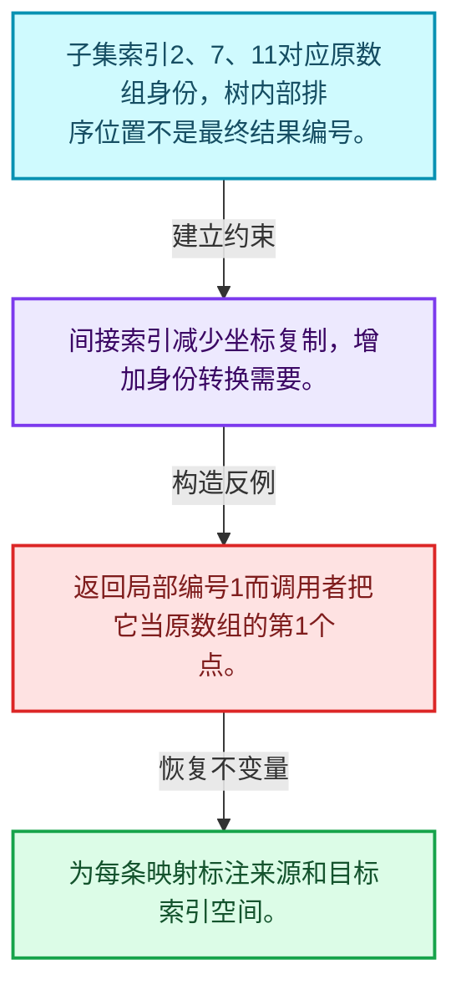
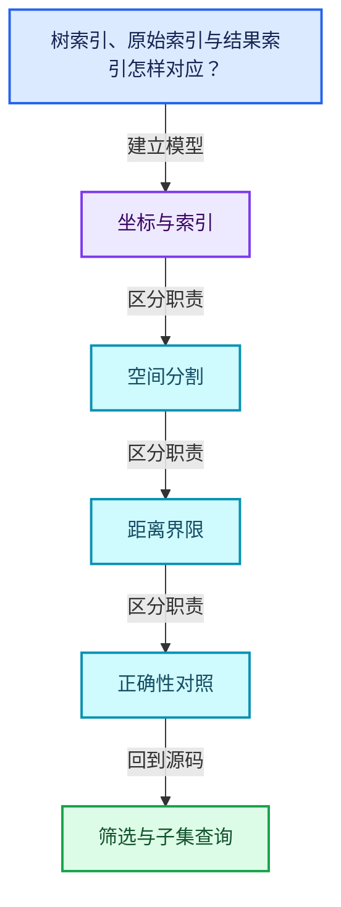
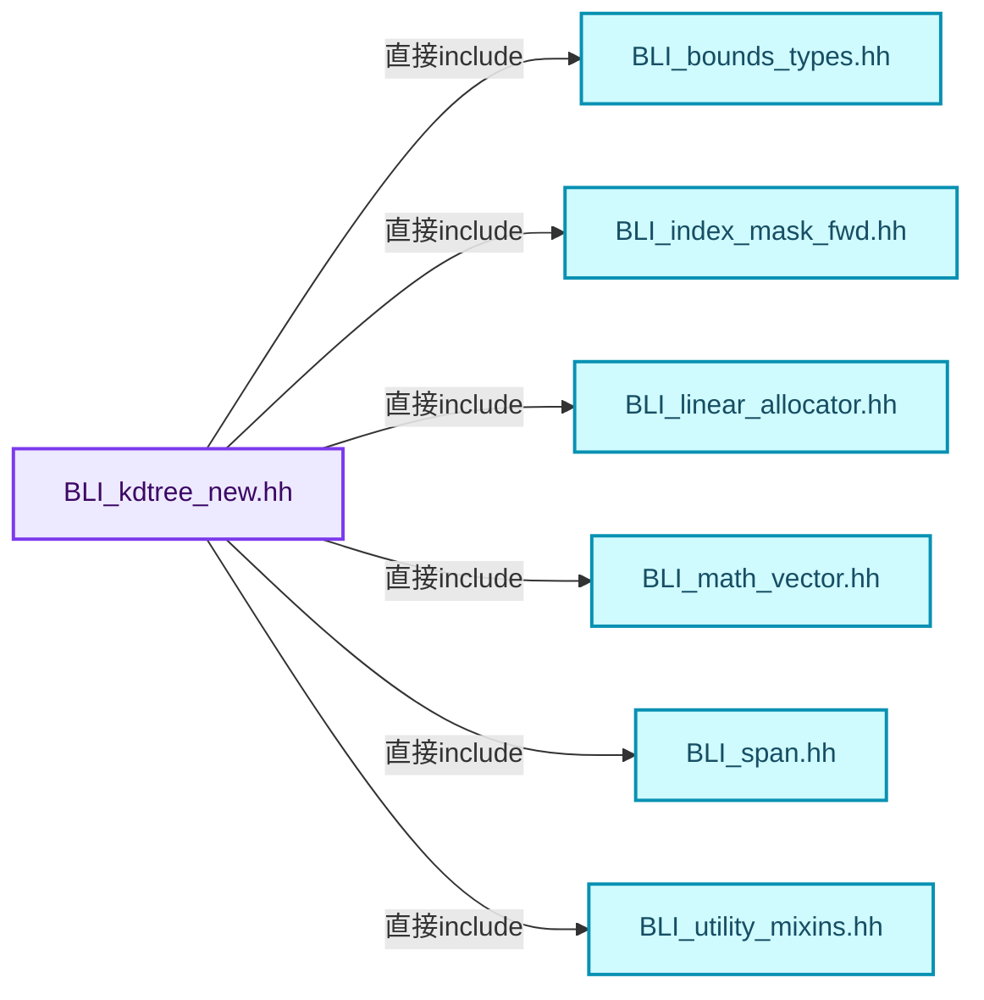
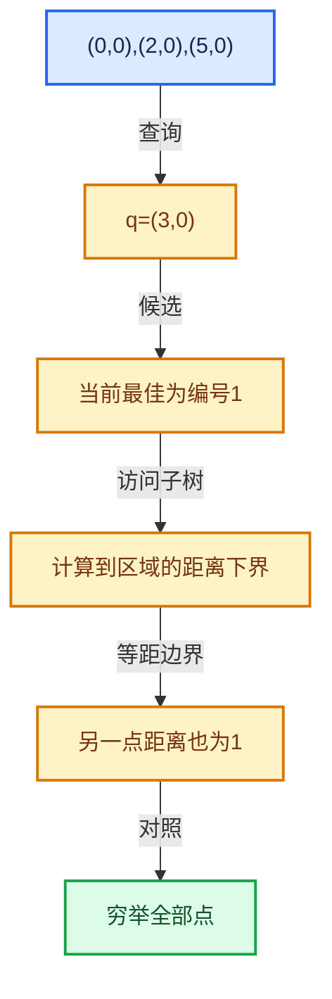

# 12-06 筛选与子集查询

[方向导航](README.md) · [总目录](../README.md) · [覆盖索引](../%E6%BA%90%E7%A0%81%E7%89%88%E6%9C%AC%E4%B8%8E%E8%A6%86%E7%9B%96%E7%B4%A2%E5%BC%95.md)

> 阅读顺序：问题与数据模型 → 语法与类型 → 源码逐行 → 调用线索 → 历史与取舍 → 推演和练习。

- 基准 HEAD：`cbda6b96c26c0dee3c3b5cbb93960c4ac06a6b30`。
- 记录日期：2026-10-14。
- 教学示例状态：正文中的推演不是本机性能实测；已运行练习见验收报告。

## 一、从问题到设计

树索引、原始索引与结果索引怎样对应？

子集构建引入间接索引，筛选条件不得破坏距离证明；结果身份需回到调用者坐标数组。

本篇把语法、数据语义和系统取舍连接起来。先证明距离下界与返回身份，再讨论布局优化和并行构建。

### 本篇独立模型与设计推理

子集索引2、7、11对应原数组身份，树内部排序位置不是最终结果编号。

设计取舍：间接索引减少坐标复制，增加身份转换需要。

最小反例：返回局部编号1而调用者把它当原数组的第1个点。

推导与处理：为每条映射标注来源和目标索引空间。



### 源码范围与相邻篇章

| 文件 | 本篇逐行范围 | 基准SHA-256 |
|---|---|---|
| [source/blender/blenlib/BLI_kdtree_new.hh](../../../../../source/blender/blenlib/BLI_kdtree_new.hh) | L545—L686 | `b94b92497ea97b794042524c44573cd3d88d01c1fc9aa86c60a8940f6be04159` |
| [source/blender/blenlib/intern/kdtree.cc](../../../../../source/blender/blenlib/intern/kdtree.cc) | L682—L907 | `039dbc5c16d992dd0c468586cb3de58c161d4f327ecdd0909ea377342d038a90` |

同一主讲文件可能分多篇覆盖；超出本篇范围的符号通过覆盖索引定位。空行与纯注释保留在源码摘录中，逐行表解释有效语句与语法边界；许可证头统一保留。

前篇：[K近邻与范围查询](05-K%E8%BF%91%E9%82%BB%E4%B8%8E%E8%8C%83%E5%9B%B4%E6%9F%A5%E8%AF%A2.md).

后篇：[Bounds与BVH对比](07-Bounds%E4%B8%8EBVH%E5%AF%B9%E6%AF%94.md).

## 二、类型、数据与阅读地图



这是概念依赖图，边表示阅读关系，不声称是运行时调用顺序。

### 直接编译依赖



箭头只表示头文件包含关系；完整调用线索见后面的符号定位表。

## 三、关键词、语法与类型角色

### 模板 template

模板把类型或常量作为生成实现的参数。读声明时先列出类型参数、非类型参数和默认值，再看使用者实际实例化了什么。模板声明本身不意味着每种T都支持其全部成员。

具体检查：把T替换为int、string、只能移动的类型，分别检查每个被调用操作是否成立。

### 依赖名称 typename

typename既可引入类型模板参数，也可告诉编译器某个依赖名称是类型。它不创建运行时对象；解析期确认语法类别与实例化期检查具体类型是不同阶段。

具体检查：区分typename T::value_type和T::size()，前者标记类型，后者是表达式。

### 约束 requires

requires表达式或requires子句限制模板参与重载的条件。它提供编译期可用性检查，不是运行时if，不能指望输入到达程序后再被这一机制验证。

具体检查：构造满足和不满足约束的两个类型，观察候选被排除而不是在函数内返回错误。

### 只读限定 const

const约束当前访问路径可做的修改。const指针、指向const的指针、const视图对象、const元素是不同位置的限定；其他别名可能仍可修改原对象。

具体检查：分别写T* const、const T*与const T* const，并画出不可修改的层次。

### 完美转发 std::forward

std::forward在转发引用模板中恢复调用者原来的值类别。它依赖推导出的模板实参；无条件move会改变左值调用者的语义。

具体检查：对同一接口分别传入左值、临时对象和const左值，记录实际重载。

### 显式静态转换 static_cast

static_cast表达编译期允许的转换，不会自动验证运行时真实类型、指针寿命或索引边界。由void指针恢复T指针时，调用者仍须保证实际存储中确有合法T对象。

具体检查：标出转换前后的类型以及正确性依据来自哪里。

### 可选值 optional

optional把不存在与存在的T区分开，T的构造和析构跟随engaged状态变化。访问前应由has_value或条件分支证明存在。

具体检查：把空Field状态与合法常量零区分，不能用某个普通值代替不存在。

### 对齐 alignof

alignof得到类型要求的地址对齐。分配足够字节后仍需把地址对齐到相应边界，内嵌缓冲也一样。

具体检查：对齐a为2的幂时可推导向上取整，但仍要考虑溢出与边界。

### 对象表示 sizeof

sizeof给出对象表示大小，不是其引用的所有堆内存总量。sizeof视图很小并不说明底层数组很小。

具体检查：分别统计容器对象、容量字节和元素拥有的间接资源。

### 构造与new表达式

普通new可能分配并构造；placement new在给定地址构造，存储由其他机制提供。失败回滚应区分两类责任。

具体检查：追踪地址来自哪里、构造何时成功、由谁析构、由谁释放。

### 内部断言 assert

断言表达开发者预期成立的内部契约，发布构建可能关闭。它不能替代对不可信输入的完整错误处理，也不保证后续操作被运行时保护。

具体检查：对每条断言构造违反条件的输入，区分调用者错误与应向用户报告的错误。

### 类型别名 using

类型别名为已有类型建立名字，不创建运行期对象。它常把模板内部使用的类型统一暴露给泛型调用者。

具体检查：展开别名直到基础类型，区分类型别名和变量声明。

## 四、真实源码与逐行讲解

源码块保持原行内容，原始行号由小节标题及逐行表给出。表中的调用定位是静态阅读辅助；重载、模板实例化、宏展开和虚调用需结合完整声明，不能仅凭词法出现证明动态调用。

### BLI_kdtree_new.hh：L545—L592

<!-- source:source/blender/blenlib/BLI_kdtree_new.hh:545:592 -->

```cpp

template<typename T>
int KDTreeNew<T>::find_nearest_n(const T &position, MutableSpan<Nearest> r_nearest) const
{
  if (this->is_empty() || r_nearest.is_empty()) {
    return 0;
  }
  kdtree::NearestNQuery<Nearest, value_type> query(r_nearest);
  this->search(query, position);
  return query.count();
}

template<typename T>
template<typename Fn>
void KDTreeNew<T>::foreach_in_radius(const T &position, const value_type radius, Fn &&fn) const
{
  if (this->is_empty()) {
    return;
  }
  kdtree::RadiusQuery<value_type, std::decay_t<Fn>> query(radius * radius, std::forward<Fn>(fn));
  this->search(query, position);
}

template<typename T>
int KDTreeNew<T>::find_in_radius(const T &position,
                                 const value_type radius,
                                 Vector<Nearest> &r_nearest) const
{
  r_nearest.clear();
  this->foreach_in_radius(position, radius, [&](const int index, const value_type distance_sq) {
    r_nearest.append({index, distance_sq});
  });
  std::sort(r_nearest.begin(), r_nearest.end(), [](const Nearest &a, const Nearest &b) {
    return a.distance_sq < b.distance_sq || (a.distance_sq == b.distance_sq && a.index < b.index);
  });
  return int(r_nearest.size());
}

template<typename T>
int KDTreeNew<T>::count_in_radius(const T &position, const value_type radius) const
{
  if (this->is_empty()) {
    return 0;
  }
  kdtree::RadiusQuery<value_type, decltype([](int, value_type) {})> query(radius * radius, {});
  this->search(query, position);
  return query.count();
}
```

本段语义重点：

- `find_nearest`：最近邻查询入口；返回索引归属和距离单位按实际API确认。
- `distance_sq`：平方距离，可避免开方，但阈值也必须使用一致单位。

| 原始行 | 语义、约束与检查 |
|---|---|
| L546 | 声明模板参数 `template<typename T>`。类型参数决定生成操作的类型，非类型参数可决定内嵌容量或编译期分支。 |
| L547 | 出现调用或函数声明 `::find_nearest_n`，对应表达式为 `int KDTreeNew<T>::find_nearest_n(const T &position, MutableSpan<Nearest> r_nearest) const`。参数求值、返回类型与重载需结合前后完整语句；静态文本引用不能证明动态目标。 |
| L548 | 连接上一行的声明或控制结构与其语句块；后续行在这个作用域中执行或声明。 |
| L549 | 判断 `this->is_empty() &#124;&#124; r_nearest.is_empty()`，成立时进入本分支，否则继续后续路径。 |
| L550 | 返回表达式 `0`。 |
| L551 | 结束当前语法单元。局部自动对象在离开其作用域时按规则销毁；这不等于所有被引用的外部数据也被释放。 |
| L552 | 出现调用或函数声明 `query`，对应表达式为 `kdtree::NearestNQuery<Nearest, value_type> query(r_nearest);`。参数求值、返回类型与重载需结合前后完整语句；静态文本引用不能证明动态目标。 |
| L553 | 出现调用或函数声明 `search`，对应表达式为 `this->search(query, position);`。参数求值、返回类型与重载需结合前后完整语句；静态文本引用不能证明动态目标。 |
| L554 | 返回表达式 `query.count()`。 |
| L555 | 结束当前语法单元。局部自动对象在离开其作用域时按规则销毁；这不等于所有被引用的外部数据也被释放。 |
| L557 | 声明模板参数 `template<typename T>`。类型参数决定生成操作的类型，非类型参数可决定内嵌容量或编译期分支。 |
| L558 | 声明模板参数 `template<typename Fn>`。类型参数决定生成操作的类型，非类型参数可决定内嵌容量或编译期分支。 |
| L559 | 出现调用或函数声明 `::foreach_in_radius`，对应表达式为 `void KDTreeNew<T>::foreach_in_radius(const T &position, const value_type radius, Fn &&fn) const`。参数求值、返回类型与重载需结合前后完整语句；静态文本引用不能证明动态目标。 |
| L560 | 连接上一行的声明或控制结构与其语句块；后续行在这个作用域中执行或声明。 |
| L561 | 判断 `this->is_empty()`，成立时进入本分支，否则继续后续路径。 |
| L562 | 结束当前函数，本路径不再执行后续语句；局部对象按作用域规则清理。 |
| L563 | 结束当前语法单元。局部自动对象在离开其作用域时按规则销毁；这不等于所有被引用的外部数据也被释放。 |
| L564 | 出现调用或函数声明 `kdtree::RadiusQuery`，对应表达式为 `kdtree::RadiusQuery<value_type, std::decay_t<Fn>> query(radius * radius, std::forward<Fn>(fn));`。参数求值、返回类型与重载需结合前后完整语句；静态文本引用不能证明动态目标。 |
| L565 | 出现调用或函数声明 `search`，对应表达式为 `this->search(query, position);`。参数求值、返回类型与重载需结合前后完整语句；静态文本引用不能证明动态目标。 |
| L566 | 结束当前语法单元。局部自动对象在离开其作用域时按规则销毁；这不等于所有被引用的外部数据也被释放。 |
| L568 | 声明模板参数 `template<typename T>`。类型参数决定生成操作的类型，非类型参数可决定内嵌容量或编译期分支。 |
| L569 | 出现调用或函数声明 `::find_in_radius`，对应表达式为 `int KDTreeNew<T>::find_in_radius(const T &position,`。参数求值、返回类型与重载需结合前后完整语句；静态文本引用不能证明动态目标。 |
| L570 | 本行是连续声明或表达式的一部分：`const value_type radius,`。与本段前后行合读；逗号、括号和限定符决定它属于参数、初始化列表还是实际计算。 |
| L571 | 本行是连续声明或表达式的一部分：`Vector<Nearest> &r_nearest) const`。与本段前后行合读；逗号、括号和限定符决定它属于参数、初始化列表还是实际计算。 |
| L572 | 连接上一行的声明或控制结构与其语句块；后续行在这个作用域中执行或声明。 |
| L573 | 出现调用或函数声明 `clear`，对应表达式为 `r_nearest.clear();`。参数求值、返回类型与重载需结合前后完整语句；静态文本引用不能证明动态目标。 |
| L574 | 本行涉及 `distance_sq`：平方距离，可避免开方，但阈值也必须使用一致单位。按此语义解读 `this->foreach_in_radius(position, radius, [&](const int index, const value_type distance_sq) {`，不要把地址、数量或状态混用。 |
| L575 | 本行涉及 `distance_sq`：平方距离，可避免开方，但阈值也必须使用一致单位。按此语义解读 `r_nearest.append({index, distance_sq})`，不要把地址、数量或状态混用。 |
| L576 | 结束当前语法单元。局部自动对象在离开其作用域时按规则销毁；这不等于所有被引用的外部数据也被释放。 |
| L577 | 出现调用或函数声明 `std::sort`，对应表达式为 `std::sort(r_nearest.begin(), r_nearest.end(), [](const Nearest &a, const Nearest &b) {`。参数求值、返回类型与重载需结合前后完整语句；静态文本引用不能证明动态目标。 |
| L578 | 返回表达式 `a.distance_sq < b.distance_sq &#124;&#124; (a.distance_sq == b.distance_sq && a.index < b.index)`。结合函数声明检查返回值是否借用原存储，借用值不会自动延长其寿命。 |
| L579 | 结束当前语法单元。局部自动对象在离开其作用域时按规则销毁；这不等于所有被引用的外部数据也被释放。 |
| L580 | 返回表达式 `int(r_nearest.size())`。 |
| L581 | 结束当前语法单元。局部自动对象在离开其作用域时按规则销毁；这不等于所有被引用的外部数据也被释放。 |
| L583 | 声明模板参数 `template<typename T>`。类型参数决定生成操作的类型，非类型参数可决定内嵌容量或编译期分支。 |
| L584 | 出现调用或函数声明 `::count_in_radius`，对应表达式为 `int KDTreeNew<T>::count_in_radius(const T &position, const value_type radius) const`。参数求值、返回类型与重载需结合前后完整语句；静态文本引用不能证明动态目标。 |
| L585 | 连接上一行的声明或控制结构与其语句块；后续行在这个作用域中执行或声明。 |
| L586 | 判断 `this->is_empty()`，成立时进入本分支，否则继续后续路径。 |
| L587 | 返回表达式 `0`。 |
| L588 | 结束当前语法单元。局部自动对象在离开其作用域时按规则销毁；这不等于所有被引用的外部数据也被释放。 |
| L589 | 出现调用或函数声明 `decltype`，对应表达式为 `kdtree::RadiusQuery<value_type, decltype([](int, value_type) {})> query(radius * radius, {});`。参数求值、返回类型与重载需结合前后完整语句；静态文本引用不能证明动态目标。 |
| L590 | 出现调用或函数声明 `search`，对应表达式为 `this->search(query, position);`。参数求值、返回类型与重载需结合前后完整语句；静态文本引用不能证明动态目标。 |
| L591 | 返回表达式 `query.count()`。 |
| L592 | 结束当前语法单元。局部自动对象在离开其作用域时按规则销毁；这不等于所有被引用的外部数据也被释放。 |

### BLI_kdtree_new.hh：L593—L684

<!-- source:source/blender/blenlib/BLI_kdtree_new.hh:593:684 -->

```cpp

template<typename T>
template<typename Query>
void KDTreeNew<T>::search(Query &query, const T &position) const
  requires kdtree::QueryType<Query, value_type>
{
  BLI_assert(!this->is_empty());
  /* Squared distance to the bounds of the tree, per dimension, which the walk below replaces
   * one dimension at a time rather than recomputing. */
  T offsets(value_type(0));
  value_type distance_sq = 0;
  for (const int dim : IndexRange(dimensions)) {
    if (position[dim] < bounds_.min[dim]) {
      offsets[dim] = math::square(bounds_.min[dim] - position[dim]);
    }
    else if (position[dim] > bounds_.max[dim]) {
      offsets[dim] = math::square(position[dim] - bounds_.max[dim]);
    }
    distance_sq += offsets[dim];
  }
  this->search_node(query, position, root_, distance_sq, offsets);
}

template<typename T>
template<typename Query>
bool KDTreeNew<T>::search_node(Query &query,
                               const T &position,
                               const Node *node,
                               const value_type distance_sq,
                               T &offsets) const
  requires kdtree::QueryType<Query, value_type>
{
  if (node->children == nullptr) {
    const int *indices = tree_indices_;
    const T *points = points_;
    for (int i = node->leaf.start; i < node->leaf.end; i++) {
      const int index = indices[i];
      const value_type point_distance_sq = math::distance_squared(position, points[index]);
      if (kdtree::keep_distance<Query>(point_distance_sq, query.max_distance_sq())) {
        if (!query.add_point(point_distance_sq, index)) {
          return false;
        }
      }
    }
    return true;
  }

  /* Both children are loaded before it is known which one to visit, so that the loads do not
   * wait on the comparison below. Picking one first makes the walk down the tree a chain of
   * dependent loads. */
  const Node *low_child = &node->children[0];
  const Node *high_child = &node->children[1];

  /* Visit the side of the split the position is on first, since what it finds there is what
   * lets the other side be skipped. */
  const int dim = node->dim;
  const value_type value = position[dim];
  const value_type to_low = value - node->split.low;
  const value_type to_high = value - node->split.high;

  /* Written as a branch rather than as a choice between two pointers, so that the processor
   * predicts which child comes next and starts loading it before the comparison has resolved.
   * Selecting the pointer instead makes the walk down the tree wait at every level. */
  const Node *far_child;
  value_type far_offset;
  if ((to_low + to_high) < 0) {
    if (!this->search_node(query, position, low_child, distance_sq, offsets)) {
      return false;
    }
    far_child = high_child;
    far_offset = math::square(to_high);
  }
  else {
    if (!this->search_node(query, position, high_child, distance_sq, offsets)) {
      return false;
    }
    far_child = low_child;
    far_offset = math::square(to_low);
  }

  /* Swap in the distance to the far side for this dimension, keeping the others. */
  const value_type previous = offsets[dim];
  const value_type far_distance_sq = distance_sq + far_offset - previous;
  if (!kdtree::keep_distance<Query>(far_distance_sq, query.max_distance_sq())) {
    return true;
  }
  offsets[dim] = far_offset;
  const bool keep_searching = this->search_node(
      query, position, far_child, far_distance_sq, offsets);
  offsets[dim] = previous;
  return keep_searching;
}
```

本段语义重点：

- `search_node`：访问一个空间子树；剪枝条件必须用正确的距离下界。
- `points_`：查询或构建使用的点坐标视图，使用期间必须满足借用契约。
- `children`：子节点入口，叶节点与内部节点按判别信息采用不同解释。
- `distance_sq`：平方距离，可避免开方，但阈值也必须使用一致单位。
- `max_distance_sq`：当前允许或最优平方距离上界，影响剪枝是否正确。

| 原始行 | 语义、约束与检查 |
|---|---|
| L594 | 声明模板参数 `template<typename T>`。类型参数决定生成操作的类型，非类型参数可决定内嵌容量或编译期分支。 |
| L595 | 声明模板参数 `template<typename Query>`。类型参数决定生成操作的类型，非类型参数可决定内嵌容量或编译期分支。 |
| L596 | 出现调用或函数声明 `::search`，对应表达式为 `void KDTreeNew<T>::search(Query &query, const T &position) const`。参数求值、返回类型与重载需结合前后完整语句；静态文本引用不能证明动态目标。 |
| L597 | 约束模板可用性：`requires kdtree::QueryType<Query, value_type>`。条件在编译期检查，不替代运行期的地址、长度和类型一致性验证。 |
| L598 | 连接上一行的声明或控制结构与其语句块；后续行在这个作用域中执行或声明。 |
| L599 | 断言约束 `BLI_assert(!this->is_empty());`。条件是后续访问的内部前置条件；发布构建可能不执行，不能把断言当作输入修复。 |
| L602 | 出现调用或函数声明 `offsets`，对应表达式为 `T offsets(value_type(0));`。参数求值、返回类型与重载需结合前后完整语句；静态文本引用不能证明动态目标。 |
| L603 | 建立或更新 `distance_sq`：平方距离，可避免开方，但阈值也必须使用一致单位。本行的具体值关系为 `value_type distance_sq = 0`；对照更新前后相应范围或状态是否一致。 |
| L604 | 按 `for (const int dim : IndexRange(dimensions))` 指定的范围或条件重复执行。对照循环变量与真实元素编号；循环内调用成本乘以实际迭代次数。 |
| L605 | 判断 `position[dim] < bounds_.min[dim]`，成立时进入本分支，否则继续后续路径。 |
| L606 | 把右侧 `math::square(bounds_.min[dim] - position[dim])` 用于初始化或更新左侧 `offsets[dim]`。声明初始化与已有对象赋值应按上下文区分；有资源的类型会调用相应特殊成员。 |
| L607 | 结束当前语法单元。局部自动对象在离开其作用域时按规则销毁；这不等于所有被引用的外部数据也被释放。 |
| L608 | 判断 `position[dim] > bounds_.max[dim]`，成立时进入本分支，否则继续后续路径。 |
| L609 | 把右侧 `math::square(position[dim] - bounds_.max[dim])` 用于初始化或更新左侧 `offsets[dim]`。声明初始化与已有对象赋值应按上下文区分；有资源的类型会调用相应特殊成员。 |
| L610 | 结束当前语法单元。局部自动对象在离开其作用域时按规则销毁；这不等于所有被引用的外部数据也被释放。 |
| L611 | 复合更新 `distance_sq += offsets[dim]`：读取左侧现有值，与右侧按`+=`对应操作组合后写回。检查数值边界、位掩码或共享状态保护；它不是新对象的构造。 |
| L612 | 结束当前语法单元。局部自动对象在离开其作用域时按规则销毁；这不等于所有被引用的外部数据也被释放。 |
| L613 | 本行使用 `search_node`：访问一个空间子树；剪枝条件必须用正确的距离下界。 |
| L614 | 结束当前语法单元。局部自动对象在离开其作用域时按规则销毁；这不等于所有被引用的外部数据也被释放。 |
| L616 | 声明模板参数 `template<typename T>`。类型参数决定生成操作的类型，非类型参数可决定内嵌容量或编译期分支。 |
| L617 | 声明模板参数 `template<typename Query>`。类型参数决定生成操作的类型，非类型参数可决定内嵌容量或编译期分支。 |
| L618 | 本行使用 `search_node`：访问一个空间子树；剪枝条件必须用正确的距离下界。 |
| L619 | 本行是连续声明或表达式的一部分：`const T &position,`。与本段前后行合读；逗号、括号和限定符决定它属于参数、初始化列表还是实际计算。 |
| L620 | 本行是连续声明或表达式的一部分：`const Node *node,`。与本段前后行合读；逗号、括号和限定符决定它属于参数、初始化列表还是实际计算。 |
| L621 | 本行涉及 `distance_sq`：平方距离，可避免开方，但阈值也必须使用一致单位。按此语义解读 `const value_type distance_sq,`，不要把地址、数量或状态混用。 |
| L622 | 本行是连续声明或表达式的一部分：`T &offsets) const`。与本段前后行合读；逗号、括号和限定符决定它属于参数、初始化列表还是实际计算。 |
| L623 | 约束模板可用性：`requires kdtree::QueryType<Query, value_type>`。条件在编译期检查，不替代运行期的地址、长度和类型一致性验证。 |
| L624 | 连接上一行的声明或控制结构与其语句块；后续行在这个作用域中执行或声明。 |
| L625 | 判断 `node->children == nullptr`，成立时进入本分支，否则继续后续路径。这里区分空地址与可用地址，但非空本身仍不能证明对象存活。 |
| L626 | 把右侧 `tree_indices_` 用于初始化或更新左侧 `const int *indices`。声明初始化与已有对象赋值应按上下文区分；有资源的类型会调用相应特殊成员。 |
| L627 | 建立或更新 `points_`：查询或构建使用的点坐标视图，使用期间必须满足借用契约。本行的具体值关系为 `const T *points = points_`；对照更新前后相应范围或状态是否一致。 |
| L628 | 按 `for (int i = node->leaf.start; i < node->leaf.end; i++)` 指定的范围或条件重复执行。对照循环变量与真实元素编号；循环内调用成本乘以实际迭代次数。 |
| L629 | 把右侧 `indices[i]` 用于初始化或更新左侧 `const int index`。声明初始化与已有对象赋值应按上下文区分；有资源的类型会调用相应特殊成员。 |
| L630 | 把右侧 `math::distance_squared(position, points[index])` 用于初始化或更新左侧 `const value_type point_distance_sq`。声明初始化与已有对象赋值应按上下文区分；有资源的类型会调用相应特殊成员。 |
| L631 | 判断 `kdtree::keep_distance<Query>(point_distance_sq, query.max_distance_sq())`，成立时进入本分支，否则继续后续路径。 |
| L632 | 判断 `!query.add_point(point_distance_sq, index)`，成立时进入本分支，否则继续后续路径。 |
| L633 | 返回表达式 `false`。这是本路径的布尔结果，具体成功、存在或状态含义由函数接口规定。 |
| L634 | 结束当前语法单元。局部自动对象在离开其作用域时按规则销毁；这不等于所有被引用的外部数据也被释放。 |
| L635 | 结束当前语法单元。局部自动对象在离开其作用域时按规则销毁；这不等于所有被引用的外部数据也被释放。 |
| L636 | 结束当前语法单元。局部自动对象在离开其作用域时按规则销毁；这不等于所有被引用的外部数据也被释放。 |
| L637 | 返回表达式 `true`。这是本路径的布尔结果，具体成功、存在或状态含义由函数接口规定。 |
| L638 | 结束当前语法单元。局部自动对象在离开其作用域时按规则销毁；这不等于所有被引用的外部数据也被释放。 |
| L643 | 建立或更新 `children`：子节点入口，叶节点与内部节点按判别信息采用不同解释。本行的具体值关系为 `const Node *low_child = &node->children[0]`；对照更新前后相应范围或状态是否一致。 |
| L644 | 建立或更新 `children`：子节点入口，叶节点与内部节点按判别信息采用不同解释。本行的具体值关系为 `const Node *high_child = &node->children[1]`；对照更新前后相应范围或状态是否一致。 |
| L648 | 把右侧 `node->dim` 用于初始化或更新左侧 `const int dim`。声明初始化与已有对象赋值应按上下文区分；有资源的类型会调用相应特殊成员。 |
| L649 | 把右侧 `position[dim]` 用于初始化或更新左侧 `const value_type value`。声明初始化与已有对象赋值应按上下文区分；有资源的类型会调用相应特殊成员。 |
| L650 | 把右侧 `value - node->split.low` 用于初始化或更新左侧 `const value_type to_low`。声明初始化与已有对象赋值应按上下文区分；有资源的类型会调用相应特殊成员。 |
| L651 | 把右侧 `value - node->split.high` 用于初始化或更新左侧 `const value_type to_high`。声明初始化与已有对象赋值应按上下文区分；有资源的类型会调用相应特殊成员。 |
| L656 | 声明成员、局部对象或完成语句 `const Node *far_child`。若为指针或引用，它本身不说明拥有；若为值对象，其构造析构由所在作用域或外层对象管理。 |
| L657 | 声明成员、局部对象或完成语句 `value_type far_offset`。若为指针或引用，它本身不说明拥有；若为值对象，其构造析构由所在作用域或外层对象管理。 |
| L658 | 判断 `(to_low + to_high) < 0`，成立时进入本分支，否则继续后续路径。 |
| L659 | 本行使用 `search_node`：访问一个空间子树；剪枝条件必须用正确的距离下界。 |
| L660 | 返回表达式 `false`。这是本路径的布尔结果，具体成功、存在或状态含义由函数接口规定。 |
| L661 | 结束当前语法单元。局部自动对象在离开其作用域时按规则销毁；这不等于所有被引用的外部数据也被释放。 |
| L662 | 把右侧 `high_child` 用于初始化或更新左侧 `far_child`。声明初始化与已有对象赋值应按上下文区分；有资源的类型会调用相应特殊成员。 |
| L663 | 把右侧 `math::square(to_high)` 用于初始化或更新左侧 `far_offset`。声明初始化与已有对象赋值应按上下文区分；有资源的类型会调用相应特殊成员。 |
| L664 | 结束当前语法单元。局部自动对象在离开其作用域时按规则销毁；这不等于所有被引用的外部数据也被释放。 |
| L665 | 处理前一条件不成立的互补路径。比较两条路径最后是否恢复同一不变量，以及是否产生不同的资源责任。 |
| L666 | 本行使用 `search_node`：访问一个空间子树；剪枝条件必须用正确的距离下界。 |
| L667 | 返回表达式 `false`。这是本路径的布尔结果，具体成功、存在或状态含义由函数接口规定。 |
| L668 | 结束当前语法单元。局部自动对象在离开其作用域时按规则销毁；这不等于所有被引用的外部数据也被释放。 |
| L669 | 把右侧 `low_child` 用于初始化或更新左侧 `far_child`。声明初始化与已有对象赋值应按上下文区分；有资源的类型会调用相应特殊成员。 |
| L670 | 把右侧 `math::square(to_low)` 用于初始化或更新左侧 `far_offset`。声明初始化与已有对象赋值应按上下文区分；有资源的类型会调用相应特殊成员。 |
| L671 | 结束当前语法单元。局部自动对象在离开其作用域时按规则销毁；这不等于所有被引用的外部数据也被释放。 |
| L674 | 把右侧 `offsets[dim]` 用于初始化或更新左侧 `const value_type previous`。声明初始化与已有对象赋值应按上下文区分；有资源的类型会调用相应特殊成员。 |
| L675 | 建立或更新 `distance_sq`：平方距离，可避免开方，但阈值也必须使用一致单位。本行的具体值关系为 `const value_type far_distance_sq = distance_sq + far_offset - previous`；对照更新前后相应范围或状态是否一致。 |
| L676 | 判断 `!kdtree::keep_distance<Query>(far_distance_sq, query.max_distance_sq())`，成立时进入本分支，否则继续后续路径。 |
| L677 | 返回表达式 `true`。这是本路径的布尔结果，具体成功、存在或状态含义由函数接口规定。 |
| L678 | 结束当前语法单元。局部自动对象在离开其作用域时按规则销毁；这不等于所有被引用的外部数据也被释放。 |
| L679 | 把右侧 `far_offset` 用于初始化或更新左侧 `offsets[dim]`。声明初始化与已有对象赋值应按上下文区分；有资源的类型会调用相应特殊成员。 |
| L680 | 本行使用 `search_node`：访问一个空间子树；剪枝条件必须用正确的距离下界。 |
| L681 | 声明成员、局部对象或完成语句 `query, position, far_child, far_distance_sq, offsets)`。若为指针或引用，它本身不说明拥有；若为值对象，其构造析构由所在作用域或外层对象管理。 |
| L682 | 把右侧 `previous` 用于初始化或更新左侧 `offsets[dim]`。声明初始化与已有对象赋值应按上下文区分；有资源的类型会调用相应特殊成员。 |
| L683 | 返回表达式 `keep_searching`。 |
| L684 | 结束当前语法单元。局部自动对象在离开其作用域时按规则销毁；这不等于所有被引用的外部数据也被释放。 |

### BLI_kdtree_new.hh：L685—L686

<!-- source:source/blender/blenlib/BLI_kdtree_new.hh:685:686 -->

```cpp

}  // namespace blender
```

| 原始行 | 语义、约束与检查 |
|---|---|
| L686 | 结束当前语法单元。局部自动对象在离开其作用域时按规则销毁；这不等于所有被引用的外部数据也被释放。 |

### kdtree.cc：L682—L724

<!-- source:source/blender/blenlib/intern/kdtree.cc:682:724 -->

```cpp

/** \} */

/* -------------------------------------------------------------------- */
/** \name #KDTreeNew
 * \{ */

template<typename T>
void KDTreeNew<T>::build(const Span<T> points,
                         const Span<int> indices,
                         const IndexMask *mask,
                         const int size,
                         const int leaf_size,
                         LinearAllocator<> &allocator)
{
  points_ = points.data();
  if (size == 0) {
    return;
  }
  const MutableSpan<int> tree_indices = allocator.allocate_array<int>(size);

  Span<int> source;
  if (mask) {
    mask->to_indices<int>(tree_indices);
    source = tree_indices;
  }
  else {
    source = indices;
  }

  TreeBuilder<T> builder(points, tree_indices, leaf_size, allocator);
  root_ = builder.build(source, bounds_);
  tree_indices_ = tree_indices.data();
  size_ = size;

#ifndef NDEBUG
  /* Only the pointer to the points is kept, so nothing can check a search result against their
   * number later. Everything the tree can return comes from here. */
  for (const int index : tree_indices) {
    BLI_assert(index >= 0 && index < points.size());
  }
#endif
}
```

本段语义重点：

- `size_`：该对象记录的元素数或长度，不能直接当作容量。
- `points_`：查询或构建使用的点坐标视图，使用期间必须满足借用契约。

| 原始行 | 语义、约束与检查 |
|---|---|
| L689 | 声明模板参数 `template<typename T>`。类型参数决定生成操作的类型，非类型参数可决定内嵌容量或编译期分支。 |
| L690 | 出现调用或函数声明 `::build`，对应表达式为 `void KDTreeNew<T>::build(const Span<T> points,`。参数求值、返回类型与重载需结合前后完整语句；静态文本引用不能证明动态目标。 |
| L691 | 本行是连续声明或表达式的一部分：`const Span<int> indices,`。与本段前后行合读；逗号、括号和限定符决定它属于参数、初始化列表还是实际计算。 |
| L692 | 本行是连续声明或表达式的一部分：`const IndexMask *mask,`。与本段前后行合读；逗号、括号和限定符决定它属于参数、初始化列表还是实际计算。 |
| L693 | 本行是连续声明或表达式的一部分：`const int size,`。与本段前后行合读；逗号、括号和限定符决定它属于参数、初始化列表还是实际计算。 |
| L694 | 本行是连续声明或表达式的一部分：`const int leaf_size,`。与本段前后行合读；逗号、括号和限定符决定它属于参数、初始化列表还是实际计算。 |
| L695 | 本行是连续声明或表达式的一部分：`LinearAllocator<> &allocator)`。与本段前后行合读；逗号、括号和限定符决定它属于参数、初始化列表还是实际计算。 |
| L696 | 连接上一行的声明或控制结构与其语句块；后续行在这个作用域中执行或声明。 |
| L697 | 建立或更新 `points_`：查询或构建使用的点坐标视图，使用期间必须满足借用契约。本行的具体值关系为 `points_ = points.data()`；对照更新前后相应范围或状态是否一致。 |
| L698 | 判断 `size == 0`，成立时进入本分支，否则继续后续路径。该边界影响可访问元素或可用容量，两者要按各变量的定义区分。 |
| L699 | 结束当前函数，本路径不再执行后续语句；局部对象按作用域规则清理。 |
| L700 | 结束当前语法单元。局部自动对象在离开其作用域时按规则销毁；这不等于所有被引用的外部数据也被释放。 |
| L701 | 把右侧 `allocator.allocate_array<int>(size)` 用于初始化或更新左侧 `const MutableSpan<int> tree_indices`。声明初始化与已有对象赋值应按上下文区分；有资源的类型会调用相应特殊成员。 |
| L703 | 声明成员、局部对象或完成语句 `Span<int> source`。若为指针或引用，它本身不说明拥有；若为值对象，其构造析构由所在作用域或外层对象管理。 |
| L704 | 判断 `mask`，成立时进入本分支，否则继续后续路径。 |
| L705 | 出现调用或函数声明 `to_indices`，对应表达式为 `mask->to_indices<int>(tree_indices);`。参数求值、返回类型与重载需结合前后完整语句；静态文本引用不能证明动态目标。 |
| L706 | 把右侧 `tree_indices` 用于初始化或更新左侧 `source`。声明初始化与已有对象赋值应按上下文区分；有资源的类型会调用相应特殊成员。 |
| L707 | 结束当前语法单元。局部自动对象在离开其作用域时按规则销毁；这不等于所有被引用的外部数据也被释放。 |
| L708 | 处理前一条件不成立的互补路径。比较两条路径最后是否恢复同一不变量，以及是否产生不同的资源责任。 |
| L709 | 把右侧 `indices` 用于初始化或更新左侧 `source`。声明初始化与已有对象赋值应按上下文区分；有资源的类型会调用相应特殊成员。 |
| L710 | 结束当前语法单元。局部自动对象在离开其作用域时按规则销毁；这不等于所有被引用的外部数据也被释放。 |
| L712 | 出现调用或函数声明 `builder`，对应表达式为 `TreeBuilder<T> builder(points, tree_indices, leaf_size, allocator);`。参数求值、返回类型与重载需结合前后完整语句；静态文本引用不能证明动态目标。 |
| L713 | 把右侧 `builder.build(source, bounds_)` 用于初始化或更新左侧 `root_`。声明初始化与已有对象赋值应按上下文区分；有资源的类型会调用相应特殊成员。 |
| L714 | 把右侧 `tree_indices.data()` 用于初始化或更新左侧 `tree_indices_`。声明初始化与已有对象赋值应按上下文区分；有资源的类型会调用相应特殊成员。 |
| L715 | 建立或更新 `size_`：该对象记录的元素数或长度，不能直接当作容量。本行的具体值关系为 `size_ = size`；对照更新前后相应范围或状态是否一致。 |
| L717 | 预处理阶段处理 #ifndef NDEBUG。它决定哪些代码进入编译，不是运行时分支；阅读行为时必须结合实际构建宏。 |
| L720 | 按 `for (const int index : tree_indices)` 指定的范围或条件重复执行。对照循环变量与真实元素编号；循环内调用成本乘以实际迭代次数。 |
| L721 | 断言约束 `BLI_assert(index >= 0 && index < points.size());`。条件是后续访问的内部前置条件；发布构建可能不执行，不能把断言当作输入修复。 |
| L722 | 结束当前语法单元。局部自动对象在离开其作用域时按规则销毁；这不等于所有被引用的外部数据也被释放。 |
| L723 | 预处理阶段处理 #endif。它决定哪些代码进入编译，不是运行时分支；阅读行为时必须结合实际构建宏。 |
| L724 | 结束当前语法单元。局部自动对象在离开其作用域时按规则销毁；这不等于所有被引用的外部数据也被释放。 |

### kdtree.cc：L725—L778

<!-- source:source/blender/blenlib/intern/kdtree.cc:725:778 -->

```cpp

template<typename T>
LinearAllocator<> &KDTreeNew<T>::make_allocator(const int points_num,
                                                const int leaf_size,
                                                void *&r_owned)
{
  /* Allocate enough for the allocator itself, the indices, and the first set of nodes. */
  const int64_t indices_size = int64_t(points_num) * sizeof(int);
  const int64_t nodes_size = int64_t(TreeBuilder<T>::node_batch_size(points_num, leaf_size)) *
                             sizeof(Node);
  /* Room for the allocator to align each of the two allocations it hands out of this. */
  const int64_t alignment_slack = 2 * alignof(std::max_align_t);
  const int64_t rest = indices_size + nodes_size + alignment_slack;
  const int64_t size = sizeof(LinearAllocator<>) + rest;

  void *buffer = MEM_new_uninitialized_aligned(size, alignof(LinearAllocator<>), __func__);
  r_owned = buffer;
  LinearAllocator<> *allocator = new (buffer) LinearAllocator<>();
  allocator->provide_buffer(static_cast<char *>(buffer) + sizeof(LinearAllocator<>), rest);
  return *allocator;
}

template<typename T> KDTreeNew<T>::~KDTreeNew()
{
  /* An allocator the caller passed is only borrowed, and outlives the tree. The tree's own sits
   * at the start of the buffer it was built in. */
  if (owned_buffer_ != nullptr) {
    std::destroy_at(static_cast<LinearAllocator<> *>(owned_buffer_));
    MEM_delete_void(owned_buffer_);
  }
}

template<typename T>
KDTreeNew<T>::KDTreeNew(const Span<T> points, LinearAllocator<> &allocator, const int leaf_size)
{
  this->build(points, Span<int>(), nullptr, int(points.size()), std::max(leaf_size, 1), allocator);
}

template<typename T>
KDTreeNew<T>::KDTreeNew(const Span<T> points,
                        const IndexMask &mask,
                        LinearAllocator<> &allocator,
                        const int leaf_size)
{
  const std::optional<IndexRange> range = mask.to_range();
  const bool every_point = range && *range == points.index_range();
  /* Avoid the indirection when the mask contains every point anyway. */
  this->build(points,
              Span<int>(),
              every_point ? nullptr : &mask,
              int(mask.size()),
              std::max(leaf_size, 1),
              allocator);
}
```

本段语义重点：

- `std::max`：取较大值，在容量计算中常用于同时满足请求量和增长策略。
- `owned_buffer_`：由对象负责释放的缓冲，不能和外部借用坐标混为一谈。

| 原始行 | 语义、约束与检查 |
|---|---|
| L726 | 声明模板参数 `template<typename T>`。类型参数决定生成操作的类型，非类型参数可决定内嵌容量或编译期分支。 |
| L727 | 出现调用或函数声明 `::make_allocator`，对应表达式为 `LinearAllocator<> &KDTreeNew<T>::make_allocator(const int points_num,`。参数求值、返回类型与重载需结合前后完整语句；静态文本引用不能证明动态目标。 |
| L728 | 本行是连续声明或表达式的一部分：`const int leaf_size,`。与本段前后行合读；逗号、括号和限定符决定它属于参数、初始化列表还是实际计算。 |
| L729 | 本行是连续声明或表达式的一部分：`void *&r_owned)`。与本段前后行合读；逗号、括号和限定符决定它属于参数、初始化列表还是实际计算。 |
| L730 | 连接上一行的声明或控制结构与其语句块；后续行在这个作用域中执行或声明。 |
| L732 | 把右侧 `int64_t(points_num) * sizeof(int)` 用于初始化或更新左侧 `const int64_t indices_size`。声明初始化与已有对象赋值应按上下文区分；有资源的类型会调用相应特殊成员。 |
| L733 | 把右侧 `int64_t(TreeBuilder<T>::node_batch_size(points_num, leaf_size)) *` 用于初始化或更新左侧 `const int64_t nodes_size`。声明初始化与已有对象赋值应按上下文区分；有资源的类型会调用相应特殊成员。 |
| L734 | 出现调用或函数声明 `sizeof`，对应表达式为 `sizeof(Node);`。参数求值、返回类型与重载需结合前后完整语句；静态文本引用不能证明动态目标。 |
| L736 | 把右侧 `2 * alignof(std::max_align_t)` 用于初始化或更新左侧 `const int64_t alignment_slack`。声明初始化与已有对象赋值应按上下文区分；有资源的类型会调用相应特殊成员。 |
| L737 | 把右侧 `indices_size + nodes_size + alignment_slack` 用于初始化或更新左侧 `const int64_t rest`。声明初始化与已有对象赋值应按上下文区分；有资源的类型会调用相应特殊成员。 |
| L738 | 把右侧 `sizeof(LinearAllocator<>) + rest` 用于初始化或更新左侧 `const int64_t size`。声明初始化与已有对象赋值应按上下文区分；有资源的类型会调用相应特殊成员。 |
| L740 | 把右侧 `MEM_new_uninitialized_aligned(size, alignof(LinearAllocator<>), __func__)` 用于初始化或更新左侧 `void *buffer`。声明初始化与已有对象赋值应按上下文区分；有资源的类型会调用相应特殊成员。 |
| L741 | 把右侧 `buffer` 用于初始化或更新左侧 `r_owned`。声明初始化与已有对象赋值应按上下文区分；有资源的类型会调用相应特殊成员。 |
| L742 | 把右侧 `new (buffer) LinearAllocator<>()` 用于初始化或更新左侧 `LinearAllocator<> *allocator`。声明初始化与已有对象赋值应按上下文区分；有资源的类型会调用相应特殊成员。 |
| L743 | 出现调用或函数声明 `provide_buffer`，对应表达式为 `allocator->provide_buffer(static_cast<char *>(buffer) + sizeof(LinearAllocator<>), rest);`。参数求值、返回类型与重载需结合前后完整语句；静态文本引用不能证明动态目标。 |
| L744 | 返回表达式 `*allocator`。结合函数声明检查返回值是否借用原存储，借用值不会自动延长其寿命。 |
| L745 | 结束当前语法单元。局部自动对象在离开其作用域时按规则销毁；这不等于所有被引用的外部数据也被释放。 |
| L747 | 声明模板参数 `template<typename T> KDTreeNew<T>::~KDTreeNew()`。类型参数决定生成操作的类型，非类型参数可决定内嵌容量或编译期分支。 |
| L748 | 连接上一行的声明或控制结构与其语句块；后续行在这个作用域中执行或声明。 |
| L751 | 判断 `owned_buffer_ != nullptr`，成立时进入本分支，否则继续后续路径。这里区分空地址与可用地址，但非空本身仍不能证明对象存活。 |
| L752 | 本行涉及 `owned_buffer_`：由对象负责释放的缓冲，不能和外部借用坐标混为一谈。按此语义解读 `std::destroy_at(static_cast<LinearAllocator<> *>(owned_buffer_))`，不要把地址、数量或状态混用。 |
| L753 | 本行涉及 `owned_buffer_`：由对象负责释放的缓冲，不能和外部借用坐标混为一谈。按此语义解读 `MEM_delete_void(owned_buffer_)`，不要把地址、数量或状态混用。 |
| L754 | 结束当前语法单元。局部自动对象在离开其作用域时按规则销毁；这不等于所有被引用的外部数据也被释放。 |
| L755 | 结束当前语法单元。局部自动对象在离开其作用域时按规则销毁；这不等于所有被引用的外部数据也被释放。 |
| L757 | 声明模板参数 `template<typename T>`。类型参数决定生成操作的类型，非类型参数可决定内嵌容量或编译期分支。 |
| L758 | 出现调用或函数声明 `::KDTreeNew`，对应表达式为 `KDTreeNew<T>::KDTreeNew(const Span<T> points, LinearAllocator<> &allocator, const int leaf_size)`。参数求值、返回类型与重载需结合前后完整语句；静态文本引用不能证明动态目标。 |
| L759 | 连接上一行的声明或控制结构与其语句块；后续行在这个作用域中执行或声明。 |
| L760 | 本行使用 `std::max`：取较大值，在容量计算中常用于同时满足请求量和增长策略。 |
| L761 | 结束当前语法单元。局部自动对象在离开其作用域时按规则销毁；这不等于所有被引用的外部数据也被释放。 |
| L763 | 声明模板参数 `template<typename T>`。类型参数决定生成操作的类型，非类型参数可决定内嵌容量或编译期分支。 |
| L764 | 出现调用或函数声明 `::KDTreeNew`，对应表达式为 `KDTreeNew<T>::KDTreeNew(const Span<T> points,`。参数求值、返回类型与重载需结合前后完整语句；静态文本引用不能证明动态目标。 |
| L765 | 本行是连续声明或表达式的一部分：`const IndexMask &mask,`。与本段前后行合读；逗号、括号和限定符决定它属于参数、初始化列表还是实际计算。 |
| L766 | 本行是连续声明或表达式的一部分：`LinearAllocator<> &allocator,`。与本段前后行合读；逗号、括号和限定符决定它属于参数、初始化列表还是实际计算。 |
| L767 | 本行是连续声明或表达式的一部分：`const int leaf_size)`。与本段前后行合读；逗号、括号和限定符决定它属于参数、初始化列表还是实际计算。 |
| L768 | 连接上一行的声明或控制结构与其语句块；后续行在这个作用域中执行或声明。 |
| L769 | 把右侧 `mask.to_range()` 用于初始化或更新左侧 `const std::optional<IndexRange> range`。声明初始化与已有对象赋值应按上下文区分；有资源的类型会调用相应特殊成员。 |
| L770 | 把右侧 `range && *range == points.index_range()` 用于初始化或更新左侧 `const bool every_point`。声明初始化与已有对象赋值应按上下文区分；有资源的类型会调用相应特殊成员。 |
| L772 | 出现调用或函数声明 `build`，对应表达式为 `this->build(points,`。参数求值、返回类型与重载需结合前后完整语句；静态文本引用不能证明动态目标。 |
| L773 | 出现调用或函数声明 `Span`，对应表达式为 `Span<int>(),`。参数求值、返回类型与重载需结合前后完整语句；静态文本引用不能证明动态目标。 |
| L774 | 本行是连续声明或表达式的一部分：`every_point ? nullptr : &mask,`。与本段前后行合读；逗号、括号和限定符决定它属于参数、初始化列表还是实际计算。 |
| L775 | 出现调用或函数声明 `int`，对应表达式为 `int(mask.size()),`。参数求值、返回类型与重载需结合前后完整语句；静态文本引用不能证明动态目标。 |
| L776 | 本行使用 `std::max`：取较大值，在容量计算中常用于同时满足请求量和增长策略。 |
| L777 | 声明成员、局部对象或完成语句 `allocator)`。若为指针或引用，它本身不说明拥有；若为值对象，其构造析构由所在作用域或外层对象管理。 |
| L778 | 结束当前语法单元。局部自动对象在离开其作用域时按规则销毁；这不等于所有被引用的外部数据也被释放。 |

### kdtree.cc：L779—L824

<!-- source:source/blender/blenlib/intern/kdtree.cc:779:824 -->

```cpp

template<typename T>
KDTreeNew<T>::KDTreeNew(const Span<T> points,
                        const Span<int> indices,
                        LinearAllocator<> &allocator,
                        const int leaf_size)
{
  this->build(points, indices, nullptr, int(indices.size()), std::max(leaf_size, 1), allocator);
}

template<typename T> KDTreeNew<T>::KDTreeNew(const Span<T> points, const int leaf_size)
{
  this->build(points,
              Span<int>(),
              nullptr,
              int(points.size()),
              std::max(leaf_size, 1),
              make_allocator(int(points.size()), std::max(leaf_size, 1), owned_buffer_));
}

template<typename T>
KDTreeNew<T>::KDTreeNew(const Span<T> points, const IndexMask &mask, const int leaf_size)
{
  const std::optional<IndexRange> range = mask.to_range();
  const bool every_point = range && *range == points.index_range();
  this->build(points,
              Span<int>(),
              every_point ? nullptr : &mask,
              int(mask.size()),
              std::max(leaf_size, 1),
              make_allocator(int(mask.size()), std::max(leaf_size, 1), owned_buffer_));
}

template<typename T>
KDTreeNew<T>::KDTreeNew(const Span<T> points, const Span<int> indices, const int leaf_size)
{
  this->build(points,
              indices,
              nullptr,
              int(indices.size()),
              std::max(leaf_size, 1),
              make_allocator(int(indices.size()), std::max(leaf_size, 1), owned_buffer_));
}

template class KDTreeNew<float2>;
template class KDTreeNew<float3>;
```

本段语义重点：

- `std::max`：取较大值，在容量计算中常用于同时满足请求量和增长策略。
- `owned_buffer_`：由对象负责释放的缓冲，不能和外部借用坐标混为一谈。

| 原始行 | 语义、约束与检查 |
|---|---|
| L780 | 声明模板参数 `template<typename T>`。类型参数决定生成操作的类型，非类型参数可决定内嵌容量或编译期分支。 |
| L781 | 出现调用或函数声明 `::KDTreeNew`，对应表达式为 `KDTreeNew<T>::KDTreeNew(const Span<T> points,`。参数求值、返回类型与重载需结合前后完整语句；静态文本引用不能证明动态目标。 |
| L782 | 本行是连续声明或表达式的一部分：`const Span<int> indices,`。与本段前后行合读；逗号、括号和限定符决定它属于参数、初始化列表还是实际计算。 |
| L783 | 本行是连续声明或表达式的一部分：`LinearAllocator<> &allocator,`。与本段前后行合读；逗号、括号和限定符决定它属于参数、初始化列表还是实际计算。 |
| L784 | 本行是连续声明或表达式的一部分：`const int leaf_size)`。与本段前后行合读；逗号、括号和限定符决定它属于参数、初始化列表还是实际计算。 |
| L785 | 连接上一行的声明或控制结构与其语句块；后续行在这个作用域中执行或声明。 |
| L786 | 本行使用 `std::max`：取较大值，在容量计算中常用于同时满足请求量和增长策略。 |
| L787 | 结束当前语法单元。局部自动对象在离开其作用域时按规则销毁；这不等于所有被引用的外部数据也被释放。 |
| L789 | 声明模板参数 `template<typename T> KDTreeNew<T>::KDTreeNew(const Span<T> points, const int leaf_size)`。类型参数决定生成操作的类型，非类型参数可决定内嵌容量或编译期分支。 |
| L790 | 连接上一行的声明或控制结构与其语句块；后续行在这个作用域中执行或声明。 |
| L791 | 出现调用或函数声明 `build`，对应表达式为 `this->build(points,`。参数求值、返回类型与重载需结合前后完整语句；静态文本引用不能证明动态目标。 |
| L792 | 出现调用或函数声明 `Span`，对应表达式为 `Span<int>(),`。参数求值、返回类型与重载需结合前后完整语句；静态文本引用不能证明动态目标。 |
| L793 | 本行是连续声明或表达式的一部分：`nullptr,`。与本段前后行合读；逗号、括号和限定符决定它属于参数、初始化列表还是实际计算。 |
| L794 | 出现调用或函数声明 `int`，对应表达式为 `int(points.size()),`。参数求值、返回类型与重载需结合前后完整语句；静态文本引用不能证明动态目标。 |
| L795 | 本行使用 `std::max`：取较大值，在容量计算中常用于同时满足请求量和增长策略。 |
| L796 | 本行使用 `std::max`：取较大值，在容量计算中常用于同时满足请求量和增长策略。 |
| L797 | 结束当前语法单元。局部自动对象在离开其作用域时按规则销毁；这不等于所有被引用的外部数据也被释放。 |
| L799 | 声明模板参数 `template<typename T>`。类型参数决定生成操作的类型，非类型参数可决定内嵌容量或编译期分支。 |
| L800 | 出现调用或函数声明 `::KDTreeNew`，对应表达式为 `KDTreeNew<T>::KDTreeNew(const Span<T> points, const IndexMask &mask, const int leaf_size)`。参数求值、返回类型与重载需结合前后完整语句；静态文本引用不能证明动态目标。 |
| L801 | 连接上一行的声明或控制结构与其语句块；后续行在这个作用域中执行或声明。 |
| L802 | 把右侧 `mask.to_range()` 用于初始化或更新左侧 `const std::optional<IndexRange> range`。声明初始化与已有对象赋值应按上下文区分；有资源的类型会调用相应特殊成员。 |
| L803 | 把右侧 `range && *range == points.index_range()` 用于初始化或更新左侧 `const bool every_point`。声明初始化与已有对象赋值应按上下文区分；有资源的类型会调用相应特殊成员。 |
| L804 | 出现调用或函数声明 `build`，对应表达式为 `this->build(points,`。参数求值、返回类型与重载需结合前后完整语句；静态文本引用不能证明动态目标。 |
| L805 | 出现调用或函数声明 `Span`，对应表达式为 `Span<int>(),`。参数求值、返回类型与重载需结合前后完整语句；静态文本引用不能证明动态目标。 |
| L806 | 本行是连续声明或表达式的一部分：`every_point ? nullptr : &mask,`。与本段前后行合读；逗号、括号和限定符决定它属于参数、初始化列表还是实际计算。 |
| L807 | 出现调用或函数声明 `int`，对应表达式为 `int(mask.size()),`。参数求值、返回类型与重载需结合前后完整语句；静态文本引用不能证明动态目标。 |
| L808 | 本行使用 `std::max`：取较大值，在容量计算中常用于同时满足请求量和增长策略。 |
| L809 | 本行使用 `std::max`：取较大值，在容量计算中常用于同时满足请求量和增长策略。 |
| L810 | 结束当前语法单元。局部自动对象在离开其作用域时按规则销毁；这不等于所有被引用的外部数据也被释放。 |
| L812 | 声明模板参数 `template<typename T>`。类型参数决定生成操作的类型，非类型参数可决定内嵌容量或编译期分支。 |
| L813 | 出现调用或函数声明 `::KDTreeNew`，对应表达式为 `KDTreeNew<T>::KDTreeNew(const Span<T> points, const Span<int> indices, const int leaf_size)`。参数求值、返回类型与重载需结合前后完整语句；静态文本引用不能证明动态目标。 |
| L814 | 连接上一行的声明或控制结构与其语句块；后续行在这个作用域中执行或声明。 |
| L815 | 出现调用或函数声明 `build`，对应表达式为 `this->build(points,`。参数求值、返回类型与重载需结合前后完整语句；静态文本引用不能证明动态目标。 |
| L816 | 本行是连续声明或表达式的一部分：`indices,`。与本段前后行合读；逗号、括号和限定符决定它属于参数、初始化列表还是实际计算。 |
| L817 | 本行是连续声明或表达式的一部分：`nullptr,`。与本段前后行合读；逗号、括号和限定符决定它属于参数、初始化列表还是实际计算。 |
| L818 | 出现调用或函数声明 `int`，对应表达式为 `int(indices.size()),`。参数求值、返回类型与重载需结合前后完整语句；静态文本引用不能证明动态目标。 |
| L819 | 本行使用 `std::max`：取较大值，在容量计算中常用于同时满足请求量和增长策略。 |
| L820 | 本行使用 `std::max`：取较大值，在容量计算中常用于同时满足请求量和增长策略。 |
| L821 | 结束当前语法单元。局部自动对象在离开其作用域时按规则销毁；这不等于所有被引用的外部数据也被释放。 |
| L823 | 声明模板参数 `template class KDTreeNew<float2>;`。类型参数决定生成操作的类型，非类型参数可决定内嵌容量或编译期分支。 |
| L824 | 声明模板参数 `template class KDTreeNew<float3>;`。类型参数决定生成操作的类型，非类型参数可决定内嵌容量或编译期分支。 |

### kdtree.cc：L825—L878

<!-- source:source/blender/blenlib/intern/kdtree.cc:825:878 -->

```cpp

/** \} */

/* -------------------------------------------------------------------- */
/** \name #calc_duplicates
 * \{ */

namespace kdtree {

template<typename T, typename ForeachFn>
static int calc_duplicates_impl(const KDTreeNew<T> &tree,
                                const typename T::base_type range,
                                const MutableSpan<int> duplicates,
                                const ForeachFn foreach_index)
{
  using value_type = typename T::base_type;
  const T *points = tree.points();
  int found = 0;
  foreach_index([&](const int index) {
    BLI_assert(index < duplicates.size());
    /* Skip points that are already merged into another point. Points that were preset to their
     * own index are not merged themselves, but can still be merged into. */
    if (duplicates[index] != -1 && duplicates[index] != index) {
      return;
    }
    const int found_before = found;
    tree.foreach_in_radius(
        points[index], range, [&](const int other, const value_type /*distance_sq*/) {
          if (other != index && duplicates[other] == -1) {
            duplicates[other] = index;
            found++;
          }
        });
    if (found != found_before) {
      /* Mark as a target so the merged points don't form chains. */
      duplicates[index] = index;
    }
  });
  return found;
}

template<typename T>
int calc_duplicates(const KDTreeNew<T> &tree,
                    const typename T::base_type range,
                    const Span<int> visit_order,
                    const MutableSpan<int> duplicates)
{
  BLI_assert(visit_order.size() == tree.size());
  return calc_duplicates_impl(tree, range, duplicates, [&](const auto fn) {
    for (const int index : visit_order) {
      fn(index);
    }
  });
}
```

本段语义重点：

- 分支证据 `duplicates[index] != -1 && duplicates[index] != index)`：分别推演条件成立与不成立，核对相同出口处的状态。
- 分支证据 `other != index && duplicates[other] == -1)`：分别推演条件成立与不成立，核对相同出口处的状态。

| 原始行 | 语义、约束与检查 |
|---|---|
| L832 | 把后续声明放入 kdtree 命名空间，影响名称查找和符号归属，不创建运行时对象。 |
| L834 | 声明模板参数 `template<typename T, typename ForeachFn>`。类型参数决定生成操作的类型，非类型参数可决定内嵌容量或编译期分支。 |
| L835 | 出现调用或函数声明 `calc_duplicates_impl`，对应表达式为 `static int calc_duplicates_impl(const KDTreeNew<T> &tree,`。参数求值、返回类型与重载需结合前后完整语句；静态文本引用不能证明动态目标。 |
| L836 | 本行是连续声明或表达式的一部分：`const typename T::base_type range,`。与本段前后行合读；逗号、括号和限定符决定它属于参数、初始化列表还是实际计算。 |
| L837 | 本行是连续声明或表达式的一部分：`const MutableSpan<int> duplicates,`。与本段前后行合读；逗号、括号和限定符决定它属于参数、初始化列表还是实际计算。 |
| L838 | 本行是连续声明或表达式的一部分：`const ForeachFn foreach_index)`。与本段前后行合读；逗号、括号和限定符决定它属于参数、初始化列表还是实际计算。 |
| L839 | 连接上一行的声明或控制结构与其语句块；后续行在这个作用域中执行或声明。 |
| L840 | 定义类型别名 `using value_type = typename T::base_type`，为模板接口或内部实现统一命名；本行不分配该类型对象。 |
| L841 | 把右侧 `tree.points()` 用于初始化或更新左侧 `const T *points`。声明初始化与已有对象赋值应按上下文区分；有资源的类型会调用相应特殊成员。 |
| L842 | 把右侧 `0` 用于初始化或更新左侧 `int found`。声明初始化与已有对象赋值应按上下文区分；有资源的类型会调用相应特殊成员。 |
| L843 | 出现调用或函数声明 `foreach_index`，对应表达式为 `foreach_index([&](const int index) {`。参数求值、返回类型与重载需结合前后完整语句；静态文本引用不能证明动态目标。 |
| L844 | 断言约束 `BLI_assert(index < duplicates.size());`。条件是后续访问的内部前置条件；发布构建可能不执行，不能把断言当作输入修复。 |
| L847 | 判断 `duplicates[index] != -1 && duplicates[index] != index`，成立时进入本分支，否则继续后续路径。 |
| L848 | 结束当前函数，本路径不再执行后续语句；局部对象按作用域规则清理。 |
| L849 | 结束当前语法单元。局部自动对象在离开其作用域时按规则销毁；这不等于所有被引用的外部数据也被释放。 |
| L850 | 把右侧 `found` 用于初始化或更新左侧 `const int found_before`。声明初始化与已有对象赋值应按上下文区分；有资源的类型会调用相应特殊成员。 |
| L851 | 出现调用或函数声明 `foreach_in_radius`，对应表达式为 `tree.foreach_in_radius(`。参数求值、返回类型与重载需结合前后完整语句；静态文本引用不能证明动态目标。 |
| L852 | 本行是连续声明或表达式的一部分：`points[index], range, [&](const int other, const value_type ) {`。与本段前后行合读；逗号、括号和限定符决定它属于参数、初始化列表还是实际计算。 |
| L853 | 判断 `other != index && duplicates[other] == -1`，成立时进入本分支，否则继续后续路径。 |
| L854 | 把右侧 `index` 用于初始化或更新左侧 `duplicates[other]`。声明初始化与已有对象赋值应按上下文区分；有资源的类型会调用相应特殊成员。 |
| L855 | 递增或递减现有状态：`found++;`。这改变计数或游标；检查边界、计数单位，以及并发访问是否有相应保护。 |
| L856 | 结束当前语法单元。局部自动对象在离开其作用域时按规则销毁；这不等于所有被引用的外部数据也被释放。 |
| L857 | 结束当前语法单元。局部自动对象在离开其作用域时按规则销毁；这不等于所有被引用的外部数据也被释放。 |
| L858 | 判断 `found != found_before`，成立时进入本分支，否则继续后续路径。 |
| L860 | 把右侧 `index` 用于初始化或更新左侧 `duplicates[index]`。声明初始化与已有对象赋值应按上下文区分；有资源的类型会调用相应特殊成员。 |
| L861 | 结束当前语法单元。局部自动对象在离开其作用域时按规则销毁；这不等于所有被引用的外部数据也被释放。 |
| L862 | 结束当前语法单元。局部自动对象在离开其作用域时按规则销毁；这不等于所有被引用的外部数据也被释放。 |
| L863 | 返回表达式 `found`。 |
| L864 | 结束当前语法单元。局部自动对象在离开其作用域时按规则销毁；这不等于所有被引用的外部数据也被释放。 |
| L866 | 声明模板参数 `template<typename T>`。类型参数决定生成操作的类型，非类型参数可决定内嵌容量或编译期分支。 |
| L867 | 出现调用或函数声明 `calc_duplicates`，对应表达式为 `int calc_duplicates(const KDTreeNew<T> &tree,`。参数求值、返回类型与重载需结合前后完整语句；静态文本引用不能证明动态目标。 |
| L868 | 本行是连续声明或表达式的一部分：`const typename T::base_type range,`。与本段前后行合读；逗号、括号和限定符决定它属于参数、初始化列表还是实际计算。 |
| L869 | 本行是连续声明或表达式的一部分：`const Span<int> visit_order,`。与本段前后行合读；逗号、括号和限定符决定它属于参数、初始化列表还是实际计算。 |
| L870 | 本行是连续声明或表达式的一部分：`const MutableSpan<int> duplicates)`。与本段前后行合读；逗号、括号和限定符决定它属于参数、初始化列表还是实际计算。 |
| L871 | 连接上一行的声明或控制结构与其语句块；后续行在这个作用域中执行或声明。 |
| L872 | 断言约束 `BLI_assert(visit_order.size() == tree.size());`。条件是后续访问的内部前置条件；发布构建可能不执行，不能把断言当作输入修复。 |
| L873 | 返回表达式 `calc_duplicates_impl(tree, range, duplicates, [&](const auto fn) {`。 |
| L874 | 按 `for (const int index : visit_order)` 指定的范围或条件重复执行。对照循环变量与真实元素编号；循环内调用成本乘以实际迭代次数。 |
| L875 | 出现调用或函数声明 `fn`，对应表达式为 `fn(index);`。参数求值、返回类型与重载需结合前后完整语句；静态文本引用不能证明动态目标。 |
| L876 | 结束当前语法单元。局部自动对象在离开其作用域时按规则销毁；这不等于所有被引用的外部数据也被释放。 |
| L877 | 结束当前语法单元。局部自动对象在离开其作用域时按规则销毁；这不等于所有被引用的外部数据也被释放。 |
| L878 | 结束当前语法单元。局部自动对象在离开其作用域时按规则销毁；这不等于所有被引用的外部数据也被释放。 |

### kdtree.cc：L879—L907

<!-- source:source/blender/blenlib/intern/kdtree.cc:879:907 -->

```cpp

template<typename T>
int calc_duplicates(const KDTreeNew<T> &tree,
                    const typename T::base_type range,
                    const IndexMask &visit_order,
                    const MutableSpan<int> duplicates)
{
  BLI_assert(visit_order.size() == tree.size());
  return calc_duplicates_impl(tree, range, duplicates, [&](const auto fn) {
    visit_order.foreach_index_optimized<int>(fn);
  });
}

template int calc_duplicates(const KDTreeNew<float2> &, float, Span<int>, MutableSpan<int>);
template int calc_duplicates(const KDTreeNew<float3> &, float, Span<int>, MutableSpan<int>);
template int calc_duplicates(const KDTreeNew<float2> &,
                             float,
                             const IndexMask &,
                             MutableSpan<int>);
template int calc_duplicates(const KDTreeNew<float3> &,
                             float,
                             const IndexMask &,
                             MutableSpan<int>);

}  // namespace kdtree

/** \} */

}  // namespace blender
```

| 原始行 | 语义、约束与检查 |
|---|---|
| L880 | 声明模板参数 `template<typename T>`。类型参数决定生成操作的类型，非类型参数可决定内嵌容量或编译期分支。 |
| L881 | 出现调用或函数声明 `calc_duplicates`，对应表达式为 `int calc_duplicates(const KDTreeNew<T> &tree,`。参数求值、返回类型与重载需结合前后完整语句；静态文本引用不能证明动态目标。 |
| L882 | 本行是连续声明或表达式的一部分：`const typename T::base_type range,`。与本段前后行合读；逗号、括号和限定符决定它属于参数、初始化列表还是实际计算。 |
| L883 | 本行是连续声明或表达式的一部分：`const IndexMask &visit_order,`。与本段前后行合读；逗号、括号和限定符决定它属于参数、初始化列表还是实际计算。 |
| L884 | 本行是连续声明或表达式的一部分：`const MutableSpan<int> duplicates)`。与本段前后行合读；逗号、括号和限定符决定它属于参数、初始化列表还是实际计算。 |
| L885 | 连接上一行的声明或控制结构与其语句块；后续行在这个作用域中执行或声明。 |
| L886 | 断言约束 `BLI_assert(visit_order.size() == tree.size());`。条件是后续访问的内部前置条件；发布构建可能不执行，不能把断言当作输入修复。 |
| L887 | 返回表达式 `calc_duplicates_impl(tree, range, duplicates, [&](const auto fn) {`。 |
| L888 | 出现调用或函数声明 `foreach_index_optimized`，对应表达式为 `visit_order.foreach_index_optimized<int>(fn);`。参数求值、返回类型与重载需结合前后完整语句；静态文本引用不能证明动态目标。 |
| L889 | 结束当前语法单元。局部自动对象在离开其作用域时按规则销毁；这不等于所有被引用的外部数据也被释放。 |
| L890 | 结束当前语法单元。局部自动对象在离开其作用域时按规则销毁；这不等于所有被引用的外部数据也被释放。 |
| L892 | 声明模板参数 `template int calc_duplicates(const KDTreeNew<float2> &, float, Span<int>, MutableSpan<int>);`。类型参数决定生成操作的类型，非类型参数可决定内嵌容量或编译期分支。 |
| L893 | 声明模板参数 `template int calc_duplicates(const KDTreeNew<float3> &, float, Span<int>, MutableSpan<int>);`。类型参数决定生成操作的类型，非类型参数可决定内嵌容量或编译期分支。 |
| L894 | 声明模板参数 `template int calc_duplicates(const KDTreeNew<float2> &,`。类型参数决定生成操作的类型，非类型参数可决定内嵌容量或编译期分支。 |
| L895 | 本行是连续声明或表达式的一部分：`float,`。与本段前后行合读；逗号、括号和限定符决定它属于参数、初始化列表还是实际计算。 |
| L896 | 本行是连续声明或表达式的一部分：`const IndexMask &,`。与本段前后行合读；逗号、括号和限定符决定它属于参数、初始化列表还是实际计算。 |
| L897 | 声明成员、局部对象或完成语句 `MutableSpan<int>)`。若为指针或引用，它本身不说明拥有；若为值对象，其构造析构由所在作用域或外层对象管理。 |
| L898 | 声明模板参数 `template int calc_duplicates(const KDTreeNew<float3> &,`。类型参数决定生成操作的类型，非类型参数可决定内嵌容量或编译期分支。 |
| L899 | 本行是连续声明或表达式的一部分：`float,`。与本段前后行合读；逗号、括号和限定符决定它属于参数、初始化列表还是实际计算。 |
| L900 | 本行是连续声明或表达式的一部分：`const IndexMask &,`。与本段前后行合读；逗号、括号和限定符决定它属于参数、初始化列表还是实际计算。 |
| L901 | 声明成员、局部对象或完成语句 `MutableSpan<int>)`。若为指针或引用，它本身不说明拥有；若为值对象，其构造析构由所在作用域或外层对象管理。 |
| L903 | 结束当前语法单元。局部自动对象在离开其作用域时按规则销毁；这不等于所有被引用的外部数据也被释放。 |
| L907 | 结束当前语法单元。局部自动对象在离开其作用域时按规则销毁；这不等于所有被引用的外部数据也被释放。 |

## 五、接口定位、调用线索与生命周期

### 本篇声明与实现入口

| 源码位置 | 实际声明片段 |
|---|---|
| [BLI_kdtree_new.hh:L602](../../../../../source/blender/blenlib/BLI_kdtree_new.hh#L602) | `T offsets(value_type(0));` |
| [BLI_kdtree_new.hh:L608](../../../../../source/blender/blenlib/BLI_kdtree_new.hh#L608) | `else if (position[dim] > bounds_.max[dim])` |
| [kdtree.cc:L712](../../../../../source/blender/blenlib/intern/kdtree.cc#L712) | `TreeBuilder<T> builder(points, tree_indices, leaf_size, allocator);` |
| [kdtree.cc:L753](../../../../../source/blender/blenlib/intern/kdtree.cc#L753) | `MEM_delete_void(owned_buffer_);` |
| [kdtree.cc:L835](../../../../../source/blender/blenlib/intern/kdtree.cc#L835) | `static int calc_duplicates_impl(const KDTreeNew<T> &tree,` |
| [kdtree.cc:L867](../../../../../source/blender/blenlib/intern/kdtree.cc#L867) | `int calc_duplicates(const KDTreeNew<T> &tree,` |
| [kdtree.cc:L881](../../../../../source/blender/blenlib/intern/kdtree.cc#L881) | `int calc_duplicates(const KDTreeNew<T> &tree,` |
| [kdtree.cc:L892](../../../../../source/blender/blenlib/intern/kdtree.cc#L892) | `template int calc_duplicates(const KDTreeNew<float2> &, float, Span<int>, MutableSpan<int>);` |
| [kdtree.cc:L893](../../../../../source/blender/blenlib/intern/kdtree.cc#L893) | `template int calc_duplicates(const KDTreeNew<float3> &, float, Span<int>, MutableSpan<int>);` |
| [kdtree.cc:L894](../../../../../source/blender/blenlib/intern/kdtree.cc#L894) | `template int calc_duplicates(const KDTreeNew<float2> &,` |
| [kdtree.cc:L898](../../../../../source/blender/blenlib/intern/kdtree.cc#L898) | `template int calc_duplicates(const KDTreeNew<float3> &,` |

### 同名符号出现位置

以下表提供跨文件阅读入口，包含声明、调用或测试使用；没有经过完整C++名称解析，不把它命名为已证明的运行时调用图。

| 符号 | 位置 | 文本证据 |
|---|---|---|
| `offsets` | [BKE_curves.hh:L196](../../../../../source/blender/blenkernel/BKE_curves.hh#L196) | `Span<int> offsets() const;` |
| `offsets` | [mesh_mapping.cc:L266](../../../../../source/blender/blenkernel/intern/mesh_mapping.cc#L266) | `Array<int> offsets(items_num + 1, 0);` |
| `offsets` | [mesh_mapping.cc:L285](../../../../../source/blender/blenkernel/intern/mesh_mapping.cc#L285) | `const OffsetIndices<int> offsets(r_offsets);` |
| `builder` | [deg_builder_relations.h:L363](../../../../../source/blender/depsgraph/intern/builder/deg_builder_relations.h#L363) | `: builder(builder), node(node), default_name(default_name)` |
| `builder` | [multi_function_procedure_executor.cc:L17](../../../../../source/blender/functions/intern/multi_function_procedure_executor.cc#L17) | `SignatureBuilder builder("Procedure Executor", signature_);` |
| `MEM_delete_void` | [BLI_allocator.hh:L62](../../../../../source/blender/blenlib/BLI_allocator.hh#L62) | `MEM_delete_void(ptr);` |
| `MEM_delete_void` | [BLI_allocator.hh:L92](../../../../../source/blender/blenlib/BLI_allocator.hh#L92) | `MEM_delete_void(ptr);` |
| `MEM_delete_void` | [generic_virtual_array.cc:L250](../../../../../source/blender/blenlib/intern/generic_virtual_array.cc#L250) | `MEM_delete_void(const_cast<void *>(value_));` |
| `calc_duplicates` | [BLI_kdtree_new.hh:L466](../../../../../source/blender/blenlib/BLI_kdtree_new.hh#L466) | `int calc_duplicates(const KDTreeNew<T> &tree,` |
| `calc_duplicates` | [BLI_kdtree_new.hh:L471](../../../../../source/blender/blenlib/BLI_kdtree_new.hh#L471) | `int calc_duplicates(const KDTreeNew<T> &tree,` |
| `calc_duplicates` | [BLI_kdtree_new.hh:L484](../../../../../source/blender/blenlib/BLI_kdtree_new.hh#L484) | `inline int calc_duplicates(const KDTreeNew<T> &tree,` |

### 生命周期推理图


这是审查生命周期的通用模型。具体类是否拥有数据由本篇成员、构造、析构和调用者一起证明；任何箭头都不自动代表shared_ptr。

## 六、把代码放进具体数据中推演

本方向的共同数值模型如下。本篇的专门检查是：用非连续子集2、7、11构建查询并检查返回编号。

| 步骤 | 数据或状态 | 为什么需要这一步 |
|---|---|---|
| 点集 | (0,0),(2,0),(5,0) | 原始编号0,1,2 |
| 查询 | q=(3,0) | 平方距离9,1,4 |
| 候选 | 当前最佳为编号1 | 最佳平方距离1 |
| 访问子树 | 计算到区域的距离下界 | 下界大于上界时可剪枝 |
| 等距边界 | 另一点距离也为1 | 允许结果集合按接口有多个合法答案 |
| 对照 | 穷举全部点 | 确认最优距离与筛选条件一致 |



图是教学推演模型；精确分支与状态更新以本篇摘录及调用契约为准。

### 本篇独立练习与参考思路

用非连续子集2、7、11构建查询并检查返回编号。

参考思路：子集构建引入间接索引，筛选条件不得破坏距离证明；结果身份需回到调用者坐标数组。

将输入、预期结果和资源责任分成三张清单。先用最直接的实现给出可核对的答案，再替换成对应源码使用的表示；比较结果不变的条件，而不是只比较接口名字。

验收依据：返回点属于允许子集；距离不大于任何合法候选；等距按集合或距离验证，不能强制任意固定编号。

## 七、复杂度、设计取舍与其他基础库

与nanoflann比较查询模型与来源，与BVH比较划分对象和原语，与暴力搜索比较构建成本是否值得；Blender实现有独立修改和借用契约。

本篇的具体取舍：子集构建引入间接索引，筛选条件不得破坏距离证明；结果身份需回到调用者坐标数组。

| 观察维度 | 从源码取得证据的方法 | 本篇要避免的误判 |
|---|---|---|
| 时间 | 对循环次数、分派次数和重建频率分别计数 | 看到单次常数操作就断定整个操作序列是常数成本 |
| 内存 | 区分对象本体、容量存储、间接资源和共享控制块 | 用sizeof代替总内存 |
| 安全 | 沿构造、失败回滚、销毁与失效逐路径检查 | 把断言或非空指针当作完整安全证明 |
| 并发 | 逐字段确认锁、发布顺序和借用寿命 | 把引用计数线程安全等同数据读写线程安全 |

相关一手资料：

- [C++公开工作草案](https://eel.is/c++draft/)：持续更新的工作草案；语言与标准库语义以相应章节为准。
- [nanoflann官方源码](https://github.com/jlblancoc/nanoflann)：上游仓库入口；Blender实现的来源以本地版权头及提交说明为准。

资料用于核对契约和进一步阅读；这里没有声称外部库与Blender实现相同，也没有把上游性能数字当作本机实测。

## 八、历史提交与设计演化

### 2026-09-17 · Hans Goudey

[BLI: New KDTree implementation with better performance](https://projects.blender.org/blender/blender/commit/d94ff69e386aebe06ed536f363a9c7f3c3c36e8e)

完整哈希：`d94ff69e386aebe06ed536f363a9c7f3c3c36e8e`。提交标题与作者日期来自本地Git对象。

提交说明原文（历史证据，不能直接作为当前API说明）：

```text
BLI: New KDTree implementation with better performance

This PR adds a new KD-tree implementation that is much faster to build
and has much faster lookup performance. It's a new implementation
because the API is different, and the heritage of the code is completely
separate. The code structure is derived from the nanoflann library [0],
but heavily modified to work better with Blender code and to further
improve performance, by a large amount in some cases.

The provided API is a bit opinionated: it forgoes the separate "insert"
and "balance" steps with a single "build" step, making the caller build
their own coordinate array that can then be referenced by the caller.
Optionally, a subset of the coordinates can be referenced by an index
span or an IndexMask.

A few bounding box calculation functions are also improved to use
pipelining to reduce the cost of dependent writes. For some cases that
can be a 3-5x performance improvement as well.

Overall performance is a significant improvement. In a test of 1 million
points on a Ryzen 7950X:

|                   | BLI_kdtree | nanoflann |        |
| ----------------- | ---------- | --------- | ------ |
| Build (random)    |     204 ms |    5.5 ms |  37.2x |
| Build (grid-like) |     168 ms |    4.4 ms |  38.2x |
| Find nearest      |    4.49 us |    479 ns |   9.4x |
| Find 8 nearest    |    8.27 us |   1.40 us |  5.91x |
| Memory            |    26.7 MB |    6.5 MB |  0.24x |

For more performance numbers, see the pull request.

For this initial commit, I only changed usage in three Geometry Nodes
files. After that, incrementally switching in separate commits should be
a much better process.

[0]: https://github.com/jlblancoc/nanoflann

Pull Request: https://projects.blender.org/blender/blender/pulls/163778

---------

Co-authored-by: Brecht Van Lommel <brecht@blender.org>
```

阅读任务：先根据说明复述旧问题，提出一个自己的修复方案，再对照diff。结合本篇重点“树索引、原始索引与结果索引怎样对应？”判断方案改变的是表示、接口、生命周期还是调度。

## 九、反例、测试入口与掌握标准

需要实际构造的反例：

- 空输入或没有结果需求：确认接口允许的空状态与不允许访问的操作。
- 边界位置和退化结构：把长度为1、末尾位置、重复值或深链代入真实分支。
- 生命周期结束或修改之后：检查保存的指针、引用、结果视图是否仍有效。
- 与本篇核心不变量相冲突的输入：用非连续子集2、7、11构建查询并检查返回编号。

### 可运行的教学参考程序

[reference_exercises.cc](../_tools/reference_exercises.cc)包含独立于Blender的C++20参考检查：视图、简化SmallVector、异常回滚、哈希碰撞与删除、偏移数组、拓扑映射、共享缓存、表达式、惰性分支、闭包和暴力最近邻。

参考程序有意省略生产实现的完整能力。例如SmallVector禁止复制移动容器，不支持只能移动的元素，并禁止append参数别名到自身元素；TinyMap固定8槽，不提供增长。程序通过不能替代Blender实现测试。实际运行结果、编译器与命令见验收报告。

掌握标准：离开源码解释“树索引、原始索引与结果索引怎样对应？”；独立完成上述练习；能指出一个会破坏坐标与索引相关约束的最小反例，并用具体代码行说明检查或修复应放在哪里。
