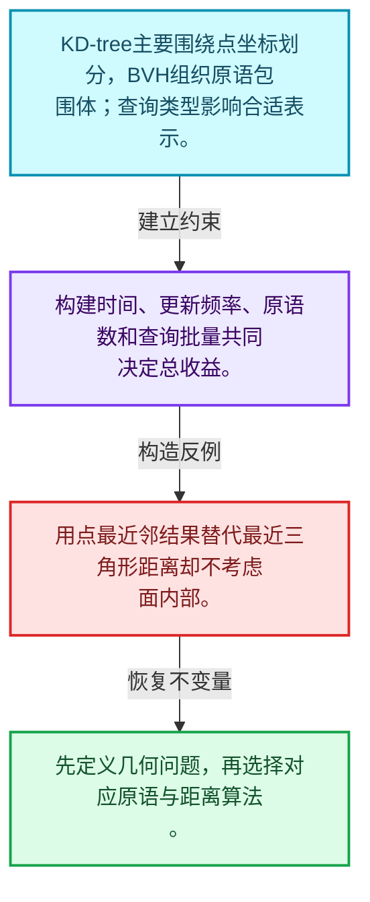
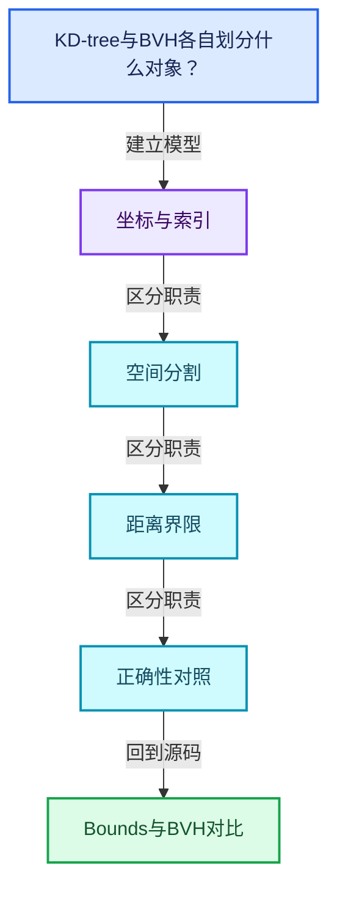
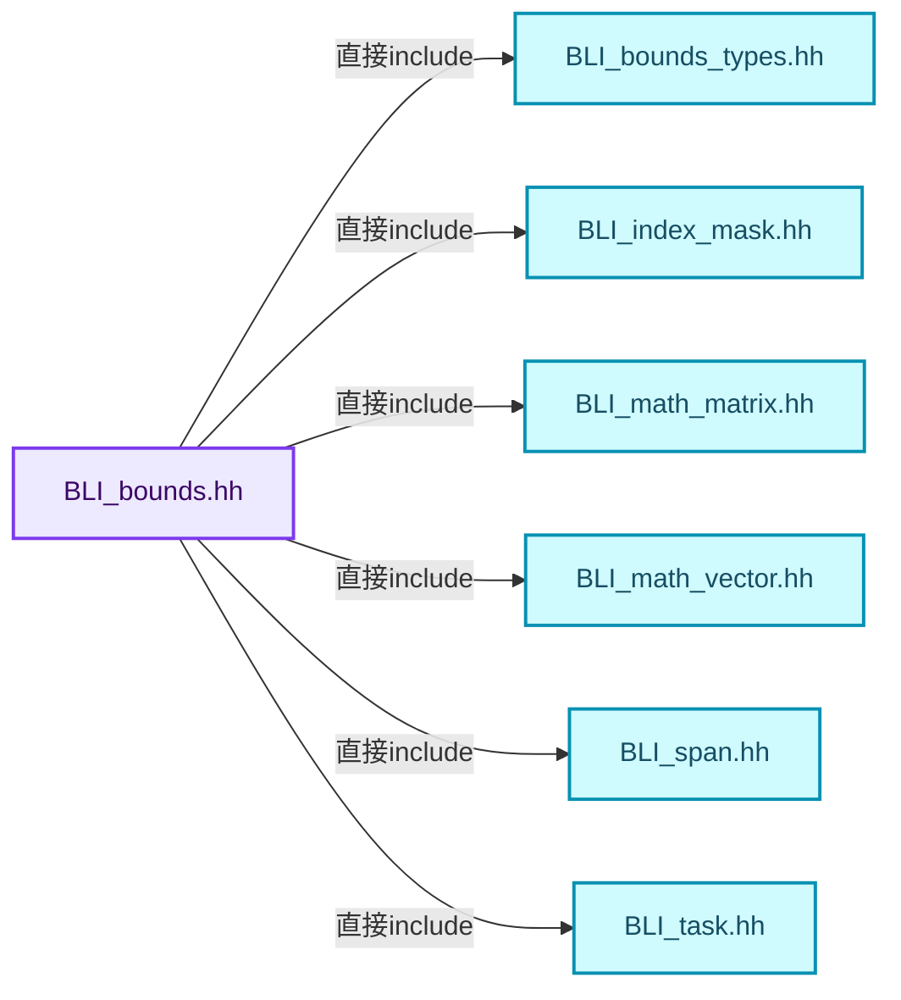
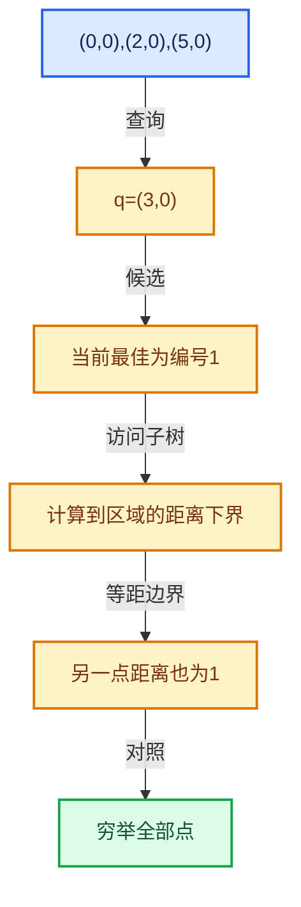

# 12-07 Bounds与BVH对比

[方向导航](README.md) · [总目录](../README.md) · [覆盖索引](../%E6%BA%90%E7%A0%81%E7%89%88%E6%9C%AC%E4%B8%8E%E8%A6%86%E7%9B%96%E7%B4%A2%E5%BC%95.md)

> 阅读顺序：问题与数据模型 → 语法与类型 → 源码逐行 → 调用线索 → 历史与取舍 → 推演和练习。

- 基准 HEAD：`cbda6b96c26c0dee3c3b5cbb93960c4ac06a6b30`。
- 记录日期：2026-10-14。
- 教学示例状态：正文中的推演不是本机性能实测；已运行练习见验收报告。

## 一、从问题到设计

KD-tree与BVH各自划分什么对象？

点划分和包围体层次的组织目标不同；原语类型、更新模式和查询形式决定选型。

本篇把语法、数据语义和系统取舍连接起来。先证明距离下界与返回身份，再讨论布局优化和并行构建。

### 本篇独立模型与设计推理

KD-tree主要围绕点坐标划分，BVH组织原语包围体；查询类型影响合适表示。

设计取舍：构建时间、更新频率、原语数和查询批量共同决定总收益。

最小反例：用点最近邻结果替代最近三角形距离却不考虑面内部。

推导与处理：先定义几何问题，再选择对应原语与距离算法。



### 源码范围与相邻篇章

| 文件 | 本篇逐行范围 | 基准SHA-256 |
|---|---|---|
| [source/blender/blenlib/BLI_bounds.hh](../../../../../source/blender/blenlib/BLI_bounds.hh) | L1—L616 | `1844a838227551ceda54d9c73e21e606e7ea33eba699167308543977acbf566b` |
| [source/blender/blenlib/BLI_bounds_types.hh](../../../../../source/blender/blenlib/BLI_bounds_types.hh) | L1—L82 | `b37f904c6bc0f072e65f3b8335f191240146361023228e41921b084fa665a1bc` |

同一主讲文件可能分多篇覆盖；超出本篇范围的符号通过覆盖索引定位。空行与纯注释保留在源码摘录中，逐行表解释有效语句与语法边界；许可证头统一保留。

前篇：[筛选与子集查询](06-%E7%AD%9B%E9%80%89%E4%B8%8E%E5%AD%90%E9%9B%86%E6%9F%A5%E8%AF%A2.md).

后篇：[正确性基准与独立实现](08-%E6%AD%A3%E7%A1%AE%E6%80%A7%E5%9F%BA%E5%87%86%E4%B8%8E%E7%8B%AC%E7%AB%8B%E5%AE%9E%E7%8E%B0.md).

## 二、类型、数据与阅读地图



这是概念依赖图，边表示阅读关系，不声称是运行时调用顺序。

### 直接编译依赖



箭头只表示头文件包含关系；完整调用线索见后面的符号定位表。

## 三、关键词、语法与类型角色

### 模板 template

模板把类型或常量作为生成实现的参数。读声明时先列出类型参数、非类型参数和默认值，再看使用者实际实例化了什么。模板声明本身不意味着每种T都支持其全部成员。

具体检查：把T替换为int、string、只能移动的类型，分别检查每个被调用操作是否成立。

### 依赖名称 typename

typename既可引入类型模板参数，也可告诉编译器某个依赖名称是类型。它不创建运行时对象；解析期确认语法类别与实例化期检查具体类型是不同阶段。

具体检查：区分typename T::value_type和T::size()，前者标记类型，后者是表达式。

### 常量求值 constexpr

constexpr声明允许相应实体参与常量求值，但constexpr函数仍可以在运行时执行。是否常量求值由调用场景和表达式合法性共同决定。

具体检查：比较constexpr变量初始化和从运行时输入调用同一函数。

### 只读限定 const

const约束当前访问路径可做的修改。const指针、指向const的指针、const视图对象、const元素是不同位置的限定；其他别名可能仍可修改原对象。

具体检查：分别写T* const、const T*与const T* const，并画出不可修改的层次。

### 显式静态转换 static_cast

static_cast表达编译期允许的转换，不会自动验证运行时真实类型、指针寿命或索引边界。由void指针恢复T指针时，调用者仍须保证实际存储中确有合法T对象。

具体检查：标出转换前后的类型以及正确性依据来自哪里。

### 运行时多态 virtual

虚调用根据实际动态类型选择实现；经基类指针销毁对象时通常需要相应虚析构契约。每元素虚调用和循环外一次分派有不同开销。

具体检查：找出虚接口的实现类和调用频率，再讨论是否值得去虚拟化。

### 可选值 optional

optional把不存在与存在的T区分开，T的构造和析构跟随engaged状态变化。访问前应由has_value或条件分支证明存在。

具体检查：把空Field状态与合法常量零区分，不能用某个普通值代替不存在。

### 构造与new表达式

普通new可能分配并构造；placement new在给定地址构造，存储由其他机制提供。失败回滚应区分两类责任。

具体检查：追踪地址来自哪里、构造何时成功、由谁析构、由谁释放。

### 内部断言 assert

断言表达开发者预期成立的内部契约，发布构建可能关闭。它不能替代对不可信输入的完整错误处理，也不保证后续操作被运行时保护。

具体检查：对每条断言构造违反条件的输入，区分调用者错误与应向用户报告的错误。

### 编译期分支 if constexpr

条件在实例化时决定被保留的分支，这常用于不同类型的合法操作选择。它与运行时if有不同的实例化检查规则。

具体检查：找出每个分支依赖哪些类型特征，再使用满足与不满足条件的类型。

## 四、真实源码与逐行讲解

源码块保持原行内容，原始行号由小节标题及逐行表给出。表中的调用定位是静态阅读辅助；重载、模板实例化、宏展开和虚调用需结合完整声明，不能仅凭词法出现证明动态调用。

### BLI_bounds.hh：L1—L46

<!-- source:source/blender/blenlib/BLI_bounds.hh:1:46 -->

```cpp
/* SPDX-FileCopyrightText: 2023 Blender Authors
 *
 * SPDX-License-Identifier: GPL-2.0-or-later */

#pragma once

/** \file
 * \ingroup bli
 */

#include <optional>

#include "BLI_bounds_types.hh"
#include "BLI_index_mask.hh"
#include "BLI_math_matrix.hh"
#include "BLI_math_vector.hh"
#include "BLI_span.hh"
#include "BLI_task.hh"
#include "BLI_virtual_array.hh"

#include "PRF_profile.hh"

namespace blender {

namespace bounds {

template<typename T> [[nodiscard]] inline Bounds<T> merge(const Bounds<T> &a, const Bounds<T> &b)
{
  return {math::min(a.min, b.min), math::max(a.max, b.max)};
}

template<typename T>
[[nodiscard]] inline std::optional<Bounds<T>> merge(const std::optional<Bounds<T>> &a,
                                                    const std::optional<Bounds<T>> &b)
{
  if (a.has_value() && b.has_value()) {
    return merge(*a, *b);
  }
  if (a.has_value()) {
    return a;
  }
  if (b.has_value()) {
    return b;
  }
  return std::nullopt;
}
```

本段语义重点：

- 分支证据 `a.has_value() && b.has_value())`：分别推演条件成立与不成立，核对相同出口处的状态。
- 分支证据 `a.has_value())`：分别推演条件成立与不成立，核对相同出口处的状态。

| 原始行 | 语义、约束与检查 |
|---|---|
| L5 | 防止同一头文件在一个翻译单元中重复展开；不控制多个源文件之间的链接或对象寿命。 |
| L11 | 引入编译依赖 <optional>；这是声明可见性关系，不表示运行时一定调用该文件的所有接口。 |
| L13 | 引入编译依赖 "BLI_bounds_types.hh"；这是声明可见性关系，不表示运行时一定调用该文件的所有接口。 |
| L14 | 引入编译依赖 "BLI_index_mask.hh"；这是声明可见性关系，不表示运行时一定调用该文件的所有接口。 |
| L15 | 引入编译依赖 "BLI_math_matrix.hh"；这是声明可见性关系，不表示运行时一定调用该文件的所有接口。 |
| L16 | 引入编译依赖 "BLI_math_vector.hh"；这是声明可见性关系，不表示运行时一定调用该文件的所有接口。 |
| L17 | 引入编译依赖 "BLI_span.hh"；这是声明可见性关系，不表示运行时一定调用该文件的所有接口。 |
| L18 | 引入编译依赖 "BLI_task.hh"；这是声明可见性关系，不表示运行时一定调用该文件的所有接口。 |
| L19 | 引入编译依赖 "BLI_virtual_array.hh"；这是声明可见性关系，不表示运行时一定调用该文件的所有接口。 |
| L21 | 引入编译依赖 "PRF_profile.hh"；这是声明可见性关系，不表示运行时一定调用该文件的所有接口。 |
| L23 | 把后续声明放入 blender 命名空间，影响名称查找和符号归属，不创建运行时对象。 |
| L25 | 把后续声明放入 bounds 命名空间，影响名称查找和符号归属，不创建运行时对象。 |
| L27 | 声明模板参数 `template<typename T> [[nodiscard]] inline Bounds<T> merge(const Bounds<T> &a, const Bounds<T> &b)`。类型参数决定生成操作的类型，非类型参数可决定内嵌容量或编译期分支。 |
| L28 | 连接上一行的声明或控制结构与其语句块；后续行在这个作用域中执行或声明。 |
| L29 | 返回表达式 `{math::min(a.min, b.min), math::max(a.max, b.max)}`。 |
| L30 | 结束当前语法单元。局部自动对象在离开其作用域时按规则销毁；这不等于所有被引用的外部数据也被释放。 |
| L32 | 声明模板参数 `template<typename T>`。类型参数决定生成操作的类型，非类型参数可决定内嵌容量或编译期分支。 |
| L33 | 出现调用或函数声明 `merge`，对应表达式为 `[[nodiscard]] inline std::optional<Bounds<T>> merge(const std::optional<Bounds<T>> &a,`。参数求值、返回类型与重载需结合前后完整语句；静态文本引用不能证明动态目标。 |
| L34 | 本行是连续声明或表达式的一部分：`const std::optional<Bounds<T>> &b)`。与本段前后行合读；逗号、括号和限定符决定它属于参数、初始化列表还是实际计算。 |
| L35 | 连接上一行的声明或控制结构与其语句块；后续行在这个作用域中执行或声明。 |
| L36 | 判断 `a.has_value() && b.has_value()`，成立时进入本分支，否则继续后续路径。 |
| L37 | 返回表达式 `merge(*a, *b)`。结合函数声明检查返回值是否借用原存储，借用值不会自动延长其寿命。 |
| L38 | 结束当前语法单元。局部自动对象在离开其作用域时按规则销毁；这不等于所有被引用的外部数据也被释放。 |
| L39 | 判断 `a.has_value()`，成立时进入本分支，否则继续后续路径。 |
| L40 | 返回表达式 `a`。 |
| L41 | 结束当前语法单元。局部自动对象在离开其作用域时按规则销毁；这不等于所有被引用的外部数据也被释放。 |
| L42 | 判断 `b.has_value()`，成立时进入本分支，否则继续后续路径。 |
| L43 | 返回表达式 `b`。 |
| L44 | 结束当前语法单元。局部自动对象在离开其作用域时按规则销毁；这不等于所有被引用的外部数据也被释放。 |
| L45 | 返回表达式 `std::nullopt`。 |
| L46 | 结束当前语法单元。局部自动对象在离开其作用域时按规则销毁；这不等于所有被引用的外部数据也被释放。 |

### BLI_bounds.hh：L47—L101

<!-- source:source/blender/blenlib/BLI_bounds.hh:47:101 -->

```cpp

template<typename T>
[[nodiscard]] inline std::optional<Bounds<T>> merge(const std::optional<Bounds<T>> &a,
                                                    const Bounds<T> &b)
{
  return merge(a, std::optional<Bounds<T>>(b));
}

template<typename T>
[[nodiscard]] inline std::optional<Bounds<T>> min_max(const std::optional<Bounds<T>> &a,
                                                      const T &b)
{
  if (a.has_value()) {
    return merge(*a, {b, b});
  }
  return Bounds<T>{b, b};
}

namespace detail {

/**
 * Find the smallest and largest values element-wise in a non-empty span, in one sequential pass.
 * Several accumulators ("lanes"), so that the comparisons of one point do not wait on those of
 * the point before it.
 */
template<typename T> [[nodiscard]] inline Bounds<T> min_max_lanes(const Span<T> values)
{
  constexpr int64_t lanes = 4;
  const int64_t size = values.size();
  const int64_t full = size & ~(lanes - 1);

  T lo[lanes];
  T hi[lanes];
  for (int64_t lane = 0; lane < lanes; lane++) {
    lo[lane] = hi[lane] = values[0];
  }
  for (int64_t i = 0; i < full; i += lanes) {
    for (int64_t lane = 0; lane < lanes; lane++) {
      const T &value = values[i + lane];
      lo[lane] = math::min(lo[lane], value);
      hi[lane] = math::max(hi[lane], value);
    }
  }

  Bounds<T> result{lo[0], hi[0]};
  for (int64_t lane = 1; lane < lanes; lane++) {
    result.min = math::min(result.min, lo[lane]);
    result.max = math::max(result.max, hi[lane]);
  }
  for (int64_t i = full; i < size; i++) {
    result.min = math::min(result.min, values[i]);
    result.max = math::max(result.max, values[i]);
  }
  return result;
}
```

本段语义重点：

- 分支证据 `a.has_value())`：分别推演条件成立与不成立，核对相同出口处的状态。

| 原始行 | 语义、约束与检查 |
|---|---|
| L48 | 声明模板参数 `template<typename T>`。类型参数决定生成操作的类型，非类型参数可决定内嵌容量或编译期分支。 |
| L49 | 出现调用或函数声明 `merge`，对应表达式为 `[[nodiscard]] inline std::optional<Bounds<T>> merge(const std::optional<Bounds<T>> &a,`。参数求值、返回类型与重载需结合前后完整语句；静态文本引用不能证明动态目标。 |
| L50 | 本行是连续声明或表达式的一部分：`const Bounds<T> &b)`。与本段前后行合读；逗号、括号和限定符决定它属于参数、初始化列表还是实际计算。 |
| L51 | 连接上一行的声明或控制结构与其语句块；后续行在这个作用域中执行或声明。 |
| L52 | 返回表达式 `merge(a, std::optional<Bounds<T>>(b))`。 |
| L53 | 结束当前语法单元。局部自动对象在离开其作用域时按规则销毁；这不等于所有被引用的外部数据也被释放。 |
| L55 | 声明模板参数 `template<typename T>`。类型参数决定生成操作的类型，非类型参数可决定内嵌容量或编译期分支。 |
| L56 | 出现调用或函数声明 `min_max`，对应表达式为 `[[nodiscard]] inline std::optional<Bounds<T>> min_max(const std::optional<Bounds<T>> &a,`。参数求值、返回类型与重载需结合前后完整语句；静态文本引用不能证明动态目标。 |
| L57 | 本行是连续声明或表达式的一部分：`const T &b)`。与本段前后行合读；逗号、括号和限定符决定它属于参数、初始化列表还是实际计算。 |
| L58 | 连接上一行的声明或控制结构与其语句块；后续行在这个作用域中执行或声明。 |
| L59 | 判断 `a.has_value()`，成立时进入本分支，否则继续后续路径。 |
| L60 | 返回表达式 `merge(*a, {b, b})`。 |
| L61 | 结束当前语法单元。局部自动对象在离开其作用域时按规则销毁；这不等于所有被引用的外部数据也被释放。 |
| L62 | 返回表达式 `Bounds<T>{b, b}`。 |
| L63 | 结束当前语法单元。局部自动对象在离开其作用域时按规则销毁；这不等于所有被引用的外部数据也被释放。 |
| L65 | 把后续声明放入 detail 命名空间，影响名称查找和符号归属，不创建运行时对象。 |
| L72 | 声明模板参数 `template<typename T> [[nodiscard]] inline Bounds<T> min_max_lanes(const Span<T> values)`。类型参数决定生成操作的类型，非类型参数可决定内嵌容量或编译期分支。 |
| L73 | 连接上一行的声明或控制结构与其语句块；后续行在这个作用域中执行或声明。 |
| L74 | 把右侧 `4` 用于初始化或更新左侧 `constexpr int64_t lanes`。声明初始化与已有对象赋值应按上下文区分；有资源的类型会调用相应特殊成员。 |
| L75 | 把右侧 `values.size()` 用于初始化或更新左侧 `const int64_t size`。声明初始化与已有对象赋值应按上下文区分；有资源的类型会调用相应特殊成员。 |
| L76 | 涉及析构接口或显式析构：`const int64_t full = size & ~(lanes - 1);`。检查目标对象已成功构造，且资源不会在另一条清理路径再次销毁。 |
| L78 | 声明成员、局部对象或完成语句 `T lo[lanes]`。若为指针或引用，它本身不说明拥有；若为值对象，其构造析构由所在作用域或外层对象管理。 |
| L79 | 声明成员、局部对象或完成语句 `T hi[lanes]`。若为指针或引用，它本身不说明拥有；若为值对象，其构造析构由所在作用域或外层对象管理。 |
| L80 | 纯虚接口声明：`for (int64_t lane = 0; lane < lanes; lane++) {`。等号零标记抽象接口，需要按继承约定提供覆写；不表示执行函数并把结果设为零。 |
| L81 | 把右侧 `hi[lane] = values[0]` 用于初始化或更新左侧 `lo[lane]`。声明初始化与已有对象赋值应按上下文区分；有资源的类型会调用相应特殊成员。 |
| L82 | 结束当前语法单元。局部自动对象在离开其作用域时按规则销毁；这不等于所有被引用的外部数据也被释放。 |
| L83 | 纯虚接口声明：`for (int64_t i = 0; i < full; i += lanes) {`。等号零标记抽象接口，需要按继承约定提供覆写；不表示执行函数并把结果设为零。 |
| L84 | 纯虚接口声明：`for (int64_t lane = 0; lane < lanes; lane++) {`。等号零标记抽象接口，需要按继承约定提供覆写；不表示执行函数并把结果设为零。 |
| L85 | 把右侧 `values[i + lane]` 用于初始化或更新左侧 `const T &value`。声明初始化与已有对象赋值应按上下文区分；有资源的类型会调用相应特殊成员。 |
| L86 | 把右侧 `math::min(lo[lane], value)` 用于初始化或更新左侧 `lo[lane]`。声明初始化与已有对象赋值应按上下文区分；有资源的类型会调用相应特殊成员。 |
| L87 | 把右侧 `math::max(hi[lane], value)` 用于初始化或更新左侧 `hi[lane]`。声明初始化与已有对象赋值应按上下文区分；有资源的类型会调用相应特殊成员。 |
| L88 | 结束当前语法单元。局部自动对象在离开其作用域时按规则销毁；这不等于所有被引用的外部数据也被释放。 |
| L89 | 结束当前语法单元。局部自动对象在离开其作用域时按规则销毁；这不等于所有被引用的外部数据也被释放。 |
| L91 | 声明成员、局部对象或完成语句 `Bounds<T> result{lo[0], hi[0]}`。若为指针或引用，它本身不说明拥有；若为值对象，其构造析构由所在作用域或外层对象管理。 |
| L92 | 按 `for (int64_t lane = 1; lane < lanes; lane++)` 指定的范围或条件重复执行。对照循环变量与真实元素编号；循环内调用成本乘以实际迭代次数。 |
| L93 | 把右侧 `math::min(result.min, lo[lane])` 用于初始化或更新左侧 `result.min`。声明初始化与已有对象赋值应按上下文区分；有资源的类型会调用相应特殊成员。 |
| L94 | 把右侧 `math::max(result.max, hi[lane])` 用于初始化或更新左侧 `result.max`。声明初始化与已有对象赋值应按上下文区分；有资源的类型会调用相应特殊成员。 |
| L95 | 结束当前语法单元。局部自动对象在离开其作用域时按规则销毁；这不等于所有被引用的外部数据也被释放。 |
| L96 | 按 `for (int64_t i = full; i < size; i++)` 指定的范围或条件重复执行。对照循环变量与真实元素编号；循环内调用成本乘以实际迭代次数。 |
| L97 | 把右侧 `math::min(result.min, values[i])` 用于初始化或更新左侧 `result.min`。声明初始化与已有对象赋值应按上下文区分；有资源的类型会调用相应特殊成员。 |
| L98 | 把右侧 `math::max(result.max, values[i])` 用于初始化或更新左侧 `result.max`。声明初始化与已有对象赋值应按上下文区分；有资源的类型会调用相应特殊成员。 |
| L99 | 结束当前语法单元。局部自动对象在离开其作用域时按规则销毁；这不等于所有被引用的外部数据也被释放。 |
| L100 | 返回表达式 `result`。 |
| L101 | 结束当前语法单元。局部自动对象在离开其作用域时按规则销毁；这不等于所有被引用的外部数据也被释放。 |

### BLI_bounds.hh：L102—L157

<!-- source:source/blender/blenlib/BLI_bounds.hh:102:157 -->

```cpp

/** #min_max_lanes with a radius added to each value first. */
template<typename T, typename RadiusT>
[[nodiscard]] inline Bounds<T> min_max_lanes_with_radii(const Span<T> values,
                                                        const Span<RadiusT> radii)
{
  constexpr int64_t lanes = 4;
  const int64_t size = values.size();
  const int64_t full = size & ~(lanes - 1);

  T lo[lanes];
  T hi[lanes];
  for (int64_t lane = 0; lane < lanes; lane++) {
    lo[lane] = values[0] - radii[0];
    hi[lane] = values[0] + radii[0];
  }
  for (int64_t i = 0; i < full; i += lanes) {
    for (int64_t lane = 0; lane < lanes; lane++) {
      lo[lane] = math::min(lo[lane], values[i + lane] - radii[i + lane]);
      hi[lane] = math::max(hi[lane], values[i + lane] + radii[i + lane]);
    }
  }

  Bounds<T> result{lo[0], hi[0]};
  for (int64_t lane = 1; lane < lanes; lane++) {
    result.min = math::min(result.min, lo[lane]);
    result.max = math::max(result.max, hi[lane]);
  }
  for (int64_t i = full; i < size; i++) {
    result.min = math::min(result.min, values[i] - radii[i]);
    result.max = math::max(result.max, values[i] + radii[i]);
  }
  return result;
}

}  // namespace detail

/**
 * Find the smallest and largest values element-wise in the span.
 */
template<typename T> [[nodiscard]] inline std::optional<Bounds<T>> min_max(const Span<T> values)
{
  if (values.is_empty()) {
    return std::nullopt;
  }
  PRF_scope_with_name("bounds::min_max", ProfileCategory::Default);
  const Bounds<T> init{values.first(), values.first()};
  return threading::parallel_reduce(
      values.index_range(),
      1024,
      init,
      [&](const IndexRange range, const Bounds<T> &init) {
        return merge(init, detail::min_max_lanes(values.slice(range)));
      },
      [](const Bounds<T> &a, const Bounds<T> &b) { return merge(a, b); });
}
```

本段语义重点：

- 分支证据 `values.is_empty())`：分别推演条件成立与不成立，核对相同出口处的状态。

| 原始行 | 语义、约束与检查 |
|---|---|
| L104 | 声明模板参数 `template<typename T, typename RadiusT>`。类型参数决定生成操作的类型，非类型参数可决定内嵌容量或编译期分支。 |
| L105 | 出现调用或函数声明 `min_max_lanes_with_radii`，对应表达式为 `[[nodiscard]] inline Bounds<T> min_max_lanes_with_radii(const Span<T> values,`。参数求值、返回类型与重载需结合前后完整语句；静态文本引用不能证明动态目标。 |
| L106 | 本行是连续声明或表达式的一部分：`const Span<RadiusT> radii)`。与本段前后行合读；逗号、括号和限定符决定它属于参数、初始化列表还是实际计算。 |
| L107 | 连接上一行的声明或控制结构与其语句块；后续行在这个作用域中执行或声明。 |
| L108 | 把右侧 `4` 用于初始化或更新左侧 `constexpr int64_t lanes`。声明初始化与已有对象赋值应按上下文区分；有资源的类型会调用相应特殊成员。 |
| L109 | 把右侧 `values.size()` 用于初始化或更新左侧 `const int64_t size`。声明初始化与已有对象赋值应按上下文区分；有资源的类型会调用相应特殊成员。 |
| L110 | 涉及析构接口或显式析构：`const int64_t full = size & ~(lanes - 1);`。检查目标对象已成功构造，且资源不会在另一条清理路径再次销毁。 |
| L112 | 声明成员、局部对象或完成语句 `T lo[lanes]`。若为指针或引用，它本身不说明拥有；若为值对象，其构造析构由所在作用域或外层对象管理。 |
| L113 | 声明成员、局部对象或完成语句 `T hi[lanes]`。若为指针或引用，它本身不说明拥有；若为值对象，其构造析构由所在作用域或外层对象管理。 |
| L114 | 纯虚接口声明：`for (int64_t lane = 0; lane < lanes; lane++) {`。等号零标记抽象接口，需要按继承约定提供覆写；不表示执行函数并把结果设为零。 |
| L115 | 把右侧 `values[0] - radii[0]` 用于初始化或更新左侧 `lo[lane]`。声明初始化与已有对象赋值应按上下文区分；有资源的类型会调用相应特殊成员。 |
| L116 | 把右侧 `values[0] + radii[0]` 用于初始化或更新左侧 `hi[lane]`。声明初始化与已有对象赋值应按上下文区分；有资源的类型会调用相应特殊成员。 |
| L117 | 结束当前语法单元。局部自动对象在离开其作用域时按规则销毁；这不等于所有被引用的外部数据也被释放。 |
| L118 | 纯虚接口声明：`for (int64_t i = 0; i < full; i += lanes) {`。等号零标记抽象接口，需要按继承约定提供覆写；不表示执行函数并把结果设为零。 |
| L119 | 纯虚接口声明：`for (int64_t lane = 0; lane < lanes; lane++) {`。等号零标记抽象接口，需要按继承约定提供覆写；不表示执行函数并把结果设为零。 |
| L120 | 把右侧 `math::min(lo[lane], values[i + lane] - radii[i + lane])` 用于初始化或更新左侧 `lo[lane]`。声明初始化与已有对象赋值应按上下文区分；有资源的类型会调用相应特殊成员。 |
| L121 | 把右侧 `math::max(hi[lane], values[i + lane] + radii[i + lane])` 用于初始化或更新左侧 `hi[lane]`。声明初始化与已有对象赋值应按上下文区分；有资源的类型会调用相应特殊成员。 |
| L122 | 结束当前语法单元。局部自动对象在离开其作用域时按规则销毁；这不等于所有被引用的外部数据也被释放。 |
| L123 | 结束当前语法单元。局部自动对象在离开其作用域时按规则销毁；这不等于所有被引用的外部数据也被释放。 |
| L125 | 声明成员、局部对象或完成语句 `Bounds<T> result{lo[0], hi[0]}`。若为指针或引用，它本身不说明拥有；若为值对象，其构造析构由所在作用域或外层对象管理。 |
| L126 | 按 `for (int64_t lane = 1; lane < lanes; lane++)` 指定的范围或条件重复执行。对照循环变量与真实元素编号；循环内调用成本乘以实际迭代次数。 |
| L127 | 把右侧 `math::min(result.min, lo[lane])` 用于初始化或更新左侧 `result.min`。声明初始化与已有对象赋值应按上下文区分；有资源的类型会调用相应特殊成员。 |
| L128 | 把右侧 `math::max(result.max, hi[lane])` 用于初始化或更新左侧 `result.max`。声明初始化与已有对象赋值应按上下文区分；有资源的类型会调用相应特殊成员。 |
| L129 | 结束当前语法单元。局部自动对象在离开其作用域时按规则销毁；这不等于所有被引用的外部数据也被释放。 |
| L130 | 按 `for (int64_t i = full; i < size; i++)` 指定的范围或条件重复执行。对照循环变量与真实元素编号；循环内调用成本乘以实际迭代次数。 |
| L131 | 把右侧 `math::min(result.min, values[i] - radii[i])` 用于初始化或更新左侧 `result.min`。声明初始化与已有对象赋值应按上下文区分；有资源的类型会调用相应特殊成员。 |
| L132 | 把右侧 `math::max(result.max, values[i] + radii[i])` 用于初始化或更新左侧 `result.max`。声明初始化与已有对象赋值应按上下文区分；有资源的类型会调用相应特殊成员。 |
| L133 | 结束当前语法单元。局部自动对象在离开其作用域时按规则销毁；这不等于所有被引用的外部数据也被释放。 |
| L134 | 返回表达式 `result`。 |
| L135 | 结束当前语法单元。局部自动对象在离开其作用域时按规则销毁；这不等于所有被引用的外部数据也被释放。 |
| L137 | 结束当前语法单元。局部自动对象在离开其作用域时按规则销毁；这不等于所有被引用的外部数据也被释放。 |
| L142 | 声明模板参数 `template<typename T> [[nodiscard]] inline std::optional<Bounds<T>> min_max(const Span<T> values)`。类型参数决定生成操作的类型，非类型参数可决定内嵌容量或编译期分支。 |
| L143 | 连接上一行的声明或控制结构与其语句块；后续行在这个作用域中执行或声明。 |
| L144 | 判断 `values.is_empty()`，成立时进入本分支，否则继续后续路径。 |
| L145 | 返回表达式 `std::nullopt`。 |
| L146 | 结束当前语法单元。局部自动对象在离开其作用域时按规则销毁；这不等于所有被引用的外部数据也被释放。 |
| L147 | 出现调用或函数声明 `PRF_scope_with_name`，对应表达式为 `PRF_scope_with_name("bounds::min_max", ProfileCategory::Default);`。参数求值、返回类型与重载需结合前后完整语句；静态文本引用不能证明动态目标。 |
| L148 | 声明接口 `const Bounds<T> init{values.first(), values.first()}`，本行没有对应函数体；返回类型、参数限定和const/noexcept共同组成调用契约，实际行为需继续定位实现。 |
| L149 | 返回表达式 `threading::parallel_reduce(`。 |
| L150 | 出现调用或函数声明 `index_range`，对应表达式为 `values.index_range(),`。参数求值、返回类型与重载需结合前后完整语句；静态文本引用不能证明动态目标。 |
| L151 | 本行是连续声明或表达式的一部分：`1024,`。与本段前后行合读；逗号、括号和限定符决定它属于参数、初始化列表还是实际计算。 |
| L152 | 本行是连续声明或表达式的一部分：`init,`。与本段前后行合读；逗号、括号和限定符决定它属于参数、初始化列表还是实际计算。 |
| L153 | 本行是连续声明或表达式的一部分：`[&](const IndexRange range, const Bounds<T> &init) {`。与本段前后行合读；逗号、括号和限定符决定它属于参数、初始化列表还是实际计算。 |
| L154 | 返回表达式 `merge(init, detail::min_max_lanes(values.slice(range)))`。结合函数声明检查返回值是否借用原存储，借用值不会自动延长其寿命。 |
| L155 | 结束当前语法单元。局部自动对象在离开其作用域时按规则销毁；这不等于所有被引用的外部数据也被释放。 |
| L156 | 出现调用或函数声明 `merge`，对应表达式为 `[](const Bounds<T> &a, const Bounds<T> &b) { return merge(a, b); });`。参数求值、返回类型与重载需结合前后完整语句；静态文本引用不能证明动态目标。 |
| L157 | 结束当前语法单元。局部自动对象在离开其作用域时按规则销毁；这不等于所有被引用的外部数据也被释放。 |

### BLI_bounds.hh：L158—L207

<!-- source:source/blender/blenlib/BLI_bounds.hh:158:207 -->

```cpp

template<typename T>
[[nodiscard]] inline std::optional<Bounds<T>> min_max(const IndexMask &mask, const Span<T> values)
{
  if (values.is_empty() || mask.is_empty()) {
    return std::nullopt;
  }
  if (mask.size() == values.size()) {
    /* To avoid mask slice/lookup. */
    return min_max(values);
  }
  PRF_scope_with_name("bounds::min_max", ProfileCategory::Default);
  const Bounds<T> init{values[mask.first()], values[mask.first()]};
  return threading::parallel_reduce(
      mask.index_range().drop_front(1),
      1024,
      init,
      [&](const IndexRange range, const Bounds<T> &init) {
        Bounds<T> result = init;
        mask.slice(range).foreach_index_optimized<int64_t>(
            [&](const int i) { math::min_max(values[i], result.min, result.max); });
        return result;
      },
      [](const Bounds<T> &a, const Bounds<T> &b) { return merge(a, b); });
}

/**
 * Find the smallest and largest values element-wise in the span, adding the radius to each element
 * first. The template type T is expected to have an addition operator implemented with RadiusT.
 */
template<typename T, typename RadiusT>
[[nodiscard]] inline std::optional<Bounds<T>> min_max_with_radii(const Span<T> values,
                                                                 const Span<RadiusT> radii)
{
  BLI_assert(values.size() == radii.size());
  if (values.is_empty()) {
    return std::nullopt;
  }
  PRF_scope_with_name("bounds::min_max_with_radii", ProfileCategory::Default);
  const Bounds<T> init{values.first(), values.first()};
  return threading::parallel_reduce(
      values.index_range(),
      1024,
      init,
      [&](const IndexRange range, const Bounds<T> &init) {
        return merge(init,
                     detail::min_max_lanes_with_radii(values.slice(range), radii.slice(range)));
      },
      [](const Bounds<T> &a, const Bounds<T> &b) { return merge(a, b); });
}
```

本段语义重点：

- 分支证据 `values.is_empty() &#124;&#124; mask.is_empty())`：分别推演条件成立与不成立，核对相同出口处的状态。
- 分支证据 `mask.size() == values.size())`：分别推演条件成立与不成立，核对相同出口处的状态。

| 原始行 | 语义、约束与检查 |
|---|---|
| L159 | 声明模板参数 `template<typename T>`。类型参数决定生成操作的类型，非类型参数可决定内嵌容量或编译期分支。 |
| L160 | 出现调用或函数声明 `min_max`，对应表达式为 `[[nodiscard]] inline std::optional<Bounds<T>> min_max(const IndexMask &mask, const Span<T> values)`。参数求值、返回类型与重载需结合前后完整语句；静态文本引用不能证明动态目标。 |
| L161 | 连接上一行的声明或控制结构与其语句块；后续行在这个作用域中执行或声明。 |
| L162 | 判断 `values.is_empty() &#124;&#124; mask.is_empty()`，成立时进入本分支，否则继续后续路径。 |
| L163 | 返回表达式 `std::nullopt`。 |
| L164 | 结束当前语法单元。局部自动对象在离开其作用域时按规则销毁；这不等于所有被引用的外部数据也被释放。 |
| L165 | 判断 `mask.size() == values.size()`，成立时进入本分支，否则继续后续路径。该边界影响可访问元素或可用容量，两者要按各变量的定义区分。 |
| L167 | 返回表达式 `min_max(values)`。 |
| L168 | 结束当前语法单元。局部自动对象在离开其作用域时按规则销毁；这不等于所有被引用的外部数据也被释放。 |
| L169 | 出现调用或函数声明 `PRF_scope_with_name`，对应表达式为 `PRF_scope_with_name("bounds::min_max", ProfileCategory::Default);`。参数求值、返回类型与重载需结合前后完整语句；静态文本引用不能证明动态目标。 |
| L170 | 声明接口 `const Bounds<T> init{values[mask.first()], values[mask.first()]}`，本行没有对应函数体；返回类型、参数限定和const/noexcept共同组成调用契约，实际行为需继续定位实现。 |
| L171 | 返回表达式 `threading::parallel_reduce(`。 |
| L172 | 出现调用或函数声明 `index_range`，对应表达式为 `mask.index_range().drop_front(1),`。参数求值、返回类型与重载需结合前后完整语句；静态文本引用不能证明动态目标。 |
| L173 | 本行是连续声明或表达式的一部分：`1024,`。与本段前后行合读；逗号、括号和限定符决定它属于参数、初始化列表还是实际计算。 |
| L174 | 本行是连续声明或表达式的一部分：`init,`。与本段前后行合读；逗号、括号和限定符决定它属于参数、初始化列表还是实际计算。 |
| L175 | 本行是连续声明或表达式的一部分：`[&](const IndexRange range, const Bounds<T> &init) {`。与本段前后行合读；逗号、括号和限定符决定它属于参数、初始化列表还是实际计算。 |
| L176 | 把右侧 `init` 用于初始化或更新左侧 `Bounds<T> result`。声明初始化与已有对象赋值应按上下文区分；有资源的类型会调用相应特殊成员。 |
| L177 | 出现调用或函数声明 `slice`，对应表达式为 `mask.slice(range).foreach_index_optimized<int64_t>(`。参数求值、返回类型与重载需结合前后完整语句；静态文本引用不能证明动态目标。 |
| L178 | 出现调用或函数声明 `math::min_max`，对应表达式为 `[&](const int i) { math::min_max(values[i], result.min, result.max); });`。参数求值、返回类型与重载需结合前后完整语句；静态文本引用不能证明动态目标。 |
| L179 | 返回表达式 `result`。结合函数声明检查返回值是否借用原存储，借用值不会自动延长其寿命。 |
| L180 | 结束当前语法单元。局部自动对象在离开其作用域时按规则销毁；这不等于所有被引用的外部数据也被释放。 |
| L181 | 出现调用或函数声明 `merge`，对应表达式为 `[](const Bounds<T> &a, const Bounds<T> &b) { return merge(a, b); });`。参数求值、返回类型与重载需结合前后完整语句；静态文本引用不能证明动态目标。 |
| L182 | 结束当前语法单元。局部自动对象在离开其作用域时按规则销毁；这不等于所有被引用的外部数据也被释放。 |
| L188 | 声明模板参数 `template<typename T, typename RadiusT>`。类型参数决定生成操作的类型，非类型参数可决定内嵌容量或编译期分支。 |
| L189 | 出现调用或函数声明 `min_max_with_radii`，对应表达式为 `[[nodiscard]] inline std::optional<Bounds<T>> min_max_with_radii(const Span<T> values,`。参数求值、返回类型与重载需结合前后完整语句；静态文本引用不能证明动态目标。 |
| L190 | 本行是连续声明或表达式的一部分：`const Span<RadiusT> radii)`。与本段前后行合读；逗号、括号和限定符决定它属于参数、初始化列表还是实际计算。 |
| L191 | 连接上一行的声明或控制结构与其语句块；后续行在这个作用域中执行或声明。 |
| L192 | 断言约束 `BLI_assert(values.size() == radii.size());`。条件是后续访问的内部前置条件；发布构建可能不执行，不能把断言当作输入修复。 |
| L193 | 判断 `values.is_empty()`，成立时进入本分支，否则继续后续路径。 |
| L194 | 返回表达式 `std::nullopt`。 |
| L195 | 结束当前语法单元。局部自动对象在离开其作用域时按规则销毁；这不等于所有被引用的外部数据也被释放。 |
| L196 | 出现调用或函数声明 `PRF_scope_with_name`，对应表达式为 `PRF_scope_with_name("bounds::min_max_with_radii", ProfileCategory::Default);`。参数求值、返回类型与重载需结合前后完整语句；静态文本引用不能证明动态目标。 |
| L197 | 声明接口 `const Bounds<T> init{values.first(), values.first()}`，本行没有对应函数体；返回类型、参数限定和const/noexcept共同组成调用契约，实际行为需继续定位实现。 |
| L198 | 返回表达式 `threading::parallel_reduce(`。 |
| L199 | 出现调用或函数声明 `index_range`，对应表达式为 `values.index_range(),`。参数求值、返回类型与重载需结合前后完整语句；静态文本引用不能证明动态目标。 |
| L200 | 本行是连续声明或表达式的一部分：`1024,`。与本段前后行合读；逗号、括号和限定符决定它属于参数、初始化列表还是实际计算。 |
| L201 | 本行是连续声明或表达式的一部分：`init,`。与本段前后行合读；逗号、括号和限定符决定它属于参数、初始化列表还是实际计算。 |
| L202 | 本行是连续声明或表达式的一部分：`[&](const IndexRange range, const Bounds<T> &init) {`。与本段前后行合读；逗号、括号和限定符决定它属于参数、初始化列表还是实际计算。 |
| L203 | 返回表达式 `merge(init,`。结合函数声明检查返回值是否借用原存储，借用值不会自动延长其寿命。 |
| L204 | 出现调用或函数声明 `detail::min_max_lanes_with_radii`，对应表达式为 `detail::min_max_lanes_with_radii(values.slice(range), radii.slice(range)));`。参数求值、返回类型与重载需结合前后完整语句；静态文本引用不能证明动态目标。 |
| L205 | 结束当前语法单元。局部自动对象在离开其作用域时按规则销毁；这不等于所有被引用的外部数据也被释放。 |
| L206 | 出现调用或函数声明 `merge`，对应表达式为 `[](const Bounds<T> &a, const Bounds<T> &b) { return merge(a, b); });`。参数求值、返回类型与重载需结合前后完整语句；静态文本引用不能证明动态目标。 |
| L207 | 结束当前语法单元。局部自动对象在离开其作用域时按规则销毁；这不等于所有被引用的外部数据也被释放。 |

### BLI_bounds.hh：L208—L254

<!-- source:source/blender/blenlib/BLI_bounds.hh:208:254 -->

```cpp

/**
 * Find the smallest and largest values element-wise in a virtual array.
 */
template<typename T> [[nodiscard]] inline std::optional<Bounds<T>> min_max(const VArray<T> &varray)
{
  if (varray.is_empty()) {
    return std::nullopt;
  }
  PRF_scope_with_name("bounds::min_max_with_radii", ProfileCategory::Default);
  const CommonVArrayInfo info = varray.common_info();
  if (info.type == CommonVArrayInfo::Type::Single) {
    Bounds<T> result = Bounds<T>(varray.first());
    return result;
  }
  if (info.type == CommonVArrayInfo::Type::Span) {
    const Span<T> span(static_cast<const T *>(info.data), varray.size());
    return min_max<T>(span);
  }
  const Bounds<T> init{varray.first(), varray.first()};
  return threading::parallel_reduce(
      varray.index_range(),
      1024,
      init,
      [&](const IndexRange range, const Bounds<T> &init) {
        Bounds<T> result = init;
        for (const int i : range) {
          math::min_max(varray[i], result.min, result.max);
        }
        return result;
      },
      [](const Bounds<T> &a, const Bounds<T> &b) { return merge(a, b); });
}

/**
 * Returns a new bound that contains the intersection of the two given bound.
 * Returns no box if there are no overlap.
 */
template<typename T>
[[nodiscard]] inline std::optional<Bounds<T>> intersect(const Bounds<T> &a, const Bounds<T> &b)
{
  const Bounds<T> result{math::max(a.min, b.min), math::min(a.max, b.max)};
  if (result.is_empty()) {
    return std::nullopt;
  }
  return result;
}
```

本段语义重点：

- 分支证据 `varray.is_empty())`：分别推演条件成立与不成立，核对相同出口处的状态。
- 分支证据 `info.type == CommonVArrayInfo::Type::Single)`：分别推演条件成立与不成立，核对相同出口处的状态。

| 原始行 | 语义、约束与检查 |
|---|---|
| L212 | 声明模板参数 `template<typename T> [[nodiscard]] inline std::optional<Bounds<T>> min_max(const VArray<T> &varray)`。类型参数决定生成操作的类型，非类型参数可决定内嵌容量或编译期分支。 |
| L213 | 连接上一行的声明或控制结构与其语句块；后续行在这个作用域中执行或声明。 |
| L214 | 判断 `varray.is_empty()`，成立时进入本分支，否则继续后续路径。 |
| L215 | 返回表达式 `std::nullopt`。 |
| L216 | 结束当前语法单元。局部自动对象在离开其作用域时按规则销毁；这不等于所有被引用的外部数据也被释放。 |
| L217 | 出现调用或函数声明 `PRF_scope_with_name`，对应表达式为 `PRF_scope_with_name("bounds::min_max_with_radii", ProfileCategory::Default);`。参数求值、返回类型与重载需结合前后完整语句；静态文本引用不能证明动态目标。 |
| L218 | 把右侧 `varray.common_info()` 用于初始化或更新左侧 `const CommonVArrayInfo info`。声明初始化与已有对象赋值应按上下文区分；有资源的类型会调用相应特殊成员。 |
| L219 | 判断 `info.type == CommonVArrayInfo::Type::Single`，成立时进入本分支，否则继续后续路径。 |
| L220 | 把右侧 `Bounds<T>(varray.first())` 用于初始化或更新左侧 `Bounds<T> result`。声明初始化与已有对象赋值应按上下文区分；有资源的类型会调用相应特殊成员。 |
| L221 | 返回表达式 `result`。 |
| L222 | 结束当前语法单元。局部自动对象在离开其作用域时按规则销毁；这不等于所有被引用的外部数据也被释放。 |
| L223 | 判断 `info.type == CommonVArrayInfo::Type::Span`，成立时进入本分支，否则继续后续路径。 |
| L224 | 声明接口 `const Span<T> span(static_cast<const T *>(info.data), varray.size())`，本行没有对应函数体；返回类型、参数限定和const/noexcept共同组成调用契约，实际行为需继续定位实现。 |
| L225 | 返回表达式 `min_max<T>(span)`。结合函数声明检查返回值是否借用原存储，借用值不会自动延长其寿命。 |
| L226 | 结束当前语法单元。局部自动对象在离开其作用域时按规则销毁；这不等于所有被引用的外部数据也被释放。 |
| L227 | 声明接口 `const Bounds<T> init{varray.first(), varray.first()}`，本行没有对应函数体；返回类型、参数限定和const/noexcept共同组成调用契约，实际行为需继续定位实现。 |
| L228 | 返回表达式 `threading::parallel_reduce(`。 |
| L229 | 出现调用或函数声明 `index_range`，对应表达式为 `varray.index_range(),`。参数求值、返回类型与重载需结合前后完整语句；静态文本引用不能证明动态目标。 |
| L230 | 本行是连续声明或表达式的一部分：`1024,`。与本段前后行合读；逗号、括号和限定符决定它属于参数、初始化列表还是实际计算。 |
| L231 | 本行是连续声明或表达式的一部分：`init,`。与本段前后行合读；逗号、括号和限定符决定它属于参数、初始化列表还是实际计算。 |
| L232 | 本行是连续声明或表达式的一部分：`[&](const IndexRange range, const Bounds<T> &init) {`。与本段前后行合读；逗号、括号和限定符决定它属于参数、初始化列表还是实际计算。 |
| L233 | 把右侧 `init` 用于初始化或更新左侧 `Bounds<T> result`。声明初始化与已有对象赋值应按上下文区分；有资源的类型会调用相应特殊成员。 |
| L234 | 按 `for (const int i : range)` 指定的范围或条件重复执行。对照循环变量与真实元素编号；循环内调用成本乘以实际迭代次数。 |
| L235 | 出现调用或函数声明 `math::min_max`，对应表达式为 `math::min_max(varray[i], result.min, result.max);`。参数求值、返回类型与重载需结合前后完整语句；静态文本引用不能证明动态目标。 |
| L236 | 结束当前语法单元。局部自动对象在离开其作用域时按规则销毁；这不等于所有被引用的外部数据也被释放。 |
| L237 | 返回表达式 `result`。 |
| L238 | 结束当前语法单元。局部自动对象在离开其作用域时按规则销毁；这不等于所有被引用的外部数据也被释放。 |
| L239 | 出现调用或函数声明 `merge`，对应表达式为 `[](const Bounds<T> &a, const Bounds<T> &b) { return merge(a, b); });`。参数求值、返回类型与重载需结合前后完整语句；静态文本引用不能证明动态目标。 |
| L240 | 结束当前语法单元。局部自动对象在离开其作用域时按规则销毁；这不等于所有被引用的外部数据也被释放。 |
| L246 | 声明模板参数 `template<typename T>`。类型参数决定生成操作的类型，非类型参数可决定内嵌容量或编译期分支。 |
| L247 | 出现调用或函数声明 `intersect`，对应表达式为 `[[nodiscard]] inline std::optional<Bounds<T>> intersect(const Bounds<T> &a, const Bounds<T> &b)`。参数求值、返回类型与重载需结合前后完整语句；静态文本引用不能证明动态目标。 |
| L248 | 连接上一行的声明或控制结构与其语句块；后续行在这个作用域中执行或声明。 |
| L249 | 声明接口 `const Bounds<T> result{math::max(a.min, b.min), math::min(a.max, b.max)}`，本行没有对应函数体；返回类型、参数限定和const/noexcept共同组成调用契约，实际行为需继续定位实现。 |
| L250 | 判断 `result.is_empty()`，成立时进入本分支，否则继续后续路径。 |
| L251 | 返回表达式 `std::nullopt`。 |
| L252 | 结束当前语法单元。局部自动对象在离开其作用域时按规则销毁；这不等于所有被引用的外部数据也被释放。 |
| L253 | 返回表达式 `result`。 |
| L254 | 结束当前语法单元。局部自动对象在离开其作用域时按规则销毁；这不等于所有被引用的外部数据也被释放。 |

### BLI_bounds.hh：L255—L289

<!-- source:source/blender/blenlib/BLI_bounds.hh:255:289 -->

```cpp
template<typename T>
[[nodiscard]] inline std::optional<Bounds<T>> intersect(const std::optional<Bounds<T>> &a,
                                                        const std::optional<Bounds<T>> &b)
{
  if (!a.has_value() || !b.has_value()) {
    return std::nullopt;
  }
  return intersect(*a, *b);
}

/**
 * Finds the maximum value for elements in the array.
 */
template<typename T> inline std::optional<T> max(const VArray<T> &values)
{
  if (values.is_empty()) {
    return std::nullopt;
  }
  PRF_scope_with_name("bounds::max", ProfileCategory::Default);
  if (const std::optional<T> value = values.get_if_single()) {
    return value;
  }
  const VArraySpan<int> values_span = values;
  return threading::parallel_reduce(
      values_span.index_range(),
      2048,
      std::numeric_limits<T>::min(),
      [&](const IndexRange range, int current_max) {
        for (const int value : values_span.slice(range)) {
          current_max = std::max(current_max, value);
        }
        return current_max;
      },
      [](const int a, const int b) { return std::max(a, b); });
}
```

本段语义重点：

- `std::max`：取较大值，在容量计算中常用于同时满足请求量和增长策略。

| 原始行 | 语义、约束与检查 |
|---|---|
| L255 | 声明模板参数 `template<typename T>`。类型参数决定生成操作的类型，非类型参数可决定内嵌容量或编译期分支。 |
| L256 | 出现调用或函数声明 `intersect`，对应表达式为 `[[nodiscard]] inline std::optional<Bounds<T>> intersect(const std::optional<Bounds<T>> &a,`。参数求值、返回类型与重载需结合前后完整语句；静态文本引用不能证明动态目标。 |
| L257 | 本行是连续声明或表达式的一部分：`const std::optional<Bounds<T>> &b)`。与本段前后行合读；逗号、括号和限定符决定它属于参数、初始化列表还是实际计算。 |
| L258 | 连接上一行的声明或控制结构与其语句块；后续行在这个作用域中执行或声明。 |
| L259 | 判断 `!a.has_value() &#124;&#124; !b.has_value()`，成立时进入本分支，否则继续后续路径。 |
| L260 | 返回表达式 `std::nullopt`。 |
| L261 | 结束当前语法单元。局部自动对象在离开其作用域时按规则销毁；这不等于所有被引用的外部数据也被释放。 |
| L262 | 返回表达式 `intersect(*a, *b)`。 |
| L263 | 结束当前语法单元。局部自动对象在离开其作用域时按规则销毁；这不等于所有被引用的外部数据也被释放。 |
| L268 | 声明模板参数 `template<typename T> inline std::optional<T> max(const VArray<T> &values)`。类型参数决定生成操作的类型，非类型参数可决定内嵌容量或编译期分支。 |
| L269 | 连接上一行的声明或控制结构与其语句块；后续行在这个作用域中执行或声明。 |
| L270 | 判断 `values.is_empty()`，成立时进入本分支，否则继续后续路径。 |
| L271 | 返回表达式 `std::nullopt`。 |
| L272 | 结束当前语法单元。局部自动对象在离开其作用域时按规则销毁；这不等于所有被引用的外部数据也被释放。 |
| L273 | 出现调用或函数声明 `PRF_scope_with_name`，对应表达式为 `PRF_scope_with_name("bounds::max", ProfileCategory::Default);`。参数求值、返回类型与重载需结合前后完整语句；静态文本引用不能证明动态目标。 |
| L274 | 判断 `const std::optional<T> value = values.get_if_single()`，成立时进入本分支，否则继续后续路径。 |
| L275 | 返回表达式 `value`。 |
| L276 | 结束当前语法单元。局部自动对象在离开其作用域时按规则销毁；这不等于所有被引用的外部数据也被释放。 |
| L277 | 把右侧 `values` 用于初始化或更新左侧 `const VArraySpan<int> values_span`。声明初始化与已有对象赋值应按上下文区分；有资源的类型会调用相应特殊成员。 |
| L278 | 返回表达式 `threading::parallel_reduce(`。 |
| L279 | 出现调用或函数声明 `index_range`，对应表达式为 `values_span.index_range(),`。参数求值、返回类型与重载需结合前后完整语句；静态文本引用不能证明动态目标。 |
| L280 | 本行是连续声明或表达式的一部分：`2048,`。与本段前后行合读；逗号、括号和限定符决定它属于参数、初始化列表还是实际计算。 |
| L281 | 出现调用或函数声明 `::min`，对应表达式为 `std::numeric_limits<T>::min(),`。参数求值、返回类型与重载需结合前后完整语句；静态文本引用不能证明动态目标。 |
| L282 | 本行是连续声明或表达式的一部分：`[&](const IndexRange range, int current_max) {`。与本段前后行合读；逗号、括号和限定符决定它属于参数、初始化列表还是实际计算。 |
| L283 | 按 `for (const int value : values_span.slice(range))` 指定的范围或条件重复执行。对照循环变量与真实元素编号；循环内调用成本乘以实际迭代次数。 |
| L284 | 本行使用 `std::max`：取较大值，在容量计算中常用于同时满足请求量和增长策略。 |
| L285 | 结束当前语法单元。局部自动对象在离开其作用域时按规则销毁；这不等于所有被引用的外部数据也被释放。 |
| L286 | 返回表达式 `current_max`。 |
| L287 | 结束当前语法单元。局部自动对象在离开其作用域时按规则销毁；这不等于所有被引用的外部数据也被释放。 |
| L288 | 本行使用 `std::max`：取较大值，在容量计算中常用于同时满足请求量和增长策略。 |
| L289 | 结束当前语法单元。局部自动对象在离开其作用域时按规则销毁；这不等于所有被引用的外部数据也被释放。 |

### BLI_bounds.hh：L290—L323

<!-- source:source/blender/blenlib/BLI_bounds.hh:290:323 -->

```cpp

/**
 * Return the eight corners of a 3D bounding box.
 * <pre>
 *
 * Z  Y
 * | /
 * |/
 * .-----X
 *     2----------6
 *    /|         /|
 *   / |        / |
 *  1----------5  |
 *  |  |       |  |
 *  |  3-------|--7
 *  | /        | /
 *  |/         |/
 *  0----------4
 * </pre>
 */
template<typename T>
inline std::array<VecBase<T, 3>, 8> corners(const Bounds<VecBase<T, 3>> &bounds)
{
  return {
      VecBase<T, 3>{bounds.min[0], bounds.min[1], bounds.min[2]},
      VecBase<T, 3>{bounds.min[0], bounds.min[1], bounds.max[2]},
      VecBase<T, 3>{bounds.min[0], bounds.max[1], bounds.max[2]},
      VecBase<T, 3>{bounds.min[0], bounds.max[1], bounds.min[2]},
      VecBase<T, 3>{bounds.max[0], bounds.min[1], bounds.min[2]},
      VecBase<T, 3>{bounds.max[0], bounds.min[1], bounds.max[2]},
      VecBase<T, 3>{bounds.max[0], bounds.max[1], bounds.max[2]},
      VecBase<T, 3>{bounds.max[0], bounds.max[1], bounds.min[2]},
  };
}
```

| 原始行 | 语义、约束与检查 |
|---|---|
| L310 | 声明模板参数 `template<typename T>`。类型参数决定生成操作的类型，非类型参数可决定内嵌容量或编译期分支。 |
| L311 | 出现调用或函数声明 `corners`，对应表达式为 `inline std::array<VecBase<T, 3>, 8> corners(const Bounds<VecBase<T, 3>> &bounds)`。参数求值、返回类型与重载需结合前后完整语句；静态文本引用不能证明动态目标。 |
| L312 | 连接上一行的声明或控制结构与其语句块；后续行在这个作用域中执行或声明。 |
| L313 | 返回表达式 `{`。 |
| L314 | 本行是连续声明或表达式的一部分：`VecBase<T, 3>{bounds.min[0], bounds.min[1], bounds.min[2]},`。与本段前后行合读；逗号、括号和限定符决定它属于参数、初始化列表还是实际计算。 |
| L315 | 本行是连续声明或表达式的一部分：`VecBase<T, 3>{bounds.min[0], bounds.min[1], bounds.max[2]},`。与本段前后行合读；逗号、括号和限定符决定它属于参数、初始化列表还是实际计算。 |
| L316 | 本行是连续声明或表达式的一部分：`VecBase<T, 3>{bounds.min[0], bounds.max[1], bounds.max[2]},`。与本段前后行合读；逗号、括号和限定符决定它属于参数、初始化列表还是实际计算。 |
| L317 | 本行是连续声明或表达式的一部分：`VecBase<T, 3>{bounds.min[0], bounds.max[1], bounds.min[2]},`。与本段前后行合读；逗号、括号和限定符决定它属于参数、初始化列表还是实际计算。 |
| L318 | 本行是连续声明或表达式的一部分：`VecBase<T, 3>{bounds.max[0], bounds.min[1], bounds.min[2]},`。与本段前后行合读；逗号、括号和限定符决定它属于参数、初始化列表还是实际计算。 |
| L319 | 本行是连续声明或表达式的一部分：`VecBase<T, 3>{bounds.max[0], bounds.min[1], bounds.max[2]},`。与本段前后行合读；逗号、括号和限定符决定它属于参数、初始化列表还是实际计算。 |
| L320 | 本行是连续声明或表达式的一部分：`VecBase<T, 3>{bounds.max[0], bounds.max[1], bounds.max[2]},`。与本段前后行合读；逗号、括号和限定符决定它属于参数、初始化列表还是实际计算。 |
| L321 | 本行是连续声明或表达式的一部分：`VecBase<T, 3>{bounds.max[0], bounds.max[1], bounds.min[2]},`。与本段前后行合读；逗号、括号和限定符决定它属于参数、初始化列表还是实际计算。 |
| L322 | 结束当前语法单元。局部自动对象在离开其作用域时按规则销毁；这不等于所有被引用的外部数据也被释放。 |
| L323 | 结束当前语法单元。局部自动对象在离开其作用域时按规则销毁；这不等于所有被引用的外部数据也被释放。 |

### BLI_bounds.hh：L324—L372

<!-- source:source/blender/blenlib/BLI_bounds.hh:324:372 -->

```cpp

/**
 * Return the four corners of a 2D bounding box.
 * <pre>
 *
 * Y
 * |
 * |
 * .-----X
 *
 *  3----------2
 *  |          |
 *  |          |
 *  |          |
 *  |          |
 *  0----------1
 * </pre>
 */
template<typename T>
inline std::array<VecBase<T, 2>, 4> corners(const Bounds<VecBase<T, 2>> &bounds)
{
  return {
      bounds.min,
      VecBase<T, 2>{bounds.max.x, bounds.min.y},
      bounds.max,
      VecBase<T, 2>{bounds.min.x, bounds.max.y},
  };
}

/**
 * Transform a 3D bounding box.
 *
 * Note: this necessarily grows the bounding box, to ensure that the transformed
 * bounding box fully contains the original. Therefore, calling this iteratively
 * to transform from space A to space B, and then from space B to space C, etc.,
 * will also iteratively grow the bounding box on each call. Try to avoid doing
 * that, and instead first compose the transform matrices and then use that to
 * transform the bounding box.
 */
template<typename T, int D>
inline Bounds<VecBase<T, 3>> transform_bounds(const MatBase<T, D, D> &matrix,
                                              const Bounds<VecBase<T, 3>> &bounds)
{
  std::array<VecBase<T, 3>, 8> points = corners(bounds);
  for (VecBase<T, 3> &p : points) {
    p = math::transform_point(matrix, p);
  }
  return {math::min(Span(points)), math::max(Span(points))};
}
```

| 原始行 | 语义、约束与检查 |
|---|---|
| L342 | 声明模板参数 `template<typename T>`。类型参数决定生成操作的类型，非类型参数可决定内嵌容量或编译期分支。 |
| L343 | 出现调用或函数声明 `corners`，对应表达式为 `inline std::array<VecBase<T, 2>, 4> corners(const Bounds<VecBase<T, 2>> &bounds)`。参数求值、返回类型与重载需结合前后完整语句；静态文本引用不能证明动态目标。 |
| L344 | 连接上一行的声明或控制结构与其语句块；后续行在这个作用域中执行或声明。 |
| L345 | 返回表达式 `{`。 |
| L346 | 本行是连续声明或表达式的一部分：`bounds.min,`。与本段前后行合读；逗号、括号和限定符决定它属于参数、初始化列表还是实际计算。 |
| L347 | 本行是连续声明或表达式的一部分：`VecBase<T, 2>{bounds.max.x, bounds.min.y},`。与本段前后行合读；逗号、括号和限定符决定它属于参数、初始化列表还是实际计算。 |
| L348 | 本行是连续声明或表达式的一部分：`bounds.max,`。与本段前后行合读；逗号、括号和限定符决定它属于参数、初始化列表还是实际计算。 |
| L349 | 本行是连续声明或表达式的一部分：`VecBase<T, 2>{bounds.min.x, bounds.max.y},`。与本段前后行合读；逗号、括号和限定符决定它属于参数、初始化列表还是实际计算。 |
| L350 | 结束当前语法单元。局部自动对象在离开其作用域时按规则销毁；这不等于所有被引用的外部数据也被释放。 |
| L351 | 结束当前语法单元。局部自动对象在离开其作用域时按规则销毁；这不等于所有被引用的外部数据也被释放。 |
| L363 | 声明模板参数 `template<typename T, int D>`。类型参数决定生成操作的类型，非类型参数可决定内嵌容量或编译期分支。 |
| L364 | 出现调用或函数声明 `transform_bounds`，对应表达式为 `inline Bounds<VecBase<T, 3>> transform_bounds(const MatBase<T, D, D> &matrix,`。参数求值、返回类型与重载需结合前后完整语句；静态文本引用不能证明动态目标。 |
| L365 | 本行是连续声明或表达式的一部分：`const Bounds<VecBase<T, 3>> &bounds)`。与本段前后行合读；逗号、括号和限定符决定它属于参数、初始化列表还是实际计算。 |
| L366 | 连接上一行的声明或控制结构与其语句块；后续行在这个作用域中执行或声明。 |
| L367 | 把右侧 `corners(bounds)` 用于初始化或更新左侧 `std::array<VecBase<T, 3>, 8> points`。声明初始化与已有对象赋值应按上下文区分；有资源的类型会调用相应特殊成员。 |
| L368 | 按 `for (VecBase<T, 3> &p : points)` 指定的范围或条件重复执行。对照循环变量与真实元素编号；循环内调用成本乘以实际迭代次数。 |
| L369 | 把右侧 `math::transform_point(matrix, p)` 用于初始化或更新左侧 `p`。声明初始化与已有对象赋值应按上下文区分；有资源的类型会调用相应特殊成员。 |
| L370 | 结束当前语法单元。局部自动对象在离开其作用域时按规则销毁；这不等于所有被引用的外部数据也被释放。 |
| L371 | 返回表达式 `{math::min(Span(points)), math::max(Span(points))}`。 |
| L372 | 结束当前语法单元。局部自动对象在离开其作用域时按规则销毁；这不等于所有被引用的外部数据也被释放。 |

### BLI_bounds.hh：L373—L424

<!-- source:source/blender/blenlib/BLI_bounds.hh:373:424 -->

```cpp

/**
 * Transform a 2D bounding box.
 *
 * See the note on the 3D variant.
 */
template<typename T, int D>
inline Bounds<VecBase<T, 2>> transform_bounds(const MatBase<T, D, D> &matrix,
                                              const Bounds<VecBase<T, 2>> &bounds)
{
  std::array<VecBase<T, 2>, 4> points = corners(bounds);
  for (VecBase<T, 2> &p : points) {
    p = math::transform_point(matrix, p);
  }
  return {math::min(Span(points)), math::max(Span(points))};
}

namespace detail {

template<typename T, int Size>
[[nodiscard]] inline bool any_less_than_v(const VecBase<T, Size> &a, const VecBase<T, Size> &b)
{
  for (int i = 0; i < Size; i++) {
    if (a[i] < b[i]) {
      return true;
    }
  }
  return false;
}

template<typename T, int Size>
[[nodiscard]] inline bool any_greater_than_v(const VecBase<T, Size> &a, const VecBase<T, Size> &b)
{
  for (int i = 0; i < Size; i++) {
    if (a[i] > b[i]) {
      return true;
    }
  }
  return false;
}

template<typename T, int Size>
[[nodiscard]] inline bool any_less_or_equal_than_v(const VecBase<T, Size> &a,
                                                   const VecBase<T, Size> &b)
{
  for (int i = 0; i < Size; i++) {
    if (a[i] <= b[i]) {
      return true;
    }
  }
  return false;
}
```

本段语义重点：

- 分支证据 `a[i] < b[i])`：分别推演条件成立与不成立，核对相同出口处的状态。
- 分支证据 `a[i] > b[i])`：分别推演条件成立与不成立，核对相同出口处的状态。

| 原始行 | 语义、约束与检查 |
|---|---|
| L379 | 声明模板参数 `template<typename T, int D>`。类型参数决定生成操作的类型，非类型参数可决定内嵌容量或编译期分支。 |
| L380 | 出现调用或函数声明 `transform_bounds`，对应表达式为 `inline Bounds<VecBase<T, 2>> transform_bounds(const MatBase<T, D, D> &matrix,`。参数求值、返回类型与重载需结合前后完整语句；静态文本引用不能证明动态目标。 |
| L381 | 本行是连续声明或表达式的一部分：`const Bounds<VecBase<T, 2>> &bounds)`。与本段前后行合读；逗号、括号和限定符决定它属于参数、初始化列表还是实际计算。 |
| L382 | 连接上一行的声明或控制结构与其语句块；后续行在这个作用域中执行或声明。 |
| L383 | 把右侧 `corners(bounds)` 用于初始化或更新左侧 `std::array<VecBase<T, 2>, 4> points`。声明初始化与已有对象赋值应按上下文区分；有资源的类型会调用相应特殊成员。 |
| L384 | 按 `for (VecBase<T, 2> &p : points)` 指定的范围或条件重复执行。对照循环变量与真实元素编号；循环内调用成本乘以实际迭代次数。 |
| L385 | 把右侧 `math::transform_point(matrix, p)` 用于初始化或更新左侧 `p`。声明初始化与已有对象赋值应按上下文区分；有资源的类型会调用相应特殊成员。 |
| L386 | 结束当前语法单元。局部自动对象在离开其作用域时按规则销毁；这不等于所有被引用的外部数据也被释放。 |
| L387 | 返回表达式 `{math::min(Span(points)), math::max(Span(points))}`。 |
| L388 | 结束当前语法单元。局部自动对象在离开其作用域时按规则销毁；这不等于所有被引用的外部数据也被释放。 |
| L390 | 把后续声明放入 detail 命名空间，影响名称查找和符号归属，不创建运行时对象。 |
| L392 | 声明模板参数 `template<typename T, int Size>`。类型参数决定生成操作的类型，非类型参数可决定内嵌容量或编译期分支。 |
| L393 | 出现调用或函数声明 `any_less_than_v`，对应表达式为 `[[nodiscard]] inline bool any_less_than_v(const VecBase<T, Size> &a, const VecBase<T, Size> &b)`。参数求值、返回类型与重载需结合前后完整语句；静态文本引用不能证明动态目标。 |
| L394 | 连接上一行的声明或控制结构与其语句块；后续行在这个作用域中执行或声明。 |
| L395 | 纯虚接口声明：`for (int i = 0; i < Size; i++) {`。等号零标记抽象接口，需要按继承约定提供覆写；不表示执行函数并把结果设为零。 |
| L396 | 判断 `a[i] < b[i]`，成立时进入本分支，否则继续后续路径。 |
| L397 | 返回表达式 `true`。这是本路径的布尔结果，具体成功、存在或状态含义由函数接口规定。 |
| L398 | 结束当前语法单元。局部自动对象在离开其作用域时按规则销毁；这不等于所有被引用的外部数据也被释放。 |
| L399 | 结束当前语法单元。局部自动对象在离开其作用域时按规则销毁；这不等于所有被引用的外部数据也被释放。 |
| L400 | 返回表达式 `false`。这是本路径的布尔结果，具体成功、存在或状态含义由函数接口规定。 |
| L401 | 结束当前语法单元。局部自动对象在离开其作用域时按规则销毁；这不等于所有被引用的外部数据也被释放。 |
| L403 | 声明模板参数 `template<typename T, int Size>`。类型参数决定生成操作的类型，非类型参数可决定内嵌容量或编译期分支。 |
| L404 | 出现调用或函数声明 `any_greater_than_v`，对应表达式为 `[[nodiscard]] inline bool any_greater_than_v(const VecBase<T, Size> &a, const VecBase<T, Size> &b)`。参数求值、返回类型与重载需结合前后完整语句；静态文本引用不能证明动态目标。 |
| L405 | 连接上一行的声明或控制结构与其语句块；后续行在这个作用域中执行或声明。 |
| L406 | 纯虚接口声明：`for (int i = 0; i < Size; i++) {`。等号零标记抽象接口，需要按继承约定提供覆写；不表示执行函数并把结果设为零。 |
| L407 | 判断 `a[i] > b[i]`，成立时进入本分支，否则继续后续路径。 |
| L408 | 返回表达式 `true`。这是本路径的布尔结果，具体成功、存在或状态含义由函数接口规定。 |
| L409 | 结束当前语法单元。局部自动对象在离开其作用域时按规则销毁；这不等于所有被引用的外部数据也被释放。 |
| L410 | 结束当前语法单元。局部自动对象在离开其作用域时按规则销毁；这不等于所有被引用的外部数据也被释放。 |
| L411 | 返回表达式 `false`。这是本路径的布尔结果，具体成功、存在或状态含义由函数接口规定。 |
| L412 | 结束当前语法单元。局部自动对象在离开其作用域时按规则销毁；这不等于所有被引用的外部数据也被释放。 |
| L414 | 声明模板参数 `template<typename T, int Size>`。类型参数决定生成操作的类型，非类型参数可决定内嵌容量或编译期分支。 |
| L415 | 出现调用或函数声明 `any_less_or_equal_than_v`，对应表达式为 `[[nodiscard]] inline bool any_less_or_equal_than_v(const VecBase<T, Size> &a,`。参数求值、返回类型与重载需结合前后完整语句；静态文本引用不能证明动态目标。 |
| L416 | 本行是连续声明或表达式的一部分：`const VecBase<T, Size> &b)`。与本段前后行合读；逗号、括号和限定符决定它属于参数、初始化列表还是实际计算。 |
| L417 | 连接上一行的声明或控制结构与其语句块；后续行在这个作用域中执行或声明。 |
| L418 | 纯虚接口声明：`for (int i = 0; i < Size; i++) {`。等号零标记抽象接口，需要按继承约定提供覆写；不表示执行函数并把结果设为零。 |
| L419 | 判断 `a[i] <= b[i]`，成立时进入本分支，否则继续后续路径。 |
| L420 | 返回表达式 `true`。这是本路径的布尔结果，具体成功、存在或状态含义由函数接口规定。 |
| L421 | 结束当前语法单元。局部自动对象在离开其作用域时按规则销毁；这不等于所有被引用的外部数据也被释放。 |
| L422 | 结束当前语法单元。局部自动对象在离开其作用域时按规则销毁；这不等于所有被引用的外部数据也被释放。 |
| L423 | 返回表达式 `false`。这是本路径的布尔结果，具体成功、存在或状态含义由函数接口规定。 |
| L424 | 结束当前语法单元。局部自动对象在离开其作用域时按规则销毁；这不等于所有被引用的外部数据也被释放。 |

### BLI_bounds.hh：L425—L469

<!-- source:source/blender/blenlib/BLI_bounds.hh:425:469 -->

```cpp

template<typename T> [[nodiscard]] inline bool any_less_than(const T &a, const T &b)
{
  if constexpr (std::is_integral_v<T> || std::is_floating_point_v<T>) {
    return a < b;
  }
  else {
    return any_less_than_v(a, b);
  }
}

template<typename T> [[nodiscard]] inline bool any_greater_than(const T &a, const T &b)
{
  if constexpr (std::is_integral_v<T> || std::is_floating_point_v<T>) {
    return a > b;
  }
  else {
    return any_greater_than_v(a, b);
  }
}

template<typename T> [[nodiscard]] inline bool any_less_or_equal_than(const T &a, const T &b)
{
  if constexpr (std::is_integral_v<T> || std::is_floating_point_v<T>) {
    return a <= b;
  }
  else {
    return any_less_or_equal_than_v(a, b);
  }
}

template<typename T> [[nodiscard]] inline Bounds<T> segment_bounds(const T &start, const T &end)
{
  Bounds<T> bounds{start, start};
  math::min_max(end, bounds.min, bounds.max);
  return bounds;
}

/** Returns true if (p1 / q1) > (p2 / q2). */
template<typename T>
[[nodiscard]] inline bool rational_greater_than(const T &p1, const T &q1, const T &p2, const T &q2)
{
  BLI_assert(q1 > T(0) && q2 > T(0));
  return p1 * q2 > p2 * q1;
}
```

| 原始行 | 语义、约束与检查 |
|---|---|
| L426 | 声明模板参数 `template<typename T> [[nodiscard]] inline bool any_less_than(const T &a, const T &b)`。类型参数决定生成操作的类型，非类型参数可决定内嵌容量或编译期分支。 |
| L427 | 连接上一行的声明或控制结构与其语句块；后续行在这个作用域中执行或声明。 |
| L428 | 编译期条件分支 `if constexpr (std::is_integral_v<T> &#124;&#124; std::is_floating_point_v<T>)`。按实例化类型选择相应实现；被舍弃分支和运行期if具有不同检查规则，不能当作运行时输入验证。 |
| L429 | 返回表达式 `a < b`。 |
| L430 | 结束当前语法单元。局部自动对象在离开其作用域时按规则销毁；这不等于所有被引用的外部数据也被释放。 |
| L431 | 处理前一条件不成立的互补路径。比较两条路径最后是否恢复同一不变量，以及是否产生不同的资源责任。 |
| L432 | 返回表达式 `any_less_than_v(a, b)`。 |
| L433 | 结束当前语法单元。局部自动对象在离开其作用域时按规则销毁；这不等于所有被引用的外部数据也被释放。 |
| L434 | 结束当前语法单元。局部自动对象在离开其作用域时按规则销毁；这不等于所有被引用的外部数据也被释放。 |
| L436 | 声明模板参数 `template<typename T> [[nodiscard]] inline bool any_greater_than(const T &a, const T &b)`。类型参数决定生成操作的类型，非类型参数可决定内嵌容量或编译期分支。 |
| L437 | 连接上一行的声明或控制结构与其语句块；后续行在这个作用域中执行或声明。 |
| L438 | 编译期条件分支 `if constexpr (std::is_integral_v<T> &#124;&#124; std::is_floating_point_v<T>)`。按实例化类型选择相应实现；被舍弃分支和运行期if具有不同检查规则，不能当作运行时输入验证。 |
| L439 | 返回表达式 `a > b`。 |
| L440 | 结束当前语法单元。局部自动对象在离开其作用域时按规则销毁；这不等于所有被引用的外部数据也被释放。 |
| L441 | 处理前一条件不成立的互补路径。比较两条路径最后是否恢复同一不变量，以及是否产生不同的资源责任。 |
| L442 | 返回表达式 `any_greater_than_v(a, b)`。 |
| L443 | 结束当前语法单元。局部自动对象在离开其作用域时按规则销毁；这不等于所有被引用的外部数据也被释放。 |
| L444 | 结束当前语法单元。局部自动对象在离开其作用域时按规则销毁；这不等于所有被引用的外部数据也被释放。 |
| L446 | 声明模板参数 `template<typename T> [[nodiscard]] inline bool any_less_or_equal_than(const T &a, const T &b)`。类型参数决定生成操作的类型，非类型参数可决定内嵌容量或编译期分支。 |
| L447 | 连接上一行的声明或控制结构与其语句块；后续行在这个作用域中执行或声明。 |
| L448 | 编译期条件分支 `if constexpr (std::is_integral_v<T> &#124;&#124; std::is_floating_point_v<T>)`。按实例化类型选择相应实现；被舍弃分支和运行期if具有不同检查规则，不能当作运行时输入验证。 |
| L449 | 返回表达式 `a <= b`。 |
| L450 | 结束当前语法单元。局部自动对象在离开其作用域时按规则销毁；这不等于所有被引用的外部数据也被释放。 |
| L451 | 处理前一条件不成立的互补路径。比较两条路径最后是否恢复同一不变量，以及是否产生不同的资源责任。 |
| L452 | 返回表达式 `any_less_or_equal_than_v(a, b)`。 |
| L453 | 结束当前语法单元。局部自动对象在离开其作用域时按规则销毁；这不等于所有被引用的外部数据也被释放。 |
| L454 | 结束当前语法单元。局部自动对象在离开其作用域时按规则销毁；这不等于所有被引用的外部数据也被释放。 |
| L456 | 声明模板参数 `template<typename T> [[nodiscard]] inline Bounds<T> segment_bounds(const T &start, const T &end)`。类型参数决定生成操作的类型，非类型参数可决定内嵌容量或编译期分支。 |
| L457 | 连接上一行的声明或控制结构与其语句块；后续行在这个作用域中执行或声明。 |
| L458 | 声明成员、局部对象或完成语句 `Bounds<T> bounds{start, start}`。若为指针或引用，它本身不说明拥有；若为值对象，其构造析构由所在作用域或外层对象管理。 |
| L459 | 出现调用或函数声明 `math::min_max`，对应表达式为 `math::min_max(end, bounds.min, bounds.max);`。参数求值、返回类型与重载需结合前后完整语句；静态文本引用不能证明动态目标。 |
| L460 | 返回表达式 `bounds`。 |
| L461 | 结束当前语法单元。局部自动对象在离开其作用域时按规则销毁；这不等于所有被引用的外部数据也被释放。 |
| L464 | 声明模板参数 `template<typename T>`。类型参数决定生成操作的类型，非类型参数可决定内嵌容量或编译期分支。 |
| L465 | 出现调用或函数声明 `rational_greater_than`，对应表达式为 `[[nodiscard]] inline bool rational_greater_than(const T &p1, const T &q1, const T &p2, const T &q2)`。参数求值、返回类型与重载需结合前后完整语句；静态文本引用不能证明动态目标。 |
| L466 | 连接上一行的声明或控制结构与其语句块；后续行在这个作用域中执行或声明。 |
| L467 | 断言约束 `BLI_assert(q1 > T(0) && q2 > T(0));`。条件是后续访问的内部前置条件；发布构建可能不执行，不能把断言当作输入修复。 |
| L468 | 返回表达式 `p1 * q2 > p2 * q1`。结合函数声明检查返回值是否借用原存储，借用值不会自动延长其寿命。 |
| L469 | 结束当前语法单元。局部自动对象在离开其作用域时按规则销毁；这不等于所有被引用的外部数据也被释放。 |

### BLI_bounds.hh：L470—L528

<!-- source:source/blender/blenlib/BLI_bounds.hh:470:528 -->

```cpp
/** Returns true if (p1 / q1) < (p2 / q2). */
template<typename T>
[[nodiscard]] inline bool rational_less_than(const T &p1, const T &q1, const T &p2, const T &q2)
{
  BLI_assert(q1 > T(0) && q2 > T(0));
  return p1 * q2 < p2 * q1;
}

/** Adaptation of Liang-Barsky for N dimensions. */
template<typename T, int Size>
[[nodiscard]] inline bool segment_enter_exit_bounds(const Bounds<VecBase<T, Size>> &bounds,
                                                    const VecBase<T, Size> &start,
                                                    const VecBase<T, Size> &end)
{
  T p_enter = T(0);
  T q_enter = T(1);
  T p_exit = T(1);
  T q_exit = T(1);

  /* t_enter = p_enter / q_enter */
  /* t_exit = p_exit / q_exit */
  for (int i = 0; i < Size; i++) {
    const T di = end[i] - start[i];
    if (di == T(0)) {
      /* Segment is parallel to i-th axis. */
      if (start[i] < bounds.min[i] || start[i] > bounds.max[i]) {
        return false;
      }
      continue;
    }

    /* Note: We flip the sign here to ensure the denominator is positive. This doesn't change the
     * value of the rational number. */
    const T p_low = (di > T(0)) ? bounds.min[i] - start[i] : -(bounds.max[i] - start[i]);
    const T p_high = (di > T(0)) ? bounds.max[i] - start[i] : -(bounds.min[i] - start[i]);
    const T di_abs = (di > T(0)) ? di : -di;

    /* t_low = p_low / di_abs */
    /* t_high = p_high / di_abs */
    if (rational_greater_than(p_low, di_abs, p_enter, q_enter)) {
      /* t_low > t_enter */
      p_enter = p_low;
      q_enter = di_abs;
    }
    if (rational_less_than(p_high, di_abs, p_exit, q_exit)) {
      /* t_high < t_exit */
      p_exit = p_high;
      q_exit = di_abs;
    }

    if (rational_greater_than(p_enter, q_enter, p_exit, q_exit)) {
      /* t_enter > t_exit */
      return false;
    }
  }

  /* t_exit >= 0 and t_enter <= 1 */
  return p_exit >= T(0) && p_enter <= q_enter;
}
```

本段语义重点：

- 分支证据 `di == T(0))`：分别推演条件成立与不成立，核对相同出口处的状态。
- 分支证据 `start[i] < bounds.min[i] &#124;&#124; start[i] > bounds.max[i])`：分别推演条件成立与不成立，核对相同出口处的状态。

| 原始行 | 语义、约束与检查 |
|---|---|
| L471 | 声明模板参数 `template<typename T>`。类型参数决定生成操作的类型，非类型参数可决定内嵌容量或编译期分支。 |
| L472 | 出现调用或函数声明 `rational_less_than`，对应表达式为 `[[nodiscard]] inline bool rational_less_than(const T &p1, const T &q1, const T &p2, const T &q2)`。参数求值、返回类型与重载需结合前后完整语句；静态文本引用不能证明动态目标。 |
| L473 | 连接上一行的声明或控制结构与其语句块；后续行在这个作用域中执行或声明。 |
| L474 | 断言约束 `BLI_assert(q1 > T(0) && q2 > T(0));`。条件是后续访问的内部前置条件；发布构建可能不执行，不能把断言当作输入修复。 |
| L475 | 返回表达式 `p1 * q2 < p2 * q1`。结合函数声明检查返回值是否借用原存储，借用值不会自动延长其寿命。 |
| L476 | 结束当前语法单元。局部自动对象在离开其作用域时按规则销毁；这不等于所有被引用的外部数据也被释放。 |
| L479 | 声明模板参数 `template<typename T, int Size>`。类型参数决定生成操作的类型，非类型参数可决定内嵌容量或编译期分支。 |
| L480 | 出现调用或函数声明 `segment_enter_exit_bounds`，对应表达式为 `[[nodiscard]] inline bool segment_enter_exit_bounds(const Bounds<VecBase<T, Size>> &bounds,`。参数求值、返回类型与重载需结合前后完整语句；静态文本引用不能证明动态目标。 |
| L481 | 本行是连续声明或表达式的一部分：`const VecBase<T, Size> &start,`。与本段前后行合读；逗号、括号和限定符决定它属于参数、初始化列表还是实际计算。 |
| L482 | 本行是连续声明或表达式的一部分：`const VecBase<T, Size> &end)`。与本段前后行合读；逗号、括号和限定符决定它属于参数、初始化列表还是实际计算。 |
| L483 | 连接上一行的声明或控制结构与其语句块；后续行在这个作用域中执行或声明。 |
| L484 | 把右侧 `T(0)` 用于初始化或更新左侧 `T p_enter`。声明初始化与已有对象赋值应按上下文区分；有资源的类型会调用相应特殊成员。 |
| L485 | 把右侧 `T(1)` 用于初始化或更新左侧 `T q_enter`。声明初始化与已有对象赋值应按上下文区分；有资源的类型会调用相应特殊成员。 |
| L486 | 把右侧 `T(1)` 用于初始化或更新左侧 `T p_exit`。声明初始化与已有对象赋值应按上下文区分；有资源的类型会调用相应特殊成员。 |
| L487 | 把右侧 `T(1)` 用于初始化或更新左侧 `T q_exit`。声明初始化与已有对象赋值应按上下文区分；有资源的类型会调用相应特殊成员。 |
| L491 | 纯虚接口声明：`for (int i = 0; i < Size; i++) {`。等号零标记抽象接口，需要按继承约定提供覆写；不表示执行函数并把结果设为零。 |
| L492 | 把右侧 `end[i] - start[i]` 用于初始化或更新左侧 `const T di`。声明初始化与已有对象赋值应按上下文区分；有资源的类型会调用相应特殊成员。 |
| L493 | 判断 `di == T(0)`，成立时进入本分支，否则继续后续路径。 |
| L495 | 判断 `start[i] < bounds.min[i] &#124;&#124; start[i] > bounds.max[i]`，成立时进入本分支，否则继续后续路径。 |
| L496 | 返回表达式 `false`。这是本路径的布尔结果，具体成功、存在或状态含义由函数接口规定。 |
| L497 | 结束当前语法单元。局部自动对象在离开其作用域时按规则销毁；这不等于所有被引用的外部数据也被释放。 |
| L498 | 结束本轮循环并进入下一轮；核对本轮已经取得的资源是否由作用域或显式代码清理。 |
| L499 | 结束当前语法单元。局部自动对象在离开其作用域时按规则销毁；这不等于所有被引用的外部数据也被释放。 |
| L503 | 把右侧 `(di > T(0)) ? bounds.min[i] - start[i] : -(bounds.max[i] - start[i])` 用于初始化或更新左侧 `const T p_low`。声明初始化与已有对象赋值应按上下文区分；有资源的类型会调用相应特殊成员。 |
| L504 | 把右侧 `(di > T(0)) ? bounds.max[i] - start[i] : -(bounds.min[i] - start[i])` 用于初始化或更新左侧 `const T p_high`。声明初始化与已有对象赋值应按上下文区分；有资源的类型会调用相应特殊成员。 |
| L505 | 把右侧 `(di > T(0)) ? di : -di` 用于初始化或更新左侧 `const T di_abs`。声明初始化与已有对象赋值应按上下文区分；有资源的类型会调用相应特殊成员。 |
| L509 | 判断 `rational_greater_than(p_low, di_abs, p_enter, q_enter)`，成立时进入本分支，否则继续后续路径。 |
| L511 | 把右侧 `p_low` 用于初始化或更新左侧 `p_enter`。声明初始化与已有对象赋值应按上下文区分；有资源的类型会调用相应特殊成员。 |
| L512 | 把右侧 `di_abs` 用于初始化或更新左侧 `q_enter`。声明初始化与已有对象赋值应按上下文区分；有资源的类型会调用相应特殊成员。 |
| L513 | 结束当前语法单元。局部自动对象在离开其作用域时按规则销毁；这不等于所有被引用的外部数据也被释放。 |
| L514 | 判断 `rational_less_than(p_high, di_abs, p_exit, q_exit)`，成立时进入本分支，否则继续后续路径。 |
| L516 | 把右侧 `p_high` 用于初始化或更新左侧 `p_exit`。声明初始化与已有对象赋值应按上下文区分；有资源的类型会调用相应特殊成员。 |
| L517 | 把右侧 `di_abs` 用于初始化或更新左侧 `q_exit`。声明初始化与已有对象赋值应按上下文区分；有资源的类型会调用相应特殊成员。 |
| L518 | 结束当前语法单元。局部自动对象在离开其作用域时按规则销毁；这不等于所有被引用的外部数据也被释放。 |
| L520 | 判断 `rational_greater_than(p_enter, q_enter, p_exit, q_exit)`，成立时进入本分支，否则继续后续路径。 |
| L522 | 返回表达式 `false`。这是本路径的布尔结果，具体成功、存在或状态含义由函数接口规定。 |
| L523 | 结束当前语法单元。局部自动对象在离开其作用域时按规则销毁；这不等于所有被引用的外部数据也被释放。 |
| L524 | 结束当前语法单元。局部自动对象在离开其作用域时按规则销毁；这不等于所有被引用的外部数据也被释放。 |
| L527 | 返回表达式 `p_exit >= T(0) && p_enter <= q_enter`。 |
| L528 | 结束当前语法单元。局部自动对象在离开其作用域时按规则销毁；这不等于所有被引用的外部数据也被释放。 |

### BLI_bounds.hh：L529—L572

<!-- source:source/blender/blenlib/BLI_bounds.hh:529:572 -->

```cpp

}  // namespace detail
}  // namespace bounds

template<typename T> inline bool Bounds<T>::is_empty() const
{
  return bounds::detail::any_less_or_equal_than(this->max, this->min);
}

template<typename T> inline T Bounds<T>::center() const
{
  return math::midpoint(this->min, this->max);
}

template<typename T> inline T Bounds<T>::size() const
{
  return math::abs(max - min);
}

template<typename T> inline void Bounds<T>::translate(const T &offset)
{
  this->min += offset;
  this->max += offset;
}

template<typename T> inline void Bounds<T>::scale_from_center(const T &scale)
{
  const T center = this->center();
  const T new_half_size = this->size() / T(2) * scale;
  this->min = center - new_half_size;
  this->max = center + new_half_size;
}

template<typename T> inline void Bounds<T>::resize(const T &new_size)
{
  this->min = this->center() - (new_size / T(2));
  this->max = this->min + new_size;
}

template<typename T> inline void Bounds<T>::recenter(const T &new_center)
{
  const T offset = new_center - this->center();
  this->translate(offset);
}
```

| 原始行 | 语义、约束与检查 |
|---|---|
| L530 | 结束当前语法单元。局部自动对象在离开其作用域时按规则销毁；这不等于所有被引用的外部数据也被释放。 |
| L531 | 结束当前语法单元。局部自动对象在离开其作用域时按规则销毁；这不等于所有被引用的外部数据也被释放。 |
| L533 | 声明模板参数 `template<typename T> inline bool Bounds<T>::is_empty() const`。类型参数决定生成操作的类型，非类型参数可决定内嵌容量或编译期分支。 |
| L534 | 连接上一行的声明或控制结构与其语句块；后续行在这个作用域中执行或声明。 |
| L535 | 返回表达式 `bounds::detail::any_less_or_equal_than(this->max, this->min)`。 |
| L536 | 结束当前语法单元。局部自动对象在离开其作用域时按规则销毁；这不等于所有被引用的外部数据也被释放。 |
| L538 | 声明模板参数 `template<typename T> inline T Bounds<T>::center() const`。类型参数决定生成操作的类型，非类型参数可决定内嵌容量或编译期分支。 |
| L539 | 连接上一行的声明或控制结构与其语句块；后续行在这个作用域中执行或声明。 |
| L540 | 返回表达式 `math::midpoint(this->min, this->max)`。 |
| L541 | 结束当前语法单元。局部自动对象在离开其作用域时按规则销毁；这不等于所有被引用的外部数据也被释放。 |
| L543 | 声明模板参数 `template<typename T> inline T Bounds<T>::size() const`。类型参数决定生成操作的类型，非类型参数可决定内嵌容量或编译期分支。 |
| L544 | 连接上一行的声明或控制结构与其语句块；后续行在这个作用域中执行或声明。 |
| L545 | 返回表达式 `math::abs(max - min)`。 |
| L546 | 结束当前语法单元。局部自动对象在离开其作用域时按规则销毁；这不等于所有被引用的外部数据也被释放。 |
| L548 | 声明模板参数 `template<typename T> inline void Bounds<T>::translate(const T &offset)`。类型参数决定生成操作的类型，非类型参数可决定内嵌容量或编译期分支。 |
| L549 | 连接上一行的声明或控制结构与其语句块；后续行在这个作用域中执行或声明。 |
| L550 | 复合更新 `this->min += offset`：读取左侧现有值，与右侧按`+=`对应操作组合后写回。检查数值边界、位掩码或共享状态保护；它不是新对象的构造。 |
| L551 | 复合更新 `this->max += offset`：读取左侧现有值，与右侧按`+=`对应操作组合后写回。检查数值边界、位掩码或共享状态保护；它不是新对象的构造。 |
| L552 | 结束当前语法单元。局部自动对象在离开其作用域时按规则销毁；这不等于所有被引用的外部数据也被释放。 |
| L554 | 声明模板参数 `template<typename T> inline void Bounds<T>::scale_from_center(const T &scale)`。类型参数决定生成操作的类型，非类型参数可决定内嵌容量或编译期分支。 |
| L555 | 连接上一行的声明或控制结构与其语句块；后续行在这个作用域中执行或声明。 |
| L556 | 把右侧 `this->center()` 用于初始化或更新左侧 `const T center`。声明初始化与已有对象赋值应按上下文区分；有资源的类型会调用相应特殊成员。 |
| L557 | 把右侧 `this->size() / T(2) * scale` 用于初始化或更新左侧 `const T new_half_size`。声明初始化与已有对象赋值应按上下文区分；有资源的类型会调用相应特殊成员。 |
| L558 | 把右侧 `center - new_half_size` 用于初始化或更新左侧 `this->min`。声明初始化与已有对象赋值应按上下文区分；有资源的类型会调用相应特殊成员。 |
| L559 | 把右侧 `center + new_half_size` 用于初始化或更新左侧 `this->max`。声明初始化与已有对象赋值应按上下文区分；有资源的类型会调用相应特殊成员。 |
| L560 | 结束当前语法单元。局部自动对象在离开其作用域时按规则销毁；这不等于所有被引用的外部数据也被释放。 |
| L562 | 声明模板参数 `template<typename T> inline void Bounds<T>::resize(const T &new_size)`。类型参数决定生成操作的类型，非类型参数可决定内嵌容量或编译期分支。 |
| L563 | 连接上一行的声明或控制结构与其语句块；后续行在这个作用域中执行或声明。 |
| L564 | 把右侧 `this->center() - (new_size / T(2))` 用于初始化或更新左侧 `this->min`。声明初始化与已有对象赋值应按上下文区分；有资源的类型会调用相应特殊成员。 |
| L565 | 把右侧 `this->min + new_size` 用于初始化或更新左侧 `this->max`。声明初始化与已有对象赋值应按上下文区分；有资源的类型会调用相应特殊成员。 |
| L566 | 结束当前语法单元。局部自动对象在离开其作用域时按规则销毁；这不等于所有被引用的外部数据也被释放。 |
| L568 | 声明模板参数 `template<typename T> inline void Bounds<T>::recenter(const T &new_center)`。类型参数决定生成操作的类型，非类型参数可决定内嵌容量或编译期分支。 |
| L569 | 连接上一行的声明或控制结构与其语句块；后续行在这个作用域中执行或声明。 |
| L570 | 把右侧 `new_center - this->center()` 用于初始化或更新左侧 `const T offset`。声明初始化与已有对象赋值应按上下文区分；有资源的类型会调用相应特殊成员。 |
| L571 | 出现调用或函数声明 `translate`，对应表达式为 `this->translate(offset);`。参数求值、返回类型与重载需结合前后完整语句；静态文本引用不能证明动态目标。 |
| L572 | 结束当前语法单元。局部自动对象在离开其作用域时按规则销毁；这不等于所有被引用的外部数据也被释放。 |

### BLI_bounds.hh：L573—L616

<!-- source:source/blender/blenlib/BLI_bounds.hh:573:616 -->

```cpp

template<typename T>
template<typename PaddingT>
inline void Bounds<T>::pad(const PaddingT &padding)
{
  this->min = this->min - padding;
  this->max = this->max + padding;
}

template<typename T> inline bool Bounds<T>::contains(const T &point) const
{
  if (bounds::detail::any_less_than(point, this->min)) {
    return false;
  }
  if (bounds::detail::any_greater_than(point, this->max)) {
    return false;
  }
  return true;
}

template<typename T> inline bool Bounds<T>::intersects(const Bounds<T> &other) const
{
  if (bounds::intersect(*this, other)) {
    return true;
  }
  return false;
}

template<typename T> inline bool Bounds<T>::intersects_segment(const T &start, const T &end) const
{
  /* Check end points first to properly handle degenerate case where the segment is a point. */
  if (this->contains(start) || this->contains(end)) {
    return true;
  }
  if constexpr (std::is_integral_v<T> || std::is_floating_point_v<T>) {
    return this->intersects(bounds::detail::segment_bounds(start, end));
  }
  else {
    /* Check if the segment is entering and exiting the bounds. */
    return bounds::detail::segment_enter_exit_bounds(*this, start, end);
  }
}

}  // namespace blender
```

本段语义重点：

- 分支证据 `bounds::detail::any_less_than(point, this->min))`：分别推演条件成立与不成立，核对相同出口处的状态。
- 分支证据 `bounds::detail::any_greater_than(point, this->max))`：分别推演条件成立与不成立，核对相同出口处的状态。

| 原始行 | 语义、约束与检查 |
|---|---|
| L574 | 声明模板参数 `template<typename T>`。类型参数决定生成操作的类型，非类型参数可决定内嵌容量或编译期分支。 |
| L575 | 声明模板参数 `template<typename PaddingT>`。类型参数决定生成操作的类型，非类型参数可决定内嵌容量或编译期分支。 |
| L576 | 出现调用或函数声明 `::pad`，对应表达式为 `inline void Bounds<T>::pad(const PaddingT &padding)`。参数求值、返回类型与重载需结合前后完整语句；静态文本引用不能证明动态目标。 |
| L577 | 连接上一行的声明或控制结构与其语句块；后续行在这个作用域中执行或声明。 |
| L578 | 把右侧 `this->min - padding` 用于初始化或更新左侧 `this->min`。声明初始化与已有对象赋值应按上下文区分；有资源的类型会调用相应特殊成员。 |
| L579 | 把右侧 `this->max + padding` 用于初始化或更新左侧 `this->max`。声明初始化与已有对象赋值应按上下文区分；有资源的类型会调用相应特殊成员。 |
| L580 | 结束当前语法单元。局部自动对象在离开其作用域时按规则销毁；这不等于所有被引用的外部数据也被释放。 |
| L582 | 声明模板参数 `template<typename T> inline bool Bounds<T>::contains(const T &point) const`。类型参数决定生成操作的类型，非类型参数可决定内嵌容量或编译期分支。 |
| L583 | 连接上一行的声明或控制结构与其语句块；后续行在这个作用域中执行或声明。 |
| L584 | 判断 `bounds::detail::any_less_than(point, this->min)`，成立时进入本分支，否则继续后续路径。 |
| L585 | 返回表达式 `false`。这是本路径的布尔结果，具体成功、存在或状态含义由函数接口规定。 |
| L586 | 结束当前语法单元。局部自动对象在离开其作用域时按规则销毁；这不等于所有被引用的外部数据也被释放。 |
| L587 | 判断 `bounds::detail::any_greater_than(point, this->max)`，成立时进入本分支，否则继续后续路径。 |
| L588 | 返回表达式 `false`。这是本路径的布尔结果，具体成功、存在或状态含义由函数接口规定。 |
| L589 | 结束当前语法单元。局部自动对象在离开其作用域时按规则销毁；这不等于所有被引用的外部数据也被释放。 |
| L590 | 返回表达式 `true`。这是本路径的布尔结果，具体成功、存在或状态含义由函数接口规定。 |
| L591 | 结束当前语法单元。局部自动对象在离开其作用域时按规则销毁；这不等于所有被引用的外部数据也被释放。 |
| L593 | 声明模板参数 `template<typename T> inline bool Bounds<T>::intersects(const Bounds<T> &other) const`。类型参数决定生成操作的类型，非类型参数可决定内嵌容量或编译期分支。 |
| L594 | 连接上一行的声明或控制结构与其语句块；后续行在这个作用域中执行或声明。 |
| L595 | 判断 `bounds::intersect(*this, other)`，成立时进入本分支，否则继续后续路径。 |
| L596 | 返回表达式 `true`。这是本路径的布尔结果，具体成功、存在或状态含义由函数接口规定。 |
| L597 | 结束当前语法单元。局部自动对象在离开其作用域时按规则销毁；这不等于所有被引用的外部数据也被释放。 |
| L598 | 返回表达式 `false`。这是本路径的布尔结果，具体成功、存在或状态含义由函数接口规定。 |
| L599 | 结束当前语法单元。局部自动对象在离开其作用域时按规则销毁；这不等于所有被引用的外部数据也被释放。 |
| L601 | 声明模板参数 `template<typename T> inline bool Bounds<T>::intersects_segment(const T &start, const T &end) const`。类型参数决定生成操作的类型，非类型参数可决定内嵌容量或编译期分支。 |
| L602 | 连接上一行的声明或控制结构与其语句块；后续行在这个作用域中执行或声明。 |
| L604 | 判断 `this->contains(start) &#124;&#124; this->contains(end)`，成立时进入本分支，否则继续后续路径。 |
| L605 | 返回表达式 `true`。这是本路径的布尔结果，具体成功、存在或状态含义由函数接口规定。 |
| L606 | 结束当前语法单元。局部自动对象在离开其作用域时按规则销毁；这不等于所有被引用的外部数据也被释放。 |
| L607 | 编译期条件分支 `if constexpr (std::is_integral_v<T> &#124;&#124; std::is_floating_point_v<T>)`。按实例化类型选择相应实现；被舍弃分支和运行期if具有不同检查规则，不能当作运行时输入验证。 |
| L608 | 返回表达式 `this->intersects(bounds::detail::segment_bounds(start, end))`。 |
| L609 | 结束当前语法单元。局部自动对象在离开其作用域时按规则销毁；这不等于所有被引用的外部数据也被释放。 |
| L610 | 处理前一条件不成立的互补路径。比较两条路径最后是否恢复同一不变量，以及是否产生不同的资源责任。 |
| L612 | 返回表达式 `bounds::detail::segment_enter_exit_bounds(*this, start, end)`。 |
| L613 | 结束当前语法单元。局部自动对象在离开其作用域时按规则销毁；这不等于所有被引用的外部数据也被释放。 |
| L614 | 结束当前语法单元。局部自动对象在离开其作用域时按规则销毁；这不等于所有被引用的外部数据也被释放。 |
| L616 | 结束当前语法单元。局部自动对象在离开其作用域时按规则销毁；这不等于所有被引用的外部数据也被释放。 |

### BLI_bounds_types.hh：L1—L46

<!-- source:source/blender/blenlib/BLI_bounds_types.hh:1:46 -->

```cpp
/* SPDX-FileCopyrightText: 2023 Blender Authors
 *
 * SPDX-License-Identifier: GPL-2.0-or-later */

#pragma once

/** \file
 * \ingroup bli
 */

namespace blender {

template<typename T> struct Bounds {
  T min;
  T max;
  Bounds() = default;
  explicit Bounds(const T &value) : min(value), max(value) {}
  Bounds(const T &min, const T &max) : min(min), max(max) {}

  /**
   * Returns true when the size of the bounds is zero (or negative).
   * This matches the behavior of #BLI_rcti_is_empty/#BLI_rctf_is_empty.
   */
  bool is_empty() const;
  /**
   * Return the center (i.e. the midpoint) of the bounds.
   * This matches the behavior of #BLI_rctf_cent/#BLI_rcti_cent.
   */
  T center() const;
  /**
   * Return the size of the bounds.
   * E.g. for a Bounds<float3> this would return the dimensions of bounding box as a float3.
   * This matches the behavior of #BLI_rctf_size/#BLI_rcti_size.
   */
  T size() const;

  /**
   * Translate the bounds by #offset.
   * This matches the behavior of #BLI_rctf_translate/#BLI_rcti_translate.
   */
  void translate(const T &offset);
  /**
   * Scale the bounds from the center.
   * This matches the behavior of #BLI_rctf_scale/#BLI_rcti_scale.
   */
  void scale_from_center(const T &scale);
```

| 原始行 | 语义、约束与检查 |
|---|---|
| L5 | 防止同一头文件在一个翻译单元中重复展开；不控制多个源文件之间的链接或对象寿命。 |
| L11 | 把后续声明放入 blender 命名空间，影响名称查找和符号归属，不创建运行时对象。 |
| L13 | 声明模板参数 `template<typename T> struct Bounds {`。类型参数决定生成操作的类型，非类型参数可决定内嵌容量或编译期分支。 |
| L14 | 声明成员、局部对象或完成语句 `T min`。若为指针或引用，它本身不说明拥有；若为值对象，其构造析构由所在作用域或外层对象管理。 |
| L15 | 声明成员、局部对象或完成语句 `T max`。若为指针或引用，它本身不说明拥有；若为值对象，其构造析构由所在作用域或外层对象管理。 |
| L16 | 显式采用编译器生成的特殊成员行为：`Bounds() = default;`。成员和基类的性质决定该操作是否可用、是否被删除及异常约定，不表示运行时给对象赋值为default。 |
| L17 | 出现调用或函数声明 `Bounds`，对应表达式为 `explicit Bounds(const T &value) : min(value), max(value) {}`。参数求值、返回类型与重载需结合前后完整语句；静态文本引用不能证明动态目标。 |
| L18 | 出现调用或函数声明 `Bounds`，对应表达式为 `Bounds(const T &min, const T &max) : min(min), max(max) {}`。参数求值、返回类型与重载需结合前后完整语句；静态文本引用不能证明动态目标。 |
| L24 | 声明接口 `bool is_empty() const`，本行没有对应函数体；返回类型、参数限定和const/noexcept共同组成调用契约，实际行为需继续定位实现。 |
| L29 | 声明接口 `T center() const`，本行没有对应函数体；返回类型、参数限定和const/noexcept共同组成调用契约，实际行为需继续定位实现。 |
| L35 | 声明接口 `T size() const`，本行没有对应函数体；返回类型、参数限定和const/noexcept共同组成调用契约，实际行为需继续定位实现。 |
| L41 | 声明接口 `void translate(const T &offset)`，本行没有对应函数体；返回类型、参数限定和const/noexcept共同组成调用契约，实际行为需继续定位实现。 |
| L46 | 声明接口 `void scale_from_center(const T &scale)`，本行没有对应函数体；返回类型、参数限定和const/noexcept共同组成调用契约，实际行为需继续定位实现。 |

### BLI_bounds_types.hh：L47—L82

<!-- source:source/blender/blenlib/BLI_bounds_types.hh:47:82 -->

```cpp

  /**
   * Resize the bounds in-place to ensure their size is #new_size.
   * The center of the bounds doesn't change.
   * This matches the behavior of #BLI_rctf_resize/#BLI_rcti_resize.
   */
  void resize(const T &new_size);
  /**
   * Translate the bounds such that their center is #new_center.
   * This matches the behavior of #BLI_rctf_recenter/#BLI_rcti_recenter.
   */
  void recenter(const T &new_center);

  /**
   * Adds some padding to the bounds.
   * This matches the behavior of #BLI_rcti_pad/#BLI_rctf_pad.
   */
  template<typename PaddingT> void pad(const PaddingT &padding);

  /**
   * Returns true if \a point is inside the bounds.
   * This matches the behavior of #BLI_rctf_isect_pt/#BLI_rcti_isect_pt.
   */
  bool contains(const T &point) const;

  /**
   * Returns true if the \a other bounds is inside or intersect this one.
   */
  bool intersects(const Bounds<T> &other) const;
  /**
   * Returns true if a line segment from \a start to \a end is inside or intersects the bounds.
   */
  bool intersects_segment(const T &start, const T &end) const;
};

}  // namespace blender
```

| 原始行 | 语义、约束与检查 |
|---|---|
| L53 | 声明接口 `void resize(const T &new_size)`，本行没有对应函数体；返回类型、参数限定和const/noexcept共同组成调用契约，实际行为需继续定位实现。 |
| L58 | 声明接口 `void recenter(const T &new_center)`，本行没有对应函数体；返回类型、参数限定和const/noexcept共同组成调用契约，实际行为需继续定位实现。 |
| L64 | 声明模板参数 `template<typename PaddingT> void pad(const PaddingT &padding);`。类型参数决定生成操作的类型，非类型参数可决定内嵌容量或编译期分支。 |
| L70 | 声明接口 `bool contains(const T &point) const`，本行没有对应函数体；返回类型、参数限定和const/noexcept共同组成调用契约，实际行为需继续定位实现。 |
| L75 | 声明接口 `bool intersects(const Bounds<T> &other) const`，本行没有对应函数体；返回类型、参数限定和const/noexcept共同组成调用契约，实际行为需继续定位实现。 |
| L79 | 声明接口 `bool intersects_segment(const T &start, const T &end) const`，本行没有对应函数体；返回类型、参数限定和const/noexcept共同组成调用契约，实际行为需继续定位实现。 |
| L80 | 结束当前语法单元。局部自动对象在离开其作用域时按规则销毁；这不等于所有被引用的外部数据也被释放。 |
| L82 | 结束当前语法单元。局部自动对象在离开其作用域时按规则销毁；这不等于所有被引用的外部数据也被释放。 |

## 五、接口定位、调用线索与生命周期

### 本篇声明与实现入口

| 源码位置 | 实际声明片段 |
|---|---|
| [BLI_bounds.hh:L147](../../../../../source/blender/blenlib/BLI_bounds.hh#L147) | `PRF_scope_with_name("bounds::min_max", ProfileCategory::Default);` |
| [BLI_bounds.hh:L169](../../../../../source/blender/blenlib/BLI_bounds.hh#L169) | `PRF_scope_with_name("bounds::min_max", ProfileCategory::Default);` |
| [BLI_bounds.hh:L196](../../../../../source/blender/blenlib/BLI_bounds.hh#L196) | `PRF_scope_with_name("bounds::min_max_with_radii", ProfileCategory::Default);` |
| [BLI_bounds.hh:L217](../../../../../source/blender/blenlib/BLI_bounds.hh#L217) | `PRF_scope_with_name("bounds::min_max_with_radii", ProfileCategory::Default);` |
| [BLI_bounds.hh:L224](../../../../../source/blender/blenlib/BLI_bounds.hh#L224) | `const Span<T> span(static_cast<const T *>(info.data), varray.size());` |
| [BLI_bounds.hh:L268](../../../../../source/blender/blenlib/BLI_bounds.hh#L268) | `template<typename T> inline std::optional<T> max(const VArray<T> &values)` |
| [BLI_bounds.hh:L273](../../../../../source/blender/blenlib/BLI_bounds.hh#L273) | `PRF_scope_with_name("bounds::max", ProfileCategory::Default);` |
| [BLI_bounds_types.hh:L13](../../../../../source/blender/blenlib/BLI_bounds_types.hh#L13) | `template<typename T> struct Bounds` |
| [BLI_bounds_types.hh:L16](../../../../../source/blender/blenlib/BLI_bounds_types.hh#L16) | `Bounds() = default;` |
| [BLI_bounds_types.hh:L17](../../../../../source/blender/blenlib/BLI_bounds_types.hh#L17) | `explicit Bounds(const T &value) : min(value), max(value) {}` |
| [BLI_bounds_types.hh:L18](../../../../../source/blender/blenlib/BLI_bounds_types.hh#L18) | `Bounds(const T &min, const T &max) : min(min), max(max) {}` |
| [BLI_bounds_types.hh:L24](../../../../../source/blender/blenlib/BLI_bounds_types.hh#L24) | `bool is_empty() const;` |
| [BLI_bounds_types.hh:L29](../../../../../source/blender/blenlib/BLI_bounds_types.hh#L29) | `T center() const;` |
| [BLI_bounds_types.hh:L35](../../../../../source/blender/blenlib/BLI_bounds_types.hh#L35) | `T size() const;` |
| [BLI_bounds_types.hh:L41](../../../../../source/blender/blenlib/BLI_bounds_types.hh#L41) | `void translate(const T &offset);` |
| [BLI_bounds_types.hh:L46](../../../../../source/blender/blenlib/BLI_bounds_types.hh#L46) | `void scale_from_center(const T &scale);` |
| [BLI_bounds_types.hh:L53](../../../../../source/blender/blenlib/BLI_bounds_types.hh#L53) | `void resize(const T &new_size);` |
| [BLI_bounds_types.hh:L58](../../../../../source/blender/blenlib/BLI_bounds_types.hh#L58) | `void recenter(const T &new_center);` |
| [BLI_bounds_types.hh:L64](../../../../../source/blender/blenlib/BLI_bounds_types.hh#L64) | `template<typename PaddingT> void pad(const PaddingT &padding);` |
| [BLI_bounds_types.hh:L70](../../../../../source/blender/blenlib/BLI_bounds_types.hh#L70) | `bool contains(const T &point) const;` |
| [BLI_bounds_types.hh:L75](../../../../../source/blender/blenlib/BLI_bounds_types.hh#L75) | `bool intersects(const Bounds<T> &other) const;` |
| [BLI_bounds_types.hh:L79](../../../../../source/blender/blenlib/BLI_bounds_types.hh#L79) | `bool intersects_segment(const T &start, const T &end) const;` |

### 同名符号出现位置

以下表提供跨文件阅读入口，包含声明、调用或测试使用；没有经过完整C++名称解析，不把它命名为已证明的运行时调用图。

| 符号 | 位置 | 文本证据 |
|---|---|---|
| `PRF_scope_with_name` | [BLI_array_utils.hh:L193](../../../../../source/blender/blenlib/BLI_array_utils.hh#L193) | `PRF_scope_with_name("array_utils::gather", ProfileCategory::Default);` |
| `PRF_scope_with_name` | [BLI_array_utils.hh:L216](../../../../../source/blender/blenlib/BLI_array_utils.hh#L216) | `PRF_scope_with_name("array_utils::gather", ProfileCategory::Default);` |
| `PRF_scope_with_name` | [BLI_array_utils.hh:L244](../../../../../source/blender/blenlib/BLI_array_utils.hh#L244) | `PRF_scope_with_name("array_utils::gather", ProfileCategory::Default);` |
| `span` | [BKE_attribute.hh:L263](../../../../../source/blender/blenkernel/BKE_attribute.hh#L263) | `: span(std::move(other.varray), copy_values_to_span),` |
| `span` | [BKE_attribute.hh:L361](../../../../../source/blender/blenkernel/BKE_attribute.hh#L361) | `: span(std::move(other.varray), copy_values_to_span),` |
| `span` | [BLI_array_utils.hh:L254](../../../../../source/blender/blenlib/BLI_array_utils.hh#L254) | `const Span span(static_cast<const T *>(info.data), src.size());` |
| `max` | [mesh.cc:L716](../../../../../source/blender/blenkernel/intern/mesh.cc#L716) | `return {float3(std::numeric_limits<float>::max()), float3(std::numeric_limits<float>::lowest())};` |
| `max` | [mesh_mapping.cc:L581](../../../../../source/blender/blenkernel/intern/mesh_mapping.cc#L581) | `tot_group = std::max(gid_bit, tot_group);` |
| `max` | [BLI_allocator.hh:L77](../../../../../source/blender/blenlib/BLI_allocator.hh#L77) | `return MEM_new_uninitialized_aligned(size, std::max(alignment, min_alignment), name);` |
| `Bounds` | [mesh.cc:L1657](../../../../../source/blender/blenkernel/intern/mesh.cc#L1657) | `Bounds(float3(-1.0f), float3(1.0f)));` |
| `is_empty` | [BKE_attribute.hh:L780](../../../../../source/blender/blenkernel/BKE_attribute.hh#L780) | `if (name.is_empty()) {` |
| `is_empty` | [BKE_attribute.hh:L798](../../../../../source/blender/blenkernel/BKE_attribute.hh#L798) | `if (name.is_empty()) {` |
| `is_empty` | [BKE_curves.hh:L185](../../../../../source/blender/blenkernel/BKE_curves.hh#L185) | `bool is_empty() const;` |
| `center` | [mesh.cc:L886](../../../../../source/blender/blenkernel/intern/mesh.cc#L886) | `face_centers[face] = bounds.center();` |
| `center` | [BLI_bounds.hh:L538](../../../../../source/blender/blenlib/BLI_bounds.hh#L538) | `template<typename T> inline T Bounds<T>::center() const` |
| `center` | [BLI_bounds.hh:L556](../../../../../source/blender/blenlib/BLI_bounds.hh#L556) | `const T center = this->center();` |
| `size` | [BKE_curves.hh:L599](../../../../../source/blender/blenkernel/BKE_curves.hh#L599) | `return {curve_index + points.start(), points.size() + 1};` |
| `size` | [BKE_curves.hh:L1085](../../../../../source/blender/blenkernel/BKE_curves.hh#L1085) | `return {start, curves::segments_num(points.size(), cyclic)};` |
| `size` | [BKE_mesh.hh:L308](../../../../../source/blender/blenkernel/BKE_mesh.hh#L308) | `return corner - 1 + (corner == face.start()) * face.size();` |
| `translate` | [BKE_curves.hh:L464](../../../../../source/blender/blenkernel/BKE_curves.hh#L464) | `void translate(const float3 &translation);` |
| `translate` | [BLI_bounds.hh:L548](../../../../../source/blender/blenlib/BLI_bounds.hh#L548) | `template<typename T> inline void Bounds<T>::translate(const T &offset)` |
| `translate` | [BLI_bounds.hh:L571](../../../../../source/blender/blenlib/BLI_bounds.hh#L571) | `this->translate(offset);` |
| `scale_from_center` | [BLI_bounds.hh:L554](../../../../../source/blender/blenlib/BLI_bounds.hh#L554) | `template<typename T> inline void Bounds<T>::scale_from_center(const T &scale)` |
| `resize` | [BKE_attribute_storage.hh:L195](../../../../../source/blender/blenkernel/BKE_attribute_storage.hh#L195) | `void resize(AttrDomain domain, int64_t new_size);` |
| `resize` | [BKE_curves.hh:L445](../../../../../source/blender/blenkernel/BKE_curves.hh#L445) | `void resize(int points_num, int curves_num);` |
| `resize` | [mesh.cc:L749](../../../../../source/blender/blenkernel/intern/mesh.cc#L749) | `groups.resize(groups.size() + 2);` |
| `recenter` | [BLI_bounds.hh:L568](../../../../../source/blender/blenlib/BLI_bounds.hh#L568) | `template<typename T> inline void Bounds<T>::recenter(const T &new_center)` |
| `pad` | [BLI_bounds.hh:L576](../../../../../source/blender/blenlib/BLI_bounds.hh#L576) | `inline void Bounds<T>::pad(const PaddingT &padding)` |
| `contains` | [BKE_attribute.hh:L525](../../../../../source/blender/blenkernel/BKE_attribute.hh#L525) | `bool contains(StringRef name) const` |
| `contains` | [BKE_attribute.hh:L777](../../../../../source/blender/blenkernel/BKE_attribute.hh#L777) | `if (this->contains(name)) {` |
| `contains` | [BKE_attribute.hh:L818](../../../../../source/blender/blenkernel/BKE_attribute.hh#L818) | `BLI_assert(this->contains(name));` |

### 生命周期推理图


这是审查生命周期的通用模型。具体类是否拥有数据由本篇成员、构造、析构和调用者一起证明；任何箭头都不自动代表shared_ptr。

## 六、把代码放进具体数据中推演

本方向的共同数值模型如下。本篇的专门检查是：比较点最近邻和三角形射线查询所需数据。

| 步骤 | 数据或状态 | 为什么需要这一步 |
|---|---|---|
| 点集 | (0,0),(2,0),(5,0) | 原始编号0,1,2 |
| 查询 | q=(3,0) | 平方距离9,1,4 |
| 候选 | 当前最佳为编号1 | 最佳平方距离1 |
| 访问子树 | 计算到区域的距离下界 | 下界大于上界时可剪枝 |
| 等距边界 | 另一点距离也为1 | 允许结果集合按接口有多个合法答案 |
| 对照 | 穷举全部点 | 确认最优距离与筛选条件一致 |



图是教学推演模型；精确分支与状态更新以本篇摘录及调用契约为准。

### 本篇独立练习与参考思路

比较点最近邻和三角形射线查询所需数据。

参考思路：点划分和包围体层次的组织目标不同；原语类型、更新模式和查询形式决定选型。

将输入、预期结果和资源责任分成三张清单。先用最直接的实现给出可核对的答案，再替换成对应源码使用的表示；比较结果不变的条件，而不是只比较接口名字。

验收依据：返回点属于允许子集；距离不大于任何合法候选；等距按集合或距离验证，不能强制任意固定编号。

## 七、复杂度、设计取舍与其他基础库

与nanoflann比较查询模型与来源，与BVH比较划分对象和原语，与暴力搜索比较构建成本是否值得；Blender实现有独立修改和借用契约。

本篇的具体取舍：点划分和包围体层次的组织目标不同；原语类型、更新模式和查询形式决定选型。

| 观察维度 | 从源码取得证据的方法 | 本篇要避免的误判 |
|---|---|---|
| 时间 | 对循环次数、分派次数和重建频率分别计数 | 看到单次常数操作就断定整个操作序列是常数成本 |
| 内存 | 区分对象本体、容量存储、间接资源和共享控制块 | 用sizeof代替总内存 |
| 安全 | 沿构造、失败回滚、销毁与失效逐路径检查 | 把断言或非空指针当作完整安全证明 |
| 并发 | 逐字段确认锁、发布顺序和借用寿命 | 把引用计数线程安全等同数据读写线程安全 |

相关一手资料：

- [C++公开工作草案](https://eel.is/c++draft/)：持续更新的工作草案；语言与标准库语义以相应章节为准。
- [nanoflann官方源码](https://github.com/jlblancoc/nanoflann)：上游仓库入口；Blender实现的来源以本地版权头及提交说明为准。

资料用于核对契约和进一步阅读；这里没有声称外部库与Blender实现相同，也没有把上游性能数字当作本机实测。

## 八、历史提交与设计演化

### 2026-09-17 · Hans Goudey

[BLI: New KDTree implementation with better performance](https://projects.blender.org/blender/blender/commit/d94ff69e386aebe06ed536f363a9c7f3c3c36e8e)

完整哈希：`d94ff69e386aebe06ed536f363a9c7f3c3c36e8e`。提交标题与作者日期来自本地Git对象。

提交说明原文（历史证据，不能直接作为当前API说明）：

```text
BLI: New KDTree implementation with better performance

This PR adds a new KD-tree implementation that is much faster to build
and has much faster lookup performance. It's a new implementation
because the API is different, and the heritage of the code is completely
separate. The code structure is derived from the nanoflann library [0],
but heavily modified to work better with Blender code and to further
improve performance, by a large amount in some cases.

The provided API is a bit opinionated: it forgoes the separate "insert"
and "balance" steps with a single "build" step, making the caller build
their own coordinate array that can then be referenced by the caller.
Optionally, a subset of the coordinates can be referenced by an index
span or an IndexMask.

A few bounding box calculation functions are also improved to use
pipelining to reduce the cost of dependent writes. For some cases that
can be a 3-5x performance improvement as well.

Overall performance is a significant improvement. In a test of 1 million
points on a Ryzen 7950X:

|                   | BLI_kdtree | nanoflann |        |
| ----------------- | ---------- | --------- | ------ |
| Build (random)    |     204 ms |    5.5 ms |  37.2x |
| Build (grid-like) |     168 ms |    4.4 ms |  38.2x |
| Find nearest      |    4.49 us |    479 ns |   9.4x |
| Find 8 nearest    |    8.27 us |   1.40 us |  5.91x |
| Memory            |    26.7 MB |    6.5 MB |  0.24x |

For more performance numbers, see the pull request.

For this initial commit, I only changed usage in three Geometry Nodes
files. After that, incrementally switching in separate commits should be
a much better process.

[0]: https://github.com/jlblancoc/nanoflann

Pull Request: https://projects.blender.org/blender/blender/pulls/163778

---------

Co-authored-by: Brecht Van Lommel <brecht@blender.org>
```

阅读任务：先根据说明复述旧问题，提出一个自己的修复方案，再对照diff。结合本篇重点“KD-tree与BVH各自划分什么对象？”判断方案改变的是表示、接口、生命周期还是调度。

## 九、反例、测试入口与掌握标准

仓库测试入口：

- [BLI_bounds_test.cc](../../../../../source/blender/blenlib/tests/BLI_bounds_test.cc)：阅读输入、断言与覆盖边界；本篇不把“存在测试”写成“本轮已运行”。

需要实际构造的反例：

- 空输入或没有结果需求：确认接口允许的空状态与不允许访问的操作。
- 边界位置和退化结构：把长度为1、末尾位置、重复值或深链代入真实分支。
- 生命周期结束或修改之后：检查保存的指针、引用、结果视图是否仍有效。
- 与本篇核心不变量相冲突的输入：比较点最近邻和三角形射线查询所需数据。

### 可运行的教学参考程序

[reference_exercises.cc](../_tools/reference_exercises.cc)包含独立于Blender的C++20参考检查：视图、简化SmallVector、异常回滚、哈希碰撞与删除、偏移数组、拓扑映射、共享缓存、表达式、惰性分支、闭包和暴力最近邻。

参考程序有意省略生产实现的完整能力。例如SmallVector禁止复制移动容器，不支持只能移动的元素，并禁止append参数别名到自身元素；TinyMap固定8槽，不提供增长。程序通过不能替代Blender实现测试。实际运行结果、编译器与命令见验收报告。

掌握标准：离开源码解释“KD-tree与BVH各自划分什么对象？”；独立完成上述练习；能指出一个会破坏坐标与索引相关约束的最小反例，并用具体代码行说明检查或修复应放在哪里。
