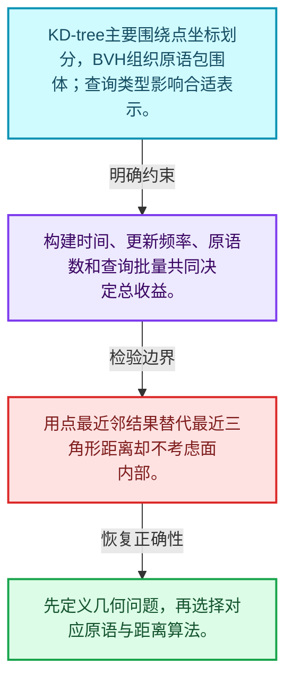
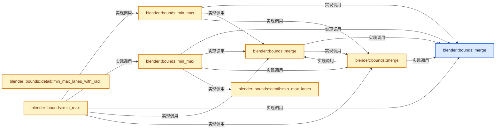
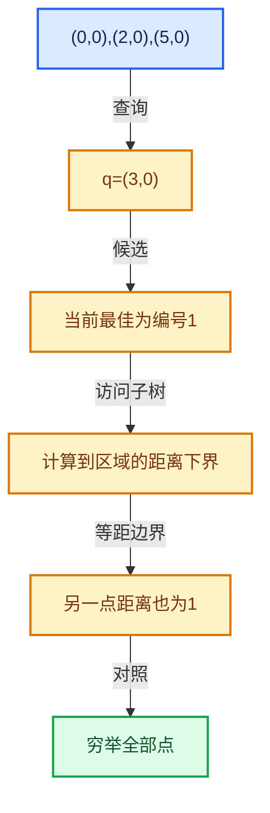

# 12-07 Bounds与BVH对比

[方向导航](README.md) · [总目录](../README.md) · [实现索引](../00-课程指南/02-源码与提交索引/符号依赖与实现索引.md)

## 从问题到实现

KD-tree与BVH各自划分什么对象？

点划分和包围体层次的组织目标不同；原语类型、更新模式和查询形式决定选型。

**数据模型**

KD-tree主要围绕点坐标划分，BVH组织原语包围体；查询类型影响合适表示。

**设计取舍**

构建时间、更新频率、原语数和查询批量共同决定总收益。

**最小反例**

用点最近邻结果替代最近三角形距离却不考虑面内部。

**推导**

先定义几何问题，再选择对应原语与距离算法。

## 阅读地图与执行推演








图中的数值推演是本方向的教学模型；实际函数之间的调用边与概念分析边分别标注，不能把概念关系当作运行时调度顺序。

## 完整源码单元与就地讲解

中文讲解直接放在相关代码旁，复杂机制在代码下展开。原文折叠区保留基准行号；不需要在行号表和函数之间来回查找。类布局可分段展示，函数实现不按固定行数切开。

### 类型布局、声明与编译条件 · BLI_bounds.hh L1—L26

<!-- annotated:109909624ed6cc -->

```cpp
/* SPDX-FileCopyrightText: 2023 Blender Authors
 *
 * SPDX-License-Identifier: GPL-2.0-or-later */

#pragma once

/** \file
 * \ingroup bli
 */

#include <optional>

#include "BLI_bounds_types.hh"
#include "BLI_index_mask.hh"
#include "BLI_math_matrix.hh"
#include "BLI_math_vector.hh"
#include "BLI_span.hh"
#include "BLI_task.hh"
#include "BLI_virtual_array.hh"

#include "PRF_profile.hh"

namespace blender {

namespace bounds {

```

<details>
<summary>核对原始源码：source/blender/blenlib/BLI_bounds.hh · L1—L26</summary>

<!-- original:109909624ed6cc:source/blender/blenlib/BLI_bounds.hh:1:26 -->

```cpp
/* SPDX-FileCopyrightText: 2023 Blender Authors
 *
 * SPDX-License-Identifier: GPL-2.0-or-later */

#pragma once

/** \file
 * \ingroup bli
 */

#include <optional>

#include "BLI_bounds_types.hh"
#include "BLI_index_mask.hh"
#include "BLI_math_matrix.hh"
#include "BLI_math_vector.hh"
#include "BLI_span.hh"
#include "BLI_task.hh"
#include "BLI_virtual_array.hh"

#include "PRF_profile.hh"

namespace blender {

namespace bounds {

```

</details>

<a id="f-26dade32771df176"></a>

### `blender::bounds::merge`

实现位置：[source/blender/blenlib/BLI_bounds.hh](../../../../../source/blender/blenlib/BLI_bounds.hh) · L27—L30。

接口参数：

- `const Bounds<T> &a`
- `const Bounds<T> &b`

**教学注释版**

<!-- annotated:ac558ec9dbb05f -->

```cpp
template<typename T> [[nodiscard]] inline Bounds<T> merge(const Bounds<T> &a, const Bounds<T> &b)
{
  return {math::min(a.min, b.min), math::max(a.max, b.max)};
}
```

<details>
<summary>核对原始源码：source/blender/blenlib/BLI_bounds.hh · L27—L30</summary>

<!-- original:ac558ec9dbb05f:source/blender/blenlib/BLI_bounds.hh:27:30 -->

```cpp
template<typename T> [[nodiscard]] inline Bounds<T> merge(const Bounds<T> &a, const Bounds<T> &b)
{
  return {math::min(a.min, b.min), math::max(a.max, b.max)};
}
```

</details>

**结果出口**

- `return {math::min(a.min, b.min), math::max(a.max, b.max)};`

**继续追踪实现**

- `math::min` → [blender::math::min · L56](../90-实现依赖专题/01-BLI基础库/BLI_math_vector.hh.md#f-ee6ead51e4bb3364)；[blender::math::min · L65](../90-实现依赖专题/01-BLI基础库/BLI_math_vector.hh.md#f-f65ce48b3051cce3)；[blender::math::min · L81](../90-实现依赖专题/01-BLI基础库/BLI_math_vector.hh.md#f-9c602d29fab41795)；[blender::math::min · L43](../90-实现依赖专题/01-BLI基础库/BLI_math_base.hh.md#f-72ff0c229e6c09b0)。同名重载需按实参类型选择。
- `math::max` → [blender::bounds::max · L268](07-Bounds与BVH对比.md#f-407b28b5a068f9a0)。

<!-- annotated:a877a1c98d1dea -->

```cpp

```

<details>
<summary>核对原始源码：source/blender/blenlib/BLI_bounds.hh · L31—L31</summary>

<!-- original:a877a1c98d1dea:source/blender/blenlib/BLI_bounds.hh:31:31 -->

```cpp

```

</details>

<a id="f-f539fea5d229191a"></a>

### `blender::bounds::merge`

实现位置：[source/blender/blenlib/BLI_bounds.hh](../../../../../source/blender/blenlib/BLI_bounds.hh) · L32—L46。

接口参数：

- `const std::optional<Bounds<T>> &a`
- `const std::optional<Bounds<T>> &b`

**教学注释版**

<!-- annotated:aaf91e120ee30c -->

```cpp
template<typename T>
[[nodiscard]] inline std::optional<Bounds<T>> merge(const std::optional<Bounds<T>> &a,
                                                    const std::optional<Bounds<T>> &b)
{
  if (a.has_value() && b.has_value()) {
    return merge(*a, *b);
  }
  if (a.has_value()) {
    return a;
  }
  if (b.has_value()) {
    return b;
  }
  return std::nullopt;
}
```

<details>
<summary>核对原始源码：source/blender/blenlib/BLI_bounds.hh · L32—L46</summary>

<!-- original:aaf91e120ee30c:source/blender/blenlib/BLI_bounds.hh:32:46 -->

```cpp
template<typename T>
[[nodiscard]] inline std::optional<Bounds<T>> merge(const std::optional<Bounds<T>> &a,
                                                    const std::optional<Bounds<T>> &b)
{
  if (a.has_value() && b.has_value()) {
    return merge(*a, *b);
  }
  if (a.has_value()) {
    return a;
  }
  if (b.has_value()) {
    return b;
  }
  return std::nullopt;
}
```

</details>

**结果出口**

- `return merge(*a, *b);`
- `return a;`
- `return b;`
- `return std::nullopt;`

**继续追踪实现**

- `a.has_value` → [外部契约](https://eel.is/c++draft/)：这个边界按实际表达式及所属类型核对参数、返回值、寿命与失败行为。这里提供接口入口，不声称已解释该第三方版本的内部实现。
- `b.has_value` → [外部契约](https://eel.is/c++draft/)：这个边界按实际表达式及所属类型核对参数、返回值、寿命与失败行为。这里提供接口入口，不声称已解释该第三方版本的内部实现。
- `merge` → [blender::bounds::merge · L27](07-Bounds与BVH对比.md#f-26dade32771df176)；[blender::bounds::merge · L32](07-Bounds与BVH对比.md#f-f539fea5d229191a)；[blender::bounds::merge · L48](07-Bounds与BVH对比.md#f-34b53687690dd2a5)。同名重载需按实参类型选择。

<!-- annotated:f4ff01a3727e00 -->

```cpp

```

<details>
<summary>核对原始源码：source/blender/blenlib/BLI_bounds.hh · L47—L47</summary>

<!-- original:f4ff01a3727e00:source/blender/blenlib/BLI_bounds.hh:47:47 -->

```cpp

```

</details>

<a id="f-34b53687690dd2a5"></a>

### `blender::bounds::merge`

实现位置：[source/blender/blenlib/BLI_bounds.hh](../../../../../source/blender/blenlib/BLI_bounds.hh) · L48—L53。

接口参数：

- `const std::optional<Bounds<T>> &a`
- `const Bounds<T> &b`

**教学注释版**

<!-- annotated:c537ec86250233 -->

```cpp
template<typename T>
[[nodiscard]] inline std::optional<Bounds<T>> merge(const std::optional<Bounds<T>> &a,
                                                    const Bounds<T> &b)
{
  return merge(a, std::optional<Bounds<T>>(b));
}
```

<details>
<summary>核对原始源码：source/blender/blenlib/BLI_bounds.hh · L48—L53</summary>

<!-- original:c537ec86250233:source/blender/blenlib/BLI_bounds.hh:48:53 -->

```cpp
template<typename T>
[[nodiscard]] inline std::optional<Bounds<T>> merge(const std::optional<Bounds<T>> &a,
                                                    const Bounds<T> &b)
{
  return merge(a, std::optional<Bounds<T>>(b));
}
```

</details>

**结果出口**

- `return merge(a, std::optional<Bounds<T>>(b));`

**继续追踪实现**

- `merge` → [blender::bounds::merge · L27](07-Bounds与BVH对比.md#f-26dade32771df176)；[blender::bounds::merge · L32](07-Bounds与BVH对比.md#f-f539fea5d229191a)；[blender::bounds::merge · L48](07-Bounds与BVH对比.md#f-34b53687690dd2a5)。同名重载需按实参类型选择。
- `std::optional<Bounds<T>>` → [外部契约](https://eel.is/c++draft/)：这个边界按实际表达式及所属类型核对参数、返回值、寿命与失败行为。这里提供接口入口，不声称已解释该第三方版本的内部实现。

<!-- annotated:13fa5b7e64c2d6 -->

```cpp

```

<details>
<summary>核对原始源码：source/blender/blenlib/BLI_bounds.hh · L54—L54</summary>

<!-- original:13fa5b7e64c2d6:source/blender/blenlib/BLI_bounds.hh:54:54 -->

```cpp

```

</details>

<a id="f-8ec8264a27aee526"></a>

### `blender::bounds::min_max`

实现位置：[source/blender/blenlib/BLI_bounds.hh](../../../../../source/blender/blenlib/BLI_bounds.hh) · L55—L63。

接口参数：

- `const std::optional<Bounds<T>> &a`
- `const T &b`

**教学注释版**

<!-- annotated:68deb68db62501 -->

```cpp
template<typename T>
[[nodiscard]] inline std::optional<Bounds<T>> min_max(const std::optional<Bounds<T>> &a,
                                                      const T &b)
{
  if (a.has_value()) {
    return merge(*a, {b, b});
  }
  return Bounds<T>{b, b};
}
```

<details>
<summary>核对原始源码：source/blender/blenlib/BLI_bounds.hh · L55—L63</summary>

<!-- original:68deb68db62501:source/blender/blenlib/BLI_bounds.hh:55:63 -->

```cpp
template<typename T>
[[nodiscard]] inline std::optional<Bounds<T>> min_max(const std::optional<Bounds<T>> &a,
                                                      const T &b)
{
  if (a.has_value()) {
    return merge(*a, {b, b});
  }
  return Bounds<T>{b, b};
}
```

</details>

**结果出口**

- `return merge(*a, {b, b});`
- `return Bounds<T>{b, b};`

**继续追踪实现**

- `a.has_value` → [外部契约](https://eel.is/c++draft/)：这个边界按实际表达式及所属类型核对参数、返回值、寿命与失败行为。这里提供接口入口，不声称已解释该第三方版本的内部实现。
- `merge` → [blender::bounds::merge · L27](07-Bounds与BVH对比.md#f-26dade32771df176)；[blender::bounds::merge · L32](07-Bounds与BVH对比.md#f-f539fea5d229191a)；[blender::bounds::merge · L48](07-Bounds与BVH对比.md#f-34b53687690dd2a5)。同名重载需按实参类型选择。

### 类型布局、声明与编译条件 · BLI_bounds.hh L64—L71

<!-- annotated:a4921da9bb081e -->

```cpp

namespace detail {

/**
 * Find the smallest and largest values element-wise in a non-empty span, in one sequential pass.
 * Several accumulators ("lanes"), so that the comparisons of one point do not wait on those of
 * the point before it.
 */
```

<details>
<summary>核对原始源码：source/blender/blenlib/BLI_bounds.hh · L64—L71</summary>

<!-- original:a4921da9bb081e:source/blender/blenlib/BLI_bounds.hh:64:71 -->

```cpp

namespace detail {

/**
 * Find the smallest and largest values element-wise in a non-empty span, in one sequential pass.
 * Several accumulators ("lanes"), so that the comparisons of one point do not wait on those of
 * the point before it.
 */
```

</details>

<a id="f-f7a622f039be3036"></a>

### `blender::bounds::detail::min_max_lanes`

实现位置：[source/blender/blenlib/BLI_bounds.hh](../../../../../source/blender/blenlib/BLI_bounds.hh) · L72—L101。

接口参数：

- `const Span<T> values`

**教学注释版**

<!-- annotated:c5d3be24c2350c -->

```cpp
template<typename T> [[nodiscard]] inline Bounds<T> min_max_lanes(const Span<T> values)
{
  constexpr int64_t lanes = 4;
  // [讲解] values.size：查询视图长度或生成对应有效索引区间。
  const int64_t size = values.size();
  const int64_t full = size & ~(lanes - 1);

  T lo[lanes];
  T hi[lanes];
  for (int64_t lane = 0; lane < lanes; lane++) {
    lo[lane] = hi[lane] = values[0];
  }
  for (int64_t i = 0; i < full; i += lanes) {
    for (int64_t lane = 0; lane < lanes; lane++) {
      const T &value = values[i + lane];
      lo[lane] = math::min(lo[lane], value);
      hi[lane] = math::max(hi[lane], value);
    }
  }

  Bounds<T> result{lo[0], hi[0]};
  for (int64_t lane = 1; lane < lanes; lane++) {
    result.min = math::min(result.min, lo[lane]);
    result.max = math::max(result.max, hi[lane]);
  }
  for (int64_t i = full; i < size; i++) {
    result.min = math::min(result.min, values[i]);
    result.max = math::max(result.max, values[i]);
  }
  return result;
}
```

<details>
<summary>核对原始源码：source/blender/blenlib/BLI_bounds.hh · L72—L101</summary>

<!-- original:c5d3be24c2350c:source/blender/blenlib/BLI_bounds.hh:72:101 -->

```cpp
template<typename T> [[nodiscard]] inline Bounds<T> min_max_lanes(const Span<T> values)
{
  constexpr int64_t lanes = 4;
  const int64_t size = values.size();
  const int64_t full = size & ~(lanes - 1);

  T lo[lanes];
  T hi[lanes];
  for (int64_t lane = 0; lane < lanes; lane++) {
    lo[lane] = hi[lane] = values[0];
  }
  for (int64_t i = 0; i < full; i += lanes) {
    for (int64_t lane = 0; lane < lanes; lane++) {
      const T &value = values[i + lane];
      lo[lane] = math::min(lo[lane], value);
      hi[lane] = math::max(hi[lane], value);
    }
  }

  Bounds<T> result{lo[0], hi[0]};
  for (int64_t lane = 1; lane < lanes; lane++) {
    result.min = math::min(result.min, lo[lane]);
    result.max = math::max(result.max, hi[lane]);
  }
  for (int64_t i = full; i < size; i++) {
    result.min = math::min(result.min, values[i]);
    result.max = math::max(result.max, values[i]);
  }
  return result;
}
```

</details>

**沿实际写入检查状态**

- `lo[lane] = hi[lane] = values[0];`
- `lo[lane] = math::min(lo[lane], value);`
- `hi[lane] = math::max(hi[lane], value);`
- `result.min = math::min(result.min, lo[lane]);`
- `result.max = math::max(result.max, hi[lane]);`
- `result.min = math::min(result.min, values[i]);`
- `result.max = math::max(result.max, values[i]);`

**结果出口**

- `return result;`

**继续追踪实现**

- `values.size` → [blender::Span::size · L256](../01-基础容器与现代CPP/05-Span只读连续视图.md#f-5f80fa006089c998)。
- `math::min` → [blender::math::min · L56](../90-实现依赖专题/01-BLI基础库/BLI_math_vector.hh.md#f-ee6ead51e4bb3364)；[blender::math::min · L65](../90-实现依赖专题/01-BLI基础库/BLI_math_vector.hh.md#f-f65ce48b3051cce3)；[blender::math::min · L81](../90-实现依赖专题/01-BLI基础库/BLI_math_vector.hh.md#f-9c602d29fab41795)；[blender::math::min · L43](../90-实现依赖专题/01-BLI基础库/BLI_math_base.hh.md#f-72ff0c229e6c09b0)。同名重载需按实参类型选择。
- `math::max` → [blender::bounds::max · L268](07-Bounds与BVH对比.md#f-407b28b5a068f9a0)。

### 类型布局、声明与编译条件 · BLI_bounds.hh L102—L103

<!-- annotated:bcb6257d4af1ee -->

```cpp

/** #min_max_lanes with a radius added to each value first. */
```

<details>
<summary>核对原始源码：source/blender/blenlib/BLI_bounds.hh · L102—L103</summary>

<!-- original:bcb6257d4af1ee:source/blender/blenlib/BLI_bounds.hh:102:103 -->

```cpp

/** #min_max_lanes with a radius added to each value first. */
```

</details>

<a id="f-0167286f0d1fe01d"></a>

### `blender::bounds::detail::min_max_lanes_with_radii`

实现位置：[source/blender/blenlib/BLI_bounds.hh](../../../../../source/blender/blenlib/BLI_bounds.hh) · L104—L135。

接口参数：

- `const Span<T> values`
- `const Span<RadiusT> radii`

**教学注释版**

<!-- annotated:4c8949a2623832 -->

```cpp
template<typename T, typename RadiusT>
[[nodiscard]] inline Bounds<T> min_max_lanes_with_radii(const Span<T> values,
                                                        const Span<RadiusT> radii)
{
  constexpr int64_t lanes = 4;
  // [讲解] values.size：查询视图长度或生成对应有效索引区间。
  const int64_t size = values.size();
  const int64_t full = size & ~(lanes - 1);

  T lo[lanes];
  T hi[lanes];
  for (int64_t lane = 0; lane < lanes; lane++) {
    lo[lane] = values[0] - radii[0];
    hi[lane] = values[0] + radii[0];
  }
  for (int64_t i = 0; i < full; i += lanes) {
    for (int64_t lane = 0; lane < lanes; lane++) {
      lo[lane] = math::min(lo[lane], values[i + lane] - radii[i + lane]);
      hi[lane] = math::max(hi[lane], values[i + lane] + radii[i + lane]);
    }
  }

  Bounds<T> result{lo[0], hi[0]};
  for (int64_t lane = 1; lane < lanes; lane++) {
    result.min = math::min(result.min, lo[lane]);
    result.max = math::max(result.max, hi[lane]);
  }
  for (int64_t i = full; i < size; i++) {
    result.min = math::min(result.min, values[i] - radii[i]);
    result.max = math::max(result.max, values[i] + radii[i]);
  }
  return result;
}
```

<details>
<summary>核对原始源码：source/blender/blenlib/BLI_bounds.hh · L104—L135</summary>

<!-- original:4c8949a2623832:source/blender/blenlib/BLI_bounds.hh:104:135 -->

```cpp
template<typename T, typename RadiusT>
[[nodiscard]] inline Bounds<T> min_max_lanes_with_radii(const Span<T> values,
                                                        const Span<RadiusT> radii)
{
  constexpr int64_t lanes = 4;
  const int64_t size = values.size();
  const int64_t full = size & ~(lanes - 1);

  T lo[lanes];
  T hi[lanes];
  for (int64_t lane = 0; lane < lanes; lane++) {
    lo[lane] = values[0] - radii[0];
    hi[lane] = values[0] + radii[0];
  }
  for (int64_t i = 0; i < full; i += lanes) {
    for (int64_t lane = 0; lane < lanes; lane++) {
      lo[lane] = math::min(lo[lane], values[i + lane] - radii[i + lane]);
      hi[lane] = math::max(hi[lane], values[i + lane] + radii[i + lane]);
    }
  }

  Bounds<T> result{lo[0], hi[0]};
  for (int64_t lane = 1; lane < lanes; lane++) {
    result.min = math::min(result.min, lo[lane]);
    result.max = math::max(result.max, hi[lane]);
  }
  for (int64_t i = full; i < size; i++) {
    result.min = math::min(result.min, values[i] - radii[i]);
    result.max = math::max(result.max, values[i] + radii[i]);
  }
  return result;
}
```

</details>

**沿实际写入检查状态**

- `lo[lane] = values[0] - radii[0];`
- `hi[lane] = values[0] + radii[0];`
- `lo[lane] = math::min(lo[lane], values[i + lane] - radii[i + lane]);`
- `hi[lane] = math::max(hi[lane], values[i + lane] + radii[i + lane]);`
- `result.min = math::min(result.min, lo[lane]);`
- `result.max = math::max(result.max, hi[lane]);`
- `result.min = math::min(result.min, values[i] - radii[i]);`
- `result.max = math::max(result.max, values[i] + radii[i]);`

**结果出口**

- `return result;`

**继续追踪实现**

- `values.size` → [blender::Span::size · L256](../01-基础容器与现代CPP/05-Span只读连续视图.md#f-5f80fa006089c998)。
- `math::min` → [blender::math::min · L56](../90-实现依赖专题/01-BLI基础库/BLI_math_vector.hh.md#f-ee6ead51e4bb3364)；[blender::math::min · L65](../90-实现依赖专题/01-BLI基础库/BLI_math_vector.hh.md#f-f65ce48b3051cce3)；[blender::math::min · L81](../90-实现依赖专题/01-BLI基础库/BLI_math_vector.hh.md#f-9c602d29fab41795)；[blender::math::min · L43](../90-实现依赖专题/01-BLI基础库/BLI_math_base.hh.md#f-72ff0c229e6c09b0)。同名重载需按实参类型选择。
- `math::max` → [blender::bounds::max · L268](07-Bounds与BVH对比.md#f-407b28b5a068f9a0)。

### 类型布局、声明与编译条件 · BLI_bounds.hh L136—L141

<!-- annotated:461f61d018a957 -->

```cpp

}  // namespace detail

/**
 * Find the smallest and largest values element-wise in the span.
 */
```

<details>
<summary>核对原始源码：source/blender/blenlib/BLI_bounds.hh · L136—L141</summary>

<!-- original:461f61d018a957:source/blender/blenlib/BLI_bounds.hh:136:141 -->

```cpp

}  // namespace detail

/**
 * Find the smallest and largest values element-wise in the span.
 */
```

</details>

<a id="f-54be182a0edebcb6"></a>

### `blender::bounds::min_max`

实现位置：[source/blender/blenlib/BLI_bounds.hh](../../../../../source/blender/blenlib/BLI_bounds.hh) · L142—L157。

接口参数：

- `const Span<T> values`

**教学注释版**

<!-- annotated:d24d14197d5057 -->

```cpp
template<typename T> [[nodiscard]] inline std::optional<Bounds<T>> min_max(const Span<T> values)
{
  // [讲解] values.is_empty：查询视图长度或生成对应有效索引区间。
  if (values.is_empty()) {
    return std::nullopt;
  }
  PRF_scope_with_name("bounds::min_max", ProfileCategory::Default);
  // [讲解] values.first：按视图边界访问元素。
  const Bounds<T> init{values.first(), values.first()};
  return threading::parallel_reduce(
      // [讲解] values.index_range：查询视图长度或生成对应有效索引区间。
      values.index_range(),
      1024,
      init,
      [&](const IndexRange range, const Bounds<T> &init) {
        // [讲解] values.slice：建立原连续范围的子视图。
        return merge(init, detail::min_max_lanes(values.slice(range)));
      },
      [](const Bounds<T> &a, const Bounds<T> &b) { return merge(a, b); });
}
```

<details>
<summary>核对原始源码：source/blender/blenlib/BLI_bounds.hh · L142—L157</summary>

<!-- original:d24d14197d5057:source/blender/blenlib/BLI_bounds.hh:142:157 -->

```cpp
template<typename T> [[nodiscard]] inline std::optional<Bounds<T>> min_max(const Span<T> values)
{
  if (values.is_empty()) {
    return std::nullopt;
  }
  PRF_scope_with_name("bounds::min_max", ProfileCategory::Default);
  const Bounds<T> init{values.first(), values.first()};
  return threading::parallel_reduce(
      values.index_range(),
      1024,
      init,
      [&](const IndexRange range, const Bounds<T> &init) {
        return merge(init, detail::min_max_lanes(values.slice(range)));
      },
      [](const Bounds<T> &a, const Bounds<T> &b) { return merge(a, b); });
}
```

</details>

**结果出口**

- `return std::nullopt;`
- `return threading::parallel_reduce(`
- `return merge(init, detail::min_max_lanes(values.slice(range)));`

**继续追踪实现**

- `values.is_empty` → [blender::Span::is_empty · L264](../01-基础容器与现代CPP/05-Span只读连续视图.md#f-8cc1d7ba8feb50e6)。
- `PRF_scope_with_name` → [PRF_scope_with_name · L52](../90-实现依赖专题/07-Intern运行时与平台/profile/PRF_profile.hh.md#m-adc22c3a3f8c)；[PRF_scope_with_name · L91](../90-实现依赖专题/07-Intern运行时与平台/profile/PRF_profile.hh.md#m-3cbbaddb89c4)。宏定义由构建条件选择。
- `values.first` → [blender::Span::first · L319](../01-基础容器与现代CPP/05-Span只读连续视图.md#f-d8c9bcc3e9757248)。
- `threading::parallel_reduce` → [blender::threading::parallel_reduce · L126](../11-Depsgraph与并行任务系统/07-任务池与TBB接入.md#f-9225ddb5efb97fcc)。
- `values.index_range` → [blender::Span::index_range · L405](../01-基础容器与现代CPP/05-Span只读连续视图.md#f-caaa9b06e13e53e0)。
- `merge` → [blender::bounds::merge · L27](07-Bounds与BVH对比.md#f-26dade32771df176)；[blender::bounds::merge · L32](07-Bounds与BVH对比.md#f-f539fea5d229191a)；[blender::bounds::merge · L48](07-Bounds与BVH对比.md#f-34b53687690dd2a5)。同名重载需按实参类型选择。
- `detail::min_max_lanes` → [blender::bounds::detail::min_max_lanes · L72](07-Bounds与BVH对比.md#f-f7a622f039be3036)。
- `values.slice` → [blender::Span::slice · L141](../01-基础容器与现代CPP/05-Span只读连续视图.md#f-380a0e8fdcbd53cc)；[blender::Span::slice · L149](../01-基础容器与现代CPP/05-Span只读连续视图.md#f-9b9c15e78dd54eec)。同名重载需按实参类型选择。

<!-- annotated:df7463a9207280 -->

```cpp

```

<details>
<summary>核对原始源码：source/blender/blenlib/BLI_bounds.hh · L158—L158</summary>

<!-- original:df7463a9207280:source/blender/blenlib/BLI_bounds.hh:158:158 -->

```cpp

```

</details>

<a id="f-c05654b35c75b0ff"></a>

### `blender::bounds::min_max`

实现位置：[source/blender/blenlib/BLI_bounds.hh](../../../../../source/blender/blenlib/BLI_bounds.hh) · L159—L182。

接口参数：

- `const IndexMask &mask`
- `const Span<T> values`

**教学注释版**

<!-- annotated:690975f443d344 -->

```cpp
template<typename T>
[[nodiscard]] inline std::optional<Bounds<T>> min_max(const IndexMask &mask, const Span<T> values)
{
  // [讲解] values.is_empty：查询视图长度或生成对应有效索引区间。
  if (values.is_empty() || mask.is_empty()) {
    return std::nullopt;
  }
  // [讲解] values.size：查询视图长度或生成对应有效索引区间。
  if (mask.size() == values.size()) {
    /* To avoid mask slice/lookup. */
    return min_max(values);
  }
  PRF_scope_with_name("bounds::min_max", ProfileCategory::Default);
  const Bounds<T> init{values[mask.first()], values[mask.first()]};
  return threading::parallel_reduce(
      mask.index_range().drop_front(1),
      1024,
      init,
      [&](const IndexRange range, const Bounds<T> &init) {
        Bounds<T> result = init;
        mask.slice(range).foreach_index_optimized<int64_t>(
            [&](const int i) { math::min_max(values[i], result.min, result.max); });
        return result;
      },
      [](const Bounds<T> &a, const Bounds<T> &b) { return merge(a, b); });
}
```

<details>
<summary>核对原始源码：source/blender/blenlib/BLI_bounds.hh · L159—L182</summary>

<!-- original:690975f443d344:source/blender/blenlib/BLI_bounds.hh:159:182 -->

```cpp
template<typename T>
[[nodiscard]] inline std::optional<Bounds<T>> min_max(const IndexMask &mask, const Span<T> values)
{
  if (values.is_empty() || mask.is_empty()) {
    return std::nullopt;
  }
  if (mask.size() == values.size()) {
    /* To avoid mask slice/lookup. */
    return min_max(values);
  }
  PRF_scope_with_name("bounds::min_max", ProfileCategory::Default);
  const Bounds<T> init{values[mask.first()], values[mask.first()]};
  return threading::parallel_reduce(
      mask.index_range().drop_front(1),
      1024,
      init,
      [&](const IndexRange range, const Bounds<T> &init) {
        Bounds<T> result = init;
        mask.slice(range).foreach_index_optimized<int64_t>(
            [&](const int i) { math::min_max(values[i], result.min, result.max); });
        return result;
      },
      [](const Bounds<T> &a, const Bounds<T> &b) { return merge(a, b); });
}
```

</details>

**结果出口**

- `return std::nullopt;`
- `return min_max(values);`
- `return threading::parallel_reduce(`
- `return result;`

**继续追踪实现**

- `values.is_empty` → [blender::Span::is_empty · L264](../01-基础容器与现代CPP/05-Span只读连续视图.md#f-8cc1d7ba8feb50e6)。
- `mask.is_empty` → [blender::index_mask::IndexMask::is_empty · L748](../04-虚拟数组与索引选择/09-分段存储与遍历.md#f-190ac996386064f4)。
- `mask.size` → [blender::index_mask::IndexMask::size · L743](../04-虚拟数组与索引选择/09-分段存储与遍历.md#f-0163b32abc9a0d9c)。
- `values.size` → [blender::Span::size · L256](../01-基础容器与现代CPP/05-Span只读连续视图.md#f-5f80fa006089c998)。
- `min_max` → [blender::bounds::min_max · L55](07-Bounds与BVH对比.md#f-8ec8264a27aee526)；[blender::bounds::min_max · L142](07-Bounds与BVH对比.md#f-54be182a0edebcb6)；[blender::bounds::min_max · L159](07-Bounds与BVH对比.md#f-c05654b35c75b0ff)；[blender::bounds::min_max · L212](07-Bounds与BVH对比.md#f-6c1add8352426e55)。同名重载需按实参类型选择。
- `PRF_scope_with_name` → [PRF_scope_with_name · L52](../90-实现依赖专题/07-Intern运行时与平台/profile/PRF_profile.hh.md#m-adc22c3a3f8c)；[PRF_scope_with_name · L91](../90-实现依赖专题/07-Intern运行时与平台/profile/PRF_profile.hh.md#m-3cbbaddb89c4)。宏定义由构建条件选择。
- `mask.first` → [blender::index_mask::IndexMask::first · L768](../04-虚拟数组与索引选择/09-分段存储与遍历.md#f-0fdcf75a0be7ad37)。
- `threading::parallel_reduce` → [blender::threading::parallel_reduce · L126](../11-Depsgraph与并行任务系统/07-任务池与TBB接入.md#f-9225ddb5efb97fcc)。
- `mask.index_range().drop_front` → [调用协议](../00-课程指南/01-路线与规范/模板宏与动态分派协议.md)：接收对象类型依赖auto、返回值或模板实例；不按同名猜测目标。调用位置L172。
- `mask.index_range` → [blender::index_mask::IndexMask::index_range · L753](../04-虚拟数组与索引选择/09-分段存储与遍历.md#f-749c399cf5bc4035)。
- `mask.slice(range).foreach_index_optimized<int64_t>` → [调用协议](../00-课程指南/01-路线与规范/模板宏与动态分派协议.md)：接收对象类型依赖auto、返回值或模板实例；不按同名猜测目标。调用位置L177。
- `mask.slice` → [blender::index_mask::IndexMask::slice · L845](../04-虚拟数组与索引选择/09-分段存储与遍历.md#f-8c3ef56b66c5f123)。
- `math::min_max` → [blender::bounds::min_max · L55](07-Bounds与BVH对比.md#f-8ec8264a27aee526)；[blender::bounds::min_max · L142](07-Bounds与BVH对比.md#f-54be182a0edebcb6)；[blender::bounds::min_max · L159](07-Bounds与BVH对比.md#f-c05654b35c75b0ff)；[blender::bounds::min_max · L212](07-Bounds与BVH对比.md#f-6c1add8352426e55)。同名重载需按实参类型选择。
- `merge` → [blender::bounds::merge · L27](07-Bounds与BVH对比.md#f-26dade32771df176)；[blender::bounds::merge · L32](07-Bounds与BVH对比.md#f-f539fea5d229191a)；[blender::bounds::merge · L48](07-Bounds与BVH对比.md#f-34b53687690dd2a5)。同名重载需按实参类型选择。

### 类型布局、声明与编译条件 · BLI_bounds.hh L183—L187

<!-- annotated:876fbac66704eb -->

```cpp

/**
 * Find the smallest and largest values element-wise in the span, adding the radius to each element
 * first. The template type T is expected to have an addition operator implemented with RadiusT.
 */
```

<details>
<summary>核对原始源码：source/blender/blenlib/BLI_bounds.hh · L183—L187</summary>

<!-- original:876fbac66704eb:source/blender/blenlib/BLI_bounds.hh:183:187 -->

```cpp

/**
 * Find the smallest and largest values element-wise in the span, adding the radius to each element
 * first. The template type T is expected to have an addition operator implemented with RadiusT.
 */
```

</details>

<a id="f-7cb47639fafbdef7"></a>

### `blender::bounds::min_max_with_radii`

实现位置：[source/blender/blenlib/BLI_bounds.hh](../../../../../source/blender/blenlib/BLI_bounds.hh) · L188—L207。

接口参数：

- `const Span<T> values`
- `const Span<RadiusT> radii`

**教学注释版**

<!-- annotated:a85220e44d8370 -->

```cpp
template<typename T, typename RadiusT>
[[nodiscard]] inline std::optional<Bounds<T>> min_max_with_radii(const Span<T> values,
                                                                 const Span<RadiusT> radii)
{
  // [讲解] values.size：查询视图长度或生成对应有效索引区间。
  BLI_assert(values.size() == radii.size());
  // [讲解] values.is_empty：查询视图长度或生成对应有效索引区间。
  if (values.is_empty()) {
    return std::nullopt;
  }
  PRF_scope_with_name("bounds::min_max_with_radii", ProfileCategory::Default);
  // [讲解] values.first：按视图边界访问元素。
  const Bounds<T> init{values.first(), values.first()};
  return threading::parallel_reduce(
      // [讲解] values.index_range：查询视图长度或生成对应有效索引区间。
      values.index_range(),
      1024,
      init,
      [&](const IndexRange range, const Bounds<T> &init) {
        return merge(init,
                     // [讲解] values.slice：建立原连续范围的子视图。
                     detail::min_max_lanes_with_radii(values.slice(range), radii.slice(range)));
      },
      [](const Bounds<T> &a, const Bounds<T> &b) { return merge(a, b); });
}
```

<details>
<summary>核对原始源码：source/blender/blenlib/BLI_bounds.hh · L188—L207</summary>

<!-- original:a85220e44d8370:source/blender/blenlib/BLI_bounds.hh:188:207 -->

```cpp
template<typename T, typename RadiusT>
[[nodiscard]] inline std::optional<Bounds<T>> min_max_with_radii(const Span<T> values,
                                                                 const Span<RadiusT> radii)
{
  BLI_assert(values.size() == radii.size());
  if (values.is_empty()) {
    return std::nullopt;
  }
  PRF_scope_with_name("bounds::min_max_with_radii", ProfileCategory::Default);
  const Bounds<T> init{values.first(), values.first()};
  return threading::parallel_reduce(
      values.index_range(),
      1024,
      init,
      [&](const IndexRange range, const Bounds<T> &init) {
        return merge(init,
                     detail::min_max_lanes_with_radii(values.slice(range), radii.slice(range)));
      },
      [](const Bounds<T> &a, const Bounds<T> &b) { return merge(a, b); });
}
```

</details>

**结果出口**

- `return std::nullopt;`
- `return threading::parallel_reduce(`
- `return merge(init,`

**继续追踪实现**

- `BLI_assert` → [BLI_assert · L48](../90-实现依赖专题/01-BLI基础库/BLI_assert.hh.md#m-57a88495704d)；[BLI_assert · L63](../90-实现依赖专题/01-BLI基础库/BLI_assert.hh.md#m-d07050020cb5)。宏定义由构建条件选择。
- `values.size` → [blender::Span::size · L256](../01-基础容器与现代CPP/05-Span只读连续视图.md#f-5f80fa006089c998)。
- `radii.size` → [blender::Span::size · L256](../01-基础容器与现代CPP/05-Span只读连续视图.md#f-5f80fa006089c998)。
- `values.is_empty` → [blender::Span::is_empty · L264](../01-基础容器与现代CPP/05-Span只读连续视图.md#f-8cc1d7ba8feb50e6)。
- `PRF_scope_with_name` → [PRF_scope_with_name · L52](../90-实现依赖专题/07-Intern运行时与平台/profile/PRF_profile.hh.md#m-adc22c3a3f8c)；[PRF_scope_with_name · L91](../90-实现依赖专题/07-Intern运行时与平台/profile/PRF_profile.hh.md#m-3cbbaddb89c4)。宏定义由构建条件选择。
- `values.first` → [blender::Span::first · L319](../01-基础容器与现代CPP/05-Span只读连续视图.md#f-d8c9bcc3e9757248)。
- `threading::parallel_reduce` → [blender::threading::parallel_reduce · L126](../11-Depsgraph与并行任务系统/07-任务池与TBB接入.md#f-9225ddb5efb97fcc)。
- `values.index_range` → [blender::Span::index_range · L405](../01-基础容器与现代CPP/05-Span只读连续视图.md#f-caaa9b06e13e53e0)。
- `merge` → [blender::bounds::merge · L27](07-Bounds与BVH对比.md#f-26dade32771df176)；[blender::bounds::merge · L32](07-Bounds与BVH对比.md#f-f539fea5d229191a)；[blender::bounds::merge · L48](07-Bounds与BVH对比.md#f-34b53687690dd2a5)。同名重载需按实参类型选择。
- `detail::min_max_lanes_with_radii` → [blender::bounds::detail::min_max_lanes_with_radii · L104](07-Bounds与BVH对比.md#f-0167286f0d1fe01d)。
- `values.slice` → [blender::Span::slice · L141](../01-基础容器与现代CPP/05-Span只读连续视图.md#f-380a0e8fdcbd53cc)；[blender::Span::slice · L149](../01-基础容器与现代CPP/05-Span只读连续视图.md#f-9b9c15e78dd54eec)。同名重载需按实参类型选择。
- `radii.slice` → [blender::Span::slice · L141](../01-基础容器与现代CPP/05-Span只读连续视图.md#f-380a0e8fdcbd53cc)；[blender::Span::slice · L149](../01-基础容器与现代CPP/05-Span只读连续视图.md#f-9b9c15e78dd54eec)。同名重载需按实参类型选择。

### 类型布局、声明与编译条件 · BLI_bounds.hh L208—L211

<!-- annotated:d8ab56f39ba065 -->

```cpp

/**
 * Find the smallest and largest values element-wise in a virtual array.
 */
```

<details>
<summary>核对原始源码：source/blender/blenlib/BLI_bounds.hh · L208—L211</summary>

<!-- original:d8ab56f39ba065:source/blender/blenlib/BLI_bounds.hh:208:211 -->

```cpp

/**
 * Find the smallest and largest values element-wise in a virtual array.
 */
```

</details>

<a id="f-6c1add8352426e55"></a>

### `blender::bounds::min_max`

实现位置：[source/blender/blenlib/BLI_bounds.hh](../../../../../source/blender/blenlib/BLI_bounds.hh) · L212—L240。

接口参数：

- `const VArray<T> &varray`

**教学注释版**

<!-- annotated:d96ac0bae20783 -->

```cpp
template<typename T> [[nodiscard]] inline std::optional<Bounds<T>> min_max(const VArray<T> &varray)
{
  if (varray.is_empty()) {
    return std::nullopt;
  }
  PRF_scope_with_name("bounds::min_max_with_radii", ProfileCategory::Default);
  const CommonVArrayInfo info = varray.common_info();
  if (info.type == CommonVArrayInfo::Type::Single) {
    Bounds<T> result = Bounds<T>(varray.first());
    return result;
  }
  if (info.type == CommonVArrayInfo::Type::Span) {
    const Span<T> span(static_cast<const T *>(info.data), varray.size());
    return min_max<T>(span);
  }
  const Bounds<T> init{varray.first(), varray.first()};
  return threading::parallel_reduce(
      varray.index_range(),
      1024,
      init,
      [&](const IndexRange range, const Bounds<T> &init) {
        Bounds<T> result = init;
        for (const int i : range) {
          math::min_max(varray[i], result.min, result.max);
        }
        return result;
      },
      [](const Bounds<T> &a, const Bounds<T> &b) { return merge(a, b); });
}
```

<details>
<summary>核对原始源码：source/blender/blenlib/BLI_bounds.hh · L212—L240</summary>

<!-- original:d96ac0bae20783:source/blender/blenlib/BLI_bounds.hh:212:240 -->

```cpp
template<typename T> [[nodiscard]] inline std::optional<Bounds<T>> min_max(const VArray<T> &varray)
{
  if (varray.is_empty()) {
    return std::nullopt;
  }
  PRF_scope_with_name("bounds::min_max_with_radii", ProfileCategory::Default);
  const CommonVArrayInfo info = varray.common_info();
  if (info.type == CommonVArrayInfo::Type::Single) {
    Bounds<T> result = Bounds<T>(varray.first());
    return result;
  }
  if (info.type == CommonVArrayInfo::Type::Span) {
    const Span<T> span(static_cast<const T *>(info.data), varray.size());
    return min_max<T>(span);
  }
  const Bounds<T> init{varray.first(), varray.first()};
  return threading::parallel_reduce(
      varray.index_range(),
      1024,
      init,
      [&](const IndexRange range, const Bounds<T> &init) {
        Bounds<T> result = init;
        for (const int i : range) {
          math::min_max(varray[i], result.min, result.max);
        }
        return result;
      },
      [](const Bounds<T> &a, const Bounds<T> &b) { return merge(a, b); });
}
```

</details>

**结果出口**

- `return std::nullopt;`
- `return result;`
- `return min_max<T>(span);`
- `return threading::parallel_reduce(`

**继续追踪实现**

- `varray.is_empty` → [blender::Bounds<T>::is_empty · L533](07-Bounds与BVH对比.md#f-55ac376b3d0a0944)。
- `PRF_scope_with_name` → [PRF_scope_with_name · L52](../90-实现依赖专题/07-Intern运行时与平台/profile/PRF_profile.hh.md#m-adc22c3a3f8c)；[PRF_scope_with_name · L91](../90-实现依赖专题/07-Intern运行时与平台/profile/PRF_profile.hh.md#m-3cbbaddb89c4)。宏定义由构建条件选择。
- `varray.common_info` → [调用协议](../00-课程指南/01-路线与规范/模板宏与动态分派协议.md)：由接收对象具体类型或运行时策略提供实现。调用位置L218。
- `Bounds<T>` → [blender::Bounds](../90-实现依赖专题/01-BLI基础库/BLI_bounds_types.hh.md#t-034e001bc6d9)；[blender::Bounds](../90-实现依赖专题/08-其他Blender模块/io/usd/intern/usd_writer_abstract.hh.md#t-c611d2724544)；[blender::Bounds](../90-实现依赖专题/08-其他Blender模块/makesdna/DNA_mesh_types.h.md#t-3124dc634817)；[blender::draw::overlay::Bounds](../90-实现依赖专题/08-其他Blender模块/draw/engines/overlay/overlay_bounds.hh.md#t-1e10f8dc8848)。
- `varray.first` → [调用协议](../00-课程指南/01-路线与规范/模板宏与动态分派协议.md)：由接收对象具体类型或运行时策略提供实现。调用位置L220。
- `varray.size` → [blender::Bounds<T>::size · L543](07-Bounds与BVH对比.md#f-fcce88c0824fcd97)。
- `min_max<T>` → [blender::bounds::min_max · L55](07-Bounds与BVH对比.md#f-8ec8264a27aee526)；[blender::bounds::min_max · L142](07-Bounds与BVH对比.md#f-54be182a0edebcb6)；[blender::bounds::min_max · L159](07-Bounds与BVH对比.md#f-c05654b35c75b0ff)；[blender::bounds::min_max · L212](07-Bounds与BVH对比.md#f-6c1add8352426e55)。同名重载需按实参类型选择。
- `threading::parallel_reduce` → [blender::threading::parallel_reduce · L126](../11-Depsgraph与并行任务系统/07-任务池与TBB接入.md#f-9225ddb5efb97fcc)。
- `varray.index_range` → [调用协议](../00-课程指南/01-路线与规范/模板宏与动态分派协议.md)：由接收对象具体类型或运行时策略提供实现。调用位置L229。
- `math::min_max` → [blender::bounds::min_max · L55](07-Bounds与BVH对比.md#f-8ec8264a27aee526)；[blender::bounds::min_max · L142](07-Bounds与BVH对比.md#f-54be182a0edebcb6)；[blender::bounds::min_max · L159](07-Bounds与BVH对比.md#f-c05654b35c75b0ff)；[blender::bounds::min_max · L212](07-Bounds与BVH对比.md#f-6c1add8352426e55)。同名重载需按实参类型选择。
- `merge` → [blender::bounds::merge · L27](07-Bounds与BVH对比.md#f-26dade32771df176)；[blender::bounds::merge · L32](07-Bounds与BVH对比.md#f-f539fea5d229191a)；[blender::bounds::merge · L48](07-Bounds与BVH对比.md#f-34b53687690dd2a5)。同名重载需按实参类型选择。

### 类型布局、声明与编译条件 · BLI_bounds.hh L241—L245

<!-- annotated:aa9885919ec63a -->

```cpp

/**
 * Returns a new bound that contains the intersection of the two given bound.
 * Returns no box if there are no overlap.
 */
```

<details>
<summary>核对原始源码：source/blender/blenlib/BLI_bounds.hh · L241—L245</summary>

<!-- original:aa9885919ec63a:source/blender/blenlib/BLI_bounds.hh:241:245 -->

```cpp

/**
 * Returns a new bound that contains the intersection of the two given bound.
 * Returns no box if there are no overlap.
 */
```

</details>

<a id="f-1efe408cab52f476"></a>

### `blender::bounds::intersect`

实现位置：[source/blender/blenlib/BLI_bounds.hh](../../../../../source/blender/blenlib/BLI_bounds.hh) · L246—L254。

接口参数：

- `const Bounds<T> &a`
- `const Bounds<T> &b`

**教学注释版**

<!-- annotated:64cee80b0fa9b8 -->

```cpp
template<typename T>
[[nodiscard]] inline std::optional<Bounds<T>> intersect(const Bounds<T> &a, const Bounds<T> &b)
{
  const Bounds<T> result{math::max(a.min, b.min), math::min(a.max, b.max)};
  if (result.is_empty()) {
    return std::nullopt;
  }
  return result;
}
```

<details>
<summary>核对原始源码：source/blender/blenlib/BLI_bounds.hh · L246—L254</summary>

<!-- original:64cee80b0fa9b8:source/blender/blenlib/BLI_bounds.hh:246:254 -->

```cpp
template<typename T>
[[nodiscard]] inline std::optional<Bounds<T>> intersect(const Bounds<T> &a, const Bounds<T> &b)
{
  const Bounds<T> result{math::max(a.min, b.min), math::min(a.max, b.max)};
  if (result.is_empty()) {
    return std::nullopt;
  }
  return result;
}
```

</details>

**结果出口**

- `return std::nullopt;`
- `return result;`

**继续追踪实现**

- `math::max` → [blender::bounds::max · L268](07-Bounds与BVH对比.md#f-407b28b5a068f9a0)。
- `math::min` → [blender::math::min · L56](../90-实现依赖专题/01-BLI基础库/BLI_math_vector.hh.md#f-ee6ead51e4bb3364)；[blender::math::min · L65](../90-实现依赖专题/01-BLI基础库/BLI_math_vector.hh.md#f-f65ce48b3051cce3)；[blender::math::min · L81](../90-实现依赖专题/01-BLI基础库/BLI_math_vector.hh.md#f-9c602d29fab41795)；[blender::math::min · L43](../90-实现依赖专题/01-BLI基础库/BLI_math_base.hh.md#f-72ff0c229e6c09b0)。同名重载需按实参类型选择。
- `result.is_empty` → [blender::Bounds<T>::is_empty · L533](07-Bounds与BVH对比.md#f-55ac376b3d0a0944)。

<a id="f-73e90541b00d94e4"></a>

### `blender::bounds::intersect`

实现位置：[source/blender/blenlib/BLI_bounds.hh](../../../../../source/blender/blenlib/BLI_bounds.hh) · L255—L263。

接口参数：

- `const std::optional<Bounds<T>> &a`
- `const std::optional<Bounds<T>> &b`

**教学注释版**

<!-- annotated:91e0c323616a64 -->

```cpp
template<typename T>
[[nodiscard]] inline std::optional<Bounds<T>> intersect(const std::optional<Bounds<T>> &a,
                                                        const std::optional<Bounds<T>> &b)
{
  if (!a.has_value() || !b.has_value()) {
    return std::nullopt;
  }
  return intersect(*a, *b);
}
```

<details>
<summary>核对原始源码：source/blender/blenlib/BLI_bounds.hh · L255—L263</summary>

<!-- original:91e0c323616a64:source/blender/blenlib/BLI_bounds.hh:255:263 -->

```cpp
template<typename T>
[[nodiscard]] inline std::optional<Bounds<T>> intersect(const std::optional<Bounds<T>> &a,
                                                        const std::optional<Bounds<T>> &b)
{
  if (!a.has_value() || !b.has_value()) {
    return std::nullopt;
  }
  return intersect(*a, *b);
}
```

</details>

**结果出口**

- `return std::nullopt;`
- `return intersect(*a, *b);`

**继续追踪实现**

- `a.has_value` → [外部契约](https://eel.is/c++draft/)：这个边界按实际表达式及所属类型核对参数、返回值、寿命与失败行为。这里提供接口入口，不声称已解释该第三方版本的内部实现。
- `b.has_value` → [外部契约](https://eel.is/c++draft/)：这个边界按实际表达式及所属类型核对参数、返回值、寿命与失败行为。这里提供接口入口，不声称已解释该第三方版本的内部实现。
- `intersect` → [blender::bounds::intersect · L246](07-Bounds与BVH对比.md#f-1efe408cab52f476)；[blender::bounds::intersect · L255](07-Bounds与BVH对比.md#f-73e90541b00d94e4)。同名重载需按实参类型选择。

### 类型布局、声明与编译条件 · BLI_bounds.hh L264—L267

<!-- annotated:e15c9c9b94b8f8 -->

```cpp

/**
 * Finds the maximum value for elements in the array.
 */
```

<details>
<summary>核对原始源码：source/blender/blenlib/BLI_bounds.hh · L264—L267</summary>

<!-- original:e15c9c9b94b8f8:source/blender/blenlib/BLI_bounds.hh:264:267 -->

```cpp

/**
 * Finds the maximum value for elements in the array.
 */
```

</details>

<a id="f-407b28b5a068f9a0"></a>

### `blender::bounds::max`

实现位置：[source/blender/blenlib/BLI_bounds.hh](../../../../../source/blender/blenlib/BLI_bounds.hh) · L268—L289。

接口参数：

- `const VArray<T> &values`

**教学注释版**

<!-- annotated:8b4f451c506b49 -->

```cpp
template<typename T> inline std::optional<T> max(const VArray<T> &values)
{
  if (values.is_empty()) {
    return std::nullopt;
  }
  PRF_scope_with_name("bounds::max", ProfileCategory::Default);
  if (const std::optional<T> value = values.get_if_single()) {
    return value;
  }
  const VArraySpan<int> values_span = values;
  return threading::parallel_reduce(
      values_span.index_range(),
      2048,
      // [讲解] std::numeric_limits<T>::min：按比较关系选取较小值；截断范围时还需先满足非负和可表示范围，min本身不会证明边界安全。
      std::numeric_limits<T>::min(),
      [&](const IndexRange range, int current_max) {
        for (const int value : values_span.slice(range)) {
          // [讲解] std::max：按比较关系选取较大值。本讲解中的增长公式同时满足最低请求和几何增长；若保存返回引用，还需注意实参寿命。
          current_max = std::max(current_max, value);
        }
        return current_max;
      },
      [](const int a, const int b) { return std::max(a, b); });
}
```

<details>
<summary>核对原始源码：source/blender/blenlib/BLI_bounds.hh · L268—L289</summary>

<!-- original:8b4f451c506b49:source/blender/blenlib/BLI_bounds.hh:268:289 -->

```cpp
template<typename T> inline std::optional<T> max(const VArray<T> &values)
{
  if (values.is_empty()) {
    return std::nullopt;
  }
  PRF_scope_with_name("bounds::max", ProfileCategory::Default);
  if (const std::optional<T> value = values.get_if_single()) {
    return value;
  }
  const VArraySpan<int> values_span = values;
  return threading::parallel_reduce(
      values_span.index_range(),
      2048,
      std::numeric_limits<T>::min(),
      [&](const IndexRange range, int current_max) {
        for (const int value : values_span.slice(range)) {
          current_max = std::max(current_max, value);
        }
        return current_max;
      },
      [](const int a, const int b) { return std::max(a, b); });
}
```

</details>

**沿实际写入检查状态**

- `current_max = std::max(current_max, value);`

**结果出口**

- `return std::nullopt;`
- `return value;`
- `return threading::parallel_reduce(`
- `return current_max;`

**继续追踪实现**

- `values.is_empty` → [blender::Bounds<T>::is_empty · L533](07-Bounds与BVH对比.md#f-55ac376b3d0a0944)。
- `PRF_scope_with_name` → [PRF_scope_with_name · L52](../90-实现依赖专题/07-Intern运行时与平台/profile/PRF_profile.hh.md#m-adc22c3a3f8c)；[PRF_scope_with_name · L91](../90-实现依赖专题/07-Intern运行时与平台/profile/PRF_profile.hh.md#m-3cbbaddb89c4)。宏定义由构建条件选择。
- `values.get_if_single` → [blender::VArrayCommon::get_if_single · L649](../04-虚拟数组与索引选择/03-单值与Span表示.md#f-779c11c4fd8e6ac3)。
- `threading::parallel_reduce` → [blender::threading::parallel_reduce · L126](../11-Depsgraph与并行任务系统/07-任务池与TBB接入.md#f-9225ddb5efb97fcc)。
- `values_span.index_range` → [调用协议](../00-课程指南/01-路线与规范/模板宏与动态分派协议.md)：由接收对象具体类型或运行时策略提供实现。调用位置L279。
- `std::numeric_limits<T>::min` → [外部契约](https://eel.is/c++draft/alg.min.max)：按比较关系选取较小值；截断范围时还需先满足非负和可表示范围，min本身不会证明边界安全。
- `values_span.slice` → [调用协议](../00-课程指南/01-路线与规范/模板宏与动态分派协议.md)：由接收对象具体类型或运行时策略提供实现。调用位置L283。
- `std::max` → [外部契约](https://eel.is/c++draft/alg.min.max)：按比较关系选取较大值。本讲解中的增长公式同时满足最低请求和几何增长；若保存返回引用，还需注意实参寿命。

### 类型布局、声明与编译条件 · BLI_bounds.hh L290—L309

<!-- annotated:a3be9bebeab592 -->

```cpp

/**
 * Return the eight corners of a 3D bounding box.
 * <pre>
 *
 * Z  Y
 * | /
 * |/
 * .-----X
 *     2----------6
 *    /|         /|
 *   / |        / |
 *  1----------5  |
 *  |  |       |  |
 *  |  3-------|--7
 *  | /        | /
 *  |/         |/
 *  0----------4
 * </pre>
 */
```

<details>
<summary>核对原始源码：source/blender/blenlib/BLI_bounds.hh · L290—L309</summary>

<!-- original:a3be9bebeab592:source/blender/blenlib/BLI_bounds.hh:290:309 -->

```cpp

/**
 * Return the eight corners of a 3D bounding box.
 * <pre>
 *
 * Z  Y
 * | /
 * |/
 * .-----X
 *     2----------6
 *    /|         /|
 *   / |        / |
 *  1----------5  |
 *  |  |       |  |
 *  |  3-------|--7
 *  | /        | /
 *  |/         |/
 *  0----------4
 * </pre>
 */
```

</details>

<a id="f-d5da474e85cd48cd"></a>

### `blender::bounds::corners`

实现位置：[source/blender/blenlib/BLI_bounds.hh](../../../../../source/blender/blenlib/BLI_bounds.hh) · L310—L323。

接口参数：

- `const Bounds<VecBase<T, 3>> &bounds`

**教学注释版**

<!-- annotated:6e232b5bf07653 -->

```cpp
template<typename T>
inline std::array<VecBase<T, 3>, 8> corners(const Bounds<VecBase<T, 3>> &bounds)
{
  return {
      VecBase<T, 3>{bounds.min[0], bounds.min[1], bounds.min[2]},
      VecBase<T, 3>{bounds.min[0], bounds.min[1], bounds.max[2]},
      VecBase<T, 3>{bounds.min[0], bounds.max[1], bounds.max[2]},
      VecBase<T, 3>{bounds.min[0], bounds.max[1], bounds.min[2]},
      VecBase<T, 3>{bounds.max[0], bounds.min[1], bounds.min[2]},
      VecBase<T, 3>{bounds.max[0], bounds.min[1], bounds.max[2]},
      VecBase<T, 3>{bounds.max[0], bounds.max[1], bounds.max[2]},
      VecBase<T, 3>{bounds.max[0], bounds.max[1], bounds.min[2]},
  };
}
```

<details>
<summary>核对原始源码：source/blender/blenlib/BLI_bounds.hh · L310—L323</summary>

<!-- original:6e232b5bf07653:source/blender/blenlib/BLI_bounds.hh:310:323 -->

```cpp
template<typename T>
inline std::array<VecBase<T, 3>, 8> corners(const Bounds<VecBase<T, 3>> &bounds)
{
  return {
      VecBase<T, 3>{bounds.min[0], bounds.min[1], bounds.min[2]},
      VecBase<T, 3>{bounds.min[0], bounds.min[1], bounds.max[2]},
      VecBase<T, 3>{bounds.min[0], bounds.max[1], bounds.max[2]},
      VecBase<T, 3>{bounds.min[0], bounds.max[1], bounds.min[2]},
      VecBase<T, 3>{bounds.max[0], bounds.min[1], bounds.min[2]},
      VecBase<T, 3>{bounds.max[0], bounds.min[1], bounds.max[2]},
      VecBase<T, 3>{bounds.max[0], bounds.max[1], bounds.max[2]},
      VecBase<T, 3>{bounds.max[0], bounds.max[1], bounds.min[2]},
  };
}
```

</details>

**结果出口**

- `return {`

**继续追踪实现**

本实现没有需要继续展开的显式调用；检查返回表达式、对象转换和调用者前置条件。

### 类型布局、声明与编译条件 · BLI_bounds.hh L324—L341

<!-- annotated:83db5bf1c6a67e -->

```cpp

/**
 * Return the four corners of a 2D bounding box.
 * <pre>
 *
 * Y
 * |
 * |
 * .-----X
 *
 *  3----------2
 *  |          |
 *  |          |
 *  |          |
 *  |          |
 *  0----------1
 * </pre>
 */
```

<details>
<summary>核对原始源码：source/blender/blenlib/BLI_bounds.hh · L324—L341</summary>

<!-- original:83db5bf1c6a67e:source/blender/blenlib/BLI_bounds.hh:324:341 -->

```cpp

/**
 * Return the four corners of a 2D bounding box.
 * <pre>
 *
 * Y
 * |
 * |
 * .-----X
 *
 *  3----------2
 *  |          |
 *  |          |
 *  |          |
 *  |          |
 *  0----------1
 * </pre>
 */
```

</details>

<a id="f-fbf7c69b24980238"></a>

### `blender::bounds::corners`

实现位置：[source/blender/blenlib/BLI_bounds.hh](../../../../../source/blender/blenlib/BLI_bounds.hh) · L342—L351。

接口参数：

- `const Bounds<VecBase<T, 2>> &bounds`

**教学注释版**

<!-- annotated:cd68f9b2a42f0f -->

```cpp
template<typename T>
inline std::array<VecBase<T, 2>, 4> corners(const Bounds<VecBase<T, 2>> &bounds)
{
  return {
      bounds.min,
      VecBase<T, 2>{bounds.max.x, bounds.min.y},
      bounds.max,
      VecBase<T, 2>{bounds.min.x, bounds.max.y},
  };
}
```

<details>
<summary>核对原始源码：source/blender/blenlib/BLI_bounds.hh · L342—L351</summary>

<!-- original:cd68f9b2a42f0f:source/blender/blenlib/BLI_bounds.hh:342:351 -->

```cpp
template<typename T>
inline std::array<VecBase<T, 2>, 4> corners(const Bounds<VecBase<T, 2>> &bounds)
{
  return {
      bounds.min,
      VecBase<T, 2>{bounds.max.x, bounds.min.y},
      bounds.max,
      VecBase<T, 2>{bounds.min.x, bounds.max.y},
  };
}
```

</details>

**结果出口**

- `return {`

**继续追踪实现**

本实现没有需要继续展开的显式调用；检查返回表达式、对象转换和调用者前置条件。

### 类型布局、声明与编译条件 · BLI_bounds.hh L352—L362

<!-- annotated:d2cc9121243627 -->

```cpp

/**
 * Transform a 3D bounding box.
 *
 * Note: this necessarily grows the bounding box, to ensure that the transformed
 * bounding box fully contains the original. Therefore, calling this iteratively
 * to transform from space A to space B, and then from space B to space C, etc.,
 * will also iteratively grow the bounding box on each call. Try to avoid doing
 * that, and instead first compose the transform matrices and then use that to
 * transform the bounding box.
 */
```

<details>
<summary>核对原始源码：source/blender/blenlib/BLI_bounds.hh · L352—L362</summary>

<!-- original:d2cc9121243627:source/blender/blenlib/BLI_bounds.hh:352:362 -->

```cpp

/**
 * Transform a 3D bounding box.
 *
 * Note: this necessarily grows the bounding box, to ensure that the transformed
 * bounding box fully contains the original. Therefore, calling this iteratively
 * to transform from space A to space B, and then from space B to space C, etc.,
 * will also iteratively grow the bounding box on each call. Try to avoid doing
 * that, and instead first compose the transform matrices and then use that to
 * transform the bounding box.
 */
```

</details>

<a id="f-a4d7efbc8ef039f6"></a>

### `blender::bounds::transform_bounds`

实现位置：[source/blender/blenlib/BLI_bounds.hh](../../../../../source/blender/blenlib/BLI_bounds.hh) · L363—L372。

接口参数：

- `const MatBase<T, D, D> &matrix`
- `const Bounds<VecBase<T, 3>> &bounds`

**教学注释版**

<!-- annotated:bb11a1a41df432 -->

```cpp
template<typename T, int D>
inline Bounds<VecBase<T, 3>> transform_bounds(const MatBase<T, D, D> &matrix,
                                              const Bounds<VecBase<T, 3>> &bounds)
{
  std::array<VecBase<T, 3>, 8> points = corners(bounds);
  for (VecBase<T, 3> &p : points) {
    p = math::transform_point(matrix, p);
  }
  return {math::min(Span(points)), math::max(Span(points))};
}
```

<details>
<summary>核对原始源码：source/blender/blenlib/BLI_bounds.hh · L363—L372</summary>

<!-- original:bb11a1a41df432:source/blender/blenlib/BLI_bounds.hh:363:372 -->

```cpp
template<typename T, int D>
inline Bounds<VecBase<T, 3>> transform_bounds(const MatBase<T, D, D> &matrix,
                                              const Bounds<VecBase<T, 3>> &bounds)
{
  std::array<VecBase<T, 3>, 8> points = corners(bounds);
  for (VecBase<T, 3> &p : points) {
    p = math::transform_point(matrix, p);
  }
  return {math::min(Span(points)), math::max(Span(points))};
}
```

</details>

**沿实际写入检查状态**

- `p = math::transform_point(matrix, p);`

**结果出口**

- `return {math::min(Span(points)), math::max(Span(points))};`

**继续追踪实现**

- `corners` → [blender::bounds::corners · L310](07-Bounds与BVH对比.md#f-d5da474e85cd48cd)；[blender::bounds::corners · L342](07-Bounds与BVH对比.md#f-fbf7c69b24980238)。同名重载需按实参类型选择。
- `math::transform_point` → [blender::math::transform_point · L318](../90-实现依赖专题/01-BLI基础库/BLI_math_quaternion.hh.md#f-e52a2e8c12e32657)；[blender::math::transform_point · L491](../90-实现依赖专题/01-BLI基础库/BLI_math_quaternion.hh.md#f-6c9f8362c60efe6c)；[blender::math::transform_point · L445](../90-实现依赖专题/01-BLI基础库/BLI_math_basis_types.hh.md#f-a151fd44ae743502)。同名重载需按实参类型选择。
- `math::min` → [blender::math::min · L56](../90-实现依赖专题/01-BLI基础库/BLI_math_vector.hh.md#f-ee6ead51e4bb3364)；[blender::math::min · L65](../90-实现依赖专题/01-BLI基础库/BLI_math_vector.hh.md#f-f65ce48b3051cce3)；[blender::math::min · L81](../90-实现依赖专题/01-BLI基础库/BLI_math_vector.hh.md#f-9c602d29fab41795)；[blender::math::min · L43](../90-实现依赖专题/01-BLI基础库/BLI_math_base.hh.md#f-72ff0c229e6c09b0)。同名重载需按实参类型选择。
- `Span` → [blender::Span](../90-实现依赖专题/01-BLI基础库/BLI_span.hh.md#t-8765a8e0c1d5)；[blender::Span](../90-实现依赖专题/01-BLI基础库/BLI_index_range.hh.md#t-86091874a1c0)；[blender::Span](../90-实现依赖专题/08-其他Blender模块/makesdna/DNA_pointcloud_types.h.md#t-112aa6ed842c)；[blender::Span](../90-实现依赖专题/08-其他Blender模块/makesdna/DNA_node_types.h.md#t-49ec6fbb9b69)；[blender::Span](../90-实现依赖专题/08-其他Blender模块/makesdna/DNA_mesh_types.h.md#t-184fd48fb638)；[blender::Span](../90-实现依赖专题/08-其他Blender模块/makesdna/DNA_anim_types.h.md#t-d841071994c2)；[blender::Span](../90-实现依赖专题/08-其他Blender模块/makesrna/RNA_path_fwd.hh.md#t-4dbb08969e41)。
- `math::max` → [blender::bounds::max · L268](07-Bounds与BVH对比.md#f-407b28b5a068f9a0)。

### 类型布局、声明与编译条件 · BLI_bounds.hh L373—L378

<!-- annotated:1e087302b3a206 -->

```cpp

/**
 * Transform a 2D bounding box.
 *
 * See the note on the 3D variant.
 */
```

<details>
<summary>核对原始源码：source/blender/blenlib/BLI_bounds.hh · L373—L378</summary>

<!-- original:1e087302b3a206:source/blender/blenlib/BLI_bounds.hh:373:378 -->

```cpp

/**
 * Transform a 2D bounding box.
 *
 * See the note on the 3D variant.
 */
```

</details>

<a id="f-68216b9346cbd8a6"></a>

### `blender::bounds::transform_bounds`

实现位置：[source/blender/blenlib/BLI_bounds.hh](../../../../../source/blender/blenlib/BLI_bounds.hh) · L379—L388。

接口参数：

- `const MatBase<T, D, D> &matrix`
- `const Bounds<VecBase<T, 2>> &bounds`

**教学注释版**

<!-- annotated:432ecc6c1a1e89 -->

```cpp
template<typename T, int D>
inline Bounds<VecBase<T, 2>> transform_bounds(const MatBase<T, D, D> &matrix,
                                              const Bounds<VecBase<T, 2>> &bounds)
{
  std::array<VecBase<T, 2>, 4> points = corners(bounds);
  for (VecBase<T, 2> &p : points) {
    p = math::transform_point(matrix, p);
  }
  return {math::min(Span(points)), math::max(Span(points))};
}
```

<details>
<summary>核对原始源码：source/blender/blenlib/BLI_bounds.hh · L379—L388</summary>

<!-- original:432ecc6c1a1e89:source/blender/blenlib/BLI_bounds.hh:379:388 -->

```cpp
template<typename T, int D>
inline Bounds<VecBase<T, 2>> transform_bounds(const MatBase<T, D, D> &matrix,
                                              const Bounds<VecBase<T, 2>> &bounds)
{
  std::array<VecBase<T, 2>, 4> points = corners(bounds);
  for (VecBase<T, 2> &p : points) {
    p = math::transform_point(matrix, p);
  }
  return {math::min(Span(points)), math::max(Span(points))};
}
```

</details>

**沿实际写入检查状态**

- `p = math::transform_point(matrix, p);`

**结果出口**

- `return {math::min(Span(points)), math::max(Span(points))};`

**继续追踪实现**

- `corners` → [blender::bounds::corners · L310](07-Bounds与BVH对比.md#f-d5da474e85cd48cd)；[blender::bounds::corners · L342](07-Bounds与BVH对比.md#f-fbf7c69b24980238)。同名重载需按实参类型选择。
- `math::transform_point` → [blender::math::transform_point · L318](../90-实现依赖专题/01-BLI基础库/BLI_math_quaternion.hh.md#f-e52a2e8c12e32657)；[blender::math::transform_point · L491](../90-实现依赖专题/01-BLI基础库/BLI_math_quaternion.hh.md#f-6c9f8362c60efe6c)；[blender::math::transform_point · L445](../90-实现依赖专题/01-BLI基础库/BLI_math_basis_types.hh.md#f-a151fd44ae743502)。同名重载需按实参类型选择。
- `math::min` → [blender::math::min · L56](../90-实现依赖专题/01-BLI基础库/BLI_math_vector.hh.md#f-ee6ead51e4bb3364)；[blender::math::min · L65](../90-实现依赖专题/01-BLI基础库/BLI_math_vector.hh.md#f-f65ce48b3051cce3)；[blender::math::min · L81](../90-实现依赖专题/01-BLI基础库/BLI_math_vector.hh.md#f-9c602d29fab41795)；[blender::math::min · L43](../90-实现依赖专题/01-BLI基础库/BLI_math_base.hh.md#f-72ff0c229e6c09b0)。同名重载需按实参类型选择。
- `Span` → [blender::Span](../90-实现依赖专题/01-BLI基础库/BLI_span.hh.md#t-8765a8e0c1d5)；[blender::Span](../90-实现依赖专题/01-BLI基础库/BLI_index_range.hh.md#t-86091874a1c0)；[blender::Span](../90-实现依赖专题/08-其他Blender模块/makesdna/DNA_pointcloud_types.h.md#t-112aa6ed842c)；[blender::Span](../90-实现依赖专题/08-其他Blender模块/makesdna/DNA_node_types.h.md#t-49ec6fbb9b69)；[blender::Span](../90-实现依赖专题/08-其他Blender模块/makesdna/DNA_mesh_types.h.md#t-184fd48fb638)；[blender::Span](../90-实现依赖专题/08-其他Blender模块/makesdna/DNA_anim_types.h.md#t-d841071994c2)；[blender::Span](../90-实现依赖专题/08-其他Blender模块/makesrna/RNA_path_fwd.hh.md#t-4dbb08969e41)。
- `math::max` → [blender::bounds::max · L268](07-Bounds与BVH对比.md#f-407b28b5a068f9a0)。

### 类型布局、声明与编译条件 · BLI_bounds.hh L389—L391

<!-- annotated:b3ed58276f551f -->

```cpp

namespace detail {

```

<details>
<summary>核对原始源码：source/blender/blenlib/BLI_bounds.hh · L389—L391</summary>

<!-- original:b3ed58276f551f:source/blender/blenlib/BLI_bounds.hh:389:391 -->

```cpp

namespace detail {

```

</details>

<a id="f-21ffb204579f81f6"></a>

### `blender::bounds::detail::any_less_than_v`

实现位置：[source/blender/blenlib/BLI_bounds.hh](../../../../../source/blender/blenlib/BLI_bounds.hh) · L392—L401。

接口参数：

- `const VecBase<T, Size> &a`
- `const VecBase<T, Size> &b`

**教学注释版**

<!-- annotated:d41247a7171de2 -->

```cpp
template<typename T, int Size>
[[nodiscard]] inline bool any_less_than_v(const VecBase<T, Size> &a, const VecBase<T, Size> &b)
{
  for (int i = 0; i < Size; i++) {
    if (a[i] < b[i]) {
      return true;
    }
  }
  return false;
}
```

<details>
<summary>核对原始源码：source/blender/blenlib/BLI_bounds.hh · L392—L401</summary>

<!-- original:d41247a7171de2:source/blender/blenlib/BLI_bounds.hh:392:401 -->

```cpp
template<typename T, int Size>
[[nodiscard]] inline bool any_less_than_v(const VecBase<T, Size> &a, const VecBase<T, Size> &b)
{
  for (int i = 0; i < Size; i++) {
    if (a[i] < b[i]) {
      return true;
    }
  }
  return false;
}
```

</details>

**结果出口**

- `return true;`
- `return false;`

**继续追踪实现**

本实现没有需要继续展开的显式调用；检查返回表达式、对象转换和调用者前置条件。

<!-- annotated:e81abd24ae8d00 -->

```cpp

```

<details>
<summary>核对原始源码：source/blender/blenlib/BLI_bounds.hh · L402—L402</summary>

<!-- original:e81abd24ae8d00:source/blender/blenlib/BLI_bounds.hh:402:402 -->

```cpp

```

</details>

<a id="f-3322e6e8e179e497"></a>

### `blender::bounds::detail::any_greater_than_v`

实现位置：[source/blender/blenlib/BLI_bounds.hh](../../../../../source/blender/blenlib/BLI_bounds.hh) · L403—L412。

接口参数：

- `const VecBase<T, Size> &a`
- `const VecBase<T, Size> &b`

**教学注释版**

<!-- annotated:35be3556d6d8f9 -->

```cpp
template<typename T, int Size>
[[nodiscard]] inline bool any_greater_than_v(const VecBase<T, Size> &a, const VecBase<T, Size> &b)
{
  for (int i = 0; i < Size; i++) {
    if (a[i] > b[i]) {
      return true;
    }
  }
  return false;
}
```

<details>
<summary>核对原始源码：source/blender/blenlib/BLI_bounds.hh · L403—L412</summary>

<!-- original:35be3556d6d8f9:source/blender/blenlib/BLI_bounds.hh:403:412 -->

```cpp
template<typename T, int Size>
[[nodiscard]] inline bool any_greater_than_v(const VecBase<T, Size> &a, const VecBase<T, Size> &b)
{
  for (int i = 0; i < Size; i++) {
    if (a[i] > b[i]) {
      return true;
    }
  }
  return false;
}
```

</details>

**结果出口**

- `return true;`
- `return false;`

**继续追踪实现**

本实现没有需要继续展开的显式调用；检查返回表达式、对象转换和调用者前置条件。

<!-- annotated:9aa85dc907624e -->

```cpp

```

<details>
<summary>核对原始源码：source/blender/blenlib/BLI_bounds.hh · L413—L413</summary>

<!-- original:9aa85dc907624e:source/blender/blenlib/BLI_bounds.hh:413:413 -->

```cpp

```

</details>

<a id="f-da1f0a52ba630529"></a>

### `blender::bounds::detail::any_less_or_equal_than_v`

实现位置：[source/blender/blenlib/BLI_bounds.hh](../../../../../source/blender/blenlib/BLI_bounds.hh) · L414—L424。

接口参数：

- `const VecBase<T, Size> &a`
- `const VecBase<T, Size> &b`

**教学注释版**

<!-- annotated:abfe089763f25d -->

```cpp
template<typename T, int Size>
[[nodiscard]] inline bool any_less_or_equal_than_v(const VecBase<T, Size> &a,
                                                   const VecBase<T, Size> &b)
{
  for (int i = 0; i < Size; i++) {
    if (a[i] <= b[i]) {
      return true;
    }
  }
  return false;
}
```

<details>
<summary>核对原始源码：source/blender/blenlib/BLI_bounds.hh · L414—L424</summary>

<!-- original:abfe089763f25d:source/blender/blenlib/BLI_bounds.hh:414:424 -->

```cpp
template<typename T, int Size>
[[nodiscard]] inline bool any_less_or_equal_than_v(const VecBase<T, Size> &a,
                                                   const VecBase<T, Size> &b)
{
  for (int i = 0; i < Size; i++) {
    if (a[i] <= b[i]) {
      return true;
    }
  }
  return false;
}
```

</details>

**结果出口**

- `return true;`
- `return false;`

**继续追踪实现**

本实现没有需要继续展开的显式调用；检查返回表达式、对象转换和调用者前置条件。

<!-- annotated:a229f10934d1d3 -->

```cpp

```

<details>
<summary>核对原始源码：source/blender/blenlib/BLI_bounds.hh · L425—L425</summary>

<!-- original:a229f10934d1d3:source/blender/blenlib/BLI_bounds.hh:425:425 -->

```cpp

```

</details>

<a id="f-1f388b5b899602b6"></a>

### `blender::bounds::detail::any_less_than`

实现位置：[source/blender/blenlib/BLI_bounds.hh](../../../../../source/blender/blenlib/BLI_bounds.hh) · L426—L434。

接口参数：

- `const T &a`
- `const T &b`

**教学注释版**

<!-- annotated:da517761348789 -->

```cpp
template<typename T> [[nodiscard]] inline bool any_less_than(const T &a, const T &b)
{
  if constexpr (std::is_integral_v<T> || std::is_floating_point_v<T>) {
    return a < b;
  }
  else {
    return any_less_than_v(a, b);
  }
}
```

<details>
<summary>核对原始源码：source/blender/blenlib/BLI_bounds.hh · L426—L434</summary>

<!-- original:da517761348789:source/blender/blenlib/BLI_bounds.hh:426:434 -->

```cpp
template<typename T> [[nodiscard]] inline bool any_less_than(const T &a, const T &b)
{
  if constexpr (std::is_integral_v<T> || std::is_floating_point_v<T>) {
    return a < b;
  }
  else {
    return any_less_than_v(a, b);
  }
}
```

</details>

**结果出口**

- `return a < b;`
- `return any_less_than_v(a, b);`

**继续追踪实现**

- `any_less_than_v` → [blender::bounds::detail::any_less_than_v · L392](07-Bounds与BVH对比.md#f-21ffb204579f81f6)。

<!-- annotated:3a274df6354ac4 -->

```cpp

```

<details>
<summary>核对原始源码：source/blender/blenlib/BLI_bounds.hh · L435—L435</summary>

<!-- original:3a274df6354ac4:source/blender/blenlib/BLI_bounds.hh:435:435 -->

```cpp

```

</details>

<a id="f-00aee5e8c7a08fad"></a>

### `blender::bounds::detail::any_greater_than`

实现位置：[source/blender/blenlib/BLI_bounds.hh](../../../../../source/blender/blenlib/BLI_bounds.hh) · L436—L444。

接口参数：

- `const T &a`
- `const T &b`

**教学注释版**

<!-- annotated:8ebceb0e22a510 -->

```cpp
template<typename T> [[nodiscard]] inline bool any_greater_than(const T &a, const T &b)
{
  if constexpr (std::is_integral_v<T> || std::is_floating_point_v<T>) {
    return a > b;
  }
  else {
    return any_greater_than_v(a, b);
  }
}
```

<details>
<summary>核对原始源码：source/blender/blenlib/BLI_bounds.hh · L436—L444</summary>

<!-- original:8ebceb0e22a510:source/blender/blenlib/BLI_bounds.hh:436:444 -->

```cpp
template<typename T> [[nodiscard]] inline bool any_greater_than(const T &a, const T &b)
{
  if constexpr (std::is_integral_v<T> || std::is_floating_point_v<T>) {
    return a > b;
  }
  else {
    return any_greater_than_v(a, b);
  }
}
```

</details>

**结果出口**

- `return a > b;`
- `return any_greater_than_v(a, b);`

**继续追踪实现**

- `any_greater_than_v` → [blender::bounds::detail::any_greater_than_v · L403](07-Bounds与BVH对比.md#f-3322e6e8e179e497)。

<!-- annotated:745ed9ab52417e -->

```cpp

```

<details>
<summary>核对原始源码：source/blender/blenlib/BLI_bounds.hh · L445—L445</summary>

<!-- original:745ed9ab52417e:source/blender/blenlib/BLI_bounds.hh:445:445 -->

```cpp

```

</details>

<a id="f-afba6d8785c070eb"></a>

### `blender::bounds::detail::any_less_or_equal_than`

实现位置：[source/blender/blenlib/BLI_bounds.hh](../../../../../source/blender/blenlib/BLI_bounds.hh) · L446—L454。

接口参数：

- `const T &a`
- `const T &b`

**教学注释版**

<!-- annotated:74704cd913b6b3 -->

```cpp
template<typename T> [[nodiscard]] inline bool any_less_or_equal_than(const T &a, const T &b)
{
  if constexpr (std::is_integral_v<T> || std::is_floating_point_v<T>) {
    return a <= b;
  }
  else {
    return any_less_or_equal_than_v(a, b);
  }
}
```

<details>
<summary>核对原始源码：source/blender/blenlib/BLI_bounds.hh · L446—L454</summary>

<!-- original:74704cd913b6b3:source/blender/blenlib/BLI_bounds.hh:446:454 -->

```cpp
template<typename T> [[nodiscard]] inline bool any_less_or_equal_than(const T &a, const T &b)
{
  if constexpr (std::is_integral_v<T> || std::is_floating_point_v<T>) {
    return a <= b;
  }
  else {
    return any_less_or_equal_than_v(a, b);
  }
}
```

</details>

**结果出口**

- `return a <= b;`
- `return any_less_or_equal_than_v(a, b);`

**继续追踪实现**

- `any_less_or_equal_than_v` → [blender::bounds::detail::any_less_or_equal_than_v · L414](07-Bounds与BVH对比.md#f-da1f0a52ba630529)。

<!-- annotated:33b65b88ea55f2 -->

```cpp

```

<details>
<summary>核对原始源码：source/blender/blenlib/BLI_bounds.hh · L455—L455</summary>

<!-- original:33b65b88ea55f2:source/blender/blenlib/BLI_bounds.hh:455:455 -->

```cpp

```

</details>

<a id="f-309ef4d06a3dad92"></a>

### `blender::bounds::detail::segment_bounds`

实现位置：[source/blender/blenlib/BLI_bounds.hh](../../../../../source/blender/blenlib/BLI_bounds.hh) · L456—L461。

接口参数：

- `const T &start`
- `const T &end`

**教学注释版**

<!-- annotated:cabf93f2880899 -->

```cpp
template<typename T> [[nodiscard]] inline Bounds<T> segment_bounds(const T &start, const T &end)
{
  Bounds<T> bounds{start, start};
  math::min_max(end, bounds.min, bounds.max);
  return bounds;
}
```

<details>
<summary>核对原始源码：source/blender/blenlib/BLI_bounds.hh · L456—L461</summary>

<!-- original:cabf93f2880899:source/blender/blenlib/BLI_bounds.hh:456:461 -->

```cpp
template<typename T> [[nodiscard]] inline Bounds<T> segment_bounds(const T &start, const T &end)
{
  Bounds<T> bounds{start, start};
  math::min_max(end, bounds.min, bounds.max);
  return bounds;
}
```

</details>

**结果出口**

- `return bounds;`

**继续追踪实现**

- `math::min_max` → [blender::bounds::min_max · L55](07-Bounds与BVH对比.md#f-8ec8264a27aee526)；[blender::bounds::min_max · L142](07-Bounds与BVH对比.md#f-54be182a0edebcb6)；[blender::bounds::min_max · L159](07-Bounds与BVH对比.md#f-c05654b35c75b0ff)；[blender::bounds::min_max · L212](07-Bounds与BVH对比.md#f-6c1add8352426e55)。同名重载需按实参类型选择。

### 类型布局、声明与编译条件 · BLI_bounds.hh L462—L463

<!-- annotated:d1610b9877be8e -->

```cpp

/** Returns true if (p1 / q1) > (p2 / q2). */
```

<details>
<summary>核对原始源码：source/blender/blenlib/BLI_bounds.hh · L462—L463</summary>

<!-- original:d1610b9877be8e:source/blender/blenlib/BLI_bounds.hh:462:463 -->

```cpp

/** Returns true if (p1 / q1) > (p2 / q2). */
```

</details>

<a id="f-8f4994e453ba23d3"></a>

### `blender::bounds::detail::rational_greater_than`

实现位置：[source/blender/blenlib/BLI_bounds.hh](../../../../../source/blender/blenlib/BLI_bounds.hh) · L464—L469。

接口参数：

- `const T &p1`
- `const T &q1`
- `const T &p2`
- `const T &q2`

**教学注释版**

<!-- annotated:8baa1bd183f4cc -->

```cpp
template<typename T>
[[nodiscard]] inline bool rational_greater_than(const T &p1, const T &q1, const T &p2, const T &q2)
{
  BLI_assert(q1 > T(0) && q2 > T(0));
  return p1 * q2 > p2 * q1;
}
```

<details>
<summary>核对原始源码：source/blender/blenlib/BLI_bounds.hh · L464—L469</summary>

<!-- original:8baa1bd183f4cc:source/blender/blenlib/BLI_bounds.hh:464:469 -->

```cpp
template<typename T>
[[nodiscard]] inline bool rational_greater_than(const T &p1, const T &q1, const T &p2, const T &q2)
{
  BLI_assert(q1 > T(0) && q2 > T(0));
  return p1 * q2 > p2 * q1;
}
```

</details>

**结果出口**

- `return p1 * q2 > p2 * q1;`

**继续追踪实现**

- `BLI_assert` → [BLI_assert · L48](../90-实现依赖专题/01-BLI基础库/BLI_assert.hh.md#m-57a88495704d)；[BLI_assert · L63](../90-实现依赖专题/01-BLI基础库/BLI_assert.hh.md#m-d07050020cb5)。宏定义由构建条件选择。
- `T` → [DiagSplit::T · L96](../90-实现依赖专题/07-Intern运行时与平台/cycles/subd/split.cpp.md#f-d5d0885c790cc4e4)。

### 类型布局、声明与编译条件 · BLI_bounds.hh L470—L470

<!-- annotated:7a46f3ec917542 -->

```cpp
/** Returns true if (p1 / q1) < (p2 / q2). */
```

<details>
<summary>核对原始源码：source/blender/blenlib/BLI_bounds.hh · L470—L470</summary>

<!-- original:7a46f3ec917542:source/blender/blenlib/BLI_bounds.hh:470:470 -->

```cpp
/** Returns true if (p1 / q1) < (p2 / q2). */
```

</details>

<a id="f-a7959b024cd5b6ed"></a>

### `blender::bounds::detail::rational_less_than`

实现位置：[source/blender/blenlib/BLI_bounds.hh](../../../../../source/blender/blenlib/BLI_bounds.hh) · L471—L476。

接口参数：

- `const T &p1`
- `const T &q1`
- `const T &p2`
- `const T &q2`

**教学注释版**

<!-- annotated:9d5f252d007355 -->

```cpp
template<typename T>
[[nodiscard]] inline bool rational_less_than(const T &p1, const T &q1, const T &p2, const T &q2)
{
  BLI_assert(q1 > T(0) && q2 > T(0));
  return p1 * q2 < p2 * q1;
}
```

<details>
<summary>核对原始源码：source/blender/blenlib/BLI_bounds.hh · L471—L476</summary>

<!-- original:9d5f252d007355:source/blender/blenlib/BLI_bounds.hh:471:476 -->

```cpp
template<typename T>
[[nodiscard]] inline bool rational_less_than(const T &p1, const T &q1, const T &p2, const T &q2)
{
  BLI_assert(q1 > T(0) && q2 > T(0));
  return p1 * q2 < p2 * q1;
}
```

</details>

**结果出口**

- `return p1 * q2 < p2 * q1;`

**继续追踪实现**

- `BLI_assert` → [BLI_assert · L48](../90-实现依赖专题/01-BLI基础库/BLI_assert.hh.md#m-57a88495704d)；[BLI_assert · L63](../90-实现依赖专题/01-BLI基础库/BLI_assert.hh.md#m-d07050020cb5)。宏定义由构建条件选择。
- `T` → [DiagSplit::T · L96](../90-实现依赖专题/07-Intern运行时与平台/cycles/subd/split.cpp.md#f-d5d0885c790cc4e4)。

### 类型布局、声明与编译条件 · BLI_bounds.hh L477—L478

<!-- annotated:57ee68402cebff -->

```cpp

/** Adaptation of Liang-Barsky for N dimensions. */
```

<details>
<summary>核对原始源码：source/blender/blenlib/BLI_bounds.hh · L477—L478</summary>

<!-- original:57ee68402cebff:source/blender/blenlib/BLI_bounds.hh:477:478 -->

```cpp

/** Adaptation of Liang-Barsky for N dimensions. */
```

</details>

<a id="f-e759e832804dc57a"></a>

### `blender::bounds::detail::segment_enter_exit_bounds`

实现位置：[source/blender/blenlib/BLI_bounds.hh](../../../../../source/blender/blenlib/BLI_bounds.hh) · L479—L528。

接口参数：

- `const Bounds<VecBase<T, Size>> &bounds`
- `const VecBase<T, Size> &start`
- `const VecBase<T, Size> &end`

**教学注释版**

<!-- annotated:60560c2c61dfa0 -->

```cpp
template<typename T, int Size>
[[nodiscard]] inline bool segment_enter_exit_bounds(const Bounds<VecBase<T, Size>> &bounds,
                                                    const VecBase<T, Size> &start,
                                                    const VecBase<T, Size> &end)
{
  T p_enter = T(0);
  T q_enter = T(1);
  T p_exit = T(1);
  T q_exit = T(1);

  /* t_enter = p_enter / q_enter */
  /* t_exit = p_exit / q_exit */
  for (int i = 0; i < Size; i++) {
    const T di = end[i] - start[i];
    if (di == T(0)) {
      /* Segment is parallel to i-th axis. */
      if (start[i] < bounds.min[i] || start[i] > bounds.max[i]) {
        return false;
      }
      continue;
    }

    /* Note: We flip the sign here to ensure the denominator is positive. This doesn't change the
     * value of the rational number. */
    const T p_low = (di > T(0)) ? bounds.min[i] - start[i] : -(bounds.max[i] - start[i]);
    const T p_high = (di > T(0)) ? bounds.max[i] - start[i] : -(bounds.min[i] - start[i]);
    const T di_abs = (di > T(0)) ? di : -di;

    /* t_low = p_low / di_abs */
    /* t_high = p_high / di_abs */
    if (rational_greater_than(p_low, di_abs, p_enter, q_enter)) {
      /* t_low > t_enter */
      p_enter = p_low;
      q_enter = di_abs;
    }
    if (rational_less_than(p_high, di_abs, p_exit, q_exit)) {
      /* t_high < t_exit */
      p_exit = p_high;
      q_exit = di_abs;
    }

    if (rational_greater_than(p_enter, q_enter, p_exit, q_exit)) {
      /* t_enter > t_exit */
      return false;
    }
  }

  /* t_exit >= 0 and t_enter <= 1 */
  return p_exit >= T(0) && p_enter <= q_enter;
}
```

<details>
<summary>核对原始源码：source/blender/blenlib/BLI_bounds.hh · L479—L528</summary>

<!-- original:60560c2c61dfa0:source/blender/blenlib/BLI_bounds.hh:479:528 -->

```cpp
template<typename T, int Size>
[[nodiscard]] inline bool segment_enter_exit_bounds(const Bounds<VecBase<T, Size>> &bounds,
                                                    const VecBase<T, Size> &start,
                                                    const VecBase<T, Size> &end)
{
  T p_enter = T(0);
  T q_enter = T(1);
  T p_exit = T(1);
  T q_exit = T(1);

  /* t_enter = p_enter / q_enter */
  /* t_exit = p_exit / q_exit */
  for (int i = 0; i < Size; i++) {
    const T di = end[i] - start[i];
    if (di == T(0)) {
      /* Segment is parallel to i-th axis. */
      if (start[i] < bounds.min[i] || start[i] > bounds.max[i]) {
        return false;
      }
      continue;
    }

    /* Note: We flip the sign here to ensure the denominator is positive. This doesn't change the
     * value of the rational number. */
    const T p_low = (di > T(0)) ? bounds.min[i] - start[i] : -(bounds.max[i] - start[i]);
    const T p_high = (di > T(0)) ? bounds.max[i] - start[i] : -(bounds.min[i] - start[i]);
    const T di_abs = (di > T(0)) ? di : -di;

    /* t_low = p_low / di_abs */
    /* t_high = p_high / di_abs */
    if (rational_greater_than(p_low, di_abs, p_enter, q_enter)) {
      /* t_low > t_enter */
      p_enter = p_low;
      q_enter = di_abs;
    }
    if (rational_less_than(p_high, di_abs, p_exit, q_exit)) {
      /* t_high < t_exit */
      p_exit = p_high;
      q_exit = di_abs;
    }

    if (rational_greater_than(p_enter, q_enter, p_exit, q_exit)) {
      /* t_enter > t_exit */
      return false;
    }
  }

  /* t_exit >= 0 and t_enter <= 1 */
  return p_exit >= T(0) && p_enter <= q_enter;
}
```

</details>

**沿实际写入检查状态**

- `p_enter = p_low;`
- `q_enter = di_abs;`
- `p_exit = p_high;`
- `q_exit = di_abs;`

**结果出口**

- `return false;`
- `return p_exit >= T(0) && p_enter <= q_enter;`

**继续追踪实现**

- `T` → [DiagSplit::T · L96](../90-实现依赖专题/07-Intern运行时与平台/cycles/subd/split.cpp.md#f-d5d0885c790cc4e4)。
- `rational_greater_than` → [blender::bounds::detail::rational_greater_than · L464](07-Bounds与BVH对比.md#f-8f4994e453ba23d3)。
- `rational_less_than` → [blender::bounds::detail::rational_less_than · L471](07-Bounds与BVH对比.md#f-a7959b024cd5b6ed)。

### 类型布局、声明与编译条件 · BLI_bounds.hh L529—L532

<!-- annotated:5811886aaba15b -->

```cpp

}  // namespace detail
}  // namespace bounds

```

<details>
<summary>核对原始源码：source/blender/blenlib/BLI_bounds.hh · L529—L532</summary>

<!-- original:5811886aaba15b:source/blender/blenlib/BLI_bounds.hh:529:532 -->

```cpp

}  // namespace detail
}  // namespace bounds

```

</details>

<a id="f-55ac376b3d0a0944"></a>

### `blender::Bounds<T>::is_empty`

实现位置：[source/blender/blenlib/BLI_bounds.hh](../../../../../source/blender/blenlib/BLI_bounds.hh) · L533—L536。

**教学注释版**

<!-- annotated:e91c761e3850a4 -->

```cpp
template<typename T> inline bool Bounds<T>::is_empty() const
{
  return bounds::detail::any_less_or_equal_than(this->max, this->min);
}
```

<details>
<summary>核对原始源码：source/blender/blenlib/BLI_bounds.hh · L533—L536</summary>

<!-- original:e91c761e3850a4:source/blender/blenlib/BLI_bounds.hh:533:536 -->

```cpp
template<typename T> inline bool Bounds<T>::is_empty() const
{
  return bounds::detail::any_less_or_equal_than(this->max, this->min);
}
```

</details>

**结果出口**

- `return bounds::detail::any_less_or_equal_than(this->max, this->min);`

**继续追踪实现**

- `bounds::detail::any_less_or_equal_than` → [blender::bounds::detail::any_less_or_equal_than · L446](07-Bounds与BVH对比.md#f-afba6d8785c070eb)。

<!-- annotated:6f4558a4db29ab -->

```cpp

```

<details>
<summary>核对原始源码：source/blender/blenlib/BLI_bounds.hh · L537—L537</summary>

<!-- original:6f4558a4db29ab:source/blender/blenlib/BLI_bounds.hh:537:537 -->

```cpp

```

</details>

<a id="f-7b998bf9d20cb6a5"></a>

### `blender::Bounds<T>::center`

实现位置：[source/blender/blenlib/BLI_bounds.hh](../../../../../source/blender/blenlib/BLI_bounds.hh) · L538—L541。

**教学注释版**

<!-- annotated:d739e28acc3c46 -->

```cpp
template<typename T> inline T Bounds<T>::center() const
{
  return math::midpoint(this->min, this->max);
}
```

<details>
<summary>核对原始源码：source/blender/blenlib/BLI_bounds.hh · L538—L541</summary>

<!-- original:d739e28acc3c46:source/blender/blenlib/BLI_bounds.hh:538:541 -->

```cpp
template<typename T> inline T Bounds<T>::center() const
{
  return math::midpoint(this->min, this->max);
}
```

</details>

**结果出口**

- `return math::midpoint(this->min, this->max);`

**继续追踪实现**

- `math::midpoint` → [blender::math::midpoint · L647](../90-实现依赖专题/01-BLI基础库/BLI_math_vector.hh.md#f-383eeed0051cc8bd)；[blender::math::midpoint · L288](../90-实现依赖专题/01-BLI基础库/BLI_math_base.hh.md#f-1a01baa0be6c0b84)。同名重载需按实参类型选择。

<!-- annotated:b46ac9e24b3572 -->

```cpp

```

<details>
<summary>核对原始源码：source/blender/blenlib/BLI_bounds.hh · L542—L542</summary>

<!-- original:b46ac9e24b3572:source/blender/blenlib/BLI_bounds.hh:542:542 -->

```cpp

```

</details>

<a id="f-fcce88c0824fcd97"></a>

### `blender::Bounds<T>::size`

实现位置：[source/blender/blenlib/BLI_bounds.hh](../../../../../source/blender/blenlib/BLI_bounds.hh) · L543—L546。

**教学注释版**

<!-- annotated:b2f35d09b83c50 -->

```cpp
template<typename T> inline T Bounds<T>::size() const
{
  return math::abs(max - min);
}
```

<details>
<summary>核对原始源码：source/blender/blenlib/BLI_bounds.hh · L543—L546</summary>

<!-- original:b2f35d09b83c50:source/blender/blenlib/BLI_bounds.hh:543:546 -->

```cpp
template<typename T> inline T Bounds<T>::size() const
{
  return math::abs(max - min);
}
```

</details>

**结果出口**

- `return math::abs(max - min);`

**继续追踪实现**

- `math::abs` → [blender::math::abs · L38](../90-实现依赖专题/01-BLI基础库/BLI_math_vector.hh.md#f-e755530125bc2198)；[blender::math::abs · L201](../90-实现依赖专题/01-BLI基础库/BLI_math_basis_types.hh.md#f-a137ffce39989ffc)；[blender::math::abs · L33](../90-实现依赖专题/01-BLI基础库/BLI_math_base.hh.md#f-a2c9c981f4e8420c)。同名重载需按实参类型选择。

<!-- annotated:271f37fa18f7e6 -->

```cpp

```

<details>
<summary>核对原始源码：source/blender/blenlib/BLI_bounds.hh · L547—L547</summary>

<!-- original:271f37fa18f7e6:source/blender/blenlib/BLI_bounds.hh:547:547 -->

```cpp

```

</details>

<a id="f-63c2470ae9655a5f"></a>

### `blender::Bounds<T>::translate`

实现位置：[source/blender/blenlib/BLI_bounds.hh](../../../../../source/blender/blenlib/BLI_bounds.hh) · L548—L552。

接口参数：

- `const T &offset`

**教学注释版**

<!-- annotated:b33715f046adfd -->

```cpp
template<typename T> inline void Bounds<T>::translate(const T &offset)
{
  this->min += offset;
  this->max += offset;
}
```

<details>
<summary>核对原始源码：source/blender/blenlib/BLI_bounds.hh · L548—L552</summary>

<!-- original:b33715f046adfd:source/blender/blenlib/BLI_bounds.hh:548:552 -->

```cpp
template<typename T> inline void Bounds<T>::translate(const T &offset)
{
  this->min += offset;
  this->max += offset;
}
```

</details>

**沿实际写入检查状态**

- `this->min += offset;`
- `this->max += offset;`

**继续追踪实现**

本实现没有需要继续展开的显式调用；检查返回表达式、对象转换和调用者前置条件。

<!-- annotated:c87a4697b3147b -->

```cpp

```

<details>
<summary>核对原始源码：source/blender/blenlib/BLI_bounds.hh · L553—L553</summary>

<!-- original:c87a4697b3147b:source/blender/blenlib/BLI_bounds.hh:553:553 -->

```cpp

```

</details>

<a id="f-97ab0952fa59684b"></a>

### `blender::Bounds<T>::scale_from_center`

实现位置：[source/blender/blenlib/BLI_bounds.hh](../../../../../source/blender/blenlib/BLI_bounds.hh) · L554—L560。

接口参数：

- `const T &scale`

**教学注释版**

<!-- annotated:29553e31c9ed51 -->

```cpp
template<typename T> inline void Bounds<T>::scale_from_center(const T &scale)
{
  const T center = this->center();
  const T new_half_size = this->size() / T(2) * scale;
  this->min = center - new_half_size;
  this->max = center + new_half_size;
}
```

<details>
<summary>核对原始源码：source/blender/blenlib/BLI_bounds.hh · L554—L560</summary>

<!-- original:29553e31c9ed51:source/blender/blenlib/BLI_bounds.hh:554:560 -->

```cpp
template<typename T> inline void Bounds<T>::scale_from_center(const T &scale)
{
  const T center = this->center();
  const T new_half_size = this->size() / T(2) * scale;
  this->min = center - new_half_size;
  this->max = center + new_half_size;
}
```

</details>

**沿实际写入检查状态**

- `this->min = center - new_half_size;`
- `this->max = center + new_half_size;`

**继续追踪实现**

- `this->center` → [blender::Bounds<T>::center · L538](07-Bounds与BVH对比.md#f-7b998bf9d20cb6a5)。
- `this->size` → [blender::Bounds<T>::size · L543](07-Bounds与BVH对比.md#f-fcce88c0824fcd97)。
- `T` → [DiagSplit::T · L96](../90-实现依赖专题/07-Intern运行时与平台/cycles/subd/split.cpp.md#f-d5d0885c790cc4e4)。

<!-- annotated:a548e760d79a7a -->

```cpp

```

<details>
<summary>核对原始源码：source/blender/blenlib/BLI_bounds.hh · L561—L561</summary>

<!-- original:a548e760d79a7a:source/blender/blenlib/BLI_bounds.hh:561:561 -->

```cpp

```

</details>

<a id="f-64430fa40fd6a2bd"></a>

### `blender::Bounds<T>::resize`

实现位置：[source/blender/blenlib/BLI_bounds.hh](../../../../../source/blender/blenlib/BLI_bounds.hh) · L562—L566。

接口参数：

- `const T &new_size`

**教学注释版**

<!-- annotated:ff661f2866176f -->

```cpp
template<typename T> inline void Bounds<T>::resize(const T &new_size)
{
  this->min = this->center() - (new_size / T(2));
  this->max = this->min + new_size;
}
```

<details>
<summary>核对原始源码：source/blender/blenlib/BLI_bounds.hh · L562—L566</summary>

<!-- original:ff661f2866176f:source/blender/blenlib/BLI_bounds.hh:562:566 -->

```cpp
template<typename T> inline void Bounds<T>::resize(const T &new_size)
{
  this->min = this->center() - (new_size / T(2));
  this->max = this->min + new_size;
}
```

</details>

**沿实际写入检查状态**

- `this->min = this->center() - (new_size / T(2));`
- `this->max = this->min + new_size;`

**继续追踪实现**

- `this->center` → [blender::Bounds<T>::center · L538](07-Bounds与BVH对比.md#f-7b998bf9d20cb6a5)。
- `T` → [DiagSplit::T · L96](../90-实现依赖专题/07-Intern运行时与平台/cycles/subd/split.cpp.md#f-d5d0885c790cc4e4)。

<!-- annotated:547626867a6ef5 -->

```cpp

```

<details>
<summary>核对原始源码：source/blender/blenlib/BLI_bounds.hh · L567—L567</summary>

<!-- original:547626867a6ef5:source/blender/blenlib/BLI_bounds.hh:567:567 -->

```cpp

```

</details>

<a id="f-cfd14e205a2d3989"></a>

### `blender::Bounds<T>::recenter`

实现位置：[source/blender/blenlib/BLI_bounds.hh](../../../../../source/blender/blenlib/BLI_bounds.hh) · L568—L572。

接口参数：

- `const T &new_center`

**教学注释版**

<!-- annotated:dd2dad00bc048c -->

```cpp
template<typename T> inline void Bounds<T>::recenter(const T &new_center)
{
  const T offset = new_center - this->center();
  this->translate(offset);
}
```

<details>
<summary>核对原始源码：source/blender/blenlib/BLI_bounds.hh · L568—L572</summary>

<!-- original:dd2dad00bc048c:source/blender/blenlib/BLI_bounds.hh:568:572 -->

```cpp
template<typename T> inline void Bounds<T>::recenter(const T &new_center)
{
  const T offset = new_center - this->center();
  this->translate(offset);
}
```

</details>

**继续追踪实现**

- `this->center` → [blender::Bounds<T>::center · L538](07-Bounds与BVH对比.md#f-7b998bf9d20cb6a5)。
- `this->translate` → [blender::Bounds<T>::translate · L548](07-Bounds与BVH对比.md#f-63c2470ae9655a5f)。

### 类型布局、声明与编译条件 · BLI_bounds.hh L573—L574

<!-- annotated:669ca896eeb74e -->

```cpp

template<typename T>
```

<details>
<summary>核对原始源码：source/blender/blenlib/BLI_bounds.hh · L573—L574</summary>

<!-- original:669ca896eeb74e:source/blender/blenlib/BLI_bounds.hh:573:574 -->

```cpp

template<typename T>
```

</details>

<a id="f-325fbb34200737de"></a>

### `blender::Bounds<T>::pad`

实现位置：[source/blender/blenlib/BLI_bounds.hh](../../../../../source/blender/blenlib/BLI_bounds.hh) · L575—L580。

接口参数：

- `const PaddingT &padding`

**教学注释版**

<!-- annotated:dd3e54c9defc7e -->

```cpp
template<typename PaddingT>
inline void Bounds<T>::pad(const PaddingT &padding)
{
  this->min = this->min - padding;
  this->max = this->max + padding;
}
```

<details>
<summary>核对原始源码：source/blender/blenlib/BLI_bounds.hh · L575—L580</summary>

<!-- original:dd3e54c9defc7e:source/blender/blenlib/BLI_bounds.hh:575:580 -->

```cpp
template<typename PaddingT>
inline void Bounds<T>::pad(const PaddingT &padding)
{
  this->min = this->min - padding;
  this->max = this->max + padding;
}
```

</details>

**沿实际写入检查状态**

- `this->min = this->min - padding;`
- `this->max = this->max + padding;`

**继续追踪实现**

本实现没有需要继续展开的显式调用；检查返回表达式、对象转换和调用者前置条件。

<!-- annotated:aae9d3e8cb7d9a -->

```cpp

```

<details>
<summary>核对原始源码：source/blender/blenlib/BLI_bounds.hh · L581—L581</summary>

<!-- original:aae9d3e8cb7d9a:source/blender/blenlib/BLI_bounds.hh:581:581 -->

```cpp

```

</details>

<a id="f-0a53b6dc67ee8070"></a>

### `blender::Bounds<T>::contains`

实现位置：[source/blender/blenlib/BLI_bounds.hh](../../../../../source/blender/blenlib/BLI_bounds.hh) · L582—L591。

接口参数：

- `const T &point`

**教学注释版**

<!-- annotated:f3dddf80ba42cb -->

```cpp
template<typename T> inline bool Bounds<T>::contains(const T &point) const
{
  if (bounds::detail::any_less_than(point, this->min)) {
    return false;
  }
  if (bounds::detail::any_greater_than(point, this->max)) {
    return false;
  }
  return true;
}
```

<details>
<summary>核对原始源码：source/blender/blenlib/BLI_bounds.hh · L582—L591</summary>

<!-- original:f3dddf80ba42cb:source/blender/blenlib/BLI_bounds.hh:582:591 -->

```cpp
template<typename T> inline bool Bounds<T>::contains(const T &point) const
{
  if (bounds::detail::any_less_than(point, this->min)) {
    return false;
  }
  if (bounds::detail::any_greater_than(point, this->max)) {
    return false;
  }
  return true;
}
```

</details>

**结果出口**

- `return false;`
- `return true;`

**继续追踪实现**

- `bounds::detail::any_less_than` → [blender::bounds::detail::any_less_than · L426](07-Bounds与BVH对比.md#f-1f388b5b899602b6)。
- `bounds::detail::any_greater_than` → [blender::bounds::detail::any_greater_than · L436](07-Bounds与BVH对比.md#f-00aee5e8c7a08fad)。

<!-- annotated:ec80af9904ac19 -->

```cpp

```

<details>
<summary>核对原始源码：source/blender/blenlib/BLI_bounds.hh · L592—L592</summary>

<!-- original:ec80af9904ac19:source/blender/blenlib/BLI_bounds.hh:592:592 -->

```cpp

```

</details>

<a id="f-c0fa2673c5af4574"></a>

### `blender::Bounds<T>::intersects`

实现位置：[source/blender/blenlib/BLI_bounds.hh](../../../../../source/blender/blenlib/BLI_bounds.hh) · L593—L599。

接口参数：

- `const Bounds<T> &other`

**教学注释版**

<!-- annotated:d3850b62490578 -->

```cpp
template<typename T> inline bool Bounds<T>::intersects(const Bounds<T> &other) const
{
  if (bounds::intersect(*this, other)) {
    return true;
  }
  return false;
}
```

<details>
<summary>核对原始源码：source/blender/blenlib/BLI_bounds.hh · L593—L599</summary>

<!-- original:d3850b62490578:source/blender/blenlib/BLI_bounds.hh:593:599 -->

```cpp
template<typename T> inline bool Bounds<T>::intersects(const Bounds<T> &other) const
{
  if (bounds::intersect(*this, other)) {
    return true;
  }
  return false;
}
```

</details>

**结果出口**

- `return true;`
- `return false;`

**继续追踪实现**

- `bounds::intersect` → [blender::bounds::intersect · L246](07-Bounds与BVH对比.md#f-1efe408cab52f476)；[blender::bounds::intersect · L255](07-Bounds与BVH对比.md#f-73e90541b00d94e4)。同名重载需按实参类型选择。

<!-- annotated:87a6a805c12666 -->

```cpp

```

<details>
<summary>核对原始源码：source/blender/blenlib/BLI_bounds.hh · L600—L600</summary>

<!-- original:87a6a805c12666:source/blender/blenlib/BLI_bounds.hh:600:600 -->

```cpp

```

</details>

<a id="f-162e86a68afe8373"></a>

### `blender::Bounds<T>::intersects_segment`

实现位置：[source/blender/blenlib/BLI_bounds.hh](../../../../../source/blender/blenlib/BLI_bounds.hh) · L601—L614。

接口参数：

- `const T &start`
- `const T &end`

**教学注释版**

<!-- annotated:3591d3a0ad0ab1 -->

```cpp
template<typename T> inline bool Bounds<T>::intersects_segment(const T &start, const T &end) const
{
  /* Check end points first to properly handle degenerate case where the segment is a point. */
  if (this->contains(start) || this->contains(end)) {
    return true;
  }
  if constexpr (std::is_integral_v<T> || std::is_floating_point_v<T>) {
    return this->intersects(bounds::detail::segment_bounds(start, end));
  }
  else {
    /* Check if the segment is entering and exiting the bounds. */
    return bounds::detail::segment_enter_exit_bounds(*this, start, end);
  }
}
```

<details>
<summary>核对原始源码：source/blender/blenlib/BLI_bounds.hh · L601—L614</summary>

<!-- original:3591d3a0ad0ab1:source/blender/blenlib/BLI_bounds.hh:601:614 -->

```cpp
template<typename T> inline bool Bounds<T>::intersects_segment(const T &start, const T &end) const
{
  /* Check end points first to properly handle degenerate case where the segment is a point. */
  if (this->contains(start) || this->contains(end)) {
    return true;
  }
  if constexpr (std::is_integral_v<T> || std::is_floating_point_v<T>) {
    return this->intersects(bounds::detail::segment_bounds(start, end));
  }
  else {
    /* Check if the segment is entering and exiting the bounds. */
    return bounds::detail::segment_enter_exit_bounds(*this, start, end);
  }
}
```

</details>

**结果出口**

- `return true;`
- `return this->intersects(bounds::detail::segment_bounds(start, end));`
- `return bounds::detail::segment_enter_exit_bounds(*this, start, end);`

**继续追踪实现**

- `this->contains` → [blender::Bounds<T>::contains · L582](07-Bounds与BVH对比.md#f-0a53b6dc67ee8070)。
- `this->intersects` → [blender::Bounds<T>::intersects · L593](07-Bounds与BVH对比.md#f-c0fa2673c5af4574)。
- `bounds::detail::segment_bounds` → [blender::bounds::detail::segment_bounds · L456](07-Bounds与BVH对比.md#f-309ef4d06a3dad92)。
- `bounds::detail::segment_enter_exit_bounds` → [blender::bounds::detail::segment_enter_exit_bounds · L479](07-Bounds与BVH对比.md#f-e759e832804dc57a)。

### 类型布局、声明与编译条件 · BLI_bounds.hh L615—L616

<!-- annotated:6a4eae9a760074 -->

```cpp

}  // namespace blender
```

<details>
<summary>核对原始源码：source/blender/blenlib/BLI_bounds.hh · L615—L616</summary>

<!-- original:6a4eae9a760074:source/blender/blenlib/BLI_bounds.hh:615:616 -->

```cpp

}  // namespace blender
```

</details>

### 类型布局、声明与编译条件 · BLI_bounds_types.hh L1—L15

<a id="t-034e001bc6d9"></a>

`Bounds`在这里声明的数据成员：

- `T min`
- `T max`

<!-- annotated:f8707d8707335f -->

```cpp
/* SPDX-FileCopyrightText: 2023 Blender Authors
 *
 * SPDX-License-Identifier: GPL-2.0-or-later */

#pragma once

/** \file
 * \ingroup bli
 */

namespace blender {

template<typename T> struct Bounds {
  T min;
  T max;
```

<details>
<summary>核对原始源码：source/blender/blenlib/BLI_bounds_types.hh · L1—L15</summary>

<!-- original:f8707d8707335f:source/blender/blenlib/BLI_bounds_types.hh:1:15 -->

```cpp
/* SPDX-FileCopyrightText: 2023 Blender Authors
 *
 * SPDX-License-Identifier: GPL-2.0-or-later */

#pragma once

/** \file
 * \ingroup bli
 */

namespace blender {

template<typename T> struct Bounds {
  T min;
  T max;
```

</details>

<a id="f-a430ba7bc596d7c4"></a>

### `blender::Bounds::Bounds`

实现位置：[source/blender/blenlib/BLI_bounds_types.hh](../../../../../source/blender/blenlib/BLI_bounds_types.hh) · L16—L16。

**教学注释版**

<!-- annotated:b39fa04f1de50a -->

```cpp
  Bounds() = default;
```

<details>
<summary>核对原始源码：source/blender/blenlib/BLI_bounds_types.hh · L16—L16</summary>

<!-- original:b39fa04f1de50a:source/blender/blenlib/BLI_bounds_types.hh:16:16 -->

```cpp
  Bounds() = default;
```

</details>

**继续追踪实现**

本实现没有需要继续展开的显式调用；检查返回表达式、对象转换和调用者前置条件。

<a id="f-9f61d555eb2b91f1"></a>

### `blender::Bounds::Bounds`

实现位置：[source/blender/blenlib/BLI_bounds_types.hh](../../../../../source/blender/blenlib/BLI_bounds_types.hh) · L17—L17。

接口参数：

- `const T &value`

**教学注释版**

<!-- annotated:d85a53c8101230 -->

```cpp
  explicit Bounds(const T &value) : min(value), max(value) {}
```

<details>
<summary>核对原始源码：source/blender/blenlib/BLI_bounds_types.hh · L17—L17</summary>

<!-- original:d85a53c8101230:source/blender/blenlib/BLI_bounds_types.hh:17:17 -->

```cpp
  explicit Bounds(const T &value) : min(value), max(value) {}
```

</details>

**继续追踪实现**

本实现没有需要继续展开的显式调用；检查返回表达式、对象转换和调用者前置条件。

<a id="f-7100dbd4bc2ea3b4"></a>

### `blender::Bounds::Bounds`

实现位置：[source/blender/blenlib/BLI_bounds_types.hh](../../../../../source/blender/blenlib/BLI_bounds_types.hh) · L18—L18。

接口参数：

- `const T &min`
- `const T &max`

**教学注释版**

<!-- annotated:dd7a026fb7a9e5 -->

```cpp
  Bounds(const T &min, const T &max) : min(min), max(max) {}
```

<details>
<summary>核对原始源码：source/blender/blenlib/BLI_bounds_types.hh · L18—L18</summary>

<!-- original:dd7a026fb7a9e5:source/blender/blenlib/BLI_bounds_types.hh:18:18 -->

```cpp
  Bounds(const T &min, const T &max) : min(min), max(max) {}
```

</details>

**继续追踪实现**

本实现没有需要继续展开的显式调用；检查返回表达式、对象转换和调用者前置条件。

### 类型布局、声明与编译条件 · BLI_bounds_types.hh L19—L82

<!-- annotated:4745abb4815606 -->

```cpp

  /**
   * Returns true when the size of the bounds is zero (or negative).
   * This matches the behavior of #BLI_rcti_is_empty/#BLI_rctf_is_empty.
   */
  bool is_empty() const;
  /**
   * Return the center (i.e. the midpoint) of the bounds.
   * This matches the behavior of #BLI_rctf_cent/#BLI_rcti_cent.
   */
  T center() const;
  /**
   * Return the size of the bounds.
   * E.g. for a Bounds<float3> this would return the dimensions of bounding box as a float3.
   * This matches the behavior of #BLI_rctf_size/#BLI_rcti_size.
   */
  T size() const;

  /**
   * Translate the bounds by #offset.
   * This matches the behavior of #BLI_rctf_translate/#BLI_rcti_translate.
   */
  void translate(const T &offset);
  /**
   * Scale the bounds from the center.
   * This matches the behavior of #BLI_rctf_scale/#BLI_rcti_scale.
   */
  void scale_from_center(const T &scale);

  /**
   * Resize the bounds in-place to ensure their size is #new_size.
   * The center of the bounds doesn't change.
   * This matches the behavior of #BLI_rctf_resize/#BLI_rcti_resize.
   */
  void resize(const T &new_size);
  /**
   * Translate the bounds such that their center is #new_center.
   * This matches the behavior of #BLI_rctf_recenter/#BLI_rcti_recenter.
   */
  void recenter(const T &new_center);

  /**
   * Adds some padding to the bounds.
   * This matches the behavior of #BLI_rcti_pad/#BLI_rctf_pad.
   */
  template<typename PaddingT> void pad(const PaddingT &padding);

  /**
   * Returns true if \a point is inside the bounds.
   * This matches the behavior of #BLI_rctf_isect_pt/#BLI_rcti_isect_pt.
   */
  bool contains(const T &point) const;

  /**
   * Returns true if the \a other bounds is inside or intersect this one.
   */
  bool intersects(const Bounds<T> &other) const;
  /**
   * Returns true if a line segment from \a start to \a end is inside or intersects the bounds.
   */
  bool intersects_segment(const T &start, const T &end) const;
};

}  // namespace blender
```

<details>
<summary>核对原始源码：source/blender/blenlib/BLI_bounds_types.hh · L19—L82</summary>

<!-- original:4745abb4815606:source/blender/blenlib/BLI_bounds_types.hh:19:82 -->

```cpp

  /**
   * Returns true when the size of the bounds is zero (or negative).
   * This matches the behavior of #BLI_rcti_is_empty/#BLI_rctf_is_empty.
   */
  bool is_empty() const;
  /**
   * Return the center (i.e. the midpoint) of the bounds.
   * This matches the behavior of #BLI_rctf_cent/#BLI_rcti_cent.
   */
  T center() const;
  /**
   * Return the size of the bounds.
   * E.g. for a Bounds<float3> this would return the dimensions of bounding box as a float3.
   * This matches the behavior of #BLI_rctf_size/#BLI_rcti_size.
   */
  T size() const;

  /**
   * Translate the bounds by #offset.
   * This matches the behavior of #BLI_rctf_translate/#BLI_rcti_translate.
   */
  void translate(const T &offset);
  /**
   * Scale the bounds from the center.
   * This matches the behavior of #BLI_rctf_scale/#BLI_rcti_scale.
   */
  void scale_from_center(const T &scale);

  /**
   * Resize the bounds in-place to ensure their size is #new_size.
   * The center of the bounds doesn't change.
   * This matches the behavior of #BLI_rctf_resize/#BLI_rcti_resize.
   */
  void resize(const T &new_size);
  /**
   * Translate the bounds such that their center is #new_center.
   * This matches the behavior of #BLI_rctf_recenter/#BLI_rcti_recenter.
   */
  void recenter(const T &new_center);

  /**
   * Adds some padding to the bounds.
   * This matches the behavior of #BLI_rcti_pad/#BLI_rctf_pad.
   */
  template<typename PaddingT> void pad(const PaddingT &padding);

  /**
   * Returns true if \a point is inside the bounds.
   * This matches the behavior of #BLI_rctf_isect_pt/#BLI_rcti_isect_pt.
   */
  bool contains(const T &point) const;

  /**
   * Returns true if the \a other bounds is inside or intersect this one.
   */
  bool intersects(const Bounds<T> &other) const;
  /**
   * Returns true if a line segment from \a start to \a end is inside or intersects the bounds.
   */
  bool intersects_segment(const T &start, const T &end) const;
};

}  // namespace blender
```

</details>

## 语法与相关类型

### 模板 template

模板把类型或常量作为生成实现的参数。读声明时先列出类型参数、非类型参数和默认值，再看使用者实际实例化了什么。模板声明本身不意味着每种T都支持其全部成员。

把T替换为int、string、只能移动的类型，分别检查每个被调用操作是否成立。

### 依赖名称 typename

typename既可引入类型模板参数，也可告诉编译器某个依赖名称是类型。它不创建运行时对象；解析期确认语法类别与实例化期检查具体类型是不同阶段。

区分typename T::value_type和T::size()，前者标记类型，后者是表达式。

### 常量求值 constexpr

constexpr声明允许相应实体参与常量求值，但constexpr函数仍可以在运行时执行。是否常量求值由调用场景和表达式合法性共同决定。

比较constexpr变量初始化和从运行时输入调用同一函数。

### 只读限定 const

const约束当前访问路径可做的修改。const指针、指向const的指针、const视图对象、const元素是不同位置的限定；其他别名可能仍可修改原对象。

分别写T* const、const T*与const T* const，并画出不可修改的层次。

### 显式静态转换 static_cast

static_cast表达编译期允许的转换，不会自动验证运行时真实类型、指针寿命或索引边界。由void指针恢复T指针时，调用者仍须保证实际存储中确有合法T对象。

标出转换前后的类型以及正确性依据来自哪里。

### 运行时多态 virtual

虚调用根据实际动态类型选择实现；经基类指针销毁对象时通常需要相应虚析构契约。每元素虚调用和循环外一次分派有不同开销。

找出虚接口的实现类和调用频率，再讨论是否值得去虚拟化。

### 可选值 optional

optional把不存在与存在的T区分开，T的构造和析构跟随engaged状态变化。访问前应由has_value或条件分支证明存在。

把空Field状态与合法常量零区分，不能用某个普通值代替不存在。

### 构造与new表达式

普通new可能分配并构造；placement new在给定地址构造，存储由其他机制提供。失败回滚应区分两类责任。

追踪地址来自哪里、构造何时成功、由谁析构、由谁释放。

### 内部断言 assert

断言表达开发者预期成立的内部契约，发布构建可能关闭。它不能替代对不可信输入的完整错误处理，也不保证后续操作被运行时保护。

对每条断言构造违反条件的输入，区分调用者错误与应向用户报告的错误。

### 编译期分支 if constexpr

条件在实例化时决定被保留的分支，这常用于不同类型的合法操作选择。它与运行时if有不同的实例化检查规则。

找出每个分支依赖哪些类型特征，再使用满足与不满足条件的类型。

## 实现练习与验证

比较点最近邻和三角形射线查询所需数据。

参考推理：先定义几何问题，再选择对应原语与距离算法。

返回点属于允许子集；距离不大于任何合法候选；等距按集合或距离验证，不能强制任意固定编号。

## 历史、跨库比较与证据

与nanoflann比较查询模型与来源，与BVH比较划分对象和原语，与暴力搜索比较构建成本是否值得；Blender实现有独立修改和借用契约。

[历史提交索引](../00-课程指南/02-源码与提交索引/历史提交与设计演化索引.md) · [源码基准](../00-课程指南/02-源码与提交索引/源码版本与覆盖索引.md) · [验收报告](../00-课程指南/03-验收报告/验收报告.md)
