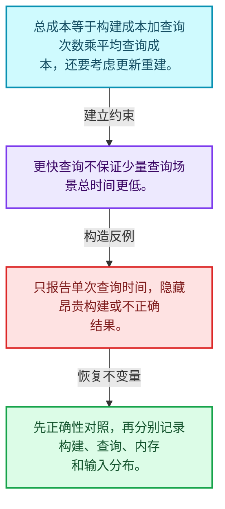
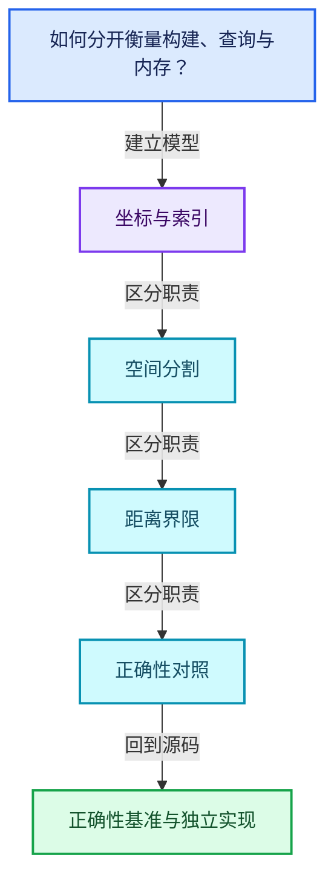
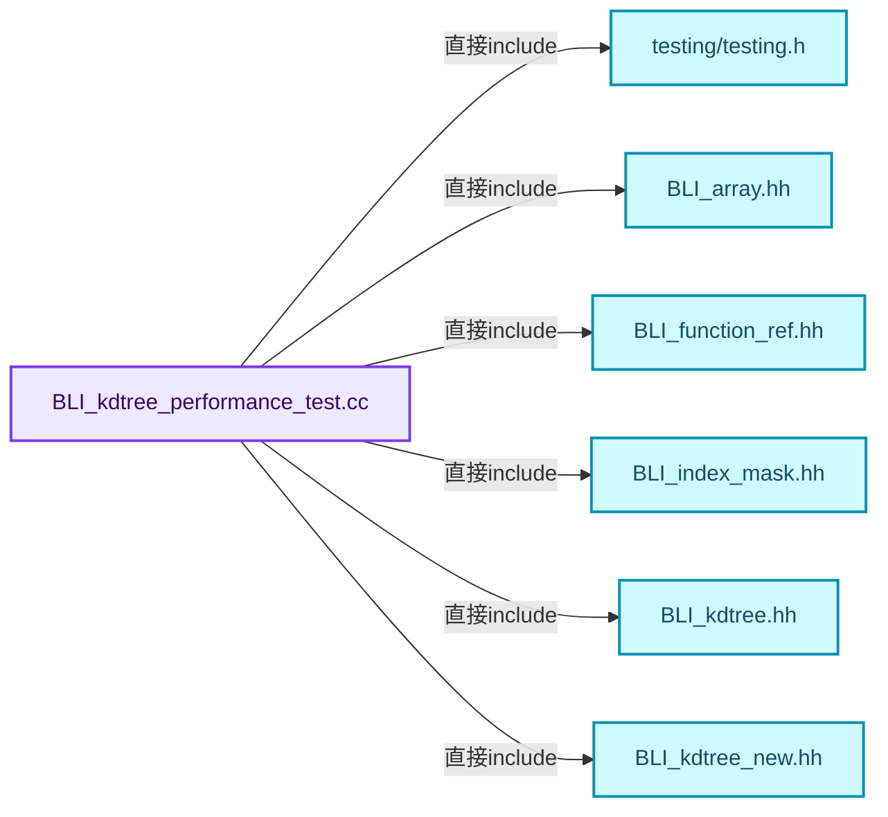
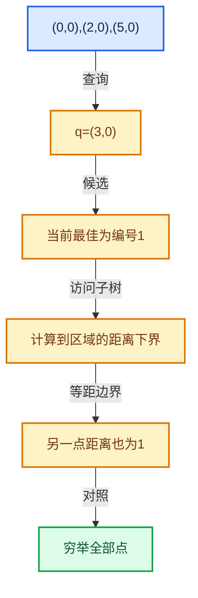

# 12-08 正确性基准与独立实现

[方向导航](README.md) · [总目录](../README.md) · [覆盖索引](../%E6%BA%90%E7%A0%81%E7%89%88%E6%9C%AC%E4%B8%8E%E8%A6%86%E7%9B%96%E7%B4%A2%E5%BC%95.md)

> 阅读顺序：问题与数据模型 → 语法与类型 → 源码逐行 → 调用线索 → 历史与取舍 → 推演和练习。

- 基准 HEAD：`cbda6b96c26c0dee3c3b5cbb93960c4ac06a6b30`。
- 记录日期：2026-10-14。
- 教学示例状态：正文中的推演不是本机性能实测；已运行练习见验收报告。

## 一、从问题到设计

如何分开衡量构建、查询与内存？

历史基准不能直接代表本机，输入分布与查询批量影响收益；正确性检查应先于测速。

本篇把语法、数据语义和系统取舍连接起来。先证明距离下界与返回身份，再讨论布局优化和并行构建。

### 本篇独立模型与设计推理

总成本等于构建成本加查询次数乘平均查询成本，还要考虑更新重建。

设计取舍：更快查询不保证少量查询场景总时间更低。

最小反例：只报告单次查询时间，隐藏昂贵构建或不正确结果。

推导与处理：先正确性对照，再分别记录构建、查询、内存和输入分布。



### 源码范围与相邻篇章

| 文件 | 本篇逐行范围 | 基准SHA-256 |
|---|---|---|
| [source/blender/blenlib/tests/performance/BLI_kdtree_performance_test.cc](../../../../../source/blender/blenlib/tests/performance/BLI_kdtree_performance_test.cc) | L1—L731 | `0133cfbf1bab433b9cf1b40c2be05f5a2c099d77825c3cd5261f95592ba32941` |

同一主讲文件可能分多篇覆盖；超出本篇范围的符号通过覆盖索引定位。空行与纯注释保留在源码摘录中，逐行表解释有效语句与语法边界；许可证头统一保留。

前篇：[Bounds与BVH对比](07-Bounds%E4%B8%8EBVH%E5%AF%B9%E6%AF%94.md).

## 二、类型、数据与阅读地图



这是概念依赖图，边表示阅读关系，不声称是运行时调用顺序。

### 直接编译依赖



箭头只表示头文件包含关系；完整调用线索见后面的符号定位表。

## 三、关键词、语法与类型角色

### 常量求值 constexpr

constexpr声明允许相应实体参与常量求值，但constexpr函数仍可以在运行时执行。是否常量求值由调用场景和表达式合法性共同决定。

具体检查：比较constexpr变量初始化和从运行时输入调用同一函数。

### 只读限定 const

const约束当前访问路径可做的修改。const指针、指向const的指针、const视图对象、const元素是不同位置的限定；其他别名可能仍可修改原对象。

具体检查：分别写T* const、const T*与const T* const，并画出不可修改的层次。

### 异常边界 try与catch

try定义异常传播的局部边界。失败路径需要销毁已经成功构造的部分并释放相应存储；未构造的对象不能被析构。

具体检查：在第k次构造失败，列出已经存在的对象集合与待释放缓冲。

### 覆写检查 override

override要求函数确实覆盖基类虚函数，可捕获参数类型和const限定不匹配。它不改变基类规定的生命周期或线程约束。

具体检查：故意改变一个参数或const，观察编译器如何拒绝误写的新函数。

### 类型别名 using

类型别名为已有类型建立名字，不创建运行期对象。它常把模板内部使用的类型统一暴露给泛型调用者。

具体检查：展开别名直到基础类型，区分类型别名和变量声明。

### 枚举与状态模型 enum

枚举把有限状态命名；enum class避免许多隐式整数转换。状态机正确性还依赖允许的转移，不能只看有哪些枚举项。

具体检查：列出每个状态的进入条件和离开条件，检查终止状态是否仍可能被调度。

## 四、真实源码与逐行讲解

源码块保持原行内容，原始行号由小节标题及逐行表给出。表中的调用定位是静态阅读辅助；重载、模板实例化、宏展开和虚调用需结合完整声明，不能仅凭词法出现证明动态调用。

### BLI_kdtree_performance_test.cc：L1—L45

<!-- source:source/blender/blenlib/tests/performance/BLI_kdtree_performance_test.cc:1:45 -->

```cpp
/* SPDX-FileCopyrightText: 2026 Blender Authors
 *
 * SPDX-License-Identifier: Apache-2.0 */

#include <algorithm>
#include <array>
#include <cinttypes>
#include <cmath>
#include <ctime>

#include "testing/testing.h"

#include "BLI_array.hh"
#include "BLI_function_ref.hh"
#include "BLI_index_mask.hh"
#include "BLI_kdtree.hh"
#include "BLI_kdtree_new.hh"
#include "BLI_math_vector_types.hh"
#include "BLI_rand.hh"
#include "BLI_task_c.hh"
#include "BLI_threads.hh"
#include "BLI_time.hh"

namespace blender {

static const std::array<int64_t, 4> POINT_COUNTS = {1000, 10000, 100000, 1000000};

/**
 * Trees this small are built one per group by nodes like Cluster by Distance and Index of
 * Nearest, so the cost of building the tree matters as much as the queries.
 */
static const std::array<int64_t, 5> TINY_POINT_COUNTS = {4, 16, 64, 256, 1024};

/** Number of query points used by the search benchmarks. */
static constexpr int64_t QUERY_COUNT = 100000;

/** Neighbors requested by the "find nearest n" benchmark. */
static constexpr int NEAREST_N = 8;

/**
 * Search radius chosen so that a uniform distribution has roughly this many points in range.
 * Using a fixed radius instead would make the small and large sizes test completely different
 * things (finding nothing vs. finding most of the tree).
 */
static constexpr double NEIGHBORS_IN_RANGE = 8.0;
```

| 原始行 | 语义、约束与检查 |
|---|---|
| L5 | 引入编译依赖 <algorithm>；这是声明可见性关系，不表示运行时一定调用该文件的所有接口。 |
| L6 | 引入编译依赖 <array>；这是声明可见性关系，不表示运行时一定调用该文件的所有接口。 |
| L7 | 引入编译依赖 <cinttypes>；这是声明可见性关系，不表示运行时一定调用该文件的所有接口。 |
| L8 | 引入编译依赖 <cmath>；这是声明可见性关系，不表示运行时一定调用该文件的所有接口。 |
| L9 | 引入编译依赖 <ctime>；这是声明可见性关系，不表示运行时一定调用该文件的所有接口。 |
| L11 | 引入编译依赖 "testing/testing.h"；这是声明可见性关系，不表示运行时一定调用该文件的所有接口。 |
| L13 | 引入编译依赖 "BLI_array.hh"；这是声明可见性关系，不表示运行时一定调用该文件的所有接口。 |
| L14 | 引入编译依赖 "BLI_function_ref.hh"；这是声明可见性关系，不表示运行时一定调用该文件的所有接口。 |
| L15 | 引入编译依赖 "BLI_index_mask.hh"；这是声明可见性关系，不表示运行时一定调用该文件的所有接口。 |
| L16 | 引入编译依赖 "BLI_kdtree.hh"；这是声明可见性关系，不表示运行时一定调用该文件的所有接口。 |
| L17 | 引入编译依赖 "BLI_kdtree_new.hh"；这是声明可见性关系，不表示运行时一定调用该文件的所有接口。 |
| L18 | 引入编译依赖 "BLI_math_vector_types.hh"；这是声明可见性关系，不表示运行时一定调用该文件的所有接口。 |
| L19 | 引入编译依赖 "BLI_rand.hh"；这是声明可见性关系，不表示运行时一定调用该文件的所有接口。 |
| L20 | 引入编译依赖 "BLI_task_c.hh"；这是声明可见性关系，不表示运行时一定调用该文件的所有接口。 |
| L21 | 引入编译依赖 "BLI_threads.hh"；这是声明可见性关系，不表示运行时一定调用该文件的所有接口。 |
| L22 | 引入编译依赖 "BLI_time.hh"；这是声明可见性关系，不表示运行时一定调用该文件的所有接口。 |
| L24 | 把后续声明放入 blender 命名空间，影响名称查找和符号归属，不创建运行时对象。 |
| L26 | 把右侧 `{1000, 10000, 100000, 1000000}` 用于初始化或更新左侧 `static const std::array<int64_t, 4> POINT_COUNTS`。声明初始化与已有对象赋值应按上下文区分；有资源的类型会调用相应特殊成员。 |
| L32 | 把右侧 `{4, 16, 64, 256, 1024}` 用于初始化或更新左侧 `static const std::array<int64_t, 5> TINY_POINT_COUNTS`。声明初始化与已有对象赋值应按上下文区分；有资源的类型会调用相应特殊成员。 |
| L35 | 把右侧 `100000` 用于初始化或更新左侧 `static constexpr int64_t QUERY_COUNT`。声明初始化与已有对象赋值应按上下文区分；有资源的类型会调用相应特殊成员。 |
| L38 | 把右侧 `8` 用于初始化或更新左侧 `static constexpr int NEAREST_N`。声明初始化与已有对象赋值应按上下文区分；有资源的类型会调用相应特殊成员。 |
| L45 | 把右侧 `8.0` 用于初始化或更新左侧 `static constexpr double NEIGHBORS_IN_RANGE`。声明初始化与已有对象赋值应按上下文区分；有资源的类型会调用相应特殊成员。 |

### BLI_kdtree_performance_test.cc：L46—L92

<!-- source:source/blender/blenlib/tests/performance/BLI_kdtree_performance_test.cc:46:92 -->

```cpp

static float radius_for_neighbor_count(const int64_t points_num)
{
  /* Volume of the sphere containing #NEIGHBORS_IN_RANGE points in the unit cube. */
  return float(std::cbrt(NEIGHBORS_IN_RANGE * 3.0 / (4.0 * M_PI * double(points_num))));
}

/* -------------------------------------------------------------------- */
/** \name Point Distributions
 *
 * All of these fill the unit cube, so a given radius means the same thing for each of them.
 * \{ */

/** Uniform noise. Neighbors in space are completely unrelated to neighbors in the array. */
static Array<float3> make_random_points(const int64_t points_num)
{
  RandomNumberGenerator random;
  Array<float3> positions(points_num);
  for (const int64_t i : positions.index_range()) {
    positions[i] = float3(random.get_float(), random.get_float(), random.get_float());
  }
  return positions;
}

/**
 * A jittered grid visited in scan-line order, so points close in the array are close in space.
 * This is much closer to real geometry (mesh vertices, hair roots, grid-aligned point clouds)
 * than uniform noise, and it's the case where memory access patterns can be exploited.
 */
static Array<float3> make_contiguous_points(const int64_t points_num)
{
  RandomNumberGenerator random;
  Array<float3> positions(points_num);
  /* Round up, so the grid is always large enough to contain every point. */
  const int64_t side = std::max<int64_t>(std::ceil(std::cbrt(double(points_num))), 1);
  const float step = 1.0f / float(side);
  for (const int64_t i : positions.index_range()) {
    const int64_t x = i % side;
    const int64_t y = (i / side) % side;
    const int64_t z = i / (side * side);
    const float3 corner = float3(float(x), float(y), float(z)) * step;
    const float3 jitter = float3(random.get_float(), random.get_float(), random.get_float()) *
                          step;
    positions[i] = corner + jitter;
  }
  return positions;
}
```

本段语义重点：

- `std::max`：取较大值，在容量计算中常用于同时满足请求量和增长策略。

| 原始行 | 语义、约束与检查 |
|---|---|
| L47 | 出现调用或函数声明 `radius_for_neighbor_count`，对应表达式为 `static float radius_for_neighbor_count(const int64_t points_num)`。参数求值、返回类型与重载需结合前后完整语句；静态文本引用不能证明动态目标。 |
| L48 | 连接上一行的声明或控制结构与其语句块；后续行在这个作用域中执行或声明。 |
| L50 | 返回表达式 `float(std::cbrt(NEIGHBORS_IN_RANGE * 3.0 / (4.0 * M_PI * double(points_num))))`。 |
| L51 | 结束当前语法单元。局部自动对象在离开其作用域时按规则销毁；这不等于所有被引用的外部数据也被释放。 |
| L60 | 出现调用或函数声明 `make_random_points`，对应表达式为 `static Array<float3> make_random_points(const int64_t points_num)`。参数求值、返回类型与重载需结合前后完整语句；静态文本引用不能证明动态目标。 |
| L61 | 连接上一行的声明或控制结构与其语句块；后续行在这个作用域中执行或声明。 |
| L62 | 声明成员、局部对象或完成语句 `RandomNumberGenerator random`。若为指针或引用，它本身不说明拥有；若为值对象，其构造析构由所在作用域或外层对象管理。 |
| L63 | 出现调用或函数声明 `positions`，对应表达式为 `Array<float3> positions(points_num);`。参数求值、返回类型与重载需结合前后完整语句；静态文本引用不能证明动态目标。 |
| L64 | 按 `for (const int64_t i : positions.index_range())` 指定的范围或条件重复执行。对照循环变量与真实元素编号；循环内调用成本乘以实际迭代次数。 |
| L65 | 把右侧 `float3(random.get_float(), random.get_float(), random.get_float())` 用于初始化或更新左侧 `positions[i]`。声明初始化与已有对象赋值应按上下文区分；有资源的类型会调用相应特殊成员。 |
| L66 | 结束当前语法单元。局部自动对象在离开其作用域时按规则销毁；这不等于所有被引用的外部数据也被释放。 |
| L67 | 返回表达式 `positions`。 |
| L68 | 结束当前语法单元。局部自动对象在离开其作用域时按规则销毁；这不等于所有被引用的外部数据也被释放。 |
| L75 | 出现调用或函数声明 `make_contiguous_points`，对应表达式为 `static Array<float3> make_contiguous_points(const int64_t points_num)`。参数求值、返回类型与重载需结合前后完整语句；静态文本引用不能证明动态目标。 |
| L76 | 连接上一行的声明或控制结构与其语句块；后续行在这个作用域中执行或声明。 |
| L77 | 声明成员、局部对象或完成语句 `RandomNumberGenerator random`。若为指针或引用，它本身不说明拥有；若为值对象，其构造析构由所在作用域或外层对象管理。 |
| L78 | 出现调用或函数声明 `positions`，对应表达式为 `Array<float3> positions(points_num);`。参数求值、返回类型与重载需结合前后完整语句；静态文本引用不能证明动态目标。 |
| L80 | 本行使用 `std::max`：取较大值，在容量计算中常用于同时满足请求量和增长策略。 |
| L81 | 把右侧 `1.0f / float(side)` 用于初始化或更新左侧 `const float step`。声明初始化与已有对象赋值应按上下文区分；有资源的类型会调用相应特殊成员。 |
| L82 | 按 `for (const int64_t i : positions.index_range())` 指定的范围或条件重复执行。对照循环变量与真实元素编号；循环内调用成本乘以实际迭代次数。 |
| L83 | 把右侧 `i % side` 用于初始化或更新左侧 `const int64_t x`。声明初始化与已有对象赋值应按上下文区分；有资源的类型会调用相应特殊成员。 |
| L84 | 把右侧 `(i / side) % side` 用于初始化或更新左侧 `const int64_t y`。声明初始化与已有对象赋值应按上下文区分；有资源的类型会调用相应特殊成员。 |
| L85 | 把右侧 `i / (side * side)` 用于初始化或更新左侧 `const int64_t z`。声明初始化与已有对象赋值应按上下文区分；有资源的类型会调用相应特殊成员。 |
| L86 | 把右侧 `float3(float(x), float(y), float(z)) * step` 用于初始化或更新左侧 `const float3 corner`。声明初始化与已有对象赋值应按上下文区分；有资源的类型会调用相应特殊成员。 |
| L87 | 把右侧 `float3(random.get_float(), random.get_float(), random.get_float()) *` 用于初始化或更新左侧 `const float3 jitter`。声明初始化与已有对象赋值应按上下文区分；有资源的类型会调用相应特殊成员。 |
| L88 | 声明成员、局部对象或完成语句 `step`。若为指针或引用，它本身不说明拥有；若为值对象，其构造析构由所在作用域或外层对象管理。 |
| L89 | 把右侧 `corner + jitter` 用于初始化或更新左侧 `positions[i]`。声明初始化与已有对象赋值应按上下文区分；有资源的类型会调用相应特殊成员。 |
| L90 | 结束当前语法单元。局部自动对象在离开其作用域时按规则销毁；这不等于所有被引用的外部数据也被释放。 |
| L91 | 返回表达式 `positions`。 |
| L92 | 结束当前语法单元。局部自动对象在离开其作用域时按规则销毁；这不等于所有被引用的外部数据也被释放。 |

### BLI_kdtree_performance_test.cc：L93—L144

<!-- source:source/blender/blenlib/tests/performance/BLI_kdtree_performance_test.cc:93:144 -->

```cpp

/**
 * Half of the points sit exactly on one of a few locations. Degenerate cases like this show up
 * whenever geometry is generated procedurally (instances at the same origin, collapsed edges,
 * points snapped to a grid), and they're the worst case for the median split: many coordinates
 * are equal along every axis, so the tree can become badly unbalanced.
 */
static Array<float3> make_duplicate_points(const int64_t points_num)
{
  constexpr int hotspots_num = 16;
  RandomNumberGenerator random;
  Array<float3> hotspots(hotspots_num);
  for (const int i : hotspots.index_range()) {
    hotspots[i] = float3(random.get_float(), random.get_float(), random.get_float());
  }

  Array<float3> positions(points_num);
  for (const int64_t i : positions.index_range()) {
    if (i % 2 == 0) {
      positions[i] = hotspots[random.get_int32(hotspots_num)];
    }
    else {
      positions[i] = float3(random.get_float(), random.get_float(), random.get_float());
    }
  }
  return positions;
}

using MakePointsFn = Array<float3> (*)(int64_t);

struct Distribution {
  const char *name;
  MakePointsFn make_points;
};

static const Distribution DISTRIBUTIONS[] = {
    {"random", make_random_points},
    {"contiguous", make_contiguous_points},
    {"duplicates", make_duplicate_points},
};

/** \} */

/* -------------------------------------------------------------------- */
/** \name Utilities
 * \{ */

/** The two implementations that are compared. */
enum class Impl {
  BLI,
  New,
};
```

本段语义重点：

- 分支证据 `i % 2 == 0)`：分别推演条件成立与不成立，核对相同出口处的状态。

| 原始行 | 语义、约束与检查 |
|---|---|
| L100 | 出现调用或函数声明 `make_duplicate_points`，对应表达式为 `static Array<float3> make_duplicate_points(const int64_t points_num)`。参数求值、返回类型与重载需结合前后完整语句；静态文本引用不能证明动态目标。 |
| L101 | 连接上一行的声明或控制结构与其语句块；后续行在这个作用域中执行或声明。 |
| L102 | 把右侧 `16` 用于初始化或更新左侧 `constexpr int hotspots_num`。声明初始化与已有对象赋值应按上下文区分；有资源的类型会调用相应特殊成员。 |
| L103 | 声明成员、局部对象或完成语句 `RandomNumberGenerator random`。若为指针或引用，它本身不说明拥有；若为值对象，其构造析构由所在作用域或外层对象管理。 |
| L104 | 出现调用或函数声明 `hotspots`，对应表达式为 `Array<float3> hotspots(hotspots_num);`。参数求值、返回类型与重载需结合前后完整语句；静态文本引用不能证明动态目标。 |
| L105 | 按 `for (const int i : hotspots.index_range())` 指定的范围或条件重复执行。对照循环变量与真实元素编号；循环内调用成本乘以实际迭代次数。 |
| L106 | 把右侧 `float3(random.get_float(), random.get_float(), random.get_float())` 用于初始化或更新左侧 `hotspots[i]`。声明初始化与已有对象赋值应按上下文区分；有资源的类型会调用相应特殊成员。 |
| L107 | 结束当前语法单元。局部自动对象在离开其作用域时按规则销毁；这不等于所有被引用的外部数据也被释放。 |
| L109 | 出现调用或函数声明 `positions`，对应表达式为 `Array<float3> positions(points_num);`。参数求值、返回类型与重载需结合前后完整语句；静态文本引用不能证明动态目标。 |
| L110 | 按 `for (const int64_t i : positions.index_range())` 指定的范围或条件重复执行。对照循环变量与真实元素编号；循环内调用成本乘以实际迭代次数。 |
| L111 | 判断 `i % 2 == 0`，成立时进入本分支，否则继续后续路径。 |
| L112 | 把右侧 `hotspots[random.get_int32(hotspots_num)]` 用于初始化或更新左侧 `positions[i]`。声明初始化与已有对象赋值应按上下文区分；有资源的类型会调用相应特殊成员。 |
| L113 | 结束当前语法单元。局部自动对象在离开其作用域时按规则销毁；这不等于所有被引用的外部数据也被释放。 |
| L114 | 处理前一条件不成立的互补路径。比较两条路径最后是否恢复同一不变量，以及是否产生不同的资源责任。 |
| L115 | 把右侧 `float3(random.get_float(), random.get_float(), random.get_float())` 用于初始化或更新左侧 `positions[i]`。声明初始化与已有对象赋值应按上下文区分；有资源的类型会调用相应特殊成员。 |
| L116 | 结束当前语法单元。局部自动对象在离开其作用域时按规则销毁；这不等于所有被引用的外部数据也被释放。 |
| L117 | 结束当前语法单元。局部自动对象在离开其作用域时按规则销毁；这不等于所有被引用的外部数据也被释放。 |
| L118 | 返回表达式 `positions`。 |
| L119 | 结束当前语法单元。局部自动对象在离开其作用域时按规则销毁；这不等于所有被引用的外部数据也被释放。 |
| L121 | 定义类型别名 `using MakePointsFn = Array<float3> (*)(int64_t)`，为模板接口或内部实现统一命名；本行不分配该类型对象。 |
| L123 | 声明或定义类型 `struct Distribution`。结合继承、访问权限和成员布局确认接口与拥有关系；前向声明本身没有完整对象布局。 |
| L124 | 声明成员、局部对象或完成语句 `const char *name`。若为指针或引用，它本身不说明拥有；若为值对象，其构造析构由所在作用域或外层对象管理。 |
| L125 | 声明成员、局部对象或完成语句 `MakePointsFn make_points`。若为指针或引用，它本身不说明拥有；若为值对象，其构造析构由所在作用域或外层对象管理。 |
| L126 | 结束当前语法单元。局部自动对象在离开其作用域时按规则销毁；这不等于所有被引用的外部数据也被释放。 |
| L128 | 把右侧 `{` 用于初始化或更新左侧 `static const Distribution DISTRIBUTIONS[]`。声明初始化与已有对象赋值应按上下文区分；有资源的类型会调用相应特殊成员。 |
| L129 | 本行是连续声明或表达式的一部分：`{"random", make_random_points},`。与本段前后行合读；逗号、括号和限定符决定它属于参数、初始化列表还是实际计算。 |
| L130 | 本行是连续声明或表达式的一部分：`{"contiguous", make_contiguous_points},`。与本段前后行合读；逗号、括号和限定符决定它属于参数、初始化列表还是实际计算。 |
| L131 | 本行是连续声明或表达式的一部分：`{"duplicates", make_duplicate_points},`。与本段前后行合读；逗号、括号和限定符决定它属于参数、初始化列表还是实际计算。 |
| L132 | 结束当前语法单元。局部自动对象在离开其作用域时按规则销毁；这不等于所有被引用的外部数据也被释放。 |
| L141 | 声明或定义类型 `enum class Impl`。结合继承、访问权限和成员布局确认接口与拥有关系；前向声明本身没有完整对象布局。 |
| L142 | 本行是连续声明或表达式的一部分：`BLI,`。与本段前后行合读；逗号、括号和限定符决定它属于参数、初始化列表还是实际计算。 |
| L143 | 本行是连续声明或表达式的一部分：`New,`。与本段前后行合读；逗号、括号和限定符决定它属于参数、初始化列表还是实际计算。 |
| L144 | 结束当前语法单元。局部自动对象在离开其作用域时按规则销毁；这不等于所有被引用的外部数据也被释放。 |

### BLI_kdtree_performance_test.cc：L145—L196

<!-- source:source/blender/blenlib/tests/performance/BLI_kdtree_performance_test.cc:145:196 -->

```cpp

static const std::array<Impl, 2> IMPLEMENTATIONS = {Impl::BLI, Impl::New};

static const char *impl_name(const Impl impl)
{
  return impl == Impl::BLI ? "BLI_kdtree" : "New";
}

/**
 * Query points taken from the tree's own points, keeping their relative order so that a
 * spatially coherent input is also queried coherently. They're offset by a small amount so
 * queries don't degenerate into finding the exact same coordinate every time.
 */
static Array<float3> make_query_points(const Span<float3> positions)
{
  const int64_t queries_num = std::min<int64_t>(QUERY_COUNT, positions.size());
  const int64_t stride = positions.size() / queries_num;
  RandomNumberGenerator random;
  Array<float3> queries(queries_num);
  for (const int64_t i : queries.index_range()) {
    const float3 offset = float3(random.get_float(), random.get_float(), random.get_float());
    queries[i] = positions[i * stride] + (offset - 0.5f) * 0.01f;
  }
  return queries;
}

static KDTree<float3> *build_bli_tree(const Span<float3> positions)
{
  KDTree<float3> *tree = kdtree_new<float3>(positions.size());
  for (const int64_t i : positions.index_range()) {
    kdtree_insert(tree, int(i), positions[i]);
  }
  kdtree_balance(tree);
  return tree;
}

/**
 * Runs \a function often enough that the result isn't dominated by timer noise for small point
 * counts, without making the largest point counts take a long time. Returns the fastest run.
 */
static double run_iterations(const int64_t points_num, const FunctionRef<void()> function)
{
  const int iterations = int(std::clamp<int64_t>(2000000 / points_num, 3, 1000));
  double min_time = 1e30;
  for (int repetition = 0; repetition < iterations; repetition++) {
    const double time_before = BLI_time_now_seconds();
    function();
    const double time_after = BLI_time_now_seconds();
    min_time = std::min(min_time, time_after - time_before);
  }
  return min_time;
}
```

本段语义重点：

- `std::min`：取较小值，常用于截断范围；还要检查负值、溢出和空范围。

| 原始行 | 语义、约束与检查 |
|---|---|
| L146 | 把右侧 `{Impl::BLI, Impl::New}` 用于初始化或更新左侧 `static const std::array<Impl, 2> IMPLEMENTATIONS`。声明初始化与已有对象赋值应按上下文区分；有资源的类型会调用相应特殊成员。 |
| L148 | 出现调用或函数声明 `impl_name`，对应表达式为 `static const char *impl_name(const Impl impl)`。参数求值、返回类型与重载需结合前后完整语句；静态文本引用不能证明动态目标。 |
| L149 | 连接上一行的声明或控制结构与其语句块；后续行在这个作用域中执行或声明。 |
| L150 | 返回表达式 `impl == Impl::BLI ? "BLI_kdtree" : "New"`。 |
| L151 | 结束当前语法单元。局部自动对象在离开其作用域时按规则销毁；这不等于所有被引用的外部数据也被释放。 |
| L158 | 出现调用或函数声明 `make_query_points`，对应表达式为 `static Array<float3> make_query_points(const Span<float3> positions)`。参数求值、返回类型与重载需结合前后完整语句；静态文本引用不能证明动态目标。 |
| L159 | 连接上一行的声明或控制结构与其语句块；后续行在这个作用域中执行或声明。 |
| L160 | 本行使用 `std::min`：取较小值，常用于截断范围；还要检查负值、溢出和空范围。 |
| L161 | 把右侧 `positions.size() / queries_num` 用于初始化或更新左侧 `const int64_t stride`。声明初始化与已有对象赋值应按上下文区分；有资源的类型会调用相应特殊成员。 |
| L162 | 声明成员、局部对象或完成语句 `RandomNumberGenerator random`。若为指针或引用，它本身不说明拥有；若为值对象，其构造析构由所在作用域或外层对象管理。 |
| L163 | 出现调用或函数声明 `queries`，对应表达式为 `Array<float3> queries(queries_num);`。参数求值、返回类型与重载需结合前后完整语句；静态文本引用不能证明动态目标。 |
| L164 | 按 `for (const int64_t i : queries.index_range())` 指定的范围或条件重复执行。对照循环变量与真实元素编号；循环内调用成本乘以实际迭代次数。 |
| L165 | 把右侧 `float3(random.get_float(), random.get_float(), random.get_float())` 用于初始化或更新左侧 `const float3 offset`。声明初始化与已有对象赋值应按上下文区分；有资源的类型会调用相应特殊成员。 |
| L166 | 把右侧 `positions[i * stride] + (offset - 0.5f) * 0.01f` 用于初始化或更新左侧 `queries[i]`。声明初始化与已有对象赋值应按上下文区分；有资源的类型会调用相应特殊成员。 |
| L167 | 结束当前语法单元。局部自动对象在离开其作用域时按规则销毁；这不等于所有被引用的外部数据也被释放。 |
| L168 | 返回表达式 `queries`。 |
| L169 | 结束当前语法单元。局部自动对象在离开其作用域时按规则销毁；这不等于所有被引用的外部数据也被释放。 |
| L171 | 出现调用或函数声明 `build_bli_tree`，对应表达式为 `static KDTree<float3> *build_bli_tree(const Span<float3> positions)`。参数求值、返回类型与重载需结合前后完整语句；静态文本引用不能证明动态目标。 |
| L172 | 连接上一行的声明或控制结构与其语句块；后续行在这个作用域中执行或声明。 |
| L173 | 把右侧 `kdtree_new<float3>(positions.size())` 用于初始化或更新左侧 `KDTree<float3> *tree`。声明初始化与已有对象赋值应按上下文区分；有资源的类型会调用相应特殊成员。 |
| L174 | 按 `for (const int64_t i : positions.index_range())` 指定的范围或条件重复执行。对照循环变量与真实元素编号；循环内调用成本乘以实际迭代次数。 |
| L175 | 出现调用或函数声明 `kdtree_insert`，对应表达式为 `kdtree_insert(tree, int(i), positions[i]);`。参数求值、返回类型与重载需结合前后完整语句；静态文本引用不能证明动态目标。 |
| L176 | 结束当前语法单元。局部自动对象在离开其作用域时按规则销毁；这不等于所有被引用的外部数据也被释放。 |
| L177 | 出现调用或函数声明 `kdtree_balance`，对应表达式为 `kdtree_balance(tree);`。参数求值、返回类型与重载需结合前后完整语句；静态文本引用不能证明动态目标。 |
| L178 | 返回表达式 `tree`。 |
| L179 | 结束当前语法单元。局部自动对象在离开其作用域时按规则销毁；这不等于所有被引用的外部数据也被释放。 |
| L185 | 出现调用或函数声明 `run_iterations`，对应表达式为 `static double run_iterations(const int64_t points_num, const FunctionRef<void()> function)`。参数求值、返回类型与重载需结合前后完整语句；静态文本引用不能证明动态目标。 |
| L186 | 连接上一行的声明或控制结构与其语句块；后续行在这个作用域中执行或声明。 |
| L187 | 把右侧 `int(std::clamp<int64_t>(2000000 / points_num, 3, 1000))` 用于初始化或更新左侧 `const int iterations`。声明初始化与已有对象赋值应按上下文区分；有资源的类型会调用相应特殊成员。 |
| L188 | 把右侧 `1e30` 用于初始化或更新左侧 `double min_time`。声明初始化与已有对象赋值应按上下文区分；有资源的类型会调用相应特殊成员。 |
| L189 | 纯虚接口声明：`for (int repetition = 0; repetition < iterations; repetition++) {`。等号零标记抽象接口，需要按继承约定提供覆写；不表示执行函数并把结果设为零。 |
| L190 | 把右侧 `BLI_time_now_seconds()` 用于初始化或更新左侧 `const double time_before`。声明初始化与已有对象赋值应按上下文区分；有资源的类型会调用相应特殊成员。 |
| L191 | 出现调用或函数声明 `function`，对应表达式为 `function();`。参数求值、返回类型与重载需结合前后完整语句；静态文本引用不能证明动态目标。 |
| L192 | 把右侧 `BLI_time_now_seconds()` 用于初始化或更新左侧 `const double time_after`。声明初始化与已有对象赋值应按上下文区分；有资源的类型会调用相应特殊成员。 |
| L193 | 本行使用 `std::min`：取较小值，常用于截断范围；还要检查负值、溢出和空范围。 |
| L194 | 结束当前语法单元。局部自动对象在离开其作用域时按规则销毁；这不等于所有被引用的外部数据也被释放。 |
| L195 | 返回表达式 `min_time`。 |
| L196 | 结束当前语法单元。局部自动对象在离开其作用域时按规则销毁；这不等于所有被引用的外部数据也被释放。 |

### BLI_kdtree_performance_test.cc：L197—L249

<!-- source:source/blender/blenlib/tests/performance/BLI_kdtree_performance_test.cc:197:249 -->

```cpp

/**
 * Like #run_iterations, but for operations that are too fast to time on their own: a single run
 * of the smallest trees is only a few hundred nanoseconds, which is close enough to the cost of
 * reading the clock that it would dominate the result. Runs the function in batches instead.
 *
 * \return The average time of a single run, from the fastest batch.
 */
static double run_batched(const int64_t points_num, const FunctionRef<void()> function)
{
  const int64_t batch_size = std::max<int64_t>(20000 / points_num, 1);
  double min_time = 1e30;
  for (int repetition = 0; repetition < 20; repetition++) {
    const double time_before = BLI_time_now_seconds();
    for ([[maybe_unused]] const int64_t i : IndexRange(batch_size)) {
      function();
    }
    const double time_after = BLI_time_now_seconds();
    min_time = std::min(min_time, (time_after - time_before) / double(batch_size));
  }
  return min_time;
}

/**
 * Runs \a query_fn for query points in batches, wrapping around the array until the time budget
 * is used up. Since a single query can be orders of magnitude slower in the degenerate cases,
 * running a fixed number of queries would either be too noisy or far too slow.
 *
 * \return The average time of a single query.
 */
static double run_queries(const Span<float3> queries,
                          const FunctionRef<void(const float3 &query)> query_fn)
{
  /* Small enough that the slowest queries don't overshoot the budget by much, large enough that
   * the timer isn't a significant cost. */
  constexpr int64_t batch_size = 256;
  constexpr double time_budget = 0.25;
  constexpr int64_t min_queries = 2000;

  double total_time = 0.0;
  int64_t queries_num = 0;
  while (total_time < time_budget || queries_num < min_queries) {
    const int64_t start = queries_num % queries.size();
    const int64_t size = std::min(batch_size, queries.size() - start);
    const double time_before = BLI_time_now_seconds();
    for (const float3 &query : queries.slice(start, size)) {
      query_fn(query);
    }
    total_time += BLI_time_now_seconds() - time_before;
    queries_num += size;
  }
  return total_time / double(queries_num);
}
```

本段语义重点：

- `std::max`：取较大值，在容量计算中常用于同时满足请求量和增长策略。
- `std::min`：取较小值，常用于截断范围；还要检查负值、溢出和空范围。

| 原始行 | 语义、约束与检查 |
|---|---|
| L205 | 出现调用或函数声明 `run_batched`，对应表达式为 `static double run_batched(const int64_t points_num, const FunctionRef<void()> function)`。参数求值、返回类型与重载需结合前后完整语句；静态文本引用不能证明动态目标。 |
| L206 | 连接上一行的声明或控制结构与其语句块；后续行在这个作用域中执行或声明。 |
| L207 | 本行使用 `std::max`：取较大值，在容量计算中常用于同时满足请求量和增长策略。 |
| L208 | 把右侧 `1e30` 用于初始化或更新左侧 `double min_time`。声明初始化与已有对象赋值应按上下文区分；有资源的类型会调用相应特殊成员。 |
| L209 | 纯虚接口声明：`for (int repetition = 0; repetition < 20; repetition++) {`。等号零标记抽象接口，需要按继承约定提供覆写；不表示执行函数并把结果设为零。 |
| L210 | 把右侧 `BLI_time_now_seconds()` 用于初始化或更新左侧 `const double time_before`。声明初始化与已有对象赋值应按上下文区分；有资源的类型会调用相应特殊成员。 |
| L211 | 按 `for ([[maybe_unused]] const int64_t i : IndexRange(batch_size))` 指定的范围或条件重复执行。对照循环变量与真实元素编号；循环内调用成本乘以实际迭代次数。 |
| L212 | 出现调用或函数声明 `function`，对应表达式为 `function();`。参数求值、返回类型与重载需结合前后完整语句；静态文本引用不能证明动态目标。 |
| L213 | 结束当前语法单元。局部自动对象在离开其作用域时按规则销毁；这不等于所有被引用的外部数据也被释放。 |
| L214 | 把右侧 `BLI_time_now_seconds()` 用于初始化或更新左侧 `const double time_after`。声明初始化与已有对象赋值应按上下文区分；有资源的类型会调用相应特殊成员。 |
| L215 | 本行使用 `std::min`：取较小值，常用于截断范围；还要检查负值、溢出和空范围。 |
| L216 | 结束当前语法单元。局部自动对象在离开其作用域时按规则销毁；这不等于所有被引用的外部数据也被释放。 |
| L217 | 返回表达式 `min_time`。 |
| L218 | 结束当前语法单元。局部自动对象在离开其作用域时按规则销毁；这不等于所有被引用的外部数据也被释放。 |
| L227 | 出现调用或函数声明 `run_queries`，对应表达式为 `static double run_queries(const Span<float3> queries,`。参数求值、返回类型与重载需结合前后完整语句；静态文本引用不能证明动态目标。 |
| L228 | 出现调用或函数声明 `void`，对应表达式为 `const FunctionRef<void(const float3 &query)> query_fn)`。参数求值、返回类型与重载需结合前后完整语句；静态文本引用不能证明动态目标。 |
| L229 | 连接上一行的声明或控制结构与其语句块；后续行在这个作用域中执行或声明。 |
| L232 | 把右侧 `256` 用于初始化或更新左侧 `constexpr int64_t batch_size`。声明初始化与已有对象赋值应按上下文区分；有资源的类型会调用相应特殊成员。 |
| L233 | 把右侧 `0.25` 用于初始化或更新左侧 `constexpr double time_budget`。声明初始化与已有对象赋值应按上下文区分；有资源的类型会调用相应特殊成员。 |
| L234 | 把右侧 `2000` 用于初始化或更新左侧 `constexpr int64_t min_queries`。声明初始化与已有对象赋值应按上下文区分；有资源的类型会调用相应特殊成员。 |
| L236 | 把右侧 `0.0` 用于初始化或更新左侧 `double total_time`。声明初始化与已有对象赋值应按上下文区分；有资源的类型会调用相应特殊成员。 |
| L237 | 把右侧 `0` 用于初始化或更新左侧 `int64_t queries_num`。声明初始化与已有对象赋值应按上下文区分；有资源的类型会调用相应特殊成员。 |
| L238 | 按 `while (total_time < time_budget &#124;&#124; queries_num < min_queries)` 指定的范围或条件重复执行。对照循环变量与真实元素编号；循环内调用成本乘以实际迭代次数。 |
| L239 | 把右侧 `queries_num % queries.size()` 用于初始化或更新左侧 `const int64_t start`。声明初始化与已有对象赋值应按上下文区分；有资源的类型会调用相应特殊成员。 |
| L240 | 本行使用 `std::min`：取较小值，常用于截断范围；还要检查负值、溢出和空范围。 |
| L241 | 把右侧 `BLI_time_now_seconds()` 用于初始化或更新左侧 `const double time_before`。声明初始化与已有对象赋值应按上下文区分；有资源的类型会调用相应特殊成员。 |
| L242 | 按 `for (const float3 &query : queries.slice(start, size))` 指定的范围或条件重复执行。对照循环变量与真实元素编号；循环内调用成本乘以实际迭代次数。 |
| L243 | 出现调用或函数声明 `query_fn`，对应表达式为 `query_fn(query);`。参数求值、返回类型与重载需结合前后完整语句；静态文本引用不能证明动态目标。 |
| L244 | 结束当前语法单元。局部自动对象在离开其作用域时按规则销毁；这不等于所有被引用的外部数据也被释放。 |
| L245 | 复合更新 `total_time += BLI_time_now_seconds() - time_before`：读取左侧现有值，与右侧按`+=`对应操作组合后写回。检查数值边界、位掩码或共享状态保护；它不是新对象的构造。 |
| L246 | 复合更新 `queries_num += size`：读取左侧现有值，与右侧按`+=`对应操作组合后写回。检查数值边界、位掩码或共享状态保护；它不是新对象的构造。 |
| L247 | 结束当前语法单元。局部自动对象在离开其作用域时按规则销毁；这不等于所有被引用的外部数据也被释放。 |
| L248 | 返回表达式 `total_time / double(queries_num)`。 |
| L249 | 结束当前语法单元。局部自动对象在离开其作用域时按规则销毁；这不等于所有被引用的外部数据也被释放。 |

### BLI_kdtree_performance_test.cc：L250—L308

<!-- source:source/blender/blenlib/tests/performance/BLI_kdtree_performance_test.cc:250:308 -->

```cpp

static void print_time(const double seconds)
{
  if (seconds < 0.000001) {
    printf(" %8.1f ns |", seconds * 1000000000.0);
  }
  else if (seconds < 0.001) {
    printf(" %8.2f µs |", seconds * 1000000.0);
  }
  else {
    printf(" %8.2f ms |", seconds * 1000.0);
  }
}

static void print_table_header(const char *title,
                               const char *value_description,
                               const Span<int64_t> point_counts)
{
  printf("\n#### %s\n\n(%s)\n\n| distribution | implementation |", title, value_description);
  for (const int64_t points_num : point_counts) {
    printf(" %" PRId64 " points |", points_num);
  }
  printf("\n|---:|---:|");
  for ([[maybe_unused]] const int64_t points_num : point_counts) {
    printf("---:|");
  }
  printf("\n");
}

/**
 * Runs \a run_cell for every combination of distribution, implementation and point count,
 * printing one row per distribution and implementation. The function returns the time of a
 * single run of whatever it measures.
 */
using RunCellFn = FunctionRef<double(Impl impl, const Span<float3> positions, int64_t points_num)>;

static void run_table(const char *title,
                      const char *value_description,
                      const RunCellFn run_cell,
                      const Span<int64_t> point_counts = POINT_COUNTS,
                      const Span<Impl> implementations = IMPLEMENTATIONS)
{
  /* Without this the scheduler reports a single thread, which makes #threading::max_threads_task
   * do nothing, so the tree's own limit on how many threads it builds with has no effect. */
  BLI_task_scheduler_init();

  print_table_header(title, value_description, point_counts);
  for (const Distribution &distribution : DISTRIBUTIONS) {
    for (const Impl impl : implementations) {
      printf("| %s | %s |", distribution.name, impl_name(impl));
      for (const int64_t points_num : point_counts) {
        const Array<float3> positions = distribution.make_points(points_num);
        print_time(run_cell(impl, positions, points_num));
        fflush(stdout);
      }
      printf("\n");
    }
  }
}
```

本段语义重点：

- 分支证据 `seconds < 0.000001)`：分别推演条件成立与不成立，核对相同出口处的状态。
- 分支证据 `seconds < 0.001)`：分别推演条件成立与不成立，核对相同出口处的状态。

| 原始行 | 语义、约束与检查 |
|---|---|
| L251 | 出现调用或函数声明 `print_time`，对应表达式为 `static void print_time(const double seconds)`。参数求值、返回类型与重载需结合前后完整语句；静态文本引用不能证明动态目标。 |
| L252 | 连接上一行的声明或控制结构与其语句块；后续行在这个作用域中执行或声明。 |
| L253 | 判断 `seconds < 0.000001`，成立时进入本分支，否则继续后续路径。 |
| L254 | 出现调用或函数声明 `printf`，对应表达式为 `printf(" %8.1f ns &#124;", seconds * 1000000000.0);`。参数求值、返回类型与重载需结合前后完整语句；静态文本引用不能证明动态目标。 |
| L255 | 结束当前语法单元。局部自动对象在离开其作用域时按规则销毁；这不等于所有被引用的外部数据也被释放。 |
| L256 | 判断 `seconds < 0.001`，成立时进入本分支，否则继续后续路径。 |
| L257 | 出现调用或函数声明 `printf`，对应表达式为 `printf(" %8.2f µs &#124;", seconds * 1000000.0);`。参数求值、返回类型与重载需结合前后完整语句；静态文本引用不能证明动态目标。 |
| L258 | 结束当前语法单元。局部自动对象在离开其作用域时按规则销毁；这不等于所有被引用的外部数据也被释放。 |
| L259 | 处理前一条件不成立的互补路径。比较两条路径最后是否恢复同一不变量，以及是否产生不同的资源责任。 |
| L260 | 出现调用或函数声明 `printf`，对应表达式为 `printf(" %8.2f ms &#124;", seconds * 1000.0);`。参数求值、返回类型与重载需结合前后完整语句；静态文本引用不能证明动态目标。 |
| L261 | 结束当前语法单元。局部自动对象在离开其作用域时按规则销毁；这不等于所有被引用的外部数据也被释放。 |
| L262 | 结束当前语法单元。局部自动对象在离开其作用域时按规则销毁；这不等于所有被引用的外部数据也被释放。 |
| L264 | 出现调用或函数声明 `print_table_header`，对应表达式为 `static void print_table_header(const char *title,`。参数求值、返回类型与重载需结合前后完整语句；静态文本引用不能证明动态目标。 |
| L265 | 本行是连续声明或表达式的一部分：`const char *value_description,`。与本段前后行合读；逗号、括号和限定符决定它属于参数、初始化列表还是实际计算。 |
| L266 | 本行是连续声明或表达式的一部分：`const Span<int64_t> point_counts)`。与本段前后行合读；逗号、括号和限定符决定它属于参数、初始化列表还是实际计算。 |
| L267 | 连接上一行的声明或控制结构与其语句块；后续行在这个作用域中执行或声明。 |
| L268 | 出现调用或函数声明 `printf`，对应表达式为 `printf("\n#### %s\n\n(%s)\n\n&#124; distribution &#124; implementation &#124;", title, value_description);`。参数求值、返回类型与重载需结合前后完整语句；静态文本引用不能证明动态目标。 |
| L269 | 按 `for (const int64_t points_num : point_counts)` 指定的范围或条件重复执行。对照循环变量与真实元素编号；循环内调用成本乘以实际迭代次数。 |
| L270 | 出现调用或函数声明 `printf`，对应表达式为 `printf(" %" PRId64 " points &#124;", points_num);`。参数求值、返回类型与重载需结合前后完整语句；静态文本引用不能证明动态目标。 |
| L271 | 结束当前语法单元。局部自动对象在离开其作用域时按规则销毁；这不等于所有被引用的外部数据也被释放。 |
| L272 | 出现调用或函数声明 `printf`，对应表达式为 `printf("\n&#124;---:&#124;---:&#124;");`。参数求值、返回类型与重载需结合前后完整语句；静态文本引用不能证明动态目标。 |
| L273 | 按 `for ([[maybe_unused]] const int64_t points_num : point_counts)` 指定的范围或条件重复执行。对照循环变量与真实元素编号；循环内调用成本乘以实际迭代次数。 |
| L274 | 出现调用或函数声明 `printf`，对应表达式为 `printf("---:&#124;");`。参数求值、返回类型与重载需结合前后完整语句；静态文本引用不能证明动态目标。 |
| L275 | 结束当前语法单元。局部自动对象在离开其作用域时按规则销毁；这不等于所有被引用的外部数据也被释放。 |
| L276 | 出现调用或函数声明 `printf`，对应表达式为 `printf("\n");`。参数求值、返回类型与重载需结合前后完整语句；静态文本引用不能证明动态目标。 |
| L277 | 结束当前语法单元。局部自动对象在离开其作用域时按规则销毁；这不等于所有被引用的外部数据也被释放。 |
| L284 | 定义类型别名 `using RunCellFn = FunctionRef<double(Impl impl, const Span<float3> positions, int64_t points_num)>`，为模板接口或内部实现统一命名；本行不分配该类型对象。 |
| L286 | 出现调用或函数声明 `run_table`，对应表达式为 `static void run_table(const char *title,`。参数求值、返回类型与重载需结合前后完整语句；静态文本引用不能证明动态目标。 |
| L287 | 本行是连续声明或表达式的一部分：`const char *value_description,`。与本段前后行合读；逗号、括号和限定符决定它属于参数、初始化列表还是实际计算。 |
| L288 | 本行是连续声明或表达式的一部分：`const RunCellFn run_cell,`。与本段前后行合读；逗号、括号和限定符决定它属于参数、初始化列表还是实际计算。 |
| L289 | 把右侧 `POINT_COUNTS,` 用于初始化或更新左侧 `const Span<int64_t> point_counts`。声明初始化与已有对象赋值应按上下文区分；有资源的类型会调用相应特殊成员。 |
| L290 | 把右侧 `IMPLEMENTATIONS)` 用于初始化或更新左侧 `const Span<Impl> implementations`。声明初始化与已有对象赋值应按上下文区分；有资源的类型会调用相应特殊成员。 |
| L291 | 连接上一行的声明或控制结构与其语句块；后续行在这个作用域中执行或声明。 |
| L294 | 出现调用或函数声明 `BLI_task_scheduler_init`，对应表达式为 `BLI_task_scheduler_init();`。参数求值、返回类型与重载需结合前后完整语句；静态文本引用不能证明动态目标。 |
| L296 | 出现调用或函数声明 `print_table_header`，对应表达式为 `print_table_header(title, value_description, point_counts);`。参数求值、返回类型与重载需结合前后完整语句；静态文本引用不能证明动态目标。 |
| L297 | 按 `for (const Distribution &distribution : DISTRIBUTIONS)` 指定的范围或条件重复执行。对照循环变量与真实元素编号；循环内调用成本乘以实际迭代次数。 |
| L298 | 按 `for (const Impl impl : implementations)` 指定的范围或条件重复执行。对照循环变量与真实元素编号；循环内调用成本乘以实际迭代次数。 |
| L299 | 出现调用或函数声明 `printf`，对应表达式为 `printf("&#124; %s &#124; %s &#124;", distribution.name, impl_name(impl));`。参数求值、返回类型与重载需结合前后完整语句；静态文本引用不能证明动态目标。 |
| L300 | 按 `for (const int64_t points_num : point_counts)` 指定的范围或条件重复执行。对照循环变量与真实元素编号；循环内调用成本乘以实际迭代次数。 |
| L301 | 把右侧 `distribution.make_points(points_num)` 用于初始化或更新左侧 `const Array<float3> positions`。声明初始化与已有对象赋值应按上下文区分；有资源的类型会调用相应特殊成员。 |
| L302 | 出现调用或函数声明 `print_time`，对应表达式为 `print_time(run_cell(impl, positions, points_num));`。参数求值、返回类型与重载需结合前后完整语句；静态文本引用不能证明动态目标。 |
| L303 | 出现调用或函数声明 `fflush`，对应表达式为 `fflush(stdout);`。参数求值、返回类型与重载需结合前后完整语句；静态文本引用不能证明动态目标。 |
| L304 | 结束当前语法单元。局部自动对象在离开其作用域时按规则销毁；这不等于所有被引用的外部数据也被释放。 |
| L305 | 出现调用或函数声明 `printf`，对应表达式为 `printf("\n");`。参数求值、返回类型与重载需结合前后完整语句；静态文本引用不能证明动态目标。 |
| L306 | 结束当前语法单元。局部自动对象在离开其作用域时按规则销毁；这不等于所有被引用的外部数据也被释放。 |
| L307 | 结束当前语法单元。局部自动对象在离开其作用域时按规则销毁；这不等于所有被引用的外部数据也被释放。 |
| L308 | 结束当前语法单元。局部自动对象在离开其作用域时按规则销毁；这不等于所有被引用的外部数据也被释放。 |

### BLI_kdtree_performance_test.cc：L309—L355

<!-- source:source/blender/blenlib/tests/performance/BLI_kdtree_performance_test.cc:309:355 -->

```cpp

/** \} */

/* -------------------------------------------------------------------- */
/** \name Benchmarks
 * \{ */

TEST(kdtree_performance, Build)
{
  run_table("Building the tree",
            "`kdtree_insert` and `kdtree_balance` vs. the `KDTreeNew` constructor",
            [](const Impl impl, const Span<float3> positions, const int64_t points_num) {
              if (impl == Impl::BLI) {
                return run_iterations(points_num, [&]() {
                  KDTree<float3> *tree = build_bli_tree(positions);
                  kdtree_free(tree);
                });
              }
              return run_iterations(points_num, [&]() { KDTreeNew<float3> tree(positions); });
            });
}

TEST(kdtree_performance, FindNearest)
{
  run_table("Find the nearest point",
            "time per query",
            [](const Impl impl, const Span<float3> positions, const int64_t /*points_num*/) {
              const Array<float3> queries = make_query_points(positions);
              int64_t index_sum = 0;
              double time;
              if (impl == Impl::BLI) {
                KDTree<float3> *tree = build_bli_tree(positions);
                time = run_queries(queries, [&](const float3 &query) {
                  KDTreeNearest<float3> nearest;
                  index_sum += kdtree_find_nearest(tree, query, &nearest);
                });
                kdtree_free(tree);
              }
              else {
                const KDTreeNew<float3> tree(positions);
                time = run_queries(
                    queries, [&](const float3 &query) { index_sum += tree.find_nearest(query); });
              }
              EXPECT_GT(index_sum, 0);
              return time;
            });
}
```

本段语义重点：

- `find_nearest`：最近邻查询入口；返回索引归属和距离单位按实际API确认。

| 原始行 | 语义、约束与检查 |
|---|---|
| L316 | 出现调用或函数声明 `TEST`，对应表达式为 `TEST(kdtree_performance, Build)`。参数求值、返回类型与重载需结合前后完整语句；静态文本引用不能证明动态目标。 |
| L317 | 连接上一行的声明或控制结构与其语句块；后续行在这个作用域中执行或声明。 |
| L318 | 出现调用或函数声明 `run_table`，对应表达式为 `run_table("Building the tree",`。参数求值、返回类型与重载需结合前后完整语句；静态文本引用不能证明动态目标。 |
| L319 | 本行是连续声明或表达式的一部分：`"ˋkdtree_insertˋ and ˋkdtree_balanceˋ vs. the ˋKDTreeNewˋ constructor",`。与本段前后行合读；逗号、括号和限定符决定它属于参数、初始化列表还是实际计算。 |
| L320 | 本行是连续声明或表达式的一部分：`[](const Impl impl, const Span<float3> positions, const int64_t points_num) {`。与本段前后行合读；逗号、括号和限定符决定它属于参数、初始化列表还是实际计算。 |
| L321 | 判断 `impl == Impl::BLI`，成立时进入本分支，否则继续后续路径。 |
| L322 | 返回表达式 `run_iterations(points_num, [&]() {`。 |
| L323 | 把右侧 `build_bli_tree(positions)` 用于初始化或更新左侧 `KDTree<float3> *tree`。声明初始化与已有对象赋值应按上下文区分；有资源的类型会调用相应特殊成员。 |
| L324 | 出现调用或函数声明 `kdtree_free`，对应表达式为 `kdtree_free(tree);`。参数求值、返回类型与重载需结合前后完整语句；静态文本引用不能证明动态目标。 |
| L325 | 结束当前语法单元。局部自动对象在离开其作用域时按规则销毁；这不等于所有被引用的外部数据也被释放。 |
| L326 | 结束当前语法单元。局部自动对象在离开其作用域时按规则销毁；这不等于所有被引用的外部数据也被释放。 |
| L327 | 返回表达式 `run_iterations(points_num, [&]() { KDTreeNew<float3> tree(positions); })`。 |
| L328 | 结束当前语法单元。局部自动对象在离开其作用域时按规则销毁；这不等于所有被引用的外部数据也被释放。 |
| L329 | 结束当前语法单元。局部自动对象在离开其作用域时按规则销毁；这不等于所有被引用的外部数据也被释放。 |
| L331 | 出现调用或函数声明 `TEST`，对应表达式为 `TEST(kdtree_performance, FindNearest)`。参数求值、返回类型与重载需结合前后完整语句；静态文本引用不能证明动态目标。 |
| L332 | 连接上一行的声明或控制结构与其语句块；后续行在这个作用域中执行或声明。 |
| L333 | 出现调用或函数声明 `run_table`，对应表达式为 `run_table("Find the nearest point",`。参数求值、返回类型与重载需结合前后完整语句；静态文本引用不能证明动态目标。 |
| L334 | 本行是连续声明或表达式的一部分：`"time per query",`。与本段前后行合读；逗号、括号和限定符决定它属于参数、初始化列表还是实际计算。 |
| L335 | 本行是连续声明或表达式的一部分：`[](const Impl impl, const Span<float3> positions, const int64_t ) {`。与本段前后行合读；逗号、括号和限定符决定它属于参数、初始化列表还是实际计算。 |
| L336 | 把右侧 `make_query_points(positions)` 用于初始化或更新左侧 `const Array<float3> queries`。声明初始化与已有对象赋值应按上下文区分；有资源的类型会调用相应特殊成员。 |
| L337 | 把右侧 `0` 用于初始化或更新左侧 `int64_t index_sum`。声明初始化与已有对象赋值应按上下文区分；有资源的类型会调用相应特殊成员。 |
| L338 | 声明成员、局部对象或完成语句 `double time`。若为指针或引用，它本身不说明拥有；若为值对象，其构造析构由所在作用域或外层对象管理。 |
| L339 | 判断 `impl == Impl::BLI`，成立时进入本分支，否则继续后续路径。 |
| L340 | 把右侧 `build_bli_tree(positions)` 用于初始化或更新左侧 `KDTree<float3> *tree`。声明初始化与已有对象赋值应按上下文区分；有资源的类型会调用相应特殊成员。 |
| L341 | 把右侧 `run_queries(queries, [&](const float3 &query) {` 用于初始化或更新左侧 `time`。声明初始化与已有对象赋值应按上下文区分；有资源的类型会调用相应特殊成员。 |
| L342 | 声明成员、局部对象或完成语句 `KDTreeNearest<float3> nearest`。若为指针或引用，它本身不说明拥有；若为值对象，其构造析构由所在作用域或外层对象管理。 |
| L343 | 复合更新 `index_sum += kdtree_find_nearest(tree, query, &nearest)`：读取左侧现有值，与右侧按`+=`对应操作组合后写回。检查数值边界、位掩码或共享状态保护；它不是新对象的构造。 |
| L344 | 结束当前语法单元。局部自动对象在离开其作用域时按规则销毁；这不等于所有被引用的外部数据也被释放。 |
| L345 | 出现调用或函数声明 `kdtree_free`，对应表达式为 `kdtree_free(tree);`。参数求值、返回类型与重载需结合前后完整语句；静态文本引用不能证明动态目标。 |
| L346 | 结束当前语法单元。局部自动对象在离开其作用域时按规则销毁；这不等于所有被引用的外部数据也被释放。 |
| L347 | 处理前一条件不成立的互补路径。比较两条路径最后是否恢复同一不变量，以及是否产生不同的资源责任。 |
| L348 | 声明接口 `const KDTreeNew<float3> tree(positions)`，本行没有对应函数体；返回类型、参数限定和const/noexcept共同组成调用契约，实际行为需继续定位实现。 |
| L349 | 把右侧 `run_queries(` 用于初始化或更新左侧 `time`。声明初始化与已有对象赋值应按上下文区分；有资源的类型会调用相应特殊成员。 |
| L350 | 本行使用 `find_nearest`：最近邻查询入口；返回索引归属和距离单位按实际API确认。 |
| L351 | 结束当前语法单元。局部自动对象在离开其作用域时按规则销毁；这不等于所有被引用的外部数据也被释放。 |
| L352 | 出现调用或函数声明 `EXPECT_GT`，对应表达式为 `EXPECT_GT(index_sum, 0);`。参数求值、返回类型与重载需结合前后完整语句；静态文本引用不能证明动态目标。 |
| L353 | 返回表达式 `time`。 |
| L354 | 结束当前语法单元。局部自动对象在离开其作用域时按规则销毁；这不等于所有被引用的外部数据也被释放。 |
| L355 | 结束当前语法单元。局部自动对象在离开其作用域时按规则销毁；这不等于所有被引用的外部数据也被释放。 |

### BLI_kdtree_performance_test.cc：L356—L400

<!-- source:source/blender/blenlib/tests/performance/BLI_kdtree_performance_test.cc:356:400 -->

```cpp

TEST(kdtree_performance, FindNearestSkipSelf)
{
  run_table("Find the nearest point, skipping the search point itself",
            "time per query, this is what the Index of Nearest node does",
            [](const Impl impl, const Span<float3> positions, const int64_t /*points_num*/) {
              /* Search from the points themselves, since that's the only case where skipping
               * the search point matters. */
              const Span<float3> queries = positions.take_front(
                  std::min<int64_t>(QUERY_COUNT, positions.size()));
              int64_t index_sum = 0;
              double time;
              /* The queries are the points themselves, so the index to skip is the position of
               * the query in the array. Counting the calls instead would go wrong as soon as
               * #run_queries wraps around, and then the search would accept the point it is
               * searching from and return immediately. */
              const auto query_index = [&](const float3 &query) {
                return int(&query - queries.data());
              };
              if (impl == Impl::BLI) {
                KDTree<float3> *tree = build_bli_tree(positions);
                time = run_queries(queries, [&](const float3 &query) {
                  const int i = query_index(query);
                  index_sum += kdtree_find_nearest_cb<float3>(
                      tree,
                      query,
                      nullptr,
                      [i](const int other, const float3 & /*co*/, const float /*dist_sq*/) {
                        return other == i ? 0 : 1;
                      });
                });
                kdtree_free(tree);
              }
              else {
                const KDTreeNew<float3> tree(positions);
                time = run_queries(queries, [&](const float3 &query) {
                  const int i = query_index(query);
                  index_sum += tree.find_nearest_filtered(
                      query, [i](const int other) { return other != i; });
                });
              }
              EXPECT_GT(index_sum, 0);
              return time;
            });
}
```

本段语义重点：

- `find_nearest`：最近邻查询入口；返回索引归属和距离单位按实际API确认。
- `std::min`：取较小值，常用于截断范围；还要检查负值、溢出和空范围。

| 原始行 | 语义、约束与检查 |
|---|---|
| L357 | 出现调用或函数声明 `TEST`，对应表达式为 `TEST(kdtree_performance, FindNearestSkipSelf)`。参数求值、返回类型与重载需结合前后完整语句；静态文本引用不能证明动态目标。 |
| L358 | 连接上一行的声明或控制结构与其语句块；后续行在这个作用域中执行或声明。 |
| L359 | 出现调用或函数声明 `run_table`，对应表达式为 `run_table("Find the nearest point, skipping the search point itself",`。参数求值、返回类型与重载需结合前后完整语句；静态文本引用不能证明动态目标。 |
| L360 | 本行是连续声明或表达式的一部分：`"time per query, this is what the Index of Nearest node does",`。与本段前后行合读；逗号、括号和限定符决定它属于参数、初始化列表还是实际计算。 |
| L361 | 本行是连续声明或表达式的一部分：`[](const Impl impl, const Span<float3> positions, const int64_t ) {`。与本段前后行合读；逗号、括号和限定符决定它属于参数、初始化列表还是实际计算。 |
| L364 | 把右侧 `positions.take_front(` 用于初始化或更新左侧 `const Span<float3> queries`。声明初始化与已有对象赋值应按上下文区分；有资源的类型会调用相应特殊成员。 |
| L365 | 本行使用 `std::min`：取较小值，常用于截断范围；还要检查负值、溢出和空范围。 |
| L366 | 把右侧 `0` 用于初始化或更新左侧 `int64_t index_sum`。声明初始化与已有对象赋值应按上下文区分；有资源的类型会调用相应特殊成员。 |
| L367 | 声明成员、局部对象或完成语句 `double time`。若为指针或引用，它本身不说明拥有；若为值对象，其构造析构由所在作用域或外层对象管理。 |
| L372 | 把右侧 `[&](const float3 &query) {` 用于初始化或更新左侧 `const auto query_index`。声明初始化与已有对象赋值应按上下文区分；有资源的类型会调用相应特殊成员。 |
| L373 | 返回表达式 `int(&query - queries.data())`。结合函数声明检查返回值是否借用原存储，借用值不会自动延长其寿命。 |
| L374 | 结束当前语法单元。局部自动对象在离开其作用域时按规则销毁；这不等于所有被引用的外部数据也被释放。 |
| L375 | 判断 `impl == Impl::BLI`，成立时进入本分支，否则继续后续路径。 |
| L376 | 把右侧 `build_bli_tree(positions)` 用于初始化或更新左侧 `KDTree<float3> *tree`。声明初始化与已有对象赋值应按上下文区分；有资源的类型会调用相应特殊成员。 |
| L377 | 把右侧 `run_queries(queries, [&](const float3 &query) {` 用于初始化或更新左侧 `time`。声明初始化与已有对象赋值应按上下文区分；有资源的类型会调用相应特殊成员。 |
| L378 | 把右侧 `query_index(query)` 用于初始化或更新左侧 `const int i`。声明初始化与已有对象赋值应按上下文区分；有资源的类型会调用相应特殊成员。 |
| L379 | 复合更新 `index_sum += kdtree_find_nearest_cb<float3>(`：读取左侧现有值，与右侧按`+=`对应操作组合后写回。检查数值边界、位掩码或共享状态保护；它不是新对象的构造。 |
| L380 | 本行是连续声明或表达式的一部分：`tree,`。与本段前后行合读；逗号、括号和限定符决定它属于参数、初始化列表还是实际计算。 |
| L381 | 本行是连续声明或表达式的一部分：`query,`。与本段前后行合读；逗号、括号和限定符决定它属于参数、初始化列表还是实际计算。 |
| L382 | 本行是连续声明或表达式的一部分：`nullptr,`。与本段前后行合读；逗号、括号和限定符决定它属于参数、初始化列表还是实际计算。 |
| L383 | 本行是连续声明或表达式的一部分：`[i](const int other, const float3 & , const float ) {`。与本段前后行合读；逗号、括号和限定符决定它属于参数、初始化列表还是实际计算。 |
| L384 | 返回表达式 `other == i ? 0 : 1`。结合函数声明检查返回值是否借用原存储，借用值不会自动延长其寿命。 |
| L385 | 结束当前语法单元。局部自动对象在离开其作用域时按规则销毁；这不等于所有被引用的外部数据也被释放。 |
| L386 | 结束当前语法单元。局部自动对象在离开其作用域时按规则销毁；这不等于所有被引用的外部数据也被释放。 |
| L387 | 出现调用或函数声明 `kdtree_free`，对应表达式为 `kdtree_free(tree);`。参数求值、返回类型与重载需结合前后完整语句；静态文本引用不能证明动态目标。 |
| L388 | 结束当前语法单元。局部自动对象在离开其作用域时按规则销毁；这不等于所有被引用的外部数据也被释放。 |
| L389 | 处理前一条件不成立的互补路径。比较两条路径最后是否恢复同一不变量，以及是否产生不同的资源责任。 |
| L390 | 声明接口 `const KDTreeNew<float3> tree(positions)`，本行没有对应函数体；返回类型、参数限定和const/noexcept共同组成调用契约，实际行为需继续定位实现。 |
| L391 | 把右侧 `run_queries(queries, [&](const float3 &query) {` 用于初始化或更新左侧 `time`。声明初始化与已有对象赋值应按上下文区分；有资源的类型会调用相应特殊成员。 |
| L392 | 把右侧 `query_index(query)` 用于初始化或更新左侧 `const int i`。声明初始化与已有对象赋值应按上下文区分；有资源的类型会调用相应特殊成员。 |
| L393 | 复合更新 `index_sum += tree.find_nearest_filtered(`：读取左侧现有值，与右侧按`+=`对应操作组合后写回。检查数值边界、位掩码或共享状态保护；它不是新对象的构造。 |
| L394 | 声明成员、局部对象或完成语句 `query, [i](const int other) { return other != i; })`。若为指针或引用，它本身不说明拥有；若为值对象，其构造析构由所在作用域或外层对象管理。 |
| L395 | 结束当前语法单元。局部自动对象在离开其作用域时按规则销毁；这不等于所有被引用的外部数据也被释放。 |
| L396 | 结束当前语法单元。局部自动对象在离开其作用域时按规则销毁；这不等于所有被引用的外部数据也被释放。 |
| L397 | 出现调用或函数声明 `EXPECT_GT`，对应表达式为 `EXPECT_GT(index_sum, 0);`。参数求值、返回类型与重载需结合前后完整语句；静态文本引用不能证明动态目标。 |
| L398 | 返回表达式 `time`。 |
| L399 | 结束当前语法单元。局部自动对象在离开其作用域时按规则销毁；这不等于所有被引用的外部数据也被释放。 |
| L400 | 结束当前语法单元。局部自动对象在离开其作用域时按规则销毁；这不等于所有被引用的外部数据也被释放。 |

### BLI_kdtree_performance_test.cc：L401—L465

<!-- source:source/blender/blenlib/tests/performance/BLI_kdtree_performance_test.cc:401:465 -->

```cpp

TEST(kdtree_performance, FindNearestN)
{
  run_table("Find the 8 nearest points",
            "time per query",
            [](const Impl impl, const Span<float3> positions, const int64_t /*points_num*/) {
              const Array<float3> queries = make_query_points(positions);
              int64_t found_sum = 0;
              double time;
              if (impl == Impl::BLI) {
                KDTree<float3> *tree = build_bli_tree(positions);
                Array<KDTreeNearest<float3>> nearest(NEAREST_N);
                time = run_queries(queries, [&](const float3 &query) {
                  found_sum += kdtree_find_nearest_n(tree, query, nearest.data(), NEAREST_N);
                });
                kdtree_free(tree);
              }
              else {
                const KDTreeNew<float3> tree(positions);
                Array<KDTreeNew<float3>::Nearest> nearest(NEAREST_N);
                time = run_queries(queries, [&](const float3 &query) {
                  found_sum += tree.find_nearest_n(query, nearest);
                });
              }
              EXPECT_GT(found_sum, 0);
              return time;
            });
}

TEST(kdtree_performance, RangeSearch)
{
  run_table("Visit every point in a radius",
            "time per query, radius scaled for ~8 points in range",
            [](const Impl impl, const Span<float3> positions, const int64_t points_num) {
              const Array<float3> queries = make_query_points(positions);
              const float radius = radius_for_neighbor_count(points_num);
              int64_t found_sum = 0;
              double time;
              if (impl == Impl::BLI) {
                KDTree<float3> *tree = build_bli_tree(positions);
                time = run_queries(queries, [&](const float3 &query) {
                  kdtree_range_search_cb(
                      tree,
                      query,
                      radius,
                      [&](const int /*index*/, const float3 & /*co*/, const float /*dist_sq*/) {
                        found_sum++;
                        return true;
                      });
                });
                kdtree_free(tree);
              }
              else {
                const KDTreeNew<float3> tree(positions);
                time = run_queries(queries, [&](const float3 &query) {
                  tree.foreach_in_radius(
                      query, radius, [&](const int /*index*/, const float /*distance_sq*/) {
                        found_sum++;
                      });
                });
              }
              EXPECT_GT(found_sum, 0);
              return time;
            });
}
```

本段语义重点：

- `find_nearest`：最近邻查询入口；返回索引归属和距离单位按实际API确认。

| 原始行 | 语义、约束与检查 |
|---|---|
| L402 | 出现调用或函数声明 `TEST`，对应表达式为 `TEST(kdtree_performance, FindNearestN)`。参数求值、返回类型与重载需结合前后完整语句；静态文本引用不能证明动态目标。 |
| L403 | 连接上一行的声明或控制结构与其语句块；后续行在这个作用域中执行或声明。 |
| L404 | 出现调用或函数声明 `run_table`，对应表达式为 `run_table("Find the 8 nearest points",`。参数求值、返回类型与重载需结合前后完整语句；静态文本引用不能证明动态目标。 |
| L405 | 本行是连续声明或表达式的一部分：`"time per query",`。与本段前后行合读；逗号、括号和限定符决定它属于参数、初始化列表还是实际计算。 |
| L406 | 本行是连续声明或表达式的一部分：`[](const Impl impl, const Span<float3> positions, const int64_t ) {`。与本段前后行合读；逗号、括号和限定符决定它属于参数、初始化列表还是实际计算。 |
| L407 | 把右侧 `make_query_points(positions)` 用于初始化或更新左侧 `const Array<float3> queries`。声明初始化与已有对象赋值应按上下文区分；有资源的类型会调用相应特殊成员。 |
| L408 | 把右侧 `0` 用于初始化或更新左侧 `int64_t found_sum`。声明初始化与已有对象赋值应按上下文区分；有资源的类型会调用相应特殊成员。 |
| L409 | 声明成员、局部对象或完成语句 `double time`。若为指针或引用，它本身不说明拥有；若为值对象，其构造析构由所在作用域或外层对象管理。 |
| L410 | 判断 `impl == Impl::BLI`，成立时进入本分支，否则继续后续路径。 |
| L411 | 把右侧 `build_bli_tree(positions)` 用于初始化或更新左侧 `KDTree<float3> *tree`。声明初始化与已有对象赋值应按上下文区分；有资源的类型会调用相应特殊成员。 |
| L412 | 出现调用或函数声明 `nearest`，对应表达式为 `Array<KDTreeNearest<float3>> nearest(NEAREST_N);`。参数求值、返回类型与重载需结合前后完整语句；静态文本引用不能证明动态目标。 |
| L413 | 把右侧 `run_queries(queries, [&](const float3 &query) {` 用于初始化或更新左侧 `time`。声明初始化与已有对象赋值应按上下文区分；有资源的类型会调用相应特殊成员。 |
| L414 | 复合更新 `found_sum += kdtree_find_nearest_n(tree, query, nearest.data(), NEAREST_N)`：读取左侧现有值，与右侧按`+=`对应操作组合后写回。检查数值边界、位掩码或共享状态保护；它不是新对象的构造。 |
| L415 | 结束当前语法单元。局部自动对象在离开其作用域时按规则销毁；这不等于所有被引用的外部数据也被释放。 |
| L416 | 出现调用或函数声明 `kdtree_free`，对应表达式为 `kdtree_free(tree);`。参数求值、返回类型与重载需结合前后完整语句；静态文本引用不能证明动态目标。 |
| L417 | 结束当前语法单元。局部自动对象在离开其作用域时按规则销毁；这不等于所有被引用的外部数据也被释放。 |
| L418 | 处理前一条件不成立的互补路径。比较两条路径最后是否恢复同一不变量，以及是否产生不同的资源责任。 |
| L419 | 声明接口 `const KDTreeNew<float3> tree(positions)`，本行没有对应函数体；返回类型、参数限定和const/noexcept共同组成调用契约，实际行为需继续定位实现。 |
| L420 | 出现调用或函数声明 `nearest`，对应表达式为 `Array<KDTreeNew<float3>::Nearest> nearest(NEAREST_N);`。参数求值、返回类型与重载需结合前后完整语句；静态文本引用不能证明动态目标。 |
| L421 | 把右侧 `run_queries(queries, [&](const float3 &query) {` 用于初始化或更新左侧 `time`。声明初始化与已有对象赋值应按上下文区分；有资源的类型会调用相应特殊成员。 |
| L422 | 复合更新 `found_sum += tree.find_nearest_n(query, nearest)`：读取左侧现有值，与右侧按`+=`对应操作组合后写回。检查数值边界、位掩码或共享状态保护；它不是新对象的构造。 |
| L423 | 结束当前语法单元。局部自动对象在离开其作用域时按规则销毁；这不等于所有被引用的外部数据也被释放。 |
| L424 | 结束当前语法单元。局部自动对象在离开其作用域时按规则销毁；这不等于所有被引用的外部数据也被释放。 |
| L425 | 出现调用或函数声明 `EXPECT_GT`，对应表达式为 `EXPECT_GT(found_sum, 0);`。参数求值、返回类型与重载需结合前后完整语句；静态文本引用不能证明动态目标。 |
| L426 | 返回表达式 `time`。 |
| L427 | 结束当前语法单元。局部自动对象在离开其作用域时按规则销毁；这不等于所有被引用的外部数据也被释放。 |
| L428 | 结束当前语法单元。局部自动对象在离开其作用域时按规则销毁；这不等于所有被引用的外部数据也被释放。 |
| L430 | 出现调用或函数声明 `TEST`，对应表达式为 `TEST(kdtree_performance, RangeSearch)`。参数求值、返回类型与重载需结合前后完整语句；静态文本引用不能证明动态目标。 |
| L431 | 连接上一行的声明或控制结构与其语句块；后续行在这个作用域中执行或声明。 |
| L432 | 出现调用或函数声明 `run_table`，对应表达式为 `run_table("Visit every point in a radius",`。参数求值、返回类型与重载需结合前后完整语句；静态文本引用不能证明动态目标。 |
| L433 | 本行是连续声明或表达式的一部分：`"time per query, radius scaled for ~8 points in range",`。与本段前后行合读；逗号、括号和限定符决定它属于参数、初始化列表还是实际计算。 |
| L434 | 本行是连续声明或表达式的一部分：`[](const Impl impl, const Span<float3> positions, const int64_t points_num) {`。与本段前后行合读；逗号、括号和限定符决定它属于参数、初始化列表还是实际计算。 |
| L435 | 把右侧 `make_query_points(positions)` 用于初始化或更新左侧 `const Array<float3> queries`。声明初始化与已有对象赋值应按上下文区分；有资源的类型会调用相应特殊成员。 |
| L436 | 把右侧 `radius_for_neighbor_count(points_num)` 用于初始化或更新左侧 `const float radius`。声明初始化与已有对象赋值应按上下文区分；有资源的类型会调用相应特殊成员。 |
| L437 | 把右侧 `0` 用于初始化或更新左侧 `int64_t found_sum`。声明初始化与已有对象赋值应按上下文区分；有资源的类型会调用相应特殊成员。 |
| L438 | 声明成员、局部对象或完成语句 `double time`。若为指针或引用，它本身不说明拥有；若为值对象，其构造析构由所在作用域或外层对象管理。 |
| L439 | 判断 `impl == Impl::BLI`，成立时进入本分支，否则继续后续路径。 |
| L440 | 把右侧 `build_bli_tree(positions)` 用于初始化或更新左侧 `KDTree<float3> *tree`。声明初始化与已有对象赋值应按上下文区分；有资源的类型会调用相应特殊成员。 |
| L441 | 把右侧 `run_queries(queries, [&](const float3 &query) {` 用于初始化或更新左侧 `time`。声明初始化与已有对象赋值应按上下文区分；有资源的类型会调用相应特殊成员。 |
| L442 | 出现调用或函数声明 `kdtree_range_search_cb`，对应表达式为 `kdtree_range_search_cb(`。参数求值、返回类型与重载需结合前后完整语句；静态文本引用不能证明动态目标。 |
| L443 | 本行是连续声明或表达式的一部分：`tree,`。与本段前后行合读；逗号、括号和限定符决定它属于参数、初始化列表还是实际计算。 |
| L444 | 本行是连续声明或表达式的一部分：`query,`。与本段前后行合读；逗号、括号和限定符决定它属于参数、初始化列表还是实际计算。 |
| L445 | 本行是连续声明或表达式的一部分：`radius,`。与本段前后行合读；逗号、括号和限定符决定它属于参数、初始化列表还是实际计算。 |
| L446 | 本行是连续声明或表达式的一部分：`[&](const int , const float3 & , const float ) {`。与本段前后行合读；逗号、括号和限定符决定它属于参数、初始化列表还是实际计算。 |
| L447 | 递增或递减现有状态：`found_sum++;`。这改变计数或游标；检查边界、计数单位，以及并发访问是否有相应保护。 |
| L448 | 返回表达式 `true`。这是本路径的布尔结果，具体成功、存在或状态含义由函数接口规定。 |
| L449 | 结束当前语法单元。局部自动对象在离开其作用域时按规则销毁；这不等于所有被引用的外部数据也被释放。 |
| L450 | 结束当前语法单元。局部自动对象在离开其作用域时按规则销毁；这不等于所有被引用的外部数据也被释放。 |
| L451 | 出现调用或函数声明 `kdtree_free`，对应表达式为 `kdtree_free(tree);`。参数求值、返回类型与重载需结合前后完整语句；静态文本引用不能证明动态目标。 |
| L452 | 结束当前语法单元。局部自动对象在离开其作用域时按规则销毁；这不等于所有被引用的外部数据也被释放。 |
| L453 | 处理前一条件不成立的互补路径。比较两条路径最后是否恢复同一不变量，以及是否产生不同的资源责任。 |
| L454 | 声明接口 `const KDTreeNew<float3> tree(positions)`，本行没有对应函数体；返回类型、参数限定和const/noexcept共同组成调用契约，实际行为需继续定位实现。 |
| L455 | 把右侧 `run_queries(queries, [&](const float3 &query) {` 用于初始化或更新左侧 `time`。声明初始化与已有对象赋值应按上下文区分；有资源的类型会调用相应特殊成员。 |
| L456 | 出现调用或函数声明 `foreach_in_radius`，对应表达式为 `tree.foreach_in_radius(`。参数求值、返回类型与重载需结合前后完整语句；静态文本引用不能证明动态目标。 |
| L457 | 本行是连续声明或表达式的一部分：`query, radius, [&](const int , const float ) {`。与本段前后行合读；逗号、括号和限定符决定它属于参数、初始化列表还是实际计算。 |
| L458 | 递增或递减现有状态：`found_sum++;`。这改变计数或游标；检查边界、计数单位，以及并发访问是否有相应保护。 |
| L459 | 结束当前语法单元。局部自动对象在离开其作用域时按规则销毁；这不等于所有被引用的外部数据也被释放。 |
| L460 | 结束当前语法单元。局部自动对象在离开其作用域时按规则销毁；这不等于所有被引用的外部数据也被释放。 |
| L461 | 结束当前语法单元。局部自动对象在离开其作用域时按规则销毁；这不等于所有被引用的外部数据也被释放。 |
| L462 | 出现调用或函数声明 `EXPECT_GT`，对应表达式为 `EXPECT_GT(found_sum, 0);`。参数求值、返回类型与重载需结合前后完整语句；静态文本引用不能证明动态目标。 |
| L463 | 返回表达式 `time`。 |
| L464 | 结束当前语法单元。局部自动对象在离开其作用域时按规则销毁；这不等于所有被引用的外部数据也被释放。 |
| L465 | 结束当前语法单元。局部自动对象在离开其作用域时按规则销毁；这不等于所有被引用的外部数据也被释放。 |

### BLI_kdtree_performance_test.cc：L466—L491

<!-- source:source/blender/blenlib/tests/performance/BLI_kdtree_performance_test.cc:466:491 -->

```cpp

TEST(kdtree_performance, CalcDuplicates)
{
  run_table("Merging points by distance",
            "time for the whole tree, radius scaled for ~8 points in range, this is what the "
            "Cluster by Distance node does",
            [](const Impl impl, const Span<float3> positions, const int64_t points_num) {
              const float radius = radius_for_neighbor_count(points_num);
              Array<int> duplicates(points_num);
              if (impl == Impl::BLI) {
                KDTree<float3> *tree = build_bli_tree(positions);
                const double time = run_iterations(points_num, [&]() {
                  duplicates.as_mutable_span().fill(-1);
                  kdtree_calc_duplicates_fast(tree, radius, true, duplicates.data());
                });
                kdtree_free(tree);
                return time;
              }
              const KDTreeNew<float3> tree(positions);
              const IndexMask visit_order(points_num);
              return run_iterations(points_num, [&]() {
                duplicates.as_mutable_span().fill(-1);
                kdtree::calc_duplicates(tree, radius, visit_order, duplicates);
              });
            });
}
```

本段语义重点：

- 分支证据 `impl == Impl::BLI)`：分别推演条件成立与不成立，核对相同出口处的状态。

| 原始行 | 语义、约束与检查 |
|---|---|
| L467 | 出现调用或函数声明 `TEST`，对应表达式为 `TEST(kdtree_performance, CalcDuplicates)`。参数求值、返回类型与重载需结合前后完整语句；静态文本引用不能证明动态目标。 |
| L468 | 连接上一行的声明或控制结构与其语句块；后续行在这个作用域中执行或声明。 |
| L469 | 出现调用或函数声明 `run_table`，对应表达式为 `run_table("Merging points by distance",`。参数求值、返回类型与重载需结合前后完整语句；静态文本引用不能证明动态目标。 |
| L470 | 本行是连续声明或表达式的一部分：`"time for the whole tree, radius scaled for ~8 points in range, this is what the "`。与本段前后行合读；逗号、括号和限定符决定它属于参数、初始化列表还是实际计算。 |
| L471 | 本行是连续声明或表达式的一部分：`"Cluster by Distance node does",`。与本段前后行合读；逗号、括号和限定符决定它属于参数、初始化列表还是实际计算。 |
| L472 | 本行是连续声明或表达式的一部分：`[](const Impl impl, const Span<float3> positions, const int64_t points_num) {`。与本段前后行合读；逗号、括号和限定符决定它属于参数、初始化列表还是实际计算。 |
| L473 | 把右侧 `radius_for_neighbor_count(points_num)` 用于初始化或更新左侧 `const float radius`。声明初始化与已有对象赋值应按上下文区分；有资源的类型会调用相应特殊成员。 |
| L474 | 出现调用或函数声明 `duplicates`，对应表达式为 `Array<int> duplicates(points_num);`。参数求值、返回类型与重载需结合前后完整语句；静态文本引用不能证明动态目标。 |
| L475 | 判断 `impl == Impl::BLI`，成立时进入本分支，否则继续后续路径。 |
| L476 | 把右侧 `build_bli_tree(positions)` 用于初始化或更新左侧 `KDTree<float3> *tree`。声明初始化与已有对象赋值应按上下文区分；有资源的类型会调用相应特殊成员。 |
| L477 | 把右侧 `run_iterations(points_num, [&]() {` 用于初始化或更新左侧 `const double time`。声明初始化与已有对象赋值应按上下文区分；有资源的类型会调用相应特殊成员。 |
| L478 | 出现调用或函数声明 `as_mutable_span`，对应表达式为 `duplicates.as_mutable_span().fill(-1);`。参数求值、返回类型与重载需结合前后完整语句；静态文本引用不能证明动态目标。 |
| L479 | 出现调用或函数声明 `kdtree_calc_duplicates_fast`，对应表达式为 `kdtree_calc_duplicates_fast(tree, radius, true, duplicates.data());`。参数求值、返回类型与重载需结合前后完整语句；静态文本引用不能证明动态目标。 |
| L480 | 结束当前语法单元。局部自动对象在离开其作用域时按规则销毁；这不等于所有被引用的外部数据也被释放。 |
| L481 | 出现调用或函数声明 `kdtree_free`，对应表达式为 `kdtree_free(tree);`。参数求值、返回类型与重载需结合前后完整语句；静态文本引用不能证明动态目标。 |
| L482 | 返回表达式 `time`。 |
| L483 | 结束当前语法单元。局部自动对象在离开其作用域时按规则销毁；这不等于所有被引用的外部数据也被释放。 |
| L484 | 声明接口 `const KDTreeNew<float3> tree(positions)`，本行没有对应函数体；返回类型、参数限定和const/noexcept共同组成调用契约，实际行为需继续定位实现。 |
| L485 | 声明接口 `const IndexMask visit_order(points_num)`，本行没有对应函数体；返回类型、参数限定和const/noexcept共同组成调用契约，实际行为需继续定位实现。 |
| L486 | 返回表达式 `run_iterations(points_num, [&]() {`。 |
| L487 | 出现调用或函数声明 `as_mutable_span`，对应表达式为 `duplicates.as_mutable_span().fill(-1);`。参数求值、返回类型与重载需结合前后完整语句；静态文本引用不能证明动态目标。 |
| L488 | 出现调用或函数声明 `kdtree::calc_duplicates`，对应表达式为 `kdtree::calc_duplicates(tree, radius, visit_order, duplicates);`。参数求值、返回类型与重载需结合前后完整语句；静态文本引用不能证明动态目标。 |
| L489 | 结束当前语法单元。局部自动对象在离开其作用域时按规则销毁；这不等于所有被引用的外部数据也被释放。 |
| L490 | 结束当前语法单元。局部自动对象在离开其作用域时按规则销毁；这不等于所有被引用的外部数据也被释放。 |
| L491 | 结束当前语法单元。局部自动对象在离开其作用域时按规则销毁；这不等于所有被引用的外部数据也被释放。 |

### BLI_kdtree_performance_test.cc：L492—L569

<!-- source:source/blender/blenlib/tests/performance/BLI_kdtree_performance_test.cc:492:569 -->

```cpp

/** \} */

/* -------------------------------------------------------------------- */
/** \name Threaded Build
 * \{ */

TEST(kdtree_performance, ThreadedBuild)
{
  static const int thread_counts[] = {1, 2, 4, 8, 16, 32};
  static const int64_t point_counts[] = {1000, 10000, 100000, 1000000};

  printf(
      "\n#### Threaded build\n\n(`KDTreeNew` build time by thread count, random. The\n"
      "tree limits its own thread count by size as well, so the larger counts give the same\n"
      "time once that limit is the lower of the two.)\n\n");
  printf("| points |");
  for (const int threads_num : thread_counts) {
    printf(" %d threads |", threads_num);
  }
  printf(" speedup |\n|---:|");
  for ([[maybe_unused]] const int threads_num : thread_counts) {
    printf("---:|");
  }
  printf("---:|\n");

  Vector<double> cpu_times;
  for (const int64_t points_num : point_counts) {
    const Array<float3> positions = make_random_points(points_num);
    printf("| %" PRId64 " |", points_num);
    double single_thread_time = 0.0;
    double best_time = 1e30;
    for (const int threads_num : thread_counts) {
      BLI_system_num_threads_override_set(threads_num);
      BLI_task_scheduler_init();

      /* Processor time as well as elapsed time, to show how much of the machine the build
       * occupies. Threads spent here are not available for other work. */
      const std::clock_t cpu_before = std::clock();
      const double time = run_iterations(points_num, [&]() { KDTreeNew<float3> tree(positions); });
      const std::clock_t cpu_after = std::clock();
      cpu_times.append(double(cpu_after - cpu_before) / double(CLOCKS_PER_SEC));

      if (threads_num == 1) {
        single_thread_time = time;
      }
      best_time = std::min(best_time, time);
      print_time(time);
      fflush(stdout);

      BLI_task_scheduler_exit();
    }
    printf(" %.1fx |\n", single_thread_time / best_time);
  }

  printf("\n(processor time of the same builds, relative to the single threaded build)\n\n");
  printf("| points |");
  for (const int threads_num : thread_counts) {
    printf(" %d threads |", threads_num);
  }
  printf("\n|---:|");
  for ([[maybe_unused]] const int threads_num : thread_counts) {
    printf("---:|");
  }
  printf("\n");
  int64_t cpu_time_i = 0;
  for (const int64_t points_num : point_counts) {
    printf("| %" PRId64 " |", points_num);
    const double base = cpu_times[cpu_time_i];
    for ([[maybe_unused]] const int threads_num : thread_counts) {
      printf(" %.1fx |", cpu_times[cpu_time_i++] / base);
    }
    printf("\n");
  }

  BLI_system_num_threads_override_set(0);
  BLI_task_scheduler_init();
}
```

本段语义重点：

- `std::min`：取较小值，常用于截断范围；还要检查负值、溢出和空范围。

| 原始行 | 语义、约束与检查 |
|---|---|
| L499 | 出现调用或函数声明 `TEST`，对应表达式为 `TEST(kdtree_performance, ThreadedBuild)`。参数求值、返回类型与重载需结合前后完整语句；静态文本引用不能证明动态目标。 |
| L500 | 连接上一行的声明或控制结构与其语句块；后续行在这个作用域中执行或声明。 |
| L501 | 把右侧 `{1, 2, 4, 8, 16, 32}` 用于初始化或更新左侧 `static const int thread_counts[]`。声明初始化与已有对象赋值应按上下文区分；有资源的类型会调用相应特殊成员。 |
| L502 | 把右侧 `{1000, 10000, 100000, 1000000}` 用于初始化或更新左侧 `static const int64_t point_counts[]`。声明初始化与已有对象赋值应按上下文区分；有资源的类型会调用相应特殊成员。 |
| L504 | 出现调用或函数声明 `printf`，对应表达式为 `printf(`。参数求值、返回类型与重载需结合前后完整语句；静态文本引用不能证明动态目标。 |
| L505 | 出现调用或函数声明 `n`，对应表达式为 `"\n#### Threaded build\n\n(ˋKDTreeNewˋ build time by thread count, random. The\n"`。参数求值、返回类型与重载需结合前后完整语句；静态文本引用不能证明动态目标。 |
| L506 | 本行是连续声明或表达式的一部分：`"tree limits its own thread count by size as well, so the larger counts give the same\n"`。与本段前后行合读；逗号、括号和限定符决定它属于参数、初始化列表还是实际计算。 |
| L507 | 声明成员、局部对象或完成语句 `"time once that limit is the lower of the two.)\n\n")`。若为指针或引用，它本身不说明拥有；若为值对象，其构造析构由所在作用域或外层对象管理。 |
| L508 | 出现调用或函数声明 `printf`，对应表达式为 `printf("&#124; points &#124;");`。参数求值、返回类型与重载需结合前后完整语句；静态文本引用不能证明动态目标。 |
| L509 | 按 `for (const int threads_num : thread_counts)` 指定的范围或条件重复执行。对照循环变量与真实元素编号；循环内调用成本乘以实际迭代次数。 |
| L510 | 出现调用或函数声明 `printf`，对应表达式为 `printf(" %d threads &#124;", threads_num);`。参数求值、返回类型与重载需结合前后完整语句；静态文本引用不能证明动态目标。 |
| L511 | 结束当前语法单元。局部自动对象在离开其作用域时按规则销毁；这不等于所有被引用的外部数据也被释放。 |
| L512 | 出现调用或函数声明 `printf`，对应表达式为 `printf(" speedup &#124;\n&#124;---:&#124;");`。参数求值、返回类型与重载需结合前后完整语句；静态文本引用不能证明动态目标。 |
| L513 | 按 `for ([[maybe_unused]] const int threads_num : thread_counts)` 指定的范围或条件重复执行。对照循环变量与真实元素编号；循环内调用成本乘以实际迭代次数。 |
| L514 | 出现调用或函数声明 `printf`，对应表达式为 `printf("---:&#124;");`。参数求值、返回类型与重载需结合前后完整语句；静态文本引用不能证明动态目标。 |
| L515 | 结束当前语法单元。局部自动对象在离开其作用域时按规则销毁；这不等于所有被引用的外部数据也被释放。 |
| L516 | 出现调用或函数声明 `printf`，对应表达式为 `printf("---:&#124;\n");`。参数求值、返回类型与重载需结合前后完整语句；静态文本引用不能证明动态目标。 |
| L518 | 声明成员、局部对象或完成语句 `Vector<double> cpu_times`。若为指针或引用，它本身不说明拥有；若为值对象，其构造析构由所在作用域或外层对象管理。 |
| L519 | 按 `for (const int64_t points_num : point_counts)` 指定的范围或条件重复执行。对照循环变量与真实元素编号；循环内调用成本乘以实际迭代次数。 |
| L520 | 把右侧 `make_random_points(points_num)` 用于初始化或更新左侧 `const Array<float3> positions`。声明初始化与已有对象赋值应按上下文区分；有资源的类型会调用相应特殊成员。 |
| L521 | 出现调用或函数声明 `printf`，对应表达式为 `printf("&#124; %" PRId64 " &#124;", points_num);`。参数求值、返回类型与重载需结合前后完整语句；静态文本引用不能证明动态目标。 |
| L522 | 把右侧 `0.0` 用于初始化或更新左侧 `double single_thread_time`。声明初始化与已有对象赋值应按上下文区分；有资源的类型会调用相应特殊成员。 |
| L523 | 把右侧 `1e30` 用于初始化或更新左侧 `double best_time`。声明初始化与已有对象赋值应按上下文区分；有资源的类型会调用相应特殊成员。 |
| L524 | 按 `for (const int threads_num : thread_counts)` 指定的范围或条件重复执行。对照循环变量与真实元素编号；循环内调用成本乘以实际迭代次数。 |
| L525 | 出现调用或函数声明 `BLI_system_num_threads_override_set`，对应表达式为 `BLI_system_num_threads_override_set(threads_num);`。参数求值、返回类型与重载需结合前后完整语句；静态文本引用不能证明动态目标。 |
| L526 | 出现调用或函数声明 `BLI_task_scheduler_init`，对应表达式为 `BLI_task_scheduler_init();`。参数求值、返回类型与重载需结合前后完整语句；静态文本引用不能证明动态目标。 |
| L530 | 把右侧 `std::clock()` 用于初始化或更新左侧 `const std::clock_t cpu_before`。声明初始化与已有对象赋值应按上下文区分；有资源的类型会调用相应特殊成员。 |
| L531 | 把右侧 `run_iterations(points_num, [&]() { KDTreeNew<float3> tree(positions); })` 用于初始化或更新左侧 `const double time`。声明初始化与已有对象赋值应按上下文区分；有资源的类型会调用相应特殊成员。 |
| L532 | 把右侧 `std::clock()` 用于初始化或更新左侧 `const std::clock_t cpu_after`。声明初始化与已有对象赋值应按上下文区分；有资源的类型会调用相应特殊成员。 |
| L533 | 出现调用或函数声明 `append`，对应表达式为 `cpu_times.append(double(cpu_after - cpu_before) / double(CLOCKS_PER_SEC));`。参数求值、返回类型与重载需结合前后完整语句；静态文本引用不能证明动态目标。 |
| L535 | 判断 `threads_num == 1`，成立时进入本分支，否则继续后续路径。 |
| L536 | 把右侧 `time` 用于初始化或更新左侧 `single_thread_time`。声明初始化与已有对象赋值应按上下文区分；有资源的类型会调用相应特殊成员。 |
| L537 | 结束当前语法单元。局部自动对象在离开其作用域时按规则销毁；这不等于所有被引用的外部数据也被释放。 |
| L538 | 本行使用 `std::min`：取较小值，常用于截断范围；还要检查负值、溢出和空范围。 |
| L539 | 出现调用或函数声明 `print_time`，对应表达式为 `print_time(time);`。参数求值、返回类型与重载需结合前后完整语句；静态文本引用不能证明动态目标。 |
| L540 | 出现调用或函数声明 `fflush`，对应表达式为 `fflush(stdout);`。参数求值、返回类型与重载需结合前后完整语句；静态文本引用不能证明动态目标。 |
| L542 | 出现调用或函数声明 `BLI_task_scheduler_exit`，对应表达式为 `BLI_task_scheduler_exit();`。参数求值、返回类型与重载需结合前后完整语句；静态文本引用不能证明动态目标。 |
| L543 | 结束当前语法单元。局部自动对象在离开其作用域时按规则销毁；这不等于所有被引用的外部数据也被释放。 |
| L544 | 出现调用或函数声明 `printf`，对应表达式为 `printf(" %.1fx &#124;\n", single_thread_time / best_time);`。参数求值、返回类型与重载需结合前后完整语句；静态文本引用不能证明动态目标。 |
| L545 | 结束当前语法单元。局部自动对象在离开其作用域时按规则销毁；这不等于所有被引用的外部数据也被释放。 |
| L547 | 出现调用或函数声明 `printf`，对应表达式为 `printf("\n(processor time of the same builds, relative to the single threaded build)\n\n");`。参数求值、返回类型与重载需结合前后完整语句；静态文本引用不能证明动态目标。 |
| L548 | 出现调用或函数声明 `printf`，对应表达式为 `printf("&#124; points &#124;");`。参数求值、返回类型与重载需结合前后完整语句；静态文本引用不能证明动态目标。 |
| L549 | 按 `for (const int threads_num : thread_counts)` 指定的范围或条件重复执行。对照循环变量与真实元素编号；循环内调用成本乘以实际迭代次数。 |
| L550 | 出现调用或函数声明 `printf`，对应表达式为 `printf(" %d threads &#124;", threads_num);`。参数求值、返回类型与重载需结合前后完整语句；静态文本引用不能证明动态目标。 |
| L551 | 结束当前语法单元。局部自动对象在离开其作用域时按规则销毁；这不等于所有被引用的外部数据也被释放。 |
| L552 | 出现调用或函数声明 `printf`，对应表达式为 `printf("\n&#124;---:&#124;");`。参数求值、返回类型与重载需结合前后完整语句；静态文本引用不能证明动态目标。 |
| L553 | 按 `for ([[maybe_unused]] const int threads_num : thread_counts)` 指定的范围或条件重复执行。对照循环变量与真实元素编号；循环内调用成本乘以实际迭代次数。 |
| L554 | 出现调用或函数声明 `printf`，对应表达式为 `printf("---:&#124;");`。参数求值、返回类型与重载需结合前后完整语句；静态文本引用不能证明动态目标。 |
| L555 | 结束当前语法单元。局部自动对象在离开其作用域时按规则销毁；这不等于所有被引用的外部数据也被释放。 |
| L556 | 出现调用或函数声明 `printf`，对应表达式为 `printf("\n");`。参数求值、返回类型与重载需结合前后完整语句；静态文本引用不能证明动态目标。 |
| L557 | 把右侧 `0` 用于初始化或更新左侧 `int64_t cpu_time_i`。声明初始化与已有对象赋值应按上下文区分；有资源的类型会调用相应特殊成员。 |
| L558 | 按 `for (const int64_t points_num : point_counts)` 指定的范围或条件重复执行。对照循环变量与真实元素编号；循环内调用成本乘以实际迭代次数。 |
| L559 | 出现调用或函数声明 `printf`，对应表达式为 `printf("&#124; %" PRId64 " &#124;", points_num);`。参数求值、返回类型与重载需结合前后完整语句；静态文本引用不能证明动态目标。 |
| L560 | 把右侧 `cpu_times[cpu_time_i]` 用于初始化或更新左侧 `const double base`。声明初始化与已有对象赋值应按上下文区分；有资源的类型会调用相应特殊成员。 |
| L561 | 按 `for ([[maybe_unused]] const int threads_num : thread_counts)` 指定的范围或条件重复执行。对照循环变量与真实元素编号；循环内调用成本乘以实际迭代次数。 |
| L562 | 出现调用或函数声明 `printf`，对应表达式为 `printf(" %.1fx &#124;", cpu_times[cpu_time_i++] / base);`。参数求值、返回类型与重载需结合前后完整语句；静态文本引用不能证明动态目标。 |
| L563 | 结束当前语法单元。局部自动对象在离开其作用域时按规则销毁；这不等于所有被引用的外部数据也被释放。 |
| L564 | 出现调用或函数声明 `printf`，对应表达式为 `printf("\n");`。参数求值、返回类型与重载需结合前后完整语句；静态文本引用不能证明动态目标。 |
| L565 | 结束当前语法单元。局部自动对象在离开其作用域时按规则销毁；这不等于所有被引用的外部数据也被释放。 |
| L567 | 出现调用或函数声明 `BLI_system_num_threads_override_set`，对应表达式为 `BLI_system_num_threads_override_set(0);`。参数求值、返回类型与重载需结合前后完整语句；静态文本引用不能证明动态目标。 |
| L568 | 出现调用或函数声明 `BLI_task_scheduler_init`，对应表达式为 `BLI_task_scheduler_init();`。参数求值、返回类型与重载需结合前后完整语句；静态文本引用不能证明动态目标。 |
| L569 | 结束当前语法单元。局部自动对象在离开其作用域时按规则销毁；这不等于所有被引用的外部数据也被释放。 |

### BLI_kdtree_performance_test.cc：L570—L609

<!-- source:source/blender/blenlib/tests/performance/BLI_kdtree_performance_test.cc:570:609 -->

```cpp

/** \} */

/* -------------------------------------------------------------------- */
/** \name Tiny Trees
 *
 * Nodes that group points by an ID build one tree per group, so trees with a handful of points
 * are common and the cost of building one is part of every query. These measure whole workloads
 * including the build, rather than a single query against a tree that already exists.
 * \{ */

TEST(kdtree_performance, TinyTreesBuild)
{
  run_table(
      "Building a tiny tree",
      "time to build and free one tree",
      [](const Impl impl, const Span<float3> positions, const int64_t points_num) {
        int64_t sum = 0;
        double time;
        if (impl == Impl::BLI) {
          time = run_batched(points_num, [&]() {
            KDTree<float3> *tree = build_bli_tree(positions);
            sum += tree->nodes_len;
            kdtree_free(tree);
          });
        }
        else {
          AlignedBuffer<8192, 8> buffer;
          time = run_batched(points_num, [&]() {
            LinearAllocator<> memory;
            memory.provide_buffer(buffer);
            const KDTreeNew<float3> tree(positions, memory);
            sum += tree.size();
          });
        }
        EXPECT_GT(sum, 0);
        return time;
      },
      TINY_POINT_COUNTS);
}
```

本段语义重点：

- 分支证据 `impl == Impl::BLI)`：分别推演条件成立与不成立，核对相同出口处的状态。

| 原始行 | 语义、约束与检查 |
|---|---|
| L581 | 出现调用或函数声明 `TEST`，对应表达式为 `TEST(kdtree_performance, TinyTreesBuild)`。参数求值、返回类型与重载需结合前后完整语句；静态文本引用不能证明动态目标。 |
| L582 | 连接上一行的声明或控制结构与其语句块；后续行在这个作用域中执行或声明。 |
| L583 | 出现调用或函数声明 `run_table`，对应表达式为 `run_table(`。参数求值、返回类型与重载需结合前后完整语句；静态文本引用不能证明动态目标。 |
| L584 | 本行是连续声明或表达式的一部分：`"Building a tiny tree",`。与本段前后行合读；逗号、括号和限定符决定它属于参数、初始化列表还是实际计算。 |
| L585 | 本行是连续声明或表达式的一部分：`"time to build and free one tree",`。与本段前后行合读；逗号、括号和限定符决定它属于参数、初始化列表还是实际计算。 |
| L586 | 本行是连续声明或表达式的一部分：`[](const Impl impl, const Span<float3> positions, const int64_t points_num) {`。与本段前后行合读；逗号、括号和限定符决定它属于参数、初始化列表还是实际计算。 |
| L587 | 把右侧 `0` 用于初始化或更新左侧 `int64_t sum`。声明初始化与已有对象赋值应按上下文区分；有资源的类型会调用相应特殊成员。 |
| L588 | 声明成员、局部对象或完成语句 `double time`。若为指针或引用，它本身不说明拥有；若为值对象，其构造析构由所在作用域或外层对象管理。 |
| L589 | 判断 `impl == Impl::BLI`，成立时进入本分支，否则继续后续路径。 |
| L590 | 把右侧 `run_batched(points_num, [&]() {` 用于初始化或更新左侧 `time`。声明初始化与已有对象赋值应按上下文区分；有资源的类型会调用相应特殊成员。 |
| L591 | 把右侧 `build_bli_tree(positions)` 用于初始化或更新左侧 `KDTree<float3> *tree`。声明初始化与已有对象赋值应按上下文区分；有资源的类型会调用相应特殊成员。 |
| L592 | 复合更新 `sum += tree->nodes_len`：读取左侧现有值，与右侧按`+=`对应操作组合后写回。检查数值边界、位掩码或共享状态保护；它不是新对象的构造。 |
| L593 | 出现调用或函数声明 `kdtree_free`，对应表达式为 `kdtree_free(tree);`。参数求值、返回类型与重载需结合前后完整语句；静态文本引用不能证明动态目标。 |
| L594 | 结束当前语法单元。局部自动对象在离开其作用域时按规则销毁；这不等于所有被引用的外部数据也被释放。 |
| L595 | 结束当前语法单元。局部自动对象在离开其作用域时按规则销毁；这不等于所有被引用的外部数据也被释放。 |
| L596 | 处理前一条件不成立的互补路径。比较两条路径最后是否恢复同一不变量，以及是否产生不同的资源责任。 |
| L597 | 声明成员、局部对象或完成语句 `AlignedBuffer<8192, 8> buffer`。若为指针或引用，它本身不说明拥有；若为值对象，其构造析构由所在作用域或外层对象管理。 |
| L598 | 把右侧 `run_batched(points_num, [&]() {` 用于初始化或更新左侧 `time`。声明初始化与已有对象赋值应按上下文区分；有资源的类型会调用相应特殊成员。 |
| L599 | 声明成员、局部对象或完成语句 `LinearAllocator<> memory`。若为指针或引用，它本身不说明拥有；若为值对象，其构造析构由所在作用域或外层对象管理。 |
| L600 | 出现调用或函数声明 `provide_buffer`，对应表达式为 `memory.provide_buffer(buffer);`。参数求值、返回类型与重载需结合前后完整语句；静态文本引用不能证明动态目标。 |
| L601 | 声明接口 `const KDTreeNew<float3> tree(positions, memory)`，本行没有对应函数体；返回类型、参数限定和const/noexcept共同组成调用契约，实际行为需继续定位实现。 |
| L602 | 复合更新 `sum += tree.size()`：读取左侧现有值，与右侧按`+=`对应操作组合后写回。检查数值边界、位掩码或共享状态保护；它不是新对象的构造。 |
| L603 | 结束当前语法单元。局部自动对象在离开其作用域时按规则销毁；这不等于所有被引用的外部数据也被释放。 |
| L604 | 结束当前语法单元。局部自动对象在离开其作用域时按规则销毁；这不等于所有被引用的外部数据也被释放。 |
| L605 | 出现调用或函数声明 `EXPECT_GT`，对应表达式为 `EXPECT_GT(sum, 0);`。参数求值、返回类型与重载需结合前后完整语句；静态文本引用不能证明动态目标。 |
| L606 | 返回表达式 `time`。 |
| L607 | 结束当前语法单元。局部自动对象在离开其作用域时按规则销毁；这不等于所有被引用的外部数据也被释放。 |
| L608 | 声明成员、局部对象或完成语句 `TINY_POINT_COUNTS)`。若为指针或引用，它本身不说明拥有；若为值对象，其构造析构由所在作用域或外层对象管理。 |
| L609 | 结束当前语法单元。局部自动对象在离开其作用域时按规则销毁；这不等于所有被引用的外部数据也被释放。 |

### BLI_kdtree_performance_test.cc：L610—L650

<!-- source:source/blender/blenlib/tests/performance/BLI_kdtree_performance_test.cc:610:650 -->

```cpp

TEST(kdtree_performance, TinyTreesFindNearestOther)
{
  run_table(
      "Building a tiny tree and finding the nearest other point for every point",
      "time for the whole group, this is what the Index of Nearest node does per group",
      [](const Impl impl, const Span<float3> positions, const int64_t points_num) {
        int64_t sum = 0;
        double time;
        if (impl == Impl::BLI) {
          time = run_batched(points_num, [&]() {
            KDTree<float3> *tree = build_bli_tree(positions);
            for (const int64_t i : IndexRange(points_num)) {
              sum += kdtree_find_nearest_cb<float3>(
                  tree,
                  positions[i],
                  nullptr,
                  [i](const int other, const float3 & /*co*/, const float /*dist_sq*/) {
                    return other == int(i) ? 0 : 1;
                  });
            }
            kdtree_free(tree);
          });
        }
        else {
          AlignedBuffer<8192, 8> buffer;
          time = run_batched(points_num, [&]() {
            LinearAllocator<> memory;
            memory.provide_buffer(buffer);
            const KDTreeNew<float3> tree(positions, memory);
            for (const int64_t i : IndexRange(points_num)) {
              sum += tree.find_nearest_filtered(positions[i],
                                                [i](const int other) { return other != int(i); });
            }
          });
        }
        EXPECT_GT(sum, 0);
        return time;
      },
      TINY_POINT_COUNTS);
}
```

本段语义重点：

- `find_nearest`：最近邻查询入口；返回索引归属和距离单位按实际API确认。

| 原始行 | 语义、约束与检查 |
|---|---|
| L611 | 出现调用或函数声明 `TEST`，对应表达式为 `TEST(kdtree_performance, TinyTreesFindNearestOther)`。参数求值、返回类型与重载需结合前后完整语句；静态文本引用不能证明动态目标。 |
| L612 | 连接上一行的声明或控制结构与其语句块；后续行在这个作用域中执行或声明。 |
| L613 | 出现调用或函数声明 `run_table`，对应表达式为 `run_table(`。参数求值、返回类型与重载需结合前后完整语句；静态文本引用不能证明动态目标。 |
| L614 | 本行是连续声明或表达式的一部分：`"Building a tiny tree and finding the nearest other point for every point",`。与本段前后行合读；逗号、括号和限定符决定它属于参数、初始化列表还是实际计算。 |
| L615 | 本行是连续声明或表达式的一部分：`"time for the whole group, this is what the Index of Nearest node does per group",`。与本段前后行合读；逗号、括号和限定符决定它属于参数、初始化列表还是实际计算。 |
| L616 | 本行是连续声明或表达式的一部分：`[](const Impl impl, const Span<float3> positions, const int64_t points_num) {`。与本段前后行合读；逗号、括号和限定符决定它属于参数、初始化列表还是实际计算。 |
| L617 | 把右侧 `0` 用于初始化或更新左侧 `int64_t sum`。声明初始化与已有对象赋值应按上下文区分；有资源的类型会调用相应特殊成员。 |
| L618 | 声明成员、局部对象或完成语句 `double time`。若为指针或引用，它本身不说明拥有；若为值对象，其构造析构由所在作用域或外层对象管理。 |
| L619 | 判断 `impl == Impl::BLI`，成立时进入本分支，否则继续后续路径。 |
| L620 | 把右侧 `run_batched(points_num, [&]() {` 用于初始化或更新左侧 `time`。声明初始化与已有对象赋值应按上下文区分；有资源的类型会调用相应特殊成员。 |
| L621 | 把右侧 `build_bli_tree(positions)` 用于初始化或更新左侧 `KDTree<float3> *tree`。声明初始化与已有对象赋值应按上下文区分；有资源的类型会调用相应特殊成员。 |
| L622 | 按 `for (const int64_t i : IndexRange(points_num))` 指定的范围或条件重复执行。对照循环变量与真实元素编号；循环内调用成本乘以实际迭代次数。 |
| L623 | 复合更新 `sum += kdtree_find_nearest_cb<float3>(`：读取左侧现有值，与右侧按`+=`对应操作组合后写回。检查数值边界、位掩码或共享状态保护；它不是新对象的构造。 |
| L624 | 本行是连续声明或表达式的一部分：`tree,`。与本段前后行合读；逗号、括号和限定符决定它属于参数、初始化列表还是实际计算。 |
| L625 | 本行是连续声明或表达式的一部分：`positions[i],`。与本段前后行合读；逗号、括号和限定符决定它属于参数、初始化列表还是实际计算。 |
| L626 | 本行是连续声明或表达式的一部分：`nullptr,`。与本段前后行合读；逗号、括号和限定符决定它属于参数、初始化列表还是实际计算。 |
| L627 | 本行是连续声明或表达式的一部分：`[i](const int other, const float3 & , const float ) {`。与本段前后行合读；逗号、括号和限定符决定它属于参数、初始化列表还是实际计算。 |
| L628 | 返回表达式 `other == int(i) ? 0 : 1`。结合函数声明检查返回值是否借用原存储，借用值不会自动延长其寿命。 |
| L629 | 结束当前语法单元。局部自动对象在离开其作用域时按规则销毁；这不等于所有被引用的外部数据也被释放。 |
| L630 | 结束当前语法单元。局部自动对象在离开其作用域时按规则销毁；这不等于所有被引用的外部数据也被释放。 |
| L631 | 出现调用或函数声明 `kdtree_free`，对应表达式为 `kdtree_free(tree);`。参数求值、返回类型与重载需结合前后完整语句；静态文本引用不能证明动态目标。 |
| L632 | 结束当前语法单元。局部自动对象在离开其作用域时按规则销毁；这不等于所有被引用的外部数据也被释放。 |
| L633 | 结束当前语法单元。局部自动对象在离开其作用域时按规则销毁；这不等于所有被引用的外部数据也被释放。 |
| L634 | 处理前一条件不成立的互补路径。比较两条路径最后是否恢复同一不变量，以及是否产生不同的资源责任。 |
| L635 | 声明成员、局部对象或完成语句 `AlignedBuffer<8192, 8> buffer`。若为指针或引用，它本身不说明拥有；若为值对象，其构造析构由所在作用域或外层对象管理。 |
| L636 | 把右侧 `run_batched(points_num, [&]() {` 用于初始化或更新左侧 `time`。声明初始化与已有对象赋值应按上下文区分；有资源的类型会调用相应特殊成员。 |
| L637 | 声明成员、局部对象或完成语句 `LinearAllocator<> memory`。若为指针或引用，它本身不说明拥有；若为值对象，其构造析构由所在作用域或外层对象管理。 |
| L638 | 出现调用或函数声明 `provide_buffer`，对应表达式为 `memory.provide_buffer(buffer);`。参数求值、返回类型与重载需结合前后完整语句；静态文本引用不能证明动态目标。 |
| L639 | 声明接口 `const KDTreeNew<float3> tree(positions, memory)`，本行没有对应函数体；返回类型、参数限定和const/noexcept共同组成调用契约，实际行为需继续定位实现。 |
| L640 | 按 `for (const int64_t i : IndexRange(points_num))` 指定的范围或条件重复执行。对照循环变量与真实元素编号；循环内调用成本乘以实际迭代次数。 |
| L641 | 复合更新 `sum += tree.find_nearest_filtered(positions[i],`：读取左侧现有值，与右侧按`+=`对应操作组合后写回。检查数值边界、位掩码或共享状态保护；它不是新对象的构造。 |
| L642 | 出现调用或函数声明 `int`，对应表达式为 `[i](const int other) { return other != int(i); });`。参数求值、返回类型与重载需结合前后完整语句；静态文本引用不能证明动态目标。 |
| L643 | 结束当前语法单元。局部自动对象在离开其作用域时按规则销毁；这不等于所有被引用的外部数据也被释放。 |
| L644 | 结束当前语法单元。局部自动对象在离开其作用域时按规则销毁；这不等于所有被引用的外部数据也被释放。 |
| L645 | 结束当前语法单元。局部自动对象在离开其作用域时按规则销毁；这不等于所有被引用的外部数据也被释放。 |
| L646 | 出现调用或函数声明 `EXPECT_GT`，对应表达式为 `EXPECT_GT(sum, 0);`。参数求值、返回类型与重载需结合前后完整语句；静态文本引用不能证明动态目标。 |
| L647 | 返回表达式 `time`。 |
| L648 | 结束当前语法单元。局部自动对象在离开其作用域时按规则销毁；这不等于所有被引用的外部数据也被释放。 |
| L649 | 声明成员、局部对象或完成语句 `TINY_POINT_COUNTS)`。若为指针或引用，它本身不说明拥有；若为值对象，其构造析构由所在作用域或外层对象管理。 |
| L650 | 结束当前语法单元。局部自动对象在离开其作用域时按规则销毁；这不等于所有被引用的外部数据也被释放。 |

### BLI_kdtree_performance_test.cc：L651—L679

<!-- source:source/blender/blenlib/tests/performance/BLI_kdtree_performance_test.cc:651:679 -->

```cpp

TEST(kdtree_performance, TinyTreesCalcDuplicates)
{
  run_table(
      "Building a tiny tree and merging its points by distance",
      "time for the whole group, this is what the Cluster by Distance node does per group",
      [](const Impl impl, const Span<float3> positions, const int64_t points_num) {
        const float radius = radius_for_neighbor_count(points_num);
        Array<int> duplicates(points_num);
        if (impl == Impl::BLI) {
          return run_batched(points_num, [&]() {
            KDTree<float3> *tree = build_bli_tree(positions);
            duplicates.as_mutable_span().fill(-1);
            kdtree_calc_duplicates_fast(tree, radius, true, duplicates.data());
            kdtree_free(tree);
          });
        }
        AlignedBuffer<8192, 8> buffer;
        const IndexMask visit_order(points_num);
        return run_batched(points_num, [&]() {
          LinearAllocator<> memory;
          memory.provide_buffer(buffer);
          const KDTreeNew<float3> tree(positions, memory);
          duplicates.as_mutable_span().fill(-1);
          kdtree::calc_duplicates(tree, radius, visit_order, duplicates);
        });
      },
      TINY_POINT_COUNTS);
}
```

本段语义重点：

- 分支证据 `impl == Impl::BLI)`：分别推演条件成立与不成立，核对相同出口处的状态。

| 原始行 | 语义、约束与检查 |
|---|---|
| L652 | 出现调用或函数声明 `TEST`，对应表达式为 `TEST(kdtree_performance, TinyTreesCalcDuplicates)`。参数求值、返回类型与重载需结合前后完整语句；静态文本引用不能证明动态目标。 |
| L653 | 连接上一行的声明或控制结构与其语句块；后续行在这个作用域中执行或声明。 |
| L654 | 出现调用或函数声明 `run_table`，对应表达式为 `run_table(`。参数求值、返回类型与重载需结合前后完整语句；静态文本引用不能证明动态目标。 |
| L655 | 本行是连续声明或表达式的一部分：`"Building a tiny tree and merging its points by distance",`。与本段前后行合读；逗号、括号和限定符决定它属于参数、初始化列表还是实际计算。 |
| L656 | 本行是连续声明或表达式的一部分：`"time for the whole group, this is what the Cluster by Distance node does per group",`。与本段前后行合读；逗号、括号和限定符决定它属于参数、初始化列表还是实际计算。 |
| L657 | 本行是连续声明或表达式的一部分：`[](const Impl impl, const Span<float3> positions, const int64_t points_num) {`。与本段前后行合读；逗号、括号和限定符决定它属于参数、初始化列表还是实际计算。 |
| L658 | 把右侧 `radius_for_neighbor_count(points_num)` 用于初始化或更新左侧 `const float radius`。声明初始化与已有对象赋值应按上下文区分；有资源的类型会调用相应特殊成员。 |
| L659 | 出现调用或函数声明 `duplicates`，对应表达式为 `Array<int> duplicates(points_num);`。参数求值、返回类型与重载需结合前后完整语句；静态文本引用不能证明动态目标。 |
| L660 | 判断 `impl == Impl::BLI`，成立时进入本分支，否则继续后续路径。 |
| L661 | 返回表达式 `run_batched(points_num, [&]() {`。 |
| L662 | 把右侧 `build_bli_tree(positions)` 用于初始化或更新左侧 `KDTree<float3> *tree`。声明初始化与已有对象赋值应按上下文区分；有资源的类型会调用相应特殊成员。 |
| L663 | 出现调用或函数声明 `as_mutable_span`，对应表达式为 `duplicates.as_mutable_span().fill(-1);`。参数求值、返回类型与重载需结合前后完整语句；静态文本引用不能证明动态目标。 |
| L664 | 出现调用或函数声明 `kdtree_calc_duplicates_fast`，对应表达式为 `kdtree_calc_duplicates_fast(tree, radius, true, duplicates.data());`。参数求值、返回类型与重载需结合前后完整语句；静态文本引用不能证明动态目标。 |
| L665 | 出现调用或函数声明 `kdtree_free`，对应表达式为 `kdtree_free(tree);`。参数求值、返回类型与重载需结合前后完整语句；静态文本引用不能证明动态目标。 |
| L666 | 结束当前语法单元。局部自动对象在离开其作用域时按规则销毁；这不等于所有被引用的外部数据也被释放。 |
| L667 | 结束当前语法单元。局部自动对象在离开其作用域时按规则销毁；这不等于所有被引用的外部数据也被释放。 |
| L668 | 声明成员、局部对象或完成语句 `AlignedBuffer<8192, 8> buffer`。若为指针或引用，它本身不说明拥有；若为值对象，其构造析构由所在作用域或外层对象管理。 |
| L669 | 声明接口 `const IndexMask visit_order(points_num)`，本行没有对应函数体；返回类型、参数限定和const/noexcept共同组成调用契约，实际行为需继续定位实现。 |
| L670 | 返回表达式 `run_batched(points_num, [&]() {`。 |
| L671 | 声明成员、局部对象或完成语句 `LinearAllocator<> memory`。若为指针或引用，它本身不说明拥有；若为值对象，其构造析构由所在作用域或外层对象管理。 |
| L672 | 出现调用或函数声明 `provide_buffer`，对应表达式为 `memory.provide_buffer(buffer);`。参数求值、返回类型与重载需结合前后完整语句；静态文本引用不能证明动态目标。 |
| L673 | 声明接口 `const KDTreeNew<float3> tree(positions, memory)`，本行没有对应函数体；返回类型、参数限定和const/noexcept共同组成调用契约，实际行为需继续定位实现。 |
| L674 | 出现调用或函数声明 `as_mutable_span`，对应表达式为 `duplicates.as_mutable_span().fill(-1);`。参数求值、返回类型与重载需结合前后完整语句；静态文本引用不能证明动态目标。 |
| L675 | 出现调用或函数声明 `kdtree::calc_duplicates`，对应表达式为 `kdtree::calc_duplicates(tree, radius, visit_order, duplicates);`。参数求值、返回类型与重载需结合前后完整语句；静态文本引用不能证明动态目标。 |
| L676 | 结束当前语法单元。局部自动对象在离开其作用域时按规则销毁；这不等于所有被引用的外部数据也被释放。 |
| L677 | 结束当前语法单元。局部自动对象在离开其作用域时按规则销毁；这不等于所有被引用的外部数据也被释放。 |
| L678 | 声明成员、局部对象或完成语句 `TINY_POINT_COUNTS)`。若为指针或引用，它本身不说明拥有；若为值对象，其构造析构由所在作用域或外层对象管理。 |
| L679 | 结束当前语法单元。局部自动对象在离开其作用域时按规则销毁；这不等于所有被引用的外部数据也被释放。 |

### BLI_kdtree_performance_test.cc：L680—L731

<!-- source:source/blender/blenlib/tests/performance/BLI_kdtree_performance_test.cc:680:731 -->

```cpp

/** \} */

/* -------------------------------------------------------------------- */
/** \name Leaf Size
 * \{ */

TEST(kdtree_performance, KDTreeNewLeafSize)
{
  BLI_task_scheduler_init(); /* Without this, the build's own thread limit has no effect. */

  static const int leaf_sizes[] = {4, 8, 10, 16, 32, 64, 128};
  static const int64_t point_counts[] = {10000, 1000000};

  for (const int64_t points_num : point_counts) {
    printf("\n#### KDTreeNew leaf size\n\n(%" PRId64 " points)\n\n", points_num);
    printf("| distribution | leaf size | build | find nearest | 8 nearest | radius |\n");
    printf("|---:|---:|---:|---:|---:|---:|\n");

    const float radius = radius_for_neighbor_count(points_num);
    for (const Distribution &distribution : DISTRIBUTIONS) {
      const Array<float3> positions = distribution.make_points(points_num);
      const Array<float3> queries = make_query_points(positions);
      for (const int leaf_size : leaf_sizes) {
        printf("| %s | %d |", distribution.name, leaf_size);
        print_time(
            run_iterations(points_num, [&]() { KDTreeNew<float3> tree(positions, leaf_size); }));

        const KDTreeNew<float3> tree(positions, leaf_size);
        int64_t sum = 0;
        print_time(
            run_queries(queries, [&](const float3 &query) { sum += tree.find_nearest(query); }));

        Array<KDTreeNew<float3>::Nearest> nearest(NEAREST_N);
        print_time(run_queries(
            queries, [&](const float3 &query) { sum += tree.find_nearest_n(query, nearest); }));

        print_time(run_queries(queries, [&](const float3 &query) {
          tree.foreach_in_radius(
              query, radius, [&](const int /*index*/, const float /*distance_sq*/) { sum++; });
        }));
        EXPECT_GT(sum, 0);
        printf("\n");
        fflush(stdout);
      }
    }
  }
}

/** \} */

}  // namespace blender
```

本段语义重点：

- `find_nearest`：最近邻查询入口；返回索引归属和距离单位按实际API确认。

| 原始行 | 语义、约束与检查 |
|---|---|
| L687 | 出现调用或函数声明 `TEST`，对应表达式为 `TEST(kdtree_performance, KDTreeNewLeafSize)`。参数求值、返回类型与重载需结合前后完整语句；静态文本引用不能证明动态目标。 |
| L688 | 连接上一行的声明或控制结构与其语句块；后续行在这个作用域中执行或声明。 |
| L689 | 出现调用或函数声明 `BLI_task_scheduler_init`，对应表达式为 `BLI_task_scheduler_init();`。参数求值、返回类型与重载需结合前后完整语句；静态文本引用不能证明动态目标。 |
| L691 | 把右侧 `{4, 8, 10, 16, 32, 64, 128}` 用于初始化或更新左侧 `static const int leaf_sizes[]`。声明初始化与已有对象赋值应按上下文区分；有资源的类型会调用相应特殊成员。 |
| L692 | 把右侧 `{10000, 1000000}` 用于初始化或更新左侧 `static const int64_t point_counts[]`。声明初始化与已有对象赋值应按上下文区分；有资源的类型会调用相应特殊成员。 |
| L694 | 按 `for (const int64_t points_num : point_counts)` 指定的范围或条件重复执行。对照循环变量与真实元素编号；循环内调用成本乘以实际迭代次数。 |
| L695 | 出现调用或函数声明 `printf`，对应表达式为 `printf("\n#### KDTreeNew leaf size\n\n(%" PRId64 " points)\n\n", points_num);`。参数求值、返回类型与重载需结合前后完整语句；静态文本引用不能证明动态目标。 |
| L696 | 出现调用或函数声明 `printf`，对应表达式为 `printf("&#124; distribution &#124; leaf size &#124; build &#124; find nearest &#124; 8 nearest &#124; radius &#124;\n");`。参数求值、返回类型与重载需结合前后完整语句；静态文本引用不能证明动态目标。 |
| L697 | 出现调用或函数声明 `printf`，对应表达式为 `printf("&#124;---:&#124;---:&#124;---:&#124;---:&#124;---:&#124;---:&#124;\n");`。参数求值、返回类型与重载需结合前后完整语句；静态文本引用不能证明动态目标。 |
| L699 | 把右侧 `radius_for_neighbor_count(points_num)` 用于初始化或更新左侧 `const float radius`。声明初始化与已有对象赋值应按上下文区分；有资源的类型会调用相应特殊成员。 |
| L700 | 按 `for (const Distribution &distribution : DISTRIBUTIONS)` 指定的范围或条件重复执行。对照循环变量与真实元素编号；循环内调用成本乘以实际迭代次数。 |
| L701 | 把右侧 `distribution.make_points(points_num)` 用于初始化或更新左侧 `const Array<float3> positions`。声明初始化与已有对象赋值应按上下文区分；有资源的类型会调用相应特殊成员。 |
| L702 | 把右侧 `make_query_points(positions)` 用于初始化或更新左侧 `const Array<float3> queries`。声明初始化与已有对象赋值应按上下文区分；有资源的类型会调用相应特殊成员。 |
| L703 | 按 `for (const int leaf_size : leaf_sizes)` 指定的范围或条件重复执行。对照循环变量与真实元素编号；循环内调用成本乘以实际迭代次数。 |
| L704 | 出现调用或函数声明 `printf`，对应表达式为 `printf("&#124; %s &#124; %d &#124;", distribution.name, leaf_size);`。参数求值、返回类型与重载需结合前后完整语句；静态文本引用不能证明动态目标。 |
| L705 | 出现调用或函数声明 `print_time`，对应表达式为 `print_time(`。参数求值、返回类型与重载需结合前后完整语句；静态文本引用不能证明动态目标。 |
| L706 | 出现调用或函数声明 `run_iterations`，对应表达式为 `run_iterations(points_num, [&]() { KDTreeNew<float3> tree(positions, leaf_size); }));`。参数求值、返回类型与重载需结合前后完整语句；静态文本引用不能证明动态目标。 |
| L708 | 声明接口 `const KDTreeNew<float3> tree(positions, leaf_size)`，本行没有对应函数体；返回类型、参数限定和const/noexcept共同组成调用契约，实际行为需继续定位实现。 |
| L709 | 把右侧 `0` 用于初始化或更新左侧 `int64_t sum`。声明初始化与已有对象赋值应按上下文区分；有资源的类型会调用相应特殊成员。 |
| L710 | 出现调用或函数声明 `print_time`，对应表达式为 `print_time(`。参数求值、返回类型与重载需结合前后完整语句；静态文本引用不能证明动态目标。 |
| L711 | 本行使用 `find_nearest`：最近邻查询入口；返回索引归属和距离单位按实际API确认。 |
| L713 | 出现调用或函数声明 `nearest`，对应表达式为 `Array<KDTreeNew<float3>::Nearest> nearest(NEAREST_N);`。参数求值、返回类型与重载需结合前后完整语句；静态文本引用不能证明动态目标。 |
| L714 | 出现调用或函数声明 `print_time`，对应表达式为 `print_time(run_queries(`。参数求值、返回类型与重载需结合前后完整语句；静态文本引用不能证明动态目标。 |
| L715 | 复合更新 `queries, [&](const float3 &query) { sum += tree.find_nearest_n(query, nearest); }))`：读取左侧现有值，与右侧按`+=`对应操作组合后写回。检查数值边界、位掩码或共享状态保护；它不是新对象的构造。 |
| L717 | 出现调用或函数声明 `print_time`，对应表达式为 `print_time(run_queries(queries, [&](const float3 &query) {`。参数求值、返回类型与重载需结合前后完整语句；静态文本引用不能证明动态目标。 |
| L718 | 出现调用或函数声明 `foreach_in_radius`，对应表达式为 `tree.foreach_in_radius(`。参数求值、返回类型与重载需结合前后完整语句；静态文本引用不能证明动态目标。 |
| L719 | 声明成员、局部对象或完成语句 `query, radius, [&](const int , const float ) { sum++; })`。若为指针或引用，它本身不说明拥有；若为值对象，其构造析构由所在作用域或外层对象管理。 |
| L720 | 声明成员、局部对象或完成语句 `}))`。若为指针或引用，它本身不说明拥有；若为值对象，其构造析构由所在作用域或外层对象管理。 |
| L721 | 出现调用或函数声明 `EXPECT_GT`，对应表达式为 `EXPECT_GT(sum, 0);`。参数求值、返回类型与重载需结合前后完整语句；静态文本引用不能证明动态目标。 |
| L722 | 出现调用或函数声明 `printf`，对应表达式为 `printf("\n");`。参数求值、返回类型与重载需结合前后完整语句；静态文本引用不能证明动态目标。 |
| L723 | 出现调用或函数声明 `fflush`，对应表达式为 `fflush(stdout);`。参数求值、返回类型与重载需结合前后完整语句；静态文本引用不能证明动态目标。 |
| L724 | 结束当前语法单元。局部自动对象在离开其作用域时按规则销毁；这不等于所有被引用的外部数据也被释放。 |
| L725 | 结束当前语法单元。局部自动对象在离开其作用域时按规则销毁；这不等于所有被引用的外部数据也被释放。 |
| L726 | 结束当前语法单元。局部自动对象在离开其作用域时按规则销毁；这不等于所有被引用的外部数据也被释放。 |
| L727 | 结束当前语法单元。局部自动对象在离开其作用域时按规则销毁；这不等于所有被引用的外部数据也被释放。 |
| L731 | 结束当前语法单元。局部自动对象在离开其作用域时按规则销毁；这不等于所有被引用的外部数据也被释放。 |

## 五、接口定位、调用线索与生命周期

### 本篇声明与实现入口

| 源码位置 | 实际声明片段 |
|---|---|
| [BLI_kdtree_performance_test.cc:L47](../../../../../source/blender/blenlib/tests/performance/BLI_kdtree_performance_test.cc#L47) | `static float radius_for_neighbor_count(const int64_t points_num)` |
| [BLI_kdtree_performance_test.cc:L60](../../../../../source/blender/blenlib/tests/performance/BLI_kdtree_performance_test.cc#L60) | `static Array<float3> make_random_points(const int64_t points_num)` |
| [BLI_kdtree_performance_test.cc:L63](../../../../../source/blender/blenlib/tests/performance/BLI_kdtree_performance_test.cc#L63) | `Array<float3> positions(points_num);` |
| [BLI_kdtree_performance_test.cc:L75](../../../../../source/blender/blenlib/tests/performance/BLI_kdtree_performance_test.cc#L75) | `static Array<float3> make_contiguous_points(const int64_t points_num)` |
| [BLI_kdtree_performance_test.cc:L78](../../../../../source/blender/blenlib/tests/performance/BLI_kdtree_performance_test.cc#L78) | `Array<float3> positions(points_num);` |
| [BLI_kdtree_performance_test.cc:L100](../../../../../source/blender/blenlib/tests/performance/BLI_kdtree_performance_test.cc#L100) | `static Array<float3> make_duplicate_points(const int64_t points_num)` |
| [BLI_kdtree_performance_test.cc:L104](../../../../../source/blender/blenlib/tests/performance/BLI_kdtree_performance_test.cc#L104) | `Array<float3> hotspots(hotspots_num);` |
| [BLI_kdtree_performance_test.cc:L109](../../../../../source/blender/blenlib/tests/performance/BLI_kdtree_performance_test.cc#L109) | `Array<float3> positions(points_num);` |
| [BLI_kdtree_performance_test.cc:L123](../../../../../source/blender/blenlib/tests/performance/BLI_kdtree_performance_test.cc#L123) | `struct Distribution` |
| [BLI_kdtree_performance_test.cc:L141](../../../../../source/blender/blenlib/tests/performance/BLI_kdtree_performance_test.cc#L141) | `enum class Impl` |
| [BLI_kdtree_performance_test.cc:L148](../../../../../source/blender/blenlib/tests/performance/BLI_kdtree_performance_test.cc#L148) | `static const char *impl_name(const Impl impl)` |
| [BLI_kdtree_performance_test.cc:L158](../../../../../source/blender/blenlib/tests/performance/BLI_kdtree_performance_test.cc#L158) | `static Array<float3> make_query_points(const Span<float3> positions)` |
| [BLI_kdtree_performance_test.cc:L163](../../../../../source/blender/blenlib/tests/performance/BLI_kdtree_performance_test.cc#L163) | `Array<float3> queries(queries_num);` |
| [BLI_kdtree_performance_test.cc:L171](../../../../../source/blender/blenlib/tests/performance/BLI_kdtree_performance_test.cc#L171) | `static KDTree<float3> *build_bli_tree(const Span<float3> positions)` |
| [BLI_kdtree_performance_test.cc:L185](../../../../../source/blender/blenlib/tests/performance/BLI_kdtree_performance_test.cc#L185) | `static double run_iterations(const int64_t points_num, const FunctionRef<void()> function)` |
| [BLI_kdtree_performance_test.cc:L205](../../../../../source/blender/blenlib/tests/performance/BLI_kdtree_performance_test.cc#L205) | `static double run_batched(const int64_t points_num, const FunctionRef<void()> function)` |
| [BLI_kdtree_performance_test.cc:L227](../../../../../source/blender/blenlib/tests/performance/BLI_kdtree_performance_test.cc#L227) | `static double run_queries(const Span<float3> queries,` |
| [BLI_kdtree_performance_test.cc:L251](../../../../../source/blender/blenlib/tests/performance/BLI_kdtree_performance_test.cc#L251) | `static void print_time(const double seconds)` |
| [BLI_kdtree_performance_test.cc:L256](../../../../../source/blender/blenlib/tests/performance/BLI_kdtree_performance_test.cc#L256) | `else if (seconds < 0.001)` |
| [BLI_kdtree_performance_test.cc:L264](../../../../../source/blender/blenlib/tests/performance/BLI_kdtree_performance_test.cc#L264) | `static void print_table_header(const char *title,` |
| [BLI_kdtree_performance_test.cc:L286](../../../../../source/blender/blenlib/tests/performance/BLI_kdtree_performance_test.cc#L286) | `static void run_table(const char *title,` |
| [BLI_kdtree_performance_test.cc:L294](../../../../../source/blender/blenlib/tests/performance/BLI_kdtree_performance_test.cc#L294) | `BLI_task_scheduler_init();` |
| [BLI_kdtree_performance_test.cc:L316](../../../../../source/blender/blenlib/tests/performance/BLI_kdtree_performance_test.cc#L316) | `TEST(kdtree_performance, Build)` |
| [BLI_kdtree_performance_test.cc:L331](../../../../../source/blender/blenlib/tests/performance/BLI_kdtree_performance_test.cc#L331) | `TEST(kdtree_performance, FindNearest)` |
| [BLI_kdtree_performance_test.cc:L348](../../../../../source/blender/blenlib/tests/performance/BLI_kdtree_performance_test.cc#L348) | `const KDTreeNew<float3> tree(positions);` |
| [BLI_kdtree_performance_test.cc:L352](../../../../../source/blender/blenlib/tests/performance/BLI_kdtree_performance_test.cc#L352) | `EXPECT_GT(index_sum, 0);` |
| [BLI_kdtree_performance_test.cc:L357](../../../../../source/blender/blenlib/tests/performance/BLI_kdtree_performance_test.cc#L357) | `TEST(kdtree_performance, FindNearestSkipSelf)` |
| [BLI_kdtree_performance_test.cc:L390](../../../../../source/blender/blenlib/tests/performance/BLI_kdtree_performance_test.cc#L390) | `const KDTreeNew<float3> tree(positions);` |
| [BLI_kdtree_performance_test.cc:L397](../../../../../source/blender/blenlib/tests/performance/BLI_kdtree_performance_test.cc#L397) | `EXPECT_GT(index_sum, 0);` |
| [BLI_kdtree_performance_test.cc:L402](../../../../../source/blender/blenlib/tests/performance/BLI_kdtree_performance_test.cc#L402) | `TEST(kdtree_performance, FindNearestN)` |
| [BLI_kdtree_performance_test.cc:L412](../../../../../source/blender/blenlib/tests/performance/BLI_kdtree_performance_test.cc#L412) | `Array<KDTreeNearest<float3>> nearest(NEAREST_N);` |
| [BLI_kdtree_performance_test.cc:L419](../../../../../source/blender/blenlib/tests/performance/BLI_kdtree_performance_test.cc#L419) | `const KDTreeNew<float3> tree(positions);` |
| [BLI_kdtree_performance_test.cc:L420](../../../../../source/blender/blenlib/tests/performance/BLI_kdtree_performance_test.cc#L420) | `Array<KDTreeNew<float3>::Nearest> nearest(NEAREST_N);` |
| [BLI_kdtree_performance_test.cc:L425](../../../../../source/blender/blenlib/tests/performance/BLI_kdtree_performance_test.cc#L425) | `EXPECT_GT(found_sum, 0);` |
| [BLI_kdtree_performance_test.cc:L430](../../../../../source/blender/blenlib/tests/performance/BLI_kdtree_performance_test.cc#L430) | `TEST(kdtree_performance, RangeSearch)` |
| [BLI_kdtree_performance_test.cc:L454](../../../../../source/blender/blenlib/tests/performance/BLI_kdtree_performance_test.cc#L454) | `const KDTreeNew<float3> tree(positions);` |
| [BLI_kdtree_performance_test.cc:L462](../../../../../source/blender/blenlib/tests/performance/BLI_kdtree_performance_test.cc#L462) | `EXPECT_GT(found_sum, 0);` |
| [BLI_kdtree_performance_test.cc:L467](../../../../../source/blender/blenlib/tests/performance/BLI_kdtree_performance_test.cc#L467) | `TEST(kdtree_performance, CalcDuplicates)` |
| [BLI_kdtree_performance_test.cc:L474](../../../../../source/blender/blenlib/tests/performance/BLI_kdtree_performance_test.cc#L474) | `Array<int> duplicates(points_num);` |
| [BLI_kdtree_performance_test.cc:L484](../../../../../source/blender/blenlib/tests/performance/BLI_kdtree_performance_test.cc#L484) | `const KDTreeNew<float3> tree(positions);` |
| [BLI_kdtree_performance_test.cc:L485](../../../../../source/blender/blenlib/tests/performance/BLI_kdtree_performance_test.cc#L485) | `const IndexMask visit_order(points_num);` |
| [BLI_kdtree_performance_test.cc:L499](../../../../../source/blender/blenlib/tests/performance/BLI_kdtree_performance_test.cc#L499) | `TEST(kdtree_performance, ThreadedBuild)` |
| [BLI_kdtree_performance_test.cc:L525](../../../../../source/blender/blenlib/tests/performance/BLI_kdtree_performance_test.cc#L525) | `BLI_system_num_threads_override_set(threads_num);` |
| [BLI_kdtree_performance_test.cc:L526](../../../../../source/blender/blenlib/tests/performance/BLI_kdtree_performance_test.cc#L526) | `BLI_task_scheduler_init();` |
| [BLI_kdtree_performance_test.cc:L542](../../../../../source/blender/blenlib/tests/performance/BLI_kdtree_performance_test.cc#L542) | `BLI_task_scheduler_exit();` |
| [BLI_kdtree_performance_test.cc:L567](../../../../../source/blender/blenlib/tests/performance/BLI_kdtree_performance_test.cc#L567) | `BLI_system_num_threads_override_set(0);` |
| [BLI_kdtree_performance_test.cc:L568](../../../../../source/blender/blenlib/tests/performance/BLI_kdtree_performance_test.cc#L568) | `BLI_task_scheduler_init();` |
| [BLI_kdtree_performance_test.cc:L581](../../../../../source/blender/blenlib/tests/performance/BLI_kdtree_performance_test.cc#L581) | `TEST(kdtree_performance, TinyTreesBuild)` |
| [BLI_kdtree_performance_test.cc:L601](../../../../../source/blender/blenlib/tests/performance/BLI_kdtree_performance_test.cc#L601) | `const KDTreeNew<float3> tree(positions, memory);` |
| [BLI_kdtree_performance_test.cc:L605](../../../../../source/blender/blenlib/tests/performance/BLI_kdtree_performance_test.cc#L605) | `EXPECT_GT(sum, 0);` |
| [BLI_kdtree_performance_test.cc:L611](../../../../../source/blender/blenlib/tests/performance/BLI_kdtree_performance_test.cc#L611) | `TEST(kdtree_performance, TinyTreesFindNearestOther)` |
| [BLI_kdtree_performance_test.cc:L639](../../../../../source/blender/blenlib/tests/performance/BLI_kdtree_performance_test.cc#L639) | `const KDTreeNew<float3> tree(positions, memory);` |
| [BLI_kdtree_performance_test.cc:L646](../../../../../source/blender/blenlib/tests/performance/BLI_kdtree_performance_test.cc#L646) | `EXPECT_GT(sum, 0);` |
| [BLI_kdtree_performance_test.cc:L652](../../../../../source/blender/blenlib/tests/performance/BLI_kdtree_performance_test.cc#L652) | `TEST(kdtree_performance, TinyTreesCalcDuplicates)` |
| [BLI_kdtree_performance_test.cc:L659](../../../../../source/blender/blenlib/tests/performance/BLI_kdtree_performance_test.cc#L659) | `Array<int> duplicates(points_num);` |
| [BLI_kdtree_performance_test.cc:L669](../../../../../source/blender/blenlib/tests/performance/BLI_kdtree_performance_test.cc#L669) | `const IndexMask visit_order(points_num);` |
| [BLI_kdtree_performance_test.cc:L673](../../../../../source/blender/blenlib/tests/performance/BLI_kdtree_performance_test.cc#L673) | `const KDTreeNew<float3> tree(positions, memory);` |
| [BLI_kdtree_performance_test.cc:L687](../../../../../source/blender/blenlib/tests/performance/BLI_kdtree_performance_test.cc#L687) | `TEST(kdtree_performance, KDTreeNewLeafSize)` |
| [BLI_kdtree_performance_test.cc:L689](../../../../../source/blender/blenlib/tests/performance/BLI_kdtree_performance_test.cc#L689) | `BLI_task_scheduler_init(); /* Without this, the build's own thread limit has no effect. */` |
| [BLI_kdtree_performance_test.cc:L708](../../../../../source/blender/blenlib/tests/performance/BLI_kdtree_performance_test.cc#L708) | `const KDTreeNew<float3> tree(positions, leaf_size);` |
| [BLI_kdtree_performance_test.cc:L713](../../../../../source/blender/blenlib/tests/performance/BLI_kdtree_performance_test.cc#L713) | `Array<KDTreeNew<float3>::Nearest> nearest(NEAREST_N);` |
| [BLI_kdtree_performance_test.cc:L721](../../../../../source/blender/blenlib/tests/performance/BLI_kdtree_performance_test.cc#L721) | `EXPECT_GT(sum, 0);` |

### 同名符号出现位置

以下表提供跨文件阅读入口，包含声明、调用或测试使用；没有经过完整C++名称解析，不把它命名为已证明的运行时调用图。

| 符号 | 位置 | 文本证据 |
|---|---|---|
| `positions` | [BKE_curves.hh:L234](../../../../../source/blender/blenkernel/BKE_curves.hh#L234) | `Span<float3> positions() const;` |
| `positions` | [BKE_curves.hh:L552](../../../../../source/blender/blenkernel/BKE_curves.hh#L552) | `std::optional<Span<float3>> positions() const;` |
| `positions` | [bvhutils.cc:L804](../../../../../source/blender/blenkernel/intern/bvhutils.cc#L804) | `const Span<float3> positions = this->positions();` |
| `BLI_task_scheduler_init` | [task_scheduler.cc:L70](../../../../../source/blender/blenlib/intern/task_scheduler.cc#L70) | `void BLI_task_scheduler_init(const bool use_flush_denormals_to_zero)` |
| `BLI_task_scheduler_init` | [BLI_kdtree_test.cc:L632](../../../../../source/blender/blenlib/tests/BLI_kdtree_test.cc#L632) | `BLI_task_scheduler_init();` |
| `BLI_task_scheduler_init` | [FN_lazy_function_test.cc:L87](../../../../../source/blender/functions/tests/FN_lazy_function_test.cc#L87) | `BLI_task_scheduler_init();` |
| `TEST` | [BLI_kdtree_test.cc:L71](../../../../../source/blender/blenlib/tests/BLI_kdtree_test.cc#L71) | `TEST(kdtree, Empty)` |
| `TEST` | [BLI_kdtree_test.cc:L87](../../../../../source/blender/blenlib/tests/BLI_kdtree_test.cc#L87) | `TEST(kdtree, SinglePoint)` |
| `TEST` | [BLI_kdtree_test.cc:L102](../../../../../source/blender/blenlib/tests/BLI_kdtree_test.cc#L102) | `TEST(kdtree, FindNearest)` |
| `tree` | [BLI_kdtree_test.cc:L74](../../../../../source/blender/blenlib/tests/BLI_kdtree_test.cc#L74) | `const KDTreeNew<float3> tree(positions);` |
| `tree` | [BLI_kdtree_test.cc:L90](../../../../../source/blender/blenlib/tests/BLI_kdtree_test.cc#L90) | `const KDTreeNew<float3> tree(positions);` |
| `tree` | [BLI_kdtree_test.cc:L105](../../../../../source/blender/blenlib/tests/BLI_kdtree_test.cc#L105) | `const KDTreeNew<float3> tree(positions);` |
| `EXPECT_GT` | [BLI_kdtree_test.cc:L391](../../../../../source/blender/blenlib/tests/BLI_kdtree_test.cc#L391) | `EXPECT_GT(math::distance_squared(positions[i], positions[j]), range_sq)` |
| `EXPECT_GT` | [BLI_kdtree_test.cc:L625](../../../../../source/blender/blenlib/tests/BLI_kdtree_test.cc#L625) | `EXPECT_GT(found, 0);` |
| `nearest` | [BLI_kdtree_test.cc:L80](../../../../../source/blender/blenlib/tests/BLI_kdtree_test.cc#L80) | `Array<Nearest> nearest(4);` |
| `nearest` | [BLI_kdtree_test.cc:L157](../../../../../source/blender/blenlib/tests/BLI_kdtree_test.cc#L157) | `Array<Nearest> nearest(7);` |
| `nearest` | [BLI_kdtree_test.cc:L174](../../../../../source/blender/blenlib/tests/BLI_kdtree_test.cc#L174) | `Array<Nearest> nearest(10);` |
| `duplicates` | [BLI_kdtree_test.cc:L405](../../../../../source/blender/blenlib/tests/BLI_kdtree_test.cc#L405) | `Array<int> duplicates(points_num, -1);` |
| `duplicates` | [BLI_kdtree_test.cc:L424](../../../../../source/blender/blenlib/tests/BLI_kdtree_test.cc#L424) | `Array<int> duplicates(positions.size(), -1);` |
| `duplicates` | [BLI_kdtree_test.cc:L451](../../../../../source/blender/blenlib/tests/BLI_kdtree_test.cc#L451) | `Array<int> duplicates(positions.size(), -1);` |
| `BLI_system_num_threads_override_set` | [BLI_kdtree_test.cc:L631](../../../../../source/blender/blenlib/tests/BLI_kdtree_test.cc#L631) | `BLI_system_num_threads_override_set(threads_num);` |
| `BLI_system_num_threads_override_set` | [BLI_kdtree_test.cc:L640](../../../../../source/blender/blenlib/tests/BLI_kdtree_test.cc#L640) | `BLI_system_num_threads_override_set(0);` |
| `BLI_task_scheduler_exit` | [task_scheduler.cc:L103](../../../../../source/blender/blenlib/intern/task_scheduler.cc#L103) | `void BLI_task_scheduler_exit()` |
| `BLI_task_scheduler_exit` | [BLI_kdtree_test.cc:L639](../../../../../source/blender/blenlib/tests/BLI_kdtree_test.cc#L639) | `BLI_task_scheduler_exit();` |

### 生命周期推理图


这是审查生命周期的通用模型。具体类是否拥有数据由本篇成员、构造、析构和调用者一起证明；任何箭头都不自动代表shared_ptr。

## 六、把代码放进具体数据中推演

本方向的共同数值模型如下。本篇的专门检查是：实现最小KD-tree，保留暴力对照并记录硬件、规模和随机种子。

| 步骤 | 数据或状态 | 为什么需要这一步 |
|---|---|---|
| 点集 | (0,0),(2,0),(5,0) | 原始编号0,1,2 |
| 查询 | q=(3,0) | 平方距离9,1,4 |
| 候选 | 当前最佳为编号1 | 最佳平方距离1 |
| 访问子树 | 计算到区域的距离下界 | 下界大于上界时可剪枝 |
| 等距边界 | 另一点距离也为1 | 允许结果集合按接口有多个合法答案 |
| 对照 | 穷举全部点 | 确认最优距离与筛选条件一致 |



图是教学推演模型；精确分支与状态更新以本篇摘录及调用契约为准。

### 本篇独立练习与参考思路

实现最小KD-tree，保留暴力对照并记录硬件、规模和随机种子。

参考思路：历史基准不能直接代表本机，输入分布与查询批量影响收益；正确性检查应先于测速。

将输入、预期结果和资源责任分成三张清单。先用最直接的实现给出可核对的答案，再替换成对应源码使用的表示；比较结果不变的条件，而不是只比较接口名字。

验收依据：返回点属于允许子集；距离不大于任何合法候选；等距按集合或距离验证，不能强制任意固定编号。

## 七、复杂度、设计取舍与其他基础库

与nanoflann比较查询模型与来源，与BVH比较划分对象和原语，与暴力搜索比较构建成本是否值得；Blender实现有独立修改和借用契约。

本篇的具体取舍：历史基准不能直接代表本机，输入分布与查询批量影响收益；正确性检查应先于测速。

| 观察维度 | 从源码取得证据的方法 | 本篇要避免的误判 |
|---|---|---|
| 时间 | 对循环次数、分派次数和重建频率分别计数 | 看到单次常数操作就断定整个操作序列是常数成本 |
| 内存 | 区分对象本体、容量存储、间接资源和共享控制块 | 用sizeof代替总内存 |
| 安全 | 沿构造、失败回滚、销毁与失效逐路径检查 | 把断言或非空指针当作完整安全证明 |
| 并发 | 逐字段确认锁、发布顺序和借用寿命 | 把引用计数线程安全等同数据读写线程安全 |

相关一手资料：

- [C++公开工作草案](https://eel.is/c++draft/)：持续更新的工作草案；语言与标准库语义以相应章节为准。
- [nanoflann官方源码](https://github.com/jlblancoc/nanoflann)：上游仓库入口；Blender实现的来源以本地版权头及提交说明为准。

资料用于核对契约和进一步阅读；这里没有声称外部库与Blender实现相同，也没有把上游性能数字当作本机实测。

## 八、历史提交与设计演化

### 2026-09-17 · Hans Goudey

[BLI: New KDTree implementation with better performance](https://projects.blender.org/blender/blender/commit/d94ff69e386aebe06ed536f363a9c7f3c3c36e8e)

完整哈希：`d94ff69e386aebe06ed536f363a9c7f3c3c36e8e`。提交标题与作者日期来自本地Git对象。

提交说明原文（历史证据，不能直接作为当前API说明）：

```text
BLI: New KDTree implementation with better performance

This PR adds a new KD-tree implementation that is much faster to build
and has much faster lookup performance. It's a new implementation
because the API is different, and the heritage of the code is completely
separate. The code structure is derived from the nanoflann library [0],
but heavily modified to work better with Blender code and to further
improve performance, by a large amount in some cases.

The provided API is a bit opinionated: it forgoes the separate "insert"
and "balance" steps with a single "build" step, making the caller build
their own coordinate array that can then be referenced by the caller.
Optionally, a subset of the coordinates can be referenced by an index
span or an IndexMask.

A few bounding box calculation functions are also improved to use
pipelining to reduce the cost of dependent writes. For some cases that
can be a 3-5x performance improvement as well.

Overall performance is a significant improvement. In a test of 1 million
points on a Ryzen 7950X:

|                   | BLI_kdtree | nanoflann |        |
| ----------------- | ---------- | --------- | ------ |
| Build (random)    |     204 ms |    5.5 ms |  37.2x |
| Build (grid-like) |     168 ms |    4.4 ms |  38.2x |
| Find nearest      |    4.49 us |    479 ns |   9.4x |
| Find 8 nearest    |    8.27 us |   1.40 us |  5.91x |
| Memory            |    26.7 MB |    6.5 MB |  0.24x |

For more performance numbers, see the pull request.

For this initial commit, I only changed usage in three Geometry Nodes
files. After that, incrementally switching in separate commits should be
a much better process.

[0]: https://github.com/jlblancoc/nanoflann

Pull Request: https://projects.blender.org/blender/blender/pulls/163778

---------

Co-authored-by: Brecht Van Lommel <brecht@blender.org>
```

阅读任务：先根据说明复述旧问题，提出一个自己的修复方案，再对照diff。结合本篇重点“如何分开衡量构建、查询与内存？”判断方案改变的是表示、接口、生命周期还是调度。

## 九、反例、测试入口与掌握标准

需要实际构造的反例：

- 空输入或没有结果需求：确认接口允许的空状态与不允许访问的操作。
- 边界位置和退化结构：把长度为1、末尾位置、重复值或深链代入真实分支。
- 生命周期结束或修改之后：检查保存的指针、引用、结果视图是否仍有效。
- 与本篇核心不变量相冲突的输入：实现最小KD-tree，保留暴力对照并记录硬件、规模和随机种子。

### 可运行的教学参考程序

[reference_exercises.cc](../_tools/reference_exercises.cc)包含独立于Blender的C++20参考检查：视图、简化SmallVector、异常回滚、哈希碰撞与删除、偏移数组、拓扑映射、共享缓存、表达式、惰性分支、闭包和暴力最近邻。

参考程序有意省略生产实现的完整能力。例如SmallVector禁止复制移动容器，不支持只能移动的元素，并禁止append参数别名到自身元素；TinyMap固定8槽，不提供增长。程序通过不能替代Blender实现测试。实际运行结果、编译器与命令见验收报告。

掌握标准：离开源码解释“如何分开衡量构建、查询与内存？”；独立完成上述练习；能指出一个会破坏坐标与索引相关约束的最小反例，并用具体代码行说明检查或修复应放在哪里。
