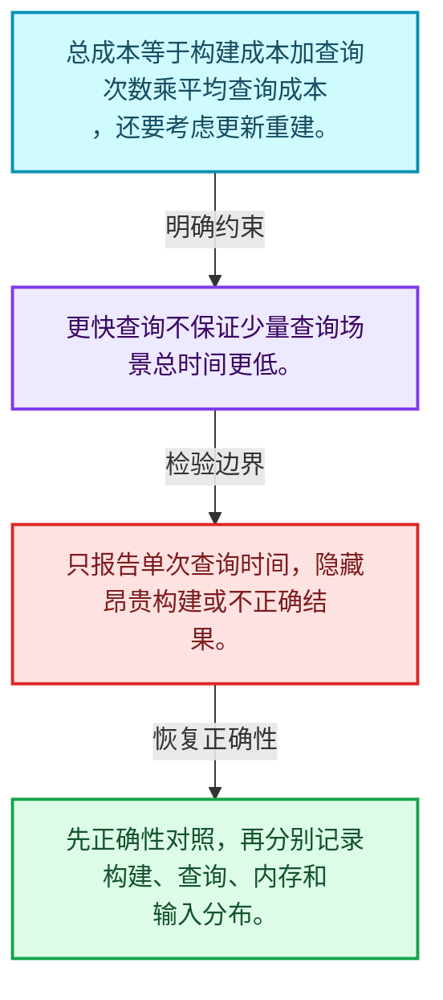
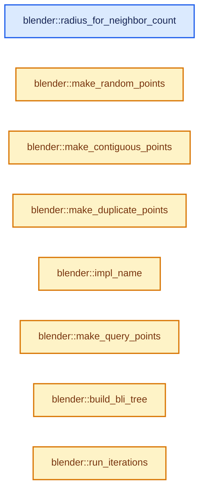
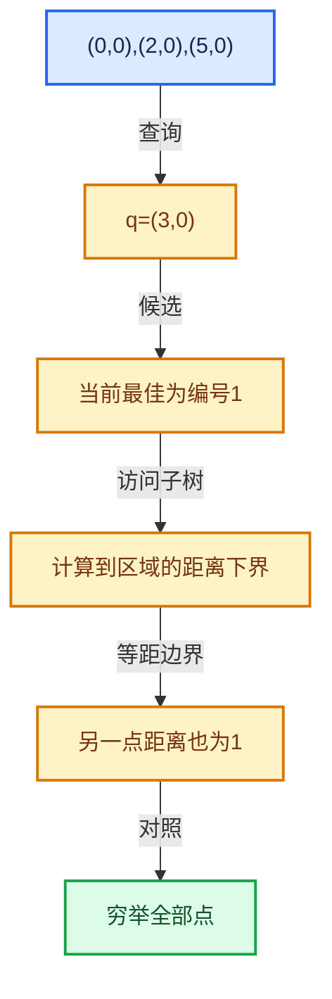

# 12-08 正确性基准与独立实现

[方向导航](README.md) · [总目录](../README.md) · [实现索引](../00-课程指南/02-源码与提交索引/符号依赖与实现索引.md)

## 从问题到实现

如何分开衡量构建、查询与内存？

历史基准不能直接代表本机，输入分布与查询批量影响收益；正确性检查应先于测速。

**数据模型**

总成本等于构建成本加查询次数乘平均查询成本，还要考虑更新重建。

**设计取舍**

更快查询不保证少量查询场景总时间更低。

**最小反例**

只报告单次查询时间，隐藏昂贵构建或不正确结果。

**推导**

先正确性对照，再分别记录构建、查询、内存和输入分布。

## 阅读地图与执行推演








图中的数值推演是本方向的教学模型；实际函数之间的调用边与概念分析边分别标注，不能把概念关系当作运行时调度顺序。

## 完整源码单元与就地讲解

中文讲解直接放在相关代码旁，复杂机制在代码下展开。原文折叠区保留基准行号；不需要在行号表和函数之间来回查找。类布局可分段展示，函数实现不按固定行数切开。

### 类型布局、声明与编译条件 · BLI_kdtree_performance_test.cc L1—L46

<!-- annotated:be60b811158680 -->

```cpp
/* SPDX-FileCopyrightText: 2026 Blender Authors
 *
 * SPDX-License-Identifier: Apache-2.0 */

#include <algorithm>
#include <array>
#include <cinttypes>
#include <cmath>
#include <ctime>

#include "testing/testing.h"

#include "BLI_array.hh"
#include "BLI_function_ref.hh"
#include "BLI_index_mask.hh"
#include "BLI_kdtree.hh"
#include "BLI_kdtree_new.hh"
#include "BLI_math_vector_types.hh"
#include "BLI_rand.hh"
#include "BLI_task_c.hh"
#include "BLI_threads.hh"
#include "BLI_time.hh"

namespace blender {

static const std::array<int64_t, 4> POINT_COUNTS = {1000, 10000, 100000, 1000000};

/**
 * Trees this small are built one per group by nodes like Cluster by Distance and Index of
 * Nearest, so the cost of building the tree matters as much as the queries.
 */
static const std::array<int64_t, 5> TINY_POINT_COUNTS = {4, 16, 64, 256, 1024};

/** Number of query points used by the search benchmarks. */
static constexpr int64_t QUERY_COUNT = 100000;

/** Neighbors requested by the "find nearest n" benchmark. */
static constexpr int NEAREST_N = 8;

/**
 * Search radius chosen so that a uniform distribution has roughly this many points in range.
 * Using a fixed radius instead would make the small and large sizes test completely different
 * things (finding nothing vs. finding most of the tree).
 */
static constexpr double NEIGHBORS_IN_RANGE = 8.0;

```

<details>
<summary>核对原始源码：source/blender/blenlib/tests/performance/BLI_kdtree_performance_test.cc · L1—L46</summary>

<!-- original:be60b811158680:source/blender/blenlib/tests/performance/BLI_kdtree_performance_test.cc:1:46 -->

```cpp
/* SPDX-FileCopyrightText: 2026 Blender Authors
 *
 * SPDX-License-Identifier: Apache-2.0 */

#include <algorithm>
#include <array>
#include <cinttypes>
#include <cmath>
#include <ctime>

#include "testing/testing.h"

#include "BLI_array.hh"
#include "BLI_function_ref.hh"
#include "BLI_index_mask.hh"
#include "BLI_kdtree.hh"
#include "BLI_kdtree_new.hh"
#include "BLI_math_vector_types.hh"
#include "BLI_rand.hh"
#include "BLI_task_c.hh"
#include "BLI_threads.hh"
#include "BLI_time.hh"

namespace blender {

static const std::array<int64_t, 4> POINT_COUNTS = {1000, 10000, 100000, 1000000};

/**
 * Trees this small are built one per group by nodes like Cluster by Distance and Index of
 * Nearest, so the cost of building the tree matters as much as the queries.
 */
static const std::array<int64_t, 5> TINY_POINT_COUNTS = {4, 16, 64, 256, 1024};

/** Number of query points used by the search benchmarks. */
static constexpr int64_t QUERY_COUNT = 100000;

/** Neighbors requested by the "find nearest n" benchmark. */
static constexpr int NEAREST_N = 8;

/**
 * Search radius chosen so that a uniform distribution has roughly this many points in range.
 * Using a fixed radius instead would make the small and large sizes test completely different
 * things (finding nothing vs. finding most of the tree).
 */
static constexpr double NEIGHBORS_IN_RANGE = 8.0;

```

</details>

<a id="f-48db88f486d0282b"></a>

### `blender::radius_for_neighbor_count`

实现位置：[source/blender/blenlib/tests/performance/BLI_kdtree_performance_test.cc](../../../../../source/blender/blenlib/tests/performance/BLI_kdtree_performance_test.cc) · L47—L51。

接口参数：

- `const int64_t points_num`

**教学注释版**

<!-- annotated:9bdd6c99298713 -->

```cpp
static float radius_for_neighbor_count(const int64_t points_num)
{
  /* Volume of the sphere containing #NEIGHBORS_IN_RANGE points in the unit cube. */
  return float(std::cbrt(NEIGHBORS_IN_RANGE * 3.0 / (4.0 * M_PI * double(points_num))));
}
```

<details>
<summary>核对原始源码：source/blender/blenlib/tests/performance/BLI_kdtree_performance_test.cc · L47—L51</summary>

<!-- original:9bdd6c99298713:source/blender/blenlib/tests/performance/BLI_kdtree_performance_test.cc:47:51 -->

```cpp
static float radius_for_neighbor_count(const int64_t points_num)
{
  /* Volume of the sphere containing #NEIGHBORS_IN_RANGE points in the unit cube. */
  return float(std::cbrt(NEIGHBORS_IN_RANGE * 3.0 / (4.0 * M_PI * double(points_num))));
}
```

</details>

**结果出口**

- `return float(std::cbrt(NEIGHBORS_IN_RANGE * 3.0 / (4.0 * M_PI * double(points_num))));`

**继续追踪实现**

- `std::cbrt` → [外部契约](https://eel.is/c++draft/)：这个边界按实际表达式及所属类型核对参数、返回值、寿命与失败行为。这里提供接口入口，不声称已解释该第三方版本的内部实现。

### 类型布局、声明与编译条件 · BLI_kdtree_performance_test.cc L52—L59

<!-- annotated:ae2ab9db6fc2f1 -->

```cpp

/* -------------------------------------------------------------------- */
/** \name Point Distributions
 *
 * All of these fill the unit cube, so a given radius means the same thing for each of them.
 * \{ */

/** Uniform noise. Neighbors in space are completely unrelated to neighbors in the array. */
```

<details>
<summary>核对原始源码：source/blender/blenlib/tests/performance/BLI_kdtree_performance_test.cc · L52—L59</summary>

<!-- original:ae2ab9db6fc2f1:source/blender/blenlib/tests/performance/BLI_kdtree_performance_test.cc:52:59 -->

```cpp

/* -------------------------------------------------------------------- */
/** \name Point Distributions
 *
 * All of these fill the unit cube, so a given radius means the same thing for each of them.
 * \{ */

/** Uniform noise. Neighbors in space are completely unrelated to neighbors in the array. */
```

</details>

<a id="f-2b680dbee0768bb6"></a>

### `blender::make_random_points`

实现位置：[source/blender/blenlib/tests/performance/BLI_kdtree_performance_test.cc](../../../../../source/blender/blenlib/tests/performance/BLI_kdtree_performance_test.cc) · L60—L68。

接口参数：

- `const int64_t points_num`

**教学注释版**

<!-- annotated:b0b5d487009ea2 -->

```cpp
static Array<float3> make_random_points(const int64_t points_num)
{
  RandomNumberGenerator random;
  Array<float3> positions(points_num);
  // [讲解] positions.index_range：查询固定有效长度及其索引范围。
  for (const int64_t i : positions.index_range()) {
    positions[i] = float3(random.get_float(), random.get_float(), random.get_float());
  }
  return positions;
}
```

<details>
<summary>核对原始源码：source/blender/blenlib/tests/performance/BLI_kdtree_performance_test.cc · L60—L68</summary>

<!-- original:b0b5d487009ea2:source/blender/blenlib/tests/performance/BLI_kdtree_performance_test.cc:60:68 -->

```cpp
static Array<float3> make_random_points(const int64_t points_num)
{
  RandomNumberGenerator random;
  Array<float3> positions(points_num);
  for (const int64_t i : positions.index_range()) {
    positions[i] = float3(random.get_float(), random.get_float(), random.get_float());
  }
  return positions;
}
```

</details>

**沿实际写入检查状态**

- `positions[i] = float3(random.get_float(), random.get_float(), random.get_float());`

**结果出口**

- `return positions;`

**继续追踪实现**

- `positions.index_range` → [blender::Array::index_range · L371](../01-基础容器与现代CPP/08-Array复制移动与销毁.md#f-50a09e14742887a0)。
- `float3` → [float3 · L641](../90-实现依赖专题/08-其他Blender模块/compositor/algorithms/intern/smaa.cc.md#m-0ea8254cfdb4)。宏定义由构建条件选择。
- `random.get_float` → [blender::RandomNumberGenerator::get_float · L83](../90-实现依赖专题/01-BLI基础库/BLI_rand.hh.md#f-c43dc1f759b49ddb)。

### 类型布局、声明与编译条件 · BLI_kdtree_performance_test.cc L69—L74

<!-- annotated:dac57342307b1c -->

```cpp

/**
 * A jittered grid visited in scan-line order, so points close in the array are close in space.
 * This is much closer to real geometry (mesh vertices, hair roots, grid-aligned point clouds)
 * than uniform noise, and it's the case where memory access patterns can be exploited.
 */
```

<details>
<summary>核对原始源码：source/blender/blenlib/tests/performance/BLI_kdtree_performance_test.cc · L69—L74</summary>

<!-- original:dac57342307b1c:source/blender/blenlib/tests/performance/BLI_kdtree_performance_test.cc:69:74 -->

```cpp

/**
 * A jittered grid visited in scan-line order, so points close in the array are close in space.
 * This is much closer to real geometry (mesh vertices, hair roots, grid-aligned point clouds)
 * than uniform noise, and it's the case where memory access patterns can be exploited.
 */
```

</details>

<a id="f-05cdb99541054cc5"></a>

### `blender::make_contiguous_points`

实现位置：[source/blender/blenlib/tests/performance/BLI_kdtree_performance_test.cc](../../../../../source/blender/blenlib/tests/performance/BLI_kdtree_performance_test.cc) · L75—L92。

接口参数：

- `const int64_t points_num`

**教学注释版**

<!-- annotated:bb1058dca67373 -->

```cpp
static Array<float3> make_contiguous_points(const int64_t points_num)
{
  RandomNumberGenerator random;
  Array<float3> positions(points_num);
  /* Round up, so the grid is always large enough to contain every point. */
  // [讲解] std::max<int64_t>：按比较关系选取较大值。本讲解中的增长公式同时满足最低请求和几何增长；若保存返回引用，还需注意实参寿命。
  const int64_t side = std::max<int64_t>(std::ceil(std::cbrt(double(points_num))), 1);
  const float step = 1.0f / float(side);
  // [讲解] positions.index_range：查询固定有效长度及其索引范围。
  for (const int64_t i : positions.index_range()) {
    const int64_t x = i % side;
    const int64_t y = (i / side) % side;
    const int64_t z = i / (side * side);
    const float3 corner = float3(float(x), float(y), float(z)) * step;
    const float3 jitter = float3(random.get_float(), random.get_float(), random.get_float()) *
                          step;
    positions[i] = corner + jitter;
  }
  return positions;
}
```

<details>
<summary>核对原始源码：source/blender/blenlib/tests/performance/BLI_kdtree_performance_test.cc · L75—L92</summary>

<!-- original:bb1058dca67373:source/blender/blenlib/tests/performance/BLI_kdtree_performance_test.cc:75:92 -->

```cpp
static Array<float3> make_contiguous_points(const int64_t points_num)
{
  RandomNumberGenerator random;
  Array<float3> positions(points_num);
  /* Round up, so the grid is always large enough to contain every point. */
  const int64_t side = std::max<int64_t>(std::ceil(std::cbrt(double(points_num))), 1);
  const float step = 1.0f / float(side);
  for (const int64_t i : positions.index_range()) {
    const int64_t x = i % side;
    const int64_t y = (i / side) % side;
    const int64_t z = i / (side * side);
    const float3 corner = float3(float(x), float(y), float(z)) * step;
    const float3 jitter = float3(random.get_float(), random.get_float(), random.get_float()) *
                          step;
    positions[i] = corner + jitter;
  }
  return positions;
}
```

</details>

**沿实际写入检查状态**

- `positions[i] = corner + jitter;`

**结果出口**

- `return positions;`

**继续追踪实现**

- `std::max<int64_t>` → [外部契约](https://eel.is/c++draft/alg.min.max)：按比较关系选取较大值。本讲解中的增长公式同时满足最低请求和几何增长；若保存返回引用，还需注意实参寿命。
- `std::ceil` → [外部契约](https://eel.is/c++draft/)：这个边界按实际表达式及所属类型核对参数、返回值、寿命与失败行为。这里提供接口入口，不声称已解释该第三方版本的内部实现。
- `std::cbrt` → [外部契约](https://eel.is/c++draft/)：这个边界按实际表达式及所属类型核对参数、返回值、寿命与失败行为。这里提供接口入口，不声称已解释该第三方版本的内部实现。
- `positions.index_range` → [blender::Array::index_range · L371](../01-基础容器与现代CPP/08-Array复制移动与销毁.md#f-50a09e14742887a0)。
- `float3` → [float3 · L641](../90-实现依赖专题/08-其他Blender模块/compositor/algorithms/intern/smaa.cc.md#m-0ea8254cfdb4)。宏定义由构建条件选择。
- `random.get_float` → [blender::RandomNumberGenerator::get_float · L83](../90-实现依赖专题/01-BLI基础库/BLI_rand.hh.md#f-c43dc1f759b49ddb)。

### 类型布局、声明与编译条件 · BLI_kdtree_performance_test.cc L93—L99

<!-- annotated:1b6c8453f239bb -->

```cpp

/**
 * Half of the points sit exactly on one of a few locations. Degenerate cases like this show up
 * whenever geometry is generated procedurally (instances at the same origin, collapsed edges,
 * points snapped to a grid), and they're the worst case for the median split: many coordinates
 * are equal along every axis, so the tree can become badly unbalanced.
 */
```

<details>
<summary>核对原始源码：source/blender/blenlib/tests/performance/BLI_kdtree_performance_test.cc · L93—L99</summary>

<!-- original:1b6c8453f239bb:source/blender/blenlib/tests/performance/BLI_kdtree_performance_test.cc:93:99 -->

```cpp

/**
 * Half of the points sit exactly on one of a few locations. Degenerate cases like this show up
 * whenever geometry is generated procedurally (instances at the same origin, collapsed edges,
 * points snapped to a grid), and they're the worst case for the median split: many coordinates
 * are equal along every axis, so the tree can become badly unbalanced.
 */
```

</details>

<a id="f-3e024a69b1c3a23f"></a>

### `blender::make_duplicate_points`

实现位置：[source/blender/blenlib/tests/performance/BLI_kdtree_performance_test.cc](../../../../../source/blender/blenlib/tests/performance/BLI_kdtree_performance_test.cc) · L100—L119。

接口参数：

- `const int64_t points_num`

**教学注释版**

<!-- annotated:ade8a105d11802 -->

```cpp
static Array<float3> make_duplicate_points(const int64_t points_num)
{
  constexpr int hotspots_num = 16;
  RandomNumberGenerator random;
  Array<float3> hotspots(hotspots_num);
  // [讲解] hotspots.index_range：查询固定有效长度及其索引范围。
  for (const int i : hotspots.index_range()) {
    hotspots[i] = float3(random.get_float(), random.get_float(), random.get_float());
  }

  Array<float3> positions(points_num);
  for (const int64_t i : positions.index_range()) {
    if (i % 2 == 0) {
      positions[i] = hotspots[random.get_int32(hotspots_num)];
    }
    else {
      positions[i] = float3(random.get_float(), random.get_float(), random.get_float());
    }
  }
  return positions;
}
```

<details>
<summary>核对原始源码：source/blender/blenlib/tests/performance/BLI_kdtree_performance_test.cc · L100—L119</summary>

<!-- original:ade8a105d11802:source/blender/blenlib/tests/performance/BLI_kdtree_performance_test.cc:100:119 -->

```cpp
static Array<float3> make_duplicate_points(const int64_t points_num)
{
  constexpr int hotspots_num = 16;
  RandomNumberGenerator random;
  Array<float3> hotspots(hotspots_num);
  for (const int i : hotspots.index_range()) {
    hotspots[i] = float3(random.get_float(), random.get_float(), random.get_float());
  }

  Array<float3> positions(points_num);
  for (const int64_t i : positions.index_range()) {
    if (i % 2 == 0) {
      positions[i] = hotspots[random.get_int32(hotspots_num)];
    }
    else {
      positions[i] = float3(random.get_float(), random.get_float(), random.get_float());
    }
  }
  return positions;
}
```

</details>

**沿实际写入检查状态**

- `hotspots[i] = float3(random.get_float(), random.get_float(), random.get_float());`
- `positions[i] = hotspots[random.get_int32(hotspots_num)];`
- `positions[i] = float3(random.get_float(), random.get_float(), random.get_float());`

**结果出口**

- `return positions;`

**继续追踪实现**

- `hotspots.index_range` → [blender::Array::index_range · L371](../01-基础容器与现代CPP/08-Array复制移动与销毁.md#f-50a09e14742887a0)。
- `float3` → [float3 · L641](../90-实现依赖专题/08-其他Blender模块/compositor/algorithms/intern/smaa.cc.md#m-0ea8254cfdb4)。宏定义由构建条件选择。
- `random.get_float` → [blender::RandomNumberGenerator::get_float · L83](../90-实现依赖专题/01-BLI基础库/BLI_rand.hh.md#f-c43dc1f759b49ddb)。
- `positions.index_range` → [blender::Array::index_range · L371](../01-基础容器与现代CPP/08-Array复制移动与销毁.md#f-50a09e14742887a0)。
- `random.get_int32` → [blender::RandomNumberGenerator::get_int32 · L52](../90-实现依赖专题/01-BLI基础库/BLI_rand.hh.md#f-2241ace1b1d89483)；[blender::RandomNumberGenerator::get_int32 · L66](../90-实现依赖专题/01-BLI基础库/BLI_rand.hh.md#f-749e1881a54f698a)。同名重载需按实参类型选择。

### 类型布局、声明与编译条件 · BLI_kdtree_performance_test.cc L120—L147

<a id="t-674e7240d54d"></a>

`Distribution`在这里声明的数据成员：

- `char name`
- `MakePointsFn make_points`

<a id="t-a953353433ee"></a>

<!-- annotated:2aecdf711c8a12 -->

```cpp

using MakePointsFn = Array<float3> (*)(int64_t);

struct Distribution {
  const char *name;
  MakePointsFn make_points;
};

static const Distribution DISTRIBUTIONS[] = {
    {"random", make_random_points},
    {"contiguous", make_contiguous_points},
    {"duplicates", make_duplicate_points},
};

/** \} */

/* -------------------------------------------------------------------- */
/** \name Utilities
 * \{ */

/** The two implementations that are compared. */
enum class Impl {
  BLI,
  New,
};

static const std::array<Impl, 2> IMPLEMENTATIONS = {Impl::BLI, Impl::New};

```

<details>
<summary>核对原始源码：source/blender/blenlib/tests/performance/BLI_kdtree_performance_test.cc · L120—L147</summary>

<!-- original:2aecdf711c8a12:source/blender/blenlib/tests/performance/BLI_kdtree_performance_test.cc:120:147 -->

```cpp

using MakePointsFn = Array<float3> (*)(int64_t);

struct Distribution {
  const char *name;
  MakePointsFn make_points;
};

static const Distribution DISTRIBUTIONS[] = {
    {"random", make_random_points},
    {"contiguous", make_contiguous_points},
    {"duplicates", make_duplicate_points},
};

/** \} */

/* -------------------------------------------------------------------- */
/** \name Utilities
 * \{ */

/** The two implementations that are compared. */
enum class Impl {
  BLI,
  New,
};

static const std::array<Impl, 2> IMPLEMENTATIONS = {Impl::BLI, Impl::New};

```

</details>

<a id="f-a180f7f48748f4fd"></a>

### `blender::impl_name`

实现位置：[source/blender/blenlib/tests/performance/BLI_kdtree_performance_test.cc](../../../../../source/blender/blenlib/tests/performance/BLI_kdtree_performance_test.cc) · L148—L151。

接口参数：

- `const Impl impl`

**教学注释版**

<!-- annotated:af5c5d25d1c171 -->

```cpp
static const char *impl_name(const Impl impl)
{
  return impl == Impl::BLI ? "BLI_kdtree" : "New";
}
```

<details>
<summary>核对原始源码：source/blender/blenlib/tests/performance/BLI_kdtree_performance_test.cc · L148—L151</summary>

<!-- original:af5c5d25d1c171:source/blender/blenlib/tests/performance/BLI_kdtree_performance_test.cc:148:151 -->

```cpp
static const char *impl_name(const Impl impl)
{
  return impl == Impl::BLI ? "BLI_kdtree" : "New";
}
```

</details>

**结果出口**

- `return impl == Impl::BLI ? "BLI_kdtree" : "New";`

**继续追踪实现**

本实现没有需要继续展开的显式调用；检查返回表达式、对象转换和调用者前置条件。

### 类型布局、声明与编译条件 · BLI_kdtree_performance_test.cc L152—L157

<!-- annotated:82bfdf16013b66 -->

```cpp

/**
 * Query points taken from the tree's own points, keeping their relative order so that a
 * spatially coherent input is also queried coherently. They're offset by a small amount so
 * queries don't degenerate into finding the exact same coordinate every time.
 */
```

<details>
<summary>核对原始源码：source/blender/blenlib/tests/performance/BLI_kdtree_performance_test.cc · L152—L157</summary>

<!-- original:82bfdf16013b66:source/blender/blenlib/tests/performance/BLI_kdtree_performance_test.cc:152:157 -->

```cpp

/**
 * Query points taken from the tree's own points, keeping their relative order so that a
 * spatially coherent input is also queried coherently. They're offset by a small amount so
 * queries don't degenerate into finding the exact same coordinate every time.
 */
```

</details>

<a id="f-88f85373ec367ba1"></a>

### `blender::make_query_points`

实现位置：[source/blender/blenlib/tests/performance/BLI_kdtree_performance_test.cc](../../../../../source/blender/blenlib/tests/performance/BLI_kdtree_performance_test.cc) · L158—L169。

接口参数：

- `const Span<float3> positions`

**教学注释版**

<!-- annotated:5db1fb65424011 -->

```cpp
static Array<float3> make_query_points(const Span<float3> positions)
{
  // [讲解] std::min<int64_t>：按比较关系选取较小值；截断范围时还需先满足非负和可表示范围，min本身不会证明边界安全。
  const int64_t queries_num = std::min<int64_t>(QUERY_COUNT, positions.size());
  // [讲解] positions.size：查询视图长度或生成对应有效索引区间。
  const int64_t stride = positions.size() / queries_num;
  RandomNumberGenerator random;
  Array<float3> queries(queries_num);
  // [讲解] queries.index_range：查询固定有效长度及其索引范围。
  for (const int64_t i : queries.index_range()) {
    const float3 offset = float3(random.get_float(), random.get_float(), random.get_float());
    queries[i] = positions[i * stride] + (offset - 0.5f) * 0.01f;
  }
  return queries;
}
```

<details>
<summary>核对原始源码：source/blender/blenlib/tests/performance/BLI_kdtree_performance_test.cc · L158—L169</summary>

<!-- original:5db1fb65424011:source/blender/blenlib/tests/performance/BLI_kdtree_performance_test.cc:158:169 -->

```cpp
static Array<float3> make_query_points(const Span<float3> positions)
{
  const int64_t queries_num = std::min<int64_t>(QUERY_COUNT, positions.size());
  const int64_t stride = positions.size() / queries_num;
  RandomNumberGenerator random;
  Array<float3> queries(queries_num);
  for (const int64_t i : queries.index_range()) {
    const float3 offset = float3(random.get_float(), random.get_float(), random.get_float());
    queries[i] = positions[i * stride] + (offset - 0.5f) * 0.01f;
  }
  return queries;
}
```

</details>

**沿实际写入检查状态**

- `queries[i] = positions[i * stride] + (offset - 0.5f) * 0.01f;`

**结果出口**

- `return queries;`

**继续追踪实现**

- `std::min<int64_t>` → [外部契约](https://eel.is/c++draft/alg.min.max)：按比较关系选取较小值；截断范围时还需先满足非负和可表示范围，min本身不会证明边界安全。
- `positions.size` → [blender::Span::size · L256](../01-基础容器与现代CPP/05-Span只读连续视图.md#f-5f80fa006089c998)。
- `queries.index_range` → [blender::Array::index_range · L371](../01-基础容器与现代CPP/08-Array复制移动与销毁.md#f-50a09e14742887a0)。
- `float3` → [float3 · L641](../90-实现依赖专题/08-其他Blender模块/compositor/algorithms/intern/smaa.cc.md#m-0ea8254cfdb4)。宏定义由构建条件选择。
- `random.get_float` → [blender::RandomNumberGenerator::get_float · L83](../90-实现依赖专题/01-BLI基础库/BLI_rand.hh.md#f-c43dc1f759b49ddb)。

<!-- annotated:802fcc6ed50a7b -->

```cpp

```

<details>
<summary>核对原始源码：source/blender/blenlib/tests/performance/BLI_kdtree_performance_test.cc · L170—L170</summary>

<!-- original:802fcc6ed50a7b:source/blender/blenlib/tests/performance/BLI_kdtree_performance_test.cc:170:170 -->

```cpp

```

</details>

<a id="f-c83115dc6460b1a4"></a>

### `blender::build_bli_tree`

实现位置：[source/blender/blenlib/tests/performance/BLI_kdtree_performance_test.cc](../../../../../source/blender/blenlib/tests/performance/BLI_kdtree_performance_test.cc) · L171—L179。

接口参数：

- `const Span<float3> positions`

**教学注释版**

<!-- annotated:4830ff35ae6c1b -->

```cpp
static KDTree<float3> *build_bli_tree(const Span<float3> positions)
{
  // [讲解] positions.size：查询视图长度或生成对应有效索引区间。
  KDTree<float3> *tree = kdtree_new<float3>(positions.size());
  // [讲解] positions.index_range：查询视图长度或生成对应有效索引区间。
  for (const int64_t i : positions.index_range()) {
    kdtree_insert(tree, int(i), positions[i]);
  }
  kdtree_balance(tree);
  return tree;
}
```

<details>
<summary>核对原始源码：source/blender/blenlib/tests/performance/BLI_kdtree_performance_test.cc · L171—L179</summary>

<!-- original:4830ff35ae6c1b:source/blender/blenlib/tests/performance/BLI_kdtree_performance_test.cc:171:179 -->

```cpp
static KDTree<float3> *build_bli_tree(const Span<float3> positions)
{
  KDTree<float3> *tree = kdtree_new<float3>(positions.size());
  for (const int64_t i : positions.index_range()) {
    kdtree_insert(tree, int(i), positions[i]);
  }
  kdtree_balance(tree);
  return tree;
}
```

</details>

**结果出口**

- `return tree;`

**继续追踪实现**

- `kdtree_new<float3>` → [blender::kdtree_new · L65](../90-实现依赖专题/01-BLI基础库/BLI_kdtree.hh.md#f-46a3316dfd09a49e)。
- `positions.size` → [blender::Span::size · L256](../01-基础容器与现代CPP/05-Span只读连续视图.md#f-5f80fa006089c998)。
- `positions.index_range` → [blender::Span::index_range · L405](../01-基础容器与现代CPP/05-Span只读连续视图.md#f-caaa9b06e13e53e0)。
- `kdtree_insert` → [blender::kdtree_insert · L95](../90-实现依赖专题/01-BLI基础库/BLI_kdtree.hh.md#f-ed9cb6449add9ae9)。
- `kdtree_balance` → [blender::kdtree_balance · L183](../90-实现依赖专题/01-BLI基础库/BLI_kdtree.hh.md#f-c4ab209b5302fead)。

### 类型布局、声明与编译条件 · BLI_kdtree_performance_test.cc L180—L184

<!-- annotated:fd4be59d467691 -->

```cpp

/**
 * Runs \a function often enough that the result isn't dominated by timer noise for small point
 * counts, without making the largest point counts take a long time. Returns the fastest run.
 */
```

<details>
<summary>核对原始源码：source/blender/blenlib/tests/performance/BLI_kdtree_performance_test.cc · L180—L184</summary>

<!-- original:fd4be59d467691:source/blender/blenlib/tests/performance/BLI_kdtree_performance_test.cc:180:184 -->

```cpp

/**
 * Runs \a function often enough that the result isn't dominated by timer noise for small point
 * counts, without making the largest point counts take a long time. Returns the fastest run.
 */
```

</details>

<a id="f-0c7025bbe8d18ada"></a>

### `blender::run_iterations`

实现位置：[source/blender/blenlib/tests/performance/BLI_kdtree_performance_test.cc](../../../../../source/blender/blenlib/tests/performance/BLI_kdtree_performance_test.cc) · L185—L196。

接口参数：

- `const int64_t points_num`
- `const FunctionRef<void()> function`

**教学注释版**

<!-- annotated:430e54c9a1a627 -->

```cpp
static double run_iterations(const int64_t points_num, const FunctionRef<void()> function)
{
  const int iterations = int(std::clamp<int64_t>(2000000 / points_num, 3, 1000));
  double min_time = 1e30;
  for (int repetition = 0; repetition < iterations; repetition++) {
    const double time_before = BLI_time_now_seconds();
    function();
    const double time_after = BLI_time_now_seconds();
    // [讲解] std::min：按比较关系选取较小值；截断范围时还需先满足非负和可表示范围，min本身不会证明边界安全。
    min_time = std::min(min_time, time_after - time_before);
  }
  return min_time;
}
```

<details>
<summary>核对原始源码：source/blender/blenlib/tests/performance/BLI_kdtree_performance_test.cc · L185—L196</summary>

<!-- original:430e54c9a1a627:source/blender/blenlib/tests/performance/BLI_kdtree_performance_test.cc:185:196 -->

```cpp
static double run_iterations(const int64_t points_num, const FunctionRef<void()> function)
{
  const int iterations = int(std::clamp<int64_t>(2000000 / points_num, 3, 1000));
  double min_time = 1e30;
  for (int repetition = 0; repetition < iterations; repetition++) {
    const double time_before = BLI_time_now_seconds();
    function();
    const double time_after = BLI_time_now_seconds();
    min_time = std::min(min_time, time_after - time_before);
  }
  return min_time;
}
```

</details>

**沿实际写入检查状态**

- `min_time = std::min(min_time, time_after - time_before);`

**结果出口**

- `return min_time;`

**继续追踪实现**

- `std::clamp<int64_t>` → [外部契约](https://eel.is/c++draft/)：这个边界按实际表达式及所属类型核对参数、返回值、寿命与失败行为。这里提供接口入口，不声称已解释该第三方版本的内部实现。
- `BLI_time_now_seconds` → [blender::BLI_time_now_seconds · L30](../90-实现依赖专题/01-BLI基础库/intern/time.cc.md#f-78479f031bcc3c53)。
- `function` → [调用协议](../00-课程指南/01-路线与规范/模板宏与动态分派协议.md)：局部可调用对象，须结合其初始化与捕获环境。调用位置L191。
- `std::min` → [外部契约](https://eel.is/c++draft/alg.min.max)：按比较关系选取较小值；截断范围时还需先满足非负和可表示范围，min本身不会证明边界安全。

### 类型布局、声明与编译条件 · BLI_kdtree_performance_test.cc L197—L204

<!-- annotated:b7da5ecbe553a8 -->

```cpp

/**
 * Like #run_iterations, but for operations that are too fast to time on their own: a single run
 * of the smallest trees is only a few hundred nanoseconds, which is close enough to the cost of
 * reading the clock that it would dominate the result. Runs the function in batches instead.
 *
 * \return The average time of a single run, from the fastest batch.
 */
```

<details>
<summary>核对原始源码：source/blender/blenlib/tests/performance/BLI_kdtree_performance_test.cc · L197—L204</summary>

<!-- original:b7da5ecbe553a8:source/blender/blenlib/tests/performance/BLI_kdtree_performance_test.cc:197:204 -->

```cpp

/**
 * Like #run_iterations, but for operations that are too fast to time on their own: a single run
 * of the smallest trees is only a few hundred nanoseconds, which is close enough to the cost of
 * reading the clock that it would dominate the result. Runs the function in batches instead.
 *
 * \return The average time of a single run, from the fastest batch.
 */
```

</details>

<a id="f-39792c1f29615ba7"></a>

### `blender::run_batched`

实现位置：[source/blender/blenlib/tests/performance/BLI_kdtree_performance_test.cc](../../../../../source/blender/blenlib/tests/performance/BLI_kdtree_performance_test.cc) · L205—L218。

接口参数：

- `const int64_t points_num`
- `const FunctionRef<void()> function`

**教学注释版**

<!-- annotated:ed20799f28fd09 -->

```cpp
static double run_batched(const int64_t points_num, const FunctionRef<void()> function)
{
  // [讲解] std::max<int64_t>：按比较关系选取较大值。本讲解中的增长公式同时满足最低请求和几何增长；若保存返回引用，还需注意实参寿命。
  const int64_t batch_size = std::max<int64_t>(20000 / points_num, 1);
  double min_time = 1e30;
  for (int repetition = 0; repetition < 20; repetition++) {
    const double time_before = BLI_time_now_seconds();
    for ([[maybe_unused]] const int64_t i : IndexRange(batch_size)) {
      function();
    }
    const double time_after = BLI_time_now_seconds();
    // [讲解] std::min：按比较关系选取较小值；截断范围时还需先满足非负和可表示范围，min本身不会证明边界安全。
    min_time = std::min(min_time, (time_after - time_before) / double(batch_size));
  }
  return min_time;
}
```

<details>
<summary>核对原始源码：source/blender/blenlib/tests/performance/BLI_kdtree_performance_test.cc · L205—L218</summary>

<!-- original:ed20799f28fd09:source/blender/blenlib/tests/performance/BLI_kdtree_performance_test.cc:205:218 -->

```cpp
static double run_batched(const int64_t points_num, const FunctionRef<void()> function)
{
  const int64_t batch_size = std::max<int64_t>(20000 / points_num, 1);
  double min_time = 1e30;
  for (int repetition = 0; repetition < 20; repetition++) {
    const double time_before = BLI_time_now_seconds();
    for ([[maybe_unused]] const int64_t i : IndexRange(batch_size)) {
      function();
    }
    const double time_after = BLI_time_now_seconds();
    min_time = std::min(min_time, (time_after - time_before) / double(batch_size));
  }
  return min_time;
}
```

</details>

**沿实际写入检查状态**

- `min_time = std::min(min_time, (time_after - time_before) / double(batch_size));`

**结果出口**

- `return min_time;`

**继续追踪实现**

- `std::max<int64_t>` → [外部契约](https://eel.is/c++draft/alg.min.max)：按比较关系选取较大值。本讲解中的增长公式同时满足最低请求和几何增长；若保存返回引用，还需注意实参寿命。
- `BLI_time_now_seconds` → [blender::BLI_time_now_seconds · L30](../90-实现依赖专题/01-BLI基础库/intern/time.cc.md#f-78479f031bcc3c53)。
- `IndexRange` → [blender::IndexRange](../90-实现依赖专题/01-BLI基础库/BLI_index_range.hh.md#t-caa3466d6776)；[blender::gpu::shader::parser::IndexRange](../90-实现依赖专题/08-其他Blender模块/gpu/shader_tool/utils.hh.md#t-82d2bd4ea71c)；[blender::IndexRange](../90-实现依赖专题/08-其他Blender模块/makesdna/DNA_node_types.h.md#t-0448cc889d39)。
- `function` → [调用协议](../00-课程指南/01-路线与规范/模板宏与动态分派协议.md)：局部可调用对象，须结合其初始化与捕获环境。调用位置L212。
- `std::min` → [外部契约](https://eel.is/c++draft/alg.min.max)：按比较关系选取较小值；截断范围时还需先满足非负和可表示范围，min本身不会证明边界安全。

### 类型布局、声明与编译条件 · BLI_kdtree_performance_test.cc L219—L226

<!-- annotated:5f7fff00d8aa85 -->

```cpp

/**
 * Runs \a query_fn for query points in batches, wrapping around the array until the time budget
 * is used up. Since a single query can be orders of magnitude slower in the degenerate cases,
 * running a fixed number of queries would either be too noisy or far too slow.
 *
 * \return The average time of a single query.
 */
```

<details>
<summary>核对原始源码：source/blender/blenlib/tests/performance/BLI_kdtree_performance_test.cc · L219—L226</summary>

<!-- original:5f7fff00d8aa85:source/blender/blenlib/tests/performance/BLI_kdtree_performance_test.cc:219:226 -->

```cpp

/**
 * Runs \a query_fn for query points in batches, wrapping around the array until the time budget
 * is used up. Since a single query can be orders of magnitude slower in the degenerate cases,
 * running a fixed number of queries would either be too noisy or far too slow.
 *
 * \return The average time of a single query.
 */
```

</details>

<a id="f-87d5ece3276dbb93"></a>

### `blender::run_queries`

实现位置：[source/blender/blenlib/tests/performance/BLI_kdtree_performance_test.cc](../../../../../source/blender/blenlib/tests/performance/BLI_kdtree_performance_test.cc) · L227—L249。

接口参数：

- `const Span<float3> queries`
- `const FunctionRef<void(const float3 &query)> query_fn`
- `const float3 &query`

**教学注释版**

<!-- annotated:d4a90f3538c344 -->

```cpp
static double run_queries(const Span<float3> queries,
                          const FunctionRef<void(const float3 &query)> query_fn)
{
  /* Small enough that the slowest queries don't overshoot the budget by much, large enough that
   * the timer isn't a significant cost. */
  constexpr int64_t batch_size = 256;
  constexpr double time_budget = 0.25;
  constexpr int64_t min_queries = 2000;

  double total_time = 0.0;
  int64_t queries_num = 0;
  while (total_time < time_budget || queries_num < min_queries) {
    // [讲解] queries.size：查询视图长度或生成对应有效索引区间。
    const int64_t start = queries_num % queries.size();
    // [讲解] std::min：按比较关系选取较小值；截断范围时还需先满足非负和可表示范围，min本身不会证明边界安全。
    const int64_t size = std::min(batch_size, queries.size() - start);
    const double time_before = BLI_time_now_seconds();
    // [讲解] queries.slice：建立原连续范围的子视图。
    for (const float3 &query : queries.slice(start, size)) {
      query_fn(query);
    }
    total_time += BLI_time_now_seconds() - time_before;
    queries_num += size;
  }
  return total_time / double(queries_num);
}
```

<details>
<summary>核对原始源码：source/blender/blenlib/tests/performance/BLI_kdtree_performance_test.cc · L227—L249</summary>

<!-- original:d4a90f3538c344:source/blender/blenlib/tests/performance/BLI_kdtree_performance_test.cc:227:249 -->

```cpp
static double run_queries(const Span<float3> queries,
                          const FunctionRef<void(const float3 &query)> query_fn)
{
  /* Small enough that the slowest queries don't overshoot the budget by much, large enough that
   * the timer isn't a significant cost. */
  constexpr int64_t batch_size = 256;
  constexpr double time_budget = 0.25;
  constexpr int64_t min_queries = 2000;

  double total_time = 0.0;
  int64_t queries_num = 0;
  while (total_time < time_budget || queries_num < min_queries) {
    const int64_t start = queries_num % queries.size();
    const int64_t size = std::min(batch_size, queries.size() - start);
    const double time_before = BLI_time_now_seconds();
    for (const float3 &query : queries.slice(start, size)) {
      query_fn(query);
    }
    total_time += BLI_time_now_seconds() - time_before;
    queries_num += size;
  }
  return total_time / double(queries_num);
}
```

</details>

**沿实际写入检查状态**

- `total_time += BLI_time_now_seconds() - time_before;`
- `queries_num += size;`

**结果出口**

- `return total_time / double(queries_num);`

**继续追踪实现**

- `queries.size` → [blender::Span::size · L256](../01-基础容器与现代CPP/05-Span只读连续视图.md#f-5f80fa006089c998)。
- `std::min` → [外部契约](https://eel.is/c++draft/alg.min.max)：按比较关系选取较小值；截断范围时还需先满足非负和可表示范围，min本身不会证明边界安全。
- `BLI_time_now_seconds` → [blender::BLI_time_now_seconds · L30](../90-实现依赖专题/01-BLI基础库/intern/time.cc.md#f-78479f031bcc3c53)。
- `queries.slice` → [blender::Span::slice · L141](../01-基础容器与现代CPP/05-Span只读连续视图.md#f-380a0e8fdcbd53cc)；[blender::Span::slice · L149](../01-基础容器与现代CPP/05-Span只读连续视图.md#f-9b9c15e78dd54eec)。同名重载需按实参类型选择。
- `query_fn` → [调用协议](../00-课程指南/01-路线与规范/模板宏与动态分派协议.md)：局部可调用对象，须结合其初始化与捕获环境。调用位置L243。

<!-- annotated:0c3ccc78573f9d -->

```cpp

```

<details>
<summary>核对原始源码：source/blender/blenlib/tests/performance/BLI_kdtree_performance_test.cc · L250—L250</summary>

<!-- original:0c3ccc78573f9d:source/blender/blenlib/tests/performance/BLI_kdtree_performance_test.cc:250:250 -->

```cpp

```

</details>

<a id="f-9396054c803c5964"></a>

### `blender::print_time`

实现位置：[source/blender/blenlib/tests/performance/BLI_kdtree_performance_test.cc](../../../../../source/blender/blenlib/tests/performance/BLI_kdtree_performance_test.cc) · L251—L262。

接口参数：

- `const double seconds`

**教学注释版**

<!-- annotated:485cbc12dc063b -->

```cpp
static void print_time(const double seconds)
{
  if (seconds < 0.000001) {
    printf(" %8.1f ns |", seconds * 1000000000.0);
  }
  else if (seconds < 0.001) {
    printf(" %8.2f µs |", seconds * 1000000.0);
  }
  else {
    printf(" %8.2f ms |", seconds * 1000.0);
  }
}
```

<details>
<summary>核对原始源码：source/blender/blenlib/tests/performance/BLI_kdtree_performance_test.cc · L251—L262</summary>

<!-- original:485cbc12dc063b:source/blender/blenlib/tests/performance/BLI_kdtree_performance_test.cc:251:262 -->

```cpp
static void print_time(const double seconds)
{
  if (seconds < 0.000001) {
    printf(" %8.1f ns |", seconds * 1000000000.0);
  }
  else if (seconds < 0.001) {
    printf(" %8.2f µs |", seconds * 1000000.0);
  }
  else {
    printf(" %8.2f ms |", seconds * 1000.0);
  }
}
```

</details>

**继续追踪实现**

- `printf` → [外部契约](https://eel.is/c++draft/)：这个边界按实际表达式及所属类型核对参数、返回值、寿命与失败行为。这里提供接口入口，不声称已解释该第三方版本的内部实现。

<!-- annotated:b5aff2155d3e82 -->

```cpp

```

<details>
<summary>核对原始源码：source/blender/blenlib/tests/performance/BLI_kdtree_performance_test.cc · L263—L263</summary>

<!-- original:b5aff2155d3e82:source/blender/blenlib/tests/performance/BLI_kdtree_performance_test.cc:263:263 -->

```cpp

```

</details>

<a id="f-d255a595d924c8b9"></a>

### `blender::print_table_header`

实现位置：[source/blender/blenlib/tests/performance/BLI_kdtree_performance_test.cc](../../../../../source/blender/blenlib/tests/performance/BLI_kdtree_performance_test.cc) · L264—L277。

接口参数：

- `const char *title`
- `const char *value_description`
- `const Span<int64_t> point_counts`

**教学注释版**

<!-- annotated:1576517b17de1d -->

```cpp
static void print_table_header(const char *title,
                               const char *value_description,
                               const Span<int64_t> point_counts)
{
  printf("\n#### %s\n\n(%s)\n\n| distribution | implementation |", title, value_description);
  for (const int64_t points_num : point_counts) {
    printf(" %" PRId64 " points |", points_num);
  }
  printf("\n|---:|---:|");
  for ([[maybe_unused]] const int64_t points_num : point_counts) {
    printf("---:|");
  }
  printf("\n");
}
```

<details>
<summary>核对原始源码：source/blender/blenlib/tests/performance/BLI_kdtree_performance_test.cc · L264—L277</summary>

<!-- original:1576517b17de1d:source/blender/blenlib/tests/performance/BLI_kdtree_performance_test.cc:264:277 -->

```cpp
static void print_table_header(const char *title,
                               const char *value_description,
                               const Span<int64_t> point_counts)
{
  printf("\n#### %s\n\n(%s)\n\n| distribution | implementation |", title, value_description);
  for (const int64_t points_num : point_counts) {
    printf(" %" PRId64 " points |", points_num);
  }
  printf("\n|---:|---:|");
  for ([[maybe_unused]] const int64_t points_num : point_counts) {
    printf("---:|");
  }
  printf("\n");
}
```

</details>

**继续追踪实现**

- `printf` → [外部契约](https://eel.is/c++draft/)：这个边界按实际表达式及所属类型核对参数、返回值、寿命与失败行为。这里提供接口入口，不声称已解释该第三方版本的内部实现。

### 类型布局、声明与编译条件 · BLI_kdtree_performance_test.cc L278—L285

<!-- annotated:21cd11cddb378f -->

```cpp

/**
 * Runs \a run_cell for every combination of distribution, implementation and point count,
 * printing one row per distribution and implementation. The function returns the time of a
 * single run of whatever it measures.
 */
using RunCellFn = FunctionRef<double(Impl impl, const Span<float3> positions, int64_t points_num)>;

```

<details>
<summary>核对原始源码：source/blender/blenlib/tests/performance/BLI_kdtree_performance_test.cc · L278—L285</summary>

<!-- original:21cd11cddb378f:source/blender/blenlib/tests/performance/BLI_kdtree_performance_test.cc:278:285 -->

```cpp

/**
 * Runs \a run_cell for every combination of distribution, implementation and point count,
 * printing one row per distribution and implementation. The function returns the time of a
 * single run of whatever it measures.
 */
using RunCellFn = FunctionRef<double(Impl impl, const Span<float3> positions, int64_t points_num)>;

```

</details>

<a id="f-8d163fe5896dfbfd"></a>

### `blender::run_table`

实现位置：[source/blender/blenlib/tests/performance/BLI_kdtree_performance_test.cc](../../../../../source/blender/blenlib/tests/performance/BLI_kdtree_performance_test.cc) · L286—L308。

接口参数：

- `const char *title`
- `const char *value_description`
- `const RunCellFn run_cell`
- `const Span<int64_t> point_counts = POINT_COUNTS`
- `const Span<Impl> implementations = IMPLEMENTATIONS`

**教学注释版**

<!-- annotated:ff92c6b06b8344 -->

```cpp
static void run_table(const char *title,
                      const char *value_description,
                      const RunCellFn run_cell,
                      const Span<int64_t> point_counts = POINT_COUNTS,
                      const Span<Impl> implementations = IMPLEMENTATIONS)
{
  /* Without this the scheduler reports a single thread, which makes #threading::max_threads_task
   * do nothing, so the tree's own limit on how many threads it builds with has no effect. */
  BLI_task_scheduler_init();

  print_table_header(title, value_description, point_counts);
  for (const Distribution &distribution : DISTRIBUTIONS) {
    for (const Impl impl : implementations) {
      printf("| %s | %s |", distribution.name, impl_name(impl));
      for (const int64_t points_num : point_counts) {
        const Array<float3> positions = distribution.make_points(points_num);
        print_time(run_cell(impl, positions, points_num));
        fflush(stdout);
      }
      printf("\n");
    }
  }
}
```

<details>
<summary>核对原始源码：source/blender/blenlib/tests/performance/BLI_kdtree_performance_test.cc · L286—L308</summary>

<!-- original:ff92c6b06b8344:source/blender/blenlib/tests/performance/BLI_kdtree_performance_test.cc:286:308 -->

```cpp
static void run_table(const char *title,
                      const char *value_description,
                      const RunCellFn run_cell,
                      const Span<int64_t> point_counts = POINT_COUNTS,
                      const Span<Impl> implementations = IMPLEMENTATIONS)
{
  /* Without this the scheduler reports a single thread, which makes #threading::max_threads_task
   * do nothing, so the tree's own limit on how many threads it builds with has no effect. */
  BLI_task_scheduler_init();

  print_table_header(title, value_description, point_counts);
  for (const Distribution &distribution : DISTRIBUTIONS) {
    for (const Impl impl : implementations) {
      printf("| %s | %s |", distribution.name, impl_name(impl));
      for (const int64_t points_num : point_counts) {
        const Array<float3> positions = distribution.make_points(points_num);
        print_time(run_cell(impl, positions, points_num));
        fflush(stdout);
      }
      printf("\n");
    }
  }
}
```

</details>

**继续追踪实现**

- `BLI_task_scheduler_init` → [blender::BLI_task_scheduler_init · L70](../11-Depsgraph与并行任务系统/07-任务池与TBB接入.md#f-2a9b04d296c08d20)。
- `print_table_header` → [blender::print_table_header · L264](08-正确性基准与独立实现.md#f-d255a595d924c8b9)。
- `printf` → [外部契约](https://eel.is/c++draft/)：这个边界按实际表达式及所属类型核对参数、返回值、寿命与失败行为。这里提供接口入口，不声称已解释该第三方版本的内部实现。
- `impl_name` → [blender::impl_name · L148](08-正确性基准与独立实现.md#f-a180f7f48748f4fd)。
- `distribution.make_points` → [调用协议](../00-课程指南/01-路线与规范/模板宏与动态分派协议.md)：接收对象类型依赖auto、返回值或模板实例；不按同名猜测目标。调用位置L301。
- `print_time` → [blender::print_time · L251](08-正确性基准与独立实现.md#f-9396054c803c5964)。
- `run_cell` → [调用协议](../00-课程指南/01-路线与规范/模板宏与动态分派协议.md)：局部可调用对象，须结合其初始化与捕获环境。调用位置L302。
- `fflush` → [调用协议](../00-课程指南/01-路线与规范/模板宏与动态分派协议.md)：函数指针、局部可调用对象或未展开的宏；必须结合调用者环境。调用位置L303。

### 类型布局、声明与编译条件 · BLI_kdtree_performance_test.cc L309—L315

<!-- annotated:57c682a5a2964e -->

```cpp

/** \} */

/* -------------------------------------------------------------------- */
/** \name Benchmarks
 * \{ */

```

<details>
<summary>核对原始源码：source/blender/blenlib/tests/performance/BLI_kdtree_performance_test.cc · L309—L315</summary>

<!-- original:57c682a5a2964e:source/blender/blenlib/tests/performance/BLI_kdtree_performance_test.cc:309:315 -->

```cpp

/** \} */

/* -------------------------------------------------------------------- */
/** \name Benchmarks
 * \{ */

```

</details>

<a id="f-c6510c91181f6d13"></a>

### `blender::TEST`

实现位置：[source/blender/blenlib/tests/performance/BLI_kdtree_performance_test.cc](../../../../../source/blender/blenlib/tests/performance/BLI_kdtree_performance_test.cc) · L316—L329。

接口参数：

- `kdtree_performance`
- `Build`

**教学注释版**

<!-- annotated:ec0bb748c6cc6d -->

```cpp
TEST(kdtree_performance, Build)
{
  run_table("Building the tree",
            "`kdtree_insert` and `kdtree_balance` vs. the `KDTreeNew` constructor",
            [](const Impl impl, const Span<float3> positions, const int64_t points_num) {
              if (impl == Impl::BLI) {
                return run_iterations(points_num, [&]() {
                  KDTree<float3> *tree = build_bli_tree(positions);
                  kdtree_free(tree);
                });
              }
              return run_iterations(points_num, [&]() { KDTreeNew<float3> tree(positions); });
            });
}
```

<details>
<summary>核对原始源码：source/blender/blenlib/tests/performance/BLI_kdtree_performance_test.cc · L316—L329</summary>

<!-- original:ec0bb748c6cc6d:source/blender/blenlib/tests/performance/BLI_kdtree_performance_test.cc:316:329 -->

```cpp
TEST(kdtree_performance, Build)
{
  run_table("Building the tree",
            "`kdtree_insert` and `kdtree_balance` vs. the `KDTreeNew` constructor",
            [](const Impl impl, const Span<float3> positions, const int64_t points_num) {
              if (impl == Impl::BLI) {
                return run_iterations(points_num, [&]() {
                  KDTree<float3> *tree = build_bli_tree(positions);
                  kdtree_free(tree);
                });
              }
              return run_iterations(points_num, [&]() { KDTreeNew<float3> tree(positions); });
            });
}
```

</details>

**结果出口**

- `return run_iterations(points_num, [&]() {`
- `return run_iterations(points_num, [&]() { KDTreeNew<float3> tree(positions); });`

**继续追踪实现**

- `run_table` → [blender::run_table · L286](08-正确性基准与独立实现.md#f-8d163fe5896dfbfd)。
- `run_iterations` → [blender::run_iterations · L185](08-正确性基准与独立实现.md#f-0c7025bbe8d18ada)。
- `build_bli_tree` → [blender::build_bli_tree · L171](08-正确性基准与独立实现.md#f-c83115dc6460b1a4)。
- `kdtree_free` → [blender::kdtree_free · L84](../90-实现依赖专题/01-BLI基础库/BLI_kdtree.hh.md#f-29e79484de22f4be)。

<!-- annotated:54439abbe244e1 -->

```cpp

```

<details>
<summary>核对原始源码：source/blender/blenlib/tests/performance/BLI_kdtree_performance_test.cc · L330—L330</summary>

<!-- original:54439abbe244e1:source/blender/blenlib/tests/performance/BLI_kdtree_performance_test.cc:330:330 -->

```cpp

```

</details>

<a id="f-cdc87ef777591d48"></a>

### `blender::TEST`

实现位置：[source/blender/blenlib/tests/performance/BLI_kdtree_performance_test.cc](../../../../../source/blender/blenlib/tests/performance/BLI_kdtree_performance_test.cc) · L331—L355。

接口参数：

- `kdtree_performance`
- `FindNearest`

**教学注释版**

<!-- annotated:7cc63f5b0004c4 -->

```cpp
TEST(kdtree_performance, FindNearest)
{
  run_table("Find the nearest point",
            "time per query",
            [](const Impl impl, const Span<float3> positions, const int64_t /*points_num*/) {
              const Array<float3> queries = make_query_points(positions);
              int64_t index_sum = 0;
              double time;
              if (impl == Impl::BLI) {
                KDTree<float3> *tree = build_bli_tree(positions);
                time = run_queries(queries, [&](const float3 &query) {
                  KDTreeNearest<float3> nearest;
                  index_sum += kdtree_find_nearest(tree, query, &nearest);
                });
                kdtree_free(tree);
              }
              else {
                const KDTreeNew<float3> tree(positions);
                time = run_queries(
                    // [讲解] tree.find_nearest：在空间界限约束下寻找满足条件的点。
                    queries, [&](const float3 &query) { index_sum += tree.find_nearest(query); });
              }
              EXPECT_GT(index_sum, 0);
              return time;
            });
}
```

<details>
<summary>核对原始源码：source/blender/blenlib/tests/performance/BLI_kdtree_performance_test.cc · L331—L355</summary>

<!-- original:7cc63f5b0004c4:source/blender/blenlib/tests/performance/BLI_kdtree_performance_test.cc:331:355 -->

```cpp
TEST(kdtree_performance, FindNearest)
{
  run_table("Find the nearest point",
            "time per query",
            [](const Impl impl, const Span<float3> positions, const int64_t /*points_num*/) {
              const Array<float3> queries = make_query_points(positions);
              int64_t index_sum = 0;
              double time;
              if (impl == Impl::BLI) {
                KDTree<float3> *tree = build_bli_tree(positions);
                time = run_queries(queries, [&](const float3 &query) {
                  KDTreeNearest<float3> nearest;
                  index_sum += kdtree_find_nearest(tree, query, &nearest);
                });
                kdtree_free(tree);
              }
              else {
                const KDTreeNew<float3> tree(positions);
                time = run_queries(
                    queries, [&](const float3 &query) { index_sum += tree.find_nearest(query); });
              }
              EXPECT_GT(index_sum, 0);
              return time;
            });
}
```

</details>

**沿实际写入检查状态**

- `time = run_queries(queries, [&](const float3 &query) {`
- `index_sum += kdtree_find_nearest(tree, query, &nearest);`
- `time = run_queries(`

**结果出口**

- `return time;`

**继续追踪实现**

- `run_table` → [blender::run_table · L286](08-正确性基准与独立实现.md#f-8d163fe5896dfbfd)。
- `make_query_points` → [blender::make_query_points · L158](08-正确性基准与独立实现.md#f-88f85373ec367ba1)。
- `build_bli_tree` → [blender::build_bli_tree · L171](08-正确性基准与独立实现.md#f-c83115dc6460b1a4)。
- `run_queries` → [blender::run_queries · L227](08-正确性基准与独立实现.md#f-87d5ece3276dbb93)。
- `kdtree_find_nearest` → [blender::kdtree_find_nearest · L303](../90-实现依赖专题/01-BLI基础库/BLI_kdtree.hh.md#f-3b06f2cb2fa18fa7)。
- `kdtree_free` → [blender::kdtree_free · L84](../90-实现依赖专题/01-BLI基础库/BLI_kdtree.hh.md#f-29e79484de22f4be)。
- `tree.find_nearest` → [blender::KDTreeNew<T>::find_nearest · L513](05-K近邻与范围查询.md#f-2ae1c56f5d4ecf10)。
- `EXPECT_GT` → [EXPECT_GT · L196](../90-实现依赖专题/08-其他Blender模块/gpu/shaders/common/gpu_shader_test_lib.bsl.hh.md#m-f1d61106bf8d)。宏定义由构建条件选择。

<!-- annotated:8dc5fc555f3143 -->

```cpp

```

<details>
<summary>核对原始源码：source/blender/blenlib/tests/performance/BLI_kdtree_performance_test.cc · L356—L356</summary>

<!-- original:8dc5fc555f3143:source/blender/blenlib/tests/performance/BLI_kdtree_performance_test.cc:356:356 -->

```cpp

```

</details>

<a id="f-ba60f73e47f30150"></a>

### `blender::TEST`

实现位置：[source/blender/blenlib/tests/performance/BLI_kdtree_performance_test.cc](../../../../../source/blender/blenlib/tests/performance/BLI_kdtree_performance_test.cc) · L357—L400。

接口参数：

- `kdtree_performance`
- `FindNearestSkipSelf`

**教学注释版**

<!-- annotated:3a581fb04a96bc -->

```cpp
TEST(kdtree_performance, FindNearestSkipSelf)
{
  run_table("Find the nearest point, skipping the search point itself",
            "time per query, this is what the Index of Nearest node does",
            [](const Impl impl, const Span<float3> positions, const int64_t /*points_num*/) {
              /* Search from the points themselves, since that's the only case where skipping
               * the search point matters. */
              // [讲解] positions.take_front：从两端裁去或选取一定数量元素形成新视图。
              const Span<float3> queries = positions.take_front(
                  // [讲解] std::min<int64_t>：按比较关系选取较小值；截断范围时还需先满足非负和可表示范围，min本身不会证明边界安全。
                  std::min<int64_t>(QUERY_COUNT, positions.size()));
              int64_t index_sum = 0;
              double time;
              /* The queries are the points themselves, so the index to skip is the position of
               * the query in the array. Counting the calls instead would go wrong as soon as
               * #run_queries wraps around, and then the search would accept the point it is
               * searching from and return immediately. */
              const auto query_index = [&](const float3 &query) {
                // [讲解] queries.data：返回借用范围的地址。
                return int(&query - queries.data());
              };
              if (impl == Impl::BLI) {
                KDTree<float3> *tree = build_bli_tree(positions);
                time = run_queries(queries, [&](const float3 &query) {
                  const int i = query_index(query);
                  index_sum += kdtree_find_nearest_cb<float3>(
                      tree,
                      query,
                      nullptr,
                      [i](const int other, const float3 & /*co*/, const float /*dist_sq*/) {
                        return other == i ? 0 : 1;
                      });
                });
                kdtree_free(tree);
              }
              else {
                const KDTreeNew<float3> tree(positions);
                time = run_queries(queries, [&](const float3 &query) {
                  const int i = query_index(query);
                  // [讲解] tree.find_nearest_filtered：在空间界限约束下寻找满足条件的点。
                  index_sum += tree.find_nearest_filtered(
                      query, [i](const int other) { return other != i; });
                });
              }
              EXPECT_GT(index_sum, 0);
              return time;
            });
}
```

<details>
<summary>核对原始源码：source/blender/blenlib/tests/performance/BLI_kdtree_performance_test.cc · L357—L400</summary>

<!-- original:3a581fb04a96bc:source/blender/blenlib/tests/performance/BLI_kdtree_performance_test.cc:357:400 -->

```cpp
TEST(kdtree_performance, FindNearestSkipSelf)
{
  run_table("Find the nearest point, skipping the search point itself",
            "time per query, this is what the Index of Nearest node does",
            [](const Impl impl, const Span<float3> positions, const int64_t /*points_num*/) {
              /* Search from the points themselves, since that's the only case where skipping
               * the search point matters. */
              const Span<float3> queries = positions.take_front(
                  std::min<int64_t>(QUERY_COUNT, positions.size()));
              int64_t index_sum = 0;
              double time;
              /* The queries are the points themselves, so the index to skip is the position of
               * the query in the array. Counting the calls instead would go wrong as soon as
               * #run_queries wraps around, and then the search would accept the point it is
               * searching from and return immediately. */
              const auto query_index = [&](const float3 &query) {
                return int(&query - queries.data());
              };
              if (impl == Impl::BLI) {
                KDTree<float3> *tree = build_bli_tree(positions);
                time = run_queries(queries, [&](const float3 &query) {
                  const int i = query_index(query);
                  index_sum += kdtree_find_nearest_cb<float3>(
                      tree,
                      query,
                      nullptr,
                      [i](const int other, const float3 & /*co*/, const float /*dist_sq*/) {
                        return other == i ? 0 : 1;
                      });
                });
                kdtree_free(tree);
              }
              else {
                const KDTreeNew<float3> tree(positions);
                time = run_queries(queries, [&](const float3 &query) {
                  const int i = query_index(query);
                  index_sum += tree.find_nearest_filtered(
                      query, [i](const int other) { return other != i; });
                });
              }
              EXPECT_GT(index_sum, 0);
              return time;
            });
}
```

</details>

**沿实际写入检查状态**

- `time = run_queries(queries, [&](const float3 &query) {`
- `index_sum += kdtree_find_nearest_cb<float3>(`
- `index_sum += tree.find_nearest_filtered(`

**结果出口**

- `return int(&query - queries.data());`
- `return other == i ? 0 : 1;`
- `return time;`

**继续追踪实现**

- `run_table` → [blender::run_table · L286](08-正确性基准与独立实现.md#f-8d163fe5896dfbfd)。
- `positions.take_front` → [blender::Span::take_front · L197](../01-基础容器与现代CPP/05-Span只读连续视图.md#f-1556b8b4aac9d42f)。
- `std::min<int64_t>` → [外部契约](https://eel.is/c++draft/alg.min.max)：按比较关系选取较小值；截断范围时还需先满足非负和可表示范围，min本身不会证明边界安全。
- `positions.size` → [blender::Span::size · L256](../01-基础容器与现代CPP/05-Span只读连续视图.md#f-5f80fa006089c998)。
- `queries.data` → [blender::Span::data · L219](../01-基础容器与现代CPP/05-Span只读连续视图.md#f-10c5889198935800)。
- `build_bli_tree` → [blender::build_bli_tree · L171](08-正确性基准与独立实现.md#f-c83115dc6460b1a4)。
- `run_queries` → [blender::run_queries · L227](08-正确性基准与独立实现.md#f-87d5ece3276dbb93)。
- `query_index` → [调用协议](../00-课程指南/01-路线与规范/模板宏与动态分派协议.md)：局部可调用对象，须结合其初始化与捕获环境。调用位置L378。
- `kdtree_find_nearest_cb<float3>` → [blender::kdtree_find_nearest_cb · L207](../90-实现依赖专题/01-BLI基础库/BLI_kdtree.hh.md#f-747971373f52eadf)。
- `kdtree_free` → [blender::kdtree_free · L84](../90-实现依赖专题/01-BLI基础库/BLI_kdtree.hh.md#f-29e79484de22f4be)。
- `tree.find_nearest_filtered` → [blender::KDTreeNew<T>::find_nearest_filtered · L528](05-K近邻与范围查询.md#f-bfd0ae665ae44a28)。
- `EXPECT_GT` → [EXPECT_GT · L196](../90-实现依赖专题/08-其他Blender模块/gpu/shaders/common/gpu_shader_test_lib.bsl.hh.md#m-f1d61106bf8d)。宏定义由构建条件选择。

<!-- annotated:e1183122a18b2d -->

```cpp

```

<details>
<summary>核对原始源码：source/blender/blenlib/tests/performance/BLI_kdtree_performance_test.cc · L401—L401</summary>

<!-- original:e1183122a18b2d:source/blender/blenlib/tests/performance/BLI_kdtree_performance_test.cc:401:401 -->

```cpp

```

</details>

<a id="f-94cc868c6d02fa1c"></a>

### `blender::TEST`

实现位置：[source/blender/blenlib/tests/performance/BLI_kdtree_performance_test.cc](../../../../../source/blender/blenlib/tests/performance/BLI_kdtree_performance_test.cc) · L402—L428。

接口参数：

- `kdtree_performance`
- `FindNearestN`

**教学注释版**

<!-- annotated:b7595e7fb26b38 -->

```cpp
TEST(kdtree_performance, FindNearestN)
{
  run_table("Find the 8 nearest points",
            "time per query",
            [](const Impl impl, const Span<float3> positions, const int64_t /*points_num*/) {
              const Array<float3> queries = make_query_points(positions);
              int64_t found_sum = 0;
              double time;
              if (impl == Impl::BLI) {
                KDTree<float3> *tree = build_bli_tree(positions);
                Array<KDTreeNearest<float3>> nearest(NEAREST_N);
                time = run_queries(queries, [&](const float3 &query) {
                  // [讲解] nearest.data：提供数组的借用访问入口。
                  found_sum += kdtree_find_nearest_n(tree, query, nearest.data(), NEAREST_N);
                });
                kdtree_free(tree);
              }
              else {
                const KDTreeNew<float3> tree(positions);
                Array<KDTreeNew<float3>::Nearest> nearest(NEAREST_N);
                time = run_queries(queries, [&](const float3 &query) {
                  // [讲解] tree.find_nearest_n：收集半径内或最近K个合法候选。
                  found_sum += tree.find_nearest_n(query, nearest);
                });
              }
              EXPECT_GT(found_sum, 0);
              return time;
            });
}
```

<details>
<summary>核对原始源码：source/blender/blenlib/tests/performance/BLI_kdtree_performance_test.cc · L402—L428</summary>

<!-- original:b7595e7fb26b38:source/blender/blenlib/tests/performance/BLI_kdtree_performance_test.cc:402:428 -->

```cpp
TEST(kdtree_performance, FindNearestN)
{
  run_table("Find the 8 nearest points",
            "time per query",
            [](const Impl impl, const Span<float3> positions, const int64_t /*points_num*/) {
              const Array<float3> queries = make_query_points(positions);
              int64_t found_sum = 0;
              double time;
              if (impl == Impl::BLI) {
                KDTree<float3> *tree = build_bli_tree(positions);
                Array<KDTreeNearest<float3>> nearest(NEAREST_N);
                time = run_queries(queries, [&](const float3 &query) {
                  found_sum += kdtree_find_nearest_n(tree, query, nearest.data(), NEAREST_N);
                });
                kdtree_free(tree);
              }
              else {
                const KDTreeNew<float3> tree(positions);
                Array<KDTreeNew<float3>::Nearest> nearest(NEAREST_N);
                time = run_queries(queries, [&](const float3 &query) {
                  found_sum += tree.find_nearest_n(query, nearest);
                });
              }
              EXPECT_GT(found_sum, 0);
              return time;
            });
}
```

</details>

**沿实际写入检查状态**

- `time = run_queries(queries, [&](const float3 &query) {`
- `found_sum += kdtree_find_nearest_n(tree, query, nearest.data(), NEAREST_N);`
- `found_sum += tree.find_nearest_n(query, nearest);`

**结果出口**

- `return time;`

**继续追踪实现**

- `run_table` → [blender::run_table · L286](08-正确性基准与独立实现.md#f-8d163fe5896dfbfd)。
- `make_query_points` → [blender::make_query_points · L158](08-正确性基准与独立实现.md#f-88f85373ec367ba1)。
- `build_bli_tree` → [blender::build_bli_tree · L171](08-正确性基准与独立实现.md#f-c83115dc6460b1a4)。
- `run_queries` → [blender::run_queries · L227](08-正确性基准与独立实现.md#f-87d5ece3276dbb93)。
- `kdtree_find_nearest_n` → [blender::kdtree_find_nearest_n · L445](../90-实现依赖专题/01-BLI基础库/BLI_kdtree.hh.md#f-0873555c54d48d5b)。
- `nearest.data` → [blender::Array::data · L323](../01-基础容器与现代CPP/08-Array复制移动与销毁.md#f-95648c799002f4ba)；[blender::Array::data · L327](../01-基础容器与现代CPP/08-Array复制移动与销毁.md#f-50c18301f8c40f9e)。同名重载需按实参类型选择。
- `kdtree_free` → [blender::kdtree_free · L84](../90-实现依赖专题/01-BLI基础库/BLI_kdtree.hh.md#f-29e79484de22f4be)。
- `tree.find_nearest_n` → [blender::KDTreeNew<T>::find_nearest_n · L546](06-筛选与子集查询.md#f-72a182470129c15b)。
- `EXPECT_GT` → [EXPECT_GT · L196](../90-实现依赖专题/08-其他Blender模块/gpu/shaders/common/gpu_shader_test_lib.bsl.hh.md#m-f1d61106bf8d)。宏定义由构建条件选择。

<!-- annotated:656263145bd548 -->

```cpp

```

<details>
<summary>核对原始源码：source/blender/blenlib/tests/performance/BLI_kdtree_performance_test.cc · L429—L429</summary>

<!-- original:656263145bd548:source/blender/blenlib/tests/performance/BLI_kdtree_performance_test.cc:429:429 -->

```cpp

```

</details>

<a id="f-c8884780d28c35d7"></a>

### `blender::TEST`

实现位置：[source/blender/blenlib/tests/performance/BLI_kdtree_performance_test.cc](../../../../../source/blender/blenlib/tests/performance/BLI_kdtree_performance_test.cc) · L430—L465。

接口参数：

- `kdtree_performance`
- `RangeSearch`

**教学注释版**

<!-- annotated:919fe4472f5faf -->

```cpp
TEST(kdtree_performance, RangeSearch)
{
  run_table("Visit every point in a radius",
            "time per query, radius scaled for ~8 points in range",
            [](const Impl impl, const Span<float3> positions, const int64_t points_num) {
              const Array<float3> queries = make_query_points(positions);
              const float radius = radius_for_neighbor_count(points_num);
              int64_t found_sum = 0;
              double time;
              if (impl == Impl::BLI) {
                KDTree<float3> *tree = build_bli_tree(positions);
                time = run_queries(queries, [&](const float3 &query) {
                  kdtree_range_search_cb(
                      tree,
                      query,
                      radius,
                      [&](const int /*index*/, const float3 & /*co*/, const float /*dist_sq*/) {
                        found_sum++;
                        return true;
                      });
                });
                kdtree_free(tree);
              }
              else {
                const KDTreeNew<float3> tree(positions);
                time = run_queries(queries, [&](const float3 &query) {
                  // [讲解] tree.foreach_in_radius：收集半径内或最近K个合法候选。
                  tree.foreach_in_radius(
                      query, radius, [&](const int /*index*/, const float /*distance_sq*/) {
                        found_sum++;
                      });
                });
              }
              EXPECT_GT(found_sum, 0);
              return time;
            });
}
```

<details>
<summary>核对原始源码：source/blender/blenlib/tests/performance/BLI_kdtree_performance_test.cc · L430—L465</summary>

<!-- original:919fe4472f5faf:source/blender/blenlib/tests/performance/BLI_kdtree_performance_test.cc:430:465 -->

```cpp
TEST(kdtree_performance, RangeSearch)
{
  run_table("Visit every point in a radius",
            "time per query, radius scaled for ~8 points in range",
            [](const Impl impl, const Span<float3> positions, const int64_t points_num) {
              const Array<float3> queries = make_query_points(positions);
              const float radius = radius_for_neighbor_count(points_num);
              int64_t found_sum = 0;
              double time;
              if (impl == Impl::BLI) {
                KDTree<float3> *tree = build_bli_tree(positions);
                time = run_queries(queries, [&](const float3 &query) {
                  kdtree_range_search_cb(
                      tree,
                      query,
                      radius,
                      [&](const int /*index*/, const float3 & /*co*/, const float /*dist_sq*/) {
                        found_sum++;
                        return true;
                      });
                });
                kdtree_free(tree);
              }
              else {
                const KDTreeNew<float3> tree(positions);
                time = run_queries(queries, [&](const float3 &query) {
                  tree.foreach_in_radius(
                      query, radius, [&](const int /*index*/, const float /*distance_sq*/) {
                        found_sum++;
                      });
                });
              }
              EXPECT_GT(found_sum, 0);
              return time;
            });
}
```

</details>

**沿实际写入检查状态**

- `time = run_queries(queries, [&](const float3 &query) {`

**结果出口**

- `return true;`
- `return time;`

**继续追踪实现**

- `run_table` → [blender::run_table · L286](08-正确性基准与独立实现.md#f-8d163fe5896dfbfd)。
- `make_query_points` → [blender::make_query_points · L158](08-正确性基准与独立实现.md#f-88f85373ec367ba1)。
- `radius_for_neighbor_count` → [blender::radius_for_neighbor_count · L47](08-正确性基准与独立实现.md#f-48db88f486d0282b)。
- `build_bli_tree` → [blender::build_bli_tree · L171](08-正确性基准与独立实现.md#f-c83115dc6460b1a4)。
- `run_queries` → [blender::run_queries · L227](08-正确性基准与独立实现.md#f-87d5ece3276dbb93)。
- `kdtree_range_search_cb` → [blender::kdtree_range_search_cb · L587](../90-实现依赖专题/01-BLI基础库/BLI_kdtree.hh.md#f-6082cb903efb12de)。
- `kdtree_free` → [blender::kdtree_free · L84](../90-实现依赖专题/01-BLI基础库/BLI_kdtree.hh.md#f-29e79484de22f4be)。
- `tree.foreach_in_radius` → [blender::KDTreeNew<T>::foreach_in_radius · L558](06-筛选与子集查询.md#f-5e6826a931e2f8d6)。
- `EXPECT_GT` → [EXPECT_GT · L196](../90-实现依赖专题/08-其他Blender模块/gpu/shaders/common/gpu_shader_test_lib.bsl.hh.md#m-f1d61106bf8d)。宏定义由构建条件选择。

<!-- annotated:14ba0b72b91fbd -->

```cpp

```

<details>
<summary>核对原始源码：source/blender/blenlib/tests/performance/BLI_kdtree_performance_test.cc · L466—L466</summary>

<!-- original:14ba0b72b91fbd:source/blender/blenlib/tests/performance/BLI_kdtree_performance_test.cc:466:466 -->

```cpp

```

</details>

<a id="f-96f98563a541435f"></a>

### `blender::TEST`

实现位置：[source/blender/blenlib/tests/performance/BLI_kdtree_performance_test.cc](../../../../../source/blender/blenlib/tests/performance/BLI_kdtree_performance_test.cc) · L467—L491。

接口参数：

- `kdtree_performance`
- `CalcDuplicates`

**教学注释版**

<!-- annotated:6101d0c09c8432 -->

```cpp
TEST(kdtree_performance, CalcDuplicates)
{
  run_table("Merging points by distance",
            "time for the whole tree, radius scaled for ~8 points in range, this is what the "
            "Cluster by Distance node does",
            [](const Impl impl, const Span<float3> positions, const int64_t points_num) {
              const float radius = radius_for_neighbor_count(points_num);
              Array<int> duplicates(points_num);
              if (impl == Impl::BLI) {
                KDTree<float3> *tree = build_bli_tree(positions);
                const double time = run_iterations(points_num, [&]() {
                  // [讲解] duplicates.as_mutable_span：提供数组的借用访问入口。
                  duplicates.as_mutable_span().fill(-1);
                  // [讲解] duplicates.data：提供数组的借用访问入口。
                  kdtree_calc_duplicates_fast(tree, radius, true, duplicates.data());
                });
                kdtree_free(tree);
                return time;
              }
              const KDTreeNew<float3> tree(positions);
              const IndexMask visit_order(points_num);
              return run_iterations(points_num, [&]() {
                duplicates.as_mutable_span().fill(-1);
                kdtree::calc_duplicates(tree, radius, visit_order, duplicates);
              });
            });
}
```

<details>
<summary>核对原始源码：source/blender/blenlib/tests/performance/BLI_kdtree_performance_test.cc · L467—L491</summary>

<!-- original:6101d0c09c8432:source/blender/blenlib/tests/performance/BLI_kdtree_performance_test.cc:467:491 -->

```cpp
TEST(kdtree_performance, CalcDuplicates)
{
  run_table("Merging points by distance",
            "time for the whole tree, radius scaled for ~8 points in range, this is what the "
            "Cluster by Distance node does",
            [](const Impl impl, const Span<float3> positions, const int64_t points_num) {
              const float radius = radius_for_neighbor_count(points_num);
              Array<int> duplicates(points_num);
              if (impl == Impl::BLI) {
                KDTree<float3> *tree = build_bli_tree(positions);
                const double time = run_iterations(points_num, [&]() {
                  duplicates.as_mutable_span().fill(-1);
                  kdtree_calc_duplicates_fast(tree, radius, true, duplicates.data());
                });
                kdtree_free(tree);
                return time;
              }
              const KDTreeNew<float3> tree(positions);
              const IndexMask visit_order(points_num);
              return run_iterations(points_num, [&]() {
                duplicates.as_mutable_span().fill(-1);
                kdtree::calc_duplicates(tree, radius, visit_order, duplicates);
              });
            });
}
```

</details>

**结果出口**

- `return time;`
- `return run_iterations(points_num, [&]() {`

**继续追踪实现**

- `run_table` → [blender::run_table · L286](08-正确性基准与独立实现.md#f-8d163fe5896dfbfd)。
- `radius_for_neighbor_count` → [blender::radius_for_neighbor_count · L47](08-正确性基准与独立实现.md#f-48db88f486d0282b)。
- `build_bli_tree` → [blender::build_bli_tree · L171](08-正确性基准与独立实现.md#f-c83115dc6460b1a4)。
- `run_iterations` → [blender::run_iterations · L185](08-正确性基准与独立实现.md#f-0c7025bbe8d18ada)。
- `duplicates.as_mutable_span().fill` → [调用协议](../00-课程指南/01-路线与规范/模板宏与动态分派协议.md)：接收对象类型依赖auto、返回值或模板实例；不按同名猜测目标。调用位置L478。
- `duplicates.as_mutable_span` → [blender::Array::as_mutable_span · L259](../01-基础容器与现代CPP/08-Array复制移动与销毁.md#f-4e91de9f1337c144)。
- `kdtree_calc_duplicates_fast` → [blender::kdtree_calc_duplicates_fast · L722](../90-实现依赖专题/01-BLI基础库/BLI_kdtree.hh.md#f-921a28bb9645d7ab)。
- `duplicates.data` → [blender::Array::data · L323](../01-基础容器与现代CPP/08-Array复制移动与销毁.md#f-95648c799002f4ba)；[blender::Array::data · L327](../01-基础容器与现代CPP/08-Array复制移动与销毁.md#f-50c18301f8c40f9e)。同名重载需按实参类型选择。
- `kdtree_free` → [blender::kdtree_free · L84](../90-实现依赖专题/01-BLI基础库/BLI_kdtree.hh.md#f-29e79484de22f4be)。
- `kdtree::calc_duplicates` → [blender::kdtree::calc_duplicates · L866](06-筛选与子集查询.md#f-117958deb05043c6)；[blender::kdtree::calc_duplicates · L880](06-筛选与子集查询.md#f-f66a4a034d00bb17)；[blender::kdtree::calc_duplicates · L483](05-K近邻与范围查询.md#f-1642fa253cb95b93)。同名重载需按实参类型选择。

### 类型布局、声明与编译条件 · BLI_kdtree_performance_test.cc L492—L498

<!-- annotated:27d1a7b60fb205 -->

```cpp

/** \} */

/* -------------------------------------------------------------------- */
/** \name Threaded Build
 * \{ */

```

<details>
<summary>核对原始源码：source/blender/blenlib/tests/performance/BLI_kdtree_performance_test.cc · L492—L498</summary>

<!-- original:27d1a7b60fb205:source/blender/blenlib/tests/performance/BLI_kdtree_performance_test.cc:492:498 -->

```cpp

/** \} */

/* -------------------------------------------------------------------- */
/** \name Threaded Build
 * \{ */

```

</details>

<a id="f-551ad19ba0ee38b6"></a>

### `blender::TEST`

实现位置：[source/blender/blenlib/tests/performance/BLI_kdtree_performance_test.cc](../../../../../source/blender/blenlib/tests/performance/BLI_kdtree_performance_test.cc) · L499—L569。

接口参数：

- `kdtree_performance`
- `ThreadedBuild`

**教学注释版**

<!-- annotated:0a8820df3323b2 -->

```cpp
TEST(kdtree_performance, ThreadedBuild)
{
  static const int thread_counts[] = {1, 2, 4, 8, 16, 32};
  static const int64_t point_counts[] = {1000, 10000, 100000, 1000000};

  printf(
      "\n#### Threaded build\n\n(`KDTreeNew` build time by thread count, random. The\n"
      "tree limits its own thread count by size as well, so the larger counts give the same\n"
      "time once that limit is the lower of the two.)\n\n");
  printf("| points |");
  for (const int threads_num : thread_counts) {
    printf(" %d threads |", threads_num);
  }
  printf(" speedup |\n|---:|");
  for ([[maybe_unused]] const int threads_num : thread_counts) {
    printf("---:|");
  }
  printf("---:|\n");

  Vector<double> cpu_times;
  for (const int64_t points_num : point_counts) {
    const Array<float3> positions = make_random_points(points_num);
    printf("| %" PRId64 " |", points_num);
    double single_thread_time = 0.0;
    double best_time = 1e30;
    for (const int threads_num : thread_counts) {
      BLI_system_num_threads_override_set(threads_num);
      BLI_task_scheduler_init();

      /* Processor time as well as elapsed time, to show how much of the machine the build
       * occupies. Threads spent here are not available for other work. */
      const std::clock_t cpu_before = std::clock();
      const double time = run_iterations(points_num, [&]() { KDTreeNew<float3> tree(positions); });
      const std::clock_t cpu_after = std::clock();
      // [讲解] cpu_times.append：在尾部建立新元素，必要时先扩大存储。
      cpu_times.append(double(cpu_after - cpu_before) / double(CLOCKS_PER_SEC));

      if (threads_num == 1) {
        single_thread_time = time;
      }
      // [讲解] std::min：按比较关系选取较小值；截断范围时还需先满足非负和可表示范围，min本身不会证明边界安全。
      best_time = std::min(best_time, time);
      print_time(time);
      fflush(stdout);

      BLI_task_scheduler_exit();
    }
    printf(" %.1fx |\n", single_thread_time / best_time);
  }

  printf("\n(processor time of the same builds, relative to the single threaded build)\n\n");
  printf("| points |");
  for (const int threads_num : thread_counts) {
    printf(" %d threads |", threads_num);
  }
  printf("\n|---:|");
  for ([[maybe_unused]] const int threads_num : thread_counts) {
    printf("---:|");
  }
  printf("\n");
  int64_t cpu_time_i = 0;
  for (const int64_t points_num : point_counts) {
    printf("| %" PRId64 " |", points_num);
    const double base = cpu_times[cpu_time_i];
    for ([[maybe_unused]] const int threads_num : thread_counts) {
      printf(" %.1fx |", cpu_times[cpu_time_i++] / base);
    }
    printf("\n");
  }

  BLI_system_num_threads_override_set(0);
  BLI_task_scheduler_init();
}
```

<details>
<summary>核对原始源码：source/blender/blenlib/tests/performance/BLI_kdtree_performance_test.cc · L499—L569</summary>

<!-- original:0a8820df3323b2:source/blender/blenlib/tests/performance/BLI_kdtree_performance_test.cc:499:569 -->

```cpp
TEST(kdtree_performance, ThreadedBuild)
{
  static const int thread_counts[] = {1, 2, 4, 8, 16, 32};
  static const int64_t point_counts[] = {1000, 10000, 100000, 1000000};

  printf(
      "\n#### Threaded build\n\n(`KDTreeNew` build time by thread count, random. The\n"
      "tree limits its own thread count by size as well, so the larger counts give the same\n"
      "time once that limit is the lower of the two.)\n\n");
  printf("| points |");
  for (const int threads_num : thread_counts) {
    printf(" %d threads |", threads_num);
  }
  printf(" speedup |\n|---:|");
  for ([[maybe_unused]] const int threads_num : thread_counts) {
    printf("---:|");
  }
  printf("---:|\n");

  Vector<double> cpu_times;
  for (const int64_t points_num : point_counts) {
    const Array<float3> positions = make_random_points(points_num);
    printf("| %" PRId64 " |", points_num);
    double single_thread_time = 0.0;
    double best_time = 1e30;
    for (const int threads_num : thread_counts) {
      BLI_system_num_threads_override_set(threads_num);
      BLI_task_scheduler_init();

      /* Processor time as well as elapsed time, to show how much of the machine the build
       * occupies. Threads spent here are not available for other work. */
      const std::clock_t cpu_before = std::clock();
      const double time = run_iterations(points_num, [&]() { KDTreeNew<float3> tree(positions); });
      const std::clock_t cpu_after = std::clock();
      cpu_times.append(double(cpu_after - cpu_before) / double(CLOCKS_PER_SEC));

      if (threads_num == 1) {
        single_thread_time = time;
      }
      best_time = std::min(best_time, time);
      print_time(time);
      fflush(stdout);

      BLI_task_scheduler_exit();
    }
    printf(" %.1fx |\n", single_thread_time / best_time);
  }

  printf("\n(processor time of the same builds, relative to the single threaded build)\n\n");
  printf("| points |");
  for (const int threads_num : thread_counts) {
    printf(" %d threads |", threads_num);
  }
  printf("\n|---:|");
  for ([[maybe_unused]] const int threads_num : thread_counts) {
    printf("---:|");
  }
  printf("\n");
  int64_t cpu_time_i = 0;
  for (const int64_t points_num : point_counts) {
    printf("| %" PRId64 " |", points_num);
    const double base = cpu_times[cpu_time_i];
    for ([[maybe_unused]] const int threads_num : thread_counts) {
      printf(" %.1fx |", cpu_times[cpu_time_i++] / base);
    }
    printf("\n");
  }

  BLI_system_num_threads_override_set(0);
  BLI_task_scheduler_init();
}
```

</details>

**沿实际写入检查状态**

- `single_thread_time = time;`
- `best_time = std::min(best_time, time);`

**继续追踪实现**

- `printf` → [外部契约](https://eel.is/c++draft/)：这个边界按实际表达式及所属类型核对参数、返回值、寿命与失败行为。这里提供接口入口，不声称已解释该第三方版本的内部实现。
- `make_random_points` → [blender::make_random_points · L60](08-正确性基准与独立实现.md#f-2b680dbee0768bb6)。
- `BLI_system_num_threads_override_set` → [BLI_system_num_threads_override_set · L294](../90-实现依赖专题/01-BLI基础库/intern/threads.cc.md#f-fd90b4e312efe1bc)。
- `BLI_task_scheduler_init` → [blender::BLI_task_scheduler_init · L70](../11-Depsgraph与并行任务系统/07-任务池与TBB接入.md#f-2a9b04d296c08d20)。
- `std::clock` → [外部契约](https://eel.is/c++draft/)：这个边界按实际表达式及所属类型核对参数、返回值、寿命与失败行为。这里提供接口入口，不声称已解释该第三方版本的内部实现。
- `run_iterations` → [blender::run_iterations · L185](08-正确性基准与独立实现.md#f-0c7025bbe8d18ada)。
- `cpu_times.append` → [blender::Vector::append · L498](../01-基础容器与现代CPP/11-Vector插入删除与重排.md#f-5bde268a69e443ec)；[blender::Vector::append · L502](../01-基础容器与现代CPP/11-Vector插入删除与重排.md#f-591e0b15e6308532)。同名重载需按实参类型选择。
- `std::min` → [外部契约](https://eel.is/c++draft/alg.min.max)：按比较关系选取较小值；截断范围时还需先满足非负和可表示范围，min本身不会证明边界安全。
- `print_time` → [blender::print_time · L251](08-正确性基准与独立实现.md#f-9396054c803c5964)。
- `fflush` → [调用协议](../00-课程指南/01-路线与规范/模板宏与动态分派协议.md)：函数指针、局部可调用对象或未展开的宏；必须结合调用者环境。调用位置L540。
- `BLI_task_scheduler_exit` → [blender::BLI_task_scheduler_exit · L103](../11-Depsgraph与并行任务系统/07-任务池与TBB接入.md#f-18b11f0ce15cd616)。

### 类型布局、声明与编译条件 · BLI_kdtree_performance_test.cc L570—L580

<!-- annotated:12a0d6c2eefb23 -->

```cpp

/** \} */

/* -------------------------------------------------------------------- */
/** \name Tiny Trees
 *
 * Nodes that group points by an ID build one tree per group, so trees with a handful of points
 * are common and the cost of building one is part of every query. These measure whole workloads
 * including the build, rather than a single query against a tree that already exists.
 * \{ */

```

<details>
<summary>核对原始源码：source/blender/blenlib/tests/performance/BLI_kdtree_performance_test.cc · L570—L580</summary>

<!-- original:12a0d6c2eefb23:source/blender/blenlib/tests/performance/BLI_kdtree_performance_test.cc:570:580 -->

```cpp

/** \} */

/* -------------------------------------------------------------------- */
/** \name Tiny Trees
 *
 * Nodes that group points by an ID build one tree per group, so trees with a handful of points
 * are common and the cost of building one is part of every query. These measure whole workloads
 * including the build, rather than a single query against a tree that already exists.
 * \{ */

```

</details>

<a id="f-8ebed8b6cf1995a6"></a>

### `blender::TEST`

实现位置：[source/blender/blenlib/tests/performance/BLI_kdtree_performance_test.cc](../../../../../source/blender/blenlib/tests/performance/BLI_kdtree_performance_test.cc) · L581—L609。

接口参数：

- `kdtree_performance`
- `TinyTreesBuild`

**教学注释版**

<!-- annotated:81d322f48388ed -->

```cpp
TEST(kdtree_performance, TinyTreesBuild)
{
  run_table(
      "Building a tiny tree",
      "time to build and free one tree",
      [](const Impl impl, const Span<float3> positions, const int64_t points_num) {
        int64_t sum = 0;
        double time;
        if (impl == Impl::BLI) {
          time = run_batched(points_num, [&]() {
            KDTree<float3> *tree = build_bli_tree(positions);
            sum += tree->nodes_len;
            kdtree_free(tree);
          });
        }
        else {
          AlignedBuffer<8192, 8> buffer;
          time = run_batched(points_num, [&]() {
            LinearAllocator<> memory;
            memory.provide_buffer(buffer);
            const KDTreeNew<float3> tree(positions, memory);
            sum += tree.size();
          });
        }
        EXPECT_GT(sum, 0);
        return time;
      },
      TINY_POINT_COUNTS);
}
```

<details>
<summary>核对原始源码：source/blender/blenlib/tests/performance/BLI_kdtree_performance_test.cc · L581—L609</summary>

<!-- original:81d322f48388ed:source/blender/blenlib/tests/performance/BLI_kdtree_performance_test.cc:581:609 -->

```cpp
TEST(kdtree_performance, TinyTreesBuild)
{
  run_table(
      "Building a tiny tree",
      "time to build and free one tree",
      [](const Impl impl, const Span<float3> positions, const int64_t points_num) {
        int64_t sum = 0;
        double time;
        if (impl == Impl::BLI) {
          time = run_batched(points_num, [&]() {
            KDTree<float3> *tree = build_bli_tree(positions);
            sum += tree->nodes_len;
            kdtree_free(tree);
          });
        }
        else {
          AlignedBuffer<8192, 8> buffer;
          time = run_batched(points_num, [&]() {
            LinearAllocator<> memory;
            memory.provide_buffer(buffer);
            const KDTreeNew<float3> tree(positions, memory);
            sum += tree.size();
          });
        }
        EXPECT_GT(sum, 0);
        return time;
      },
      TINY_POINT_COUNTS);
}
```

</details>

**沿实际写入检查状态**

- `time = run_batched(points_num, [&]() {`
- `sum += tree->nodes_len;`
- `sum += tree.size();`

**结果出口**

- `return time;`

**继续追踪实现**

- `run_table` → [blender::run_table · L286](08-正确性基准与独立实现.md#f-8d163fe5896dfbfd)。
- `run_batched` → [blender::run_batched · L205](08-正确性基准与独立实现.md#f-39792c1f29615ba7)。
- `build_bli_tree` → [blender::build_bli_tree · L171](08-正确性基准与独立实现.md#f-c83115dc6460b1a4)。
- `kdtree_free` → [blender::kdtree_free · L84](../90-实现依赖专题/01-BLI基础库/BLI_kdtree.hh.md#f-29e79484de22f4be)。
- `memory.provide_buffer` → [blender::LinearAllocator::provide_buffer · L217](../03-内存分配与运行时类型/03-LinearAllocator分配与扩展.md#f-7fb26e552e8c2077)；[blender::LinearAllocator::provide_buffer · L224](../03-内存分配与运行时类型/03-LinearAllocator分配与扩展.md#f-f477894fce14f489)。同名重载需按实参类型选择。
- `tree.size` → [blender::KDTreeNew<T>::size · L493](05-K近邻与范围查询.md#f-233c05ce6d5c8d39)。
- `EXPECT_GT` → [EXPECT_GT · L196](../90-实现依赖专题/08-其他Blender模块/gpu/shaders/common/gpu_shader_test_lib.bsl.hh.md#m-f1d61106bf8d)。宏定义由构建条件选择。

<!-- annotated:5150421a79fa83 -->

```cpp

```

<details>
<summary>核对原始源码：source/blender/blenlib/tests/performance/BLI_kdtree_performance_test.cc · L610—L610</summary>

<!-- original:5150421a79fa83:source/blender/blenlib/tests/performance/BLI_kdtree_performance_test.cc:610:610 -->

```cpp

```

</details>

<a id="f-f96f6e326d1ce94a"></a>

### `blender::TEST`

实现位置：[source/blender/blenlib/tests/performance/BLI_kdtree_performance_test.cc](../../../../../source/blender/blenlib/tests/performance/BLI_kdtree_performance_test.cc) · L611—L650。

接口参数：

- `kdtree_performance`
- `TinyTreesFindNearestOther`

**教学注释版**

<!-- annotated:d4c16dced0e806 -->

```cpp
TEST(kdtree_performance, TinyTreesFindNearestOther)
{
  run_table(
      "Building a tiny tree and finding the nearest other point for every point",
      "time for the whole group, this is what the Index of Nearest node does per group",
      [](const Impl impl, const Span<float3> positions, const int64_t points_num) {
        int64_t sum = 0;
        double time;
        if (impl == Impl::BLI) {
          time = run_batched(points_num, [&]() {
            KDTree<float3> *tree = build_bli_tree(positions);
            for (const int64_t i : IndexRange(points_num)) {
              sum += kdtree_find_nearest_cb<float3>(
                  tree,
                  positions[i],
                  nullptr,
                  [i](const int other, const float3 & /*co*/, const float /*dist_sq*/) {
                    return other == int(i) ? 0 : 1;
                  });
            }
            kdtree_free(tree);
          });
        }
        else {
          AlignedBuffer<8192, 8> buffer;
          time = run_batched(points_num, [&]() {
            LinearAllocator<> memory;
            memory.provide_buffer(buffer);
            const KDTreeNew<float3> tree(positions, memory);
            for (const int64_t i : IndexRange(points_num)) {
              // [讲解] tree.find_nearest_filtered：在空间界限约束下寻找满足条件的点。
              sum += tree.find_nearest_filtered(positions[i],
                                                [i](const int other) { return other != int(i); });
            }
          });
        }
        EXPECT_GT(sum, 0);
        return time;
      },
      TINY_POINT_COUNTS);
}
```

<details>
<summary>核对原始源码：source/blender/blenlib/tests/performance/BLI_kdtree_performance_test.cc · L611—L650</summary>

<!-- original:d4c16dced0e806:source/blender/blenlib/tests/performance/BLI_kdtree_performance_test.cc:611:650 -->

```cpp
TEST(kdtree_performance, TinyTreesFindNearestOther)
{
  run_table(
      "Building a tiny tree and finding the nearest other point for every point",
      "time for the whole group, this is what the Index of Nearest node does per group",
      [](const Impl impl, const Span<float3> positions, const int64_t points_num) {
        int64_t sum = 0;
        double time;
        if (impl == Impl::BLI) {
          time = run_batched(points_num, [&]() {
            KDTree<float3> *tree = build_bli_tree(positions);
            for (const int64_t i : IndexRange(points_num)) {
              sum += kdtree_find_nearest_cb<float3>(
                  tree,
                  positions[i],
                  nullptr,
                  [i](const int other, const float3 & /*co*/, const float /*dist_sq*/) {
                    return other == int(i) ? 0 : 1;
                  });
            }
            kdtree_free(tree);
          });
        }
        else {
          AlignedBuffer<8192, 8> buffer;
          time = run_batched(points_num, [&]() {
            LinearAllocator<> memory;
            memory.provide_buffer(buffer);
            const KDTreeNew<float3> tree(positions, memory);
            for (const int64_t i : IndexRange(points_num)) {
              sum += tree.find_nearest_filtered(positions[i],
                                                [i](const int other) { return other != int(i); });
            }
          });
        }
        EXPECT_GT(sum, 0);
        return time;
      },
      TINY_POINT_COUNTS);
}
```

</details>

**沿实际写入检查状态**

- `time = run_batched(points_num, [&]() {`
- `sum += kdtree_find_nearest_cb<float3>(`
- `sum += tree.find_nearest_filtered(positions[i],`

**结果出口**

- `return other == int(i) ? 0 : 1;`
- `return time;`

**继续追踪实现**

- `run_table` → [blender::run_table · L286](08-正确性基准与独立实现.md#f-8d163fe5896dfbfd)。
- `run_batched` → [blender::run_batched · L205](08-正确性基准与独立实现.md#f-39792c1f29615ba7)。
- `build_bli_tree` → [blender::build_bli_tree · L171](08-正确性基准与独立实现.md#f-c83115dc6460b1a4)。
- `IndexRange` → [blender::IndexRange](../90-实现依赖专题/01-BLI基础库/BLI_index_range.hh.md#t-caa3466d6776)；[blender::gpu::shader::parser::IndexRange](../90-实现依赖专题/08-其他Blender模块/gpu/shader_tool/utils.hh.md#t-82d2bd4ea71c)；[blender::IndexRange](../90-实现依赖专题/08-其他Blender模块/makesdna/DNA_node_types.h.md#t-0448cc889d39)。
- `kdtree_find_nearest_cb<float3>` → [blender::kdtree_find_nearest_cb · L207](../90-实现依赖专题/01-BLI基础库/BLI_kdtree.hh.md#f-747971373f52eadf)。
- `kdtree_free` → [blender::kdtree_free · L84](../90-实现依赖专题/01-BLI基础库/BLI_kdtree.hh.md#f-29e79484de22f4be)。
- `memory.provide_buffer` → [blender::LinearAllocator::provide_buffer · L217](../03-内存分配与运行时类型/03-LinearAllocator分配与扩展.md#f-7fb26e552e8c2077)；[blender::LinearAllocator::provide_buffer · L224](../03-内存分配与运行时类型/03-LinearAllocator分配与扩展.md#f-f477894fce14f489)。同名重载需按实参类型选择。
- `tree.find_nearest_filtered` → [blender::KDTreeNew<T>::find_nearest_filtered · L528](05-K近邻与范围查询.md#f-bfd0ae665ae44a28)。
- `EXPECT_GT` → [EXPECT_GT · L196](../90-实现依赖专题/08-其他Blender模块/gpu/shaders/common/gpu_shader_test_lib.bsl.hh.md#m-f1d61106bf8d)。宏定义由构建条件选择。

<!-- annotated:13b81a0a9b1dd4 -->

```cpp

```

<details>
<summary>核对原始源码：source/blender/blenlib/tests/performance/BLI_kdtree_performance_test.cc · L651—L651</summary>

<!-- original:13b81a0a9b1dd4:source/blender/blenlib/tests/performance/BLI_kdtree_performance_test.cc:651:651 -->

```cpp

```

</details>

<a id="f-2def14ed24e8ccb8"></a>

### `blender::TEST`

实现位置：[source/blender/blenlib/tests/performance/BLI_kdtree_performance_test.cc](../../../../../source/blender/blenlib/tests/performance/BLI_kdtree_performance_test.cc) · L652—L679。

接口参数：

- `kdtree_performance`
- `TinyTreesCalcDuplicates`

**教学注释版**

<!-- annotated:76ee08c96c2e2c -->

```cpp
TEST(kdtree_performance, TinyTreesCalcDuplicates)
{
  run_table(
      "Building a tiny tree and merging its points by distance",
      "time for the whole group, this is what the Cluster by Distance node does per group",
      [](const Impl impl, const Span<float3> positions, const int64_t points_num) {
        const float radius = radius_for_neighbor_count(points_num);
        Array<int> duplicates(points_num);
        if (impl == Impl::BLI) {
          return run_batched(points_num, [&]() {
            KDTree<float3> *tree = build_bli_tree(positions);
            // [讲解] duplicates.as_mutable_span：提供数组的借用访问入口。
            duplicates.as_mutable_span().fill(-1);
            // [讲解] duplicates.data：提供数组的借用访问入口。
            kdtree_calc_duplicates_fast(tree, radius, true, duplicates.data());
            kdtree_free(tree);
          });
        }
        AlignedBuffer<8192, 8> buffer;
        const IndexMask visit_order(points_num);
        return run_batched(points_num, [&]() {
          LinearAllocator<> memory;
          memory.provide_buffer(buffer);
          const KDTreeNew<float3> tree(positions, memory);
          duplicates.as_mutable_span().fill(-1);
          kdtree::calc_duplicates(tree, radius, visit_order, duplicates);
        });
      },
      TINY_POINT_COUNTS);
}
```

<details>
<summary>核对原始源码：source/blender/blenlib/tests/performance/BLI_kdtree_performance_test.cc · L652—L679</summary>

<!-- original:76ee08c96c2e2c:source/blender/blenlib/tests/performance/BLI_kdtree_performance_test.cc:652:679 -->

```cpp
TEST(kdtree_performance, TinyTreesCalcDuplicates)
{
  run_table(
      "Building a tiny tree and merging its points by distance",
      "time for the whole group, this is what the Cluster by Distance node does per group",
      [](const Impl impl, const Span<float3> positions, const int64_t points_num) {
        const float radius = radius_for_neighbor_count(points_num);
        Array<int> duplicates(points_num);
        if (impl == Impl::BLI) {
          return run_batched(points_num, [&]() {
            KDTree<float3> *tree = build_bli_tree(positions);
            duplicates.as_mutable_span().fill(-1);
            kdtree_calc_duplicates_fast(tree, radius, true, duplicates.data());
            kdtree_free(tree);
          });
        }
        AlignedBuffer<8192, 8> buffer;
        const IndexMask visit_order(points_num);
        return run_batched(points_num, [&]() {
          LinearAllocator<> memory;
          memory.provide_buffer(buffer);
          const KDTreeNew<float3> tree(positions, memory);
          duplicates.as_mutable_span().fill(-1);
          kdtree::calc_duplicates(tree, radius, visit_order, duplicates);
        });
      },
      TINY_POINT_COUNTS);
}
```

</details>

**结果出口**

- `return run_batched(points_num, [&]() {`

**继续追踪实现**

- `run_table` → [blender::run_table · L286](08-正确性基准与独立实现.md#f-8d163fe5896dfbfd)。
- `radius_for_neighbor_count` → [blender::radius_for_neighbor_count · L47](08-正确性基准与独立实现.md#f-48db88f486d0282b)。
- `run_batched` → [blender::run_batched · L205](08-正确性基准与独立实现.md#f-39792c1f29615ba7)。
- `build_bli_tree` → [blender::build_bli_tree · L171](08-正确性基准与独立实现.md#f-c83115dc6460b1a4)。
- `duplicates.as_mutable_span().fill` → [调用协议](../00-课程指南/01-路线与规范/模板宏与动态分派协议.md)：接收对象类型依赖auto、返回值或模板实例；不按同名猜测目标。调用位置L663。
- `duplicates.as_mutable_span` → [blender::Array::as_mutable_span · L259](../01-基础容器与现代CPP/08-Array复制移动与销毁.md#f-4e91de9f1337c144)。
- `kdtree_calc_duplicates_fast` → [blender::kdtree_calc_duplicates_fast · L722](../90-实现依赖专题/01-BLI基础库/BLI_kdtree.hh.md#f-921a28bb9645d7ab)。
- `duplicates.data` → [blender::Array::data · L323](../01-基础容器与现代CPP/08-Array复制移动与销毁.md#f-95648c799002f4ba)；[blender::Array::data · L327](../01-基础容器与现代CPP/08-Array复制移动与销毁.md#f-50c18301f8c40f9e)。同名重载需按实参类型选择。
- `kdtree_free` → [blender::kdtree_free · L84](../90-实现依赖专题/01-BLI基础库/BLI_kdtree.hh.md#f-29e79484de22f4be)。
- `memory.provide_buffer` → [blender::LinearAllocator::provide_buffer · L217](../03-内存分配与运行时类型/03-LinearAllocator分配与扩展.md#f-7fb26e552e8c2077)；[blender::LinearAllocator::provide_buffer · L224](../03-内存分配与运行时类型/03-LinearAllocator分配与扩展.md#f-f477894fce14f489)。同名重载需按实参类型选择。
- `kdtree::calc_duplicates` → [blender::kdtree::calc_duplicates · L866](06-筛选与子集查询.md#f-117958deb05043c6)；[blender::kdtree::calc_duplicates · L880](06-筛选与子集查询.md#f-f66a4a034d00bb17)；[blender::kdtree::calc_duplicates · L483](05-K近邻与范围查询.md#f-1642fa253cb95b93)。同名重载需按实参类型选择。

### 类型布局、声明与编译条件 · BLI_kdtree_performance_test.cc L680—L686

<!-- annotated:9b528255403c36 -->

```cpp

/** \} */

/* -------------------------------------------------------------------- */
/** \name Leaf Size
 * \{ */

```

<details>
<summary>核对原始源码：source/blender/blenlib/tests/performance/BLI_kdtree_performance_test.cc · L680—L686</summary>

<!-- original:9b528255403c36:source/blender/blenlib/tests/performance/BLI_kdtree_performance_test.cc:680:686 -->

```cpp

/** \} */

/* -------------------------------------------------------------------- */
/** \name Leaf Size
 * \{ */

```

</details>

<a id="f-738381d19ec36517"></a>

### `blender::TEST`

实现位置：[source/blender/blenlib/tests/performance/BLI_kdtree_performance_test.cc](../../../../../source/blender/blenlib/tests/performance/BLI_kdtree_performance_test.cc) · L687—L727。

接口参数：

- `kdtree_performance`
- `KDTreeNewLeafSize`

**教学注释版**

<!-- annotated:e09d053f9b0741 -->

```cpp
TEST(kdtree_performance, KDTreeNewLeafSize)
{
  BLI_task_scheduler_init(); /* Without this, the build's own thread limit has no effect. */

  static const int leaf_sizes[] = {4, 8, 10, 16, 32, 64, 128};
  static const int64_t point_counts[] = {10000, 1000000};

  for (const int64_t points_num : point_counts) {
    printf("\n#### KDTreeNew leaf size\n\n(%" PRId64 " points)\n\n", points_num);
    printf("| distribution | leaf size | build | find nearest | 8 nearest | radius |\n");
    printf("|---:|---:|---:|---:|---:|---:|\n");

    const float radius = radius_for_neighbor_count(points_num);
    for (const Distribution &distribution : DISTRIBUTIONS) {
      const Array<float3> positions = distribution.make_points(points_num);
      const Array<float3> queries = make_query_points(positions);
      for (const int leaf_size : leaf_sizes) {
        printf("| %s | %d |", distribution.name, leaf_size);
        print_time(
            run_iterations(points_num, [&]() { KDTreeNew<float3> tree(positions, leaf_size); }));

        const KDTreeNew<float3> tree(positions, leaf_size);
        int64_t sum = 0;
        print_time(
            // [讲解] tree.find_nearest：在空间界限约束下寻找满足条件的点。
            run_queries(queries, [&](const float3 &query) { sum += tree.find_nearest(query); }));

        Array<KDTreeNew<float3>::Nearest> nearest(NEAREST_N);
        print_time(run_queries(
            // [讲解] tree.find_nearest_n：收集半径内或最近K个合法候选。
            queries, [&](const float3 &query) { sum += tree.find_nearest_n(query, nearest); }));

        print_time(run_queries(queries, [&](const float3 &query) {
          // [讲解] tree.foreach_in_radius：收集半径内或最近K个合法候选。
          tree.foreach_in_radius(
              query, radius, [&](const int /*index*/, const float /*distance_sq*/) { sum++; });
        }));
        EXPECT_GT(sum, 0);
        printf("\n");
        fflush(stdout);
      }
    }
  }
}
```

<details>
<summary>核对原始源码：source/blender/blenlib/tests/performance/BLI_kdtree_performance_test.cc · L687—L727</summary>

<!-- original:e09d053f9b0741:source/blender/blenlib/tests/performance/BLI_kdtree_performance_test.cc:687:727 -->

```cpp
TEST(kdtree_performance, KDTreeNewLeafSize)
{
  BLI_task_scheduler_init(); /* Without this, the build's own thread limit has no effect. */

  static const int leaf_sizes[] = {4, 8, 10, 16, 32, 64, 128};
  static const int64_t point_counts[] = {10000, 1000000};

  for (const int64_t points_num : point_counts) {
    printf("\n#### KDTreeNew leaf size\n\n(%" PRId64 " points)\n\n", points_num);
    printf("| distribution | leaf size | build | find nearest | 8 nearest | radius |\n");
    printf("|---:|---:|---:|---:|---:|---:|\n");

    const float radius = radius_for_neighbor_count(points_num);
    for (const Distribution &distribution : DISTRIBUTIONS) {
      const Array<float3> positions = distribution.make_points(points_num);
      const Array<float3> queries = make_query_points(positions);
      for (const int leaf_size : leaf_sizes) {
        printf("| %s | %d |", distribution.name, leaf_size);
        print_time(
            run_iterations(points_num, [&]() { KDTreeNew<float3> tree(positions, leaf_size); }));

        const KDTreeNew<float3> tree(positions, leaf_size);
        int64_t sum = 0;
        print_time(
            run_queries(queries, [&](const float3 &query) { sum += tree.find_nearest(query); }));

        Array<KDTreeNew<float3>::Nearest> nearest(NEAREST_N);
        print_time(run_queries(
            queries, [&](const float3 &query) { sum += tree.find_nearest_n(query, nearest); }));

        print_time(run_queries(queries, [&](const float3 &query) {
          tree.foreach_in_radius(
              query, radius, [&](const int /*index*/, const float /*distance_sq*/) { sum++; });
        }));
        EXPECT_GT(sum, 0);
        printf("\n");
        fflush(stdout);
      }
    }
  }
}
```

</details>

**继续追踪实现**

- `BLI_task_scheduler_init` → [blender::BLI_task_scheduler_init · L70](../11-Depsgraph与并行任务系统/07-任务池与TBB接入.md#f-2a9b04d296c08d20)。
- `printf` → [外部契约](https://eel.is/c++draft/)：这个边界按实际表达式及所属类型核对参数、返回值、寿命与失败行为。这里提供接口入口，不声称已解释该第三方版本的内部实现。
- `radius_for_neighbor_count` → [blender::radius_for_neighbor_count · L47](08-正确性基准与独立实现.md#f-48db88f486d0282b)。
- `distribution.make_points` → [调用协议](../00-课程指南/01-路线与规范/模板宏与动态分派协议.md)：接收对象类型依赖auto、返回值或模板实例；不按同名猜测目标。调用位置L701。
- `make_query_points` → [blender::make_query_points · L158](08-正确性基准与独立实现.md#f-88f85373ec367ba1)。
- `print_time` → [blender::print_time · L251](08-正确性基准与独立实现.md#f-9396054c803c5964)。
- `run_iterations` → [blender::run_iterations · L185](08-正确性基准与独立实现.md#f-0c7025bbe8d18ada)。
- `run_queries` → [blender::run_queries · L227](08-正确性基准与独立实现.md#f-87d5ece3276dbb93)。
- `tree.find_nearest` → [blender::KDTreeNew<T>::find_nearest · L513](05-K近邻与范围查询.md#f-2ae1c56f5d4ecf10)。
- `tree.find_nearest_n` → [blender::KDTreeNew<T>::find_nearest_n · L546](06-筛选与子集查询.md#f-72a182470129c15b)。
- `tree.foreach_in_radius` → [blender::KDTreeNew<T>::foreach_in_radius · L558](06-筛选与子集查询.md#f-5e6826a931e2f8d6)。
- `EXPECT_GT` → [EXPECT_GT · L196](../90-实现依赖专题/08-其他Blender模块/gpu/shaders/common/gpu_shader_test_lib.bsl.hh.md#m-f1d61106bf8d)。宏定义由构建条件选择。
- `fflush` → [调用协议](../00-课程指南/01-路线与规范/模板宏与动态分派协议.md)：函数指针、局部可调用对象或未展开的宏；必须结合调用者环境。调用位置L723。

### 类型布局、声明与编译条件 · BLI_kdtree_performance_test.cc L728—L731

<!-- annotated:f45694c10f048e -->

```cpp

/** \} */

}  // namespace blender
```

<details>
<summary>核对原始源码：source/blender/blenlib/tests/performance/BLI_kdtree_performance_test.cc · L728—L731</summary>

<!-- original:f45694c10f048e:source/blender/blenlib/tests/performance/BLI_kdtree_performance_test.cc:728:731 -->

```cpp

/** \} */

}  // namespace blender
```

</details>

## 语法与相关类型

### 常量求值 constexpr

constexpr声明允许相应实体参与常量求值，但constexpr函数仍可以在运行时执行。是否常量求值由调用场景和表达式合法性共同决定。

比较constexpr变量初始化和从运行时输入调用同一函数。

### 只读限定 const

const约束当前访问路径可做的修改。const指针、指向const的指针、const视图对象、const元素是不同位置的限定；其他别名可能仍可修改原对象。

分别写T* const、const T*与const T* const，并画出不可修改的层次。

### 异常边界 try与catch

try定义异常传播的局部边界。失败路径需要销毁已经成功构造的部分并释放相应存储；未构造的对象不能被析构。

在第k次构造失败，列出已经存在的对象集合与待释放缓冲。

### 覆写检查 override

override要求函数确实覆盖基类虚函数，可捕获参数类型和const限定不匹配。它不改变基类规定的生命周期或线程约束。

故意改变一个参数或const，观察编译器如何拒绝误写的新函数。

### 类型别名 using

类型别名为已有类型建立名字，不创建运行期对象。它常把模板内部使用的类型统一暴露给泛型调用者。

展开别名直到基础类型，区分类型别名和变量声明。

### 枚举与状态模型 enum

枚举把有限状态命名；enum class避免许多隐式整数转换。状态机正确性还依赖允许的转移，不能只看有哪些枚举项。

列出每个状态的进入条件和离开条件，检查终止状态是否仍可能被调度。

## 实现练习与验证

实现最小KD-tree，保留暴力对照并记录硬件、规模和随机种子。

参考推理：先正确性对照，再分别记录构建、查询、内存和输入分布。

返回点属于允许子集；距离不大于任何合法候选；等距按集合或距离验证，不能强制任意固定编号。

## 历史、跨库比较与证据

与nanoflann比较查询模型与来源，与BVH比较划分对象和原语，与暴力搜索比较构建成本是否值得；Blender实现有独立修改和借用契约。

[历史提交索引](../00-课程指南/02-源码与提交索引/历史提交与设计演化索引.md) · [源码基准](../00-课程指南/02-源码与提交索引/源码版本与覆盖索引.md) · [验收报告](../00-课程指南/03-验收报告/验收报告.md)
