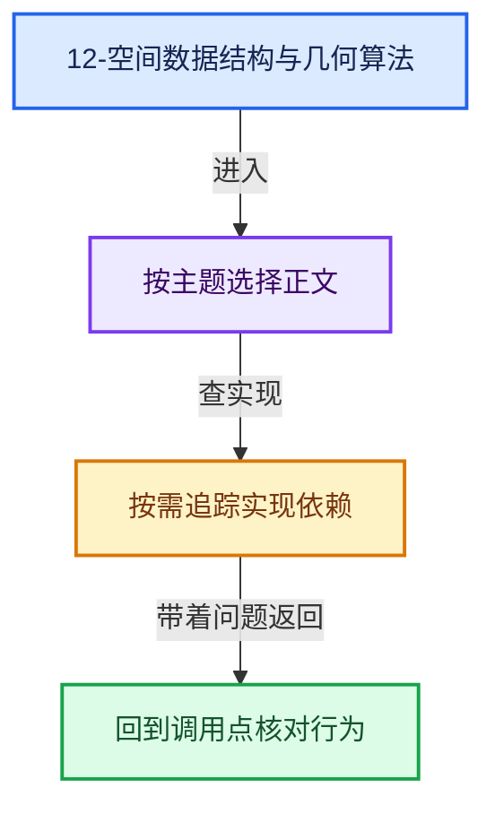
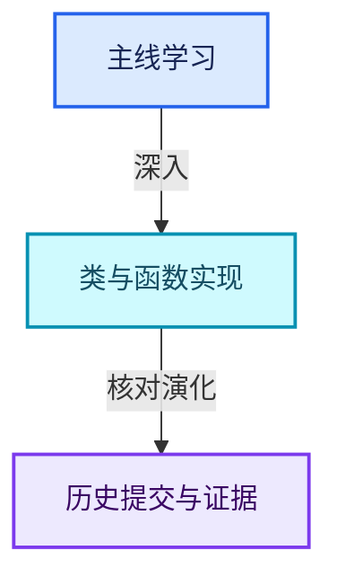

# 12-空间数据结构与几何算法

[总入口](../README.md) · [几何节点专题](../13-几何节点专题/README.md) · [实现依赖](../90-实现依赖专题/README.md)

## 阅读顺序

- [12-01 空间查询与暴力基准](01-空间查询与暴力基准.md)
- [12-02 KDTreeNew节点布局](02-KDTreeNew节点布局.md)
- [12-03 KDTreeNew构建](03-KDTreeNew构建.md)
- [12-04 最近邻搜索与剪枝](04-最近邻搜索与剪枝.md)
- [12-05 K近邻与范围查询](05-K近邻与范围查询.md)
- [12-06 筛选与子集查询](06-筛选与子集查询.md)
- [12-07 Bounds与BVH对比](07-Bounds与BVH对比.md)
- [12-08 正确性基准与独立实现](08-正确性基准与独立实现.md)

