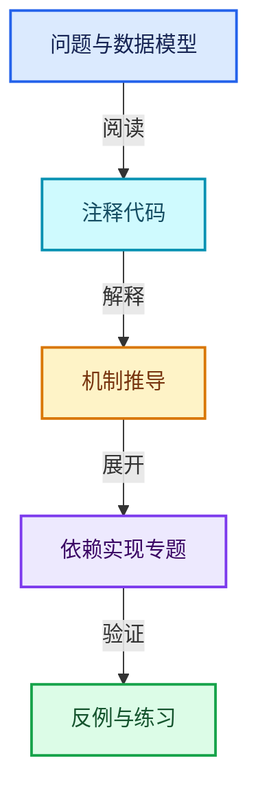
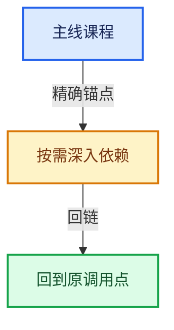

# 12-空间数据结构与几何算法

[总目录](../README.md) · [实现索引](../%E7%AC%A6%E5%8F%B7%E4%BE%9D%E8%B5%96%E4%B8%8E%E5%AE%9E%E7%8E%B0%E7%B4%A2%E5%BC%95.md)

## 主线课程

- [12-01 空间查询与暴力基准](01-%E7%A9%BA%E9%97%B4%E6%9F%A5%E8%AF%A2%E4%B8%8E%E6%9A%B4%E5%8A%9B%E5%9F%BA%E5%87%86.md)
- [12-02 KDTreeNew节点布局](02-KDTreeNew%E8%8A%82%E7%82%B9%E5%B8%83%E5%B1%80.md)
- [12-03 KDTreeNew构建](03-KDTreeNew%E6%9E%84%E5%BB%BA.md)
- [12-04 最近邻搜索与剪枝](04-%E6%9C%80%E8%BF%91%E9%82%BB%E6%90%9C%E7%B4%A2%E4%B8%8E%E5%89%AA%E6%9E%9D.md)
- [12-05 K近邻与范围查询](05-K%E8%BF%91%E9%82%BB%E4%B8%8E%E8%8C%83%E5%9B%B4%E6%9F%A5%E8%AF%A2.md)
- [12-06 筛选与子集查询](06-%E7%AD%9B%E9%80%89%E4%B8%8E%E5%AD%90%E9%9B%86%E6%9F%A5%E8%AF%A2.md)
- [12-07 Bounds与BVH对比](07-Bounds%E4%B8%8EBVH%E5%AF%B9%E6%AF%94.md)
- [12-08 正确性基准与独立实现](08-%E6%AD%A3%E7%A1%AE%E6%80%A7%E5%9F%BA%E5%87%86%E4%B8%8E%E7%8B%AC%E7%AB%8B%E5%AE%9E%E7%8E%B0.md)

## 共享实现专题

- [source/blender/blenlib/BLI_bounds_types.hh](%E4%BE%9D%E8%B5%96-BLI_bounds_types-fbc701.md)
- [source/blender/blenlib/BLI_kdtree.hh](%E4%BE%9D%E8%B5%96-BLI_kdtree-1fdadc.md)
- [source/blender/blenlib/BLI_kdtree_types.hh](%E4%BE%9D%E8%B5%96-BLI_kdtree_types-485f9d.md)
- [source/blender/blenlib/BLI_math_angle_types.hh](%E4%BE%9D%E8%B5%96-BLI_math_angle_types-e14a3a.md)
- [source/blender/blenlib/BLI_math_axis_angle.hh](%E4%BE%9D%E8%B5%96-BLI_math_axis_angle-623a67.md)
- [source/blender/blenlib/BLI_math_axis_angle_types.hh](%E4%BE%9D%E8%B5%96-BLI_math_axis_angle_types-299aa6.md)
- [source/blender/blenlib/BLI_math_base.hh](%E4%BE%9D%E8%B5%96-BLI_math_base-0728eb.md)
- [source/blender/blenlib/BLI_math_base_c.hh](%E4%BE%9D%E8%B5%96-BLI_math_base_c-171dae.md)
- [source/blender/blenlib/BLI_math_basis_types.hh](%E4%BE%9D%E8%B5%96-BLI_math_basis_types-fc7090.md)
- [source/blender/blenlib/BLI_math_color.hh](%E4%BE%9D%E8%B5%96-BLI_math_color-f3a6ea.md)
- [source/blender/blenlib/BLI_math_constants.hh](%E4%BE%9D%E8%B5%96-BLI_math_constants-44e144.md)
- [source/blender/blenlib/BLI_math_euler.hh](%E4%BE%9D%E8%B5%96-BLI_math_euler-8ad87a.md)
- [source/blender/blenlib/BLI_math_euler_types.hh](%E4%BE%9D%E8%B5%96-BLI_math_euler_types-0b9945.md)
- [source/blender/blenlib/BLI_math_interp.hh](%E4%BE%9D%E8%B5%96-BLI_math_interp-8cb985.md)
- [source/blender/blenlib/BLI_math_matrix.hh](%E4%BE%9D%E8%B5%96-BLI_math_matrix-b7b2b4.md)
- [source/blender/blenlib/BLI_math_matrix_c.hh](%E4%BE%9D%E8%B5%96-BLI_math_matrix_c-8ca9e4.md)
- [source/blender/blenlib/BLI_math_matrix_types.hh](%E4%BE%9D%E8%B5%96-BLI_math_matrix_types-e48213.md)
- [source/blender/blenlib/BLI_math_quaternion.hh](%E4%BE%9D%E8%B5%96-BLI_math_quaternion-cf105d.md)
- [source/blender/blenlib/BLI_math_quaternion_types.hh](%E4%BE%9D%E8%B5%96-BLI_math_quaternion_types-c6671a.md)
- [source/blender/blenlib/BLI_math_rotation.hh](%E4%BE%9D%E8%B5%96-BLI_math_rotation-f8b98a.md)
- [source/blender/blenlib/BLI_math_vector.hh](%E4%BE%9D%E8%B5%96-BLI_math_vector-906a87.md)
- [source/blender/blenlib/BLI_math_vector_mpq_types.hh](%E4%BE%9D%E8%B5%96-BLI_math_vector_mpq_types-faeefa.md)
- [source/blender/blenlib/BLI_math_vector_swizzle.hh](%E4%BE%9D%E8%B5%96-BLI_math_vector_swizzle-0f9c89.md)
- [source/blender/blenlib/BLI_math_vector_types.hh](%E4%BE%9D%E8%B5%96-BLI_math_vector_types-5b9874.md)
- [source/blender/blenlib/BLI_math_vector_unroll.hh](%E4%BE%9D%E8%B5%96-BLI_math_vector_unroll-85c985.md)
- [source/blender/blenlib/intern/BLI_kdopbvh.cc](%E4%BE%9D%E8%B5%96-BLI_kdopbvh-9f4bb8.md)
- [source/blender/blenlib/intern/math_base_inline.cc](%E4%BE%9D%E8%B5%96-math_base_inline-546b00.md)
- [source/blender/blenlib/intern/math_base_safe_inline.cc](%E4%BE%9D%E8%B5%96-math_base_safe_inline-c0d62b.md)
- [source/blender/blenlib/intern/math_bits_inline.cc](%E4%BE%9D%E8%B5%96-math_bits_inline-8a26f2.md)
- [source/blender/blenlib/intern/math_color.cc](%E4%BE%9D%E8%B5%96-math_color-98507f.md)
- [source/blender/blenlib/intern/math_color_blend_inline.cc](%E4%BE%9D%E8%B5%96-math_color_blend_inline-edbade.md)
- [source/blender/blenlib/intern/math_color_inline.cc](%E4%BE%9D%E8%B5%96-math_color_inline-48fb4c.md)
- [source/blender/blenlib/intern/math_geom.cc](%E4%BE%9D%E8%B5%96-math_geom-8d91a3.md)
- [source/blender/blenlib/intern/math_geom_inline.cc](%E4%BE%9D%E8%B5%96-math_geom_inline-672303.md)
- [source/blender/blenlib/intern/math_half.cc](%E4%BE%9D%E8%B5%96-math_half-7f3d7c.md)
- [source/blender/blenlib/intern/math_interp.cc](%E4%BE%9D%E8%B5%96-math_interp-40cde1.md)
- [source/blender/blenlib/intern/math_matrix.cc](%E4%BE%9D%E8%B5%96-math_matrix-d7d8ee.md)
- [source/blender/blenlib/intern/math_matrix_c.cc](%E4%BE%9D%E8%B5%96-math_matrix_c-004123.md)
- [source/blender/blenlib/intern/math_rotation.cc](%E4%BE%9D%E8%B5%96-math_rotation-d1a5d1.md)
- [source/blender/blenlib/intern/math_rotation_c.cc](%E4%BE%9D%E8%B5%96-math_rotation_c-8e57f4.md)
- [source/blender/blenlib/intern/math_solvers.cc](%E4%BE%9D%E8%B5%96-math_solvers-f0737f.md)
- [source/blender/blenlib/intern/math_statistics.cc](%E4%BE%9D%E8%B5%96-math_statistics-e129ca.md)
- [source/blender/blenlib/intern/math_vector.cc](%E4%BE%9D%E8%B5%96-math_vector-5f35fa.md)
- [source/blender/blenlib/intern/math_vector_inline.cc](%E4%BE%9D%E8%B5%96-math_vector_inline-0c8541.md)

