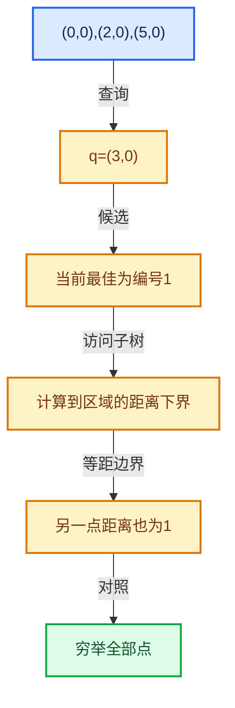

# 12-空间数据结构与几何算法

[总目录](../README.md)

先证明距离下界与返回身份，再讨论布局优化和并行构建。

## 前置知识与阅读层次

- [01-基础容器与现代CPP](../01-%E5%9F%BA%E7%A1%80%E5%AE%B9%E5%99%A8%E4%B8%8E%E7%8E%B0%E4%BB%A3CPP/README.md)
- [03-内存分配与运行时类型](../03-%E5%86%85%E5%AD%98%E5%88%86%E9%85%8D%E4%B8%8E%E8%BF%90%E8%A1%8C%E6%97%B6%E7%B1%BB%E5%9E%8B/README.md)
- [05-几何存储与拓扑映射](../05-%E5%87%A0%E4%BD%95%E5%AD%98%E5%82%A8%E4%B8%8E%E6%8B%93%E6%89%91%E6%98%A0%E5%B0%84/README.md)
- [11-Depsgraph与并行任务系统](../11-Depsgraph%E4%B8%8E%E5%B9%B6%E8%A1%8C%E4%BB%BB%E5%8A%A1%E7%B3%BB%E7%BB%9F/README.md)

初读抓住数据模型，复读逐行检查，再完成反例和独立实现。方向间允许按实际问题回查，不要求机械线性阅读。

## 正文与源码范围

| 顺序 | 文档 | 主讲文件与范围 |
|---|---|---|
| 12-01 | [空间查询与暴力基准](01-%E7%A9%BA%E9%97%B4%E6%9F%A5%E8%AF%A2%E4%B8%8E%E6%9A%B4%E5%8A%9B%E5%9F%BA%E5%87%86.md) | BLI_kdtree_test.cc:L1—L656 |
| 12-02 | [KDTreeNew节点布局](02-KDTreeNew%E8%8A%82%E7%82%B9%E5%B8%83%E5%B1%80.md) | BLI_kdtree_new.hh:L1—L136 |
| 12-03 | [KDTreeNew构建](03-KDTreeNew%E6%9E%84%E5%BB%BA.md) | BLI_kdtree_new.hh:L137—L278；kdtree.cc:L1—L216 |
| 12-04 | [最近邻搜索与剪枝](04-%E6%9C%80%E8%BF%91%E9%82%BB%E6%90%9C%E7%B4%A2%E4%B8%8E%E5%89%AA%E6%9E%9D.md) | BLI_kdtree_new.hh:L279—L410；kdtree.cc:L217—L455 |
| 12-05 | [K近邻与范围查询](05-K%E8%BF%91%E9%82%BB%E4%B8%8E%E8%8C%83%E5%9B%B4%E6%9F%A5%E8%AF%A2.md) | BLI_kdtree_new.hh:L411—L544；kdtree.cc:L456—L681 |
| 12-06 | [筛选与子集查询](06-%E7%AD%9B%E9%80%89%E4%B8%8E%E5%AD%90%E9%9B%86%E6%9F%A5%E8%AF%A2.md) | BLI_kdtree_new.hh:L545—L686；kdtree.cc:L682—L907 |
| 12-07 | [Bounds与BVH对比](07-Bounds%E4%B8%8EBVH%E5%AF%B9%E6%AF%94.md) | BLI_bounds.hh:L1—L616；BLI_bounds_types.hh:L1—L82 |
| 12-08 | [正确性基准与独立实现](08-%E6%AD%A3%E7%A1%AE%E6%80%A7%E5%9F%BA%E5%87%86%E4%B8%8E%E7%8B%AC%E7%AB%8B%E5%AE%9E%E7%8E%B0.md) | BLI_kdtree_performance_test.cc:L1—L731 |

## 本方向的数据模型

## 状态推演

## 历史入口

- [BLI: New KDTree implementation with better performance](https://projects.blender.org/blender/blender/commit/d94ff69e386aebe06ed536f363a9c7f3c3c36e8e) · Hans Goudey · 2026-09-17
- [Mesh: Move BVH storage to shared cache system](https://projects.blender.org/blender/blender/commit/024d7d12e24a5468d3e9878adf29b0b0443b5dc8) · Hans Goudey · 2024-12-04

## 跨库比较与验收

与nanoflann比较查询模型与来源，与BVH比较划分对象和原语，与暴力搜索比较构建成本是否值得；Blender实现有独立修改和借用契约。

返回点属于允许子集；距离不大于任何合法候选；等距按集合或距离验证，不能强制任意固定编号。

正文和源码区间已建立；自动检查结果见根目录验收报告。阅读者的掌握程度以独立练习与反例推理为准。
