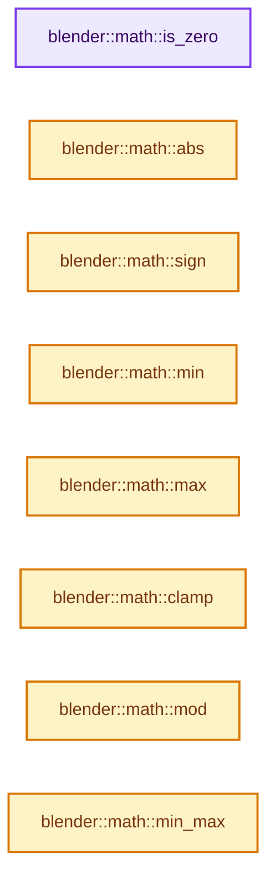

# 实现依赖专题：source/blender/blenlib/BLI_math_base.hh

[方向导航](README.md) · [符号索引](../%E7%AC%A6%E5%8F%B7%E4%BE%9D%E8%B5%96%E4%B8%8E%E5%AE%9E%E7%8E%B0%E7%B4%A2%E5%BC%95.md)

本专题从正文实际调用进入，集中保存共享实现。函数有稳定锚点，可从调用处直接跳到对应完整函数；递归与互相调用通过回链组织。

## 本文件的实现关系




## 完整成员与函数实现

<a id="f-6fdcc74ca7338838"></a>

### `blender::math::is_zero`

实现位置：[source/blender/blenlib/BLI_math_base.hh](../../../../../source/blender/blenlib/BLI_math_base.hh) · L23—L26。

接口参数：

- `const T &a`

**教学注释版**

<!-- annotated:46be494a91cf41 -->

```cpp
template<typename T> inline bool is_zero(const T &a)
{
  return a == T(0);
}
```

<details>
<summary>核对原始源码：source/blender/blenlib/BLI_math_base.hh · L23—L26</summary>

<!-- original:46be494a91cf41:source/blender/blenlib/BLI_math_base.hh:23:26 -->

```cpp
template<typename T> inline bool is_zero(const T &a)
{
  return a == T(0);
}
```

</details>

**结果出口**

- `return a == T(0);`

**继续追踪实现**

- `T` → [DiagSplit::T · L96](../05-%E5%87%A0%E4%BD%95%E5%AD%98%E5%82%A8%E4%B8%8E%E6%8B%93%E6%89%91%E6%98%A0%E5%B0%84/%E4%BE%9D%E8%B5%96-split-5f5804.md#f-d5d0885c790cc4e4)。

<a id="f-a2c9c981f4e8420c"></a>

### `blender::math::abs`

实现位置：[source/blender/blenlib/BLI_math_base.hh](../../../../../source/blender/blenlib/BLI_math_base.hh) · L33—L36。

接口参数：

- `const T &a`

**教学注释版**

<!-- annotated:5070a17d5b10ba -->

```cpp
template<typename T> inline T abs(const T &a)
{
  return std::abs(a);
}
```

<details>
<summary>核对原始源码：source/blender/blenlib/BLI_math_base.hh · L33—L36</summary>

<!-- original:5070a17d5b10ba:source/blender/blenlib/BLI_math_base.hh:33:36 -->

```cpp
template<typename T> inline T abs(const T &a)
{
  return std::abs(a);
}
```

</details>

**结果出口**

- `return std::abs(a);`

**继续追踪实现**

- `std::abs` → [外部契约](https://eel.is/c++draft/)：这个边界按实际表达式及所属类型核对参数、返回值、寿命与失败行为。这里提供接口入口，不声称已解释该第三方版本的内部实现。

<a id="f-7ce2c8677a11dcaa"></a>

### `blender::math::sign`

实现位置：[source/blender/blenlib/BLI_math_base.hh](../../../../../source/blender/blenlib/BLI_math_base.hh) · L38—L41。

接口参数：

- `const T &a`

**教学注释版**

<!-- annotated:aa418a426470ac -->

```cpp
template<typename T> inline T sign(const T &a)
{
  return (T(0) < a) - (a < T(0));
}
```

<details>
<summary>核对原始源码：source/blender/blenlib/BLI_math_base.hh · L38—L41</summary>

<!-- original:aa418a426470ac:source/blender/blenlib/BLI_math_base.hh:38:41 -->

```cpp
template<typename T> inline T sign(const T &a)
{
  return (T(0) < a) - (a < T(0));
}
```

</details>

**结果出口**

- `return (T(0) < a) - (a < T(0));`

**继续追踪实现**

- `T` → [DiagSplit::T · L96](../05-%E5%87%A0%E4%BD%95%E5%AD%98%E5%82%A8%E4%B8%8E%E6%8B%93%E6%89%91%E6%98%A0%E5%B0%84/%E4%BE%9D%E8%B5%96-split-5f5804.md#f-d5d0885c790cc4e4)。

<a id="f-72ff0c229e6c09b0"></a>

### `blender::math::min`

实现位置：[source/blender/blenlib/BLI_math_base.hh](../../../../../source/blender/blenlib/BLI_math_base.hh) · L43—L47。

接口参数：

- `const T &a`
- `const T &b`

**教学注释版**

<!-- annotated:38542595b9a99d -->

```cpp
template<typename T> inline T min(const T &a, const T &b)
{
  static_assert(std::is_arithmetic_v<T>, "math::min on non-arithmetic type is likely unintended");
  // [讲解] std::min：按比较关系选取较小值；截断范围时还需先满足非负和可表示范围，min本身不会证明边界安全。
  return std::min(a, b);
}
```

<details>
<summary>核对原始源码：source/blender/blenlib/BLI_math_base.hh · L43—L47</summary>

<!-- original:38542595b9a99d:source/blender/blenlib/BLI_math_base.hh:43:47 -->

```cpp
template<typename T> inline T min(const T &a, const T &b)
{
  static_assert(std::is_arithmetic_v<T>, "math::min on non-arithmetic type is likely unintended");
  return std::min(a, b);
}
```

</details>

**结果出口**

- `return std::min(a, b);`

**继续追踪实现**

- `std::min` → [外部契约](https://eel.is/c++draft/alg.min.max)：按比较关系选取较小值；截断范围时还需先满足非负和可表示范围，min本身不会证明边界安全。

<a id="f-a6991ca3d12937e1"></a>

### `blender::math::max`

实现位置：[source/blender/blenlib/BLI_math_base.hh](../../../../../source/blender/blenlib/BLI_math_base.hh) · L49—L53。

接口参数：

- `const T &a`
- `const T &b`

**教学注释版**

<!-- annotated:af8db38cd8568a -->

```cpp
template<typename T> inline T max(const T &a, const T &b)
{
  static_assert(std::is_arithmetic_v<T>, "math::max on non-arithmetic type is likely unintended");
  // [讲解] std::max：按比较关系选取较大值。本讲解中的增长公式同时满足最低请求和几何增长；若保存返回引用，还需注意实参寿命。
  return std::max(a, b);
}
```

<details>
<summary>核对原始源码：source/blender/blenlib/BLI_math_base.hh · L49—L53</summary>

<!-- original:af8db38cd8568a:source/blender/blenlib/BLI_math_base.hh:49:53 -->

```cpp
template<typename T> inline T max(const T &a, const T &b)
{
  static_assert(std::is_arithmetic_v<T>, "math::max on non-arithmetic type is likely unintended");
  return std::max(a, b);
}
```

</details>

**结果出口**

- `return std::max(a, b);`

**继续追踪实现**

- `std::max` → [外部契约](https://eel.is/c++draft/alg.min.max)：按比较关系选取较大值。本讲解中的增长公式同时满足最低请求和几何增长；若保存返回引用，还需注意实参寿命。

<a id="f-9282cf5d06fa3723"></a>

### `blender::math::clamp`

实现位置：[source/blender/blenlib/BLI_math_base.hh](../../../../../source/blender/blenlib/BLI_math_base.hh) · L69—L72。

接口参数：

- `const T &a`
- `const T &min`
- `const T &max`

**教学注释版**

<!-- annotated:0165d112c93635 -->

```cpp
template<typename T> inline T clamp(const T &a, const T &min, const T &max)
{
  return std::clamp(a, min, max);
}
```

<details>
<summary>核对原始源码：source/blender/blenlib/BLI_math_base.hh · L69—L72</summary>

<!-- original:0165d112c93635:source/blender/blenlib/BLI_math_base.hh:69:72 -->

```cpp
template<typename T> inline T clamp(const T &a, const T &min, const T &max)
{
  return std::clamp(a, min, max);
}
```

</details>

**结果出口**

- `return std::clamp(a, min, max);`

**继续追踪实现**

- `std::clamp` → [外部契约](https://eel.is/c++draft/)：这个边界按实际表达式及所属类型核对参数、返回值、寿命与失败行为。这里提供接口入口，不声称已解释该第三方版本的内部实现。

<a id="f-785d692213a12449"></a>

### `blender::math::mod`

实现位置：[source/blender/blenlib/BLI_math_base.hh](../../../../../source/blender/blenlib/BLI_math_base.hh) · L79—L82。

接口参数：

- `const T &a`
- `const T &b`

**教学注释版**

<!-- annotated:f5f07fbee3b403 -->

```cpp
template<typename T> inline T mod(const T &a, const T &b)
{
  return std::fmod(a, b);
}
```

<details>
<summary>核对原始源码：source/blender/blenlib/BLI_math_base.hh · L79—L82</summary>

<!-- original:f5f07fbee3b403:source/blender/blenlib/BLI_math_base.hh:79:82 -->

```cpp
template<typename T> inline T mod(const T &a, const T &b)
{
  return std::fmod(a, b);
}
```

</details>

**结果出口**

- `return std::fmod(a, b);`

**继续追踪实现**

- `std::fmod` → [外部契约](https://eel.is/c++draft/)：这个边界按实际表达式及所属类型核对参数、返回值、寿命与失败行为。这里提供接口入口，不声称已解释该第三方版本的内部实现。

<a id="f-d076aca4030981e7"></a>

### `blender::math::min_max`

实现位置：[source/blender/blenlib/BLI_math_base.hh](../../../../../source/blender/blenlib/BLI_math_base.hh) · L99—L105。

接口参数：

- `const T &value`
- `T &min`
- `T &max`

**教学注释版**

<!-- annotated:f84b7577f1810a -->

```cpp
template<typename T> inline void min_max(const T &value, T &min, T &max)
{
  static_assert(std::is_arithmetic_v<T>,
                "math::min_max on non-arithmetic type is likely unintended");
  // [讲解] std::min：按比较关系选取较小值；截断范围时还需先满足非负和可表示范围，min本身不会证明边界安全。
  min = std::min(value, min);
  // [讲解] std::max：按比较关系选取较大值。本讲解中的增长公式同时满足最低请求和几何增长；若保存返回引用，还需注意实参寿命。
  max = std::max(value, max);
}
```

<details>
<summary>核对原始源码：source/blender/blenlib/BLI_math_base.hh · L99—L105</summary>

<!-- original:f84b7577f1810a:source/blender/blenlib/BLI_math_base.hh:99:105 -->

```cpp
template<typename T> inline void min_max(const T &value, T &min, T &max)
{
  static_assert(std::is_arithmetic_v<T>,
                "math::min_max on non-arithmetic type is likely unintended");
  min = std::min(value, min);
  max = std::max(value, max);
}
```

</details>

**沿实际写入检查状态**

- `min = std::min(value, min);`
- `max = std::max(value, max);`

**继续追踪实现**

- `std::min` → [外部契约](https://eel.is/c++draft/alg.min.max)：按比较关系选取较小值；截断范围时还需先满足非负和可表示范围，min本身不会证明边界安全。
- `std::max` → [外部契约](https://eel.is/c++draft/alg.min.max)：按比较关系选取较大值。本讲解中的增长公式同时满足最低请求和几何增长；若保存返回引用，还需注意实参寿命。

<a id="f-a81537b8ea4660b0"></a>

### `blender::math::safe_divide`

实现位置：[source/blender/blenlib/BLI_math_base.hh](../../../../../source/blender/blenlib/BLI_math_base.hh) · L107—L110。

接口参数：

- `const T &a`
- `const T &b`

**教学注释版**

<!-- annotated:052210feef2cea -->

```cpp
template<typename T> inline T safe_divide(const T &a, const T &b)
{
  return (b != 0) ? a / b : T(0.0f);
}
```

<details>
<summary>核对原始源码：source/blender/blenlib/BLI_math_base.hh · L107—L110</summary>

<!-- original:052210feef2cea:source/blender/blenlib/BLI_math_base.hh:107:110 -->

```cpp
template<typename T> inline T safe_divide(const T &a, const T &b)
{
  return (b != 0) ? a / b : T(0.0f);
}
```

</details>

**结果出口**

- `return (b != 0) ? a / b : T(0.0f);`

**继续追踪实现**

- `T` → [DiagSplit::T · L96](../05-%E5%87%A0%E4%BD%95%E5%AD%98%E5%82%A8%E4%B8%8E%E6%8B%93%E6%89%91%E6%98%A0%E5%B0%84/%E4%BE%9D%E8%B5%96-split-5f5804.md#f-d5d0885c790cc4e4)。

<a id="f-b17df878cb46bc94"></a>

### `blender::math::round`

实现位置：[source/blender/blenlib/BLI_math_base.hh](../../../../../source/blender/blenlib/BLI_math_base.hh) · L117—L120。

接口参数：

- `const T &a`

**教学注释版**

<!-- annotated:bde6007a0c4420 -->

```cpp
template<typename T> inline T round(const T &a)
{
  return std::round(a);
}
```

<details>
<summary>核对原始源码：source/blender/blenlib/BLI_math_base.hh · L117—L120</summary>

<!-- original:bde6007a0c4420:source/blender/blenlib/BLI_math_base.hh:117:120 -->

```cpp
template<typename T> inline T round(const T &a)
{
  return std::round(a);
}
```

</details>

**结果出口**

- `return std::round(a);`

**继续追踪实现**

- `std::round` → [外部契约](https://eel.is/c++draft/)：这个边界按实际表达式及所属类型核对参数、返回值、寿命与失败行为。这里提供接口入口，不声称已解释该第三方版本的内部实现。

<a id="f-45db793191057701"></a>

### `blender::math::distance`

实现位置：[source/blender/blenlib/BLI_math_base.hh](../../../../../source/blender/blenlib/BLI_math_base.hh) · L143—L146。

接口参数：

- `const T &a`
- `const T &b`

**教学注释版**

<!-- annotated:2582ddfd1d10a1 -->

```cpp
template<typename T> inline T distance(const T &a, const T &b)
{
  return std::abs(a - b);
}
```

<details>
<summary>核对原始源码：source/blender/blenlib/BLI_math_base.hh · L143—L146</summary>

<!-- original:2582ddfd1d10a1:source/blender/blenlib/BLI_math_base.hh:143:146 -->

```cpp
template<typename T> inline T distance(const T &a, const T &b)
{
  return std::abs(a - b);
}
```

</details>

**结果出口**

- `return std::abs(a - b);`

**继续追踪实现**

- `std::abs` → [外部契约](https://eel.is/c++draft/)：这个边界按实际表达式及所属类型核对参数、返回值、寿命与失败行为。这里提供接口入口，不声称已解释该第三方版本的内部实现。

<a id="f-d575d73a3482378e"></a>

### `blender::math::fract`

实现位置：[source/blender/blenlib/BLI_math_base.hh](../../../../../source/blender/blenlib/BLI_math_base.hh) · L148—L151。

接口参数：

- `const T &a`

**教学注释版**

<!-- annotated:e63023c9c94b8b -->

```cpp
template<typename T> inline T fract(const T &a)
{
  return a - std::floor(a);
}
```

<details>
<summary>核对原始源码：source/blender/blenlib/BLI_math_base.hh · L148—L151</summary>

<!-- original:e63023c9c94b8b:source/blender/blenlib/BLI_math_base.hh:148:151 -->

```cpp
template<typename T> inline T fract(const T &a)
{
  return a - std::floor(a);
}
```

</details>

**结果出口**

- `return a - std::floor(a);`

**继续追踪实现**

- `std::floor` → [外部契约](https://eel.is/c++draft/)：这个边界按实际表达式及所属类型核对参数、返回值、寿命与失败行为。这里提供接口入口，不声称已解释该第三方版本的内部实现。

<a id="f-034c4463ce7f9151"></a>

### `blender::math::rcp`

实现位置：[source/blender/blenlib/BLI_math_base.hh](../../../../../source/blender/blenlib/BLI_math_base.hh) · L160—L164。

接口参数：

- `const T &a`

**教学注释版**

<!-- annotated:f74cc55d8c2f6a -->

```cpp
template<typename T> inline T rcp(const T &a)
{
  static_assert(!std::is_integral_v<T>, "T must not be an integral type.");
  return T(1) / a;
}
```

<details>
<summary>核对原始源码：source/blender/blenlib/BLI_math_base.hh · L160—L164</summary>

<!-- original:f74cc55d8c2f6a:source/blender/blenlib/BLI_math_base.hh:160:164 -->

```cpp
template<typename T> inline T rcp(const T &a)
{
  static_assert(!std::is_integral_v<T>, "T must not be an integral type.");
  return T(1) / a;
}
```

</details>

**结果出口**

- `return T(1) / a;`

**继续追踪实现**

- `T` → [DiagSplit::T · L96](../05-%E5%87%A0%E4%BD%95%E5%AD%98%E5%82%A8%E4%B8%8E%E6%8B%93%E6%89%91%E6%98%A0%E5%B0%84/%E4%BE%9D%E8%B5%96-split-5f5804.md#f-d5d0885c790cc4e4)。

<a id="f-f06a817fcc49e8a6"></a>

### `blender::math::safe_rcp`

实现位置：[source/blender/blenlib/BLI_math_base.hh](../../../../../source/blender/blenlib/BLI_math_base.hh) · L168—L172。

接口参数：

- `const T &a`

**教学注释版**

<!-- annotated:6b32a8a7d4a6cd -->

```cpp
template<typename T> inline T safe_rcp(const T &a)
{
  static_assert(!std::is_integral_v<T>, "T must be not be an integral type.");
  return a ? T(1) / a : T(0);
}
```

<details>
<summary>核对原始源码：source/blender/blenlib/BLI_math_base.hh · L168—L172</summary>

<!-- original:6b32a8a7d4a6cd:source/blender/blenlib/BLI_math_base.hh:168:172 -->

```cpp
template<typename T> inline T safe_rcp(const T &a)
{
  static_assert(!std::is_integral_v<T>, "T must be not be an integral type.");
  return a ? T(1) / a : T(0);
}
```

</details>

**结果出口**

- `return a ? T(1) / a : T(0);`

**继续追踪实现**

- `T` → [DiagSplit::T · L96](../05-%E5%87%A0%E4%BD%95%E5%AD%98%E5%82%A8%E4%B8%8E%E6%8B%93%E6%89%91%E6%98%A0%E5%B0%84/%E4%BE%9D%E8%B5%96-split-5f5804.md#f-d5d0885c790cc4e4)。

<a id="f-70bbad8a83ff6d3a"></a>

### `blender::math::acos`

实现位置：[source/blender/blenlib/BLI_math_base.hh](../../../../../source/blender/blenlib/BLI_math_base.hh) · L189—L192。

接口参数：

- `const T &a`

**教学注释版**

<!-- annotated:78d3332263fb22 -->

```cpp
template<typename T> inline T acos(const T &a)
{
  return std::acos(a);
}
```

<details>
<summary>核对原始源码：source/blender/blenlib/BLI_math_base.hh · L189—L192</summary>

<!-- original:78d3332263fb22:source/blender/blenlib/BLI_math_base.hh:189:192 -->

```cpp
template<typename T> inline T acos(const T &a)
{
  return std::acos(a);
}
```

</details>

**结果出口**

- `return std::acos(a);`

**继续追踪实现**

- `std::acos` → [外部契约](https://eel.is/c++draft/)：这个边界按实际表达式及所属类型核对参数、返回值、寿命与失败行为。这里提供接口入口，不声称已解释该第三方版本的内部实现。

<a id="f-0dc33df9518a5e2d"></a>

### `blender::math::square`

实现位置：[source/blender/blenlib/BLI_math_base.hh](../../../../../source/blender/blenlib/BLI_math_base.hh) · L209—L212。

接口参数：

- `const T &a`

**教学注释版**

<!-- annotated:41861c6d5aa094 -->

```cpp
template<typename T> inline T square(const T &a)
{
  return a * a;
}
```

<details>
<summary>核对原始源码：source/blender/blenlib/BLI_math_base.hh · L209—L212</summary>

<!-- original:41861c6d5aa094:source/blender/blenlib/BLI_math_base.hh:209:212 -->

```cpp
template<typename T> inline T square(const T &a)
{
  return a * a;
}
```

</details>

**结果出口**

- `return a * a;`

**继续追踪实现**

本实现没有需要继续展开的显式调用；检查返回表达式、对象转换和调用者前置条件。

<a id="f-e550783e6f1c1e90"></a>

### `blender::math::safe_acos`

实现位置：[source/blender/blenlib/BLI_math_base.hh](../../../../../source/blender/blenlib/BLI_math_base.hh) · L229—L238。

接口参数：

- `const T &a`

**教学注释版**

<!-- annotated:db28c979e6db38 -->

```cpp
template<typename T> inline T safe_acos(const T &a)
{
  if (a <= T(-1)) [[unlikely]] {
    return T(std::numbers::pi);
  }
  if (a >= T(1)) [[unlikely]] {
    return T(0);
  }
  return math::acos((a));
}
```

<details>
<summary>核对原始源码：source/blender/blenlib/BLI_math_base.hh · L229—L238</summary>

<!-- original:db28c979e6db38:source/blender/blenlib/BLI_math_base.hh:229:238 -->

```cpp
template<typename T> inline T safe_acos(const T &a)
{
  if (a <= T(-1)) [[unlikely]] {
    return T(std::numbers::pi);
  }
  if (a >= T(1)) [[unlikely]] {
    return T(0);
  }
  return math::acos((a));
}
```

</details>

**结果出口**

- `return T(std::numbers::pi);`
- `return T(0);`
- `return math::acos((a));`

**继续追踪实现**

- `T` → [DiagSplit::T · L96](../05-%E5%87%A0%E4%BD%95%E5%AD%98%E5%82%A8%E4%B8%8E%E6%8B%93%E6%89%91%E6%98%A0%E5%B0%84/%E4%BE%9D%E8%B5%96-split-5f5804.md#f-d5d0885c790cc4e4)。
- `math::acos` → [blender::math::acos · L189](%E4%BE%9D%E8%B5%96-BLI_math_base-0728eb.md#f-70bbad8a83ff6d3a)。

<a id="f-1f29eb306de0b3f7"></a>

### `blender::math::safe_acos_approx`

实现位置：[source/blender/blenlib/BLI_math_base.hh](../../../../../source/blender/blenlib/BLI_math_base.hh) · L241—L256。

接口参数：

- `float x`

**教学注释版**

<!-- annotated:2a112be064c543 -->

```cpp
inline float safe_acos_approx(float x)
{
  const float f = std::abs(x);
  /* Clamp and crush denormals. */
  const float m = (f < 1.0f) ? 1.0f - (1.0f - f) : 1.0f;
  /* Based on http://www.pouet.net/topic.php?which=9132&page=2
   * 85% accurate (ULP 0)
   * Examined 2130706434 values of `acos`:
   *   15.2000597 avg ULP diff, 4492 max ULP, 4.51803e-05 max error // without "denormal crush".
   * Examined 2130706434 values of `acos`:
   *   15.2007108 avg ULP diff, 4492 max ULP, 4.51803e-05 max error // with "denormal crush".
   */
  const float a = std::sqrt(1.0f - m) *
                  (1.5707963267f + m * (-0.213300989f + m * (0.077980478f + m * -0.02164095f)));
  return x < 0.0f ? float(std::numbers::pi) - a : a;
}
```

<details>
<summary>核对原始源码：source/blender/blenlib/BLI_math_base.hh · L241—L256</summary>

<!-- original:2a112be064c543:source/blender/blenlib/BLI_math_base.hh:241:256 -->

```cpp
inline float safe_acos_approx(float x)
{
  const float f = std::abs(x);
  /* Clamp and crush denormals. */
  const float m = (f < 1.0f) ? 1.0f - (1.0f - f) : 1.0f;
  /* Based on http://www.pouet.net/topic.php?which=9132&page=2
   * 85% accurate (ULP 0)
   * Examined 2130706434 values of `acos`:
   *   15.2000597 avg ULP diff, 4492 max ULP, 4.51803e-05 max error // without "denormal crush".
   * Examined 2130706434 values of `acos`:
   *   15.2007108 avg ULP diff, 4492 max ULP, 4.51803e-05 max error // with "denormal crush".
   */
  const float a = std::sqrt(1.0f - m) *
                  (1.5707963267f + m * (-0.213300989f + m * (0.077980478f + m * -0.02164095f)));
  return x < 0.0f ? float(std::numbers::pi) - a : a;
}
```

</details>

**结果出口**

- `return x < 0.0f ? float(std::numbers::pi) - a : a;`

**继续追踪实现**

- `std::abs` → [外部契约](https://eel.is/c++draft/)：这个边界按实际表达式及所属类型核对参数、返回值、寿命与失败行为。这里提供接口入口，不声称已解释该第三方版本的内部实现。
- `std::sqrt` → [外部契约](https://eel.is/c++draft/)：这个边界按实际表达式及所属类型核对参数、返回值、寿命与失败行为。这里提供接口入口，不声称已解释该第三方版本的内部实现。

<a id="f-97a0b24e14551058"></a>

### `blender::math::atan2`

实现位置：[source/blender/blenlib/BLI_math_base.hh](../../../../../source/blender/blenlib/BLI_math_base.hh) · L268—L271。

接口参数：

- `const T &y`
- `const T &x`

**教学注释版**

<!-- annotated:8f4283677300f3 -->

```cpp
template<typename T> inline T atan2(const T &y, const T &x)
{
  return std::atan2(y, x);
}
```

<details>
<summary>核对原始源码：source/blender/blenlib/BLI_math_base.hh · L268—L271</summary>

<!-- original:8f4283677300f3:source/blender/blenlib/BLI_math_base.hh:268:271 -->

```cpp
template<typename T> inline T atan2(const T &y, const T &x)
{
  return std::atan2(y, x);
}
```

</details>

**结果出口**

- `return std::atan2(y, x);`

**继续追踪实现**

- `std::atan2` → [外部契约](https://eel.is/c++draft/)：这个边界按实际表达式及所属类型核对参数、返回值、寿命与失败行为。这里提供接口入口，不声称已解释该第三方版本的内部实现。

<a id="f-6af018d10aeab067"></a>

### `blender::math::hypot`

实现位置：[source/blender/blenlib/BLI_math_base.hh](../../../../../source/blender/blenlib/BLI_math_base.hh) · L273—L276。

接口参数：

- `const T &y`
- `const T &x`

**教学注释版**

<!-- annotated:c6b1bf4759dbf0 -->

```cpp
template<typename T> inline T hypot(const T &y, const T &x)
{
  return std::hypot(y, x);
}
```

<details>
<summary>核对原始源码：source/blender/blenlib/BLI_math_base.hh · L273—L276</summary>

<!-- original:c6b1bf4759dbf0:source/blender/blenlib/BLI_math_base.hh:273:276 -->

```cpp
template<typename T> inline T hypot(const T &y, const T &x)
{
  return std::hypot(y, x);
}
```

</details>

**结果出口**

- `return std::hypot(y, x);`

**继续追踪实现**

- `std::hypot` → [外部契约](https://eel.is/c++draft/)：这个边界按实际表达式及所属类型核对参数、返回值、寿命与失败行为。这里提供接口入口，不声称已解释该第三方版本的内部实现。

<a id="f-2629b871528f6528"></a>

### `blender::math::interpolate`

实现位置：[source/blender/blenlib/BLI_math_base.hh](../../../../../source/blender/blenlib/BLI_math_base.hh) · L278—L286。

接口参数：

- `const T &a`
- `const T &b`
- `const FactorT &t`

**教学注释版**

<!-- annotated:84fc0138f9b5dc -->

```cpp
template<typename T, typename FactorT>
inline T interpolate(const T &a, const T &b, const FactorT &t)
{
  auto result = a * (1 - t) + b * t;
  if constexpr (std::is_integral_v<T> && std::is_floating_point_v<FactorT>) {
    result = std::round(result);
  }
  return result;
}
```

<details>
<summary>核对原始源码：source/blender/blenlib/BLI_math_base.hh · L278—L286</summary>

<!-- original:84fc0138f9b5dc:source/blender/blenlib/BLI_math_base.hh:278:286 -->

```cpp
template<typename T, typename FactorT>
inline T interpolate(const T &a, const T &b, const FactorT &t)
{
  auto result = a * (1 - t) + b * t;
  if constexpr (std::is_integral_v<T> && std::is_floating_point_v<FactorT>) {
    result = std::round(result);
  }
  return result;
}
```

</details>

**沿实际写入检查状态**

- `result = std::round(result);`

**结果出口**

- `return result;`

**继续追踪实现**

- `std::round` → [外部契约](https://eel.is/c++draft/)：这个边界按实际表达式及所属类型核对参数、返回值、寿命与失败行为。这里提供接口入口，不声称已解释该第三方版本的内部实现。

<a id="f-1a01baa0be6c0b84"></a>

### `blender::math::midpoint`

实现位置：[source/blender/blenlib/BLI_math_base.hh](../../../../../source/blender/blenlib/BLI_math_base.hh) · L288—L306。

接口参数：

- `const T &a`
- `const T &b`

**教学注释版**

<!-- annotated:663db9a7cff0c2 -->

```cpp
template<typename T> inline T midpoint(const T &a, const T &b)
{
  if constexpr (std::is_integral_v<T>) {
    /** See std::midpoint from C++20. */
    using Unsigned = std::make_unsigned_t<T>;
    int sign = 1;
    Unsigned smaller = a;
    Unsigned larger = b;
    if (a > b) {
      sign = -1;
      smaller = b;
      larger = a;
    }
    return a + sign * T(Unsigned(larger - smaller) / 2);
  }
  else {
    return (a + b) * T(0.5);
  }
}
```

<details>
<summary>核对原始源码：source/blender/blenlib/BLI_math_base.hh · L288—L306</summary>

<!-- original:663db9a7cff0c2:source/blender/blenlib/BLI_math_base.hh:288:306 -->

```cpp
template<typename T> inline T midpoint(const T &a, const T &b)
{
  if constexpr (std::is_integral_v<T>) {
    /** See std::midpoint from C++20. */
    using Unsigned = std::make_unsigned_t<T>;
    int sign = 1;
    Unsigned smaller = a;
    Unsigned larger = b;
    if (a > b) {
      sign = -1;
      smaller = b;
      larger = a;
    }
    return a + sign * T(Unsigned(larger - smaller) / 2);
  }
  else {
    return (a + b) * T(0.5);
  }
}
```

</details>

**沿实际写入检查状态**

- `sign = -1;`
- `smaller = b;`
- `larger = a;`

**结果出口**

- `return a + sign * T(Unsigned(larger - smaller) / 2);`
- `return (a + b) * T(0.5);`

**继续追踪实现**

- `T` → [DiagSplit::T · L96](../05-%E5%87%A0%E4%BD%95%E5%AD%98%E5%82%A8%E4%B8%8E%E6%8B%93%E6%89%91%E6%98%A0%E5%B0%84/%E4%BE%9D%E8%B5%96-split-5f5804.md#f-d5d0885c790cc4e4)。
- `Unsigned` → [调用协议](../%E6%A8%A1%E6%9D%BF%E5%AE%8F%E4%B8%8E%E5%8A%A8%E6%80%81%E5%88%86%E6%B4%BE%E5%8D%8F%E8%AE%AE.md)：函数指针、局部可调用对象或未展开的宏；必须结合调用者环境。调用位置L301。
