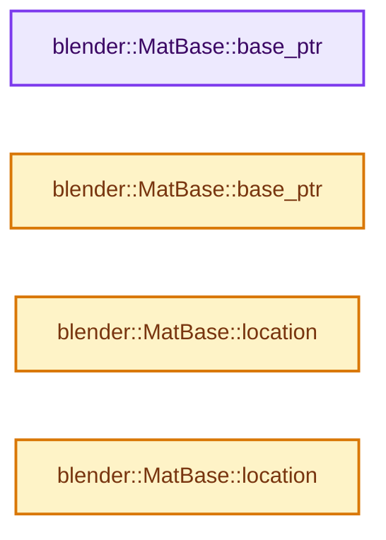
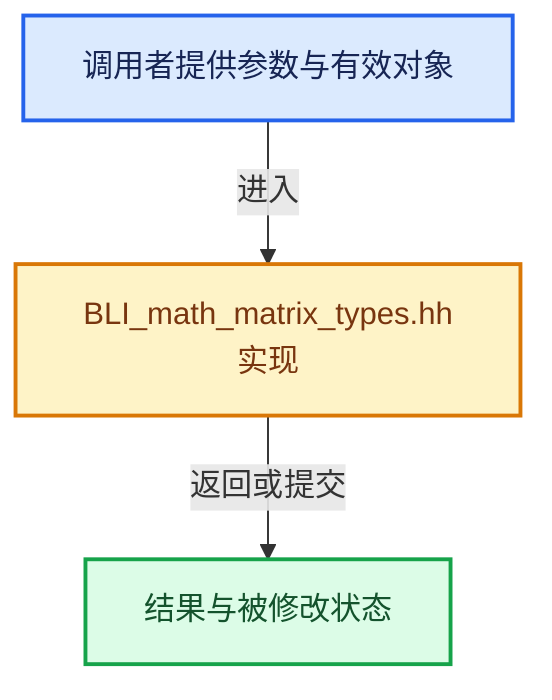

# 实现依赖专题：source/blender/blenlib/BLI_math_matrix_types.hh

[方向导航](README.md) · [符号索引](../%E7%AC%A6%E5%8F%B7%E4%BE%9D%E8%B5%96%E4%B8%8E%E5%AE%9E%E7%8E%B0%E7%B4%A2%E5%BC%95.md)

本专题从正文实际调用进入，集中保存共享实现。函数有稳定锚点，可从调用处直接跳到对应完整函数；递归与互相调用通过回链组织。

## 本文件的实现关系






## 相关类型布局与成员入口

<a id="t-db449c66b820"></a>

### `blender::MatBase`

原始声明：[source/blender/blenlib/BLI_math_matrix_types.hh](../../../../../source/blender/blenlib/BLI_math_matrix_types.hh) · L75—L504。

成员布局：

- `int min_dim`
- `int col_len`
- `int row_len`

以下保留类的数据声明与编译条件，成员函数实现通过后面的精确链接阅读。

<!-- annotated:cdc75796bd9a7c -->

```cpp
struct alignas(Alignment) MatBase : public vec_struct_base<VecBase<T, NumRow>, NumCol, false> {

  using base_type = T;
  using vec3_type = VecBase<T, 3>;
  using col_type = VecBase<T, NumRow>;
  using row_type = VecBase<T, NumCol>;
  using loc_type = VecBase<T, (NumRow < NumCol) ? NumRow : (NumRow - 1)>;
  static constexpr int min_dim = (NumRow < NumCol) ? NumRow : NumCol;
  static constexpr int col_len = NumCol;
  static constexpr int row_len = NumRow;

  /**
   * Construct a matrix with uninitialized values.
   *
   * To zero-initialize the matrix, use `MatBase<T, NumCol, NumRow> matrix = {}`.
   */
```

<details>
<summary>核对原始源码：source/blender/blenlib/BLI_math_matrix_types.hh · L75—L90</summary>

<!-- original:cdc75796bd9a7c:source/blender/blenlib/BLI_math_matrix_types.hh:75:90 -->

```cpp
struct alignas(Alignment) MatBase : public vec_struct_base<VecBase<T, NumRow>, NumCol, false> {

  using base_type = T;
  using vec3_type = VecBase<T, 3>;
  using col_type = VecBase<T, NumRow>;
  using row_type = VecBase<T, NumCol>;
  using loc_type = VecBase<T, (NumRow < NumCol) ? NumRow : (NumRow - 1)>;
  static constexpr int min_dim = (NumRow < NumCol) ? NumRow : NumCol;
  static constexpr int col_len = NumCol;
  static constexpr int row_len = NumRow;

  /**
   * Construct a matrix with uninitialized values.
   *
   * To zero-initialize the matrix, use `MatBase<T, NumCol, NumRow> matrix = {}`.
   */
```

</details>

<!-- annotated:e2bf594e99d3ec -->

```cpp

```

<details>
<summary>核对原始源码：source/blender/blenlib/BLI_math_matrix_types.hh · L92—L92</summary>

<!-- original:e2bf594e99d3ec:source/blender/blenlib/BLI_math_matrix_types.hh:92:92 -->

```cpp

```

</details>

<!-- annotated:f55f436991df75 -->

```cpp

```

<details>
<summary>核对原始源码：source/blender/blenlib/BLI_math_matrix_types.hh · L99—L99</summary>

<!-- original:f55f436991df75:source/blender/blenlib/BLI_math_matrix_types.hh:99:99 -->

```cpp

```

</details>

<!-- annotated:b7c710f92a1eb5 -->

```cpp

```

<details>
<summary>核对原始源码：source/blender/blenlib/BLI_math_matrix_types.hh · L107—L107</summary>

<!-- original:b7c710f92a1eb5:source/blender/blenlib/BLI_math_matrix_types.hh:107:107 -->

```cpp

```

</details>

<!-- annotated:11011e2c817286 -->

```cpp

  /** Masking. */

```

<details>
<summary>核对原始源码：source/blender/blenlib/BLI_math_matrix_types.hh · L116—L118</summary>

<!-- original:11011e2c817286:source/blender/blenlib/BLI_math_matrix_types.hh:116:118 -->

```cpp

  /** Masking. */

```

</details>

<!-- annotated:00ab5c8ccabfa8 -->

```cpp

  /** Conversion from pointers (from C-style vectors). */

```

<details>
<summary>核对原始源码：source/blender/blenlib/BLI_math_matrix_types.hh · L142—L144</summary>

<!-- original:00ab5c8ccabfa8:source/blender/blenlib/BLI_math_matrix_types.hh:142:144 -->

```cpp

  /** Conversion from pointers (from C-style vectors). */

```

</details>

<!-- annotated:55e2ee10e473ad -->

```cpp

```

<details>
<summary>核对原始源码：source/blender/blenlib/BLI_math_matrix_types.hh · L149—L149</summary>

<!-- original:55e2ee10e473ad:source/blender/blenlib/BLI_math_matrix_types.hh:149:149 -->

```cpp

```

</details>

<!-- annotated:60689b8db8fe8b -->

```cpp

```

<details>
<summary>核对原始源码：source/blender/blenlib/BLI_math_matrix_types.hh · L156—L156</summary>

<!-- original:60689b8db8fe8b:source/blender/blenlib/BLI_math_matrix_types.hh:156:156 -->

```cpp

```

</details>

<!-- annotated:446bfcb3116b2a -->

```cpp

  /** Conversion from other matrix types. */

```

<details>
<summary>核对原始源码：source/blender/blenlib/BLI_math_matrix_types.hh · L158—L160</summary>

<!-- original:446bfcb3116b2a:source/blender/blenlib/BLI_math_matrix_types.hh:158:160 -->

```cpp

  /** Conversion from other matrix types. */

```

</details>

<!-- annotated:0810ce52c733bc -->

```cpp

  /** C-style pointer dereference. */

  using c_style_mat = T[NumCol][NumRow];

  /** \note Prevent implicit cast to types that could fit other pointer constructor. */
```

<details>
<summary>核对原始源码：source/blender/blenlib/BLI_math_matrix_types.hh · L165—L170</summary>

<!-- original:0810ce52c733bc:source/blender/blenlib/BLI_math_matrix_types.hh:165:170 -->

```cpp

  /** C-style pointer dereference. */

  using c_style_mat = T[NumCol][NumRow];

  /** \note Prevent implicit cast to types that could fit other pointer constructor. */
```

</details>

<!-- annotated:47799cc8e3df7f -->

```cpp

  /** \note Prevent implicit cast to types that could fit other pointer constructor. */
```

<details>
<summary>核对原始源码：source/blender/blenlib/BLI_math_matrix_types.hh · L175—L176</summary>

<!-- original:47799cc8e3df7f:source/blender/blenlib/BLI_math_matrix_types.hh:175:176 -->

```cpp

  /** \note Prevent implicit cast to types that could fit other pointer constructor. */
```

</details>

<!-- annotated:4f11c9a41dc5a1 -->

```cpp

  /** \note Prevent implicit cast to types that could fit other pointer constructor. */
```

<details>
<summary>核对原始源码：source/blender/blenlib/BLI_math_matrix_types.hh · L181—L182</summary>

<!-- original:4f11c9a41dc5a1:source/blender/blenlib/BLI_math_matrix_types.hh:181:182 -->

```cpp

  /** \note Prevent implicit cast to types that could fit other pointer constructor. */
```

</details>

<!-- annotated:38014985a9ed8f -->

```cpp

  /** \note Prevent implicit cast to types that could fit other pointer constructor. */
```

<details>
<summary>核对原始源码：source/blender/blenlib/BLI_math_matrix_types.hh · L187—L188</summary>

<!-- original:38014985a9ed8f:source/blender/blenlib/BLI_math_matrix_types.hh:187:188 -->

```cpp

  /** \note Prevent implicit cast to types that could fit other pointer constructor. */
```

</details>

<!-- annotated:f24a7d42c938b4 -->

```cpp

  /** View creation. */

```

<details>
<summary>核对原始源码：source/blender/blenlib/BLI_math_matrix_types.hh · L193—L195</summary>

<!-- original:f24a7d42c938b4:source/blender/blenlib/BLI_math_matrix_types.hh:193:195 -->

```cpp

  /** View creation. */

```

</details>

<!-- annotated:cb3457fcbf0c28 -->

```cpp

```

<details>
<summary>核对原始源码：source/blender/blenlib/BLI_math_matrix_types.hh · L206—L206</summary>

<!-- original:cb3457fcbf0c28:source/blender/blenlib/BLI_math_matrix_types.hh:206:206 -->

```cpp

```

</details>

<!-- annotated:2ea782f69534fc -->

```cpp

  /** Array access. */

```

<details>
<summary>核对原始源码：source/blender/blenlib/BLI_math_matrix_types.hh · L223—L225</summary>

<!-- original:2ea782f69534fc:source/blender/blenlib/BLI_math_matrix_types.hh:223:225 -->

```cpp

  /** Array access. */

```

</details>

<!-- annotated:ca65f0b1c9972e -->

```cpp

```

<details>
<summary>核对原始源码：source/blender/blenlib/BLI_math_matrix_types.hh · L232—L232</summary>

<!-- original:ca65f0b1c9972e:source/blender/blenlib/BLI_math_matrix_types.hh:232:232 -->

```cpp

```

</details>

<!-- annotated:6891cded572602 -->

```cpp

  /** Access helpers. Using Blender coordinate system. */

```

<details>
<summary>核对原始源码：source/blender/blenlib/BLI_math_matrix_types.hh · L239—L241</summary>

<!-- original:6891cded572602:source/blender/blenlib/BLI_math_matrix_types.hh:239:241 -->

```cpp

  /** Access helpers. Using Blender coordinate system. */

```

</details>

<!-- annotated:89b1273e6a18af -->

```cpp

```

<details>
<summary>核对原始源码：source/blender/blenlib/BLI_math_matrix_types.hh · L248—L248</summary>

<!-- original:89b1273e6a18af:source/blender/blenlib/BLI_math_matrix_types.hh:248:248 -->

```cpp

```

</details>

<!-- annotated:759c76cc49485b -->

```cpp

```

<details>
<summary>核对原始源码：source/blender/blenlib/BLI_math_matrix_types.hh · L255—L255</summary>

<!-- original:759c76cc49485b:source/blender/blenlib/BLI_math_matrix_types.hh:255:255 -->

```cpp

```

</details>

<!-- annotated:dd865948870d1c -->

```cpp

```

<details>
<summary>核对原始源码：source/blender/blenlib/BLI_math_matrix_types.hh · L262—L262</summary>

<!-- original:dd865948870d1c:source/blender/blenlib/BLI_math_matrix_types.hh:262:262 -->

```cpp

```

</details>

<!-- annotated:349a561010c54d -->

```cpp

```

<details>
<summary>核对原始源码：source/blender/blenlib/BLI_math_matrix_types.hh · L269—L269</summary>

<!-- original:349a561010c54d:source/blender/blenlib/BLI_math_matrix_types.hh:269:269 -->

```cpp

```

</details>

<!-- annotated:9e4f489dd83411 -->

```cpp

```

<details>
<summary>核对原始源码：source/blender/blenlib/BLI_math_matrix_types.hh · L276—L276</summary>

<!-- original:9e4f489dd83411:source/blender/blenlib/BLI_math_matrix_types.hh:276:276 -->

```cpp

```

</details>

<!-- annotated:7b9c4ca4dc523c -->

```cpp

```

<details>
<summary>核对原始源码：source/blender/blenlib/BLI_math_matrix_types.hh · L283—L283</summary>

<!-- original:7b9c4ca4dc523c:source/blender/blenlib/BLI_math_matrix_types.hh:283:283 -->

```cpp

```

</details>

<!-- annotated:6ae5cdc9c147b9 -->

```cpp

```

<details>
<summary>核对原始源码：source/blender/blenlib/BLI_math_matrix_types.hh · L290—L290</summary>

<!-- original:6ae5cdc9c147b9:source/blender/blenlib/BLI_math_matrix_types.hh:290:290 -->

```cpp

```

</details>

<!-- annotated:f15e2617a9a205 -->

```cpp

  /** Matrix operators. */

```

<details>
<summary>核对原始源码：source/blender/blenlib/BLI_math_matrix_types.hh · L297—L299</summary>

<!-- original:f15e2617a9a205:source/blender/blenlib/BLI_math_matrix_types.hh:297:299 -->

```cpp

  /** Matrix operators. */

```

</details>

<!-- annotated:a7bdb5b8e5daed -->

```cpp

```

<details>
<summary>核对原始源码：source/blender/blenlib/BLI_math_matrix_types.hh · L306—L306</summary>

<!-- original:a7bdb5b8e5daed:source/blender/blenlib/BLI_math_matrix_types.hh:306:306 -->

```cpp

```

</details>

<!-- annotated:87d37555c38837 -->

```cpp

```

<details>
<summary>核对原始源码：source/blender/blenlib/BLI_math_matrix_types.hh · L313—L313</summary>

<!-- original:87d37555c38837:source/blender/blenlib/BLI_math_matrix_types.hh:313:313 -->

```cpp

```

</details>

<!-- annotated:44017b79c2a980 -->

```cpp

```

<details>
<summary>核对原始源码：source/blender/blenlib/BLI_math_matrix_types.hh · L318—L318</summary>

<!-- original:44017b79c2a980:source/blender/blenlib/BLI_math_matrix_types.hh:318:318 -->

```cpp

```

</details>

<!-- annotated:f015d9baa237ce -->

```cpp

```

<details>
<summary>核对原始源码：source/blender/blenlib/BLI_math_matrix_types.hh · L324—L324</summary>

<!-- original:f015d9baa237ce:source/blender/blenlib/BLI_math_matrix_types.hh:324:324 -->

```cpp

```

</details>

<!-- annotated:a83635c6e09a53 -->

```cpp

```

<details>
<summary>核对原始源码：source/blender/blenlib/BLI_math_matrix_types.hh · L330—L330</summary>

<!-- original:a83635c6e09a53:source/blender/blenlib/BLI_math_matrix_types.hh:330:330 -->

```cpp

```

</details>

<!-- annotated:12a7ab6523b818 -->

```cpp

```

<details>
<summary>核对原始源码：source/blender/blenlib/BLI_math_matrix_types.hh · L337—L337</summary>

<!-- original:12a7ab6523b818:source/blender/blenlib/BLI_math_matrix_types.hh:337:337 -->

```cpp

```

</details>

<!-- annotated:4a28a3a72a8d01 -->

```cpp

```

<details>
<summary>核对原始源码：source/blender/blenlib/BLI_math_matrix_types.hh · L344—L344</summary>

<!-- original:4a28a3a72a8d01:source/blender/blenlib/BLI_math_matrix_types.hh:344:344 -->

```cpp

```

</details>

<!-- annotated:d8f467cd867c2b -->

```cpp

```

<details>
<summary>核对原始源码：source/blender/blenlib/BLI_math_matrix_types.hh · L351—L351</summary>

<!-- original:d8f467cd867c2b:source/blender/blenlib/BLI_math_matrix_types.hh:351:351 -->

```cpp

```

</details>

<!-- annotated:81ddd7fcf91534 -->

```cpp

```

<details>
<summary>核对原始源码：source/blender/blenlib/BLI_math_matrix_types.hh · L358—L358</summary>

<!-- original:81ddd7fcf91534:source/blender/blenlib/BLI_math_matrix_types.hh:358:358 -->

```cpp

```

</details>

<!-- annotated:e70290681ed190 -->

```cpp

```

<details>
<summary>核对原始源码：source/blender/blenlib/BLI_math_matrix_types.hh · L364—L364</summary>

<!-- original:e70290681ed190:source/blender/blenlib/BLI_math_matrix_types.hh:364:364 -->

```cpp

```

</details>

<!-- annotated:2cec7cd25ff622 -->

```cpp

  /** Multiply each component by a scalar. */
```

<details>
<summary>核对原始源码：source/blender/blenlib/BLI_math_matrix_types.hh · L370—L371</summary>

<!-- original:2cec7cd25ff622:source/blender/blenlib/BLI_math_matrix_types.hh:370:371 -->

```cpp

  /** Multiply each component by a scalar. */
```

</details>

<!-- annotated:0d36216afa07a8 -->

```cpp

  /** Multiply each component by a scalar. */
```

<details>
<summary>核对原始源码：source/blender/blenlib/BLI_math_matrix_types.hh · L378—L379</summary>

<!-- original:0d36216afa07a8:source/blender/blenlib/BLI_math_matrix_types.hh:378:379 -->

```cpp

  /** Multiply each component by a scalar. */
```

</details>

<!-- annotated:96dc14e971a151 -->

```cpp

  /** Multiply two matrices using matrix multiplication. */
```

<details>
<summary>核对原始源码：source/blender/blenlib/BLI_math_matrix_types.hh · L384—L385</summary>

<!-- original:96dc14e971a151:source/blender/blenlib/BLI_math_matrix_types.hh:384:385 -->

```cpp

  /** Multiply two matrices using matrix multiplication. */
```

</details>

<!-- annotated:164b53efd02915 -->

```cpp

  /** Multiply each component by a scalar. */
```

<details>
<summary>核对原始源码：source/blender/blenlib/BLI_math_matrix_types.hh · L392—L393</summary>

<!-- original:164b53efd02915:source/blender/blenlib/BLI_math_matrix_types.hh:392:393 -->

```cpp

  /** Multiply each component by a scalar. */
```

</details>

<!-- annotated:12bff9346b3b6c -->

```cpp

  /** Vector operators. */

```

<details>
<summary>核对原始源码：source/blender/blenlib/BLI_math_matrix_types.hh · L399—L401</summary>

<!-- original:12bff9346b3b6c:source/blender/blenlib/BLI_math_matrix_types.hh:399:401 -->

```cpp

  /** Vector operators. */

```

</details>

<!-- annotated:c0e4f67f786cf7 -->

```cpp

  /** Multiply by the transposed. */
```

<details>
<summary>核对原始源码：source/blender/blenlib/BLI_math_matrix_types.hh · L410—L411</summary>

<!-- original:c0e4f67f786cf7:source/blender/blenlib/BLI_math_matrix_types.hh:410:411 -->

```cpp

  /** Multiply by the transposed. */
```

</details>

<!-- annotated:e7aa1ddd19a203 -->

```cpp

  /** Compare. */

```

<details>
<summary>核对原始源码：source/blender/blenlib/BLI_math_matrix_types.hh · L420—L422</summary>

<!-- original:e7aa1ddd19a203:source/blender/blenlib/BLI_math_matrix_types.hh:420:422 -->

```cpp

  /** Compare. */

```

</details>

<!-- annotated:1f79442634ecdf -->

```cpp

```

<details>
<summary>核对原始源码：source/blender/blenlib/BLI_math_matrix_types.hh · L432—L432</summary>

<!-- original:1f79442634ecdf:source/blender/blenlib/BLI_math_matrix_types.hh:432:432 -->

```cpp

```

</details>

<!-- annotated:ee1d1fb2690faa -->

```cpp

  /** Miscellaneous. */

```

<details>
<summary>核对原始源码：source/blender/blenlib/BLI_math_matrix_types.hh · L437—L439</summary>

<!-- original:ee1d1fb2690faa:source/blender/blenlib/BLI_math_matrix_types.hh:437:439 -->

```cpp

  /** Miscellaneous. */

```

</details>

<!-- annotated:20eb7e7c2f0eff -->

```cpp

```

<details>
<summary>核对原始源码：source/blender/blenlib/BLI_math_matrix_types.hh · L446—L446</summary>

<!-- original:20eb7e7c2f0eff:source/blender/blenlib/BLI_math_matrix_types.hh:446:446 -->

```cpp

```

</details>

<!-- annotated:db3646ff22966d -->

```cpp

```

<details>
<summary>核对原始源码：source/blender/blenlib/BLI_math_matrix_types.hh · L453—L453</summary>

<!-- original:db3646ff22966d:source/blender/blenlib/BLI_math_matrix_types.hh:453:453 -->

```cpp

```

</details>

<!-- annotated:ec84b70c8626dc -->

```cpp

```

<details>
<summary>核对原始源码：source/blender/blenlib/BLI_math_matrix_types.hh · L458—L458</summary>

<!-- original:ec84b70c8626dc:source/blender/blenlib/BLI_math_matrix_types.hh:458:458 -->

```cpp

```

</details>

<!-- annotated:b7046880ba90c8 -->

```cpp

```

<details>
<summary>核对原始源码：source/blender/blenlib/BLI_math_matrix_types.hh · L463—L463</summary>

<!-- original:b7046880ba90c8:source/blender/blenlib/BLI_math_matrix_types.hh:463:463 -->

```cpp

```

</details>

<!-- annotated:c58c39f518efe6 -->

```cpp

```

<details>
<summary>核对原始源码：source/blender/blenlib/BLI_math_matrix_types.hh · L473—L473</summary>

<!-- original:c58c39f518efe6:source/blender/blenlib/BLI_math_matrix_types.hh:473:473 -->

```cpp

```

</details>

<!-- annotated:514d15386ca8dc -->

```cpp

```

<details>
<summary>核对原始源码：source/blender/blenlib/BLI_math_matrix_types.hh · L481—L481</summary>

<!-- original:514d15386ca8dc:source/blender/blenlib/BLI_math_matrix_types.hh:481:481 -->

```cpp

```

</details>

<!-- annotated:7ccedb1a71d6b4 -->

```cpp
};
```

<details>
<summary>核对原始源码：source/blender/blenlib/BLI_math_matrix_types.hh · L504—L504</summary>

<!-- original:7ccedb1a71d6b4:source/blender/blenlib/BLI_math_matrix_types.hh:504:504 -->

```cpp
};
```

</details>

- [base_ptr](%E4%BE%9D%E8%B5%96-BLI_math_matrix_types-e48213.md#f-dca1aa125ef9c16b)
- [base_ptr](%E4%BE%9D%E8%B5%96-BLI_math_matrix_types-e48213.md#f-b75e432c486339a7)
- [location](%E4%BE%9D%E8%B5%96-BLI_math_matrix_types-e48213.md#f-41affe8232e34068)
- [location](%E4%BE%9D%E8%B5%96-BLI_math_matrix_types-e48213.md#f-73aca610b7db6123)

## 完整成员与函数实现

<a id="f-dca1aa125ef9c16b"></a>

### `blender::MatBase::base_ptr`

实现位置：[source/blender/blenlib/BLI_math_matrix_types.hh](../../../../../source/blender/blenlib/BLI_math_matrix_types.hh) · L183—L186。

**教学注释版**

<!-- annotated:837dd76b6d31bb -->

```cpp
  const T *base_ptr() const
  {
    return reinterpret_cast<const T *>(this);
  }
```

<details>
<summary>核对原始源码：source/blender/blenlib/BLI_math_matrix_types.hh · L183—L186</summary>

<!-- original:837dd76b6d31bb:source/blender/blenlib/BLI_math_matrix_types.hh:183:186 -->

```cpp
  const T *base_ptr() const
  {
    return reinterpret_cast<const T *>(this);
  }
```

</details>

**结果出口**

- `return reinterpret_cast<const T *>(this);`

**继续追踪实现**

本实现没有需要继续展开的显式调用；检查返回表达式、对象转换和调用者前置条件。

<a id="f-b75e432c486339a7"></a>

### `blender::MatBase::base_ptr`

实现位置：[source/blender/blenlib/BLI_math_matrix_types.hh](../../../../../source/blender/blenlib/BLI_math_matrix_types.hh) · L189—L192。

**教学注释版**

<!-- annotated:fc95a9b9154da3 -->

```cpp
  T *base_ptr()
  {
    return reinterpret_cast<T *>(this);
  }
```

<details>
<summary>核对原始源码：source/blender/blenlib/BLI_math_matrix_types.hh · L189—L192</summary>

<!-- original:fc95a9b9154da3:source/blender/blenlib/BLI_math_matrix_types.hh:189:192 -->

```cpp
  T *base_ptr()
  {
    return reinterpret_cast<T *>(this);
  }
```

</details>

**结果出口**

- `return reinterpret_cast<T *>(this);`

**继续追踪实现**

本实现没有需要继续展开的显式调用；检查返回表达式、对象转换和调用者前置条件。

<a id="f-41affe8232e34068"></a>

### `blender::MatBase::location`

实现位置：[source/blender/blenlib/BLI_math_matrix_types.hh](../../../../../source/blender/blenlib/BLI_math_matrix_types.hh) · L263—L268。

**教学注释版**

<!-- annotated:4dced657147f34 -->

```cpp
  loc_type &location()
  {
    BLI_STATIC_ASSERT(NumCol >= 3, "Wrong Matrix dimension");
    BLI_STATIC_ASSERT(NumRow >= 2, "Wrong Matrix dimension");
    return *reinterpret_cast<loc_type *>(&(*this)[NumCol - 1]);
  }
```

<details>
<summary>核对原始源码：source/blender/blenlib/BLI_math_matrix_types.hh · L263—L268</summary>

<!-- original:4dced657147f34:source/blender/blenlib/BLI_math_matrix_types.hh:263:268 -->

```cpp
  loc_type &location()
  {
    BLI_STATIC_ASSERT(NumCol >= 3, "Wrong Matrix dimension");
    BLI_STATIC_ASSERT(NumRow >= 2, "Wrong Matrix dimension");
    return *reinterpret_cast<loc_type *>(&(*this)[NumCol - 1]);
  }
```

</details>

**结果出口**

- `return *reinterpret_cast<loc_type *>(&(*this)[NumCol - 1]);`

**继续追踪实现**

- `BLI_STATIC_ASSERT` → [BLI_STATIC_ASSERT · L68](../01-%E5%9F%BA%E7%A1%80%E5%AE%B9%E5%99%A8%E4%B8%8E%E7%8E%B0%E4%BB%A3CPP/%E4%BE%9D%E8%B5%96-BLI_assert-cc98e8.md#m-2847bd43464c)；[BLI_STATIC_ASSERT · L37](../05-%E5%87%A0%E4%BD%95%E5%AD%98%E5%82%A8%E4%B8%8E%E6%8B%93%E6%89%91%E6%98%A0%E5%B0%84/%E4%BE%9D%E8%B5%96-GPU_shader_shared_utils-0adda3.md#m-84775b53af8c)；[BLI_STATIC_ASSERT · L58](../05-%E5%87%A0%E4%BD%95%E5%AD%98%E5%82%A8%E4%B8%8E%E6%8B%93%E6%89%91%E6%98%A0%E5%B0%84/%E4%BE%9D%E8%B5%96-GPU_shader_shared_utils-0adda3.md#m-4227322768f0)。宏定义由构建条件选择。

<a id="f-73aca610b7db6123"></a>

### `blender::MatBase::location`

实现位置：[source/blender/blenlib/BLI_math_matrix_types.hh](../../../../../source/blender/blenlib/BLI_math_matrix_types.hh) · L291—L296。

**教学注释版**

<!-- annotated:140594db8ff24a -->

```cpp
  const loc_type &location() const
  {
    BLI_STATIC_ASSERT(NumCol >= 3, "Wrong Matrix dimension");
    BLI_STATIC_ASSERT(NumRow >= 2, "Wrong Matrix dimension");
    return *reinterpret_cast<const loc_type *>(&(*this)[NumCol - 1]);
  }
```

<details>
<summary>核对原始源码：source/blender/blenlib/BLI_math_matrix_types.hh · L291—L296</summary>

<!-- original:140594db8ff24a:source/blender/blenlib/BLI_math_matrix_types.hh:291:296 -->

```cpp
  const loc_type &location() const
  {
    BLI_STATIC_ASSERT(NumCol >= 3, "Wrong Matrix dimension");
    BLI_STATIC_ASSERT(NumRow >= 2, "Wrong Matrix dimension");
    return *reinterpret_cast<const loc_type *>(&(*this)[NumCol - 1]);
  }
```

</details>

**结果出口**

- `return *reinterpret_cast<const loc_type *>(&(*this)[NumCol - 1]);`

**继续追踪实现**

- `BLI_STATIC_ASSERT` → [BLI_STATIC_ASSERT · L68](../01-%E5%9F%BA%E7%A1%80%E5%AE%B9%E5%99%A8%E4%B8%8E%E7%8E%B0%E4%BB%A3CPP/%E4%BE%9D%E8%B5%96-BLI_assert-cc98e8.md#m-2847bd43464c)；[BLI_STATIC_ASSERT · L37](../05-%E5%87%A0%E4%BD%95%E5%AD%98%E5%82%A8%E4%B8%8E%E6%8B%93%E6%89%91%E6%98%A0%E5%B0%84/%E4%BE%9D%E8%B5%96-GPU_shader_shared_utils-0adda3.md#m-84775b53af8c)；[BLI_STATIC_ASSERT · L58](../05-%E5%87%A0%E4%BD%95%E5%AD%98%E5%82%A8%E4%B8%8E%E6%8B%93%E6%89%91%E6%98%A0%E5%B0%84/%E4%BE%9D%E8%B5%96-GPU_shader_shared_utils-0adda3.md#m-4227322768f0)。宏定义由构建条件选择。
