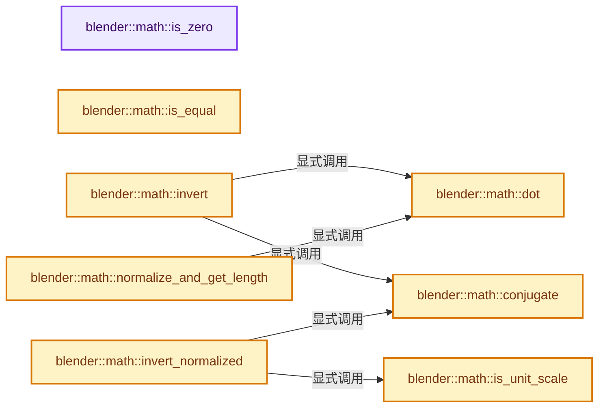
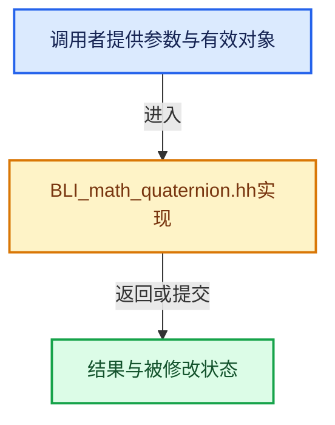

# 实现依赖专题：source/blender/blenlib/BLI_math_quaternion.hh

[方向导航](README.md) · [符号索引](../%E7%AC%A6%E5%8F%B7%E4%BE%9D%E8%B5%96%E4%B8%8E%E5%AE%9E%E7%8E%B0%E7%B4%A2%E5%BC%95.md)

本专题从正文实际调用进入，集中保存共享实现。函数有稳定锚点，可从调用处直接跳到对应完整函数；递归与互相调用通过回链组织。

## 本文件的实现关系






## 完整成员与函数实现

<a id="f-b97bee3fbc328c0d"></a>

### `blender::math::is_zero`

实现位置：[source/blender/blenlib/BLI_math_quaternion.hh](../../../../../source/blender/blenlib/BLI_math_quaternion.hh) · L108—L111。

接口参数：

- `const QuaternionBase<T> &q`

**教学注释版**

<!-- annotated:ebe13b91336784 -->

```cpp
template<typename T> [[nodiscard]] inline bool is_zero(const QuaternionBase<T> &q)
{
  return q.w == T(0) && q.x == T(0) && q.y == T(0) && q.z == T(0);
}
```

<details>
<summary>核对原始源码：source/blender/blenlib/BLI_math_quaternion.hh · L108—L111</summary>

<!-- original:ebe13b91336784:source/blender/blenlib/BLI_math_quaternion.hh:108:111 -->

```cpp
template<typename T> [[nodiscard]] inline bool is_zero(const QuaternionBase<T> &q)
{
  return q.w == T(0) && q.x == T(0) && q.y == T(0) && q.z == T(0);
}
```

</details>

**结果出口**

- `return q.w == T(0) && q.x == T(0) && q.y == T(0) && q.z == T(0);`

**继续追踪实现**

- `T` → [DiagSplit::T · L96](../05-%E5%87%A0%E4%BD%95%E5%AD%98%E5%82%A8%E4%B8%8E%E6%8B%93%E6%89%91%E6%98%A0%E5%B0%84/%E4%BE%9D%E8%B5%96-split-5f5804.md#f-d5d0885c790cc4e4)。

<a id="f-97008e57597d3ffd"></a>

### `blender::math::is_equal`

实现位置：[source/blender/blenlib/BLI_math_quaternion.hh](../../../../../source/blender/blenlib/BLI_math_quaternion.hh) · L116—L123。

接口参数：

- `const QuaternionBase<T> &a`
- `const QuaternionBase<T> &b`
- `const T epsilon = T(0)`

**教学注释版**

<!-- annotated:0c93cdd4176ad4 -->

```cpp
template<typename T>
[[nodiscard]] inline bool is_equal(const QuaternionBase<T> &a,
                                   const QuaternionBase<T> &b,
                                   const T epsilon = T(0))
{
  return math::abs(a.w - b.w) <= epsilon && math::abs(a.y - b.y) <= epsilon &&
         math::abs(a.x - b.x) <= epsilon && math::abs(a.z - b.z) <= epsilon;
}
```

<details>
<summary>核对原始源码：source/blender/blenlib/BLI_math_quaternion.hh · L116—L123</summary>

<!-- original:0c93cdd4176ad4:source/blender/blenlib/BLI_math_quaternion.hh:116:123 -->

```cpp
template<typename T>
[[nodiscard]] inline bool is_equal(const QuaternionBase<T> &a,
                                   const QuaternionBase<T> &b,
                                   const T epsilon = T(0))
{
  return math::abs(a.w - b.w) <= epsilon && math::abs(a.y - b.y) <= epsilon &&
         math::abs(a.x - b.x) <= epsilon && math::abs(a.z - b.z) <= epsilon;
}
```

</details>

**结果出口**

- `return math::abs(a.w - b.w) <= epsilon && math::abs(a.y - b.y) <= epsilon &&`

**继续追踪实现**

- `math::abs` → [blender::math::abs · L38](%E4%BE%9D%E8%B5%96-BLI_math_vector-906a87.md#f-e755530125bc2198)；[blender::math::abs · L201](%E4%BE%9D%E8%B5%96-BLI_math_basis_types-fc7090.md#f-a137ffce39989ffc)；[blender::math::abs · L33](%E4%BE%9D%E8%B5%96-BLI_math_base-0728eb.md#f-a2c9c981f4e8420c)。同名重载需按实参类型选择。

<a id="f-29e97a29f06db326"></a>

### `blender::math::is_unit_scale`

实现位置：[source/blender/blenlib/BLI_math_quaternion.hh](../../../../../source/blender/blenlib/BLI_math_quaternion.hh) · L125—L133。

接口参数：

- `const QuaternionBase<T> &q`

**教学注释版**

<!-- annotated:49638b079786e9 -->

```cpp
template<typename T> [[nodiscard]] inline bool is_unit_scale(const QuaternionBase<T> &q)
{
  /* Checks are flipped so NAN doesn't assert because we're making sure the value was
   * normalized and in the case we don't want NAN to be raising asserts since there
   * is nothing to be done in that case. */
  const T test_unit = q.x * q.x + q.y * q.y + q.z * q.z + q.w * q.w;
  return (!(math::abs(test_unit - T(1)) >= AssertUnitEpsilon<QuaternionBase<T>>::value) ||
          !(math::abs(test_unit) >= AssertUnitEpsilon<QuaternionBase<T>>::value));
}
```

<details>
<summary>核对原始源码：source/blender/blenlib/BLI_math_quaternion.hh · L125—L133</summary>

<!-- original:49638b079786e9:source/blender/blenlib/BLI_math_quaternion.hh:125:133 -->

```cpp
template<typename T> [[nodiscard]] inline bool is_unit_scale(const QuaternionBase<T> &q)
{
  /* Checks are flipped so NAN doesn't assert because we're making sure the value was
   * normalized and in the case we don't want NAN to be raising asserts since there
   * is nothing to be done in that case. */
  const T test_unit = q.x * q.x + q.y * q.y + q.z * q.z + q.w * q.w;
  return (!(math::abs(test_unit - T(1)) >= AssertUnitEpsilon<QuaternionBase<T>>::value) ||
          !(math::abs(test_unit) >= AssertUnitEpsilon<QuaternionBase<T>>::value));
}
```

</details>

**结果出口**

- `return (!(math::abs(test_unit - T(1)) >= AssertUnitEpsilon<QuaternionBase<T>>::value) ||`

**继续追踪实现**

- `math::abs` → [blender::math::abs · L38](%E4%BE%9D%E8%B5%96-BLI_math_vector-906a87.md#f-e755530125bc2198)；[blender::math::abs · L201](%E4%BE%9D%E8%B5%96-BLI_math_basis_types-fc7090.md#f-a137ffce39989ffc)；[blender::math::abs · L33](%E4%BE%9D%E8%B5%96-BLI_math_base-0728eb.md#f-a2c9c981f4e8420c)。同名重载需按实参类型选择。
- `T` → [DiagSplit::T · L96](../05-%E5%87%A0%E4%BD%95%E5%AD%98%E5%82%A8%E4%B8%8E%E6%8B%93%E6%89%91%E6%98%A0%E5%B0%84/%E4%BE%9D%E8%B5%96-split-5f5804.md#f-d5d0885c790cc4e4)。

<a id="f-5b1ef457981dbc76"></a>

### `blender::math::dot`

实现位置：[source/blender/blenlib/BLI_math_quaternion.hh](../../../../../source/blender/blenlib/BLI_math_quaternion.hh) · L198—L202。

接口参数：

- `const QuaternionBase<T> &a`
- `const QuaternionBase<T> &b`

**教学注释版**

<!-- annotated:6076b331aa6169 -->

```cpp
template<typename T>
[[nodiscard]] inline T dot(const QuaternionBase<T> &a, const QuaternionBase<T> &b)
{
  return a.w * b.w + a.x * b.x + a.y * b.y + a.z * b.z;
}
```

<details>
<summary>核对原始源码：source/blender/blenlib/BLI_math_quaternion.hh · L198—L202</summary>

<!-- original:6076b331aa6169:source/blender/blenlib/BLI_math_quaternion.hh:198:202 -->

```cpp
template<typename T>
[[nodiscard]] inline T dot(const QuaternionBase<T> &a, const QuaternionBase<T> &b)
{
  return a.w * b.w + a.x * b.x + a.y * b.y + a.z * b.z;
}
```

</details>

**结果出口**

- `return a.w * b.w + a.x * b.x + a.y * b.y + a.z * b.z;`

**继续追踪实现**

本实现没有需要继续展开的显式调用；检查返回表达式、对象转换和调用者前置条件。

<a id="f-01755af850716654"></a>

### `blender::math::conjugate`

实现位置：[source/blender/blenlib/BLI_math_quaternion.hh](../../../../../source/blender/blenlib/BLI_math_quaternion.hh) · L223—L226。

接口参数：

- `const QuaternionBase<T> &a`

**教学注释版**

<!-- annotated:4ac1199e066b89 -->

```cpp
template<typename T> [[nodiscard]] inline QuaternionBase<T> conjugate(const QuaternionBase<T> &a)
{
  return {a.w, -a.x, -a.y, -a.z};
}
```

<details>
<summary>核对原始源码：source/blender/blenlib/BLI_math_quaternion.hh · L223—L226</summary>

<!-- original:4ac1199e066b89:source/blender/blenlib/BLI_math_quaternion.hh:223:226 -->

```cpp
template<typename T> [[nodiscard]] inline QuaternionBase<T> conjugate(const QuaternionBase<T> &a)
{
  return {a.w, -a.x, -a.y, -a.z};
}
```

</details>

**结果出口**

- `return {a.w, -a.x, -a.y, -a.z};`

**继续追踪实现**

本实现没有需要继续展开的显式调用；检查返回表达式、对象转换和调用者前置条件。

<a id="f-7ba965075f461895"></a>

### `blender::math::invert`

实现位置：[source/blender/blenlib/BLI_math_quaternion.hh](../../../../../source/blender/blenlib/BLI_math_quaternion.hh) · L234—L241。

接口参数：

- `const QuaternionBase<T> &q`

**教学注释版**

<!-- annotated:ded2c728410cbc -->

```cpp
template<typename T> [[nodiscard]] inline QuaternionBase<T> invert(const QuaternionBase<T> &q)
{
  const T length_squared = dot(q, q);
  if (length_squared == T(0)) {
    return QuaternionBase<T>::identity();
  }
  return conjugate(q) * (T(1) / length_squared);
}
```

<details>
<summary>核对原始源码：source/blender/blenlib/BLI_math_quaternion.hh · L234—L241</summary>

<!-- original:ded2c728410cbc:source/blender/blenlib/BLI_math_quaternion.hh:234:241 -->

```cpp
template<typename T> [[nodiscard]] inline QuaternionBase<T> invert(const QuaternionBase<T> &q)
{
  const T length_squared = dot(q, q);
  if (length_squared == T(0)) {
    return QuaternionBase<T>::identity();
  }
  return conjugate(q) * (T(1) / length_squared);
}
```

</details>

**结果出口**

- `return QuaternionBase<T>::identity();`
- `return conjugate(q) * (T(1) / length_squared);`

**继续追踪实现**

- `dot` → [blender::math::dot · L198](%E4%BE%9D%E8%B5%96-BLI_math_quaternion-cf105d.md#f-5b1ef457981dbc76)。
- `T` → [DiagSplit::T · L96](../05-%E5%87%A0%E4%BD%95%E5%AD%98%E5%82%A8%E4%B8%8E%E6%8B%93%E6%89%91%E6%98%A0%E5%B0%84/%E4%BE%9D%E8%B5%96-split-5f5804.md#f-d5d0885c790cc4e4)。
- `QuaternionBase<T>::identity` → [blender::math::QuaternionBase::identity · L58](%E4%BE%9D%E8%B5%96-BLI_math_quaternion_types-c6671a.md#f-c1a640a83f35968e)；[blender::math::DualQuaternionBase::identity · L242](%E4%BE%9D%E8%B5%96-BLI_math_quaternion_types-c6671a.md#f-d863b2e53282ca9e)。同名重载需按实参类型选择。
- `conjugate` → [blender::math::conjugate · L223](%E4%BE%9D%E8%B5%96-BLI_math_quaternion-cf105d.md#f-01755af850716654)。

<a id="f-632881d58ca2126a"></a>

### `blender::math::invert_normalized`

实现位置：[source/blender/blenlib/BLI_math_quaternion.hh](../../../../../source/blender/blenlib/BLI_math_quaternion.hh) · L243—L248。

接口参数：

- `const QuaternionBase<T> &q`

**教学注释版**

<!-- annotated:370f5017107b8b -->

```cpp
template<typename T>
[[nodiscard]] inline QuaternionBase<T> invert_normalized(const QuaternionBase<T> &q)
{
  BLI_assert(is_unit_scale(q));
  return conjugate(q);
}
```

<details>
<summary>核对原始源码：source/blender/blenlib/BLI_math_quaternion.hh · L243—L248</summary>

<!-- original:370f5017107b8b:source/blender/blenlib/BLI_math_quaternion.hh:243:248 -->

```cpp
template<typename T>
[[nodiscard]] inline QuaternionBase<T> invert_normalized(const QuaternionBase<T> &q)
{
  BLI_assert(is_unit_scale(q));
  return conjugate(q);
}
```

</details>

**结果出口**

- `return conjugate(q);`

**继续追踪实现**

- `BLI_assert` → [BLI_assert · L48](../01-%E5%9F%BA%E7%A1%80%E5%AE%B9%E5%99%A8%E4%B8%8E%E7%8E%B0%E4%BB%A3CPP/%E4%BE%9D%E8%B5%96-BLI_assert-cc98e8.md#m-57a88495704d)；[BLI_assert · L63](../01-%E5%9F%BA%E7%A1%80%E5%AE%B9%E5%99%A8%E4%B8%8E%E7%8E%B0%E4%BB%A3CPP/%E4%BE%9D%E8%B5%96-BLI_assert-cc98e8.md#m-d07050020cb5)。宏定义由构建条件选择。
- `is_unit_scale` → [blender::math::is_unit_scale · L125](%E4%BE%9D%E8%B5%96-BLI_math_quaternion-cf105d.md#f-29e97a29f06db326)。
- `conjugate` → [blender::math::conjugate · L223](%E4%BE%9D%E8%B5%96-BLI_math_quaternion-cf105d.md#f-01755af850716654)。

<a id="f-6fcf25529d2136aa"></a>

### `blender::math::normalize_and_get_length`

实现位置：[source/blender/blenlib/BLI_math_quaternion.hh](../../../../../source/blender/blenlib/BLI_math_quaternion.hh) · L250—L256。

接口参数：

- `const QuaternionBase<T> &q`
- `T &out_length`

**教学注释版**

<!-- annotated:abf9135d779be4 -->

```cpp
template<typename T>
[[nodiscard]] inline QuaternionBase<T> normalize_and_get_length(const QuaternionBase<T> &q,
                                                                T &out_length)
{
  out_length = math::sqrt(dot(q, q));
  return (out_length != T(0)) ? (q * (T(1) / out_length)) : QuaternionBase<T>::identity();
}
```

<details>
<summary>核对原始源码：source/blender/blenlib/BLI_math_quaternion.hh · L250—L256</summary>

<!-- original:abf9135d779be4:source/blender/blenlib/BLI_math_quaternion.hh:250:256 -->

```cpp
template<typename T>
[[nodiscard]] inline QuaternionBase<T> normalize_and_get_length(const QuaternionBase<T> &q,
                                                                T &out_length)
{
  out_length = math::sqrt(dot(q, q));
  return (out_length != T(0)) ? (q * (T(1) / out_length)) : QuaternionBase<T>::identity();
}
```

</details>

**沿实际写入检查状态**

- `out_length = math::sqrt(dot(q, q));`

**结果出口**

- `return (out_length != T(0)) ? (q * (T(1) / out_length)) : QuaternionBase<T>::identity();`

**继续追踪实现**

- `math::sqrt` → [外部契约](https://eel.is/c++draft/)：这个边界按实际表达式及所属类型核对参数、返回值、寿命与失败行为。这里提供接口入口，不声称已解释该第三方版本的内部实现。
- `dot` → [blender::math::dot · L198](%E4%BE%9D%E8%B5%96-BLI_math_quaternion-cf105d.md#f-5b1ef457981dbc76)。
- `T` → [DiagSplit::T · L96](../05-%E5%87%A0%E4%BD%95%E5%AD%98%E5%82%A8%E4%B8%8E%E6%8B%93%E6%89%91%E6%98%A0%E5%B0%84/%E4%BE%9D%E8%B5%96-split-5f5804.md#f-d5d0885c790cc4e4)。
- `QuaternionBase<T>::identity` → [blender::math::QuaternionBase::identity · L58](%E4%BE%9D%E8%B5%96-BLI_math_quaternion_types-c6671a.md#f-c1a640a83f35968e)；[blender::math::DualQuaternionBase::identity · L242](%E4%BE%9D%E8%B5%96-BLI_math_quaternion_types-c6671a.md#f-d863b2e53282ca9e)。同名重载需按实参类型选择。

<a id="f-5bf6b351333e4054"></a>

### `blender::math::normalize`

实现位置：[source/blender/blenlib/BLI_math_quaternion.hh](../../../../../source/blender/blenlib/BLI_math_quaternion.hh) · L258—L262。

接口参数：

- `const QuaternionBase<T> &q`

**教学注释版**

<!-- annotated:a3eaa33a3bfef8 -->

```cpp
template<typename T> [[nodiscard]] inline QuaternionBase<T> normalize(const QuaternionBase<T> &q)
{
  T len;
  return normalize_and_get_length(q, len);
}
```

<details>
<summary>核对原始源码：source/blender/blenlib/BLI_math_quaternion.hh · L258—L262</summary>

<!-- original:a3eaa33a3bfef8:source/blender/blenlib/BLI_math_quaternion.hh:258:262 -->

```cpp
template<typename T> [[nodiscard]] inline QuaternionBase<T> normalize(const QuaternionBase<T> &q)
{
  T len;
  return normalize_and_get_length(q, len);
}
```

</details>

**结果出口**

- `return normalize_and_get_length(q, len);`

**继续追踪实现**

- `normalize_and_get_length` → [blender::math::normalize_and_get_length · L250](%E4%BE%9D%E8%B5%96-BLI_math_quaternion-cf105d.md#f-6fcf25529d2136aa)。

<a id="f-48b9ace2a9c6185c"></a>

### `blender::math::interpolate`

实现位置：[source/blender/blenlib/BLI_math_quaternion.hh](../../../../../source/blender/blenlib/BLI_math_quaternion.hh) · L303—L316。

接口参数：

- `const QuaternionBase<T> &a`
- `const QuaternionBase<T> &b`
- `T t`

**教学注释版**

<!-- annotated:7c754e2b5e6057 -->

```cpp
template<typename T>
[[nodiscard]] inline QuaternionBase<T> interpolate(const QuaternionBase<T> &a,
                                                   const QuaternionBase<T> &b,
                                                   T t)
{
  BLI_assert(is_unit_scale(a));
  BLI_assert(is_unit_scale(b));

  /* Quaternion slerp for arbitrary interpolation factors. */
  if (math::dot(a, b) < 0.0f) {
    return a * math::pow(-math::invert_normalized(a) * b, t);
  }
  return a * math::pow(math::invert_normalized(a) * b, t);
}
```

<details>
<summary>核对原始源码：source/blender/blenlib/BLI_math_quaternion.hh · L303—L316</summary>

<!-- original:7c754e2b5e6057:source/blender/blenlib/BLI_math_quaternion.hh:303:316 -->

```cpp
template<typename T>
[[nodiscard]] inline QuaternionBase<T> interpolate(const QuaternionBase<T> &a,
                                                   const QuaternionBase<T> &b,
                                                   T t)
{
  BLI_assert(is_unit_scale(a));
  BLI_assert(is_unit_scale(b));

  /* Quaternion slerp for arbitrary interpolation factors. */
  if (math::dot(a, b) < 0.0f) {
    return a * math::pow(-math::invert_normalized(a) * b, t);
  }
  return a * math::pow(math::invert_normalized(a) * b, t);
}
```

</details>

**结果出口**

- `return a * math::pow(-math::invert_normalized(a) * b, t);`
- `return a * math::pow(math::invert_normalized(a) * b, t);`

**继续追踪实现**

- `BLI_assert` → [BLI_assert · L48](../01-%E5%9F%BA%E7%A1%80%E5%AE%B9%E5%99%A8%E4%B8%8E%E7%8E%B0%E4%BB%A3CPP/%E4%BE%9D%E8%B5%96-BLI_assert-cc98e8.md#m-57a88495704d)；[BLI_assert · L63](../01-%E5%9F%BA%E7%A1%80%E5%AE%B9%E5%99%A8%E4%B8%8E%E7%8E%B0%E4%BB%A3CPP/%E4%BE%9D%E8%B5%96-BLI_assert-cc98e8.md#m-d07050020cb5)。宏定义由构建条件选择。
- `is_unit_scale` → [blender::math::is_unit_scale · L125](%E4%BE%9D%E8%B5%96-BLI_math_quaternion-cf105d.md#f-29e97a29f06db326)。
- `math::dot` → [blender::math::dot · L198](%E4%BE%9D%E8%B5%96-BLI_math_quaternion-cf105d.md#f-5b1ef457981dbc76)。
- `math::pow` → [外部契约](https://eel.is/c++draft/)：这个边界按实际表达式及所属类型核对参数、返回值、寿命与失败行为。这里提供接口入口，不声称已解释该第三方版本的内部实现。
- `math::invert_normalized` → [blender::math::invert_normalized · L243](%E4%BE%9D%E8%B5%96-BLI_math_quaternion-cf105d.md#f-632881d58ca2126a)。

<a id="f-e52a2e8c12e32657"></a>

### `blender::math::transform_point`

实现位置：[source/blender/blenlib/BLI_math_quaternion.hh](../../../../../source/blender/blenlib/BLI_math_quaternion.hh) · L318—L341。

接口参数：

- `const QuaternionBase<T> &q`
- `const VecBase<T, 3> &v`

**教学注释版**

<!-- annotated:feca082b74609d -->

```cpp
template<typename T>
[[nodiscard]] inline VecBase<T, 3> transform_point(const QuaternionBase<T> &q,
                                                   const VecBase<T, 3> &v)
{
#if 0 /* Reference. */
  QuaternionBase<T> V(T(0), UNPACK3(v));
  QuaternionBase<T> R = q * V * conjugate(q);
  return {R.x, R.y, R.z};
#else
  /* `S = q * V`. */
  QuaternionBase<T> S;
  S.w = /* q.w  * 0.0 */ -q.x * v.x - q.y * v.y - q.z * v.z;
  S.x = q.w * v.x /* + q.x * 0.0 */ + q.y * v.z - q.z * v.y;
  S.y = q.w * v.y /* + q.y * 0.0 */ + q.z * v.x - q.x * v.z;
  S.z = q.w * v.z /* + q.z * 0.0 */ + q.x * v.y - q.y * v.x;
  /* `R = S * conjugate(q)`. */
  VecBase<T, 3> R;
  /* `R.w = S.w * q.w + S.x * q.x + S.y * q.y + S.z * q.z = 0.0`. */
  R.x = S.w * -q.x + S.x * q.w - S.y * q.z + S.z * q.y;
  R.y = S.w * -q.y + S.y * q.w - S.z * q.x + S.x * q.z;
  R.z = S.w * -q.z + S.z * q.w - S.x * q.y + S.y * q.x;
  return R;
#endif
}
```

<details>
<summary>核对原始源码：source/blender/blenlib/BLI_math_quaternion.hh · L318—L341</summary>

<!-- original:feca082b74609d:source/blender/blenlib/BLI_math_quaternion.hh:318:341 -->

```cpp
template<typename T>
[[nodiscard]] inline VecBase<T, 3> transform_point(const QuaternionBase<T> &q,
                                                   const VecBase<T, 3> &v)
{
#if 0 /* Reference. */
  QuaternionBase<T> V(T(0), UNPACK3(v));
  QuaternionBase<T> R = q * V * conjugate(q);
  return {R.x, R.y, R.z};
#else
  /* `S = q * V`. */
  QuaternionBase<T> S;
  S.w = /* q.w  * 0.0 */ -q.x * v.x - q.y * v.y - q.z * v.z;
  S.x = q.w * v.x /* + q.x * 0.0 */ + q.y * v.z - q.z * v.y;
  S.y = q.w * v.y /* + q.y * 0.0 */ + q.z * v.x - q.x * v.z;
  S.z = q.w * v.z /* + q.z * 0.0 */ + q.x * v.y - q.y * v.x;
  /* `R = S * conjugate(q)`. */
  VecBase<T, 3> R;
  /* `R.w = S.w * q.w + S.x * q.x + S.y * q.y + S.z * q.z = 0.0`. */
  R.x = S.w * -q.x + S.x * q.w - S.y * q.z + S.z * q.y;
  R.y = S.w * -q.y + S.y * q.w - S.z * q.x + S.x * q.z;
  R.z = S.w * -q.z + S.z * q.w - S.x * q.y + S.y * q.x;
  return R;
#endif
}
```

</details>

**沿实际写入检查状态**

- `S.w = /* q.w  * 0.0 */ -q.x * v.x - q.y * v.y - q.z * v.z;`
- `S.x = q.w * v.x /* + q.x * 0.0 */ + q.y * v.z - q.z * v.y;`
- `S.y = q.w * v.y /* + q.y * 0.0 */ + q.z * v.x - q.x * v.z;`
- `S.z = q.w * v.z /* + q.z * 0.0 */ + q.x * v.y - q.y * v.x;`
- `R.x = S.w * -q.x + S.x * q.w - S.y * q.z + S.z * q.y;`
- `R.y = S.w * -q.y + S.y * q.w - S.z * q.x + S.x * q.z;`
- `R.z = S.w * -q.z + S.z * q.w - S.x * q.y + S.y * q.x;`

**结果出口**

- `return {R.x, R.y, R.z};`
- `return R;`

**继续追踪实现**

- `T` → [DiagSplit::T · L96](../05-%E5%87%A0%E4%BD%95%E5%AD%98%E5%82%A8%E4%B8%8E%E6%8B%93%E6%89%91%E6%98%A0%E5%B0%84/%E4%BE%9D%E8%B5%96-split-5f5804.md#f-d5d0885c790cc4e4)。
- `UNPACK3` → [UNPACK3 · L23](../05-%E5%87%A0%E4%BD%95%E5%AD%98%E5%82%A8%E4%B8%8E%E6%8B%93%E6%89%91%E6%98%A0%E5%B0%84/%E4%BE%9D%E8%B5%96-GHOST_utildefines-34b996.md#m-f882324eb80a)；[UNPACK3 · L235](../01-%E5%9F%BA%E7%A1%80%E5%AE%B9%E5%99%A8%E4%B8%8E%E7%8E%B0%E4%BB%A3CPP/%E4%BE%9D%E8%B5%96-BLI_utildefines-293a0a.md#m-bbbbdcf09d3b)；[UNPACK3 · L14](../05-%E5%87%A0%E4%BD%95%E5%AD%98%E5%82%A8%E4%B8%8E%E6%8B%93%E6%89%91%E6%98%A0%E5%B0%84/%E4%BE%9D%E8%B5%96-gpu_shader_utildefines.bsl-e9f199.md#m-b4e3357a0310)。宏定义由构建条件选择。
- `conjugate` → [blender::math::conjugate · L223](%E4%BE%9D%E8%B5%96-BLI_math_quaternion-cf105d.md#f-01755af850716654)。

<a id="f-b852cee8f0cc9b6a"></a>

### `blender::math::normalize`

实现位置：[source/blender/blenlib/BLI_math_quaternion.hh](../../../../../source/blender/blenlib/BLI_math_quaternion.hh) · L450—L484。

接口参数：

- `const DualQuaternionBase<T> &dual_quat`

**教学注释版**

<!-- annotated:c4b32c132b4737 -->

```cpp
template<typename T>
[[nodiscard]] DualQuaternionBase<T> normalize(const DualQuaternionBase<T> &dual_quat)
{
  const T norm_weighted = math::sqrt(dot(dual_quat.quat, dual_quat.quat));
  /* NOTE(fclem): Should this be an epsilon? */
  if (norm_weighted == T(0)) {
    /* The dual-quaternion was zero initialized or is degenerate. Return identity. */
    return DualQuaternionBase<T>::identity();
  }

  const T inv_norm_weighted = T(1) / norm_weighted;

  DualQuaternionBase<T> dq = dual_quat;
  dq.quat = dq.quat * inv_norm_weighted;
  dq.trans = dq.trans * inv_norm_weighted;

  /* Handle scale if needed. */
  if (dq.scale_weight > T(0)) {
    /* Compensate for any dual quaternions added without scale.
     * This is an optimization so that we can skip the scale part when not needed. */
    const float missing_uniform_scale = dq.quat_weight - dq.scale_weight;

    if (missing_uniform_scale > T(0)) {
      dq.scale[0][0] += missing_uniform_scale;
      dq.scale[1][1] += missing_uniform_scale;
      dq.scale[2][2] += missing_uniform_scale;
      dq.scale[3][3] += missing_uniform_scale;
    }
    /* Per component scalar product. */
    dq.scale *= T(1) / dq.quat_weight;
    dq.scale_weight = T(1);
  }
  dq.quat_weight = T(1);
  return dq;
}
```

<details>
<summary>核对原始源码：source/blender/blenlib/BLI_math_quaternion.hh · L450—L484</summary>

<!-- original:c4b32c132b4737:source/blender/blenlib/BLI_math_quaternion.hh:450:484 -->

```cpp
template<typename T>
[[nodiscard]] DualQuaternionBase<T> normalize(const DualQuaternionBase<T> &dual_quat)
{
  const T norm_weighted = math::sqrt(dot(dual_quat.quat, dual_quat.quat));
  /* NOTE(fclem): Should this be an epsilon? */
  if (norm_weighted == T(0)) {
    /* The dual-quaternion was zero initialized or is degenerate. Return identity. */
    return DualQuaternionBase<T>::identity();
  }

  const T inv_norm_weighted = T(1) / norm_weighted;

  DualQuaternionBase<T> dq = dual_quat;
  dq.quat = dq.quat * inv_norm_weighted;
  dq.trans = dq.trans * inv_norm_weighted;

  /* Handle scale if needed. */
  if (dq.scale_weight > T(0)) {
    /* Compensate for any dual quaternions added without scale.
     * This is an optimization so that we can skip the scale part when not needed. */
    const float missing_uniform_scale = dq.quat_weight - dq.scale_weight;

    if (missing_uniform_scale > T(0)) {
      dq.scale[0][0] += missing_uniform_scale;
      dq.scale[1][1] += missing_uniform_scale;
      dq.scale[2][2] += missing_uniform_scale;
      dq.scale[3][3] += missing_uniform_scale;
    }
    /* Per component scalar product. */
    dq.scale *= T(1) / dq.quat_weight;
    dq.scale_weight = T(1);
  }
  dq.quat_weight = T(1);
  return dq;
}
```

</details>

**沿实际写入检查状态**

- `dq.quat = dq.quat * inv_norm_weighted;`
- `dq.trans = dq.trans * inv_norm_weighted;`
- `dq.scale[0][0] += missing_uniform_scale;`
- `dq.scale[1][1] += missing_uniform_scale;`
- `dq.scale[2][2] += missing_uniform_scale;`
- `dq.scale[3][3] += missing_uniform_scale;`
- `dq.scale *= T(1) / dq.quat_weight;`
- `dq.scale_weight = T(1);`
- `dq.quat_weight = T(1);`

**结果出口**

- `return DualQuaternionBase<T>::identity();`
- `return dq;`

**继续追踪实现**

- `math::sqrt` → [外部契约](https://eel.is/c++draft/)：这个边界按实际表达式及所属类型核对参数、返回值、寿命与失败行为。这里提供接口入口，不声称已解释该第三方版本的内部实现。
- `dot` → [blender::math::dot · L198](%E4%BE%9D%E8%B5%96-BLI_math_quaternion-cf105d.md#f-5b1ef457981dbc76)。
- `T` → [DiagSplit::T · L96](../05-%E5%87%A0%E4%BD%95%E5%AD%98%E5%82%A8%E4%B8%8E%E6%8B%93%E6%89%91%E6%98%A0%E5%B0%84/%E4%BE%9D%E8%B5%96-split-5f5804.md#f-d5d0885c790cc4e4)。
- `DualQuaternionBase<T>::identity` → [blender::math::DualQuaternionBase::identity · L242](%E4%BE%9D%E8%B5%96-BLI_math_quaternion_types-c6671a.md#f-d863b2e53282ca9e)。

<a id="f-6c9f8362c60efe6c"></a>

### `blender::math::transform_point`

实现位置：[source/blender/blenlib/BLI_math_quaternion.hh](../../../../../source/blender/blenlib/BLI_math_quaternion.hh) · L491—L545。

接口参数：

- `const DualQuaternionBase<T> &dq`
- `const VecBase<T, 3> &point`
- `MatBase<T, 3, 3> *r_crazy_space_mat = nullptr`

**教学注释版**

<!-- annotated:73a25f15608eb5 -->

```cpp
template<typename T>
[[nodiscard]] VecBase<T, 3> transform_point(const DualQuaternionBase<T> &dq,
                                            const VecBase<T, 3> &point,
                                            MatBase<T, 3, 3> *r_crazy_space_mat = nullptr)
{
  BLI_assert(is_normalized(dq));
  BLI_assert(is_unit_scale(dq.quat));
  /**
   * From:
   * "Skinning with Dual Quaternions"
   * Ladislav Kavan, Steven Collins, Jiri Zara, Carol O'Sullivan
   * Trinity College Dublin, Czech Technical University in Prague
   */
  /* Follow the paper notation. */
  const T &w0 = dq.quat.w, &x0 = dq.quat.x, &y0 = dq.quat.y, &z0 = dq.quat.z;
  const T &we = dq.trans.w, &xe = dq.trans.x, &ye = dq.trans.y, &ze = dq.trans.z;
  /* Part 3.4 - The Final Algorithm. */
  VecBase<T, 3> t;
  t[0] = T(2) * (-we * x0 + xe * w0 - ye * z0 + ze * y0);
  t[1] = T(2) * (-we * y0 + xe * z0 + ye * w0 - ze * x0);
  t[2] = T(2) * (-we * z0 - xe * y0 + ye * x0 + ze * w0);
  /* Isolate rotation matrix to easily output crazy-space mat. */
  MatBase<T, 3, 3> M;
  M[0][0] = (w0 * w0) + (x0 * x0) - (y0 * y0) - (z0 * z0); /* Same as `1 - 2y0^2 - 2z0^2`. */
  M[0][1] = T(2) * ((x0 * y0) + (w0 * z0));
  M[0][2] = T(2) * ((x0 * z0) - (w0 * y0));

  M[1][0] = T(2) * ((x0 * y0) - (w0 * z0));
  M[1][1] = (w0 * w0) + (y0 * y0) - (x0 * x0) - (z0 * z0); /* Same as `1 - 2x0^2 - 2z0^2`. */
  M[1][2] = T(2) * ((y0 * z0) + (w0 * x0));

  M[2][1] = T(2) * ((y0 * z0) - (w0 * x0));
  M[2][2] = (w0 * w0) + (z0 * z0) - (x0 * x0) - (y0 * y0); /* Same as `1 - 2x0^2 - 2y0^2`. */
  M[2][0] = T(2) * ((x0 * z0) + (w0 * y0));

  VecBase<T, 3> result = point;
  /* Apply scaling. */
  if (dq.scale_weight != T(0)) {
    /* NOTE(fclem): This is weird that this is also adding translation even if it is marked as
     * scale matrix. Follows the old C implementation for now... */
    result = transform_point(dq.scale, result);
  }
  /* Apply rotation and translation. */
  result = transform_point(M, result) + t;
  /* Compute crazy-space correction matrix. */
  if (r_crazy_space_mat != nullptr) {
    if (dq.scale_weight) {
      *r_crazy_space_mat = M * dq.scale.template view<3, 3>();
    }
    else {
      *r_crazy_space_mat = M;
    }
  }
  return result;
}
```

<details>
<summary>核对原始源码：source/blender/blenlib/BLI_math_quaternion.hh · L491—L545</summary>

<!-- original:73a25f15608eb5:source/blender/blenlib/BLI_math_quaternion.hh:491:545 -->

```cpp
template<typename T>
[[nodiscard]] VecBase<T, 3> transform_point(const DualQuaternionBase<T> &dq,
                                            const VecBase<T, 3> &point,
                                            MatBase<T, 3, 3> *r_crazy_space_mat = nullptr)
{
  BLI_assert(is_normalized(dq));
  BLI_assert(is_unit_scale(dq.quat));
  /**
   * From:
   * "Skinning with Dual Quaternions"
   * Ladislav Kavan, Steven Collins, Jiri Zara, Carol O'Sullivan
   * Trinity College Dublin, Czech Technical University in Prague
   */
  /* Follow the paper notation. */
  const T &w0 = dq.quat.w, &x0 = dq.quat.x, &y0 = dq.quat.y, &z0 = dq.quat.z;
  const T &we = dq.trans.w, &xe = dq.trans.x, &ye = dq.trans.y, &ze = dq.trans.z;
  /* Part 3.4 - The Final Algorithm. */
  VecBase<T, 3> t;
  t[0] = T(2) * (-we * x0 + xe * w0 - ye * z0 + ze * y0);
  t[1] = T(2) * (-we * y0 + xe * z0 + ye * w0 - ze * x0);
  t[2] = T(2) * (-we * z0 - xe * y0 + ye * x0 + ze * w0);
  /* Isolate rotation matrix to easily output crazy-space mat. */
  MatBase<T, 3, 3> M;
  M[0][0] = (w0 * w0) + (x0 * x0) - (y0 * y0) - (z0 * z0); /* Same as `1 - 2y0^2 - 2z0^2`. */
  M[0][1] = T(2) * ((x0 * y0) + (w0 * z0));
  M[0][2] = T(2) * ((x0 * z0) - (w0 * y0));

  M[1][0] = T(2) * ((x0 * y0) - (w0 * z0));
  M[1][1] = (w0 * w0) + (y0 * y0) - (x0 * x0) - (z0 * z0); /* Same as `1 - 2x0^2 - 2z0^2`. */
  M[1][2] = T(2) * ((y0 * z0) + (w0 * x0));

  M[2][1] = T(2) * ((y0 * z0) - (w0 * x0));
  M[2][2] = (w0 * w0) + (z0 * z0) - (x0 * x0) - (y0 * y0); /* Same as `1 - 2x0^2 - 2y0^2`. */
  M[2][0] = T(2) * ((x0 * z0) + (w0 * y0));

  VecBase<T, 3> result = point;
  /* Apply scaling. */
  if (dq.scale_weight != T(0)) {
    /* NOTE(fclem): This is weird that this is also adding translation even if it is marked as
     * scale matrix. Follows the old C implementation for now... */
    result = transform_point(dq.scale, result);
  }
  /* Apply rotation and translation. */
  result = transform_point(M, result) + t;
  /* Compute crazy-space correction matrix. */
  if (r_crazy_space_mat != nullptr) {
    if (dq.scale_weight) {
      *r_crazy_space_mat = M * dq.scale.template view<3, 3>();
    }
    else {
      *r_crazy_space_mat = M;
    }
  }
  return result;
}
```

</details>

**沿实际写入检查状态**

- `t[0] = T(2) * (-we * x0 + xe * w0 - ye * z0 + ze * y0);`
- `t[1] = T(2) * (-we * y0 + xe * z0 + ye * w0 - ze * x0);`
- `t[2] = T(2) * (-we * z0 - xe * y0 + ye * x0 + ze * w0);`
- `M[0][0] = (w0 * w0) + (x0 * x0) - (y0 * y0) - (z0 * z0); /* Same as ˋ1 - 2y0^2 - 2z0^2ˋ. */`
- `M[0][1] = T(2) * ((x0 * y0) + (w0 * z0));`
- `M[0][2] = T(2) * ((x0 * z0) - (w0 * y0));`
- `M[1][0] = T(2) * ((x0 * y0) - (w0 * z0));`
- `M[1][1] = (w0 * w0) + (y0 * y0) - (x0 * x0) - (z0 * z0); /* Same as ˋ1 - 2x0^2 - 2z0^2ˋ. */`
- `M[1][2] = T(2) * ((y0 * z0) + (w0 * x0));`
- `M[2][1] = T(2) * ((y0 * z0) - (w0 * x0));`
- `M[2][2] = (w0 * w0) + (z0 * z0) - (x0 * x0) - (y0 * y0); /* Same as ˋ1 - 2x0^2 - 2y0^2ˋ. */`
- `M[2][0] = T(2) * ((x0 * z0) + (w0 * y0));`
- `result = transform_point(dq.scale, result);`
- `result = transform_point(M, result) + t;`

**结果出口**

- `return result;`

**继续追踪实现**

- `BLI_assert` → [BLI_assert · L48](../01-%E5%9F%BA%E7%A1%80%E5%AE%B9%E5%99%A8%E4%B8%8E%E7%8E%B0%E4%BB%A3CPP/%E4%BE%9D%E8%B5%96-BLI_assert-cc98e8.md#m-57a88495704d)；[BLI_assert · L63](../01-%E5%9F%BA%E7%A1%80%E5%AE%B9%E5%99%A8%E4%B8%8E%E7%8E%B0%E4%BB%A3CPP/%E4%BE%9D%E8%B5%96-BLI_assert-cc98e8.md#m-d07050020cb5)。宏定义由构建条件选择。
- `is_normalized` → [blender::math::is_normalized · L301](%E4%BE%9D%E8%B5%96-BLI_math_quaternion_types-c6671a.md#f-db5930ac0203c674)。
- `is_unit_scale` → [blender::math::is_unit_scale · L125](%E4%BE%9D%E8%B5%96-BLI_math_quaternion-cf105d.md#f-29e97a29f06db326)。
- `T` → [DiagSplit::T · L96](../05-%E5%87%A0%E4%BD%95%E5%AD%98%E5%82%A8%E4%B8%8E%E6%8B%93%E6%89%91%E6%98%A0%E5%B0%84/%E4%BE%9D%E8%B5%96-split-5f5804.md#f-d5d0885c790cc4e4)。
- `transform_point` → [blender::math::transform_point · L318](%E4%BE%9D%E8%B5%96-BLI_math_quaternion-cf105d.md#f-e52a2e8c12e32657)；[blender::math::transform_point · L491](%E4%BE%9D%E8%B5%96-BLI_math_quaternion-cf105d.md#f-6c9f8362c60efe6c)。同名重载需按实参类型选择。
- `dq.scale.template view<3, 3>` → [调用协议](../%E6%A8%A1%E6%9D%BF%E5%AE%8F%E4%B8%8E%E5%8A%A8%E6%80%81%E5%88%86%E6%B4%BE%E5%8D%8F%E8%AE%AE.md)：接收对象类型依赖auto、返回值或模板实例；不按同名猜测目标。调用位置L538。

<a id="f-a2ee2c34c5761bb4"></a>

### `blender::math::to_euler`

实现位置：[source/blender/blenlib/BLI_math_quaternion.hh](../../../../../source/blender/blenlib/BLI_math_quaternion.hh) · L660—L666。

接口参数：

- `const QuaternionBase<T> &quat`

**教学注释版**

<!-- annotated:a118ed13935552 -->

```cpp
template<typename T> EulerXYZBase<T> to_euler(const QuaternionBase<T> &quat)
{
  using Mat3T = MatBase<T, 3, 3>;
  BLI_assert(is_unit_scale(quat));
  Mat3T unit_mat = from_rotation<Mat3T>(quat);
  return to_euler<T>(unit_mat);
}
```

<details>
<summary>核对原始源码：source/blender/blenlib/BLI_math_quaternion.hh · L660—L666</summary>

<!-- original:a118ed13935552:source/blender/blenlib/BLI_math_quaternion.hh:660:666 -->

```cpp
template<typename T> EulerXYZBase<T> to_euler(const QuaternionBase<T> &quat)
{
  using Mat3T = MatBase<T, 3, 3>;
  BLI_assert(is_unit_scale(quat));
  Mat3T unit_mat = from_rotation<Mat3T>(quat);
  return to_euler<T>(unit_mat);
}
```

</details>

**结果出口**

- `return to_euler<T>(unit_mat);`

**继续追踪实现**

- `BLI_assert` → [BLI_assert · L48](../01-%E5%9F%BA%E7%A1%80%E5%AE%B9%E5%99%A8%E4%B8%8E%E7%8E%B0%E4%BB%A3CPP/%E4%BE%9D%E8%B5%96-BLI_assert-cc98e8.md#m-57a88495704d)；[BLI_assert · L63](../01-%E5%9F%BA%E7%A1%80%E5%AE%B9%E5%99%A8%E4%B8%8E%E7%8E%B0%E4%BB%A3CPP/%E4%BE%9D%E8%B5%96-BLI_assert-cc98e8.md#m-d07050020cb5)。宏定义由构建条件选择。
- `is_unit_scale` → [blender::math::is_unit_scale · L125](%E4%BE%9D%E8%B5%96-BLI_math_quaternion-cf105d.md#f-29e97a29f06db326)。
- `from_rotation<Mat3T>` → [调用协议](../%E6%A8%A1%E6%9D%BF%E5%AE%8F%E4%B8%8E%E5%8A%A8%E6%80%81%E5%88%86%E6%B4%BE%E5%8D%8F%E8%AE%AE.md)：函数指针、局部可调用对象或未展开的宏；必须结合调用者环境。调用位置L664。
- `to_euler<T>` → [blender::math::to_euler · L660](%E4%BE%9D%E8%B5%96-BLI_math_quaternion-cf105d.md#f-a2ee2c34c5761bb4)；[blender::math::to_euler · L668](%E4%BE%9D%E8%B5%96-BLI_math_quaternion-cf105d.md#f-0dec7d1c70f62dfa)。同名重载需按实参类型选择。

<a id="f-0dec7d1c70f62dfa"></a>

### `blender::math::to_euler`

实现位置：[source/blender/blenlib/BLI_math_quaternion.hh](../../../../../source/blender/blenlib/BLI_math_quaternion.hh) · L668—L674。

接口参数：

- `const QuaternionBase<T> &quat`
- `EulerOrder order`

**教学注释版**

<!-- annotated:004dd5b37285bd -->

```cpp
template<typename T> Euler3Base<T> to_euler(const QuaternionBase<T> &quat, EulerOrder order)
{
  using Mat3T = MatBase<T, 3, 3>;
  BLI_assert(is_unit_scale(quat));
  Mat3T unit_mat = from_rotation<Mat3T>(quat);
  return to_euler<T>(unit_mat, order);
}
```

<details>
<summary>核对原始源码：source/blender/blenlib/BLI_math_quaternion.hh · L668—L674</summary>

<!-- original:004dd5b37285bd:source/blender/blenlib/BLI_math_quaternion.hh:668:674 -->

```cpp
template<typename T> Euler3Base<T> to_euler(const QuaternionBase<T> &quat, EulerOrder order)
{
  using Mat3T = MatBase<T, 3, 3>;
  BLI_assert(is_unit_scale(quat));
  Mat3T unit_mat = from_rotation<Mat3T>(quat);
  return to_euler<T>(unit_mat, order);
}
```

</details>

**结果出口**

- `return to_euler<T>(unit_mat, order);`

**继续追踪实现**

- `BLI_assert` → [BLI_assert · L48](../01-%E5%9F%BA%E7%A1%80%E5%AE%B9%E5%99%A8%E4%B8%8E%E7%8E%B0%E4%BB%A3CPP/%E4%BE%9D%E8%B5%96-BLI_assert-cc98e8.md#m-57a88495704d)；[BLI_assert · L63](../01-%E5%9F%BA%E7%A1%80%E5%AE%B9%E5%99%A8%E4%B8%8E%E7%8E%B0%E4%BB%A3CPP/%E4%BE%9D%E8%B5%96-BLI_assert-cc98e8.md#m-d07050020cb5)。宏定义由构建条件选择。
- `is_unit_scale` → [blender::math::is_unit_scale · L125](%E4%BE%9D%E8%B5%96-BLI_math_quaternion-cf105d.md#f-29e97a29f06db326)。
- `from_rotation<Mat3T>` → [调用协议](../%E6%A8%A1%E6%9D%BF%E5%AE%8F%E4%B8%8E%E5%8A%A8%E6%80%81%E5%88%86%E6%B4%BE%E5%8D%8F%E8%AE%AE.md)：函数指针、局部可调用对象或未展开的宏；必须结合调用者环境。调用位置L672。
- `to_euler<T>` → [blender::math::to_euler · L660](%E4%BE%9D%E8%B5%96-BLI_math_quaternion-cf105d.md#f-a2ee2c34c5761bb4)；[blender::math::to_euler · L668](%E4%BE%9D%E8%B5%96-BLI_math_quaternion-cf105d.md#f-0dec7d1c70f62dfa)。同名重载需按实参类型选择。
