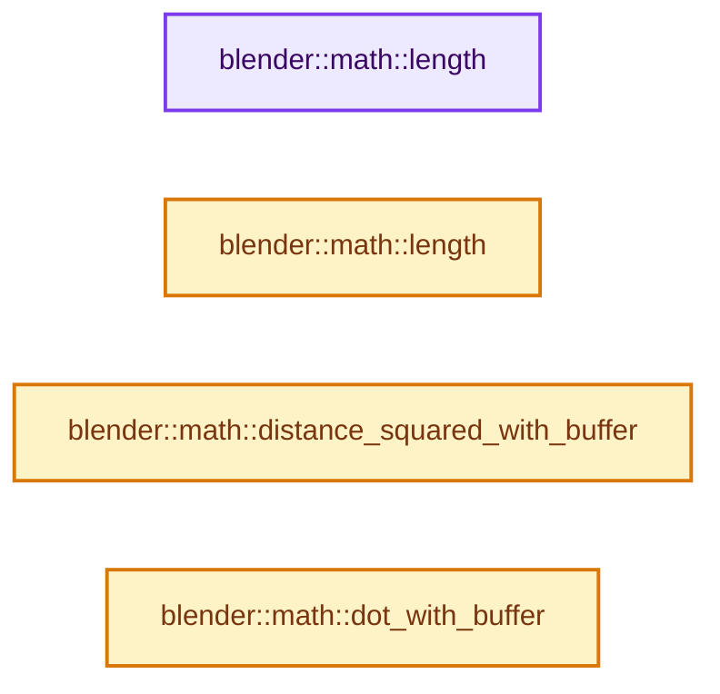
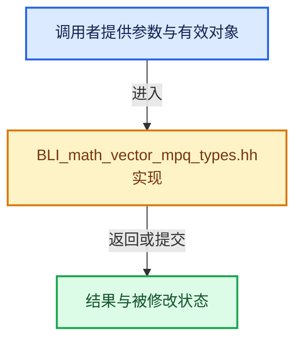

# 实现依赖专题：source/blender/blenlib/BLI_math_vector_mpq_types.hh

[方向导航](README.md) · [符号索引](../%E7%AC%A6%E5%8F%B7%E4%BE%9D%E8%B5%96%E4%B8%8E%E5%AE%9E%E7%8E%B0%E7%B4%A2%E5%BC%95.md)

本专题从正文实际调用进入，集中保存共享实现。函数有稳定锚点，可从调用处直接跳到对应完整函数；递归与互相调用通过回链组织。

## 本文件的实现关系






## 完整成员与函数实现

<a id="f-16c31b0e3391026f"></a>

### `blender::math::length`

实现位置：[source/blender/blenlib/BLI_math_vector_mpq_types.hh](../../../../../source/blender/blenlib/BLI_math_vector_mpq_types.hh) · L40—L43。

接口参数：

- `const mpq2 &a`

**教学注释版**

<!-- annotated:fcb66e06720329 -->

```cpp
template<> inline mpq_class length(const mpq2 &a)
{
  return mpq_class(sqrt(length_squared(a).get_d()));
}
```

<details>
<summary>核对原始源码：source/blender/blenlib/BLI_math_vector_mpq_types.hh · L40—L43</summary>

<!-- original:fcb66e06720329:source/blender/blenlib/BLI_math_vector_mpq_types.hh:40:43 -->

```cpp
template<> inline mpq_class length(const mpq2 &a)
{
  return mpq_class(sqrt(length_squared(a).get_d()));
}
```

</details>

**结果出口**

- `return mpq_class(sqrt(length_squared(a).get_d()));`

**继续追踪实现**

- `mpq_class` → [调用协议](../%E6%A8%A1%E6%9D%BF%E5%AE%8F%E4%B8%8E%E5%8A%A8%E6%80%81%E5%88%86%E6%B4%BE%E5%8D%8F%E8%AE%AE.md)：函数指针、局部可调用对象或未展开的宏；必须结合调用者环境。调用位置L42。
- `sqrt` → [外部契约](https://eel.is/c++draft/)：这个边界按实际表达式及所属类型核对参数、返回值、寿命与失败行为。这里提供接口入口，不声称已解释该第三方版本的内部实现。
- `length_squared(a).get_d` → [调用协议](../%E6%A8%A1%E6%9D%BF%E5%AE%8F%E4%B8%8E%E5%8A%A8%E6%80%81%E5%88%86%E6%B4%BE%E5%8D%8F%E8%AE%AE.md)：接收对象类型依赖auto、返回值或模板实例；不按同名猜测目标。调用位置L42。
- `length_squared` → [blender::math::length_squared · L452](%E4%BE%9D%E8%B5%96-BLI_math_vector-906a87.md#f-b1e1749f57230265)。

<a id="f-82d5aa193c621065"></a>

### `blender::math::length`

实现位置：[source/blender/blenlib/BLI_math_vector_mpq_types.hh](../../../../../source/blender/blenlib/BLI_math_vector_mpq_types.hh) · L49—L52。

接口参数：

- `const mpq3 &a`

**教学注释版**

<!-- annotated:97defbe83a96df -->

```cpp
template<> inline mpq_class length(const mpq3 &a)
{
  return mpq_class(sqrt(length_squared(a).get_d()));
}
```

<details>
<summary>核对原始源码：source/blender/blenlib/BLI_math_vector_mpq_types.hh · L49—L52</summary>

<!-- original:97defbe83a96df:source/blender/blenlib/BLI_math_vector_mpq_types.hh:49:52 -->

```cpp
template<> inline mpq_class length(const mpq3 &a)
{
  return mpq_class(sqrt(length_squared(a).get_d()));
}
```

</details>

**结果出口**

- `return mpq_class(sqrt(length_squared(a).get_d()));`

**继续追踪实现**

- `mpq_class` → [调用协议](../%E6%A8%A1%E6%9D%BF%E5%AE%8F%E4%B8%8E%E5%8A%A8%E6%80%81%E5%88%86%E6%B4%BE%E5%8D%8F%E8%AE%AE.md)：函数指针、局部可调用对象或未展开的宏；必须结合调用者环境。调用位置L51。
- `sqrt` → [外部契约](https://eel.is/c++draft/)：这个边界按实际表达式及所属类型核对参数、返回值、寿命与失败行为。这里提供接口入口，不声称已解释该第三方版本的内部实现。
- `length_squared(a).get_d` → [调用协议](../%E6%A8%A1%E6%9D%BF%E5%AE%8F%E4%B8%8E%E5%8A%A8%E6%80%81%E5%88%86%E6%B4%BE%E5%8D%8F%E8%AE%AE.md)：接收对象类型依赖auto、返回值或模板实例；不按同名猜测目标。调用位置L51。
- `length_squared` → [blender::math::length_squared · L452](%E4%BE%9D%E8%B5%96-BLI_math_vector-906a87.md#f-b1e1749f57230265)。

<a id="f-124e162d0257b2bf"></a>

### `blender::math::distance_squared_with_buffer`

实现位置：[source/blender/blenlib/BLI_math_vector_mpq_types.hh](../../../../../source/blender/blenlib/BLI_math_vector_mpq_types.hh) · L57—L62。

接口参数：

- `const mpq3 &a`
- `const mpq3 &b`
- `mpq3 &buffer`

**教学注释版**

<!-- annotated:80f1256bf6d57b -->

```cpp
inline mpq_class distance_squared_with_buffer(const mpq3 &a, const mpq3 &b, mpq3 &buffer)
{
  buffer = a;
  buffer -= b;
  return dot(buffer, buffer);
}
```

<details>
<summary>核对原始源码：source/blender/blenlib/BLI_math_vector_mpq_types.hh · L57—L62</summary>

<!-- original:80f1256bf6d57b:source/blender/blenlib/BLI_math_vector_mpq_types.hh:57:62 -->

```cpp
inline mpq_class distance_squared_with_buffer(const mpq3 &a, const mpq3 &b, mpq3 &buffer)
{
  buffer = a;
  buffer -= b;
  return dot(buffer, buffer);
}
```

</details>

**沿实际写入检查状态**

- `buffer = a;`
- `buffer -= b;`

**结果出口**

- `return dot(buffer, buffer);`

**继续追踪实现**

- `dot` → [blender::math::dot · L430](%E4%BE%9D%E8%B5%96-BLI_math_vector-906a87.md#f-6f0c6a081b107428)；[blender::math::dot · L198](%E4%BE%9D%E8%B5%96-BLI_math_quaternion-cf105d.md#f-5b1ef457981dbc76)。同名重载需按实参类型选择。

<a id="f-20316a0cc19a59d2"></a>

### `blender::math::dot_with_buffer`

实现位置：[source/blender/blenlib/BLI_math_vector_mpq_types.hh](../../../../../source/blender/blenlib/BLI_math_vector_mpq_types.hh) · L67—L74。

接口参数：

- `const mpq3 &a`
- `const mpq3 &b`
- `mpq3 &buffer`

**教学注释版**

<!-- annotated:9aa5cbb442e9f5 -->

```cpp
inline mpq_class dot_with_buffer(const mpq3 &a, const mpq3 &b, mpq3 &buffer)
{
  buffer = a;
  buffer *= b;
  buffer.x += buffer.y;
  buffer.x += buffer.z;
  return buffer.x;
}
```

<details>
<summary>核对原始源码：source/blender/blenlib/BLI_math_vector_mpq_types.hh · L67—L74</summary>

<!-- original:9aa5cbb442e9f5:source/blender/blenlib/BLI_math_vector_mpq_types.hh:67:74 -->

```cpp
inline mpq_class dot_with_buffer(const mpq3 &a, const mpq3 &b, mpq3 &buffer)
{
  buffer = a;
  buffer *= b;
  buffer.x += buffer.y;
  buffer.x += buffer.z;
  return buffer.x;
}
```

</details>

**沿实际写入检查状态**

- `buffer = a;`
- `buffer *= b;`
- `buffer.x += buffer.y;`
- `buffer.x += buffer.z;`

**结果出口**

- `return buffer.x;`

**继续追踪实现**

本实现没有需要继续展开的显式调用；检查返回表达式、对象转换和调用者前置条件。
