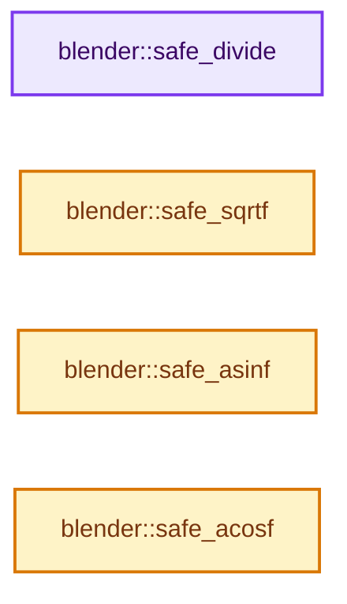
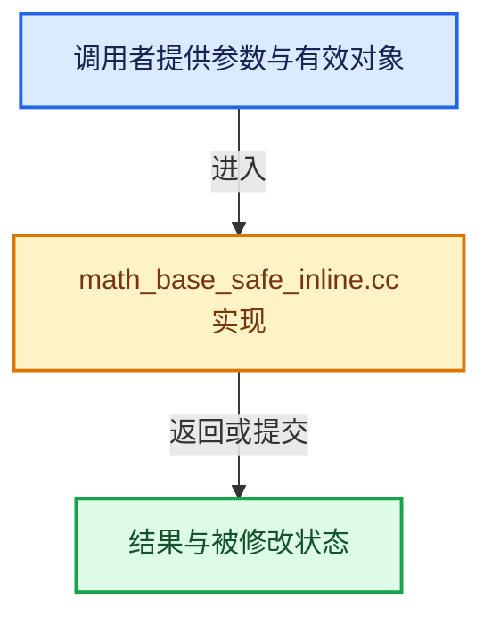

# 实现依赖专题：source/blender/blenlib/intern/math_base_safe_inline.cc

[方向导航](README.md) · [符号索引](../%E7%AC%A6%E5%8F%B7%E4%BE%9D%E8%B5%96%E4%B8%8E%E5%AE%9E%E7%8E%B0%E7%B4%A2%E5%BC%95.md)

本专题从正文实际调用进入，集中保存共享实现。函数有稳定锚点，可从调用处直接跳到对应完整函数；递归与互相调用通过回链组织。

## 本文件的实现关系






## 完整成员与函数实现

<a id="f-fdb080cebee3c5e5"></a>

### `blender::safe_divide`

实现位置：[source/blender/blenlib/intern/math_base_safe_inline.cc](../../../../../source/blender/blenlib/intern/math_base_safe_inline.cc) · L16—L19。

接口参数：

- `float a`
- `float b`

**教学注释版**

<!-- annotated:a2bd0605f097f8 -->

```cpp
MINLINE float safe_divide(float a, float b)
{
  return (b != 0.0f) ? a / b : 0.0f;
}
```

<details>
<summary>核对原始源码：source/blender/blenlib/intern/math_base_safe_inline.cc · L16—L19</summary>

<!-- original:a2bd0605f097f8:source/blender/blenlib/intern/math_base_safe_inline.cc:16:19 -->

```cpp
MINLINE float safe_divide(float a, float b)
{
  return (b != 0.0f) ? a / b : 0.0f;
}
```

</details>

**结果出口**

- `return (b != 0.0f) ? a / b : 0.0f;`

**继续追踪实现**

本实现没有需要继续展开的显式调用；检查返回表达式、对象转换和调用者前置条件。

<a id="f-dc452a8af103a306"></a>

### `blender::safe_sqrtf`

实现位置：[source/blender/blenlib/intern/math_base_safe_inline.cc](../../../../../source/blender/blenlib/intern/math_base_safe_inline.cc) · L39—L42。

接口参数：

- `float a`

**教学注释版**

<!-- annotated:33f3e8b57bf3f6 -->

```cpp
MINLINE float safe_sqrtf(float a)
{
  return sqrtf(max_ff(a, 0.0f));
}
```

<details>
<summary>核对原始源码：source/blender/blenlib/intern/math_base_safe_inline.cc · L39—L42</summary>

<!-- original:33f3e8b57bf3f6:source/blender/blenlib/intern/math_base_safe_inline.cc:39:42 -->

```cpp
MINLINE float safe_sqrtf(float a)
{
  return sqrtf(max_ff(a, 0.0f));
}
```

</details>

**结果出口**

- `return sqrtf(max_ff(a, 0.0f));`

**继续追踪实现**

- `sqrtf` → [外部契约](https://eel.is/c++draft/)：这个边界按实际表达式及所属类型核对参数、返回值、寿命与失败行为。这里提供接口入口，不声称已解释该第三方版本的内部实现。
- `max_ff` → [blender::max_ff · L325](%E4%BE%9D%E8%B5%96-math_base_inline-546b00.md#f-05a351a3afd7dc2a)。

<a id="f-b91859fefac05ec3"></a>

### `blender::safe_asinf`

实现位置：[source/blender/blenlib/intern/math_base_safe_inline.cc](../../../../../source/blender/blenlib/intern/math_base_safe_inline.cc) · L49—L53。

接口参数：

- `float a`

**教学注释版**

<!-- annotated:5b3afbb9694e27 -->

```cpp
MINLINE float safe_asinf(float a)
{
  CLAMP(a, -1.0f, 1.0f);
  return asinf(a);
}
```

<details>
<summary>核对原始源码：source/blender/blenlib/intern/math_base_safe_inline.cc · L49—L53</summary>

<!-- original:5b3afbb9694e27:source/blender/blenlib/intern/math_base_safe_inline.cc:49:53 -->

```cpp
MINLINE float safe_asinf(float a)
{
  CLAMP(a, -1.0f, 1.0f);
  return asinf(a);
}
```

</details>

**结果出口**

- `return asinf(a);`

**继续追踪实现**

- `CLAMP` → [CLAMP · L200](../01-%E5%9F%BA%E7%A1%80%E5%AE%B9%E5%99%A8%E4%B8%8E%E7%8E%B0%E4%BB%A3CPP/%E4%BE%9D%E8%B5%96-BLI_utildefines-293a0a.md#m-69703e497120)。宏定义由构建条件选择。
- `asinf` → [asinf · L169](../05-%E5%87%A0%E4%BD%95%E5%AD%98%E5%82%A8%E4%B8%8E%E6%8B%93%E6%89%91%E6%98%A0%E5%B0%84/%E4%BE%9D%E8%B5%96-compat-56205c.md#m-dd90417fae94)；[asinf · L267](../05-%E5%87%A0%E4%BD%95%E5%AD%98%E5%82%A8%E4%B8%8E%E6%8B%93%E6%89%91%E6%98%A0%E5%B0%84/%E4%BE%9D%E8%B5%96-compat-efe0e9.md#m-e1a6a02d64f4)；[asinf · L47](../05-%E5%87%A0%E4%BD%95%E5%AD%98%E5%82%A8%E4%B8%8E%E6%8B%93%E6%89%91%E6%98%A0%E5%B0%84/%E4%BE%9D%E8%B5%96-GPU_shader_shared_utils-0adda3.md#m-8482af44681f)；[asinf · L68](../05-%E5%87%A0%E4%BD%95%E5%AD%98%E5%82%A8%E4%B8%8E%E6%8B%93%E6%89%91%E6%98%A0%E5%B0%84/%E4%BE%9D%E8%B5%96-GPU_shader_shared_utils-0adda3.md#m-8f1d94fadcd2)。宏定义由构建条件选择。

<a id="f-ea1b330e846761a7"></a>

### `blender::safe_acosf`

实现位置：[source/blender/blenlib/intern/math_base_safe_inline.cc](../../../../../source/blender/blenlib/intern/math_base_safe_inline.cc) · L55—L59。

接口参数：

- `float a`

**教学注释版**

<!-- annotated:487133143c3ea2 -->

```cpp
MINLINE float safe_acosf(float a)
{
  CLAMP(a, -1.0f, 1.0f);
  return acosf(a);
}
```

<details>
<summary>核对原始源码：source/blender/blenlib/intern/math_base_safe_inline.cc · L55—L59</summary>

<!-- original:487133143c3ea2:source/blender/blenlib/intern/math_base_safe_inline.cc:55:59 -->

```cpp
MINLINE float safe_acosf(float a)
{
  CLAMP(a, -1.0f, 1.0f);
  return acosf(a);
}
```

</details>

**结果出口**

- `return acosf(a);`

**继续追踪实现**

- `CLAMP` → [CLAMP · L200](../01-%E5%9F%BA%E7%A1%80%E5%AE%B9%E5%99%A8%E4%B8%8E%E7%8E%B0%E4%BB%A3CPP/%E4%BE%9D%E8%B5%96-BLI_utildefines-293a0a.md#m-69703e497120)。宏定义由构建条件选择。
- `acosf` → [acosf · L170](../05-%E5%87%A0%E4%BD%95%E5%AD%98%E5%82%A8%E4%B8%8E%E6%8B%93%E6%89%91%E6%98%A0%E5%B0%84/%E4%BE%9D%E8%B5%96-compat-56205c.md#m-68452ab01424)；[acosf · L268](../05-%E5%87%A0%E4%BD%95%E5%AD%98%E5%82%A8%E4%B8%8E%E6%8B%93%E6%89%91%E6%98%A0%E5%B0%84/%E4%BE%9D%E8%B5%96-compat-efe0e9.md#m-a0383e8919c5)；[acosf · L46](../05-%E5%87%A0%E4%BD%95%E5%AD%98%E5%82%A8%E4%B8%8E%E6%8B%93%E6%89%91%E6%98%A0%E5%B0%84/%E4%BE%9D%E8%B5%96-GPU_shader_shared_utils-0adda3.md#m-68745dafe7bd)；[acosf · L67](../05-%E5%87%A0%E4%BD%95%E5%AD%98%E5%82%A8%E4%B8%8E%E6%8B%93%E6%89%91%E6%98%A0%E5%B0%84/%E4%BE%9D%E8%B5%96-GPU_shader_shared_utils-0adda3.md#m-a19449c3be49)。宏定义由构建条件选择。
