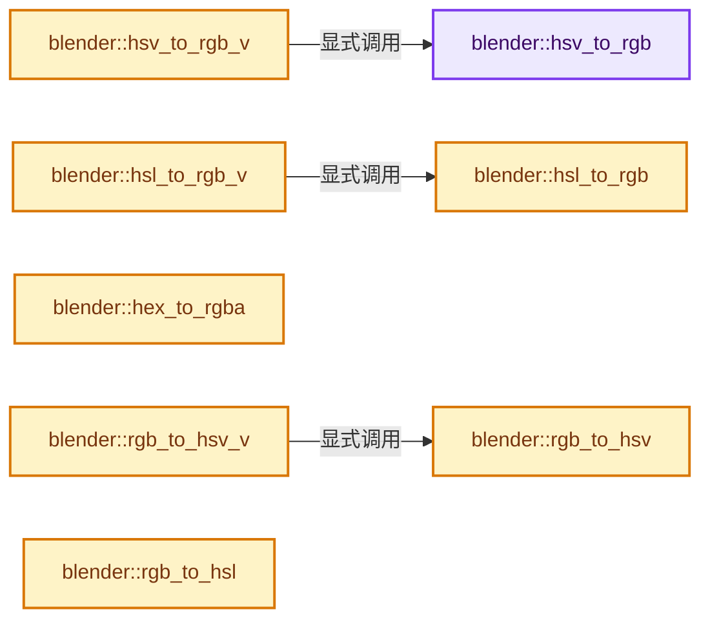
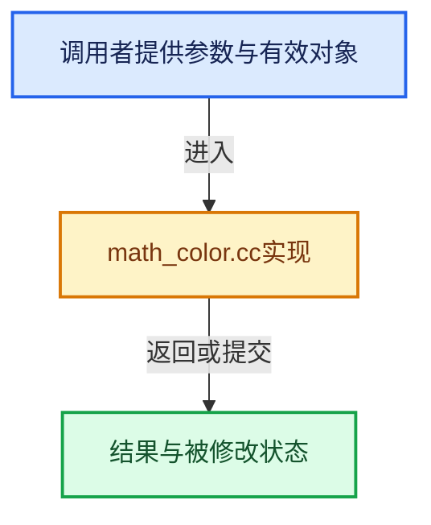

# 实现依赖专题：source/blender/blenlib/intern/math_color.cc

[方向导航](README.md) · [符号索引](../%E7%AC%A6%E5%8F%B7%E4%BE%9D%E8%B5%96%E4%B8%8E%E5%AE%9E%E7%8E%B0%E7%B4%A2%E5%BC%95.md)

本专题从正文实际调用进入，集中保存共享实现。函数有稳定锚点，可从调用处直接跳到对应完整函数；递归与互相调用通过回链组织。

## 本文件的实现关系






## 完整成员与函数实现

<a id="f-49356c91ef668f40"></a>

### `blender::hsv_to_rgb`

实现位置：[source/blender/blenlib/intern/math_color.cc](../../../../../source/blender/blenlib/intern/math_color.cc) · L25—L40。

接口参数：

- `float h`
- `float s`
- `float v`
- `float *r_r`
- `float *r_g`
- `float *r_b`

**教学注释版**

<!-- annotated:bbfce96ca63128 -->

```cpp
void hsv_to_rgb(float h, float s, float v, float *r_r, float *r_g, float *r_b)
{
  float nr, ng, nb;

  nr = fabsf(h * 6.0f - 3.0f) - 1.0f;
  ng = 2.0f - fabsf(h * 6.0f - 2.0f);
  nb = 2.0f - fabsf(h * 6.0f - 4.0f);

  CLAMP(nr, 0.0f, 1.0f);
  CLAMP(nb, 0.0f, 1.0f);
  CLAMP(ng, 0.0f, 1.0f);

  *r_r = ((nr - 1.0f) * s + 1.0f) * v;
  *r_g = ((ng - 1.0f) * s + 1.0f) * v;
  *r_b = ((nb - 1.0f) * s + 1.0f) * v;
}
```

<details>
<summary>核对原始源码：source/blender/blenlib/intern/math_color.cc · L25—L40</summary>

<!-- original:bbfce96ca63128:source/blender/blenlib/intern/math_color.cc:25:40 -->

```cpp
void hsv_to_rgb(float h, float s, float v, float *r_r, float *r_g, float *r_b)
{
  float nr, ng, nb;

  nr = fabsf(h * 6.0f - 3.0f) - 1.0f;
  ng = 2.0f - fabsf(h * 6.0f - 2.0f);
  nb = 2.0f - fabsf(h * 6.0f - 4.0f);

  CLAMP(nr, 0.0f, 1.0f);
  CLAMP(nb, 0.0f, 1.0f);
  CLAMP(ng, 0.0f, 1.0f);

  *r_r = ((nr - 1.0f) * s + 1.0f) * v;
  *r_g = ((ng - 1.0f) * s + 1.0f) * v;
  *r_b = ((nb - 1.0f) * s + 1.0f) * v;
}
```

</details>

**沿实际写入检查状态**

- `nr = fabsf(h * 6.0f - 3.0f) - 1.0f;`
- `ng = 2.0f - fabsf(h * 6.0f - 2.0f);`
- `nb = 2.0f - fabsf(h * 6.0f - 4.0f);`

**继续追踪实现**

- `fabsf` → [fabsf · L21](../05-%E5%87%A0%E4%BD%95%E5%AD%98%E5%82%A8%E4%B8%8E%E6%8B%93%E6%89%91%E6%98%A0%E5%B0%84/%E4%BE%9D%E8%B5%96-radial_tiling_shared-98abf9.md#m-02cc4c69cfb3)；[fabsf · L43](../05-%E5%87%A0%E4%BD%95%E5%AD%98%E5%82%A8%E4%B8%8E%E6%8B%93%E6%89%91%E6%98%A0%E5%B0%84/%E4%BE%9D%E8%B5%96-radial_tiling_shared-98abf9.md#m-04effe61803b)；[fabsf · L74](../05-%E5%87%A0%E4%BD%95%E5%AD%98%E5%82%A8%E4%B8%8E%E6%8B%93%E6%89%91%E6%98%A0%E5%B0%84/%E4%BE%9D%E8%B5%96-radial_tiling_shared-98abf9.md#m-927dd4eba7dc)；[fabsf · L25](../01-%E5%9F%BA%E7%A1%80%E5%AE%B9%E5%99%A8%E4%B8%8E%E7%8E%B0%E4%BB%A3CPP/%E4%BE%9D%E8%B5%96-radial_tiling_shared-7989a4.md#m-8348d6b3d08f)；[fabsf · L47](../01-%E5%9F%BA%E7%A1%80%E5%AE%B9%E5%99%A8%E4%B8%8E%E7%8E%B0%E4%BB%A3CPP/%E4%BE%9D%E8%B5%96-radial_tiling_shared-7989a4.md#m-13b7e0b6d84f)；[fabsf · L78](../01-%E5%9F%BA%E7%A1%80%E5%AE%B9%E5%99%A8%E4%B8%8E%E7%8E%B0%E4%BB%A3CPP/%E4%BE%9D%E8%B5%96-radial_tiling_shared-7989a4.md#m-326c83464a0d)；[fabsf · L21](../05-%E5%87%A0%E4%BD%95%E5%AD%98%E5%82%A8%E4%B8%8E%E6%8B%93%E6%89%91%E6%98%A0%E5%B0%84/%E4%BE%9D%E8%B5%96-node_radial_tiling_shared-b14bc2.md#m-7c3ee12fc119)；[fabsf · L43](../05-%E5%87%A0%E4%BD%95%E5%AD%98%E5%82%A8%E4%B8%8E%E6%8B%93%E6%89%91%E6%98%A0%E5%B0%84/%E4%BE%9D%E8%B5%96-node_radial_tiling_shared-b14bc2.md#m-9112db0e2dd1)；[fabsf · L74](../05-%E5%87%A0%E4%BD%95%E5%AD%98%E5%82%A8%E4%B8%8E%E6%8B%93%E6%89%91%E6%98%A0%E5%B0%84/%E4%BE%9D%E8%B5%96-node_radial_tiling_shared-b14bc2.md#m-ee4e61908a6f)；[fabsf · L167](../05-%E5%87%A0%E4%BD%95%E5%AD%98%E5%82%A8%E4%B8%8E%E6%8B%93%E6%89%91%E6%98%A0%E5%B0%84/%E4%BE%9D%E8%B5%96-compat-56205c.md#m-b039ee6c1601)；[fabsf · L265](../05-%E5%87%A0%E4%BD%95%E5%AD%98%E5%82%A8%E4%B8%8E%E6%8B%93%E6%89%91%E6%98%A0%E5%B0%84/%E4%BE%9D%E8%B5%96-compat-efe0e9.md#m-6b21869e9f3f)。宏定义由构建条件选择。
- `CLAMP` → [CLAMP · L200](../01-%E5%9F%BA%E7%A1%80%E5%AE%B9%E5%99%A8%E4%B8%8E%E7%8E%B0%E4%BB%A3CPP/%E4%BE%9D%E8%B5%96-BLI_utildefines-293a0a.md#m-69703e497120)。宏定义由构建条件选择。

<a id="f-02572bd327f53b33"></a>

### `blender::hsl_to_rgb`

实现位置：[source/blender/blenlib/intern/math_color.cc](../../../../../source/blender/blenlib/intern/math_color.cc) · L42—L59。

接口参数：

- `float h`
- `float s`
- `float l`
- `float *r_r`
- `float *r_g`
- `float *r_b`

**教学注释版**

<!-- annotated:242a9aa623be32 -->

```cpp
void hsl_to_rgb(float h, float s, float l, float *r_r, float *r_g, float *r_b)
{
  float nr, ng, nb, chroma;

  nr = fabsf(h * 6.0f - 3.0f) - 1.0f;
  ng = 2.0f - fabsf(h * 6.0f - 2.0f);
  nb = 2.0f - fabsf(h * 6.0f - 4.0f);

  CLAMP(nr, 0.0f, 1.0f);
  CLAMP(nb, 0.0f, 1.0f);
  CLAMP(ng, 0.0f, 1.0f);

  chroma = (1.0f - fabsf(2.0f * l - 1.0f)) * s;

  *r_r = (nr - 0.5f) * chroma + l;
  *r_g = (ng - 0.5f) * chroma + l;
  *r_b = (nb - 0.5f) * chroma + l;
}
```

<details>
<summary>核对原始源码：source/blender/blenlib/intern/math_color.cc · L42—L59</summary>

<!-- original:242a9aa623be32:source/blender/blenlib/intern/math_color.cc:42:59 -->

```cpp
void hsl_to_rgb(float h, float s, float l, float *r_r, float *r_g, float *r_b)
{
  float nr, ng, nb, chroma;

  nr = fabsf(h * 6.0f - 3.0f) - 1.0f;
  ng = 2.0f - fabsf(h * 6.0f - 2.0f);
  nb = 2.0f - fabsf(h * 6.0f - 4.0f);

  CLAMP(nr, 0.0f, 1.0f);
  CLAMP(nb, 0.0f, 1.0f);
  CLAMP(ng, 0.0f, 1.0f);

  chroma = (1.0f - fabsf(2.0f * l - 1.0f)) * s;

  *r_r = (nr - 0.5f) * chroma + l;
  *r_g = (ng - 0.5f) * chroma + l;
  *r_b = (nb - 0.5f) * chroma + l;
}
```

</details>

**沿实际写入检查状态**

- `nr = fabsf(h * 6.0f - 3.0f) - 1.0f;`
- `ng = 2.0f - fabsf(h * 6.0f - 2.0f);`
- `nb = 2.0f - fabsf(h * 6.0f - 4.0f);`
- `chroma = (1.0f - fabsf(2.0f * l - 1.0f)) * s;`

**继续追踪实现**

- `fabsf` → [fabsf · L21](../05-%E5%87%A0%E4%BD%95%E5%AD%98%E5%82%A8%E4%B8%8E%E6%8B%93%E6%89%91%E6%98%A0%E5%B0%84/%E4%BE%9D%E8%B5%96-radial_tiling_shared-98abf9.md#m-02cc4c69cfb3)；[fabsf · L43](../05-%E5%87%A0%E4%BD%95%E5%AD%98%E5%82%A8%E4%B8%8E%E6%8B%93%E6%89%91%E6%98%A0%E5%B0%84/%E4%BE%9D%E8%B5%96-radial_tiling_shared-98abf9.md#m-04effe61803b)；[fabsf · L74](../05-%E5%87%A0%E4%BD%95%E5%AD%98%E5%82%A8%E4%B8%8E%E6%8B%93%E6%89%91%E6%98%A0%E5%B0%84/%E4%BE%9D%E8%B5%96-radial_tiling_shared-98abf9.md#m-927dd4eba7dc)；[fabsf · L25](../01-%E5%9F%BA%E7%A1%80%E5%AE%B9%E5%99%A8%E4%B8%8E%E7%8E%B0%E4%BB%A3CPP/%E4%BE%9D%E8%B5%96-radial_tiling_shared-7989a4.md#m-8348d6b3d08f)；[fabsf · L47](../01-%E5%9F%BA%E7%A1%80%E5%AE%B9%E5%99%A8%E4%B8%8E%E7%8E%B0%E4%BB%A3CPP/%E4%BE%9D%E8%B5%96-radial_tiling_shared-7989a4.md#m-13b7e0b6d84f)；[fabsf · L78](../01-%E5%9F%BA%E7%A1%80%E5%AE%B9%E5%99%A8%E4%B8%8E%E7%8E%B0%E4%BB%A3CPP/%E4%BE%9D%E8%B5%96-radial_tiling_shared-7989a4.md#m-326c83464a0d)；[fabsf · L21](../05-%E5%87%A0%E4%BD%95%E5%AD%98%E5%82%A8%E4%B8%8E%E6%8B%93%E6%89%91%E6%98%A0%E5%B0%84/%E4%BE%9D%E8%B5%96-node_radial_tiling_shared-b14bc2.md#m-7c3ee12fc119)；[fabsf · L43](../05-%E5%87%A0%E4%BD%95%E5%AD%98%E5%82%A8%E4%B8%8E%E6%8B%93%E6%89%91%E6%98%A0%E5%B0%84/%E4%BE%9D%E8%B5%96-node_radial_tiling_shared-b14bc2.md#m-9112db0e2dd1)；[fabsf · L74](../05-%E5%87%A0%E4%BD%95%E5%AD%98%E5%82%A8%E4%B8%8E%E6%8B%93%E6%89%91%E6%98%A0%E5%B0%84/%E4%BE%9D%E8%B5%96-node_radial_tiling_shared-b14bc2.md#m-ee4e61908a6f)；[fabsf · L167](../05-%E5%87%A0%E4%BD%95%E5%AD%98%E5%82%A8%E4%B8%8E%E6%8B%93%E6%89%91%E6%98%A0%E5%B0%84/%E4%BE%9D%E8%B5%96-compat-56205c.md#m-b039ee6c1601)；[fabsf · L265](../05-%E5%87%A0%E4%BD%95%E5%AD%98%E5%82%A8%E4%B8%8E%E6%8B%93%E6%89%91%E6%98%A0%E5%B0%84/%E4%BE%9D%E8%B5%96-compat-efe0e9.md#m-6b21869e9f3f)。宏定义由构建条件选择。
- `CLAMP` → [CLAMP · L200](../01-%E5%9F%BA%E7%A1%80%E5%AE%B9%E5%99%A8%E4%B8%8E%E7%8E%B0%E4%BB%A3CPP/%E4%BE%9D%E8%B5%96-BLI_utildefines-293a0a.md#m-69703e497120)。宏定义由构建条件选择。

<a id="f-d78b8d5b93aafd9e"></a>

### `blender::hsv_to_rgb_v`

实现位置：[source/blender/blenlib/intern/math_color.cc](../../../../../source/blender/blenlib/intern/math_color.cc) · L61—L64。

接口参数：

- `const float hsv[3]`
- `float r_rgb[3]`

**教学注释版**

<!-- annotated:bc8d7be8805de2 -->

```cpp
void hsv_to_rgb_v(const float hsv[3], float r_rgb[3])
{
  hsv_to_rgb(hsv[0], hsv[1], hsv[2], &r_rgb[0], &r_rgb[1], &r_rgb[2]);
}
```

<details>
<summary>核对原始源码：source/blender/blenlib/intern/math_color.cc · L61—L64</summary>

<!-- original:bc8d7be8805de2:source/blender/blenlib/intern/math_color.cc:61:64 -->

```cpp
void hsv_to_rgb_v(const float hsv[3], float r_rgb[3])
{
  hsv_to_rgb(hsv[0], hsv[1], hsv[2], &r_rgb[0], &r_rgb[1], &r_rgb[2]);
}
```

</details>

**继续追踪实现**

- `hsv_to_rgb` → [blender::hsv_to_rgb · L25](%E4%BE%9D%E8%B5%96-math_color-98507f.md#f-49356c91ef668f40)。

<a id="f-87d85e7be1bc56e8"></a>

### `blender::hsl_to_rgb_v`

实现位置：[source/blender/blenlib/intern/math_color.cc](../../../../../source/blender/blenlib/intern/math_color.cc) · L66—L69。

接口参数：

- `const float hsl[3]`
- `float r_rgb[3]`

**教学注释版**

<!-- annotated:92d073f3d1bba8 -->

```cpp
void hsl_to_rgb_v(const float hsl[3], float r_rgb[3])
{
  hsl_to_rgb(hsl[0], hsl[1], hsl[2], &r_rgb[0], &r_rgb[1], &r_rgb[2]);
}
```

<details>
<summary>核对原始源码：source/blender/blenlib/intern/math_color.cc · L66—L69</summary>

<!-- original:92d073f3d1bba8:source/blender/blenlib/intern/math_color.cc:66:69 -->

```cpp
void hsl_to_rgb_v(const float hsl[3], float r_rgb[3])
{
  hsl_to_rgb(hsl[0], hsl[1], hsl[2], &r_rgb[0], &r_rgb[1], &r_rgb[2]);
}
```

</details>

**继续追踪实现**

- `hsl_to_rgb` → [blender::hsl_to_rgb · L42](%E4%BE%9D%E8%B5%96-math_color-98507f.md#f-02572bd327f53b33)。

<a id="f-75dcd9c5ae91a505"></a>

### `blender::hex_to_rgba`

实现位置：[source/blender/blenlib/intern/math_color.cc](../../../../../source/blender/blenlib/intern/math_color.cc) · L204—L296。

接口参数：

- `const char *hexcol`
- `float *r_r`
- `float *r_g`
- `float *r_b`
- `float *r_a`

**教学注释版**

<!-- annotated:ae22cfd5879e48 -->

```cpp
bool hex_to_rgba(const char *hexcol, float *r_r, float *r_g, float *r_b, float *r_a)
{
  if (hexcol[0] == '#') {
    hexcol++;
  }

  size_t hex_len = strlen(hexcol);
  uint r, g, b, a;
  bool alpha_parsed = false;

  switch (hex_len) {
    case 8: /* #RRGGBBAA */
      if (sscanf(hexcol, "%2x%2x%2x%2x", &r, &g, &b, &a) != 4) {
        return false;
      }
      alpha_parsed = true;
      break;
    case 7: /* #RRGGBBA -> #RRGGBBA0 */
      if (sscanf(hexcol, "%2x%2x%2x%1x", &r, &g, &b, &a) != 4) {
        return false;
      }
      a <<= 4;
      alpha_parsed = true;
      break;
    case 6: /* #RRGGBB */
      if (sscanf(hexcol, "%2x%2x%2x", &r, &g, &b) != 3) {
        return false;
      }
      break;
    case 5: /* #RGBAA -> #RRGGBBAA */
      if (sscanf(hexcol, "%1x%1x%1x%2x", &r, &g, &b, &a) != 4) {
        return false;
      }
      r = (r << 4) | r;
      g = (g << 4) | g;
      b = (b << 4) | b;
      alpha_parsed = true;
      break;
    case 4: /* #RGBA -> #RRGGBBAA */
      if (sscanf(hexcol, "%1x%1x%1x%1x", &r, &g, &b, &a) != 4) {
        return false;
      }
      r = (r << 4) | r;
      g = (g << 4) | g;
      b = (b << 4) | b;
      a = (a << 4) | a;
      alpha_parsed = true;
      break;
    case 3: /* #RGB -> #RRGGBB */
      if (sscanf(hexcol, "%1x%1x%1x", &r, &g, &b) != 3) {
        return false;
      }
      r = (r << 4) | r;
      g = (g << 4) | g;
      b = (b << 4) | b;
      break;
    case 2: /* #AB -> #ABABAB */
      if (sscanf(hexcol, "%2x", &r) != 1) {
        return false;
      }
      g = r;
      b = r;
      break;
    case 1: /* #A -> #AAAAAA */
      if (sscanf(hexcol, "%1x", &r) != 1) {
        return false;
      }
      r = (r << 4) | r;
      g = r;
      b = r;
      break;
    default:
      /* Invalid hex color length - leave color unchanged. */
      return false;
  }

  /* Convert integer color channels to float. */
  const float scale = 1.0f / 255.0f;
  *r_r = float(r) * scale;
  *r_g = float(g) * scale;
  *r_b = float(b) * scale;

  CLAMP(*r_r, 0.0f, 1.0f);
  CLAMP(*r_g, 0.0f, 1.0f);
  CLAMP(*r_b, 0.0f, 1.0f);

  /* Assign alpha if present. */
  if (r_a && alpha_parsed) {
    *r_a = float(a) * scale;
    CLAMP(*r_a, 0.0f, 1.0f);
  }
  return true;
}
```

<details>
<summary>核对原始源码：source/blender/blenlib/intern/math_color.cc · L204—L296</summary>

<!-- original:ae22cfd5879e48:source/blender/blenlib/intern/math_color.cc:204:296 -->

```cpp
bool hex_to_rgba(const char *hexcol, float *r_r, float *r_g, float *r_b, float *r_a)
{
  if (hexcol[0] == '#') {
    hexcol++;
  }

  size_t hex_len = strlen(hexcol);
  uint r, g, b, a;
  bool alpha_parsed = false;

  switch (hex_len) {
    case 8: /* #RRGGBBAA */
      if (sscanf(hexcol, "%2x%2x%2x%2x", &r, &g, &b, &a) != 4) {
        return false;
      }
      alpha_parsed = true;
      break;
    case 7: /* #RRGGBBA -> #RRGGBBA0 */
      if (sscanf(hexcol, "%2x%2x%2x%1x", &r, &g, &b, &a) != 4) {
        return false;
      }
      a <<= 4;
      alpha_parsed = true;
      break;
    case 6: /* #RRGGBB */
      if (sscanf(hexcol, "%2x%2x%2x", &r, &g, &b) != 3) {
        return false;
      }
      break;
    case 5: /* #RGBAA -> #RRGGBBAA */
      if (sscanf(hexcol, "%1x%1x%1x%2x", &r, &g, &b, &a) != 4) {
        return false;
      }
      r = (r << 4) | r;
      g = (g << 4) | g;
      b = (b << 4) | b;
      alpha_parsed = true;
      break;
    case 4: /* #RGBA -> #RRGGBBAA */
      if (sscanf(hexcol, "%1x%1x%1x%1x", &r, &g, &b, &a) != 4) {
        return false;
      }
      r = (r << 4) | r;
      g = (g << 4) | g;
      b = (b << 4) | b;
      a = (a << 4) | a;
      alpha_parsed = true;
      break;
    case 3: /* #RGB -> #RRGGBB */
      if (sscanf(hexcol, "%1x%1x%1x", &r, &g, &b) != 3) {
        return false;
      }
      r = (r << 4) | r;
      g = (g << 4) | g;
      b = (b << 4) | b;
      break;
    case 2: /* #AB -> #ABABAB */
      if (sscanf(hexcol, "%2x", &r) != 1) {
        return false;
      }
      g = r;
      b = r;
      break;
    case 1: /* #A -> #AAAAAA */
      if (sscanf(hexcol, "%1x", &r) != 1) {
        return false;
      }
      r = (r << 4) | r;
      g = r;
      b = r;
      break;
    default:
      /* Invalid hex color length - leave color unchanged. */
      return false;
  }

  /* Convert integer color channels to float. */
  const float scale = 1.0f / 255.0f;
  *r_r = float(r) * scale;
  *r_g = float(g) * scale;
  *r_b = float(b) * scale;

  CLAMP(*r_r, 0.0f, 1.0f);
  CLAMP(*r_g, 0.0f, 1.0f);
  CLAMP(*r_b, 0.0f, 1.0f);

  /* Assign alpha if present. */
  if (r_a && alpha_parsed) {
    *r_a = float(a) * scale;
    CLAMP(*r_a, 0.0f, 1.0f);
  }
  return true;
}
```

</details>

**沿实际写入检查状态**

- `alpha_parsed = true;`
- `r = (r << 4) | r;`
- `g = (g << 4) | g;`
- `b = (b << 4) | b;`
- `a = (a << 4) | a;`
- `g = r;`
- `b = r;`

**结果出口**

- `return false;`
- `return true;`

**继续追踪实现**

- `strlen` → [外部契约](https://eel.is/c++draft/)：这个边界按实际表达式及所属类型核对参数、返回值、寿命与失败行为。这里提供接口入口，不声称已解释该第三方版本的内部实现。
- `sscanf` → [调用协议](../%E6%A8%A1%E6%9D%BF%E5%AE%8F%E4%B8%8E%E5%8A%A8%E6%80%81%E5%88%86%E6%B4%BE%E5%8D%8F%E8%AE%AE.md)：函数指针、局部可调用对象或未展开的宏；必须结合调用者环境。调用位置L216。
- `CLAMP` → [CLAMP · L200](../01-%E5%9F%BA%E7%A1%80%E5%AE%B9%E5%99%A8%E4%B8%8E%E7%8E%B0%E4%BB%A3CPP/%E4%BE%9D%E8%B5%96-BLI_utildefines-293a0a.md#m-69703e497120)。宏定义由构建条件选择。

<a id="f-c247a08cab1afaf6"></a>

### `blender::rgb_to_hsv`

实现位置：[source/blender/blenlib/intern/math_color.cc](../../../../../source/blender/blenlib/intern/math_color.cc) · L298—L320。

接口参数：

- `float r`
- `float g`
- `float b`
- `float *r_h`
- `float *r_s`
- `float *r_v`

**教学注释版**

<!-- annotated:bb600f644eeb7f -->

```cpp
void rgb_to_hsv(float r, float g, float b, float *r_h, float *r_s, float *r_v)
{
  float k = 0.0f;
  float chroma;
  float min_gb;

  if (g < b) {
    SWAP(float, g, b);
    k = -1.0f;
  }
  min_gb = b;
  if (r < g) {
    SWAP(float, r, g);
    k = -2.0f / 6.0f - k;
    min_gb = min_ff(g, b);
  }

  chroma = r - min_gb;

  *r_h = fabsf(k + (g - b) / (6.0f * chroma + 1e-20f));
  *r_s = chroma / (r + 1e-20f);
  *r_v = r;
}
```

<details>
<summary>核对原始源码：source/blender/blenlib/intern/math_color.cc · L298—L320</summary>

<!-- original:bb600f644eeb7f:source/blender/blenlib/intern/math_color.cc:298:320 -->

```cpp
void rgb_to_hsv(float r, float g, float b, float *r_h, float *r_s, float *r_v)
{
  float k = 0.0f;
  float chroma;
  float min_gb;

  if (g < b) {
    SWAP(float, g, b);
    k = -1.0f;
  }
  min_gb = b;
  if (r < g) {
    SWAP(float, r, g);
    k = -2.0f / 6.0f - k;
    min_gb = min_ff(g, b);
  }

  chroma = r - min_gb;

  *r_h = fabsf(k + (g - b) / (6.0f * chroma + 1e-20f));
  *r_s = chroma / (r + 1e-20f);
  *r_v = r;
}
```

</details>

**沿实际写入检查状态**

- `k = -1.0f;`
- `min_gb = b;`
- `k = -2.0f / 6.0f - k;`
- `min_gb = min_ff(g, b);`
- `chroma = r - min_gb;`

**继续追踪实现**

- `min_ff` → [blender::min_ff · L321](%E4%BE%9D%E8%B5%96-math_base_inline-546b00.md#f-5b8d83d6f191be1a)。
- `fabsf` → [fabsf · L21](../05-%E5%87%A0%E4%BD%95%E5%AD%98%E5%82%A8%E4%B8%8E%E6%8B%93%E6%89%91%E6%98%A0%E5%B0%84/%E4%BE%9D%E8%B5%96-radial_tiling_shared-98abf9.md#m-02cc4c69cfb3)；[fabsf · L43](../05-%E5%87%A0%E4%BD%95%E5%AD%98%E5%82%A8%E4%B8%8E%E6%8B%93%E6%89%91%E6%98%A0%E5%B0%84/%E4%BE%9D%E8%B5%96-radial_tiling_shared-98abf9.md#m-04effe61803b)；[fabsf · L74](../05-%E5%87%A0%E4%BD%95%E5%AD%98%E5%82%A8%E4%B8%8E%E6%8B%93%E6%89%91%E6%98%A0%E5%B0%84/%E4%BE%9D%E8%B5%96-radial_tiling_shared-98abf9.md#m-927dd4eba7dc)；[fabsf · L25](../01-%E5%9F%BA%E7%A1%80%E5%AE%B9%E5%99%A8%E4%B8%8E%E7%8E%B0%E4%BB%A3CPP/%E4%BE%9D%E8%B5%96-radial_tiling_shared-7989a4.md#m-8348d6b3d08f)；[fabsf · L47](../01-%E5%9F%BA%E7%A1%80%E5%AE%B9%E5%99%A8%E4%B8%8E%E7%8E%B0%E4%BB%A3CPP/%E4%BE%9D%E8%B5%96-radial_tiling_shared-7989a4.md#m-13b7e0b6d84f)；[fabsf · L78](../01-%E5%9F%BA%E7%A1%80%E5%AE%B9%E5%99%A8%E4%B8%8E%E7%8E%B0%E4%BB%A3CPP/%E4%BE%9D%E8%B5%96-radial_tiling_shared-7989a4.md#m-326c83464a0d)；[fabsf · L21](../05-%E5%87%A0%E4%BD%95%E5%AD%98%E5%82%A8%E4%B8%8E%E6%8B%93%E6%89%91%E6%98%A0%E5%B0%84/%E4%BE%9D%E8%B5%96-node_radial_tiling_shared-b14bc2.md#m-7c3ee12fc119)；[fabsf · L43](../05-%E5%87%A0%E4%BD%95%E5%AD%98%E5%82%A8%E4%B8%8E%E6%8B%93%E6%89%91%E6%98%A0%E5%B0%84/%E4%BE%9D%E8%B5%96-node_radial_tiling_shared-b14bc2.md#m-9112db0e2dd1)；[fabsf · L74](../05-%E5%87%A0%E4%BD%95%E5%AD%98%E5%82%A8%E4%B8%8E%E6%8B%93%E6%89%91%E6%98%A0%E5%B0%84/%E4%BE%9D%E8%B5%96-node_radial_tiling_shared-b14bc2.md#m-ee4e61908a6f)；[fabsf · L167](../05-%E5%87%A0%E4%BD%95%E5%AD%98%E5%82%A8%E4%B8%8E%E6%8B%93%E6%89%91%E6%98%A0%E5%B0%84/%E4%BE%9D%E8%B5%96-compat-56205c.md#m-b039ee6c1601)；[fabsf · L265](../05-%E5%87%A0%E4%BD%95%E5%AD%98%E5%82%A8%E4%B8%8E%E6%8B%93%E6%89%91%E6%98%A0%E5%B0%84/%E4%BE%9D%E8%B5%96-compat-efe0e9.md#m-6b21869e9f3f)。宏定义由构建条件选择。

<a id="f-7312a69cee7c11bb"></a>

### `blender::rgb_to_hsv_v`

实现位置：[source/blender/blenlib/intern/math_color.cc](../../../../../source/blender/blenlib/intern/math_color.cc) · L322—L325。

接口参数：

- `const float rgb[3]`
- `float r_hsv[3]`

**教学注释版**

<!-- annotated:4260bd07b221e4 -->

```cpp
void rgb_to_hsv_v(const float rgb[3], float r_hsv[3])
{
  rgb_to_hsv(rgb[0], rgb[1], rgb[2], &r_hsv[0], &r_hsv[1], &r_hsv[2]);
}
```

<details>
<summary>核对原始源码：source/blender/blenlib/intern/math_color.cc · L322—L325</summary>

<!-- original:4260bd07b221e4:source/blender/blenlib/intern/math_color.cc:322:325 -->

```cpp
void rgb_to_hsv_v(const float rgb[3], float r_hsv[3])
{
  rgb_to_hsv(rgb[0], rgb[1], rgb[2], &r_hsv[0], &r_hsv[1], &r_hsv[2]);
}
```

</details>

**继续追踪实现**

- `rgb_to_hsv` → [blender::rgb_to_hsv · L298](%E4%BE%9D%E8%B5%96-math_color-98507f.md#f-c247a08cab1afaf6)。

<a id="f-fb94ea766cd53350"></a>

### `blender::rgb_to_hsl`

实现位置：[source/blender/blenlib/intern/math_color.cc](../../../../../source/blender/blenlib/intern/math_color.cc) · L327—L354。

接口参数：

- `float r`
- `float g`
- `float b`
- `float *r_h`
- `float *r_s`
- `float *r_l`

**教学注释版**

<!-- annotated:ca8e4f164c1855 -->

```cpp
void rgb_to_hsl(float r, float g, float b, float *r_h, float *r_s, float *r_l)
{
  // [讲解] std::max：按比较关系选取较大值。本讲解中的增长公式同时满足最低请求和几何增长；若保存返回引用，还需注意实参寿命。
  const float cmax = std::max({r, g, b});
  // [讲解] std::min：按比较关系选取较小值；截断范围时还需先满足非负和可表示范围，min本身不会证明边界安全。
  const float cmin = std::min({r, g, b});
  float h, s, l = min_ff(1.0f, (cmax + cmin) / 2.0f);

  if (cmax == cmin) {
    h = s = 0.0f; /* achromatic */
  }
  else {
    float d = cmax - cmin;
    s = l > 0.5f ? d / (2.0f - cmax - cmin) : d / (cmax + cmin);
    if (cmax == r) {
      h = (g - b) / d + (g < b ? 6.0f : 0.0f);
    }
    else if (cmax == g) {
      h = (b - r) / d + 2.0f;
    }
    else {
      h = (r - g) / d + 4.0f;
    }
  }
  h /= 6.0f;

  *r_h = h;
  *r_s = s;
  *r_l = l;
}
```

<details>
<summary>核对原始源码：source/blender/blenlib/intern/math_color.cc · L327—L354</summary>

<!-- original:ca8e4f164c1855:source/blender/blenlib/intern/math_color.cc:327:354 -->

```cpp
void rgb_to_hsl(float r, float g, float b, float *r_h, float *r_s, float *r_l)
{
  const float cmax = std::max({r, g, b});
  const float cmin = std::min({r, g, b});
  float h, s, l = min_ff(1.0f, (cmax + cmin) / 2.0f);

  if (cmax == cmin) {
    h = s = 0.0f; /* achromatic */
  }
  else {
    float d = cmax - cmin;
    s = l > 0.5f ? d / (2.0f - cmax - cmin) : d / (cmax + cmin);
    if (cmax == r) {
      h = (g - b) / d + (g < b ? 6.0f : 0.0f);
    }
    else if (cmax == g) {
      h = (b - r) / d + 2.0f;
    }
    else {
      h = (r - g) / d + 4.0f;
    }
  }
  h /= 6.0f;

  *r_h = h;
  *r_s = s;
  *r_l = l;
}
```

</details>

**沿实际写入检查状态**

- `h = s = 0.0f; /* achromatic */`
- `s = l > 0.5f ? d / (2.0f - cmax - cmin) : d / (cmax + cmin);`
- `h = (g - b) / d + (g < b ? 6.0f : 0.0f);`
- `h = (b - r) / d + 2.0f;`
- `h = (r - g) / d + 4.0f;`

**继续追踪实现**

- `std::max` → [外部契约](https://eel.is/c++draft/alg.min.max)：按比较关系选取较大值。本讲解中的增长公式同时满足最低请求和几何增长；若保存返回引用，还需注意实参寿命。
- `std::min` → [外部契约](https://eel.is/c++draft/alg.min.max)：按比较关系选取较小值；截断范围时还需先满足非负和可表示范围，min本身不会证明边界安全。
- `min_ff` → [blender::min_ff · L321](%E4%BE%9D%E8%B5%96-math_base_inline-546b00.md#f-5b8d83d6f191be1a)。

<a id="f-1cc891d1f696716d"></a>

### `blender::rgb_to_hsl_compat`

实现位置：[source/blender/blenlib/intern/math_color.cc](../../../../../source/blender/blenlib/intern/math_color.cc) · L356—L385。

接口参数：

- `float r`
- `float g`
- `float b`
- `float *r_h`
- `float *r_s`
- `float *r_l`

**教学注释版**

<!-- annotated:7b8243d9fed307 -->

```cpp
void rgb_to_hsl_compat(float r, float g, float b, float *r_h, float *r_s, float *r_l)
{
  /* Convert RGB to HSL, while staying as close as possible to existing HSL values.
   * Uses a threshold as there can be small errors introduced by color space conversions
   * or other operations. */
  const float orig_s = *r_s;
  const float orig_h = *r_h;
  const float threshold = 1e-5f;

  rgb_to_hsl(r, g, b, r_h, r_s, r_l);

  /* For (near) zero lightness or saturation, keep the other values unchanged,
   * as they are either undefined or very sensitive to small lightness changes. */
  if (*r_l <= threshold) {
    *r_h = orig_h;
    *r_s = orig_s;
  }
  else if (*r_s <= threshold) {
    *r_h = orig_h;
    *r_s = orig_s;
  }

  /* Hue wraps around, keep it on the same side. */
  if (fabsf(*r_h) <= threshold && fabsf(orig_h - 1.0f) <= threshold) {
    *r_h = 1.0f;
  }
  else if (fabsf(*r_h - 1.0f) <= threshold && fabsf(orig_h) <= threshold) {
    *r_h = 0.0f;
  }
}
```

<details>
<summary>核对原始源码：source/blender/blenlib/intern/math_color.cc · L356—L385</summary>

<!-- original:7b8243d9fed307:source/blender/blenlib/intern/math_color.cc:356:385 -->

```cpp
void rgb_to_hsl_compat(float r, float g, float b, float *r_h, float *r_s, float *r_l)
{
  /* Convert RGB to HSL, while staying as close as possible to existing HSL values.
   * Uses a threshold as there can be small errors introduced by color space conversions
   * or other operations. */
  const float orig_s = *r_s;
  const float orig_h = *r_h;
  const float threshold = 1e-5f;

  rgb_to_hsl(r, g, b, r_h, r_s, r_l);

  /* For (near) zero lightness or saturation, keep the other values unchanged,
   * as they are either undefined or very sensitive to small lightness changes. */
  if (*r_l <= threshold) {
    *r_h = orig_h;
    *r_s = orig_s;
  }
  else if (*r_s <= threshold) {
    *r_h = orig_h;
    *r_s = orig_s;
  }

  /* Hue wraps around, keep it on the same side. */
  if (fabsf(*r_h) <= threshold && fabsf(orig_h - 1.0f) <= threshold) {
    *r_h = 1.0f;
  }
  else if (fabsf(*r_h - 1.0f) <= threshold && fabsf(orig_h) <= threshold) {
    *r_h = 0.0f;
  }
}
```

</details>

**继续追踪实现**

- `rgb_to_hsl` → [blender::rgb_to_hsl · L327](%E4%BE%9D%E8%B5%96-math_color-98507f.md#f-fb94ea766cd53350)。
- `fabsf` → [fabsf · L21](../05-%E5%87%A0%E4%BD%95%E5%AD%98%E5%82%A8%E4%B8%8E%E6%8B%93%E6%89%91%E6%98%A0%E5%B0%84/%E4%BE%9D%E8%B5%96-radial_tiling_shared-98abf9.md#m-02cc4c69cfb3)；[fabsf · L43](../05-%E5%87%A0%E4%BD%95%E5%AD%98%E5%82%A8%E4%B8%8E%E6%8B%93%E6%89%91%E6%98%A0%E5%B0%84/%E4%BE%9D%E8%B5%96-radial_tiling_shared-98abf9.md#m-04effe61803b)；[fabsf · L74](../05-%E5%87%A0%E4%BD%95%E5%AD%98%E5%82%A8%E4%B8%8E%E6%8B%93%E6%89%91%E6%98%A0%E5%B0%84/%E4%BE%9D%E8%B5%96-radial_tiling_shared-98abf9.md#m-927dd4eba7dc)；[fabsf · L25](../01-%E5%9F%BA%E7%A1%80%E5%AE%B9%E5%99%A8%E4%B8%8E%E7%8E%B0%E4%BB%A3CPP/%E4%BE%9D%E8%B5%96-radial_tiling_shared-7989a4.md#m-8348d6b3d08f)；[fabsf · L47](../01-%E5%9F%BA%E7%A1%80%E5%AE%B9%E5%99%A8%E4%B8%8E%E7%8E%B0%E4%BB%A3CPP/%E4%BE%9D%E8%B5%96-radial_tiling_shared-7989a4.md#m-13b7e0b6d84f)；[fabsf · L78](../01-%E5%9F%BA%E7%A1%80%E5%AE%B9%E5%99%A8%E4%B8%8E%E7%8E%B0%E4%BB%A3CPP/%E4%BE%9D%E8%B5%96-radial_tiling_shared-7989a4.md#m-326c83464a0d)；[fabsf · L21](../05-%E5%87%A0%E4%BD%95%E5%AD%98%E5%82%A8%E4%B8%8E%E6%8B%93%E6%89%91%E6%98%A0%E5%B0%84/%E4%BE%9D%E8%B5%96-node_radial_tiling_shared-b14bc2.md#m-7c3ee12fc119)；[fabsf · L43](../05-%E5%87%A0%E4%BD%95%E5%AD%98%E5%82%A8%E4%B8%8E%E6%8B%93%E6%89%91%E6%98%A0%E5%B0%84/%E4%BE%9D%E8%B5%96-node_radial_tiling_shared-b14bc2.md#m-9112db0e2dd1)；[fabsf · L74](../05-%E5%87%A0%E4%BD%95%E5%AD%98%E5%82%A8%E4%B8%8E%E6%8B%93%E6%89%91%E6%98%A0%E5%B0%84/%E4%BE%9D%E8%B5%96-node_radial_tiling_shared-b14bc2.md#m-ee4e61908a6f)；[fabsf · L167](../05-%E5%87%A0%E4%BD%95%E5%AD%98%E5%82%A8%E4%B8%8E%E6%8B%93%E6%89%91%E6%98%A0%E5%B0%84/%E4%BE%9D%E8%B5%96-compat-56205c.md#m-b039ee6c1601)；[fabsf · L265](../05-%E5%87%A0%E4%BD%95%E5%AD%98%E5%82%A8%E4%B8%8E%E6%8B%93%E6%89%91%E6%98%A0%E5%B0%84/%E4%BE%9D%E8%B5%96-compat-efe0e9.md#m-6b21869e9f3f)。宏定义由构建条件选择。

<a id="f-d4fad3d4e59f44b3"></a>

### `blender::rgb_to_hsl_compat_v`

实现位置：[source/blender/blenlib/intern/math_color.cc](../../../../../source/blender/blenlib/intern/math_color.cc) · L387—L390。

接口参数：

- `const float rgb[3]`
- `float r_hsl[3]`

**教学注释版**

<!-- annotated:805266855ad923 -->

```cpp
void rgb_to_hsl_compat_v(const float rgb[3], float r_hsl[3])
{
  rgb_to_hsl_compat(rgb[0], rgb[1], rgb[2], &r_hsl[0], &r_hsl[1], &r_hsl[2]);
}
```

<details>
<summary>核对原始源码：source/blender/blenlib/intern/math_color.cc · L387—L390</summary>

<!-- original:805266855ad923:source/blender/blenlib/intern/math_color.cc:387:390 -->

```cpp
void rgb_to_hsl_compat_v(const float rgb[3], float r_hsl[3])
{
  rgb_to_hsl_compat(rgb[0], rgb[1], rgb[2], &r_hsl[0], &r_hsl[1], &r_hsl[2]);
}
```

</details>

**继续追踪实现**

- `rgb_to_hsl_compat` → [blender::rgb_to_hsl_compat · L356](%E4%BE%9D%E8%B5%96-math_color-98507f.md#f-1cc891d1f696716d)。

<a id="f-16d9ab741e7d9a8b"></a>

### `blender::rgb_to_hsl_v`

实现位置：[source/blender/blenlib/intern/math_color.cc](../../../../../source/blender/blenlib/intern/math_color.cc) · L392—L395。

接口参数：

- `const float rgb[3]`
- `float r_hsl[3]`

**教学注释版**

<!-- annotated:42678706efd94d -->

```cpp
void rgb_to_hsl_v(const float rgb[3], float r_hsl[3])
{
  rgb_to_hsl(rgb[0], rgb[1], rgb[2], &r_hsl[0], &r_hsl[1], &r_hsl[2]);
}
```

<details>
<summary>核对原始源码：source/blender/blenlib/intern/math_color.cc · L392—L395</summary>

<!-- original:42678706efd94d:source/blender/blenlib/intern/math_color.cc:392:395 -->

```cpp
void rgb_to_hsl_v(const float rgb[3], float r_hsl[3])
{
  rgb_to_hsl(rgb[0], rgb[1], rgb[2], &r_hsl[0], &r_hsl[1], &r_hsl[2]);
}
```

</details>

**继续追踪实现**

- `rgb_to_hsl` → [blender::rgb_to_hsl · L327](%E4%BE%9D%E8%B5%96-math_color-98507f.md#f-fb94ea766cd53350)。

<a id="f-631f7cfd3ae4107d"></a>

### `blender::rgb_to_hsv_compat`

实现位置：[source/blender/blenlib/intern/math_color.cc](../../../../../source/blender/blenlib/intern/math_color.cc) · L397—L425。

接口参数：

- `float r`
- `float g`
- `float b`
- `float *r_h`
- `float *r_s`
- `float *r_v`

**教学注释版**

<!-- annotated:c87377be5a3cc8 -->

```cpp
void rgb_to_hsv_compat(float r, float g, float b, float *r_h, float *r_s, float *r_v)
{
  /* Convert RGB to HSV, while staying as close as possible to existing HSV values.
   * Uses a threshold as there can be small errors introduced by color space conversions
   * or other operations. */
  const float orig_h = *r_h;
  const float orig_s = *r_s;
  const float threshold = 1e-5f;

  rgb_to_hsv(r, g, b, r_h, r_s, r_v);

  /* For (near) zero values or saturation, keep the other values unchanged,
   * as they are either undefined or very sensitive to small value changes. */
  if (*r_v <= threshold) {
    *r_h = orig_h;
    *r_s = orig_s;
  }
  else if (*r_s <= threshold) {
    *r_h = orig_h;
  }

  /* Hue wraps around, keep it on the same side. */
  if (fabsf(*r_h) <= threshold && fabsf(orig_h - 1.0f) <= threshold) {
    *r_h = 1.0f;
  }
  else if (fabsf(*r_h - 1.0f) <= threshold && fabsf(orig_h) <= threshold) {
    *r_h = 0.0f;
  }
}
```

<details>
<summary>核对原始源码：source/blender/blenlib/intern/math_color.cc · L397—L425</summary>

<!-- original:c87377be5a3cc8:source/blender/blenlib/intern/math_color.cc:397:425 -->

```cpp
void rgb_to_hsv_compat(float r, float g, float b, float *r_h, float *r_s, float *r_v)
{
  /* Convert RGB to HSV, while staying as close as possible to existing HSV values.
   * Uses a threshold as there can be small errors introduced by color space conversions
   * or other operations. */
  const float orig_h = *r_h;
  const float orig_s = *r_s;
  const float threshold = 1e-5f;

  rgb_to_hsv(r, g, b, r_h, r_s, r_v);

  /* For (near) zero values or saturation, keep the other values unchanged,
   * as they are either undefined or very sensitive to small value changes. */
  if (*r_v <= threshold) {
    *r_h = orig_h;
    *r_s = orig_s;
  }
  else if (*r_s <= threshold) {
    *r_h = orig_h;
  }

  /* Hue wraps around, keep it on the same side. */
  if (fabsf(*r_h) <= threshold && fabsf(orig_h - 1.0f) <= threshold) {
    *r_h = 1.0f;
  }
  else if (fabsf(*r_h - 1.0f) <= threshold && fabsf(orig_h) <= threshold) {
    *r_h = 0.0f;
  }
}
```

</details>

**继续追踪实现**

- `rgb_to_hsv` → [blender::rgb_to_hsv · L298](%E4%BE%9D%E8%B5%96-math_color-98507f.md#f-c247a08cab1afaf6)。
- `fabsf` → [fabsf · L21](../05-%E5%87%A0%E4%BD%95%E5%AD%98%E5%82%A8%E4%B8%8E%E6%8B%93%E6%89%91%E6%98%A0%E5%B0%84/%E4%BE%9D%E8%B5%96-radial_tiling_shared-98abf9.md#m-02cc4c69cfb3)；[fabsf · L43](../05-%E5%87%A0%E4%BD%95%E5%AD%98%E5%82%A8%E4%B8%8E%E6%8B%93%E6%89%91%E6%98%A0%E5%B0%84/%E4%BE%9D%E8%B5%96-radial_tiling_shared-98abf9.md#m-04effe61803b)；[fabsf · L74](../05-%E5%87%A0%E4%BD%95%E5%AD%98%E5%82%A8%E4%B8%8E%E6%8B%93%E6%89%91%E6%98%A0%E5%B0%84/%E4%BE%9D%E8%B5%96-radial_tiling_shared-98abf9.md#m-927dd4eba7dc)；[fabsf · L25](../01-%E5%9F%BA%E7%A1%80%E5%AE%B9%E5%99%A8%E4%B8%8E%E7%8E%B0%E4%BB%A3CPP/%E4%BE%9D%E8%B5%96-radial_tiling_shared-7989a4.md#m-8348d6b3d08f)；[fabsf · L47](../01-%E5%9F%BA%E7%A1%80%E5%AE%B9%E5%99%A8%E4%B8%8E%E7%8E%B0%E4%BB%A3CPP/%E4%BE%9D%E8%B5%96-radial_tiling_shared-7989a4.md#m-13b7e0b6d84f)；[fabsf · L78](../01-%E5%9F%BA%E7%A1%80%E5%AE%B9%E5%99%A8%E4%B8%8E%E7%8E%B0%E4%BB%A3CPP/%E4%BE%9D%E8%B5%96-radial_tiling_shared-7989a4.md#m-326c83464a0d)；[fabsf · L21](../05-%E5%87%A0%E4%BD%95%E5%AD%98%E5%82%A8%E4%B8%8E%E6%8B%93%E6%89%91%E6%98%A0%E5%B0%84/%E4%BE%9D%E8%B5%96-node_radial_tiling_shared-b14bc2.md#m-7c3ee12fc119)；[fabsf · L43](../05-%E5%87%A0%E4%BD%95%E5%AD%98%E5%82%A8%E4%B8%8E%E6%8B%93%E6%89%91%E6%98%A0%E5%B0%84/%E4%BE%9D%E8%B5%96-node_radial_tiling_shared-b14bc2.md#m-9112db0e2dd1)；[fabsf · L74](../05-%E5%87%A0%E4%BD%95%E5%AD%98%E5%82%A8%E4%B8%8E%E6%8B%93%E6%89%91%E6%98%A0%E5%B0%84/%E4%BE%9D%E8%B5%96-node_radial_tiling_shared-b14bc2.md#m-ee4e61908a6f)；[fabsf · L167](../05-%E5%87%A0%E4%BD%95%E5%AD%98%E5%82%A8%E4%B8%8E%E6%8B%93%E6%89%91%E6%98%A0%E5%B0%84/%E4%BE%9D%E8%B5%96-compat-56205c.md#m-b039ee6c1601)；[fabsf · L265](../05-%E5%87%A0%E4%BD%95%E5%AD%98%E5%82%A8%E4%B8%8E%E6%8B%93%E6%89%91%E6%98%A0%E5%B0%84/%E4%BE%9D%E8%B5%96-compat-efe0e9.md#m-6b21869e9f3f)。宏定义由构建条件选择。

<a id="f-6bf049b3a593ac35"></a>

### `blender::rgb_to_hsv_compat_v`

实现位置：[source/blender/blenlib/intern/math_color.cc](../../../../../source/blender/blenlib/intern/math_color.cc) · L427—L430。

接口参数：

- `const float rgb[3]`
- `float r_hsv[3]`

**教学注释版**

<!-- annotated:c7140113a148c8 -->

```cpp
void rgb_to_hsv_compat_v(const float rgb[3], float r_hsv[3])
{
  rgb_to_hsv_compat(rgb[0], rgb[1], rgb[2], &r_hsv[0], &r_hsv[1], &r_hsv[2]);
}
```

<details>
<summary>核对原始源码：source/blender/blenlib/intern/math_color.cc · L427—L430</summary>

<!-- original:c7140113a148c8:source/blender/blenlib/intern/math_color.cc:427:430 -->

```cpp
void rgb_to_hsv_compat_v(const float rgb[3], float r_hsv[3])
{
  rgb_to_hsv_compat(rgb[0], rgb[1], rgb[2], &r_hsv[0], &r_hsv[1], &r_hsv[2]);
}
```

</details>

**继续追踪实现**

- `rgb_to_hsv_compat` → [blender::rgb_to_hsv_compat · L397](%E4%BE%9D%E8%B5%96-math_color-98507f.md#f-631f7cfd3ae4107d)。

<a id="f-8f19383158b14184"></a>

### `blender::hsv_clamp_v`

实现位置：[source/blender/blenlib/intern/math_color.cc](../../../../../source/blender/blenlib/intern/math_color.cc) · L432—L439。

接口参数：

- `float hsv[3]`
- `float v_max`

**教学注释版**

<!-- annotated:b0a72cda527884 -->

```cpp
void hsv_clamp_v(float hsv[3], float v_max)
{
  if (hsv[0] < 0.0f || hsv[0] > 1.0f) [[unlikely]] {
    hsv[0] = hsv[0] - floorf(hsv[0]);
  }
  CLAMP(hsv[1], 0.0f, 1.0f);
  CLAMP(hsv[2], 0.0f, v_max);
}
```

<details>
<summary>核对原始源码：source/blender/blenlib/intern/math_color.cc · L432—L439</summary>

<!-- original:b0a72cda527884:source/blender/blenlib/intern/math_color.cc:432:439 -->

```cpp
void hsv_clamp_v(float hsv[3], float v_max)
{
  if (hsv[0] < 0.0f || hsv[0] > 1.0f) [[unlikely]] {
    hsv[0] = hsv[0] - floorf(hsv[0]);
  }
  CLAMP(hsv[1], 0.0f, 1.0f);
  CLAMP(hsv[2], 0.0f, v_max);
}
```

</details>

**沿实际写入检查状态**

- `hsv[0] = hsv[0] - floorf(hsv[0]);`

**继续追踪实现**

- `floorf` → [floorf · L22](../05-%E5%87%A0%E4%BD%95%E5%AD%98%E5%82%A8%E4%B8%8E%E6%8B%93%E6%89%91%E6%98%A0%E5%B0%84/%E4%BE%9D%E8%B5%96-radial_tiling_shared-98abf9.md#m-fb64dda1b0f0)；[floorf · L44](../05-%E5%87%A0%E4%BD%95%E5%AD%98%E5%82%A8%E4%B8%8E%E6%8B%93%E6%89%91%E6%98%A0%E5%B0%84/%E4%BE%9D%E8%B5%96-radial_tiling_shared-98abf9.md#m-25e4a157b53d)；[floorf · L75](../05-%E5%87%A0%E4%BD%95%E5%AD%98%E5%82%A8%E4%B8%8E%E6%8B%93%E6%89%91%E6%98%A0%E5%B0%84/%E4%BE%9D%E8%B5%96-radial_tiling_shared-98abf9.md#m-e128f662cbe8)；[floorf · L26](../01-%E5%9F%BA%E7%A1%80%E5%AE%B9%E5%99%A8%E4%B8%8E%E7%8E%B0%E4%BB%A3CPP/%E4%BE%9D%E8%B5%96-radial_tiling_shared-7989a4.md#m-ebadf845d492)；[floorf · L48](../01-%E5%9F%BA%E7%A1%80%E5%AE%B9%E5%99%A8%E4%B8%8E%E7%8E%B0%E4%BB%A3CPP/%E4%BE%9D%E8%B5%96-radial_tiling_shared-7989a4.md#m-efe0b148573a)；[floorf · L79](../01-%E5%9F%BA%E7%A1%80%E5%AE%B9%E5%99%A8%E4%B8%8E%E7%8E%B0%E4%BB%A3CPP/%E4%BE%9D%E8%B5%96-radial_tiling_shared-7989a4.md#m-9df2f26758e8)；[floorf · L22](../05-%E5%87%A0%E4%BD%95%E5%AD%98%E5%82%A8%E4%B8%8E%E6%8B%93%E6%89%91%E6%98%A0%E5%B0%84/%E4%BE%9D%E8%B5%96-node_radial_tiling_shared-b14bc2.md#m-6b2e29ad4b19)；[floorf · L44](../05-%E5%87%A0%E4%BD%95%E5%AD%98%E5%82%A8%E4%B8%8E%E6%8B%93%E6%89%91%E6%98%A0%E5%B0%84/%E4%BE%9D%E8%B5%96-node_radial_tiling_shared-b14bc2.md#m-f90222d9b445)；[floorf · L75](../05-%E5%87%A0%E4%BD%95%E5%AD%98%E5%82%A8%E4%B8%8E%E6%8B%93%E6%89%91%E6%98%A0%E5%B0%84/%E4%BE%9D%E8%B5%96-node_radial_tiling_shared-b14bc2.md#m-938380992bb5)；[floorf · L172](../05-%E5%87%A0%E4%BD%95%E5%AD%98%E5%82%A8%E4%B8%8E%E6%8B%93%E6%89%91%E6%98%A0%E5%B0%84/%E4%BE%9D%E8%B5%96-compat-56205c.md#m-176475a253a6)；[floorf · L270](../05-%E5%87%A0%E4%BD%95%E5%AD%98%E5%82%A8%E4%B8%8E%E6%8B%93%E6%89%91%E6%98%A0%E5%B0%84/%E4%BE%9D%E8%B5%96-compat-efe0e9.md#m-fb37dbc77698)；[floorf · L49](../05-%E5%87%A0%E4%BD%95%E5%AD%98%E5%82%A8%E4%B8%8E%E6%8B%93%E6%89%91%E6%98%A0%E5%B0%84/%E4%BE%9D%E8%B5%96-GPU_shader_shared_utils-0adda3.md#m-e7115fdd7560)；[floorf · L70](../05-%E5%87%A0%E4%BD%95%E5%AD%98%E5%82%A8%E4%B8%8E%E6%8B%93%E6%89%91%E6%98%A0%E5%B0%84/%E4%BE%9D%E8%B5%96-GPU_shader_shared_utils-0adda3.md#m-aee5f6a438e4)。宏定义由构建条件选择。
- `CLAMP` → [CLAMP · L200](../01-%E5%9F%BA%E7%A1%80%E5%AE%B9%E5%99%A8%E4%B8%8E%E7%8E%B0%E4%BB%A3CPP/%E4%BE%9D%E8%B5%96-BLI_utildefines-293a0a.md#m-69703e497120)。宏定义由构建条件选择。

<a id="f-207d1820dfda2625"></a>

### `blender::_bli_float_to_int_nearest`

实现位置：[source/blender/blenlib/intern/math_color.cc](../../../../../source/blender/blenlib/intern/math_color.cc) · L519—L526。

接口参数：

- `const __m128 a`

**教学注释版**

<!-- annotated:47283552835138 -->

```cpp
MALWAYS_INLINE __m128i _bli_float_to_int_nearest(const __m128 a)
{
#  if BLI_HAVE_ARM_NEON
  return vreinterpretq_m128i_s32(vcvtnq_s32_f32(a));
#  else
  return _mm_cvtps_epi32(a);
#  endif
}
```

<details>
<summary>核对原始源码：source/blender/blenlib/intern/math_color.cc · L519—L526</summary>

<!-- original:47283552835138:source/blender/blenlib/intern/math_color.cc:519:526 -->

```cpp
MALWAYS_INLINE __m128i _bli_float_to_int_nearest(const __m128 a)
{
#  if BLI_HAVE_ARM_NEON
  return vreinterpretq_m128i_s32(vcvtnq_s32_f32(a));
#  else
  return _mm_cvtps_epi32(a);
#  endif
}
```

</details>

**结果出口**

- `return vreinterpretq_m128i_s32(vcvtnq_s32_f32(a));`
- `return _mm_cvtps_epi32(a);`

**继续追踪实现**

- `vreinterpretq_m128i_s32` → [调用协议](../%E6%A8%A1%E6%9D%BF%E5%AE%8F%E4%B8%8E%E5%8A%A8%E6%80%81%E5%88%86%E6%B4%BE%E5%8D%8F%E8%AE%AE.md)：函数指针、局部可调用对象或未展开的宏；必须结合调用者环境。调用位置L522。
- `vcvtnq_s32_f32` → [调用协议](../%E6%A8%A1%E6%9D%BF%E5%AE%8F%E4%B8%8E%E5%8A%A8%E6%80%81%E5%88%86%E6%B4%BE%E5%8D%8F%E8%AE%AE.md)：函数指针、局部可调用对象或未展开的宏；必须结合调用者环境。调用位置L522。
- `_mm_cvtps_epi32` → [调用协议](../%E6%A8%A1%E6%9D%BF%E5%AE%8F%E4%B8%8E%E5%8A%A8%E6%80%81%E5%88%86%E6%B4%BE%E5%8D%8F%E8%AE%AE.md)：函数指针、局部可调用对象或未展开的宏；必须结合调用者环境。调用位置L524。

<a id="f-02a3c54fc2a50cd4"></a>

### `blender::_bli_math_fastpow`

实现位置：[source/blender/blenlib/intern/math_color.cc](../../../../../source/blender/blenlib/intern/math_color.cc) · L528—L536。

接口参数：

- `const int exp`
- `const int e2coeff`
- `const __m128 arg`

**教学注释版**

<!-- annotated:a7abd1b9e9ef12 -->

```cpp
MALWAYS_INLINE __m128 _bli_math_fastpow(const int exp, const int e2coeff, const __m128 arg)
{
  __m128 ret;
  ret = _mm_mul_ps(arg, _mm_castsi128_ps(_mm_set1_epi32(e2coeff)));
  ret = _mm_cvtepi32_ps(_mm_castps_si128(ret));
  ret = _mm_mul_ps(ret, _mm_castsi128_ps(_mm_set1_epi32(exp)));
  ret = _mm_castsi128_ps(_bli_float_to_int_nearest(ret));
  return ret;
}
```

<details>
<summary>核对原始源码：source/blender/blenlib/intern/math_color.cc · L528—L536</summary>

<!-- original:a7abd1b9e9ef12:source/blender/blenlib/intern/math_color.cc:528:536 -->

```cpp
MALWAYS_INLINE __m128 _bli_math_fastpow(const int exp, const int e2coeff, const __m128 arg)
{
  __m128 ret;
  ret = _mm_mul_ps(arg, _mm_castsi128_ps(_mm_set1_epi32(e2coeff)));
  ret = _mm_cvtepi32_ps(_mm_castps_si128(ret));
  ret = _mm_mul_ps(ret, _mm_castsi128_ps(_mm_set1_epi32(exp)));
  ret = _mm_castsi128_ps(_bli_float_to_int_nearest(ret));
  return ret;
}
```

</details>

**沿实际写入检查状态**

- `ret = _mm_mul_ps(arg, _mm_castsi128_ps(_mm_set1_epi32(e2coeff)));`
- `ret = _mm_cvtepi32_ps(_mm_castps_si128(ret));`
- `ret = _mm_mul_ps(ret, _mm_castsi128_ps(_mm_set1_epi32(exp)));`
- `ret = _mm_castsi128_ps(_bli_float_to_int_nearest(ret));`

**结果出口**

- `return ret;`

**继续追踪实现**

- `_mm_mul_ps` → [调用协议](../%E6%A8%A1%E6%9D%BF%E5%AE%8F%E4%B8%8E%E5%8A%A8%E6%80%81%E5%88%86%E6%B4%BE%E5%8D%8F%E8%AE%AE.md)：函数指针、局部可调用对象或未展开的宏；必须结合调用者环境。调用位置L531。
- `_mm_castsi128_ps` → [调用协议](../%E6%A8%A1%E6%9D%BF%E5%AE%8F%E4%B8%8E%E5%8A%A8%E6%80%81%E5%88%86%E6%B4%BE%E5%8D%8F%E8%AE%AE.md)：函数指针、局部可调用对象或未展开的宏；必须结合调用者环境。调用位置L531。
- `_mm_set1_epi32` → [调用协议](../%E6%A8%A1%E6%9D%BF%E5%AE%8F%E4%B8%8E%E5%8A%A8%E6%80%81%E5%88%86%E6%B4%BE%E5%8D%8F%E8%AE%AE.md)：函数指针、局部可调用对象或未展开的宏；必须结合调用者环境。调用位置L531。
- `_mm_cvtepi32_ps` → [调用协议](../%E6%A8%A1%E6%9D%BF%E5%AE%8F%E4%B8%8E%E5%8A%A8%E6%80%81%E5%88%86%E6%B4%BE%E5%8D%8F%E8%AE%AE.md)：函数指针、局部可调用对象或未展开的宏；必须结合调用者环境。调用位置L532。
- `_mm_castps_si128` → [调用协议](../%E6%A8%A1%E6%9D%BF%E5%AE%8F%E4%B8%8E%E5%8A%A8%E6%80%81%E5%88%86%E6%B4%BE%E5%8D%8F%E8%AE%AE.md)：函数指针、局部可调用对象或未展开的宏；必须结合调用者环境。调用位置L532。
- `_bli_float_to_int_nearest` → [blender::_bli_float_to_int_nearest · L519](%E4%BE%9D%E8%B5%96-math_color-98507f.md#f-207d1820dfda2625)。

<a id="f-61b5b621b4f2b892"></a>

### `blender::_bli_math_improve_5throot_solution`

实现位置：[source/blender/blenlib/intern/math_color.cc](../../../../../source/blender/blenlib/intern/math_color.cc) · L539—L546。

接口参数：

- `const __m128 old_result`
- `const __m128 x`

**教学注释版**

<!-- annotated:e35cb05bec5a2c -->

```cpp
MALWAYS_INLINE __m128 _bli_math_improve_5throot_solution(const __m128 old_result, const __m128 x)
{
  __m128 approx2 = _mm_mul_ps(old_result, old_result);
  __m128 approx4 = _mm_mul_ps(approx2, approx2);
  __m128 t = _mm_div_ps(x, approx4);
  __m128 summ = _mm_add_ps(_mm_mul_ps(_mm_set1_ps(4.0f), old_result), t); /* FMA. */
  return _mm_mul_ps(summ, _mm_set1_ps(1.0f / 5.0f));
}
```

<details>
<summary>核对原始源码：source/blender/blenlib/intern/math_color.cc · L539—L546</summary>

<!-- original:e35cb05bec5a2c:source/blender/blenlib/intern/math_color.cc:539:546 -->

```cpp
MALWAYS_INLINE __m128 _bli_math_improve_5throot_solution(const __m128 old_result, const __m128 x)
{
  __m128 approx2 = _mm_mul_ps(old_result, old_result);
  __m128 approx4 = _mm_mul_ps(approx2, approx2);
  __m128 t = _mm_div_ps(x, approx4);
  __m128 summ = _mm_add_ps(_mm_mul_ps(_mm_set1_ps(4.0f), old_result), t); /* FMA. */
  return _mm_mul_ps(summ, _mm_set1_ps(1.0f / 5.0f));
}
```

</details>

**结果出口**

- `return _mm_mul_ps(summ, _mm_set1_ps(1.0f / 5.0f));`

**继续追踪实现**

- `_mm_mul_ps` → [调用协议](../%E6%A8%A1%E6%9D%BF%E5%AE%8F%E4%B8%8E%E5%8A%A8%E6%80%81%E5%88%86%E6%B4%BE%E5%8D%8F%E8%AE%AE.md)：函数指针、局部可调用对象或未展开的宏；必须结合调用者环境。调用位置L541。
- `_mm_div_ps` → [调用协议](../%E6%A8%A1%E6%9D%BF%E5%AE%8F%E4%B8%8E%E5%8A%A8%E6%80%81%E5%88%86%E6%B4%BE%E5%8D%8F%E8%AE%AE.md)：函数指针、局部可调用对象或未展开的宏；必须结合调用者环境。调用位置L543。
- `_mm_add_ps` → [调用协议](../%E6%A8%A1%E6%9D%BF%E5%AE%8F%E4%B8%8E%E5%8A%A8%E6%80%81%E5%88%86%E6%B4%BE%E5%8D%8F%E8%AE%AE.md)：函数指针、局部可调用对象或未展开的宏；必须结合调用者环境。调用位置L544。
- `_mm_set1_ps` → [调用协议](../%E6%A8%A1%E6%9D%BF%E5%AE%8F%E4%B8%8E%E5%8A%A8%E6%80%81%E5%88%86%E6%B4%BE%E5%8D%8F%E8%AE%AE.md)：函数指针、局部可调用对象或未展开的宏；必须结合调用者环境。调用位置L544。

<a id="f-de3a30a7bc170542"></a>

### `blender::_bli_math_fastpow24`

实现位置：[source/blender/blenlib/intern/math_color.cc](../../../../../source/blender/blenlib/intern/math_color.cc) · L549—L570。

接口参数：

- `const __m128 arg`

**教学注释版**

<!-- annotated:ca6ebaca153c13 -->

```cpp
MALWAYS_INLINE __m128 _bli_math_fastpow24(const __m128 arg)
{
  /* max, avg and |avg| errors were calculated in GCC without FMA instructions
   * The final precision should be better than `powf` in GLIBC. */

  /* Calculate x^4/5, coefficient 0.994 was constructed manually to minimize
   * avg error.
   */
  /* 0x3F4CCCCD = 4/5 */
  /* 0x4F55A7FB = 2^(127/(4/5) - 127) * 0.994^(1/(4/5)) */
  /* error max = 0.17, avg = 0.0018, |avg| = 0.05 */
  __m128 x = _bli_math_fastpow(0x3F4CCCCD, 0x4F55A7FB, arg);
  __m128 arg2 = _mm_mul_ps(arg, arg);
  __m128 arg4 = _mm_mul_ps(arg2, arg2);
  /* error max = 0.018        avg = 0.0031    |avg| = 0.0031 */
  x = _bli_math_improve_5throot_solution(x, arg4);
  /* error max = 0.00021    avg = 1.6e-05    |avg| = 1.6e-05 */
  x = _bli_math_improve_5throot_solution(x, arg4);
  /* error max = 6.1e-07    avg = 5.2e-08    |avg| = 1.1e-07 */
  x = _bli_math_improve_5throot_solution(x, arg4);
  return _mm_mul_ps(x, _mm_mul_ps(x, x));
}
```

<details>
<summary>核对原始源码：source/blender/blenlib/intern/math_color.cc · L549—L570</summary>

<!-- original:ca6ebaca153c13:source/blender/blenlib/intern/math_color.cc:549:570 -->

```cpp
MALWAYS_INLINE __m128 _bli_math_fastpow24(const __m128 arg)
{
  /* max, avg and |avg| errors were calculated in GCC without FMA instructions
   * The final precision should be better than `powf` in GLIBC. */

  /* Calculate x^4/5, coefficient 0.994 was constructed manually to minimize
   * avg error.
   */
  /* 0x3F4CCCCD = 4/5 */
  /* 0x4F55A7FB = 2^(127/(4/5) - 127) * 0.994^(1/(4/5)) */
  /* error max = 0.17, avg = 0.0018, |avg| = 0.05 */
  __m128 x = _bli_math_fastpow(0x3F4CCCCD, 0x4F55A7FB, arg);
  __m128 arg2 = _mm_mul_ps(arg, arg);
  __m128 arg4 = _mm_mul_ps(arg2, arg2);
  /* error max = 0.018        avg = 0.0031    |avg| = 0.0031 */
  x = _bli_math_improve_5throot_solution(x, arg4);
  /* error max = 0.00021    avg = 1.6e-05    |avg| = 1.6e-05 */
  x = _bli_math_improve_5throot_solution(x, arg4);
  /* error max = 6.1e-07    avg = 5.2e-08    |avg| = 1.1e-07 */
  x = _bli_math_improve_5throot_solution(x, arg4);
  return _mm_mul_ps(x, _mm_mul_ps(x, x));
}
```

</details>

**沿实际写入检查状态**

- `x = _bli_math_improve_5throot_solution(x, arg4);`

**结果出口**

- `return _mm_mul_ps(x, _mm_mul_ps(x, x));`

**继续追踪实现**

- `_bli_math_fastpow` → [blender::_bli_math_fastpow · L528](%E4%BE%9D%E8%B5%96-math_color-98507f.md#f-02a3c54fc2a50cd4)；[blender::_bli_math_fastpow · L720](%E4%BE%9D%E8%B5%96-math_color-98507f.md#f-5c3c1acc08df8ae5)。同名重载需按实参类型选择。
- `_mm_mul_ps` → [调用协议](../%E6%A8%A1%E6%9D%BF%E5%AE%8F%E4%B8%8E%E5%8A%A8%E6%80%81%E5%88%86%E6%B4%BE%E5%8D%8F%E8%AE%AE.md)：函数指针、局部可调用对象或未展开的宏；必须结合调用者环境。调用位置L561。
- `_bli_math_improve_5throot_solution` → [blender::_bli_math_improve_5throot_solution · L539](%E4%BE%9D%E8%B5%96-math_color-98507f.md#f-61b5b621b4f2b892)；[blender::_bli_math_improve_5throot_solution · L729](%E4%BE%9D%E8%B5%96-math_color-98507f.md#f-28dee47a98da82f6)。同名重载需按实参类型选择。

<a id="f-526c54d37171a920"></a>

### `blender::_bli_math_rsqrt`

实现位置：[source/blender/blenlib/intern/math_color.cc](../../../../../source/blender/blenlib/intern/math_color.cc) · L572—L584。

接口参数：

- `__m128 in`

**教学注释版**

<!-- annotated:a23619a6424f1d -->

```cpp
MALWAYS_INLINE __m128 _bli_math_rsqrt(__m128 in)
{
  __m128 r = _mm_rsqrt_ps(in);
  /* Only do additional Newton-Raphson iterations when using actual SSE
   * code path. When we are emulating SSE on NEON via sse2neon, the
   * additional NR iterations are already done inside _mm_rsqrt_ps
   * emulation. */
#  if defined(__SSE2__)
  r = _mm_add_ps(_mm_mul_ps(_mm_set1_ps(1.5f), r),
                 _mm_mul_ps(_mm_mul_ps(_mm_mul_ps(in, _mm_set1_ps(-0.5f)), r), _mm_mul_ps(r, r)));
#  endif
  return r;
}
```

<details>
<summary>核对原始源码：source/blender/blenlib/intern/math_color.cc · L572—L584</summary>

<!-- original:a23619a6424f1d:source/blender/blenlib/intern/math_color.cc:572:584 -->

```cpp
MALWAYS_INLINE __m128 _bli_math_rsqrt(__m128 in)
{
  __m128 r = _mm_rsqrt_ps(in);
  /* Only do additional Newton-Raphson iterations when using actual SSE
   * code path. When we are emulating SSE on NEON via sse2neon, the
   * additional NR iterations are already done inside _mm_rsqrt_ps
   * emulation. */
#  if defined(__SSE2__)
  r = _mm_add_ps(_mm_mul_ps(_mm_set1_ps(1.5f), r),
                 _mm_mul_ps(_mm_mul_ps(_mm_mul_ps(in, _mm_set1_ps(-0.5f)), r), _mm_mul_ps(r, r)));
#  endif
  return r;
}
```

</details>

**沿实际写入检查状态**

- `r = _mm_add_ps(_mm_mul_ps(_mm_set1_ps(1.5f), r),`

**结果出口**

- `return r;`

**继续追踪实现**

- `_mm_rsqrt_ps` → [调用协议](../%E6%A8%A1%E6%9D%BF%E5%AE%8F%E4%B8%8E%E5%8A%A8%E6%80%81%E5%88%86%E6%B4%BE%E5%8D%8F%E8%AE%AE.md)：函数指针、局部可调用对象或未展开的宏；必须结合调用者环境。调用位置L574。
- `_mm_add_ps` → [调用协议](../%E6%A8%A1%E6%9D%BF%E5%AE%8F%E4%B8%8E%E5%8A%A8%E6%80%81%E5%88%86%E6%B4%BE%E5%8D%8F%E8%AE%AE.md)：函数指针、局部可调用对象或未展开的宏；必须结合调用者环境。调用位置L580。
- `_mm_mul_ps` → [调用协议](../%E6%A8%A1%E6%9D%BF%E5%AE%8F%E4%B8%8E%E5%8A%A8%E6%80%81%E5%88%86%E6%B4%BE%E5%8D%8F%E8%AE%AE.md)：函数指针、局部可调用对象或未展开的宏；必须结合调用者环境。调用位置L580。
- `_mm_set1_ps` → [调用协议](../%E6%A8%A1%E6%9D%BF%E5%AE%8F%E4%B8%8E%E5%8A%A8%E6%80%81%E5%88%86%E6%B4%BE%E5%8D%8F%E8%AE%AE.md)：函数指针、局部可调用对象或未展开的宏；必须结合调用者环境。调用位置L580。

<a id="f-b8a8224883fc7bc7"></a>

### `blender::_bli_math_fastpow512`

实现位置：[source/blender/blenlib/intern/math_color.cc](../../../../../source/blender/blenlib/intern/math_color.cc) · L587—L604。

接口参数：

- `const __m128 arg`

**教学注释版**

<!-- annotated:e42895e86e792b -->

```cpp
MALWAYS_INLINE __m128 _bli_math_fastpow512(const __m128 arg)
{
  /* 5/12 is too small, so compute the 4th root of 20/12 instead.
   * 20/12 = 5/3 = 1 + 2/3 = 2 - 1/3. 2/3 is a suitable argument for fastpow.
   * weighting coefficient: a^-1/2 = 2 a; a = 2^-2/3
   */
  __m128 xf = _bli_math_fastpow(0x3f2aaaab, 0x5eb504f3, arg);
  __m128 xover = _mm_mul_ps(arg, xf);
  __m128 xfm1 = _bli_math_rsqrt(xf);
  __m128 x2 = _mm_mul_ps(arg, arg);
  __m128 xunder = _mm_mul_ps(x2, xfm1);
  /* sqrt2 * over + 2 * sqrt2 * under */
  __m128 xavg = _mm_mul_ps(_mm_set1_ps(1.0f / (3.0f * 0.629960524947437f) * 0.999852f),
                           _mm_add_ps(xover, xunder));
  xavg = _mm_mul_ps(xavg, _bli_math_rsqrt(xavg));
  xavg = _mm_mul_ps(xavg, _bli_math_rsqrt(xavg));
  return xavg;
}
```

<details>
<summary>核对原始源码：source/blender/blenlib/intern/math_color.cc · L587—L604</summary>

<!-- original:e42895e86e792b:source/blender/blenlib/intern/math_color.cc:587:604 -->

```cpp
MALWAYS_INLINE __m128 _bli_math_fastpow512(const __m128 arg)
{
  /* 5/12 is too small, so compute the 4th root of 20/12 instead.
   * 20/12 = 5/3 = 1 + 2/3 = 2 - 1/3. 2/3 is a suitable argument for fastpow.
   * weighting coefficient: a^-1/2 = 2 a; a = 2^-2/3
   */
  __m128 xf = _bli_math_fastpow(0x3f2aaaab, 0x5eb504f3, arg);
  __m128 xover = _mm_mul_ps(arg, xf);
  __m128 xfm1 = _bli_math_rsqrt(xf);
  __m128 x2 = _mm_mul_ps(arg, arg);
  __m128 xunder = _mm_mul_ps(x2, xfm1);
  /* sqrt2 * over + 2 * sqrt2 * under */
  __m128 xavg = _mm_mul_ps(_mm_set1_ps(1.0f / (3.0f * 0.629960524947437f) * 0.999852f),
                           _mm_add_ps(xover, xunder));
  xavg = _mm_mul_ps(xavg, _bli_math_rsqrt(xavg));
  xavg = _mm_mul_ps(xavg, _bli_math_rsqrt(xavg));
  return xavg;
}
```

</details>

**沿实际写入检查状态**

- `xavg = _mm_mul_ps(xavg, _bli_math_rsqrt(xavg));`

**结果出口**

- `return xavg;`

**继续追踪实现**

- `_bli_math_fastpow` → [blender::_bli_math_fastpow · L528](%E4%BE%9D%E8%B5%96-math_color-98507f.md#f-02a3c54fc2a50cd4)；[blender::_bli_math_fastpow · L720](%E4%BE%9D%E8%B5%96-math_color-98507f.md#f-5c3c1acc08df8ae5)。同名重载需按实参类型选择。
- `_mm_mul_ps` → [调用协议](../%E6%A8%A1%E6%9D%BF%E5%AE%8F%E4%B8%8E%E5%8A%A8%E6%80%81%E5%88%86%E6%B4%BE%E5%8D%8F%E8%AE%AE.md)：函数指针、局部可调用对象或未展开的宏；必须结合调用者环境。调用位置L594。
- `_bli_math_rsqrt` → [blender::_bli_math_rsqrt · L572](%E4%BE%9D%E8%B5%96-math_color-98507f.md#f-526c54d37171a920)；[blender::_bli_math_rsqrt · L749](%E4%BE%9D%E8%B5%96-math_color-98507f.md#f-f3b46a3728b76211)。同名重载需按实参类型选择。
- `_mm_set1_ps` → [调用协议](../%E6%A8%A1%E6%9D%BF%E5%AE%8F%E4%B8%8E%E5%8A%A8%E6%80%81%E5%88%86%E6%B4%BE%E5%8D%8F%E8%AE%AE.md)：函数指针、局部可调用对象或未展开的宏；必须结合调用者环境。调用位置L599。
- `_mm_add_ps` → [调用协议](../%E6%A8%A1%E6%9D%BF%E5%AE%8F%E4%B8%8E%E5%8A%A8%E6%80%81%E5%88%86%E6%B4%BE%E5%8D%8F%E8%AE%AE.md)：函数指针、局部可调用对象或未展开的宏；必须结合调用者环境。调用位置L600。

<a id="f-f1469d3acb00a942"></a>

### `blender::_bli_math_blend_sse`

实现位置：[source/blender/blenlib/intern/math_color.cc](../../../../../source/blender/blenlib/intern/math_color.cc) · L606—L613。

接口参数：

- `const __m128 mask`
- `const __m128 a`
- `const __m128 b`

**教学注释版**

<!-- annotated:775a745f9fa0d6 -->

```cpp
MALWAYS_INLINE __m128 _bli_math_blend_sse(const __m128 mask, const __m128 a, const __m128 b)
{
#  if BLI_HAVE_SSE4
  return _mm_blendv_ps(b, a, mask);
#  else
  return _mm_or_ps(_mm_and_ps(mask, a), _mm_andnot_ps(mask, b));
#  endif
}
```

<details>
<summary>核对原始源码：source/blender/blenlib/intern/math_color.cc · L606—L613</summary>

<!-- original:775a745f9fa0d6:source/blender/blenlib/intern/math_color.cc:606:613 -->

```cpp
MALWAYS_INLINE __m128 _bli_math_blend_sse(const __m128 mask, const __m128 a, const __m128 b)
{
#  if BLI_HAVE_SSE4
  return _mm_blendv_ps(b, a, mask);
#  else
  return _mm_or_ps(_mm_and_ps(mask, a), _mm_andnot_ps(mask, b));
#  endif
}
```

</details>

**结果出口**

- `return _mm_blendv_ps(b, a, mask);`
- `return _mm_or_ps(_mm_and_ps(mask, a), _mm_andnot_ps(mask, b));`

**继续追踪实现**

- `_mm_blendv_ps` → [调用协议](../%E6%A8%A1%E6%9D%BF%E5%AE%8F%E4%B8%8E%E5%8A%A8%E6%80%81%E5%88%86%E6%B4%BE%E5%8D%8F%E8%AE%AE.md)：函数指针、局部可调用对象或未展开的宏；必须结合调用者环境。调用位置L609。
- `_mm_or_ps` → [调用协议](../%E6%A8%A1%E6%9D%BF%E5%AE%8F%E4%B8%8E%E5%8A%A8%E6%80%81%E5%88%86%E6%B4%BE%E5%8D%8F%E8%AE%AE.md)：函数指针、局部可调用对象或未展开的宏；必须结合调用者环境。调用位置L611。
- `_mm_and_ps` → [调用协议](../%E6%A8%A1%E6%9D%BF%E5%AE%8F%E4%B8%8E%E5%8A%A8%E6%80%81%E5%88%86%E6%B4%BE%E5%8D%8F%E8%AE%AE.md)：函数指针、局部可调用对象或未展开的宏；必须结合调用者环境。调用位置L611。
- `_mm_andnot_ps` → [调用协议](../%E6%A8%A1%E6%9D%BF%E5%AE%8F%E4%B8%8E%E5%8A%A8%E6%80%81%E5%88%86%E6%B4%BE%E5%8D%8F%E8%AE%AE.md)：函数指针、局部可调用对象或未展开的宏；必须结合调用者环境。调用位置L611。

<a id="f-9958c1d76dde48c3"></a>

### `blender::srgb_to_linearrgb_v4_simd`

实现位置：[source/blender/blenlib/intern/math_color.cc](../../../../../source/blender/blenlib/intern/math_color.cc) · L615—L623。

接口参数：

- `const __m128 c`

**教学注释版**

<!-- annotated:4c122146a6bd00 -->

```cpp
MALWAYS_INLINE __m128 srgb_to_linearrgb_v4_simd(const __m128 c)
{
  __m128 cmp = _mm_cmplt_ps(c, _mm_set1_ps(0.04045f));
  __m128 lt = _mm_max_ps(_mm_mul_ps(c, _mm_set1_ps(1.0f / 12.92f)), _mm_set1_ps(0.0f));
  __m128 gtebase = _mm_mul_ps(_mm_add_ps(c, _mm_set1_ps(0.055f)),
                              _mm_set1_ps(1.0f / 1.055f)); /* FMA. */
  __m128 gte = _bli_math_fastpow24(gtebase);
  return _bli_math_blend_sse(cmp, lt, gte);
}
```

<details>
<summary>核对原始源码：source/blender/blenlib/intern/math_color.cc · L615—L623</summary>

<!-- original:4c122146a6bd00:source/blender/blenlib/intern/math_color.cc:615:623 -->

```cpp
MALWAYS_INLINE __m128 srgb_to_linearrgb_v4_simd(const __m128 c)
{
  __m128 cmp = _mm_cmplt_ps(c, _mm_set1_ps(0.04045f));
  __m128 lt = _mm_max_ps(_mm_mul_ps(c, _mm_set1_ps(1.0f / 12.92f)), _mm_set1_ps(0.0f));
  __m128 gtebase = _mm_mul_ps(_mm_add_ps(c, _mm_set1_ps(0.055f)),
                              _mm_set1_ps(1.0f / 1.055f)); /* FMA. */
  __m128 gte = _bli_math_fastpow24(gtebase);
  return _bli_math_blend_sse(cmp, lt, gte);
}
```

</details>

**结果出口**

- `return _bli_math_blend_sse(cmp, lt, gte);`

**继续追踪实现**

- `_mm_cmplt_ps` → [调用协议](../%E6%A8%A1%E6%9D%BF%E5%AE%8F%E4%B8%8E%E5%8A%A8%E6%80%81%E5%88%86%E6%B4%BE%E5%8D%8F%E8%AE%AE.md)：函数指针、局部可调用对象或未展开的宏；必须结合调用者环境。调用位置L617。
- `_mm_set1_ps` → [调用协议](../%E6%A8%A1%E6%9D%BF%E5%AE%8F%E4%B8%8E%E5%8A%A8%E6%80%81%E5%88%86%E6%B4%BE%E5%8D%8F%E8%AE%AE.md)：函数指针、局部可调用对象或未展开的宏；必须结合调用者环境。调用位置L617。
- `_mm_max_ps` → [调用协议](../%E6%A8%A1%E6%9D%BF%E5%AE%8F%E4%B8%8E%E5%8A%A8%E6%80%81%E5%88%86%E6%B4%BE%E5%8D%8F%E8%AE%AE.md)：函数指针、局部可调用对象或未展开的宏；必须结合调用者环境。调用位置L618。
- `_mm_mul_ps` → [调用协议](../%E6%A8%A1%E6%9D%BF%E5%AE%8F%E4%B8%8E%E5%8A%A8%E6%80%81%E5%88%86%E6%B4%BE%E5%8D%8F%E8%AE%AE.md)：函数指针、局部可调用对象或未展开的宏；必须结合调用者环境。调用位置L618。
- `_mm_add_ps` → [调用协议](../%E6%A8%A1%E6%9D%BF%E5%AE%8F%E4%B8%8E%E5%8A%A8%E6%80%81%E5%88%86%E6%B4%BE%E5%8D%8F%E8%AE%AE.md)：函数指针、局部可调用对象或未展开的宏；必须结合调用者环境。调用位置L619。
- `_bli_math_fastpow24` → [blender::_bli_math_fastpow24 · L549](%E4%BE%9D%E8%B5%96-math_color-98507f.md#f-de3a30a7bc170542)；[blender::_bli_math_fastpow24 · L738](%E4%BE%9D%E8%B5%96-math_color-98507f.md#f-dc3ece8f5115df43)。同名重载需按实参类型选择。
- `_bli_math_blend_sse` → [blender::_bli_math_blend_sse · L606](%E4%BE%9D%E8%B5%96-math_color-98507f.md#f-f1469d3acb00a942)。

<a id="f-7becb428cf31cf02"></a>

### `blender::linearrgb_to_srgb_v4_simd`

实现位置：[source/blender/blenlib/intern/math_color.cc](../../../../../source/blender/blenlib/intern/math_color.cc) · L625—L632。

接口参数：

- `const __m128 c`

**教学注释版**

<!-- annotated:1cdeb8791f8646 -->

```cpp
MALWAYS_INLINE __m128 linearrgb_to_srgb_v4_simd(const __m128 c)
{
  __m128 cmp = _mm_cmplt_ps(c, _mm_set1_ps(0.0031308f));
  __m128 lt = _mm_max_ps(_mm_mul_ps(c, _mm_set1_ps(12.92f)), _mm_set1_ps(0.0f));
  __m128 gte = _mm_add_ps(_mm_mul_ps(_mm_set1_ps(1.055f), _bli_math_fastpow512(c)),
                          _mm_set1_ps(-0.055f));
  return _bli_math_blend_sse(cmp, lt, gte);
}
```

<details>
<summary>核对原始源码：source/blender/blenlib/intern/math_color.cc · L625—L632</summary>

<!-- original:1cdeb8791f8646:source/blender/blenlib/intern/math_color.cc:625:632 -->

```cpp
MALWAYS_INLINE __m128 linearrgb_to_srgb_v4_simd(const __m128 c)
{
  __m128 cmp = _mm_cmplt_ps(c, _mm_set1_ps(0.0031308f));
  __m128 lt = _mm_max_ps(_mm_mul_ps(c, _mm_set1_ps(12.92f)), _mm_set1_ps(0.0f));
  __m128 gte = _mm_add_ps(_mm_mul_ps(_mm_set1_ps(1.055f), _bli_math_fastpow512(c)),
                          _mm_set1_ps(-0.055f));
  return _bli_math_blend_sse(cmp, lt, gte);
}
```

</details>

**结果出口**

- `return _bli_math_blend_sse(cmp, lt, gte);`

**继续追踪实现**

- `_mm_cmplt_ps` → [调用协议](../%E6%A8%A1%E6%9D%BF%E5%AE%8F%E4%B8%8E%E5%8A%A8%E6%80%81%E5%88%86%E6%B4%BE%E5%8D%8F%E8%AE%AE.md)：函数指针、局部可调用对象或未展开的宏；必须结合调用者环境。调用位置L627。
- `_mm_set1_ps` → [调用协议](../%E6%A8%A1%E6%9D%BF%E5%AE%8F%E4%B8%8E%E5%8A%A8%E6%80%81%E5%88%86%E6%B4%BE%E5%8D%8F%E8%AE%AE.md)：函数指针、局部可调用对象或未展开的宏；必须结合调用者环境。调用位置L627。
- `_mm_max_ps` → [调用协议](../%E6%A8%A1%E6%9D%BF%E5%AE%8F%E4%B8%8E%E5%8A%A8%E6%80%81%E5%88%86%E6%B4%BE%E5%8D%8F%E8%AE%AE.md)：函数指针、局部可调用对象或未展开的宏；必须结合调用者环境。调用位置L628。
- `_mm_mul_ps` → [调用协议](../%E6%A8%A1%E6%9D%BF%E5%AE%8F%E4%B8%8E%E5%8A%A8%E6%80%81%E5%88%86%E6%B4%BE%E5%8D%8F%E8%AE%AE.md)：函数指针、局部可调用对象或未展开的宏；必须结合调用者环境。调用位置L628。
- `_mm_add_ps` → [调用协议](../%E6%A8%A1%E6%9D%BF%E5%AE%8F%E4%B8%8E%E5%8A%A8%E6%80%81%E5%88%86%E6%B4%BE%E5%8D%8F%E8%AE%AE.md)：函数指针、局部可调用对象或未展开的宏；必须结合调用者环境。调用位置L629。
- `_bli_math_fastpow512` → [blender::_bli_math_fastpow512 · L587](%E4%BE%9D%E8%B5%96-math_color-98507f.md#f-b8a8224883fc7bc7)；[blender::_bli_math_fastpow512 · L754](%E4%BE%9D%E8%B5%96-math_color-98507f.md#f-cfeaeb7710c08d39)。同名重载需按实参类型选择。
- `_bli_math_blend_sse` → [blender::_bli_math_blend_sse · L606](%E4%BE%9D%E8%B5%96-math_color-98507f.md#f-f1469d3acb00a942)。

<a id="f-726cc9f39ac13d69"></a>

### `blender::srgb_to_linearrgb_v3_v3`

实现位置：[source/blender/blenlib/intern/math_color.cc](../../../../../source/blender/blenlib/intern/math_color.cc) · L634—L642。

接口参数：

- `float linear[3]`
- `const float srgb[3]`

**教学注释版**

<!-- annotated:2bce6d367fb5cb -->

```cpp
void srgb_to_linearrgb_v3_v3(float linear[3], const float srgb[3])
{
  float r[4] = {srgb[0], srgb[1], srgb[2], 1.0f};
  __m128 *rv = reinterpret_cast<__m128 *>(&r);
  *rv = srgb_to_linearrgb_v4_simd(*rv);
  linear[0] = r[0];
  linear[1] = r[1];
  linear[2] = r[2];
}
```

<details>
<summary>核对原始源码：source/blender/blenlib/intern/math_color.cc · L634—L642</summary>

<!-- original:2bce6d367fb5cb:source/blender/blenlib/intern/math_color.cc:634:642 -->

```cpp
void srgb_to_linearrgb_v3_v3(float linear[3], const float srgb[3])
{
  float r[4] = {srgb[0], srgb[1], srgb[2], 1.0f};
  __m128 *rv = reinterpret_cast<__m128 *>(&r);
  *rv = srgb_to_linearrgb_v4_simd(*rv);
  linear[0] = r[0];
  linear[1] = r[1];
  linear[2] = r[2];
}
```

</details>

**沿实际写入检查状态**

- `linear[0] = r[0];`
- `linear[1] = r[1];`
- `linear[2] = r[2];`

**继续追踪实现**

- `srgb_to_linearrgb_v4_simd` → [blender::srgb_to_linearrgb_v4_simd · L615](%E4%BE%9D%E8%B5%96-math_color-98507f.md#f-9958c1d76dde48c3)。

<a id="f-9d7c5f410b641e3a"></a>

### `blender::linearrgb_to_srgb_v3_v3`

实现位置：[source/blender/blenlib/intern/math_color.cc](../../../../../source/blender/blenlib/intern/math_color.cc) · L644—L652。

接口参数：

- `float srgb[3]`
- `const float linear[3]`

**教学注释版**

<!-- annotated:beb576ba344d4a -->

```cpp
void linearrgb_to_srgb_v3_v3(float srgb[3], const float linear[3])
{
  float r[4] = {linear[0], linear[1], linear[2], 1.0f};
  __m128 *rv = reinterpret_cast<__m128 *>(&r);
  *rv = linearrgb_to_srgb_v4_simd(*rv);
  srgb[0] = r[0];
  srgb[1] = r[1];
  srgb[2] = r[2];
}
```

<details>
<summary>核对原始源码：source/blender/blenlib/intern/math_color.cc · L644—L652</summary>

<!-- original:beb576ba344d4a:source/blender/blenlib/intern/math_color.cc:644:652 -->

```cpp
void linearrgb_to_srgb_v3_v3(float srgb[3], const float linear[3])
{
  float r[4] = {linear[0], linear[1], linear[2], 1.0f};
  __m128 *rv = reinterpret_cast<__m128 *>(&r);
  *rv = linearrgb_to_srgb_v4_simd(*rv);
  srgb[0] = r[0];
  srgb[1] = r[1];
  srgb[2] = r[2];
}
```

</details>

**沿实际写入检查状态**

- `srgb[0] = r[0];`
- `srgb[1] = r[1];`
- `srgb[2] = r[2];`

**继续追踪实现**

- `linearrgb_to_srgb_v4_simd` → [blender::linearrgb_to_srgb_v4_simd · L625](%E4%BE%9D%E8%B5%96-math_color-98507f.md#f-7becb428cf31cf02)。

<a id="f-585811d7cbbd0449"></a>

### `blender::int_as_float`

实现位置：[source/blender/blenlib/intern/math_color.cc](../../../../../source/blender/blenlib/intern/math_color.cc) · L706—L711。

接口参数：

- `int32_t v`

**教学注释版**

<!-- annotated:a973dc708c839f -->

```cpp
MALWAYS_INLINE float int_as_float(int32_t v)
{
  float r;
  // [讲解] memcpy：复制字节，源与目标不应重叠。类型生命周期、对齐和可复制表示须由调用者证明，不是任意对象的复制构造。
  memcpy(&r, &v, sizeof(v));
  return r;
}
```

<details>
<summary>核对原始源码：source/blender/blenlib/intern/math_color.cc · L706—L711</summary>

<!-- original:a973dc708c839f:source/blender/blenlib/intern/math_color.cc:706:711 -->

```cpp
MALWAYS_INLINE float int_as_float(int32_t v)
{
  float r;
  memcpy(&r, &v, sizeof(v));
  return r;
}
```

</details>

**结果出口**

- `return r;`

**继续追踪实现**

- `memcpy` → [外部契约](https://eel.is/c++draft/cstring.syn)：复制字节，源与目标不应重叠。类型生命周期、对齐和可复制表示须由调用者证明，不是任意对象的复制构造。

<a id="f-e1fca9d6d07fd5b7"></a>

### `blender::float_as_int`

实现位置：[source/blender/blenlib/intern/math_color.cc](../../../../../source/blender/blenlib/intern/math_color.cc) · L713—L718。

接口参数：

- `float v`

**教学注释版**

<!-- annotated:6dff9e56ca146e -->

```cpp
MALWAYS_INLINE int32_t float_as_int(float v)
{
  int32_t r;
  // [讲解] memcpy：复制字节，源与目标不应重叠。类型生命周期、对齐和可复制表示须由调用者证明，不是任意对象的复制构造。
  memcpy(&r, &v, sizeof(v));
  return r;
}
```

<details>
<summary>核对原始源码：source/blender/blenlib/intern/math_color.cc · L713—L718</summary>

<!-- original:6dff9e56ca146e:source/blender/blenlib/intern/math_color.cc:713:718 -->

```cpp
MALWAYS_INLINE int32_t float_as_int(float v)
{
  int32_t r;
  memcpy(&r, &v, sizeof(v));
  return r;
}
```

</details>

**结果出口**

- `return r;`

**继续追踪实现**

- `memcpy` → [外部契约](https://eel.is/c++draft/cstring.syn)：复制字节，源与目标不应重叠。类型生命周期、对齐和可复制表示须由调用者证明，不是任意对象的复制构造。

<a id="f-5c3c1acc08df8ae5"></a>

### `blender::_bli_math_fastpow`

实现位置：[source/blender/blenlib/intern/math_color.cc](../../../../../source/blender/blenlib/intern/math_color.cc) · L720—L727。

接口参数：

- `const int exp`
- `const int e2coeff`
- `const float arg`

**教学注释版**

<!-- annotated:9e9f8c84da2ad9 -->

```cpp
MALWAYS_INLINE float _bli_math_fastpow(const int exp, const int e2coeff, const float arg)
{
  float ret = arg * int_as_float(e2coeff);
  ret = float(float_as_int(ret));
  ret = ret * int_as_float(exp);
  ret = int_as_float(int(ret));
  return ret;
}
```

<details>
<summary>核对原始源码：source/blender/blenlib/intern/math_color.cc · L720—L727</summary>

<!-- original:9e9f8c84da2ad9:source/blender/blenlib/intern/math_color.cc:720:727 -->

```cpp
MALWAYS_INLINE float _bli_math_fastpow(const int exp, const int e2coeff, const float arg)
{
  float ret = arg * int_as_float(e2coeff);
  ret = float(float_as_int(ret));
  ret = ret * int_as_float(exp);
  ret = int_as_float(int(ret));
  return ret;
}
```

</details>

**沿实际写入检查状态**

- `ret = float(float_as_int(ret));`
- `ret = ret * int_as_float(exp);`
- `ret = int_as_float(int(ret));`

**结果出口**

- `return ret;`

**继续追踪实现**

- `int_as_float` → [blender::int_as_float · L706](%E4%BE%9D%E8%B5%96-math_color-98507f.md#f-585811d7cbbd0449)。
- `float_as_int` → [blender::float_as_int · L713](%E4%BE%9D%E8%B5%96-math_color-98507f.md#f-e1fca9d6d07fd5b7)。

<a id="f-28dee47a98da82f6"></a>

### `blender::_bli_math_improve_5throot_solution`

实现位置：[source/blender/blenlib/intern/math_color.cc](../../../../../source/blender/blenlib/intern/math_color.cc) · L729—L736。

接口参数：

- `const float old_result`
- `const float x`

**教学注释版**

<!-- annotated:906f75fd76b485 -->

```cpp
MALWAYS_INLINE float _bli_math_improve_5throot_solution(const float old_result, const float x)
{
  float approx2 = old_result * old_result;
  float approx4 = approx2 * approx2;
  float t = x / approx4;
  float summ = 4.0f * old_result + t;
  return summ * (1.0f / 5.0f);
}
```

<details>
<summary>核对原始源码：source/blender/blenlib/intern/math_color.cc · L729—L736</summary>

<!-- original:906f75fd76b485:source/blender/blenlib/intern/math_color.cc:729:736 -->

```cpp
MALWAYS_INLINE float _bli_math_improve_5throot_solution(const float old_result, const float x)
{
  float approx2 = old_result * old_result;
  float approx4 = approx2 * approx2;
  float t = x / approx4;
  float summ = 4.0f * old_result + t;
  return summ * (1.0f / 5.0f);
}
```

</details>

**结果出口**

- `return summ * (1.0f / 5.0f);`

**继续追踪实现**

本实现没有需要继续展开的显式调用；检查返回表达式、对象转换和调用者前置条件。

<a id="f-dc3ece8f5115df43"></a>

### `blender::_bli_math_fastpow24`

实现位置：[source/blender/blenlib/intern/math_color.cc](../../../../../source/blender/blenlib/intern/math_color.cc) · L738—L747。

接口参数：

- `const float arg`

**教学注释版**

<!-- annotated:335c59fdca6702 -->

```cpp
MALWAYS_INLINE float _bli_math_fastpow24(const float arg)
{
  float x = _bli_math_fastpow(0x3F4CCCCD, 0x4F55A7FB, arg);
  float arg2 = arg * arg;
  float arg4 = arg2 * arg2;
  x = _bli_math_improve_5throot_solution(x, arg4);
  x = _bli_math_improve_5throot_solution(x, arg4);
  x = _bli_math_improve_5throot_solution(x, arg4);
  return x * x * x;
}
```

<details>
<summary>核对原始源码：source/blender/blenlib/intern/math_color.cc · L738—L747</summary>

<!-- original:335c59fdca6702:source/blender/blenlib/intern/math_color.cc:738:747 -->

```cpp
MALWAYS_INLINE float _bli_math_fastpow24(const float arg)
{
  float x = _bli_math_fastpow(0x3F4CCCCD, 0x4F55A7FB, arg);
  float arg2 = arg * arg;
  float arg4 = arg2 * arg2;
  x = _bli_math_improve_5throot_solution(x, arg4);
  x = _bli_math_improve_5throot_solution(x, arg4);
  x = _bli_math_improve_5throot_solution(x, arg4);
  return x * x * x;
}
```

</details>

**沿实际写入检查状态**

- `x = _bli_math_improve_5throot_solution(x, arg4);`

**结果出口**

- `return x * x * x;`

**继续追踪实现**

- `_bli_math_fastpow` → [blender::_bli_math_fastpow · L528](%E4%BE%9D%E8%B5%96-math_color-98507f.md#f-02a3c54fc2a50cd4)；[blender::_bli_math_fastpow · L720](%E4%BE%9D%E8%B5%96-math_color-98507f.md#f-5c3c1acc08df8ae5)。同名重载需按实参类型选择。
- `_bli_math_improve_5throot_solution` → [blender::_bli_math_improve_5throot_solution · L539](%E4%BE%9D%E8%B5%96-math_color-98507f.md#f-61b5b621b4f2b892)；[blender::_bli_math_improve_5throot_solution · L729](%E4%BE%9D%E8%B5%96-math_color-98507f.md#f-28dee47a98da82f6)。同名重载需按实参类型选择。

<a id="f-f3b46a3728b76211"></a>

### `blender::_bli_math_rsqrt`

实现位置：[source/blender/blenlib/intern/math_color.cc](../../../../../source/blender/blenlib/intern/math_color.cc) · L749—L752。

接口参数：

- `float in`

**教学注释版**

<!-- annotated:296428f2353976 -->

```cpp
MALWAYS_INLINE float _bli_math_rsqrt(float in)
{
  return 1.0f / sqrtf(in);
}
```

<details>
<summary>核对原始源码：source/blender/blenlib/intern/math_color.cc · L749—L752</summary>

<!-- original:296428f2353976:source/blender/blenlib/intern/math_color.cc:749:752 -->

```cpp
MALWAYS_INLINE float _bli_math_rsqrt(float in)
{
  return 1.0f / sqrtf(in);
}
```

</details>

**结果出口**

- `return 1.0f / sqrtf(in);`

**继续追踪实现**

- `sqrtf` → [外部契约](https://eel.is/c++draft/)：这个边界按实际表达式及所属类型核对参数、返回值、寿命与失败行为。这里提供接口入口，不声称已解释该第三方版本的内部实现。

<a id="f-cfeaeb7710c08d39"></a>

### `blender::_bli_math_fastpow512`

实现位置：[source/blender/blenlib/intern/math_color.cc](../../../../../source/blender/blenlib/intern/math_color.cc) · L754—L765。

接口参数：

- `const float arg`

**教学注释版**

<!-- annotated:f4b869a26c0346 -->

```cpp
MALWAYS_INLINE float _bli_math_fastpow512(const float arg)
{
  float xf = _bli_math_fastpow(0x3f2aaaab, 0x5eb504f3, arg);
  float xover = arg * xf;
  float xfm1 = _bli_math_rsqrt(xf);
  float x2 = arg * arg;
  float xunder = x2 * xfm1;
  float xavg = (1.0f / (3.0f * 0.629960524947437f) * 0.999852f) * (xover + xunder);
  xavg = xavg * _bli_math_rsqrt(xavg);
  xavg = xavg * _bli_math_rsqrt(xavg);
  return xavg;
}
```

<details>
<summary>核对原始源码：source/blender/blenlib/intern/math_color.cc · L754—L765</summary>

<!-- original:f4b869a26c0346:source/blender/blenlib/intern/math_color.cc:754:765 -->

```cpp
MALWAYS_INLINE float _bli_math_fastpow512(const float arg)
{
  float xf = _bli_math_fastpow(0x3f2aaaab, 0x5eb504f3, arg);
  float xover = arg * xf;
  float xfm1 = _bli_math_rsqrt(xf);
  float x2 = arg * arg;
  float xunder = x2 * xfm1;
  float xavg = (1.0f / (3.0f * 0.629960524947437f) * 0.999852f) * (xover + xunder);
  xavg = xavg * _bli_math_rsqrt(xavg);
  xavg = xavg * _bli_math_rsqrt(xavg);
  return xavg;
}
```

</details>

**沿实际写入检查状态**

- `xavg = xavg * _bli_math_rsqrt(xavg);`

**结果出口**

- `return xavg;`

**继续追踪实现**

- `_bli_math_fastpow` → [blender::_bli_math_fastpow · L528](%E4%BE%9D%E8%B5%96-math_color-98507f.md#f-02a3c54fc2a50cd4)；[blender::_bli_math_fastpow · L720](%E4%BE%9D%E8%B5%96-math_color-98507f.md#f-5c3c1acc08df8ae5)。同名重载需按实参类型选择。
- `_bli_math_rsqrt` → [blender::_bli_math_rsqrt · L572](%E4%BE%9D%E8%B5%96-math_color-98507f.md#f-526c54d37171a920)；[blender::_bli_math_rsqrt · L749](%E4%BE%9D%E8%B5%96-math_color-98507f.md#f-f3b46a3728b76211)。同名重载需按实参类型选择。

<a id="f-9d73d191c7e11cd6"></a>

### `blender::srgb_to_linearrgb_approx`

实现位置：[source/blender/blenlib/intern/math_color.cc](../../../../../source/blender/blenlib/intern/math_color.cc) · L767—L774。

接口参数：

- `float c`

**教学注释版**

<!-- annotated:88b9083791ab21 -->

```cpp
MALWAYS_INLINE float srgb_to_linearrgb_approx(float c)
{
  if (c < 0.04045f) {
    return (c < 0.0f) ? 0.0f : c * (1.0f / 12.92f);
  }

  return _bli_math_fastpow24((c + 0.055f) * (1.0f / 1.055f));
}
```

<details>
<summary>核对原始源码：source/blender/blenlib/intern/math_color.cc · L767—L774</summary>

<!-- original:88b9083791ab21:source/blender/blenlib/intern/math_color.cc:767:774 -->

```cpp
MALWAYS_INLINE float srgb_to_linearrgb_approx(float c)
{
  if (c < 0.04045f) {
    return (c < 0.0f) ? 0.0f : c * (1.0f / 12.92f);
  }

  return _bli_math_fastpow24((c + 0.055f) * (1.0f / 1.055f));
}
```

</details>

**结果出口**

- `return (c < 0.0f) ? 0.0f : c * (1.0f / 12.92f);`
- `return _bli_math_fastpow24((c + 0.055f) * (1.0f / 1.055f));`

**继续追踪实现**

- `_bli_math_fastpow24` → [blender::_bli_math_fastpow24 · L549](%E4%BE%9D%E8%B5%96-math_color-98507f.md#f-de3a30a7bc170542)；[blender::_bli_math_fastpow24 · L738](%E4%BE%9D%E8%B5%96-math_color-98507f.md#f-dc3ece8f5115df43)。同名重载需按实参类型选择。

<a id="f-118262c341ba6848"></a>

### `blender::linearrgb_to_srgb_approx`

实现位置：[source/blender/blenlib/intern/math_color.cc](../../../../../source/blender/blenlib/intern/math_color.cc) · L776—L783。

接口参数：

- `float c`

**教学注释版**

<!-- annotated:5ee0854b56418c -->

```cpp
MALWAYS_INLINE float linearrgb_to_srgb_approx(float c)
{
  if (c < 0.0031308f) {
    return (c < 0.0f) ? 0.0f : c * 12.92f;
  }

  return 1.055f * _bli_math_fastpow512(c) - 0.055f;
}
```

<details>
<summary>核对原始源码：source/blender/blenlib/intern/math_color.cc · L776—L783</summary>

<!-- original:5ee0854b56418c:source/blender/blenlib/intern/math_color.cc:776:783 -->

```cpp
MALWAYS_INLINE float linearrgb_to_srgb_approx(float c)
{
  if (c < 0.0031308f) {
    return (c < 0.0f) ? 0.0f : c * 12.92f;
  }

  return 1.055f * _bli_math_fastpow512(c) - 0.055f;
}
```

</details>

**结果出口**

- `return (c < 0.0f) ? 0.0f : c * 12.92f;`
- `return 1.055f * _bli_math_fastpow512(c) - 0.055f;`

**继续追踪实现**

- `_bli_math_fastpow512` → [blender::_bli_math_fastpow512 · L587](%E4%BE%9D%E8%B5%96-math_color-98507f.md#f-b8a8224883fc7bc7)；[blender::_bli_math_fastpow512 · L754](%E4%BE%9D%E8%B5%96-math_color-98507f.md#f-cfeaeb7710c08d39)。同名重载需按实参类型选择。

<a id="f-6e6e32feab47a3b3"></a>

### `blender::srgb_to_linearrgb_v3_v3`

实现位置：[source/blender/blenlib/intern/math_color.cc](../../../../../source/blender/blenlib/intern/math_color.cc) · L785—L790。

接口参数：

- `float linear[3]`
- `const float srgb[3]`

**教学注释版**

<!-- annotated:f3b0100fa78b33 -->

```cpp
void srgb_to_linearrgb_v3_v3(float linear[3], const float srgb[3])
{
  linear[0] = srgb_to_linearrgb_approx(srgb[0]);
  linear[1] = srgb_to_linearrgb_approx(srgb[1]);
  linear[2] = srgb_to_linearrgb_approx(srgb[2]);
}
```

<details>
<summary>核对原始源码：source/blender/blenlib/intern/math_color.cc · L785—L790</summary>

<!-- original:f3b0100fa78b33:source/blender/blenlib/intern/math_color.cc:785:790 -->

```cpp
void srgb_to_linearrgb_v3_v3(float linear[3], const float srgb[3])
{
  linear[0] = srgb_to_linearrgb_approx(srgb[0]);
  linear[1] = srgb_to_linearrgb_approx(srgb[1]);
  linear[2] = srgb_to_linearrgb_approx(srgb[2]);
}
```

</details>

**沿实际写入检查状态**

- `linear[0] = srgb_to_linearrgb_approx(srgb[0]);`
- `linear[1] = srgb_to_linearrgb_approx(srgb[1]);`
- `linear[2] = srgb_to_linearrgb_approx(srgb[2]);`

**继续追踪实现**

- `srgb_to_linearrgb_approx` → [blender::srgb_to_linearrgb_approx · L767](%E4%BE%9D%E8%B5%96-math_color-98507f.md#f-9d73d191c7e11cd6)。

<a id="f-b52b246673840133"></a>

### `blender::linearrgb_to_srgb_v3_v3`

实现位置：[source/blender/blenlib/intern/math_color.cc](../../../../../source/blender/blenlib/intern/math_color.cc) · L792—L797。

接口参数：

- `float srgb[3]`
- `const float linear[3]`

**教学注释版**

<!-- annotated:c132338659cbd5 -->

```cpp
void linearrgb_to_srgb_v3_v3(float srgb[3], const float linear[3])
{
  srgb[0] = linearrgb_to_srgb_approx(linear[0]);
  srgb[1] = linearrgb_to_srgb_approx(linear[1]);
  srgb[2] = linearrgb_to_srgb_approx(linear[2]);
}
```

<details>
<summary>核对原始源码：source/blender/blenlib/intern/math_color.cc · L792—L797</summary>

<!-- original:c132338659cbd5:source/blender/blenlib/intern/math_color.cc:792:797 -->

```cpp
void linearrgb_to_srgb_v3_v3(float srgb[3], const float linear[3])
{
  srgb[0] = linearrgb_to_srgb_approx(linear[0]);
  srgb[1] = linearrgb_to_srgb_approx(linear[1]);
  srgb[2] = linearrgb_to_srgb_approx(linear[2]);
}
```

</details>

**沿实际写入检查状态**

- `srgb[0] = linearrgb_to_srgb_approx(linear[0]);`
- `srgb[1] = linearrgb_to_srgb_approx(linear[1]);`
- `srgb[2] = linearrgb_to_srgb_approx(linear[2]);`

**继续追踪实现**

- `linearrgb_to_srgb_approx` → [blender::linearrgb_to_srgb_approx · L776](%E4%BE%9D%E8%B5%96-math_color-98507f.md#f-118262c341ba6848)。
