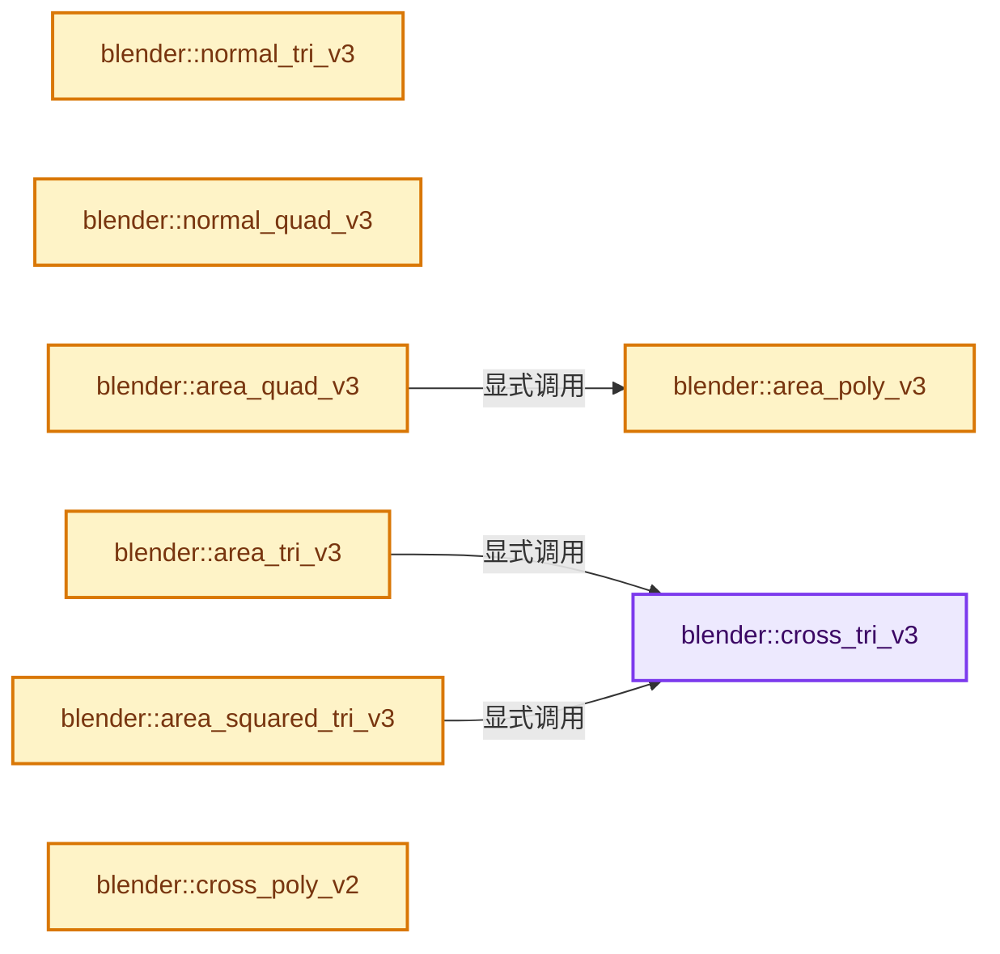
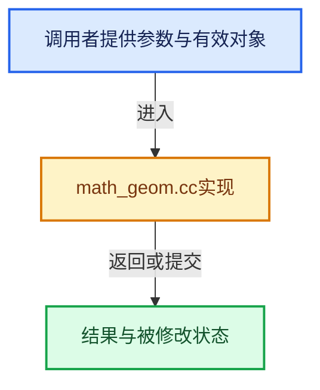

# 实现依赖专题：source/blender/blenlib/intern/math_geom.cc

[方向导航](README.md) · [符号索引](../%E7%AC%A6%E5%8F%B7%E4%BE%9D%E8%B5%96%E4%B8%8E%E5%AE%9E%E7%8E%B0%E7%B4%A2%E5%BC%95.md)

本专题从正文实际调用进入，集中保存共享实现。函数有稳定锚点，可从调用处直接跳到对应完整函数；递归与互相调用通过回链组织。

## 本文件的实现关系






<a id="m-451355bf0283"></a>

## 宏 `DIR_V3_SET`

<!-- annotated:de9e19a5499ebc -->

```cpp
#define DIR_V3_SET(d_len, va, vb) \
  { \
    sub_v3_v3v3((d_len)->dir, va, vb); \
    (d_len)->len = len_v3((d_len)->dir); \
  } \
  (void)0

```

<details>
<summary>核对原始源码：source/blender/blenlib/intern/math_geom.cc · L4199—L4205</summary>

<!-- original:de9e19a5499ebc:source/blender/blenlib/intern/math_geom.cc:4199:4205 -->

```cpp
#define DIR_V3_SET(d_len, va, vb) \
  { \
    sub_v3_v3v3((d_len)->dir, va, vb); \
    (d_len)->len = len_v3((d_len)->dir); \
  } \
  (void)0

```

</details>

宏在预处理阶段展开，参数替换、重复求值和条件编译应直接从该定义检查。与普通函数不同，宏不会自动提供参数类型检查；构建配置选择哪个定义需结合外围条件。

<a id="m-ef39be681c67"></a>

## 宏 `DIR_V2_SET`

<!-- annotated:c0e0ce3609a80c -->

```cpp
#define DIR_V2_SET(d_len, va, vb) \
  { \
    sub_v2db_v2fl_v2fl((d_len)->dir, va, vb); \
    (d_len)->len = len_v2_db((d_len)->dir); \
  } \
  (void)0

```

<details>
<summary>核对原始源码：source/blender/blenlib/intern/math_geom.cc · L4206—L4212</summary>

<!-- original:c0e0ce3609a80c:source/blender/blenlib/intern/math_geom.cc:4206:4212 -->

```cpp
#define DIR_V2_SET(d_len, va, vb) \
  { \
    sub_v2db_v2fl_v2fl((d_len)->dir, va, vb); \
    (d_len)->len = len_v2_db((d_len)->dir); \
  } \
  (void)0

```

</details>

宏在预处理阶段展开，参数替换、重复求值和条件编译应直接从该定义检查。与普通函数不同，宏不会自动提供参数类型检查；构建配置选择哪个定义需结合外围条件。

## 完整成员与函数实现

<a id="f-c6ea7f9c0e64c80d"></a>

### `blender::cross_tri_v3`

实现位置：[source/blender/blenlib/intern/math_geom.cc](../../../../../source/blender/blenlib/intern/math_geom.cc) · L30—L43。

接口参数：

- `float n[3]`
- `const float v1[3]`
- `const float v2[3]`
- `const float v3[3]`

**教学注释版**

<!-- annotated:b3204fe83ad36e -->

```cpp
void cross_tri_v3(float n[3], const float v1[3], const float v2[3], const float v3[3])
{
  float n1[3], n2[3];

  n1[0] = v1[0] - v2[0];
  n2[0] = v2[0] - v3[0];
  n1[1] = v1[1] - v2[1];
  n2[1] = v2[1] - v3[1];
  n1[2] = v1[2] - v2[2];
  n2[2] = v2[2] - v3[2];
  n[0] = n1[1] * n2[2] - n1[2] * n2[1];
  n[1] = n1[2] * n2[0] - n1[0] * n2[2];
  n[2] = n1[0] * n2[1] - n1[1] * n2[0];
}
```

<details>
<summary>核对原始源码：source/blender/blenlib/intern/math_geom.cc · L30—L43</summary>

<!-- original:b3204fe83ad36e:source/blender/blenlib/intern/math_geom.cc:30:43 -->

```cpp
void cross_tri_v3(float n[3], const float v1[3], const float v2[3], const float v3[3])
{
  float n1[3], n2[3];

  n1[0] = v1[0] - v2[0];
  n2[0] = v2[0] - v3[0];
  n1[1] = v1[1] - v2[1];
  n2[1] = v2[1] - v3[1];
  n1[2] = v1[2] - v2[2];
  n2[2] = v2[2] - v3[2];
  n[0] = n1[1] * n2[2] - n1[2] * n2[1];
  n[1] = n1[2] * n2[0] - n1[0] * n2[2];
  n[2] = n1[0] * n2[1] - n1[1] * n2[0];
}
```

</details>

**沿实际写入检查状态**

- `n1[0] = v1[0] - v2[0];`
- `n2[0] = v2[0] - v3[0];`
- `n1[1] = v1[1] - v2[1];`
- `n2[1] = v2[1] - v3[1];`
- `n1[2] = v1[2] - v2[2];`
- `n2[2] = v2[2] - v3[2];`
- `n[0] = n1[1] * n2[2] - n1[2] * n2[1];`
- `n[1] = n1[2] * n2[0] - n1[0] * n2[2];`
- `n[2] = n1[0] * n2[1] - n1[1] * n2[0];`

**继续追踪实现**

本实现没有需要继续展开的显式调用；检查返回表达式、对象转换和调用者前置条件。

<a id="f-f574cdfe156b33d2"></a>

### `blender::normal_tri_v3`

实现位置：[source/blender/blenlib/intern/math_geom.cc](../../../../../source/blender/blenlib/intern/math_geom.cc) · L45—L60。

接口参数：

- `float n[3]`
- `const float v1[3]`
- `const float v2[3]`
- `const float v3[3]`

**教学注释版**

<!-- annotated:3ea138cc10fc93 -->

```cpp
float normal_tri_v3(float n[3], const float v1[3], const float v2[3], const float v3[3])
{
  float n1[3], n2[3];

  n1[0] = v1[0] - v2[0];
  n2[0] = v2[0] - v3[0];
  n1[1] = v1[1] - v2[1];
  n2[1] = v2[1] - v3[1];
  n1[2] = v1[2] - v2[2];
  n2[2] = v2[2] - v3[2];
  n[0] = n1[1] * n2[2] - n1[2] * n2[1];
  n[1] = n1[2] * n2[0] - n1[0] * n2[2];
  n[2] = n1[0] * n2[1] - n1[1] * n2[0];

  return normalize_v3(n);
}
```

<details>
<summary>核对原始源码：source/blender/blenlib/intern/math_geom.cc · L45—L60</summary>

<!-- original:3ea138cc10fc93:source/blender/blenlib/intern/math_geom.cc:45:60 -->

```cpp
float normal_tri_v3(float n[3], const float v1[3], const float v2[3], const float v3[3])
{
  float n1[3], n2[3];

  n1[0] = v1[0] - v2[0];
  n2[0] = v2[0] - v3[0];
  n1[1] = v1[1] - v2[1];
  n2[1] = v2[1] - v3[1];
  n1[2] = v1[2] - v2[2];
  n2[2] = v2[2] - v3[2];
  n[0] = n1[1] * n2[2] - n1[2] * n2[1];
  n[1] = n1[2] * n2[0] - n1[0] * n2[2];
  n[2] = n1[0] * n2[1] - n1[1] * n2[0];

  return normalize_v3(n);
}
```

</details>

**沿实际写入检查状态**

- `n1[0] = v1[0] - v2[0];`
- `n2[0] = v2[0] - v3[0];`
- `n1[1] = v1[1] - v2[1];`
- `n2[1] = v2[1] - v3[1];`
- `n1[2] = v1[2] - v2[2];`
- `n2[2] = v2[2] - v3[2];`
- `n[0] = n1[1] * n2[2] - n1[2] * n2[1];`
- `n[1] = n1[2] * n2[0] - n1[0] * n2[2];`
- `n[2] = n1[0] * n2[1] - n1[1] * n2[0];`

**结果出口**

- `return normalize_v3(n);`

**继续追踪实现**

- `normalize_v3` → [blender::normalize_v3 · L933](%E4%BE%9D%E8%B5%96-math_vector_inline-0c8541.md#f-5f3257e657ef732c)。

<a id="f-edc1a63efd858f34"></a>

### `blender::normal_quad_v3`

实现位置：[source/blender/blenlib/intern/math_geom.cc](../../../../../source/blender/blenlib/intern/math_geom.cc) · L62—L81。

接口参数：

- `float n[3]`
- `const float v1[3]`
- `const float v2[3]`
- `const float v3[3]`
- `const float v4[3]`

**教学注释版**

<!-- annotated:ae1a4f85299ea6 -->

```cpp
float normal_quad_v3(
    float n[3], const float v1[3], const float v2[3], const float v3[3], const float v4[3])
{
  /* real cross! */
  float n1[3], n2[3];

  n1[0] = v1[0] - v3[0];
  n1[1] = v1[1] - v3[1];
  n1[2] = v1[2] - v3[2];

  n2[0] = v2[0] - v4[0];
  n2[1] = v2[1] - v4[1];
  n2[2] = v2[2] - v4[2];

  n[0] = n1[1] * n2[2] - n1[2] * n2[1];
  n[1] = n1[2] * n2[0] - n1[0] * n2[2];
  n[2] = n1[0] * n2[1] - n1[1] * n2[0];

  return normalize_v3(n);
}
```

<details>
<summary>核对原始源码：source/blender/blenlib/intern/math_geom.cc · L62—L81</summary>

<!-- original:ae1a4f85299ea6:source/blender/blenlib/intern/math_geom.cc:62:81 -->

```cpp
float normal_quad_v3(
    float n[3], const float v1[3], const float v2[3], const float v3[3], const float v4[3])
{
  /* real cross! */
  float n1[3], n2[3];

  n1[0] = v1[0] - v3[0];
  n1[1] = v1[1] - v3[1];
  n1[2] = v1[2] - v3[2];

  n2[0] = v2[0] - v4[0];
  n2[1] = v2[1] - v4[1];
  n2[2] = v2[2] - v4[2];

  n[0] = n1[1] * n2[2] - n1[2] * n2[1];
  n[1] = n1[2] * n2[0] - n1[0] * n2[2];
  n[2] = n1[0] * n2[1] - n1[1] * n2[0];

  return normalize_v3(n);
}
```

</details>

**沿实际写入检查状态**

- `n1[0] = v1[0] - v3[0];`
- `n1[1] = v1[1] - v3[1];`
- `n1[2] = v1[2] - v3[2];`
- `n2[0] = v2[0] - v4[0];`
- `n2[1] = v2[1] - v4[1];`
- `n2[2] = v2[2] - v4[2];`
- `n[0] = n1[1] * n2[2] - n1[2] * n2[1];`
- `n[1] = n1[2] * n2[0] - n1[0] * n2[2];`
- `n[2] = n1[0] * n2[1] - n1[1] * n2[0];`

**结果出口**

- `return normalize_v3(n);`

**继续追踪实现**

- `normalize_v3` → [blender::normalize_v3 · L933](%E4%BE%9D%E8%B5%96-math_vector_inline-0c8541.md#f-5f3257e657ef732c)。

<a id="f-bc4046dd9b017278"></a>

### `blender::area_quad_v3`

实现位置：[source/blender/blenlib/intern/math_geom.cc](../../../../../source/blender/blenlib/intern/math_geom.cc) · L89—L93。

接口参数：

- `const float v1[3]`
- `const float v2[3]`
- `const float v3[3]`
- `const float v4[3]`

**教学注释版**

<!-- annotated:5e174d00eac7e0 -->

```cpp
float area_quad_v3(const float v1[3], const float v2[3], const float v3[3], const float v4[3])
{
  const float verts[4][3] = {{UNPACK3(v1)}, {UNPACK3(v2)}, {UNPACK3(v3)}, {UNPACK3(v4)}};
  return area_poly_v3(verts, 4);
}
```

<details>
<summary>核对原始源码：source/blender/blenlib/intern/math_geom.cc · L89—L93</summary>

<!-- original:5e174d00eac7e0:source/blender/blenlib/intern/math_geom.cc:89:93 -->

```cpp
float area_quad_v3(const float v1[3], const float v2[3], const float v3[3], const float v4[3])
{
  const float verts[4][3] = {{UNPACK3(v1)}, {UNPACK3(v2)}, {UNPACK3(v3)}, {UNPACK3(v4)}};
  return area_poly_v3(verts, 4);
}
```

</details>

**结果出口**

- `return area_poly_v3(verts, 4);`

**继续追踪实现**

- `UNPACK3` → [UNPACK3 · L23](../05-%E5%87%A0%E4%BD%95%E5%AD%98%E5%82%A8%E4%B8%8E%E6%8B%93%E6%89%91%E6%98%A0%E5%B0%84/%E4%BE%9D%E8%B5%96-GHOST_utildefines-34b996.md#m-f882324eb80a)；[UNPACK3 · L235](../01-%E5%9F%BA%E7%A1%80%E5%AE%B9%E5%99%A8%E4%B8%8E%E7%8E%B0%E4%BB%A3CPP/%E4%BE%9D%E8%B5%96-BLI_utildefines-293a0a.md#m-bbbbdcf09d3b)；[UNPACK3 · L14](../05-%E5%87%A0%E4%BD%95%E5%AD%98%E5%82%A8%E4%B8%8E%E6%8B%93%E6%89%91%E6%98%A0%E5%B0%84/%E4%BE%9D%E8%B5%96-gpu_shader_utildefines.bsl-e9f199.md#m-b4e3357a0310)。宏定义由构建条件选择。
- `area_poly_v3` → [blender::area_poly_v3 · L137](%E4%BE%9D%E8%B5%96-math_geom-8d91a3.md#f-d711237c21e18247)。

<a id="f-010c0a7f618cbedf"></a>

### `blender::area_tri_v3`

实现位置：[source/blender/blenlib/intern/math_geom.cc](../../../../../source/blender/blenlib/intern/math_geom.cc) · L104—L109。

接口参数：

- `const float v1[3]`
- `const float v2[3]`
- `const float v3[3]`

**教学注释版**

<!-- annotated:c15ed5668c239d -->

```cpp
float area_tri_v3(const float v1[3], const float v2[3], const float v3[3])
{
  float n[3];
  cross_tri_v3(n, v1, v2, v3);
  return len_v3(n) * 0.5f;
}
```

<details>
<summary>核对原始源码：source/blender/blenlib/intern/math_geom.cc · L104—L109</summary>

<!-- original:c15ed5668c239d:source/blender/blenlib/intern/math_geom.cc:104:109 -->

```cpp
float area_tri_v3(const float v1[3], const float v2[3], const float v3[3])
{
  float n[3];
  cross_tri_v3(n, v1, v2, v3);
  return len_v3(n) * 0.5f;
}
```

</details>

**结果出口**

- `return len_v3(n) * 0.5f;`

**继续追踪实现**

- `cross_tri_v3` → [blender::cross_tri_v3 · L30](%E4%BE%9D%E8%B5%96-math_geom-8d91a3.md#f-c6ea7f9c0e64c80d)。
- `len_v3` → [blender::len_v3 · L781](%E4%BE%9D%E8%B5%96-math_vector_inline-0c8541.md#f-4ad88eb0aa8d70ab)。

<a id="f-bb9a1ea2bc8c98db"></a>

### `blender::area_squared_tri_v3`

实现位置：[source/blender/blenlib/intern/math_geom.cc](../../../../../source/blender/blenlib/intern/math_geom.cc) · L111—L117。

接口参数：

- `const float v1[3]`
- `const float v2[3]`
- `const float v3[3]`

**教学注释版**

<!-- annotated:da083f86748774 -->

```cpp
float area_squared_tri_v3(const float v1[3], const float v2[3], const float v3[3])
{
  float n[3];
  cross_tri_v3(n, v1, v2, v3);
  mul_v3_fl(n, 0.5f);
  return len_squared_v3(n);
}
```

<details>
<summary>核对原始源码：source/blender/blenlib/intern/math_geom.cc · L111—L117</summary>

<!-- original:da083f86748774:source/blender/blenlib/intern/math_geom.cc:111:117 -->

```cpp
float area_squared_tri_v3(const float v1[3], const float v2[3], const float v3[3])
{
  float n[3];
  cross_tri_v3(n, v1, v2, v3);
  mul_v3_fl(n, 0.5f);
  return len_squared_v3(n);
}
```

</details>

**结果出口**

- `return len_squared_v3(n);`

**继续追踪实现**

- `cross_tri_v3` → [blender::cross_tri_v3 · L30](%E4%BE%9D%E8%B5%96-math_geom-8d91a3.md#f-c6ea7f9c0e64c80d)。
- `mul_v3_fl` → [blender::mul_v3_fl · L414](%E4%BE%9D%E8%B5%96-math_vector_inline-0c8541.md#f-00165156a06d1224)。
- `len_squared_v3` → [blender::len_squared_v3 · L724](%E4%BE%9D%E8%B5%96-math_vector_inline-0c8541.md#f-089409f6f09f82ef)。

<a id="f-d711237c21e18247"></a>

### `blender::area_poly_v3`

实现位置：[source/blender/blenlib/intern/math_geom.cc](../../../../../source/blender/blenlib/intern/math_geom.cc) · L137—L142。

接口参数：

- `const float verts[][3]`
- `uint nr`

**教学注释版**

<!-- annotated:bf61c9569914b9 -->

```cpp
float area_poly_v3(const float verts[][3], uint nr)
{
  float n[3];
  cross_poly_v3(n, verts, nr);
  return len_v3(n) * 0.5f;
}
```

<details>
<summary>核对原始源码：source/blender/blenlib/intern/math_geom.cc · L137—L142</summary>

<!-- original:bf61c9569914b9:source/blender/blenlib/intern/math_geom.cc:137:142 -->

```cpp
float area_poly_v3(const float verts[][3], uint nr)
{
  float n[3];
  cross_poly_v3(n, verts, nr);
  return len_v3(n) * 0.5f;
}
```

</details>

**结果出口**

- `return len_v3(n) * 0.5f;`

**继续追踪实现**

- `cross_poly_v3` → [blender::cross_poly_v3 · L172](%E4%BE%9D%E8%B5%96-math_geom-8d91a3.md#f-7df4269fb6dac596)。
- `len_v3` → [blender::len_v3 · L781](%E4%BE%9D%E8%B5%96-math_vector_inline-0c8541.md#f-4ad88eb0aa8d70ab)。

<a id="f-8812c9f84a991b4f"></a>

### `blender::cross_poly_v2`

实现位置：[source/blender/blenlib/intern/math_geom.cc](../../../../../source/blender/blenlib/intern/math_geom.cc) · L153—L170。

接口参数：

- `const float verts[][2]`
- `uint nr`

**教学注释版**

<!-- annotated:9df7ab548a7c0d -->

```cpp
float cross_poly_v2(const float verts[][2], uint nr)
{
  uint a;
  float cross;
  const float *co_curr, *co_prev;

  /* The Trapezium Area Rule */
  co_prev = verts[nr - 1];
  co_curr = verts[0];
  cross = 0.0f;
  for (a = 0; a < nr; a++) {
    cross += (co_prev[0] - co_curr[0]) * (co_curr[1] + co_prev[1]);
    co_prev = co_curr;
    co_curr += 2;
  }

  return cross;
}
```

<details>
<summary>核对原始源码：source/blender/blenlib/intern/math_geom.cc · L153—L170</summary>

<!-- original:9df7ab548a7c0d:source/blender/blenlib/intern/math_geom.cc:153:170 -->

```cpp
float cross_poly_v2(const float verts[][2], uint nr)
{
  uint a;
  float cross;
  const float *co_curr, *co_prev;

  /* The Trapezium Area Rule */
  co_prev = verts[nr - 1];
  co_curr = verts[0];
  cross = 0.0f;
  for (a = 0; a < nr; a++) {
    cross += (co_prev[0] - co_curr[0]) * (co_curr[1] + co_prev[1]);
    co_prev = co_curr;
    co_curr += 2;
  }

  return cross;
}
```

</details>

**沿实际写入检查状态**

- `co_prev = verts[nr - 1];`
- `co_curr = verts[0];`
- `cross = 0.0f;`
- `cross += (co_prev[0] - co_curr[0]) * (co_curr[1] + co_prev[1]);`
- `co_prev = co_curr;`
- `co_curr += 2;`

**结果出口**

- `return cross;`

**继续追踪实现**

本实现没有需要继续展开的显式调用；检查返回表达式、对象转换和调用者前置条件。

<a id="f-7df4269fb6dac596"></a>

### `blender::cross_poly_v3`

实现位置：[source/blender/blenlib/intern/math_geom.cc](../../../../../source/blender/blenlib/intern/math_geom.cc) · L172—L184。

接口参数：

- `float n[3]`
- `const float verts[][3]`
- `uint nr`

**教学注释版**

<!-- annotated:154814a06b63d6 -->

```cpp
void cross_poly_v3(float n[3], const float verts[][3], uint nr)
{
  const float *v_prev = verts[nr - 1];
  const float *v_curr = verts[0];
  uint i;

  zero_v3(n);

  /* Newell's Method */
  for (i = 0; i < nr; v_prev = v_curr, v_curr = verts[++i]) {
    add_newell_cross_v3_v3v3(n, v_prev, v_curr);
  }
}
```

<details>
<summary>核对原始源码：source/blender/blenlib/intern/math_geom.cc · L172—L184</summary>

<!-- original:154814a06b63d6:source/blender/blenlib/intern/math_geom.cc:172:184 -->

```cpp
void cross_poly_v3(float n[3], const float verts[][3], uint nr)
{
  const float *v_prev = verts[nr - 1];
  const float *v_curr = verts[0];
  uint i;

  zero_v3(n);

  /* Newell's Method */
  for (i = 0; i < nr; v_prev = v_curr, v_curr = verts[++i]) {
    add_newell_cross_v3_v3v3(n, v_prev, v_curr);
  }
}
```

</details>

**继续追踪实现**

- `zero_v3` → [blender::zero_v3 · L26](%E4%BE%9D%E8%B5%96-math_vector_inline-0c8541.md#f-13235b08fdecb098)。
- `add_newell_cross_v3_v3v3` → [blender::add_newell_cross_v3_v3v3 · L706](%E4%BE%9D%E8%B5%96-math_vector_inline-0c8541.md#f-71334c1ecc57f554)。

<a id="f-10e5cd7992ac6839"></a>

### `blender::area_poly_v2`

实现位置：[source/blender/blenlib/intern/math_geom.cc](../../../../../source/blender/blenlib/intern/math_geom.cc) · L186—L189。

接口参数：

- `const float verts[][2]`
- `uint nr`

**教学注释版**

<!-- annotated:119ed79527feb5 -->

```cpp
float area_poly_v2(const float verts[][2], uint nr)
{
  return fabsf(0.5f * cross_poly_v2(verts, nr));
}
```

<details>
<summary>核对原始源码：source/blender/blenlib/intern/math_geom.cc · L186—L189</summary>

<!-- original:119ed79527feb5:source/blender/blenlib/intern/math_geom.cc:186:189 -->

```cpp
float area_poly_v2(const float verts[][2], uint nr)
{
  return fabsf(0.5f * cross_poly_v2(verts, nr));
}
```

</details>

**结果出口**

- `return fabsf(0.5f * cross_poly_v2(verts, nr));`

**继续追踪实现**

- `fabsf` → [fabsf · L21](../05-%E5%87%A0%E4%BD%95%E5%AD%98%E5%82%A8%E4%B8%8E%E6%8B%93%E6%89%91%E6%98%A0%E5%B0%84/%E4%BE%9D%E8%B5%96-radial_tiling_shared-98abf9.md#m-02cc4c69cfb3)；[fabsf · L43](../05-%E5%87%A0%E4%BD%95%E5%AD%98%E5%82%A8%E4%B8%8E%E6%8B%93%E6%89%91%E6%98%A0%E5%B0%84/%E4%BE%9D%E8%B5%96-radial_tiling_shared-98abf9.md#m-04effe61803b)；[fabsf · L74](../05-%E5%87%A0%E4%BD%95%E5%AD%98%E5%82%A8%E4%B8%8E%E6%8B%93%E6%89%91%E6%98%A0%E5%B0%84/%E4%BE%9D%E8%B5%96-radial_tiling_shared-98abf9.md#m-927dd4eba7dc)；[fabsf · L25](../01-%E5%9F%BA%E7%A1%80%E5%AE%B9%E5%99%A8%E4%B8%8E%E7%8E%B0%E4%BB%A3CPP/%E4%BE%9D%E8%B5%96-radial_tiling_shared-7989a4.md#m-8348d6b3d08f)；[fabsf · L47](../01-%E5%9F%BA%E7%A1%80%E5%AE%B9%E5%99%A8%E4%B8%8E%E7%8E%B0%E4%BB%A3CPP/%E4%BE%9D%E8%B5%96-radial_tiling_shared-7989a4.md#m-13b7e0b6d84f)；[fabsf · L78](../01-%E5%9F%BA%E7%A1%80%E5%AE%B9%E5%99%A8%E4%B8%8E%E7%8E%B0%E4%BB%A3CPP/%E4%BE%9D%E8%B5%96-radial_tiling_shared-7989a4.md#m-326c83464a0d)；[fabsf · L21](../05-%E5%87%A0%E4%BD%95%E5%AD%98%E5%82%A8%E4%B8%8E%E6%8B%93%E6%89%91%E6%98%A0%E5%B0%84/%E4%BE%9D%E8%B5%96-node_radial_tiling_shared-b14bc2.md#m-7c3ee12fc119)；[fabsf · L43](../05-%E5%87%A0%E4%BD%95%E5%AD%98%E5%82%A8%E4%B8%8E%E6%8B%93%E6%89%91%E6%98%A0%E5%B0%84/%E4%BE%9D%E8%B5%96-node_radial_tiling_shared-b14bc2.md#m-9112db0e2dd1)；[fabsf · L74](../05-%E5%87%A0%E4%BD%95%E5%AD%98%E5%82%A8%E4%B8%8E%E6%8B%93%E6%89%91%E6%98%A0%E5%B0%84/%E4%BE%9D%E8%B5%96-node_radial_tiling_shared-b14bc2.md#m-ee4e61908a6f)；[fabsf · L167](../05-%E5%87%A0%E4%BD%95%E5%AD%98%E5%82%A8%E4%B8%8E%E6%8B%93%E6%89%91%E6%98%A0%E5%B0%84/%E4%BE%9D%E8%B5%96-compat-56205c.md#m-b039ee6c1601)；[fabsf · L265](../05-%E5%87%A0%E4%BD%95%E5%AD%98%E5%82%A8%E4%B8%8E%E6%8B%93%E6%89%91%E6%98%A0%E5%B0%84/%E4%BE%9D%E8%B5%96-compat-efe0e9.md#m-6b21869e9f3f)。宏定义由构建条件选择。
- `cross_poly_v2` → [blender::cross_poly_v2 · L153](%E4%BE%9D%E8%B5%96-math_geom-8d91a3.md#f-8812c9f84a991b4f)。

<a id="f-78c6e2c246a0cb10"></a>

### `blender::cotangent_tri_weight_v3`

实现位置：[source/blender/blenlib/intern/math_geom.cc](../../../../../source/blender/blenlib/intern/math_geom.cc) · L202—L217。

接口参数：

- `const float v1[3]`
- `const float v2[3]`
- `const float v3[3]`

**教学注释版**

<!-- annotated:62855fb1e3961b -->

```cpp
float cotangent_tri_weight_v3(const float v1[3], const float v2[3], const float v3[3])
{
  float a[3], b[3], c[3], c_len;

  sub_v3_v3v3(a, v2, v1);
  sub_v3_v3v3(b, v3, v1);
  cross_v3_v3v3(c, a, b);

  c_len = len_v3(c);

  if (c_len > FLT_EPSILON) {
    return dot_v3v3(a, b) / c_len;
  }

  return 0.0f;
}
```

<details>
<summary>核对原始源码：source/blender/blenlib/intern/math_geom.cc · L202—L217</summary>

<!-- original:62855fb1e3961b:source/blender/blenlib/intern/math_geom.cc:202:217 -->

```cpp
float cotangent_tri_weight_v3(const float v1[3], const float v2[3], const float v3[3])
{
  float a[3], b[3], c[3], c_len;

  sub_v3_v3v3(a, v2, v1);
  sub_v3_v3v3(b, v3, v1);
  cross_v3_v3v3(c, a, b);

  c_len = len_v3(c);

  if (c_len > FLT_EPSILON) {
    return dot_v3v3(a, b) / c_len;
  }

  return 0.0f;
}
```

</details>

**沿实际写入检查状态**

- `c_len = len_v3(c);`

**结果出口**

- `return dot_v3v3(a, b) / c_len;`
- `return 0.0f;`

**继续追踪实现**

- `sub_v3_v3v3` → [blender::sub_v3_v3v3 · L360](%E4%BE%9D%E8%B5%96-math_vector_inline-0c8541.md#f-23781c252db8b30c)。
- `cross_v3_v3v3` → [blender::cross_v3_v3v3 · L690](%E4%BE%9D%E8%B5%96-math_vector_inline-0c8541.md#f-ac8d04405fb5dad4)。
- `len_v3` → [blender::len_v3 · L781](%E4%BE%9D%E8%B5%96-math_vector_inline-0c8541.md#f-4ad88eb0aa8d70ab)。
- `dot_v3v3` → [blender::dot_v3v3 · L646](%E4%BE%9D%E8%B5%96-math_vector_inline-0c8541.md#f-c88befa67d07591a)。

<a id="f-bf2050728f0916e7"></a>

### `blender::plane_from_point_normal_v3`

实现位置：[source/blender/blenlib/intern/math_geom.cc](../../../../../source/blender/blenlib/intern/math_geom.cc) · L225—L229。

接口参数：

- `float r_plane[4]`
- `const float plane_co[3]`
- `const float plane_no[3]`

**教学注释版**

<!-- annotated:8493c8268051a9 -->

```cpp
void plane_from_point_normal_v3(float r_plane[4], const float plane_co[3], const float plane_no[3])
{
  copy_v3_v3(r_plane, plane_no);
  r_plane[3] = -dot_v3v3(r_plane, plane_co);
}
```

<details>
<summary>核对原始源码：source/blender/blenlib/intern/math_geom.cc · L225—L229</summary>

<!-- original:8493c8268051a9:source/blender/blenlib/intern/math_geom.cc:225:229 -->

```cpp
void plane_from_point_normal_v3(float r_plane[4], const float plane_co[3], const float plane_no[3])
{
  copy_v3_v3(r_plane, plane_no);
  r_plane[3] = -dot_v3v3(r_plane, plane_co);
}
```

</details>

**沿实际写入检查状态**

- `r_plane[3] = -dot_v3v3(r_plane, plane_co);`

**继续追踪实现**

- `copy_v3_v3` → [blender::copy_v3_v3 · L47](%E4%BE%9D%E8%B5%96-math_vector_inline-0c8541.md#f-037a0d5fa5060bd6)。
- `dot_v3v3` → [blender::dot_v3v3 · L646](%E4%BE%9D%E8%B5%96-math_vector_inline-0c8541.md#f-c88befa67d07591a)。

<a id="f-5a1dc4c818b121ca"></a>

### `blender::volume_tetrahedron_signed_v3`

实现位置：[source/blender/blenlib/intern/math_geom.cc](../../../../../source/blender/blenlib/intern/math_geom.cc) · L263—L273。

接口参数：

- `const float v1[3]`
- `const float v2[3]`
- `const float v3[3]`
- `const float v4[3]`

**教学注释版**

<!-- annotated:0c2e82cd04123a -->

```cpp
float volume_tetrahedron_signed_v3(const float v1[3],
                                   const float v2[3],
                                   const float v3[3],
                                   const float v4[3])
{
  float m[3][3];
  sub_v3_v3v3(m[0], v1, v2);
  sub_v3_v3v3(m[1], v2, v3);
  sub_v3_v3v3(m[2], v3, v4);
  return determinant_m3_array(m) / 6.0f;
}
```

<details>
<summary>核对原始源码：source/blender/blenlib/intern/math_geom.cc · L263—L273</summary>

<!-- original:0c2e82cd04123a:source/blender/blenlib/intern/math_geom.cc:263:273 -->

```cpp
float volume_tetrahedron_signed_v3(const float v1[3],
                                   const float v2[3],
                                   const float v3[3],
                                   const float v4[3])
{
  float m[3][3];
  sub_v3_v3v3(m[0], v1, v2);
  sub_v3_v3v3(m[1], v2, v3);
  sub_v3_v3v3(m[2], v3, v4);
  return determinant_m3_array(m) / 6.0f;
}
```

</details>

**结果出口**

- `return determinant_m3_array(m) / 6.0f;`

**继续追踪实现**

- `sub_v3_v3v3` → [blender::sub_v3_v3v3 · L360](%E4%BE%9D%E8%B5%96-math_vector_inline-0c8541.md#f-23781c252db8b30c)。
- `determinant_m3_array` → [blender::determinant_m3_array · L1004](%E4%BE%9D%E8%B5%96-math_matrix_c-004123.md#f-83bebb835699846e)。

<a id="f-859f3c7fcf7cda5c"></a>

### `blender::volume_tri_tetrahedron_signed_v3_6x`

实现位置：[source/blender/blenlib/intern/math_geom.cc](../../../../../source/blender/blenlib/intern/math_geom.cc) · L275—L281。

接口参数：

- `const float v1[3]`
- `const float v2[3]`
- `const float v3[3]`

**教学注释版**

<!-- annotated:c91e898620f307 -->

```cpp
float volume_tri_tetrahedron_signed_v3_6x(const float v1[3], const float v2[3], const float v3[3])
{
  float v_cross[3];
  cross_v3_v3v3(v_cross, v1, v2);
  float tetra_volume = dot_v3v3(v_cross, v3);
  return tetra_volume;
}
```

<details>
<summary>核对原始源码：source/blender/blenlib/intern/math_geom.cc · L275—L281</summary>

<!-- original:c91e898620f307:source/blender/blenlib/intern/math_geom.cc:275:281 -->

```cpp
float volume_tri_tetrahedron_signed_v3_6x(const float v1[3], const float v2[3], const float v3[3])
{
  float v_cross[3];
  cross_v3_v3v3(v_cross, v1, v2);
  float tetra_volume = dot_v3v3(v_cross, v3);
  return tetra_volume;
}
```

</details>

**结果出口**

- `return tetra_volume;`

**继续追踪实现**

- `cross_v3_v3v3` → [blender::cross_v3_v3v3 · L690](%E4%BE%9D%E8%B5%96-math_vector_inline-0c8541.md#f-ac8d04405fb5dad4)。
- `dot_v3v3` → [blender::dot_v3v3 · L646](%E4%BE%9D%E8%B5%96-math_vector_inline-0c8541.md#f-c88befa67d07591a)。

<a id="f-541701f1759f08b8"></a>

### `blender::dist_squared_to_line_v2`

实现位置：[source/blender/blenlib/intern/math_geom.cc](../../../../../source/blender/blenlib/intern/math_geom.cc) · L294—L301。

接口参数：

- `const float p[2]`
- `const float l1[2]`
- `const float l2[2]`

**教学注释版**

<!-- annotated:a06c22f5a6e975 -->

```cpp
float dist_squared_to_line_v2(const float p[2], const float l1[2], const float l2[2])
{
  float closest[2];

  closest_to_line_v2(closest, p, l1, l2);

  return len_squared_v2v2(closest, p);
}
```

<details>
<summary>核对原始源码：source/blender/blenlib/intern/math_geom.cc · L294—L301</summary>

<!-- original:a06c22f5a6e975:source/blender/blenlib/intern/math_geom.cc:294:301 -->

```cpp
float dist_squared_to_line_v2(const float p[2], const float l1[2], const float l2[2])
{
  float closest[2];

  closest_to_line_v2(closest, p, l1, l2);

  return len_squared_v2v2(closest, p);
}
```

</details>

**结果出口**

- `return len_squared_v2v2(closest, p);`

**继续追踪实现**

- `closest_to_line_v2` → [blender::closest_to_line_v2 · L3354](%E4%BE%9D%E8%B5%96-math_geom-8d91a3.md#f-d68828a0efaa3ca3)。
- `len_squared_v2v2` → [blender::len_squared_v2v2 · L786](%E4%BE%9D%E8%B5%96-math_vector_inline-0c8541.md#f-58f946d5a3fd1414)。

<a id="f-1ab0411ccb55b4bc"></a>

### `blender::dist_to_line_v2`

实现位置：[source/blender/blenlib/intern/math_geom.cc](../../../../../source/blender/blenlib/intern/math_geom.cc) · L302—L305。

接口参数：

- `const float p[2]`
- `const float l1[2]`
- `const float l2[2]`

**教学注释版**

<!-- annotated:2cf48fe531257b -->

```cpp
float dist_to_line_v2(const float p[2], const float l1[2], const float l2[2])
{
  return sqrtf(dist_squared_to_line_v2(p, l1, l2));
}
```

<details>
<summary>核对原始源码：source/blender/blenlib/intern/math_geom.cc · L302—L305</summary>

<!-- original:2cf48fe531257b:source/blender/blenlib/intern/math_geom.cc:302:305 -->

```cpp
float dist_to_line_v2(const float p[2], const float l1[2], const float l2[2])
{
  return sqrtf(dist_squared_to_line_v2(p, l1, l2));
}
```

</details>

**结果出口**

- `return sqrtf(dist_squared_to_line_v2(p, l1, l2));`

**继续追踪实现**

- `sqrtf` → [外部契约](https://eel.is/c++draft/)：这个边界按实际表达式及所属类型核对参数、返回值、寿命与失败行为。这里提供接口入口，不声称已解释该第三方版本的内部实现。
- `dist_squared_to_line_v2` → [blender::dist_squared_to_line_v2 · L294](%E4%BE%9D%E8%B5%96-math_geom-8d91a3.md#f-541701f1759f08b8)。

<a id="f-91a340dc0d5d5a38"></a>

### `blender::dist_squared_to_line_segment_v2`

实现位置：[source/blender/blenlib/intern/math_geom.cc](../../../../../source/blender/blenlib/intern/math_geom.cc) · L307—L314。

接口参数：

- `const float p[2]`
- `const float l1[2]`
- `const float l2[2]`

**教学注释版**

<!-- annotated:959819a6cd9e29 -->

```cpp
float dist_squared_to_line_segment_v2(const float p[2], const float l1[2], const float l2[2])
{
  float closest[2];

  closest_to_line_segment_v2(closest, p, l1, l2);

  return len_squared_v2v2(closest, p);
}
```

<details>
<summary>核对原始源码：source/blender/blenlib/intern/math_geom.cc · L307—L314</summary>

<!-- original:959819a6cd9e29:source/blender/blenlib/intern/math_geom.cc:307:314 -->

```cpp
float dist_squared_to_line_segment_v2(const float p[2], const float l1[2], const float l2[2])
{
  float closest[2];

  closest_to_line_segment_v2(closest, p, l1, l2);

  return len_squared_v2v2(closest, p);
}
```

</details>

**结果出口**

- `return len_squared_v2v2(closest, p);`

**继续追踪实现**

- `closest_to_line_segment_v2` → [blender::closest_to_line_segment_v2 · L381](%E4%BE%9D%E8%B5%96-math_geom-8d91a3.md#f-19e66bab2674df5a)。
- `len_squared_v2v2` → [blender::len_squared_v2v2 · L786](%E4%BE%9D%E8%B5%96-math_vector_inline-0c8541.md#f-58f946d5a3fd1414)。

<a id="f-abb506e973c07e09"></a>

### `blender::dist_to_line_segment_v2`

实现位置：[source/blender/blenlib/intern/math_geom.cc](../../../../../source/blender/blenlib/intern/math_geom.cc) · L316—L319。

接口参数：

- `const float p[2]`
- `const float l1[2]`
- `const float l2[2]`

**教学注释版**

<!-- annotated:4fa1233422657a -->

```cpp
float dist_to_line_segment_v2(const float p[2], const float l1[2], const float l2[2])
{
  return sqrtf(dist_squared_to_line_segment_v2(p, l1, l2));
}
```

<details>
<summary>核对原始源码：source/blender/blenlib/intern/math_geom.cc · L316—L319</summary>

<!-- original:4fa1233422657a:source/blender/blenlib/intern/math_geom.cc:316:319 -->

```cpp
float dist_to_line_segment_v2(const float p[2], const float l1[2], const float l2[2])
{
  return sqrtf(dist_squared_to_line_segment_v2(p, l1, l2));
}
```

</details>

**结果出口**

- `return sqrtf(dist_squared_to_line_segment_v2(p, l1, l2));`

**继续追踪实现**

- `sqrtf` → [外部契约](https://eel.is/c++draft/)：这个边界按实际表达式及所属类型核对参数、返回值、寿命与失败行为。这里提供接口入口，不声称已解释该第三方版本的内部实现。
- `dist_squared_to_line_segment_v2` → [blender::dist_squared_to_line_segment_v2 · L307](%E4%BE%9D%E8%B5%96-math_geom-8d91a3.md#f-91a340dc0d5d5a38)。

<a id="f-19e66bab2674df5a"></a>

### `blender::closest_to_line_segment_v2`

实现位置：[source/blender/blenlib/intern/math_geom.cc](../../../../../source/blender/blenlib/intern/math_geom.cc) · L381—L401。

接口参数：

- `float r_close[2]`
- `const float p[2]`
- `const float l1[2]`
- `const float l2[2]`

**教学注释版**

<!-- annotated:e9368f38ea5757 -->

```cpp
float closest_to_line_segment_v2(float r_close[2],
                                 const float p[2],
                                 const float l1[2],
                                 const float l2[2])
{
  float lambda, cp[2];

  lambda = closest_to_line_v2(cp, p, l1, l2);

  /* flip checks for !finite case (when segment is a point) */
  if (lambda <= 0.0f) {
    copy_v2_v2(r_close, l1);
    return 0.0f;
  }
  if (lambda >= 1.0f) {
    copy_v2_v2(r_close, l2);
    return 1.0f;
  }
  copy_v2_v2(r_close, cp);
  return lambda;
}
```

<details>
<summary>核对原始源码：source/blender/blenlib/intern/math_geom.cc · L381—L401</summary>

<!-- original:e9368f38ea5757:source/blender/blenlib/intern/math_geom.cc:381:401 -->

```cpp
float closest_to_line_segment_v2(float r_close[2],
                                 const float p[2],
                                 const float l1[2],
                                 const float l2[2])
{
  float lambda, cp[2];

  lambda = closest_to_line_v2(cp, p, l1, l2);

  /* flip checks for !finite case (when segment is a point) */
  if (lambda <= 0.0f) {
    copy_v2_v2(r_close, l1);
    return 0.0f;
  }
  if (lambda >= 1.0f) {
    copy_v2_v2(r_close, l2);
    return 1.0f;
  }
  copy_v2_v2(r_close, cp);
  return lambda;
}
```

</details>

**沿实际写入检查状态**

- `lambda = closest_to_line_v2(cp, p, l1, l2);`

**结果出口**

- `return 0.0f;`
- `return 1.0f;`
- `return lambda;`

**继续追踪实现**

- `closest_to_line_v2` → [blender::closest_to_line_v2 · L3354](%E4%BE%9D%E8%B5%96-math_geom-8d91a3.md#f-d68828a0efaa3ca3)。
- `copy_v2_v2` → [blender::copy_v2_v2 · L41](%E4%BE%9D%E8%B5%96-math_vector_inline-0c8541.md#f-e736ee2dd71cd821)。

<a id="f-7753906a2490987b"></a>

### `blender::closest_to_line_segment_v3`

实现位置：[source/blender/blenlib/intern/math_geom.cc](../../../../../source/blender/blenlib/intern/math_geom.cc) · L403—L423。

接口参数：

- `float r_close[3]`
- `const float p[3]`
- `const float l1[3]`
- `const float l2[3]`

**教学注释版**

<!-- annotated:0e68c27c8d6250 -->

```cpp
float closest_to_line_segment_v3(float r_close[3],
                                 const float p[3],
                                 const float l1[3],
                                 const float l2[3])
{
  float lambda, cp[3];

  lambda = closest_to_line_v3(cp, p, l1, l2);

  /* flip checks for !finite case (when segment is a point) */
  if (lambda <= 0.0f) {
    copy_v3_v3(r_close, l1);
    return 0.0f;
  }
  if (lambda >= 1.0f) {
    copy_v3_v3(r_close, l2);
    return 1.0f;
  }
  copy_v3_v3(r_close, cp);
  return lambda;
}
```

<details>
<summary>核对原始源码：source/blender/blenlib/intern/math_geom.cc · L403—L423</summary>

<!-- original:0e68c27c8d6250:source/blender/blenlib/intern/math_geom.cc:403:423 -->

```cpp
float closest_to_line_segment_v3(float r_close[3],
                                 const float p[3],
                                 const float l1[3],
                                 const float l2[3])
{
  float lambda, cp[3];

  lambda = closest_to_line_v3(cp, p, l1, l2);

  /* flip checks for !finite case (when segment is a point) */
  if (lambda <= 0.0f) {
    copy_v3_v3(r_close, l1);
    return 0.0f;
  }
  if (lambda >= 1.0f) {
    copy_v3_v3(r_close, l2);
    return 1.0f;
  }
  copy_v3_v3(r_close, cp);
  return lambda;
}
```

</details>

**沿实际写入检查状态**

- `lambda = closest_to_line_v3(cp, p, l1, l2);`

**结果出口**

- `return 0.0f;`
- `return 1.0f;`
- `return lambda;`

**继续追踪实现**

- `closest_to_line_v3` → [blender::closest_to_line_v3 · L3347](%E4%BE%9D%E8%B5%96-math_geom-8d91a3.md#f-976cfb9153971729)。
- `copy_v3_v3` → [blender::copy_v3_v3 · L47](%E4%BE%9D%E8%B5%96-math_vector_inline-0c8541.md#f-037a0d5fa5060bd6)。

<a id="f-e002476f8e5b4f91"></a>

### `blender::closest_to_plane_v3`

实现位置：[source/blender/blenlib/intern/math_geom.cc](../../../../../source/blender/blenlib/intern/math_geom.cc) · L451—L456。

接口参数：

- `float r_close[3]`
- `const float plane[4]`
- `const float pt[3]`

**教学注释版**

<!-- annotated:b2fea77db68f32 -->

```cpp
void closest_to_plane_v3(float r_close[3], const float plane[4], const float pt[3])
{
  const float len_sq = len_squared_v3(plane);
  const float side = plane_point_side_v3(plane, pt);
  madd_v3_v3v3fl(r_close, pt, plane, -side / len_sq);
}
```

<details>
<summary>核对原始源码：source/blender/blenlib/intern/math_geom.cc · L451—L456</summary>

<!-- original:b2fea77db68f32:source/blender/blenlib/intern/math_geom.cc:451:456 -->

```cpp
void closest_to_plane_v3(float r_close[3], const float plane[4], const float pt[3])
{
  const float len_sq = len_squared_v3(plane);
  const float side = plane_point_side_v3(plane, pt);
  madd_v3_v3v3fl(r_close, pt, plane, -side / len_sq);
}
```

</details>

**继续追踪实现**

- `len_squared_v3` → [blender::len_squared_v3 · L724](%E4%BE%9D%E8%B5%96-math_vector_inline-0c8541.md#f-089409f6f09f82ef)。
- `plane_point_side_v3` → [blender::plane_point_side_v3 · L124](%E4%BE%9D%E8%B5%96-math_geom_inline-672303.md#f-172f6a5bd676a757)。
- `madd_v3_v3v3fl` → [blender::madd_v3_v3v3fl · L514](%E4%BE%9D%E8%B5%96-math_vector_inline-0c8541.md#f-862faf7c108f3bb8)。

<a id="f-efa6588188967bc6"></a>

### `blender::closest_to_plane_normalized_v3`

实现位置：[source/blender/blenlib/intern/math_geom.cc](../../../../../source/blender/blenlib/intern/math_geom.cc) · L458—L463。

接口参数：

- `float r_close[3]`
- `const float plane[4]`
- `const float pt[3]`

**教学注释版**

<!-- annotated:c6d3936dbdec69 -->

```cpp
void closest_to_plane_normalized_v3(float r_close[3], const float plane[4], const float pt[3])
{
  const float side = plane_point_side_v3(plane, pt);
  BLI_ASSERT_UNIT_V3(plane);
  madd_v3_v3v3fl(r_close, pt, plane, -side);
}
```

<details>
<summary>核对原始源码：source/blender/blenlib/intern/math_geom.cc · L458—L463</summary>

<!-- original:c6d3936dbdec69:source/blender/blenlib/intern/math_geom.cc:458:463 -->

```cpp
void closest_to_plane_normalized_v3(float r_close[3], const float plane[4], const float pt[3])
{
  const float side = plane_point_side_v3(plane, pt);
  BLI_ASSERT_UNIT_V3(plane);
  madd_v3_v3v3fl(r_close, pt, plane, -side);
}
```

</details>

**继续追踪实现**

- `plane_point_side_v3` → [blender::plane_point_side_v3 · L124](%E4%BE%9D%E8%B5%96-math_geom_inline-672303.md#f-172f6a5bd676a757)。
- `BLI_ASSERT_UNIT_V3` → [BLI_ASSERT_UNIT_V3 · L315](%E4%BE%9D%E8%B5%96-BLI_math_base_c-171dae.md#m-7f347402189a)；[BLI_ASSERT_UNIT_V3 · L359](%E4%BE%9D%E8%B5%96-BLI_math_base_c-171dae.md#m-fe91af053d50)。宏定义由构建条件选择。
- `madd_v3_v3v3fl` → [blender::madd_v3_v3v3fl · L514](%E4%BE%9D%E8%B5%96-math_vector_inline-0c8541.md#f-862faf7c108f3bb8)。

<a id="f-3fdefe38d79b54e4"></a>

### `blender::dist_signed_squared_to_plane_v3`

实现位置：[source/blender/blenlib/intern/math_geom.cc](../../../../../source/blender/blenlib/intern/math_geom.cc) · L479—L485。

接口参数：

- `const float p[3]`
- `const float plane[4]`

**教学注释版**

<!-- annotated:3f9ce7b06e6299 -->

```cpp
float dist_signed_squared_to_plane_v3(const float p[3], const float plane[4])
{
  const float len_sq = len_squared_v3(plane);
  const float side = plane_point_side_v3(plane, p);
  const float fac = side / len_sq;
  return copysignf(len_sq * (fac * fac), side);
}
```

<details>
<summary>核对原始源码：source/blender/blenlib/intern/math_geom.cc · L479—L485</summary>

<!-- original:3f9ce7b06e6299:source/blender/blenlib/intern/math_geom.cc:479:485 -->

```cpp
float dist_signed_squared_to_plane_v3(const float p[3], const float plane[4])
{
  const float len_sq = len_squared_v3(plane);
  const float side = plane_point_side_v3(plane, p);
  const float fac = side / len_sq;
  return copysignf(len_sq * (fac * fac), side);
}
```

</details>

**结果出口**

- `return copysignf(len_sq * (fac * fac), side);`

**继续追踪实现**

- `len_squared_v3` → [blender::len_squared_v3 · L724](%E4%BE%9D%E8%B5%96-math_vector_inline-0c8541.md#f-089409f6f09f82ef)。
- `plane_point_side_v3` → [blender::plane_point_side_v3 · L124](%E4%BE%9D%E8%B5%96-math_geom_inline-672303.md#f-172f6a5bd676a757)。
- `copysignf` → [copysignf · L168](../05-%E5%87%A0%E4%BD%95%E5%AD%98%E5%82%A8%E4%B8%8E%E6%8B%93%E6%89%91%E6%98%A0%E5%B0%84/%E4%BE%9D%E8%B5%96-compat-56205c.md#m-2dde2da339f8)；[copysignf · L266](../05-%E5%87%A0%E4%BD%95%E5%AD%98%E5%82%A8%E4%B8%8E%E6%8B%93%E6%89%91%E6%98%A0%E5%B0%84/%E4%BE%9D%E8%B5%96-compat-efe0e9.md#m-5b657929ce8c)。宏定义由构建条件选择。

<a id="f-7b260e98cb4306d6"></a>

### `blender::dist_squared_to_plane_v3`

实现位置：[source/blender/blenlib/intern/math_geom.cc](../../../../../source/blender/blenlib/intern/math_geom.cc) · L486—L493。

接口参数：

- `const float p[3]`
- `const float plane[4]`

**教学注释版**

<!-- annotated:6ee16e0942c8ac -->

```cpp
float dist_squared_to_plane_v3(const float p[3], const float plane[4])
{
  const float len_sq = len_squared_v3(plane);
  const float side = plane_point_side_v3(plane, p);
  const float fac = side / len_sq;
  /* only difference to code above - no 'copysignf' */
  return len_sq * (fac * fac);
}
```

<details>
<summary>核对原始源码：source/blender/blenlib/intern/math_geom.cc · L486—L493</summary>

<!-- original:6ee16e0942c8ac:source/blender/blenlib/intern/math_geom.cc:486:493 -->

```cpp
float dist_squared_to_plane_v3(const float p[3], const float plane[4])
{
  const float len_sq = len_squared_v3(plane);
  const float side = plane_point_side_v3(plane, p);
  const float fac = side / len_sq;
  /* only difference to code above - no 'copysignf' */
  return len_sq * (fac * fac);
}
```

</details>

**结果出口**

- `return len_sq * (fac * fac);`

**继续追踪实现**

- `len_squared_v3` → [blender::len_squared_v3 · L724](%E4%BE%9D%E8%B5%96-math_vector_inline-0c8541.md#f-089409f6f09f82ef)。
- `plane_point_side_v3` → [blender::plane_point_side_v3 · L124](%E4%BE%9D%E8%B5%96-math_geom_inline-672303.md#f-172f6a5bd676a757)。

<a id="f-a3e6429979399131"></a>

### `blender::dist_signed_to_plane_v3`

实现位置：[source/blender/blenlib/intern/math_geom.cc](../../../../../source/blender/blenlib/intern/math_geom.cc) · L511—L517。

接口参数：

- `const float p[3]`
- `const float plane[4]`

**教学注释版**

<!-- annotated:49544b095e409f -->

```cpp
float dist_signed_to_plane_v3(const float p[3], const float plane[4])
{
  const float len_sq = len_squared_v3(plane);
  const float side = plane_point_side_v3(plane, p);
  const float fac = side / len_sq;
  return sqrtf(len_sq) * fac;
}
```

<details>
<summary>核对原始源码：source/blender/blenlib/intern/math_geom.cc · L511—L517</summary>

<!-- original:49544b095e409f:source/blender/blenlib/intern/math_geom.cc:511:517 -->

```cpp
float dist_signed_to_plane_v3(const float p[3], const float plane[4])
{
  const float len_sq = len_squared_v3(plane);
  const float side = plane_point_side_v3(plane, p);
  const float fac = side / len_sq;
  return sqrtf(len_sq) * fac;
}
```

</details>

**结果出口**

- `return sqrtf(len_sq) * fac;`

**继续追踪实现**

- `len_squared_v3` → [blender::len_squared_v3 · L724](%E4%BE%9D%E8%B5%96-math_vector_inline-0c8541.md#f-089409f6f09f82ef)。
- `plane_point_side_v3` → [blender::plane_point_side_v3 · L124](%E4%BE%9D%E8%B5%96-math_geom_inline-672303.md#f-172f6a5bd676a757)。
- `sqrtf` → [外部契约](https://eel.is/c++draft/)：这个边界按实际表达式及所属类型核对参数、返回值、寿命与失败行为。这里提供接口入口，不声称已解释该第三方版本的内部实现。

<a id="f-994bef336efb05b0"></a>

### `blender::dist_squared_to_line_segment_v3`

实现位置：[source/blender/blenlib/intern/math_geom.cc](../../../../../source/blender/blenlib/intern/math_geom.cc) · L535—L542。

接口参数：

- `const float p[3]`
- `const float l1[3]`
- `const float l2[3]`

**教学注释版**

<!-- annotated:e09bac70a29140 -->

```cpp
float dist_squared_to_line_segment_v3(const float p[3], const float l1[3], const float l2[3])
{
  float closest[3];

  closest_to_line_segment_v3(closest, p, l1, l2);

  return len_squared_v3v3(closest, p);
}
```

<details>
<summary>核对原始源码：source/blender/blenlib/intern/math_geom.cc · L535—L542</summary>

<!-- original:e09bac70a29140:source/blender/blenlib/intern/math_geom.cc:535:542 -->

```cpp
float dist_squared_to_line_segment_v3(const float p[3], const float l1[3], const float l2[3])
{
  float closest[3];

  closest_to_line_segment_v3(closest, p, l1, l2);

  return len_squared_v3v3(closest, p);
}
```

</details>

**结果出口**

- `return len_squared_v3v3(closest, p);`

**继续追踪实现**

- `closest_to_line_segment_v3` → [blender::closest_to_line_segment_v3 · L403](%E4%BE%9D%E8%B5%96-math_geom-8d91a3.md#f-7753906a2490987b)。
- `len_squared_v3v3` → [blender::len_squared_v3v3 · L794](%E4%BE%9D%E8%B5%96-math_vector_inline-0c8541.md#f-ae487ac3ef64aa87)。

<a id="f-1cbb0122e4eceb5a"></a>

### `blender::closest_on_tri_to_point_v3`

实现位置：[source/blender/blenlib/intern/math_geom.cc](../../../../../source/blender/blenlib/intern/math_geom.cc) · L1045—L1172。

接口参数：

- `float r[3]`
- `float r_bary[3]`
- `const float p[3]`
- `const float v1[3]`
- `const float v2[3]`
- `const float v3[3]`

**教学注释版**

<!-- annotated:be309eff7fde43 -->

```cpp
void closest_on_tri_to_point_v3(float r[3],
                                float r_bary[3],
                                const float p[3],
                                const float v1[3],
                                const float v2[3],
                                const float v3[3])
{
  /* Adapted from "Real-Time Collision Detection" by Christer Ericson,
   * published by Morgan Kaufmann Publishers, copyright 2005 Elsevier Inc. */

  float ab[3], ac[3], ap[3], d1, d2;
  float bp[3], d3, d4, vc, cp[3], d5, d6, vb, va;
  float denom, v, w;

  /* Check if P in vertex region outside A */
  sub_v3_v3v3(ab, v2, v1);
  sub_v3_v3v3(ac, v3, v1);
  sub_v3_v3v3(ap, p, v1);
  d1 = dot_v3v3(ab, ap);
  d2 = dot_v3v3(ac, ap);
  if (d1 <= 0.0f && d2 <= 0.0f) {
    r_bary[0] = 1.0f;
    r_bary[1] = 0.0f;
    r_bary[2] = 0.0f;
    copy_v3_v3(r, v1);
    return;
  }

  /* Check if P in vertex region outside B */
  sub_v3_v3v3(bp, p, v2);
  d3 = dot_v3v3(ab, bp);
  d4 = dot_v3v3(ac, bp);
  if (d3 >= 0.0f && d4 <= d3) {
    r_bary[0] = 0.0f;
    r_bary[1] = 1.0f;
    r_bary[2] = 0.0f;
    copy_v3_v3(r, v2);
    return;
  }
  /* Check if P in edge region of AB, if so return projection of P onto AB */
  vc = d1 * d4 - d3 * d2;
  if (vc <= 0.0f && d1 >= 0.0f && d3 <= 0.0f) {
    const float ab_squared = d1 - d3;
    if (ab_squared == 0.0f) {
      r_bary[0] = 1.0f;
      r_bary[1] = 0.0f;
      r_bary[2] = 0.0f;
      copy_v3_v3(r, v1);
    }
    else {
      v = d1 / ab_squared;
      r_bary[0] = 1.0f - v;
      r_bary[1] = v;
      r_bary[2] = 0.0f;
      madd_v3_v3v3fl(r, v1, ab, v);
    }
    return;
  }
  /* Check if P in vertex region outside C */
  sub_v3_v3v3(cp, p, v3);
  d5 = dot_v3v3(ab, cp);
  d6 = dot_v3v3(ac, cp);
  if (d6 >= 0.0f && d5 <= d6) {
    r_bary[0] = 0.0f;
    r_bary[1] = 0.0f;
    r_bary[2] = 1.0f;
    copy_v3_v3(r, v3);
    return;
  }
  /* Check if P in edge region of AC, if so return projection of P onto AC */
  vb = d5 * d2 - d1 * d6;
  if (vb <= 0.0f && d2 >= 0.0f && d6 <= 0.0f) {
    const float ac_squared = d2 - d6;
    if (ac_squared == 0.0f) {
      r_bary[0] = 1.0f;
      r_bary[1] = 0.0f;
      r_bary[2] = 0.0f;
      copy_v3_v3(r, v1);
    }
    else {
      w = d2 / ac_squared;
      r_bary[0] = 1.0f - w;
      r_bary[1] = 0.0f;
      r_bary[2] = w;
      madd_v3_v3v3fl(r, v1, ac, w);
    }
    return;
  }
  /* Check if P in edge region of BC, if so return projection of P onto BC */
  va = d3 * d6 - d5 * d4;
  if (va <= 0.0f && (d4 - d3) >= 0.0f && (d5 - d6) >= 0.0f) {
    const float bc_squared = (d4 - d3) + (d5 - d6);
    if (bc_squared == 0.0f) {
      r_bary[0] = 0.0f;
      r_bary[1] = 1.0f;
      r_bary[2] = 0.0f;
      copy_v3_v3(r, v2);
    }
    else {
      w = (d4 - d3) / bc_squared;
      r_bary[0] = 0.0f;
      r_bary[1] = 1.0f - w;
      r_bary[2] = w;

      sub_v3_v3v3(r, v3, v2);
      mul_v3_fl(r, w);
      add_v3_v3(r, v2);
    }
    return;
  }

  /* P inside face region. Compute Q through its barycentric coordinates (u,v,w) */
  denom = 1.0f / (va + vb + vc);
  v = vb * denom;
  w = vc * denom;

  r_bary[1] = v;
  r_bary[2] = w;
  r_bary[0] = 1.0f - v - w;

  /* = u*a + v*b + w*c, u = va * denom = 1.0f - v - w */
  /* ac * w */
  mul_v3_fl(ac, w);
  /* a + ab * v */
  madd_v3_v3v3fl(r, v1, ab, v);
  /* a + ab * v + ac * w */
  add_v3_v3(r, ac);
}
```

<details>
<summary>核对原始源码：source/blender/blenlib/intern/math_geom.cc · L1045—L1172</summary>

<!-- original:be309eff7fde43:source/blender/blenlib/intern/math_geom.cc:1045:1172 -->

```cpp
void closest_on_tri_to_point_v3(float r[3],
                                float r_bary[3],
                                const float p[3],
                                const float v1[3],
                                const float v2[3],
                                const float v3[3])
{
  /* Adapted from "Real-Time Collision Detection" by Christer Ericson,
   * published by Morgan Kaufmann Publishers, copyright 2005 Elsevier Inc. */

  float ab[3], ac[3], ap[3], d1, d2;
  float bp[3], d3, d4, vc, cp[3], d5, d6, vb, va;
  float denom, v, w;

  /* Check if P in vertex region outside A */
  sub_v3_v3v3(ab, v2, v1);
  sub_v3_v3v3(ac, v3, v1);
  sub_v3_v3v3(ap, p, v1);
  d1 = dot_v3v3(ab, ap);
  d2 = dot_v3v3(ac, ap);
  if (d1 <= 0.0f && d2 <= 0.0f) {
    r_bary[0] = 1.0f;
    r_bary[1] = 0.0f;
    r_bary[2] = 0.0f;
    copy_v3_v3(r, v1);
    return;
  }

  /* Check if P in vertex region outside B */
  sub_v3_v3v3(bp, p, v2);
  d3 = dot_v3v3(ab, bp);
  d4 = dot_v3v3(ac, bp);
  if (d3 >= 0.0f && d4 <= d3) {
    r_bary[0] = 0.0f;
    r_bary[1] = 1.0f;
    r_bary[2] = 0.0f;
    copy_v3_v3(r, v2);
    return;
  }
  /* Check if P in edge region of AB, if so return projection of P onto AB */
  vc = d1 * d4 - d3 * d2;
  if (vc <= 0.0f && d1 >= 0.0f && d3 <= 0.0f) {
    const float ab_squared = d1 - d3;
    if (ab_squared == 0.0f) {
      r_bary[0] = 1.0f;
      r_bary[1] = 0.0f;
      r_bary[2] = 0.0f;
      copy_v3_v3(r, v1);
    }
    else {
      v = d1 / ab_squared;
      r_bary[0] = 1.0f - v;
      r_bary[1] = v;
      r_bary[2] = 0.0f;
      madd_v3_v3v3fl(r, v1, ab, v);
    }
    return;
  }
  /* Check if P in vertex region outside C */
  sub_v3_v3v3(cp, p, v3);
  d5 = dot_v3v3(ab, cp);
  d6 = dot_v3v3(ac, cp);
  if (d6 >= 0.0f && d5 <= d6) {
    r_bary[0] = 0.0f;
    r_bary[1] = 0.0f;
    r_bary[2] = 1.0f;
    copy_v3_v3(r, v3);
    return;
  }
  /* Check if P in edge region of AC, if so return projection of P onto AC */
  vb = d5 * d2 - d1 * d6;
  if (vb <= 0.0f && d2 >= 0.0f && d6 <= 0.0f) {
    const float ac_squared = d2 - d6;
    if (ac_squared == 0.0f) {
      r_bary[0] = 1.0f;
      r_bary[1] = 0.0f;
      r_bary[2] = 0.0f;
      copy_v3_v3(r, v1);
    }
    else {
      w = d2 / ac_squared;
      r_bary[0] = 1.0f - w;
      r_bary[1] = 0.0f;
      r_bary[2] = w;
      madd_v3_v3v3fl(r, v1, ac, w);
    }
    return;
  }
  /* Check if P in edge region of BC, if so return projection of P onto BC */
  va = d3 * d6 - d5 * d4;
  if (va <= 0.0f && (d4 - d3) >= 0.0f && (d5 - d6) >= 0.0f) {
    const float bc_squared = (d4 - d3) + (d5 - d6);
    if (bc_squared == 0.0f) {
      r_bary[0] = 0.0f;
      r_bary[1] = 1.0f;
      r_bary[2] = 0.0f;
      copy_v3_v3(r, v2);
    }
    else {
      w = (d4 - d3) / bc_squared;
      r_bary[0] = 0.0f;
      r_bary[1] = 1.0f - w;
      r_bary[2] = w;

      sub_v3_v3v3(r, v3, v2);
      mul_v3_fl(r, w);
      add_v3_v3(r, v2);
    }
    return;
  }

  /* P inside face region. Compute Q through its barycentric coordinates (u,v,w) */
  denom = 1.0f / (va + vb + vc);
  v = vb * denom;
  w = vc * denom;

  r_bary[1] = v;
  r_bary[2] = w;
  r_bary[0] = 1.0f - v - w;

  /* = u*a + v*b + w*c, u = va * denom = 1.0f - v - w */
  /* ac * w */
  mul_v3_fl(ac, w);
  /* a + ab * v */
  madd_v3_v3v3fl(r, v1, ab, v);
  /* a + ab * v + ac * w */
  add_v3_v3(r, ac);
}
```

</details>

**沿实际写入检查状态**

- `d1 = dot_v3v3(ab, ap);`
- `d2 = dot_v3v3(ac, ap);`
- `r_bary[0] = 1.0f;`
- `r_bary[1] = 0.0f;`
- `r_bary[2] = 0.0f;`
- `d3 = dot_v3v3(ab, bp);`
- `d4 = dot_v3v3(ac, bp);`
- `r_bary[0] = 0.0f;`
- `r_bary[1] = 1.0f;`
- `vc = d1 * d4 - d3 * d2;`
- `v = d1 / ab_squared;`
- `r_bary[0] = 1.0f - v;`
- `r_bary[1] = v;`
- `d5 = dot_v3v3(ab, cp);`
- `d6 = dot_v3v3(ac, cp);`
- `r_bary[2] = 1.0f;`
- `vb = d5 * d2 - d1 * d6;`
- `w = d2 / ac_squared;`
- `r_bary[0] = 1.0f - w;`
- `r_bary[2] = w;`
- `va = d3 * d6 - d5 * d4;`
- `w = (d4 - d3) / bc_squared;`
- `r_bary[1] = 1.0f - w;`
- `denom = 1.0f / (va + vb + vc);`
- `v = vb * denom;`
- `w = vc * denom;`
- `r_bary[0] = 1.0f - v - w;`

**继续追踪实现**

- `sub_v3_v3v3` → [blender::sub_v3_v3v3 · L360](%E4%BE%9D%E8%B5%96-math_vector_inline-0c8541.md#f-23781c252db8b30c)。
- `dot_v3v3` → [blender::dot_v3v3 · L646](%E4%BE%9D%E8%B5%96-math_vector_inline-0c8541.md#f-c88befa67d07591a)。
- `copy_v3_v3` → [blender::copy_v3_v3 · L47](%E4%BE%9D%E8%B5%96-math_vector_inline-0c8541.md#f-037a0d5fa5060bd6)。
- `madd_v3_v3v3fl` → [blender::madd_v3_v3v3fl · L514](%E4%BE%9D%E8%B5%96-math_vector_inline-0c8541.md#f-862faf7c108f3bb8)。
- `mul_v3_fl` → [blender::mul_v3_fl · L414](%E4%BE%9D%E8%B5%96-math_vector_inline-0c8541.md#f-00165156a06d1224)。
- `add_v3_v3` → [blender::add_v3_v3 · L286](%E4%BE%9D%E8%B5%96-math_vector_inline-0c8541.md#f-e7930c6fdefe462c)。

<a id="f-6f3923afbf23e1a4"></a>

### `blender::closest_on_tri_to_point_v3`

实现位置：[source/blender/blenlib/intern/math_geom.cc](../../../../../source/blender/blenlib/intern/math_geom.cc) · L1174—L1179。

接口参数：

- `float r[3]`
- `const float p[3]`
- `const float v1[3]`
- `const float v2[3]`
- `const float v3[3]`

**教学注释版**

<!-- annotated:ece69fe08ec8c3 -->

```cpp
void closest_on_tri_to_point_v3(
    float r[3], const float p[3], const float v1[3], const float v2[3], const float v3[3])
{
  float bary_dummy[3];
  closest_on_tri_to_point_v3(r, bary_dummy, p, v1, v2, v3);
}
```

<details>
<summary>核对原始源码：source/blender/blenlib/intern/math_geom.cc · L1174—L1179</summary>

<!-- original:ece69fe08ec8c3:source/blender/blenlib/intern/math_geom.cc:1174:1179 -->

```cpp
void closest_on_tri_to_point_v3(
    float r[3], const float p[3], const float v1[3], const float v2[3], const float v3[3])
{
  float bary_dummy[3];
  closest_on_tri_to_point_v3(r, bary_dummy, p, v1, v2, v3);
}
```

</details>

**继续追踪实现**

- `closest_on_tri_to_point_v3` → [blender::closest_on_tri_to_point_v3 · L1045](%E4%BE%9D%E8%B5%96-math_geom-8d91a3.md#f-1cbb0122e4eceb5a)；[blender::closest_on_tri_to_point_v3 · L1174](%E4%BE%9D%E8%B5%96-math_geom-8d91a3.md#f-6f3923afbf23e1a4)。同名重载需按实参类型选择。

<a id="f-c8e40beebc1103f3"></a>

### `blender::isect_seg_seg_v2`

实现位置：[source/blender/blenlib/intern/math_geom.cc](../../../../../source/blender/blenlib/intern/math_geom.cc) · L1232—L1252。

接口参数：

- `const float v1[2]`
- `const float v2[2]`
- `const float v3[2]`
- `const float v4[2]`

**教学注释版**

<!-- annotated:2ce40bf37b77af -->

```cpp
int isect_seg_seg_v2(const float v1[2], const float v2[2], const float v3[2], const float v4[2])
{
  float div, lambda, mu;

  div = (v2[0] - v1[0]) * (v4[1] - v3[1]) - (v2[1] - v1[1]) * (v4[0] - v3[0]);
  if (div == 0.0f) {
    return ISECT_LINE_LINE_COLINEAR;
  }

  lambda = (float(v1[1] - v3[1]) * (v4[0] - v3[0]) - (v1[0] - v3[0]) * (v4[1] - v3[1])) / div;

  mu = (float(v1[1] - v3[1]) * (v2[0] - v1[0]) - (v1[0] - v3[0]) * (v2[1] - v1[1])) / div;

  if (lambda >= 0.0f && lambda <= 1.0f && mu >= 0.0f && mu <= 1.0f) {
    if (lambda == 0.0f || lambda == 1.0f || mu == 0.0f || mu == 1.0f) {
      return ISECT_LINE_LINE_EXACT;
    }
    return ISECT_LINE_LINE_CROSS;
  }
  return ISECT_LINE_LINE_NONE;
}
```

<details>
<summary>核对原始源码：source/blender/blenlib/intern/math_geom.cc · L1232—L1252</summary>

<!-- original:2ce40bf37b77af:source/blender/blenlib/intern/math_geom.cc:1232:1252 -->

```cpp
int isect_seg_seg_v2(const float v1[2], const float v2[2], const float v3[2], const float v4[2])
{
  float div, lambda, mu;

  div = (v2[0] - v1[0]) * (v4[1] - v3[1]) - (v2[1] - v1[1]) * (v4[0] - v3[0]);
  if (div == 0.0f) {
    return ISECT_LINE_LINE_COLINEAR;
  }

  lambda = (float(v1[1] - v3[1]) * (v4[0] - v3[0]) - (v1[0] - v3[0]) * (v4[1] - v3[1])) / div;

  mu = (float(v1[1] - v3[1]) * (v2[0] - v1[0]) - (v1[0] - v3[0]) * (v2[1] - v1[1])) / div;

  if (lambda >= 0.0f && lambda <= 1.0f && mu >= 0.0f && mu <= 1.0f) {
    if (lambda == 0.0f || lambda == 1.0f || mu == 0.0f || mu == 1.0f) {
      return ISECT_LINE_LINE_EXACT;
    }
    return ISECT_LINE_LINE_CROSS;
  }
  return ISECT_LINE_LINE_NONE;
}
```

</details>

**沿实际写入检查状态**

- `div = (v2[0] - v1[0]) * (v4[1] - v3[1]) - (v2[1] - v1[1]) * (v4[0] - v3[0]);`
- `lambda = (float(v1[1] - v3[1]) * (v4[0] - v3[0]) - (v1[0] - v3[0]) * (v4[1] - v3[1])) / div;`
- `mu = (float(v1[1] - v3[1]) * (v2[0] - v1[0]) - (v1[0] - v3[0]) * (v2[1] - v1[1])) / div;`

**结果出口**

- `return ISECT_LINE_LINE_COLINEAR;`
- `return ISECT_LINE_LINE_EXACT;`
- `return ISECT_LINE_LINE_CROSS;`
- `return ISECT_LINE_LINE_NONE;`

**继续追踪实现**

本实现没有需要继续展开的显式调用；检查返回表达式、对象转换和调用者前置条件。

<a id="f-eceeef78ebb37cb9"></a>

### `blender::isect_seg_seg_v2_point_ex`

实现位置：[source/blender/blenlib/intern/math_geom.cc](../../../../../source/blender/blenlib/intern/math_geom.cc) · L1319—L1418。

接口参数：

- `const float v0[2]`
- `const float v1[2]`
- `const float v2[2]`
- `const float v3[2]`
- `const float endpoint_bias`
- `float r_vi[2]`

**教学注释版**

<!-- annotated:d4d66fc6d32cf5 -->

```cpp
int isect_seg_seg_v2_point_ex(const float v0[2],
                              const float v1[2],
                              const float v2[2],
                              const float v3[2],
                              const float endpoint_bias,
                              float r_vi[2])
{
  float s10[2], s32[2], s30[2], d;
  const float eps = 1e-6f;
  const float endpoint_min = -endpoint_bias;
  const float endpoint_max = endpoint_bias + 1.0f;

  sub_v2_v2v2(s10, v1, v0);
  sub_v2_v2v2(s32, v3, v2);
  sub_v2_v2v2(s30, v3, v0);

  d = cross_v2v2(s10, s32);

  if (d != 0) {
    float u, v;

    u = cross_v2v2(s30, s32) / d;
    v = cross_v2v2(s10, s30) / d;

    if ((u >= endpoint_min && u <= endpoint_max) && (v >= endpoint_min && v <= endpoint_max)) {
      /* intersection */
      float vi_test[2];
      float s_vi_v2[2];

      madd_v2_v2v2fl(vi_test, v0, s10, u);

      /* When 'd' approaches zero, float precision lets non-overlapping co-linear segments
       * detect as an intersection. So re-calculate 'v' to ensure the point overlaps both.
       * see #45123 */

      /* inline since we have most vars already */
#if 0
      v = line_point_factor_v2(ix_test, v2, v3);
#else
      sub_v2_v2v2(s_vi_v2, vi_test, v2);
      v = (dot_v2v2(s32, s_vi_v2) / dot_v2v2(s32, s32));
#endif
      if (v >= endpoint_min && v <= endpoint_max) {
        copy_v2_v2(r_vi, vi_test);
        return 1;
      }
    }

    /* out of segment intersection */
    return -1;
  }

  if ((cross_v2v2(s10, s30) == 0.0f) && (cross_v2v2(s32, s30) == 0.0f)) {
    /* equal lines */
    float s20[2];
    float u_a, u_b;

    if (equals_v2v2(v0, v1)) {
      if (len_squared_v2v2(v2, v3) > square_f(eps)) {
        /* use non-point segment as basis */
        std::swap(v0, v2);
        std::swap(v1, v3);

        sub_v2_v2v2(s10, v1, v0);
        sub_v2_v2v2(s30, v3, v0);
      }
      else {                       /* both of segments are points */
        if (equals_v2v2(v0, v2)) { /* points are equal */
          copy_v2_v2(r_vi, v0);
          return 1;
        }

        /* two different points */
        return -1;
      }
    }

    sub_v2_v2v2(s20, v2, v0);

    u_a = dot_v2v2(s20, s10) / dot_v2v2(s10, s10);
    u_b = dot_v2v2(s30, s10) / dot_v2v2(s10, s10);

    if (u_a > u_b) {
      std::swap(u_a, u_b);
    }

    if (u_a > endpoint_max || u_b < endpoint_min) {
      /* non-overlapping segments */
      return -1;
    }
    if (max_ff(0.0f, u_a) == min_ff(1.0f, u_b)) {
      /* one common point: can return result */
      madd_v2_v2v2fl(r_vi, v0, s10, max_ff(0, u_a));
      return 1;
    }
  }

  /* lines are collinear */
  return -1;
}
```

<details>
<summary>核对原始源码：source/blender/blenlib/intern/math_geom.cc · L1319—L1418</summary>

<!-- original:d4d66fc6d32cf5:source/blender/blenlib/intern/math_geom.cc:1319:1418 -->

```cpp
int isect_seg_seg_v2_point_ex(const float v0[2],
                              const float v1[2],
                              const float v2[2],
                              const float v3[2],
                              const float endpoint_bias,
                              float r_vi[2])
{
  float s10[2], s32[2], s30[2], d;
  const float eps = 1e-6f;
  const float endpoint_min = -endpoint_bias;
  const float endpoint_max = endpoint_bias + 1.0f;

  sub_v2_v2v2(s10, v1, v0);
  sub_v2_v2v2(s32, v3, v2);
  sub_v2_v2v2(s30, v3, v0);

  d = cross_v2v2(s10, s32);

  if (d != 0) {
    float u, v;

    u = cross_v2v2(s30, s32) / d;
    v = cross_v2v2(s10, s30) / d;

    if ((u >= endpoint_min && u <= endpoint_max) && (v >= endpoint_min && v <= endpoint_max)) {
      /* intersection */
      float vi_test[2];
      float s_vi_v2[2];

      madd_v2_v2v2fl(vi_test, v0, s10, u);

      /* When 'd' approaches zero, float precision lets non-overlapping co-linear segments
       * detect as an intersection. So re-calculate 'v' to ensure the point overlaps both.
       * see #45123 */

      /* inline since we have most vars already */
#if 0
      v = line_point_factor_v2(ix_test, v2, v3);
#else
      sub_v2_v2v2(s_vi_v2, vi_test, v2);
      v = (dot_v2v2(s32, s_vi_v2) / dot_v2v2(s32, s32));
#endif
      if (v >= endpoint_min && v <= endpoint_max) {
        copy_v2_v2(r_vi, vi_test);
        return 1;
      }
    }

    /* out of segment intersection */
    return -1;
  }

  if ((cross_v2v2(s10, s30) == 0.0f) && (cross_v2v2(s32, s30) == 0.0f)) {
    /* equal lines */
    float s20[2];
    float u_a, u_b;

    if (equals_v2v2(v0, v1)) {
      if (len_squared_v2v2(v2, v3) > square_f(eps)) {
        /* use non-point segment as basis */
        std::swap(v0, v2);
        std::swap(v1, v3);

        sub_v2_v2v2(s10, v1, v0);
        sub_v2_v2v2(s30, v3, v0);
      }
      else {                       /* both of segments are points */
        if (equals_v2v2(v0, v2)) { /* points are equal */
          copy_v2_v2(r_vi, v0);
          return 1;
        }

        /* two different points */
        return -1;
      }
    }

    sub_v2_v2v2(s20, v2, v0);

    u_a = dot_v2v2(s20, s10) / dot_v2v2(s10, s10);
    u_b = dot_v2v2(s30, s10) / dot_v2v2(s10, s10);

    if (u_a > u_b) {
      std::swap(u_a, u_b);
    }

    if (u_a > endpoint_max || u_b < endpoint_min) {
      /* non-overlapping segments */
      return -1;
    }
    if (max_ff(0.0f, u_a) == min_ff(1.0f, u_b)) {
      /* one common point: can return result */
      madd_v2_v2v2fl(r_vi, v0, s10, max_ff(0, u_a));
      return 1;
    }
  }

  /* lines are collinear */
  return -1;
}
```

</details>

**沿实际写入检查状态**

- `d = cross_v2v2(s10, s32);`
- `u = cross_v2v2(s30, s32) / d;`
- `v = cross_v2v2(s10, s30) / d;`
- `v = line_point_factor_v2(ix_test, v2, v3);`
- `v = (dot_v2v2(s32, s_vi_v2) / dot_v2v2(s32, s32));`
- `u_a = dot_v2v2(s20, s10) / dot_v2v2(s10, s10);`
- `u_b = dot_v2v2(s30, s10) / dot_v2v2(s10, s10);`

**结果出口**

- `return 1;`
- `return -1;`

**继续追踪实现**

- `sub_v2_v2v2` → [blender::sub_v2_v2v2 · L335](%E4%BE%9D%E8%B5%96-math_vector_inline-0c8541.md#f-f37d18ab53de26ca)。
- `cross_v2v2` → [blender::cross_v2v2 · L680](%E4%BE%9D%E8%B5%96-math_vector_inline-0c8541.md#f-44d28af163d5c2cc)。
- `madd_v2_v2v2fl` → [blender::madd_v2_v2v2fl · L508](%E4%BE%9D%E8%B5%96-math_vector_inline-0c8541.md#f-b14866659666729f)。
- `line_point_factor_v2` → [blender::line_point_factor_v2 · L3445](%E4%BE%9D%E8%B5%96-math_geom-8d91a3.md#f-2c83663237f16d09)。
- `dot_v2v2` → [blender::dot_v2v2 · L636](%E4%BE%9D%E8%B5%96-math_vector_inline-0c8541.md#f-48540c18a12b0f43)。
- `copy_v2_v2` → [blender::copy_v2_v2 · L41](%E4%BE%9D%E8%B5%96-math_vector_inline-0c8541.md#f-e736ee2dd71cd821)。
- `equals_v2v2` → [blender::equals_v2v2 · L1001](%E4%BE%9D%E8%B5%96-math_vector_inline-0c8541.md#f-5cb3944ff2c53ef9)。
- `len_squared_v2v2` → [blender::len_squared_v2v2 · L786](%E4%BE%9D%E8%B5%96-math_vector_inline-0c8541.md#f-58f946d5a3fd1414)。
- `square_f` → [blender::square_f · L302](%E4%BE%9D%E8%B5%96-math_base_inline-546b00.md#f-30f1dde493a37e0d)。
- `std::swap` → [外部契约](https://eel.is/c++draft/)：这个边界按实际表达式及所属类型核对参数、返回值、寿命与失败行为。这里提供接口入口，不声称已解释该第三方版本的内部实现。
- `max_ff` → [blender::max_ff · L325](%E4%BE%9D%E8%B5%96-math_base_inline-546b00.md#f-05a351a3afd7dc2a)。
- `min_ff` → [blender::min_ff · L321](%E4%BE%9D%E8%B5%96-math_base_inline-546b00.md#f-5b8d83d6f191be1a)。

<a id="f-63b30834b54fa9fa"></a>

### `blender::isect_seg_seg_v2_point`

实现位置：[source/blender/blenlib/intern/math_geom.cc](../../../../../source/blender/blenlib/intern/math_geom.cc) · L1420—L1425。

接口参数：

- `const float v0[2]`
- `const float v1[2]`
- `const float v2[2]`
- `const float v3[2]`
- `float r_vi[2]`

**教学注释版**

<!-- annotated:ecdea5ee5e2b52 -->

```cpp
int isect_seg_seg_v2_point(
    const float v0[2], const float v1[2], const float v2[2], const float v3[2], float r_vi[2])
{
  const float endpoint_bias = 1e-6f;
  return isect_seg_seg_v2_point_ex(v0, v1, v2, v3, endpoint_bias, r_vi);
}
```

<details>
<summary>核对原始源码：source/blender/blenlib/intern/math_geom.cc · L1420—L1425</summary>

<!-- original:ecdea5ee5e2b52:source/blender/blenlib/intern/math_geom.cc:1420:1425 -->

```cpp
int isect_seg_seg_v2_point(
    const float v0[2], const float v1[2], const float v2[2], const float v3[2], float r_vi[2])
{
  const float endpoint_bias = 1e-6f;
  return isect_seg_seg_v2_point_ex(v0, v1, v2, v3, endpoint_bias, r_vi);
}
```

</details>

**结果出口**

- `return isect_seg_seg_v2_point_ex(v0, v1, v2, v3, endpoint_bias, r_vi);`

**继续追踪实现**

- `isect_seg_seg_v2_point_ex` → [blender::isect_seg_seg_v2_point_ex · L1319](%E4%BE%9D%E8%B5%96-math_geom-8d91a3.md#f-eceeef78ebb37cb9)。

<a id="f-cf61bac7f3b07ab7"></a>

### `blender::isect_point_poly_v2`

实现位置：[source/blender/blenlib/intern/math_geom.cc](../../../../../source/blender/blenlib/intern/math_geom.cc) · L1581—L1597。

接口参数：

- `const float pt[2]`
- `const float verts[][2]`
- `const uint nr`

**教学注释版**

<!-- annotated:4a864085c1ed50 -->

```cpp
bool isect_point_poly_v2(const float pt[2], const float verts[][2], const uint nr)
{
  /* Keep in sync with #isect_point_poly_v2_int. */

  uint i, j;
  bool isect = false;
  for (i = 0, j = nr - 1; i < nr; j = i++) {
    if (((verts[i][1] > pt[1]) != (verts[j][1] > pt[1])) &&
        (pt[0] <
         (verts[j][0] - verts[i][0]) * (pt[1] - verts[i][1]) / (verts[j][1] - verts[i][1]) +
             verts[i][0]))
    {
      isect = !isect;
    }
  }
  return isect;
}
```

<details>
<summary>核对原始源码：source/blender/blenlib/intern/math_geom.cc · L1581—L1597</summary>

<!-- original:4a864085c1ed50:source/blender/blenlib/intern/math_geom.cc:1581:1597 -->

```cpp
bool isect_point_poly_v2(const float pt[2], const float verts[][2], const uint nr)
{
  /* Keep in sync with #isect_point_poly_v2_int. */

  uint i, j;
  bool isect = false;
  for (i = 0, j = nr - 1; i < nr; j = i++) {
    if (((verts[i][1] > pt[1]) != (verts[j][1] > pt[1])) &&
        (pt[0] <
         (verts[j][0] - verts[i][0]) * (pt[1] - verts[i][1]) / (verts[j][1] - verts[i][1]) +
             verts[i][0]))
    {
      isect = !isect;
    }
  }
  return isect;
}
```

</details>

**沿实际写入检查状态**

- `isect = !isect;`

**结果出口**

- `return isect;`

**继续追踪实现**

本实现没有需要继续展开的显式调用；检查返回表达式、对象转换和调用者前置条件。

<a id="f-5255f1f3fc58b63b"></a>

### `blender::isect_point_tri_v2_cw`

实现位置：[source/blender/blenlib/intern/math_geom.cc](../../../../../source/blender/blenlib/intern/math_geom.cc) · L1618—L1632。

接口参数：

- `const float pt[2]`
- `const float v1[2]`
- `const float v2[2]`
- `const float v3[2]`

**教学注释版**

<!-- annotated:8999fa642ca44d -->

```cpp
bool isect_point_tri_v2_cw(const float pt[2],
                           const float v1[2],
                           const float v2[2],
                           const float v3[2])
{
  if (line_point_side_v2(v1, v2, pt) >= 0.0f) {
    if (line_point_side_v2(v2, v3, pt) >= 0.0f) {
      if (line_point_side_v2(v3, v1, pt) >= 0.0f) {
        return true;
      }
    }
  }

  return false;
}
```

<details>
<summary>核对原始源码：source/blender/blenlib/intern/math_geom.cc · L1618—L1632</summary>

<!-- original:8999fa642ca44d:source/blender/blenlib/intern/math_geom.cc:1618:1632 -->

```cpp
bool isect_point_tri_v2_cw(const float pt[2],
                           const float v1[2],
                           const float v2[2],
                           const float v3[2])
{
  if (line_point_side_v2(v1, v2, pt) >= 0.0f) {
    if (line_point_side_v2(v2, v3, pt) >= 0.0f) {
      if (line_point_side_v2(v3, v1, pt) >= 0.0f) {
        return true;
      }
    }
  }

  return false;
}
```

</details>

**结果出口**

- `return true;`
- `return false;`

**继续追踪实现**

- `line_point_side_v2` → [blender::line_point_side_v2 · L1096](%E4%BE%9D%E8%B5%96-math_vector_inline-0c8541.md#f-8aeacb71419fb086)。

<a id="f-c026776bcc4fefd2"></a>

### `blender::isect_point_tri_v2`

实现位置：[source/blender/blenlib/intern/math_geom.cc](../../../../../source/blender/blenlib/intern/math_geom.cc) · L1634—L1647。

接口参数：

- `const float pt[2]`
- `const float v1[2]`
- `const float v2[2]`
- `const float v3[2]`

**教学注释版**

<!-- annotated:72b521b96d6021 -->

```cpp
int isect_point_tri_v2(const float pt[2], const float v1[2], const float v2[2], const float v3[2])
{
  float side12 = line_point_side_v2(v1, v2, pt);
  float side23 = line_point_side_v2(v2, v3, pt);
  float side31 = line_point_side_v2(v3, v1, pt);
  if (side12 >= 0.0f && side23 >= 0.0f && side31 >= 0.0f) {
    return 1;
  }
  if (side12 <= 0.0f && side23 <= 0.0f && side31 <= 0.0f) {
    return -1;
  }

  return 0;
}
```

<details>
<summary>核对原始源码：source/blender/blenlib/intern/math_geom.cc · L1634—L1647</summary>

<!-- original:72b521b96d6021:source/blender/blenlib/intern/math_geom.cc:1634:1647 -->

```cpp
int isect_point_tri_v2(const float pt[2], const float v1[2], const float v2[2], const float v3[2])
{
  float side12 = line_point_side_v2(v1, v2, pt);
  float side23 = line_point_side_v2(v2, v3, pt);
  float side31 = line_point_side_v2(v3, v1, pt);
  if (side12 >= 0.0f && side23 >= 0.0f && side31 >= 0.0f) {
    return 1;
  }
  if (side12 <= 0.0f && side23 <= 0.0f && side31 <= 0.0f) {
    return -1;
  }

  return 0;
}
```

</details>

**结果出口**

- `return 1;`
- `return -1;`
- `return 0;`

**继续追踪实现**

- `line_point_side_v2` → [blender::line_point_side_v2 · L1096](%E4%BE%9D%E8%B5%96-math_vector_inline-0c8541.md#f-8aeacb71419fb086)。

<a id="f-69c233adaa7ed380"></a>

### `blender::isect_point_quad_v2`

实现位置：[source/blender/blenlib/intern/math_geom.cc](../../../../../source/blender/blenlib/intern/math_geom.cc) · L1649—L1663。

接口参数：

- `const float p[2]`
- `const float v1[2]`
- `const float v2[2]`
- `const float v3[2]`
- `const float v4[2]`

**教学注释版**

<!-- annotated:d662d8fc9c8a53 -->

```cpp
int isect_point_quad_v2(
    const float p[2], const float v1[2], const float v2[2], const float v3[2], const float v4[2])
{
  float side12 = line_point_side_v2(v1, v2, p);
  float side23 = line_point_side_v2(v2, v3, p);
  float side34 = line_point_side_v2(v3, v4, p);
  float side41 = line_point_side_v2(v4, v1, p);
  if (side12 >= 0.0f && side23 >= 0.0f && side34 >= 0.0f && side41 >= 0.0f) {
    return 1;
  }
  if (side12 <= 0.0f && side23 <= 0.0f && side34 <= 0.0f && side41 <= 0.0f) {
    return -1;
  }
  return 0;
}
```

<details>
<summary>核对原始源码：source/blender/blenlib/intern/math_geom.cc · L1649—L1663</summary>

<!-- original:d662d8fc9c8a53:source/blender/blenlib/intern/math_geom.cc:1649:1663 -->

```cpp
int isect_point_quad_v2(
    const float p[2], const float v1[2], const float v2[2], const float v3[2], const float v4[2])
{
  float side12 = line_point_side_v2(v1, v2, p);
  float side23 = line_point_side_v2(v2, v3, p);
  float side34 = line_point_side_v2(v3, v4, p);
  float side41 = line_point_side_v2(v4, v1, p);
  if (side12 >= 0.0f && side23 >= 0.0f && side34 >= 0.0f && side41 >= 0.0f) {
    return 1;
  }
  if (side12 <= 0.0f && side23 <= 0.0f && side34 <= 0.0f && side41 <= 0.0f) {
    return -1;
  }
  return 0;
}
```

</details>

**结果出口**

- `return 1;`
- `return -1;`
- `return 0;`

**继续追踪实现**

- `line_point_side_v2` → [blender::line_point_side_v2 · L1096](%E4%BE%9D%E8%B5%96-math_vector_inline-0c8541.md#f-8aeacb71419fb086)。

<a id="f-47504fb66a4d675c"></a>

### `blender::isect_line_segment_tri_v3`

实现位置：[source/blender/blenlib/intern/math_geom.cc](../../../../../source/blender/blenlib/intern/math_geom.cc) · L1665—L1713。

接口参数：

- `const float p1[3]`
- `const float p2[3]`
- `const float v0[3]`
- `const float v1[3]`
- `const float v2[3]`
- `float *r_lambda`
- `float r_uv[2]`

**教学注释版**

<!-- annotated:9787aed741815a -->

```cpp
bool isect_line_segment_tri_v3(const float p1[3],
                               const float p2[3],
                               const float v0[3],
                               const float v1[3],
                               const float v2[3],
                               float *r_lambda,
                               float r_uv[2])
{

  float p[3], s[3], d[3], e1[3], e2[3], q[3];
  float a, f, u, v;

  sub_v3_v3v3(e1, v1, v0);
  sub_v3_v3v3(e2, v2, v0);
  sub_v3_v3v3(d, p2, p1);

  cross_v3_v3v3(p, d, e2);
  a = dot_v3v3(e1, p);
  if (a == 0.0f) {
    return false;
  }
  f = 1.0f / a;

  sub_v3_v3v3(s, p1, v0);

  u = f * dot_v3v3(s, p);
  if ((u < 0.0f) || (u > 1.0f)) {
    return false;
  }

  cross_v3_v3v3(q, s, e1);

  v = f * dot_v3v3(d, q);
  if ((v < 0.0f) || ((u + v) > 1.0f)) {
    return false;
  }

  *r_lambda = f * dot_v3v3(e2, q);
  if ((*r_lambda < 0.0f) || (*r_lambda > 1.0f)) {
    return false;
  }

  if (r_uv) {
    r_uv[0] = u;
    r_uv[1] = v;
  }

  return true;
}
```

<details>
<summary>核对原始源码：source/blender/blenlib/intern/math_geom.cc · L1665—L1713</summary>

<!-- original:9787aed741815a:source/blender/blenlib/intern/math_geom.cc:1665:1713 -->

```cpp
bool isect_line_segment_tri_v3(const float p1[3],
                               const float p2[3],
                               const float v0[3],
                               const float v1[3],
                               const float v2[3],
                               float *r_lambda,
                               float r_uv[2])
{

  float p[3], s[3], d[3], e1[3], e2[3], q[3];
  float a, f, u, v;

  sub_v3_v3v3(e1, v1, v0);
  sub_v3_v3v3(e2, v2, v0);
  sub_v3_v3v3(d, p2, p1);

  cross_v3_v3v3(p, d, e2);
  a = dot_v3v3(e1, p);
  if (a == 0.0f) {
    return false;
  }
  f = 1.0f / a;

  sub_v3_v3v3(s, p1, v0);

  u = f * dot_v3v3(s, p);
  if ((u < 0.0f) || (u > 1.0f)) {
    return false;
  }

  cross_v3_v3v3(q, s, e1);

  v = f * dot_v3v3(d, q);
  if ((v < 0.0f) || ((u + v) > 1.0f)) {
    return false;
  }

  *r_lambda = f * dot_v3v3(e2, q);
  if ((*r_lambda < 0.0f) || (*r_lambda > 1.0f)) {
    return false;
  }

  if (r_uv) {
    r_uv[0] = u;
    r_uv[1] = v;
  }

  return true;
}
```

</details>

**沿实际写入检查状态**

- `a = dot_v3v3(e1, p);`
- `f = 1.0f / a;`
- `u = f * dot_v3v3(s, p);`
- `v = f * dot_v3v3(d, q);`
- `r_uv[0] = u;`
- `r_uv[1] = v;`

**结果出口**

- `return false;`
- `return true;`

**继续追踪实现**

- `sub_v3_v3v3` → [blender::sub_v3_v3v3 · L360](%E4%BE%9D%E8%B5%96-math_vector_inline-0c8541.md#f-23781c252db8b30c)。
- `cross_v3_v3v3` → [blender::cross_v3_v3v3 · L690](%E4%BE%9D%E8%B5%96-math_vector_inline-0c8541.md#f-ac8d04405fb5dad4)。
- `dot_v3v3` → [blender::dot_v3v3 · L646](%E4%BE%9D%E8%B5%96-math_vector_inline-0c8541.md#f-c88befa67d07591a)。

<a id="f-8abbd30ecea9c43c"></a>

### `blender::isect_line_segment_tri_epsilon_v3`

实现位置：[source/blender/blenlib/intern/math_geom.cc](../../../../../source/blender/blenlib/intern/math_geom.cc) · L1761—L1810。

接口参数：

- `const float p1[3]`
- `const float p2[3]`
- `const float v0[3]`
- `const float v1[3]`
- `const float v2[3]`
- `float *r_lambda`
- `float r_uv[2]`
- `const float epsilon`

**教学注释版**

<!-- annotated:8edc707dd382f7 -->

```cpp
bool isect_line_segment_tri_epsilon_v3(const float p1[3],
                                       const float p2[3],
                                       const float v0[3],
                                       const float v1[3],
                                       const float v2[3],
                                       float *r_lambda,
                                       float r_uv[2],
                                       const float epsilon)
{

  float p[3], s[3], d[3], e1[3], e2[3], q[3];
  float a, f, u, v;

  sub_v3_v3v3(e1, v1, v0);
  sub_v3_v3v3(e2, v2, v0);
  sub_v3_v3v3(d, p2, p1);

  cross_v3_v3v3(p, d, e2);
  a = dot_v3v3(e1, p);
  if (a == 0.0f) {
    return false;
  }
  f = 1.0f / a;

  sub_v3_v3v3(s, p1, v0);

  u = f * dot_v3v3(s, p);
  if ((u < -epsilon) || (u > 1.0f + epsilon)) {
    return false;
  }

  cross_v3_v3v3(q, s, e1);

  v = f * dot_v3v3(d, q);
  if ((v < -epsilon) || ((u + v) > 1.0f + epsilon)) {
    return false;
  }

  *r_lambda = f * dot_v3v3(e2, q);
  if ((*r_lambda < 0.0f) || (*r_lambda > 1.0f)) {
    return false;
  }

  if (r_uv) {
    r_uv[0] = u;
    r_uv[1] = v;
  }

  return true;
}
```

<details>
<summary>核对原始源码：source/blender/blenlib/intern/math_geom.cc · L1761—L1810</summary>

<!-- original:8edc707dd382f7:source/blender/blenlib/intern/math_geom.cc:1761:1810 -->

```cpp
bool isect_line_segment_tri_epsilon_v3(const float p1[3],
                                       const float p2[3],
                                       const float v0[3],
                                       const float v1[3],
                                       const float v2[3],
                                       float *r_lambda,
                                       float r_uv[2],
                                       const float epsilon)
{

  float p[3], s[3], d[3], e1[3], e2[3], q[3];
  float a, f, u, v;

  sub_v3_v3v3(e1, v1, v0);
  sub_v3_v3v3(e2, v2, v0);
  sub_v3_v3v3(d, p2, p1);

  cross_v3_v3v3(p, d, e2);
  a = dot_v3v3(e1, p);
  if (a == 0.0f) {
    return false;
  }
  f = 1.0f / a;

  sub_v3_v3v3(s, p1, v0);

  u = f * dot_v3v3(s, p);
  if ((u < -epsilon) || (u > 1.0f + epsilon)) {
    return false;
  }

  cross_v3_v3v3(q, s, e1);

  v = f * dot_v3v3(d, q);
  if ((v < -epsilon) || ((u + v) > 1.0f + epsilon)) {
    return false;
  }

  *r_lambda = f * dot_v3v3(e2, q);
  if ((*r_lambda < 0.0f) || (*r_lambda > 1.0f)) {
    return false;
  }

  if (r_uv) {
    r_uv[0] = u;
    r_uv[1] = v;
  }

  return true;
}
```

</details>

**沿实际写入检查状态**

- `a = dot_v3v3(e1, p);`
- `f = 1.0f / a;`
- `u = f * dot_v3v3(s, p);`
- `v = f * dot_v3v3(d, q);`
- `r_uv[0] = u;`
- `r_uv[1] = v;`

**结果出口**

- `return false;`
- `return true;`

**继续追踪实现**

- `sub_v3_v3v3` → [blender::sub_v3_v3v3 · L360](%E4%BE%9D%E8%B5%96-math_vector_inline-0c8541.md#f-23781c252db8b30c)。
- `cross_v3_v3v3` → [blender::cross_v3_v3v3 · L690](%E4%BE%9D%E8%B5%96-math_vector_inline-0c8541.md#f-ac8d04405fb5dad4)。
- `dot_v3v3` → [blender::dot_v3v3 · L646](%E4%BE%9D%E8%B5%96-math_vector_inline-0c8541.md#f-c88befa67d07591a)。

<a id="f-95c27997c0e1802a"></a>

### `blender::isect_ray_tri_v3`

实现位置：[source/blender/blenlib/intern/math_geom.cc](../../../../../source/blender/blenlib/intern/math_geom.cc) · L1812—L1861。

接口参数：

- `const float ray_origin[3]`
- `const float ray_direction[3]`
- `const float v0[3]`
- `const float v1[3]`
- `const float v2[3]`
- `float *r_lambda`
- `float r_uv[2]`

**教学注释版**

<!-- annotated:95a4e1fe66c1bc -->

```cpp
bool isect_ray_tri_v3(const float ray_origin[3],
                      const float ray_direction[3],
                      const float v0[3],
                      const float v1[3],
                      const float v2[3],
                      float *r_lambda,
                      float r_uv[2])
{
  /* NOTE(@ideasman42): these values were 0.000001 in 2.4x but for projection snapping on
   * a human head `(1BU == 1m)`, subdivision-surface level 2, this gave many errors. */
  const float epsilon = 0.00000001f;
  float p[3], s[3], e1[3], e2[3], q[3];
  float a, f, u, v;

  sub_v3_v3v3(e1, v1, v0);
  sub_v3_v3v3(e2, v2, v0);

  cross_v3_v3v3(p, ray_direction, e2);
  a = dot_v3v3(e1, p);
  if ((a > -epsilon) && (a < epsilon)) {
    return false;
  }
  f = 1.0f / a;

  sub_v3_v3v3(s, ray_origin, v0);

  u = f * dot_v3v3(s, p);
  if ((u < 0.0f) || (u > 1.0f)) {
    return false;
  }

  cross_v3_v3v3(q, s, e1);

  v = f * dot_v3v3(ray_direction, q);
  if ((v < 0.0f) || ((u + v) > 1.0f)) {
    return false;
  }

  *r_lambda = f * dot_v3v3(e2, q);
  if (*r_lambda < 0.0f) {
    return false;
  }

  if (r_uv) {
    r_uv[0] = u;
    r_uv[1] = v;
  }

  return true;
}
```

<details>
<summary>核对原始源码：source/blender/blenlib/intern/math_geom.cc · L1812—L1861</summary>

<!-- original:95a4e1fe66c1bc:source/blender/blenlib/intern/math_geom.cc:1812:1861 -->

```cpp
bool isect_ray_tri_v3(const float ray_origin[3],
                      const float ray_direction[3],
                      const float v0[3],
                      const float v1[3],
                      const float v2[3],
                      float *r_lambda,
                      float r_uv[2])
{
  /* NOTE(@ideasman42): these values were 0.000001 in 2.4x but for projection snapping on
   * a human head `(1BU == 1m)`, subdivision-surface level 2, this gave many errors. */
  const float epsilon = 0.00000001f;
  float p[3], s[3], e1[3], e2[3], q[3];
  float a, f, u, v;

  sub_v3_v3v3(e1, v1, v0);
  sub_v3_v3v3(e2, v2, v0);

  cross_v3_v3v3(p, ray_direction, e2);
  a = dot_v3v3(e1, p);
  if ((a > -epsilon) && (a < epsilon)) {
    return false;
  }
  f = 1.0f / a;

  sub_v3_v3v3(s, ray_origin, v0);

  u = f * dot_v3v3(s, p);
  if ((u < 0.0f) || (u > 1.0f)) {
    return false;
  }

  cross_v3_v3v3(q, s, e1);

  v = f * dot_v3v3(ray_direction, q);
  if ((v < 0.0f) || ((u + v) > 1.0f)) {
    return false;
  }

  *r_lambda = f * dot_v3v3(e2, q);
  if (*r_lambda < 0.0f) {
    return false;
  }

  if (r_uv) {
    r_uv[0] = u;
    r_uv[1] = v;
  }

  return true;
}
```

</details>

**沿实际写入检查状态**

- `a = dot_v3v3(e1, p);`
- `f = 1.0f / a;`
- `u = f * dot_v3v3(s, p);`
- `v = f * dot_v3v3(ray_direction, q);`
- `r_uv[0] = u;`
- `r_uv[1] = v;`

**结果出口**

- `return false;`
- `return true;`

**继续追踪实现**

- `sub_v3_v3v3` → [blender::sub_v3_v3v3 · L360](%E4%BE%9D%E8%B5%96-math_vector_inline-0c8541.md#f-23781c252db8b30c)。
- `cross_v3_v3v3` → [blender::cross_v3_v3v3 · L690](%E4%BE%9D%E8%B5%96-math_vector_inline-0c8541.md#f-ac8d04405fb5dad4)。
- `dot_v3v3` → [blender::dot_v3v3 · L646](%E4%BE%9D%E8%B5%96-math_vector_inline-0c8541.md#f-c88befa67d07591a)。

<a id="f-de884353b76a663e"></a>

### `blender::isect_ray_tri_epsilon_v3`

实现位置：[source/blender/blenlib/intern/math_geom.cc](../../../../../source/blender/blenlib/intern/math_geom.cc) · L1896—L1943。

接口参数：

- `const float ray_origin[3]`
- `const float ray_direction[3]`
- `const float v0[3]`
- `const float v1[3]`
- `const float v2[3]`
- `float *r_lambda`
- `float r_uv[2]`
- `const float epsilon`

**教学注释版**

<!-- annotated:005781bba717c0 -->

```cpp
bool isect_ray_tri_epsilon_v3(const float ray_origin[3],
                              const float ray_direction[3],
                              const float v0[3],
                              const float v1[3],
                              const float v2[3],
                              float *r_lambda,
                              float r_uv[2],
                              const float epsilon)
{
  float p[3], s[3], e1[3], e2[3], q[3];
  float a, f, u, v;

  sub_v3_v3v3(e1, v1, v0);
  sub_v3_v3v3(e2, v2, v0);

  cross_v3_v3v3(p, ray_direction, e2);
  a = dot_v3v3(e1, p);
  if (a == 0.0f) {
    return false;
  }
  f = 1.0f / a;

  sub_v3_v3v3(s, ray_origin, v0);

  u = f * dot_v3v3(s, p);
  if ((u < -epsilon) || (u > 1.0f + epsilon)) {
    return false;
  }

  cross_v3_v3v3(q, s, e1);

  v = f * dot_v3v3(ray_direction, q);
  if ((v < -epsilon) || ((u + v) > 1.0f + epsilon)) {
    return false;
  }

  *r_lambda = f * dot_v3v3(e2, q);
  if (*r_lambda < 0.0f) {
    return false;
  }

  if (r_uv) {
    r_uv[0] = u;
    r_uv[1] = v;
  }

  return true;
}
```

<details>
<summary>核对原始源码：source/blender/blenlib/intern/math_geom.cc · L1896—L1943</summary>

<!-- original:005781bba717c0:source/blender/blenlib/intern/math_geom.cc:1896:1943 -->

```cpp
bool isect_ray_tri_epsilon_v3(const float ray_origin[3],
                              const float ray_direction[3],
                              const float v0[3],
                              const float v1[3],
                              const float v2[3],
                              float *r_lambda,
                              float r_uv[2],
                              const float epsilon)
{
  float p[3], s[3], e1[3], e2[3], q[3];
  float a, f, u, v;

  sub_v3_v3v3(e1, v1, v0);
  sub_v3_v3v3(e2, v2, v0);

  cross_v3_v3v3(p, ray_direction, e2);
  a = dot_v3v3(e1, p);
  if (a == 0.0f) {
    return false;
  }
  f = 1.0f / a;

  sub_v3_v3v3(s, ray_origin, v0);

  u = f * dot_v3v3(s, p);
  if ((u < -epsilon) || (u > 1.0f + epsilon)) {
    return false;
  }

  cross_v3_v3v3(q, s, e1);

  v = f * dot_v3v3(ray_direction, q);
  if ((v < -epsilon) || ((u + v) > 1.0f + epsilon)) {
    return false;
  }

  *r_lambda = f * dot_v3v3(e2, q);
  if (*r_lambda < 0.0f) {
    return false;
  }

  if (r_uv) {
    r_uv[0] = u;
    r_uv[1] = v;
  }

  return true;
}
```

</details>

**沿实际写入检查状态**

- `a = dot_v3v3(e1, p);`
- `f = 1.0f / a;`
- `u = f * dot_v3v3(s, p);`
- `v = f * dot_v3v3(ray_direction, q);`
- `r_uv[0] = u;`
- `r_uv[1] = v;`

**结果出口**

- `return false;`
- `return true;`

**继续追踪实现**

- `sub_v3_v3v3` → [blender::sub_v3_v3v3 · L360](%E4%BE%9D%E8%B5%96-math_vector_inline-0c8541.md#f-23781c252db8b30c)。
- `cross_v3_v3v3` → [blender::cross_v3_v3v3 · L690](%E4%BE%9D%E8%B5%96-math_vector_inline-0c8541.md#f-ac8d04405fb5dad4)。
- `dot_v3v3` → [blender::dot_v3v3 · L646](%E4%BE%9D%E8%B5%96-math_vector_inline-0c8541.md#f-c88befa67d07591a)。

<a id="f-c10872530267edab"></a>

### `blender::isect_ray_tri_watertight_v3_precalc`

实现位置：[source/blender/blenlib/intern/math_geom.cc](../../../../../source/blender/blenlib/intern/math_geom.cc) · L1945—L1970。

接口参数：

- `IsectRayPrecalc *isect_precalc`
- `const float ray_direction[3]`

**教学注释版**

<!-- annotated:d50b6a9cb2a590 -->

```cpp
void isect_ray_tri_watertight_v3_precalc(IsectRayPrecalc *isect_precalc,
                                         const float ray_direction[3])
{
  float inv_dir_z;

  /* Calculate dimension where the ray direction is maximal. */
  int kz = axis_dominant_v3_single(ray_direction);
  int kx = (kz != 2) ? (kz + 1) : 0;
  int ky = (kx != 2) ? (kx + 1) : 0;

  /* Swap kx and ky dimensions to preserve winding direction of triangles. */
  if (ray_direction[kz] < 0.0f) {
    std::swap(kx, ky);
  }

  /* Calculate the shear constants. */
  inv_dir_z = 1.0f / ray_direction[kz];
  isect_precalc->sx = ray_direction[kx] * inv_dir_z;
  isect_precalc->sy = ray_direction[ky] * inv_dir_z;
  isect_precalc->sz = inv_dir_z;

  /* Store the dimensions. */
  isect_precalc->kx = kx;
  isect_precalc->ky = ky;
  isect_precalc->kz = kz;
}
```

<details>
<summary>核对原始源码：source/blender/blenlib/intern/math_geom.cc · L1945—L1970</summary>

<!-- original:d50b6a9cb2a590:source/blender/blenlib/intern/math_geom.cc:1945:1970 -->

```cpp
void isect_ray_tri_watertight_v3_precalc(IsectRayPrecalc *isect_precalc,
                                         const float ray_direction[3])
{
  float inv_dir_z;

  /* Calculate dimension where the ray direction is maximal. */
  int kz = axis_dominant_v3_single(ray_direction);
  int kx = (kz != 2) ? (kz + 1) : 0;
  int ky = (kx != 2) ? (kx + 1) : 0;

  /* Swap kx and ky dimensions to preserve winding direction of triangles. */
  if (ray_direction[kz] < 0.0f) {
    std::swap(kx, ky);
  }

  /* Calculate the shear constants. */
  inv_dir_z = 1.0f / ray_direction[kz];
  isect_precalc->sx = ray_direction[kx] * inv_dir_z;
  isect_precalc->sy = ray_direction[ky] * inv_dir_z;
  isect_precalc->sz = inv_dir_z;

  /* Store the dimensions. */
  isect_precalc->kx = kx;
  isect_precalc->ky = ky;
  isect_precalc->kz = kz;
}
```

</details>

**沿实际写入检查状态**

- `inv_dir_z = 1.0f / ray_direction[kz];`
- `isect_precalc->sx = ray_direction[kx] * inv_dir_z;`
- `isect_precalc->sy = ray_direction[ky] * inv_dir_z;`
- `isect_precalc->sz = inv_dir_z;`
- `isect_precalc->kx = kx;`
- `isect_precalc->ky = ky;`
- `isect_precalc->kz = kz;`

**继续追踪实现**

- `axis_dominant_v3_single` → [blender::axis_dominant_v3_single · L86](%E4%BE%9D%E8%B5%96-math_geom_inline-672303.md#f-6ecba28ecc9522c4)。
- `std::swap` → [外部契约](https://eel.is/c++draft/)：这个边界按实际表达式及所属类型核对参数、返回值、寿命与失败行为。这里提供接口入口，不声称已解释该第三方版本的内部实现。

<a id="f-f28795b387bf6ee2"></a>

### `blender::isect_ray_tri_watertight_v3`

实现位置：[source/blender/blenlib/intern/math_geom.cc](../../../../../source/blender/blenlib/intern/math_geom.cc) · L1972—L2046。

接口参数：

- `const float ray_origin[3]`
- `const IsectRayPrecalc *isect_precalc`
- `const float v0[3]`
- `const float v1[3]`
- `const float v2[3]`
- `float *r_lambda`
- `float r_uv[2]`

**教学注释版**

<!-- annotated:840ee071774aa4 -->

```cpp
bool isect_ray_tri_watertight_v3(const float ray_origin[3],
                                 const IsectRayPrecalc *isect_precalc,
                                 const float v0[3],
                                 const float v1[3],
                                 const float v2[3],
                                 float *r_lambda,
                                 float r_uv[2])
{
  const int kx = isect_precalc->kx;
  const int ky = isect_precalc->ky;
  const int kz = isect_precalc->kz;
  const float sx = isect_precalc->sx;
  const float sy = isect_precalc->sy;
  const float sz = isect_precalc->sz;

  /* Calculate vertices relative to ray origin. */
  const float a[3] = {v0[0] - ray_origin[0], v0[1] - ray_origin[1], v0[2] - ray_origin[2]};
  const float b[3] = {v1[0] - ray_origin[0], v1[1] - ray_origin[1], v1[2] - ray_origin[2]};
  const float c[3] = {v2[0] - ray_origin[0], v2[1] - ray_origin[1], v2[2] - ray_origin[2]};

  const float a_kx = a[kx], a_ky = a[ky], a_kz = a[kz];
  const float b_kx = b[kx], b_ky = b[ky], b_kz = b[kz];
  const float c_kx = c[kx], c_ky = c[ky], c_kz = c[kz];

  /* Perform shear and scale of vertices. */
  const float ax = a_kx - sx * a_kz;
  const float ay = a_ky - sy * a_kz;
  const float bx = b_kx - sx * b_kz;
  const float by = b_ky - sy * b_kz;
  const float cx = c_kx - sx * c_kz;
  const float cy = c_ky - sy * c_kz;

  /* Calculate scaled barycentric coordinates. */
  const float u = cx * by - cy * bx;
  const float v = ax * cy - ay * cx;
  const float w = bx * ay - by * ax;
  float det;

  if ((u < 0.0f || v < 0.0f || w < 0.0f) && (u > 0.0f || v > 0.0f || w > 0.0f)) {
    return false;
  }

  /* Calculate determinant. */
  det = u + v + w;
  if (det == 0.0f || !isfinite(det)) [[unlikely]] {
    return false;
  }

  /* Calculate scaled z-coordinates of vertices and use them to calculate
   * the hit distance.
   */
  const int sign_det = (float_as_int(det) & int(0x80000000));
  const float t = (u * a_kz + v * b_kz + w * c_kz) * sz;
  const float sign_t = xor_fl(t, sign_det);
  if ((sign_t < 0.0f)
  /* Differ from Cycles, don't read r_lambda's original value
   * otherwise we won't match any of the other intersect functions here...
   * which would be confusing. */
#if 0
      || (sign_T > *r_lambda * xor_signmask(det, sign_mask))
#endif
  )
  {
    return false;
  }

  /* Normalize u, v and t. */
  const float inv_det = 1.0f / det;
  if (r_uv) {
    r_uv[0] = u * inv_det;
    r_uv[1] = v * inv_det;
  }
  *r_lambda = t * inv_det;
  return true;
}
```

<details>
<summary>核对原始源码：source/blender/blenlib/intern/math_geom.cc · L1972—L2046</summary>

<!-- original:840ee071774aa4:source/blender/blenlib/intern/math_geom.cc:1972:2046 -->

```cpp
bool isect_ray_tri_watertight_v3(const float ray_origin[3],
                                 const IsectRayPrecalc *isect_precalc,
                                 const float v0[3],
                                 const float v1[3],
                                 const float v2[3],
                                 float *r_lambda,
                                 float r_uv[2])
{
  const int kx = isect_precalc->kx;
  const int ky = isect_precalc->ky;
  const int kz = isect_precalc->kz;
  const float sx = isect_precalc->sx;
  const float sy = isect_precalc->sy;
  const float sz = isect_precalc->sz;

  /* Calculate vertices relative to ray origin. */
  const float a[3] = {v0[0] - ray_origin[0], v0[1] - ray_origin[1], v0[2] - ray_origin[2]};
  const float b[3] = {v1[0] - ray_origin[0], v1[1] - ray_origin[1], v1[2] - ray_origin[2]};
  const float c[3] = {v2[0] - ray_origin[0], v2[1] - ray_origin[1], v2[2] - ray_origin[2]};

  const float a_kx = a[kx], a_ky = a[ky], a_kz = a[kz];
  const float b_kx = b[kx], b_ky = b[ky], b_kz = b[kz];
  const float c_kx = c[kx], c_ky = c[ky], c_kz = c[kz];

  /* Perform shear and scale of vertices. */
  const float ax = a_kx - sx * a_kz;
  const float ay = a_ky - sy * a_kz;
  const float bx = b_kx - sx * b_kz;
  const float by = b_ky - sy * b_kz;
  const float cx = c_kx - sx * c_kz;
  const float cy = c_ky - sy * c_kz;

  /* Calculate scaled barycentric coordinates. */
  const float u = cx * by - cy * bx;
  const float v = ax * cy - ay * cx;
  const float w = bx * ay - by * ax;
  float det;

  if ((u < 0.0f || v < 0.0f || w < 0.0f) && (u > 0.0f || v > 0.0f || w > 0.0f)) {
    return false;
  }

  /* Calculate determinant. */
  det = u + v + w;
  if (det == 0.0f || !isfinite(det)) [[unlikely]] {
    return false;
  }

  /* Calculate scaled z-coordinates of vertices and use them to calculate
   * the hit distance.
   */
  const int sign_det = (float_as_int(det) & int(0x80000000));
  const float t = (u * a_kz + v * b_kz + w * c_kz) * sz;
  const float sign_t = xor_fl(t, sign_det);
  if ((sign_t < 0.0f)
  /* Differ from Cycles, don't read r_lambda's original value
   * otherwise we won't match any of the other intersect functions here...
   * which would be confusing. */
#if 0
      || (sign_T > *r_lambda * xor_signmask(det, sign_mask))
#endif
  )
  {
    return false;
  }

  /* Normalize u, v and t. */
  const float inv_det = 1.0f / det;
  if (r_uv) {
    r_uv[0] = u * inv_det;
    r_uv[1] = v * inv_det;
  }
  *r_lambda = t * inv_det;
  return true;
}
```

</details>

**沿实际写入检查状态**

- `det = u + v + w;`
- `r_uv[0] = u * inv_det;`
- `r_uv[1] = v * inv_det;`

**结果出口**

- `return false;`
- `return true;`

**继续追踪实现**

- `isfinite` → [isfinite · L125](../05-%E5%87%A0%E4%BD%95%E5%AD%98%E5%82%A8%E4%B8%8E%E6%8B%93%E6%89%91%E6%98%A0%E5%B0%84/%E4%BE%9D%E8%B5%96-math_base-b01ba9.md#m-ec002db2e0ff)。宏定义由构建条件选择。
- `float_as_int` → [blender::float_as_int · L713](%E4%BE%9D%E8%B5%96-math_color-98507f.md#f-e1fca9d6d07fd5b7)；[blender::float_as_int · L140](%E4%BE%9D%E8%B5%96-math_bits_inline-8a26f2.md#f-8326c0b18ec54ff0)。同名重载需按实参类型选择。
- `xor_fl` → [blender::xor_fl · L180](%E4%BE%9D%E8%B5%96-math_bits_inline-8a26f2.md#f-c20b550e13d6b1e8)。
- `xor_signmask` → [调用协议](../%E6%A8%A1%E6%9D%BF%E5%AE%8F%E4%B8%8E%E5%8A%A8%E6%80%81%E5%88%86%E6%B4%BE%E5%8D%8F%E8%AE%AE.md)：函数指针、局部可调用对象或未展开的宏；必须结合调用者环境。调用位置L2031。

<a id="f-3e22aa812ffb9794"></a>

### `blender::isect_ray_seg_v2`

实现位置：[source/blender/blenlib/intern/math_geom.cc](../../../../../source/blender/blenlib/intern/math_geom.cc) · L2144—L2188。

接口参数：

- `const float ray_origin[2]`
- `const float ray_direction[2]`
- `const float v0[2]`
- `const float v1[2]`
- `float *r_lambda`
- `float *r_u`

**教学注释版**

<!-- annotated:986098b1698267 -->

```cpp
bool isect_ray_seg_v2(const float ray_origin[2],
                      const float ray_direction[2],
                      const float v0[2],
                      const float v1[2],
                      float *r_lambda,
                      float *r_u)
{
  float v0_local[2], v1_local[2];
  sub_v2_v2v2(v0_local, v0, ray_origin);
  sub_v2_v2v2(v1_local, v1, ray_origin);

  float s10[2];
  float det;

  sub_v2_v2v2(s10, v1_local, v0_local);

  det = cross_v2v2(ray_direction, s10);
  if (det != 0.0f) {
    const float v = cross_v2v2(v0_local, v1_local);
    const float p[2] = {(ray_direction[0] * v) / det, (ray_direction[1] * v) / det};

    const float t = (dot_v2v2(p, ray_direction) / dot_v2v2(ray_direction, ray_direction));
    if ((t >= 0.0f) == 0) {
      return false;
    }

    float h[2];
    sub_v2_v2v2(h, v1_local, p);
    const float u = (dot_v2v2(s10, h) / dot_v2v2(s10, s10));
    if ((u >= 0.0f && u <= 1.0f) == 0) {
      return false;
    }

    if (r_lambda) {
      *r_lambda = t;
    }
    if (r_u) {
      *r_u = u;
    }

    return true;
  }

  return false;
}
```

<details>
<summary>核对原始源码：source/blender/blenlib/intern/math_geom.cc · L2144—L2188</summary>

<!-- original:986098b1698267:source/blender/blenlib/intern/math_geom.cc:2144:2188 -->

```cpp
bool isect_ray_seg_v2(const float ray_origin[2],
                      const float ray_direction[2],
                      const float v0[2],
                      const float v1[2],
                      float *r_lambda,
                      float *r_u)
{
  float v0_local[2], v1_local[2];
  sub_v2_v2v2(v0_local, v0, ray_origin);
  sub_v2_v2v2(v1_local, v1, ray_origin);

  float s10[2];
  float det;

  sub_v2_v2v2(s10, v1_local, v0_local);

  det = cross_v2v2(ray_direction, s10);
  if (det != 0.0f) {
    const float v = cross_v2v2(v0_local, v1_local);
    const float p[2] = {(ray_direction[0] * v) / det, (ray_direction[1] * v) / det};

    const float t = (dot_v2v2(p, ray_direction) / dot_v2v2(ray_direction, ray_direction));
    if ((t >= 0.0f) == 0) {
      return false;
    }

    float h[2];
    sub_v2_v2v2(h, v1_local, p);
    const float u = (dot_v2v2(s10, h) / dot_v2v2(s10, s10));
    if ((u >= 0.0f && u <= 1.0f) == 0) {
      return false;
    }

    if (r_lambda) {
      *r_lambda = t;
    }
    if (r_u) {
      *r_u = u;
    }

    return true;
  }

  return false;
}
```

</details>

**沿实际写入检查状态**

- `det = cross_v2v2(ray_direction, s10);`

**结果出口**

- `return false;`
- `return true;`

**继续追踪实现**

- `sub_v2_v2v2` → [blender::sub_v2_v2v2 · L335](%E4%BE%9D%E8%B5%96-math_vector_inline-0c8541.md#f-f37d18ab53de26ca)。
- `cross_v2v2` → [blender::cross_v2v2 · L680](%E4%BE%9D%E8%B5%96-math_vector_inline-0c8541.md#f-44d28af163d5c2cc)。
- `dot_v2v2` → [blender::dot_v2v2 · L636](%E4%BE%9D%E8%B5%96-math_vector_inline-0c8541.md#f-48540c18a12b0f43)。

<a id="f-5dd8d2ddfd92822e"></a>

### `blender::isect_line_plane_v3`

实现位置：[source/blender/blenlib/intern/math_geom.cc](../../../../../source/blender/blenlib/intern/math_geom.cc) · L2248—L2269。

接口参数：

- `float r_isect_co[3]`
- `const float l1[3]`
- `const float l2[3]`
- `const float plane_co[3]`
- `const float plane_no[3]`

**教学注释版**

<!-- annotated:711df8fbb57def -->

```cpp
bool isect_line_plane_v3(float r_isect_co[3],
                         const float l1[3],
                         const float l2[3],
                         const float plane_co[3],
                         const float plane_no[3])
{
  float u[3], h[3];
  float dot;

  sub_v3_v3v3(u, l2, l1);
  sub_v3_v3v3(h, l1, plane_co);
  dot = dot_v3v3(plane_no, u);

  if (fabsf(dot) > FLT_EPSILON) {
    float lambda = -dot_v3v3(plane_no, h) / dot;
    madd_v3_v3v3fl(r_isect_co, l1, u, lambda);
    return true;
  }

  /* The segment is parallel to plane */
  return false;
}
```

<details>
<summary>核对原始源码：source/blender/blenlib/intern/math_geom.cc · L2248—L2269</summary>

<!-- original:711df8fbb57def:source/blender/blenlib/intern/math_geom.cc:2248:2269 -->

```cpp
bool isect_line_plane_v3(float r_isect_co[3],
                         const float l1[3],
                         const float l2[3],
                         const float plane_co[3],
                         const float plane_no[3])
{
  float u[3], h[3];
  float dot;

  sub_v3_v3v3(u, l2, l1);
  sub_v3_v3v3(h, l1, plane_co);
  dot = dot_v3v3(plane_no, u);

  if (fabsf(dot) > FLT_EPSILON) {
    float lambda = -dot_v3v3(plane_no, h) / dot;
    madd_v3_v3v3fl(r_isect_co, l1, u, lambda);
    return true;
  }

  /* The segment is parallel to plane */
  return false;
}
```

</details>

**沿实际写入检查状态**

- `dot = dot_v3v3(plane_no, u);`

**结果出口**

- `return true;`
- `return false;`

**继续追踪实现**

- `sub_v3_v3v3` → [blender::sub_v3_v3v3 · L360](%E4%BE%9D%E8%B5%96-math_vector_inline-0c8541.md#f-23781c252db8b30c)。
- `dot_v3v3` → [blender::dot_v3v3 · L646](%E4%BE%9D%E8%B5%96-math_vector_inline-0c8541.md#f-c88befa67d07591a)。
- `fabsf` → [fabsf · L21](../05-%E5%87%A0%E4%BD%95%E5%AD%98%E5%82%A8%E4%B8%8E%E6%8B%93%E6%89%91%E6%98%A0%E5%B0%84/%E4%BE%9D%E8%B5%96-radial_tiling_shared-98abf9.md#m-02cc4c69cfb3)；[fabsf · L43](../05-%E5%87%A0%E4%BD%95%E5%AD%98%E5%82%A8%E4%B8%8E%E6%8B%93%E6%89%91%E6%98%A0%E5%B0%84/%E4%BE%9D%E8%B5%96-radial_tiling_shared-98abf9.md#m-04effe61803b)；[fabsf · L74](../05-%E5%87%A0%E4%BD%95%E5%AD%98%E5%82%A8%E4%B8%8E%E6%8B%93%E6%89%91%E6%98%A0%E5%B0%84/%E4%BE%9D%E8%B5%96-radial_tiling_shared-98abf9.md#m-927dd4eba7dc)；[fabsf · L25](../01-%E5%9F%BA%E7%A1%80%E5%AE%B9%E5%99%A8%E4%B8%8E%E7%8E%B0%E4%BB%A3CPP/%E4%BE%9D%E8%B5%96-radial_tiling_shared-7989a4.md#m-8348d6b3d08f)；[fabsf · L47](../01-%E5%9F%BA%E7%A1%80%E5%AE%B9%E5%99%A8%E4%B8%8E%E7%8E%B0%E4%BB%A3CPP/%E4%BE%9D%E8%B5%96-radial_tiling_shared-7989a4.md#m-13b7e0b6d84f)；[fabsf · L78](../01-%E5%9F%BA%E7%A1%80%E5%AE%B9%E5%99%A8%E4%B8%8E%E7%8E%B0%E4%BB%A3CPP/%E4%BE%9D%E8%B5%96-radial_tiling_shared-7989a4.md#m-326c83464a0d)；[fabsf · L21](../05-%E5%87%A0%E4%BD%95%E5%AD%98%E5%82%A8%E4%B8%8E%E6%8B%93%E6%89%91%E6%98%A0%E5%B0%84/%E4%BE%9D%E8%B5%96-node_radial_tiling_shared-b14bc2.md#m-7c3ee12fc119)；[fabsf · L43](../05-%E5%87%A0%E4%BD%95%E5%AD%98%E5%82%A8%E4%B8%8E%E6%8B%93%E6%89%91%E6%98%A0%E5%B0%84/%E4%BE%9D%E8%B5%96-node_radial_tiling_shared-b14bc2.md#m-9112db0e2dd1)；[fabsf · L74](../05-%E5%87%A0%E4%BD%95%E5%AD%98%E5%82%A8%E4%B8%8E%E6%8B%93%E6%89%91%E6%98%A0%E5%B0%84/%E4%BE%9D%E8%B5%96-node_radial_tiling_shared-b14bc2.md#m-ee4e61908a6f)；[fabsf · L167](../05-%E5%87%A0%E4%BD%95%E5%AD%98%E5%82%A8%E4%B8%8E%E6%8B%93%E6%89%91%E6%98%A0%E5%B0%84/%E4%BE%9D%E8%B5%96-compat-56205c.md#m-b039ee6c1601)；[fabsf · L265](../05-%E5%87%A0%E4%BD%95%E5%AD%98%E5%82%A8%E4%B8%8E%E6%8B%93%E6%89%91%E6%98%A0%E5%B0%84/%E4%BE%9D%E8%B5%96-compat-efe0e9.md#m-6b21869e9f3f)。宏定义由构建条件选择。
- `madd_v3_v3v3fl` → [blender::madd_v3_v3v3fl · L514](%E4%BE%9D%E8%B5%96-math_vector_inline-0c8541.md#f-862faf7c108f3bb8)。

<a id="f-1e7a740390de51d9"></a>

### `blender::isect_plane_plane_v3`

实现位置：[source/blender/blenlib/intern/math_geom.cc](../../../../../source/blender/blenlib/intern/math_geom.cc) · L2304—L2336。

接口参数：

- `const float plane_a[4]`
- `const float plane_b[4]`
- `float r_isect_co[3]`
- `float r_isect_no[3]`

**教学注释版**

<!-- annotated:18439afb7eb354 -->

```cpp
bool isect_plane_plane_v3(const float plane_a[4],
                          const float plane_b[4],
                          float r_isect_co[3],
                          float r_isect_no[3])
{
  float det, plane_c[3];

  /* direction is simply the cross product */
  cross_v3_v3v3(plane_c, plane_a, plane_b);

  /* in this case we don't need to use 'determinant_m3' */
  det = len_squared_v3(plane_c);

  if (det != 0.0f) {
    float tmp[3];

    /* (plane_b.xyz.cross(plane_c.xyz) * -plane_a[3] +
     *  plane_c.xyz.cross(plane_a.xyz) * -plane_b[3]) / det; */
    cross_v3_v3v3(tmp, plane_c, plane_b);
    mul_v3_v3fl(r_isect_co, tmp, plane_a[3]);

    cross_v3_v3v3(tmp, plane_a, plane_c);
    madd_v3_v3fl(r_isect_co, tmp, plane_b[3]);

    mul_v3_fl(r_isect_co, 1.0f / det);

    copy_v3_v3(r_isect_no, plane_c);

    return true;
  }

  return false;
}
```

<details>
<summary>核对原始源码：source/blender/blenlib/intern/math_geom.cc · L2304—L2336</summary>

<!-- original:18439afb7eb354:source/blender/blenlib/intern/math_geom.cc:2304:2336 -->

```cpp
bool isect_plane_plane_v3(const float plane_a[4],
                          const float plane_b[4],
                          float r_isect_co[3],
                          float r_isect_no[3])
{
  float det, plane_c[3];

  /* direction is simply the cross product */
  cross_v3_v3v3(plane_c, plane_a, plane_b);

  /* in this case we don't need to use 'determinant_m3' */
  det = len_squared_v3(plane_c);

  if (det != 0.0f) {
    float tmp[3];

    /* (plane_b.xyz.cross(plane_c.xyz) * -plane_a[3] +
     *  plane_c.xyz.cross(plane_a.xyz) * -plane_b[3]) / det; */
    cross_v3_v3v3(tmp, plane_c, plane_b);
    mul_v3_v3fl(r_isect_co, tmp, plane_a[3]);

    cross_v3_v3v3(tmp, plane_a, plane_c);
    madd_v3_v3fl(r_isect_co, tmp, plane_b[3]);

    mul_v3_fl(r_isect_co, 1.0f / det);

    copy_v3_v3(r_isect_no, plane_c);

    return true;
  }

  return false;
}
```

</details>

**沿实际写入检查状态**

- `det = len_squared_v3(plane_c);`

**结果出口**

- `return true;`
- `return false;`

**继续追踪实现**

- `cross_v3_v3v3` → [blender::cross_v3_v3v3 · L690](%E4%BE%9D%E8%B5%96-math_vector_inline-0c8541.md#f-ac8d04405fb5dad4)。
- `len_squared_v3` → [blender::len_squared_v3 · L724](%E4%BE%9D%E8%B5%96-math_vector_inline-0c8541.md#f-089409f6f09f82ef)。
- `mul_v3_v3fl` → [blender::mul_v3_v3fl · L428](%E4%BE%9D%E8%B5%96-math_vector_inline-0c8541.md#f-c3cb822497b967a8)。
- `madd_v3_v3fl` → [blender::madd_v3_v3fl · L501](%E4%BE%9D%E8%B5%96-math_vector_inline-0c8541.md#f-4f81667c5d595c80)。
- `mul_v3_fl` → [blender::mul_v3_fl · L414](%E4%BE%9D%E8%B5%96-math_vector_inline-0c8541.md#f-00165156a06d1224)。
- `copy_v3_v3` → [blender::copy_v3_v3 · L47](%E4%BE%9D%E8%B5%96-math_vector_inline-0c8541.md#f-037a0d5fa5060bd6)。

<a id="f-b2da9641e07686af"></a>

### `blender::getLowestRoot`

实现位置：[source/blender/blenlib/intern/math_geom.cc](../../../../../source/blender/blenlib/intern/math_geom.cc) · L2746—L2780。

接口参数：

- `const float a`
- `const float b`
- `const float c`
- `const float maxR`
- `float *root`

**教学注释版**

<!-- annotated:b08946e7c3cf24 -->

```cpp
static bool getLowestRoot(
    const float a, const float b, const float c, const float maxR, float *root)
{
  /* Check if a solution exists */
  const float determinant = b * b - 4.0f * a * c;

  /* If determinant is negative it means no solutions. */
  if (determinant >= 0.0f) {
    /* calculate the two roots: (if determinant == 0 then
     * x1==x2 but lets disregard that slight optimization) */
    const float sqrtD = sqrtf(determinant);
    float r1 = (-b - sqrtD) / (2.0f * a);
    float r2 = (-b + sqrtD) / (2.0f * a);

    /* Sort so x1 <= x2 */
    if (r1 > r2) {
      std::swap(r1, r2);
    }

    /* Get lowest root: */
    if (r1 > 0.0f && r1 < maxR) {
      *root = r1;
      return true;
    }

    /* It is possible that we want x2 - this can happen */
    /* if x1 < 0 */
    if (r2 > 0.0f && r2 < maxR) {
      *root = r2;
      return true;
    }
  }
  /* No (valid) solutions */
  return false;
}
```

<details>
<summary>核对原始源码：source/blender/blenlib/intern/math_geom.cc · L2746—L2780</summary>

<!-- original:b08946e7c3cf24:source/blender/blenlib/intern/math_geom.cc:2746:2780 -->

```cpp
static bool getLowestRoot(
    const float a, const float b, const float c, const float maxR, float *root)
{
  /* Check if a solution exists */
  const float determinant = b * b - 4.0f * a * c;

  /* If determinant is negative it means no solutions. */
  if (determinant >= 0.0f) {
    /* calculate the two roots: (if determinant == 0 then
     * x1==x2 but lets disregard that slight optimization) */
    const float sqrtD = sqrtf(determinant);
    float r1 = (-b - sqrtD) / (2.0f * a);
    float r2 = (-b + sqrtD) / (2.0f * a);

    /* Sort so x1 <= x2 */
    if (r1 > r2) {
      std::swap(r1, r2);
    }

    /* Get lowest root: */
    if (r1 > 0.0f && r1 < maxR) {
      *root = r1;
      return true;
    }

    /* It is possible that we want x2 - this can happen */
    /* if x1 < 0 */
    if (r2 > 0.0f && r2 < maxR) {
      *root = r2;
      return true;
    }
  }
  /* No (valid) solutions */
  return false;
}
```

</details>

**结果出口**

- `return true;`
- `return false;`

**继续追踪实现**

- `sqrtf` → [外部契约](https://eel.is/c++draft/)：这个边界按实际表达式及所属类型核对参数、返回值、寿命与失败行为。这里提供接口入口，不声称已解释该第三方版本的内部实现。
- `std::swap` → [外部契约](https://eel.is/c++draft/)：这个边界按实际表达式及所属类型核对参数、返回值、寿命与失败行为。这里提供接口入口，不声称已解释该第三方版本的内部实现。

<a id="f-fcae166000e275b1"></a>

### `blender::isect_sweeping_sphere_tri_v3`

实现位置：[source/blender/blenlib/intern/math_geom.cc](../../../../../source/blender/blenlib/intern/math_geom.cc) · L2804—L2995。

接口参数：

- `const float p1[3]`
- `const float p2[3]`
- `const float radius`
- `const float v0[3]`
- `const float v1[3]`
- `const float v2[3]`
- `float *r_lambda`
- `float ipoint[3]`

**教学注释版**

<!-- annotated:12dba3da67923f -->

```cpp
bool isect_sweeping_sphere_tri_v3(const float p1[3],
                                  const float p2[3],
                                  const float radius,
                                  const float v0[3],
                                  const float v1[3],
                                  const float v2[3],
                                  float *r_lambda,
                                  float ipoint[3])
{
  float e1[3], e2[3], e3[3], point[3], vel[3], /*dist[3],*/ nor[3], temp[3], bv[3];
  float a, b, c, d, e, x, y, z, radius2 = radius * radius;
  float elen2, edotv, edotbv, nordotv;
  float newLambda;
  bool found_by_sweep = false;

  sub_v3_v3v3(e1, v1, v0);
  sub_v3_v3v3(e2, v2, v0);
  sub_v3_v3v3(vel, p2, p1);

  /*---test plane of tri---*/
  cross_v3_v3v3(nor, e1, e2);
  normalize_v3(nor);

  /* flip normal */
  if (dot_v3v3(nor, vel) > 0.0f) {
    negate_v3(nor);
  }

  a = dot_v3v3(p1, nor) - dot_v3v3(v0, nor);
  nordotv = dot_v3v3(nor, vel);

  if (fabsf(nordotv) < 0.000001f) {
    if (fabsf(a) >= radius) {
      return false;
    }
  }
  else {
    float t0 = (-a + radius) / nordotv;
    float t1 = (-a - radius) / nordotv;

    if (t0 > t1) {
      std::swap(t0, t1);
    }

    if (t0 > 1.0f || t1 < 0.0f) {
      return false;
    }

    /* clamp to [0, 1] */
    CLAMP(t0, 0.0f, 1.0f);
    // CLAMP(t1, 0.0f, 1.0f); /* UNUSED. */

    /*---test inside of tri---*/
    /* plane intersection point */

    point[0] = p1[0] + vel[0] * t0 - nor[0] * radius;
    point[1] = p1[1] + vel[1] * t0 - nor[1] * radius;
    point[2] = p1[2] + vel[2] * t0 - nor[2] * radius;

    /* is the point in the tri? */
    a = dot_v3v3(e1, e1);
    b = dot_v3v3(e1, e2);
    c = dot_v3v3(e2, e2);

    sub_v3_v3v3(temp, point, v0);
    d = dot_v3v3(temp, e1);
    e = dot_v3v3(temp, e2);

    x = d * c - e * b;
    y = e * a - d * b;
    z = x + y - (a * c - b * b);

    if (z <= 0.0f && (x >= 0.0f && y >= 0.0f)) {
      // ((uint32_t(z) & ~(uint32_t(x) | uint32_t(y))) & 0x80000000)
      *r_lambda = t0;
      copy_v3_v3(ipoint, point);
      return true;
    }
  }

  *r_lambda = 1.0f;

  /*---test points---*/
  a = dot_v3v3(vel, vel);

  /*v0*/
  sub_v3_v3v3(temp, p1, v0);
  b = 2.0f * dot_v3v3(vel, temp);
  c = dot_v3v3(temp, temp) - radius2;

  if (getLowestRoot(a, b, c, *r_lambda, r_lambda)) {
    copy_v3_v3(ipoint, v0);
    found_by_sweep = true;
  }

  /*v1*/
  sub_v3_v3v3(temp, p1, v1);
  b = 2.0f * dot_v3v3(vel, temp);
  c = dot_v3v3(temp, temp) - radius2;

  if (getLowestRoot(a, b, c, *r_lambda, r_lambda)) {
    copy_v3_v3(ipoint, v1);
    found_by_sweep = true;
  }

  /*v2*/
  sub_v3_v3v3(temp, p1, v2);
  b = 2.0f * dot_v3v3(vel, temp);
  c = dot_v3v3(temp, temp) - radius2;

  if (getLowestRoot(a, b, c, *r_lambda, r_lambda)) {
    copy_v3_v3(ipoint, v2);
    found_by_sweep = true;
  }

  /*---test edges---*/
  sub_v3_v3v3(e3, v2, v1); /* wasn't yet calculated */

  /* `e1` */
  sub_v3_v3v3(bv, v0, p1);

  elen2 = dot_v3v3(e1, e1);
  edotv = dot_v3v3(e1, vel);
  edotbv = dot_v3v3(e1, bv);

  a = elen2 * -dot_v3v3(vel, vel) + edotv * edotv;
  b = 2.0f * (elen2 * dot_v3v3(vel, bv) - edotv * edotbv);
  c = elen2 * (radius2 - dot_v3v3(bv, bv)) + edotbv * edotbv;

  if (getLowestRoot(a, b, c, *r_lambda, &newLambda)) {
    e = (edotv * newLambda - edotbv) / elen2;

    if (e >= 0.0f && e <= 1.0f) {
      *r_lambda = newLambda;
      copy_v3_v3(ipoint, e1);
      mul_v3_fl(ipoint, e);
      add_v3_v3(ipoint, v0);
      found_by_sweep = true;
    }
  }

  /* `e2` */
  /* `bv` is same. */
  elen2 = dot_v3v3(e2, e2);
  edotv = dot_v3v3(e2, vel);
  edotbv = dot_v3v3(e2, bv);

  a = elen2 * -dot_v3v3(vel, vel) + edotv * edotv;
  b = 2.0f * (elen2 * dot_v3v3(vel, bv) - edotv * edotbv);
  c = elen2 * (radius2 - dot_v3v3(bv, bv)) + edotbv * edotbv;

  if (getLowestRoot(a, b, c, *r_lambda, &newLambda)) {
    e = (edotv * newLambda - edotbv) / elen2;

    if (e >= 0.0f && e <= 1.0f) {
      *r_lambda = newLambda;
      copy_v3_v3(ipoint, e2);
      mul_v3_fl(ipoint, e);
      add_v3_v3(ipoint, v0);
      found_by_sweep = true;
    }
  }

  /* `e3` */
  // sub_v3_v3v3(bv, v0, p1);   /* UNUSED */
  // elen2 = dot_v3v3(e1, e1);  /* UNUSED */
  // edotv = dot_v3v3(e1, vel); /* UNUSED */
  // edotbv = dot_v3v3(e1, bv); /* UNUSED */

  sub_v3_v3v3(bv, v1, p1);
  elen2 = dot_v3v3(e3, e3);
  edotv = dot_v3v3(e3, vel);
  edotbv = dot_v3v3(e3, bv);

  a = elen2 * -dot_v3v3(vel, vel) + edotv * edotv;
  b = 2.0f * (elen2 * dot_v3v3(vel, bv) - edotv * edotbv);
  c = elen2 * (radius2 - dot_v3v3(bv, bv)) + edotbv * edotbv;

  if (getLowestRoot(a, b, c, *r_lambda, &newLambda)) {
    e = (edotv * newLambda - edotbv) / elen2;

    if (e >= 0.0f && e <= 1.0f) {
      *r_lambda = newLambda;
      copy_v3_v3(ipoint, e3);
      mul_v3_fl(ipoint, e);
      add_v3_v3(ipoint, v1);
      found_by_sweep = true;
    }
  }

  return found_by_sweep;
}
```

<details>
<summary>核对原始源码：source/blender/blenlib/intern/math_geom.cc · L2804—L2995</summary>

<!-- original:12dba3da67923f:source/blender/blenlib/intern/math_geom.cc:2804:2995 -->

```cpp
bool isect_sweeping_sphere_tri_v3(const float p1[3],
                                  const float p2[3],
                                  const float radius,
                                  const float v0[3],
                                  const float v1[3],
                                  const float v2[3],
                                  float *r_lambda,
                                  float ipoint[3])
{
  float e1[3], e2[3], e3[3], point[3], vel[3], /*dist[3],*/ nor[3], temp[3], bv[3];
  float a, b, c, d, e, x, y, z, radius2 = radius * radius;
  float elen2, edotv, edotbv, nordotv;
  float newLambda;
  bool found_by_sweep = false;

  sub_v3_v3v3(e1, v1, v0);
  sub_v3_v3v3(e2, v2, v0);
  sub_v3_v3v3(vel, p2, p1);

  /*---test plane of tri---*/
  cross_v3_v3v3(nor, e1, e2);
  normalize_v3(nor);

  /* flip normal */
  if (dot_v3v3(nor, vel) > 0.0f) {
    negate_v3(nor);
  }

  a = dot_v3v3(p1, nor) - dot_v3v3(v0, nor);
  nordotv = dot_v3v3(nor, vel);

  if (fabsf(nordotv) < 0.000001f) {
    if (fabsf(a) >= radius) {
      return false;
    }
  }
  else {
    float t0 = (-a + radius) / nordotv;
    float t1 = (-a - radius) / nordotv;

    if (t0 > t1) {
      std::swap(t0, t1);
    }

    if (t0 > 1.0f || t1 < 0.0f) {
      return false;
    }

    /* clamp to [0, 1] */
    CLAMP(t0, 0.0f, 1.0f);
    // CLAMP(t1, 0.0f, 1.0f); /* UNUSED. */

    /*---test inside of tri---*/
    /* plane intersection point */

    point[0] = p1[0] + vel[0] * t0 - nor[0] * radius;
    point[1] = p1[1] + vel[1] * t0 - nor[1] * radius;
    point[2] = p1[2] + vel[2] * t0 - nor[2] * radius;

    /* is the point in the tri? */
    a = dot_v3v3(e1, e1);
    b = dot_v3v3(e1, e2);
    c = dot_v3v3(e2, e2);

    sub_v3_v3v3(temp, point, v0);
    d = dot_v3v3(temp, e1);
    e = dot_v3v3(temp, e2);

    x = d * c - e * b;
    y = e * a - d * b;
    z = x + y - (a * c - b * b);

    if (z <= 0.0f && (x >= 0.0f && y >= 0.0f)) {
      // ((uint32_t(z) & ~(uint32_t(x) | uint32_t(y))) & 0x80000000)
      *r_lambda = t0;
      copy_v3_v3(ipoint, point);
      return true;
    }
  }

  *r_lambda = 1.0f;

  /*---test points---*/
  a = dot_v3v3(vel, vel);

  /*v0*/
  sub_v3_v3v3(temp, p1, v0);
  b = 2.0f * dot_v3v3(vel, temp);
  c = dot_v3v3(temp, temp) - radius2;

  if (getLowestRoot(a, b, c, *r_lambda, r_lambda)) {
    copy_v3_v3(ipoint, v0);
    found_by_sweep = true;
  }

  /*v1*/
  sub_v3_v3v3(temp, p1, v1);
  b = 2.0f * dot_v3v3(vel, temp);
  c = dot_v3v3(temp, temp) - radius2;

  if (getLowestRoot(a, b, c, *r_lambda, r_lambda)) {
    copy_v3_v3(ipoint, v1);
    found_by_sweep = true;
  }

  /*v2*/
  sub_v3_v3v3(temp, p1, v2);
  b = 2.0f * dot_v3v3(vel, temp);
  c = dot_v3v3(temp, temp) - radius2;

  if (getLowestRoot(a, b, c, *r_lambda, r_lambda)) {
    copy_v3_v3(ipoint, v2);
    found_by_sweep = true;
  }

  /*---test edges---*/
  sub_v3_v3v3(e3, v2, v1); /* wasn't yet calculated */

  /* `e1` */
  sub_v3_v3v3(bv, v0, p1);

  elen2 = dot_v3v3(e1, e1);
  edotv = dot_v3v3(e1, vel);
  edotbv = dot_v3v3(e1, bv);

  a = elen2 * -dot_v3v3(vel, vel) + edotv * edotv;
  b = 2.0f * (elen2 * dot_v3v3(vel, bv) - edotv * edotbv);
  c = elen2 * (radius2 - dot_v3v3(bv, bv)) + edotbv * edotbv;

  if (getLowestRoot(a, b, c, *r_lambda, &newLambda)) {
    e = (edotv * newLambda - edotbv) / elen2;

    if (e >= 0.0f && e <= 1.0f) {
      *r_lambda = newLambda;
      copy_v3_v3(ipoint, e1);
      mul_v3_fl(ipoint, e);
      add_v3_v3(ipoint, v0);
      found_by_sweep = true;
    }
  }

  /* `e2` */
  /* `bv` is same. */
  elen2 = dot_v3v3(e2, e2);
  edotv = dot_v3v3(e2, vel);
  edotbv = dot_v3v3(e2, bv);

  a = elen2 * -dot_v3v3(vel, vel) + edotv * edotv;
  b = 2.0f * (elen2 * dot_v3v3(vel, bv) - edotv * edotbv);
  c = elen2 * (radius2 - dot_v3v3(bv, bv)) + edotbv * edotbv;

  if (getLowestRoot(a, b, c, *r_lambda, &newLambda)) {
    e = (edotv * newLambda - edotbv) / elen2;

    if (e >= 0.0f && e <= 1.0f) {
      *r_lambda = newLambda;
      copy_v3_v3(ipoint, e2);
      mul_v3_fl(ipoint, e);
      add_v3_v3(ipoint, v0);
      found_by_sweep = true;
    }
  }

  /* `e3` */
  // sub_v3_v3v3(bv, v0, p1);   /* UNUSED */
  // elen2 = dot_v3v3(e1, e1);  /* UNUSED */
  // edotv = dot_v3v3(e1, vel); /* UNUSED */
  // edotbv = dot_v3v3(e1, bv); /* UNUSED */

  sub_v3_v3v3(bv, v1, p1);
  elen2 = dot_v3v3(e3, e3);
  edotv = dot_v3v3(e3, vel);
  edotbv = dot_v3v3(e3, bv);

  a = elen2 * -dot_v3v3(vel, vel) + edotv * edotv;
  b = 2.0f * (elen2 * dot_v3v3(vel, bv) - edotv * edotbv);
  c = elen2 * (radius2 - dot_v3v3(bv, bv)) + edotbv * edotbv;

  if (getLowestRoot(a, b, c, *r_lambda, &newLambda)) {
    e = (edotv * newLambda - edotbv) / elen2;

    if (e >= 0.0f && e <= 1.0f) {
      *r_lambda = newLambda;
      copy_v3_v3(ipoint, e3);
      mul_v3_fl(ipoint, e);
      add_v3_v3(ipoint, v1);
      found_by_sweep = true;
    }
  }

  return found_by_sweep;
}
```

</details>

**沿实际写入检查状态**

- `a = dot_v3v3(p1, nor) - dot_v3v3(v0, nor);`
- `nordotv = dot_v3v3(nor, vel);`
- `point[0] = p1[0] + vel[0] * t0 - nor[0] * radius;`
- `point[1] = p1[1] + vel[1] * t0 - nor[1] * radius;`
- `point[2] = p1[2] + vel[2] * t0 - nor[2] * radius;`
- `a = dot_v3v3(e1, e1);`
- `b = dot_v3v3(e1, e2);`
- `c = dot_v3v3(e2, e2);`
- `d = dot_v3v3(temp, e1);`
- `e = dot_v3v3(temp, e2);`
- `x = d * c - e * b;`
- `y = e * a - d * b;`
- `z = x + y - (a * c - b * b);`
- `a = dot_v3v3(vel, vel);`
- `b = 2.0f * dot_v3v3(vel, temp);`
- `c = dot_v3v3(temp, temp) - radius2;`
- `found_by_sweep = true;`
- `elen2 = dot_v3v3(e1, e1);`
- `edotv = dot_v3v3(e1, vel);`
- `edotbv = dot_v3v3(e1, bv);`
- `a = elen2 * -dot_v3v3(vel, vel) + edotv * edotv;`
- `b = 2.0f * (elen2 * dot_v3v3(vel, bv) - edotv * edotbv);`
- `c = elen2 * (radius2 - dot_v3v3(bv, bv)) + edotbv * edotbv;`
- `e = (edotv * newLambda - edotbv) / elen2;`
- `elen2 = dot_v3v3(e2, e2);`
- `edotv = dot_v3v3(e2, vel);`
- `edotbv = dot_v3v3(e2, bv);`
- `elen2 = dot_v3v3(e3, e3);`
- `edotv = dot_v3v3(e3, vel);`
- `edotbv = dot_v3v3(e3, bv);`

**结果出口**

- `return false;`
- `return true;`
- `return found_by_sweep;`

**继续追踪实现**

- `sub_v3_v3v3` → [blender::sub_v3_v3v3 · L360](%E4%BE%9D%E8%B5%96-math_vector_inline-0c8541.md#f-23781c252db8b30c)。
- `cross_v3_v3v3` → [blender::cross_v3_v3v3 · L690](%E4%BE%9D%E8%B5%96-math_vector_inline-0c8541.md#f-ac8d04405fb5dad4)。
- `normalize_v3` → [blender::normalize_v3 · L933](%E4%BE%9D%E8%B5%96-math_vector_inline-0c8541.md#f-5f3257e657ef732c)。
- `dot_v3v3` → [blender::dot_v3v3 · L646](%E4%BE%9D%E8%B5%96-math_vector_inline-0c8541.md#f-c88befa67d07591a)。
- `negate_v3` → [blender::negate_v3 · L571](%E4%BE%9D%E8%B5%96-math_vector_inline-0c8541.md#f-10baf09f690bcba8)。
- `fabsf` → [fabsf · L21](../05-%E5%87%A0%E4%BD%95%E5%AD%98%E5%82%A8%E4%B8%8E%E6%8B%93%E6%89%91%E6%98%A0%E5%B0%84/%E4%BE%9D%E8%B5%96-radial_tiling_shared-98abf9.md#m-02cc4c69cfb3)；[fabsf · L43](../05-%E5%87%A0%E4%BD%95%E5%AD%98%E5%82%A8%E4%B8%8E%E6%8B%93%E6%89%91%E6%98%A0%E5%B0%84/%E4%BE%9D%E8%B5%96-radial_tiling_shared-98abf9.md#m-04effe61803b)；[fabsf · L74](../05-%E5%87%A0%E4%BD%95%E5%AD%98%E5%82%A8%E4%B8%8E%E6%8B%93%E6%89%91%E6%98%A0%E5%B0%84/%E4%BE%9D%E8%B5%96-radial_tiling_shared-98abf9.md#m-927dd4eba7dc)；[fabsf · L25](../01-%E5%9F%BA%E7%A1%80%E5%AE%B9%E5%99%A8%E4%B8%8E%E7%8E%B0%E4%BB%A3CPP/%E4%BE%9D%E8%B5%96-radial_tiling_shared-7989a4.md#m-8348d6b3d08f)；[fabsf · L47](../01-%E5%9F%BA%E7%A1%80%E5%AE%B9%E5%99%A8%E4%B8%8E%E7%8E%B0%E4%BB%A3CPP/%E4%BE%9D%E8%B5%96-radial_tiling_shared-7989a4.md#m-13b7e0b6d84f)；[fabsf · L78](../01-%E5%9F%BA%E7%A1%80%E5%AE%B9%E5%99%A8%E4%B8%8E%E7%8E%B0%E4%BB%A3CPP/%E4%BE%9D%E8%B5%96-radial_tiling_shared-7989a4.md#m-326c83464a0d)；[fabsf · L21](../05-%E5%87%A0%E4%BD%95%E5%AD%98%E5%82%A8%E4%B8%8E%E6%8B%93%E6%89%91%E6%98%A0%E5%B0%84/%E4%BE%9D%E8%B5%96-node_radial_tiling_shared-b14bc2.md#m-7c3ee12fc119)；[fabsf · L43](../05-%E5%87%A0%E4%BD%95%E5%AD%98%E5%82%A8%E4%B8%8E%E6%8B%93%E6%89%91%E6%98%A0%E5%B0%84/%E4%BE%9D%E8%B5%96-node_radial_tiling_shared-b14bc2.md#m-9112db0e2dd1)；[fabsf · L74](../05-%E5%87%A0%E4%BD%95%E5%AD%98%E5%82%A8%E4%B8%8E%E6%8B%93%E6%89%91%E6%98%A0%E5%B0%84/%E4%BE%9D%E8%B5%96-node_radial_tiling_shared-b14bc2.md#m-ee4e61908a6f)；[fabsf · L167](../05-%E5%87%A0%E4%BD%95%E5%AD%98%E5%82%A8%E4%B8%8E%E6%8B%93%E6%89%91%E6%98%A0%E5%B0%84/%E4%BE%9D%E8%B5%96-compat-56205c.md#m-b039ee6c1601)；[fabsf · L265](../05-%E5%87%A0%E4%BD%95%E5%AD%98%E5%82%A8%E4%B8%8E%E6%8B%93%E6%89%91%E6%98%A0%E5%B0%84/%E4%BE%9D%E8%B5%96-compat-efe0e9.md#m-6b21869e9f3f)。宏定义由构建条件选择。
- `std::swap` → [外部契约](https://eel.is/c++draft/)：这个边界按实际表达式及所属类型核对参数、返回值、寿命与失败行为。这里提供接口入口，不声称已解释该第三方版本的内部实现。
- `CLAMP` → [CLAMP · L200](../01-%E5%9F%BA%E7%A1%80%E5%AE%B9%E5%99%A8%E4%B8%8E%E7%8E%B0%E4%BB%A3CPP/%E4%BE%9D%E8%B5%96-BLI_utildefines-293a0a.md#m-69703e497120)。宏定义由构建条件选择。
- `copy_v3_v3` → [blender::copy_v3_v3 · L47](%E4%BE%9D%E8%B5%96-math_vector_inline-0c8541.md#f-037a0d5fa5060bd6)。
- `getLowestRoot` → [blender::getLowestRoot · L2746](%E4%BE%9D%E8%B5%96-math_geom-8d91a3.md#f-b2da9641e07686af)。
- `mul_v3_fl` → [blender::mul_v3_fl · L414](%E4%BE%9D%E8%B5%96-math_vector_inline-0c8541.md#f-00165156a06d1224)。
- `add_v3_v3` → [blender::add_v3_v3 · L286](%E4%BE%9D%E8%B5%96-math_vector_inline-0c8541.md#f-e7930c6fdefe462c)。

<a id="f-ffe5c1ee4a0e4b55"></a>

### `blender::isect_line_line_epsilon_v3`

实现位置：[source/blender/blenlib/intern/math_geom.cc](../../../../../source/blender/blenlib/intern/math_geom.cc) · L3049—L3111。

接口参数：

- `const float v1[3]`
- `const float v2[3]`
- `const float v3[3]`
- `const float v4[3]`
- `float r_i1[3]`
- `float r_i2[3]`
- `const float epsilon`

**教学注释版**

<!-- annotated:a758485cdc095f -->

```cpp
int isect_line_line_epsilon_v3(const float v1[3],
                               const float v2[3],
                               const float v3[3],
                               const float v4[3],
                               float r_i1[3],
                               float r_i2[3],
                               const float epsilon)
{
  float a[3], b[3], c[3], ab[3], cb[3];
  float d, div;

  sub_v3_v3v3(c, v3, v1);
  sub_v3_v3v3(a, v2, v1);
  sub_v3_v3v3(b, v4, v3);

  cross_v3_v3v3(ab, a, b);
  d = dot_v3v3(c, ab);
  div = dot_v3v3(ab, ab);

  /* important not to use an epsilon here, see: #45919 */
  /* test zero length line */
  if (div == 0.0f) [[unlikely]] {
    return 0;
  }
  /* test if the two lines are coplanar */
  if (fabsf(d) <= epsilon) [[unlikely]] {
    cross_v3_v3v3(cb, c, b);

    mul_v3_fl(a, dot_v3v3(cb, ab) / div);
    add_v3_v3v3(r_i1, v1, a);
    copy_v3_v3(r_i2, r_i1);

    return 1; /* one intersection only */
  }
  /* if not */

  float n[3], t[3];
  float v3t[3], v4t[3];
  sub_v3_v3v3(t, v1, v3);

  /* offset between both plane where the lines lies */
  cross_v3_v3v3(n, a, b);
  project_v3_v3v3(t, t, n);

  /* for the first line, offset the second line until it is coplanar */
  add_v3_v3v3(v3t, v3, t);
  add_v3_v3v3(v4t, v4, t);

  sub_v3_v3v3(c, v3t, v1);
  sub_v3_v3v3(a, v2, v1);
  sub_v3_v3v3(b, v4t, v3t);

  cross_v3_v3v3(ab, a, b);
  cross_v3_v3v3(cb, c, b);

  mul_v3_fl(a, dot_v3v3(cb, ab) / dot_v3v3(ab, ab));
  add_v3_v3v3(r_i1, v1, a);

  /* for the second line, just subtract the offset from the first intersection point */
  sub_v3_v3v3(r_i2, r_i1, t);

  return 2; /* two nearest points */
}
```

<details>
<summary>核对原始源码：source/blender/blenlib/intern/math_geom.cc · L3049—L3111</summary>

<!-- original:a758485cdc095f:source/blender/blenlib/intern/math_geom.cc:3049:3111 -->

```cpp
int isect_line_line_epsilon_v3(const float v1[3],
                               const float v2[3],
                               const float v3[3],
                               const float v4[3],
                               float r_i1[3],
                               float r_i2[3],
                               const float epsilon)
{
  float a[3], b[3], c[3], ab[3], cb[3];
  float d, div;

  sub_v3_v3v3(c, v3, v1);
  sub_v3_v3v3(a, v2, v1);
  sub_v3_v3v3(b, v4, v3);

  cross_v3_v3v3(ab, a, b);
  d = dot_v3v3(c, ab);
  div = dot_v3v3(ab, ab);

  /* important not to use an epsilon here, see: #45919 */
  /* test zero length line */
  if (div == 0.0f) [[unlikely]] {
    return 0;
  }
  /* test if the two lines are coplanar */
  if (fabsf(d) <= epsilon) [[unlikely]] {
    cross_v3_v3v3(cb, c, b);

    mul_v3_fl(a, dot_v3v3(cb, ab) / div);
    add_v3_v3v3(r_i1, v1, a);
    copy_v3_v3(r_i2, r_i1);

    return 1; /* one intersection only */
  }
  /* if not */

  float n[3], t[3];
  float v3t[3], v4t[3];
  sub_v3_v3v3(t, v1, v3);

  /* offset between both plane where the lines lies */
  cross_v3_v3v3(n, a, b);
  project_v3_v3v3(t, t, n);

  /* for the first line, offset the second line until it is coplanar */
  add_v3_v3v3(v3t, v3, t);
  add_v3_v3v3(v4t, v4, t);

  sub_v3_v3v3(c, v3t, v1);
  sub_v3_v3v3(a, v2, v1);
  sub_v3_v3v3(b, v4t, v3t);

  cross_v3_v3v3(ab, a, b);
  cross_v3_v3v3(cb, c, b);

  mul_v3_fl(a, dot_v3v3(cb, ab) / dot_v3v3(ab, ab));
  add_v3_v3v3(r_i1, v1, a);

  /* for the second line, just subtract the offset from the first intersection point */
  sub_v3_v3v3(r_i2, r_i1, t);

  return 2; /* two nearest points */
}
```

</details>

**沿实际写入检查状态**

- `d = dot_v3v3(c, ab);`
- `div = dot_v3v3(ab, ab);`

**结果出口**

- `return 0;`
- `return 1; /* one intersection only */`
- `return 2; /* two nearest points */`

**继续追踪实现**

- `sub_v3_v3v3` → [blender::sub_v3_v3v3 · L360](%E4%BE%9D%E8%B5%96-math_vector_inline-0c8541.md#f-23781c252db8b30c)。
- `cross_v3_v3v3` → [blender::cross_v3_v3v3 · L690](%E4%BE%9D%E8%B5%96-math_vector_inline-0c8541.md#f-ac8d04405fb5dad4)。
- `dot_v3v3` → [blender::dot_v3v3 · L646](%E4%BE%9D%E8%B5%96-math_vector_inline-0c8541.md#f-c88befa67d07591a)。
- `fabsf` → [fabsf · L21](../05-%E5%87%A0%E4%BD%95%E5%AD%98%E5%82%A8%E4%B8%8E%E6%8B%93%E6%89%91%E6%98%A0%E5%B0%84/%E4%BE%9D%E8%B5%96-radial_tiling_shared-98abf9.md#m-02cc4c69cfb3)；[fabsf · L43](../05-%E5%87%A0%E4%BD%95%E5%AD%98%E5%82%A8%E4%B8%8E%E6%8B%93%E6%89%91%E6%98%A0%E5%B0%84/%E4%BE%9D%E8%B5%96-radial_tiling_shared-98abf9.md#m-04effe61803b)；[fabsf · L74](../05-%E5%87%A0%E4%BD%95%E5%AD%98%E5%82%A8%E4%B8%8E%E6%8B%93%E6%89%91%E6%98%A0%E5%B0%84/%E4%BE%9D%E8%B5%96-radial_tiling_shared-98abf9.md#m-927dd4eba7dc)；[fabsf · L25](../01-%E5%9F%BA%E7%A1%80%E5%AE%B9%E5%99%A8%E4%B8%8E%E7%8E%B0%E4%BB%A3CPP/%E4%BE%9D%E8%B5%96-radial_tiling_shared-7989a4.md#m-8348d6b3d08f)；[fabsf · L47](../01-%E5%9F%BA%E7%A1%80%E5%AE%B9%E5%99%A8%E4%B8%8E%E7%8E%B0%E4%BB%A3CPP/%E4%BE%9D%E8%B5%96-radial_tiling_shared-7989a4.md#m-13b7e0b6d84f)；[fabsf · L78](../01-%E5%9F%BA%E7%A1%80%E5%AE%B9%E5%99%A8%E4%B8%8E%E7%8E%B0%E4%BB%A3CPP/%E4%BE%9D%E8%B5%96-radial_tiling_shared-7989a4.md#m-326c83464a0d)；[fabsf · L21](../05-%E5%87%A0%E4%BD%95%E5%AD%98%E5%82%A8%E4%B8%8E%E6%8B%93%E6%89%91%E6%98%A0%E5%B0%84/%E4%BE%9D%E8%B5%96-node_radial_tiling_shared-b14bc2.md#m-7c3ee12fc119)；[fabsf · L43](../05-%E5%87%A0%E4%BD%95%E5%AD%98%E5%82%A8%E4%B8%8E%E6%8B%93%E6%89%91%E6%98%A0%E5%B0%84/%E4%BE%9D%E8%B5%96-node_radial_tiling_shared-b14bc2.md#m-9112db0e2dd1)；[fabsf · L74](../05-%E5%87%A0%E4%BD%95%E5%AD%98%E5%82%A8%E4%B8%8E%E6%8B%93%E6%89%91%E6%98%A0%E5%B0%84/%E4%BE%9D%E8%B5%96-node_radial_tiling_shared-b14bc2.md#m-ee4e61908a6f)；[fabsf · L167](../05-%E5%87%A0%E4%BD%95%E5%AD%98%E5%82%A8%E4%B8%8E%E6%8B%93%E6%89%91%E6%98%A0%E5%B0%84/%E4%BE%9D%E8%B5%96-compat-56205c.md#m-b039ee6c1601)；[fabsf · L265](../05-%E5%87%A0%E4%BD%95%E5%AD%98%E5%82%A8%E4%B8%8E%E6%8B%93%E6%89%91%E6%98%A0%E5%B0%84/%E4%BE%9D%E8%B5%96-compat-efe0e9.md#m-6b21869e9f3f)。宏定义由构建条件选择。
- `mul_v3_fl` → [blender::mul_v3_fl · L414](%E4%BE%9D%E8%B5%96-math_vector_inline-0c8541.md#f-00165156a06d1224)。
- `add_v3_v3v3` → [blender::add_v3_v3v3 · L300](%E4%BE%9D%E8%B5%96-math_vector_inline-0c8541.md#f-7343b459d0d3db69)。
- `copy_v3_v3` → [blender::copy_v3_v3 · L47](%E4%BE%9D%E8%B5%96-math_vector_inline-0c8541.md#f-037a0d5fa5060bd6)。
- `project_v3_v3v3` → [blender::project_v3_v3v3 · L495](%E4%BE%9D%E8%B5%96-math_vector-5f35fa.md#f-650605f97ccd5047)。

<a id="f-527fc62f3440b4a6"></a>

### `blender::isect_line_line_v3`

实现位置：[source/blender/blenlib/intern/math_geom.cc](../../../../../source/blender/blenlib/intern/math_geom.cc) · L3113—L3122。

接口参数：

- `const float v1[3]`
- `const float v2[3]`
- `const float v3[3]`
- `const float v4[3]`
- `float r_i1[3]`
- `float r_i2[3]`

**教学注释版**

<!-- annotated:6425c90bee595a -->

```cpp
int isect_line_line_v3(const float v1[3],
                       const float v2[3],
                       const float v3[3],
                       const float v4[3],
                       float r_i1[3],
                       float r_i2[3])
{
  const float epsilon = 0.000001f;
  return isect_line_line_epsilon_v3(v1, v2, v3, v4, r_i1, r_i2, epsilon);
}
```

<details>
<summary>核对原始源码：source/blender/blenlib/intern/math_geom.cc · L3113—L3122</summary>

<!-- original:6425c90bee595a:source/blender/blenlib/intern/math_geom.cc:3113:3122 -->

```cpp
int isect_line_line_v3(const float v1[3],
                       const float v2[3],
                       const float v3[3],
                       const float v4[3],
                       float r_i1[3],
                       float r_i2[3])
{
  const float epsilon = 0.000001f;
  return isect_line_line_epsilon_v3(v1, v2, v3, v4, r_i1, r_i2, epsilon);
}
```

</details>

**结果出口**

- `return isect_line_line_epsilon_v3(v1, v2, v3, v4, r_i1, r_i2, epsilon);`

**继续追踪实现**

- `isect_line_line_epsilon_v3` → [blender::isect_line_line_epsilon_v3 · L3049](%E4%BE%9D%E8%B5%96-math_geom-8d91a3.md#f-ffe5c1ee4a0e4b55)。

<a id="f-c85e5e3016c33e83"></a>

### `blender::isect_aabb_aabb_v3`

实现位置：[source/blender/blenlib/intern/math_geom.cc](../../../../../source/blender/blenlib/intern/math_geom.cc) · L3226—L3233。

接口参数：

- `const float min1[3]`
- `const float max1[3]`
- `const float min2[3]`
- `const float max2[3]`

**教学注释版**

<!-- annotated:118d27d06d8815 -->

```cpp
bool isect_aabb_aabb_v3(const float min1[3],
                        const float max1[3],
                        const float min2[3],
                        const float max2[3])
{
  return (min1[0] < max2[0] && min1[1] < max2[1] && min1[2] < max2[2] && min2[0] < max1[0] &&
          min2[1] < max1[1] && min2[2] < max1[2]);
}
```

<details>
<summary>核对原始源码：source/blender/blenlib/intern/math_geom.cc · L3226—L3233</summary>

<!-- original:118d27d06d8815:source/blender/blenlib/intern/math_geom.cc:3226:3233 -->

```cpp
bool isect_aabb_aabb_v3(const float min1[3],
                        const float max1[3],
                        const float min2[3],
                        const float max2[3])
{
  return (min1[0] < max2[0] && min1[1] < max2[1] && min1[2] < max2[2] && min2[0] < max1[0] &&
          min2[1] < max1[1] && min2[2] < max1[2]);
}
```

</details>

**结果出口**

- `return (min1[0] < max2[0] && min1[1] < max2[1] && min1[2] < max2[2] && min2[0] < max1[0] &&`

**继续追踪实现**

本实现没有需要继续展开的显式调用；检查返回表达式、对象转换和调用者前置条件。

<a id="f-58c09b2089b6e4b6"></a>

### `blender::closest_to_ray_v3`

实现位置：[source/blender/blenlib/intern/math_geom.cc](../../../../../source/blender/blenlib/intern/math_geom.cc) · L3328—L3345。

接口参数：

- `float r_close[3]`
- `const float p[3]`
- `const float ray_orig[3]`
- `const float ray_dir[3]`

**教学注释版**

<!-- annotated:09875ef6e89f27 -->

```cpp
float closest_to_ray_v3(float r_close[3],
                        const float p[3],
                        const float ray_orig[3],
                        const float ray_dir[3])
{
  float h[3], lambda;

  if (is_zero_v3(ray_dir)) [[unlikely]] {
    lambda = 0.0f;
    copy_v3_v3(r_close, ray_orig);
    return lambda;
  }

  sub_v3_v3v3(h, p, ray_orig);
  lambda = dot_v3v3(ray_dir, h) / dot_v3v3(ray_dir, ray_dir);
  madd_v3_v3v3fl(r_close, ray_orig, ray_dir, lambda);
  return lambda;
}
```

<details>
<summary>核对原始源码：source/blender/blenlib/intern/math_geom.cc · L3328—L3345</summary>

<!-- original:09875ef6e89f27:source/blender/blenlib/intern/math_geom.cc:3328:3345 -->

```cpp
float closest_to_ray_v3(float r_close[3],
                        const float p[3],
                        const float ray_orig[3],
                        const float ray_dir[3])
{
  float h[3], lambda;

  if (is_zero_v3(ray_dir)) [[unlikely]] {
    lambda = 0.0f;
    copy_v3_v3(r_close, ray_orig);
    return lambda;
  }

  sub_v3_v3v3(h, p, ray_orig);
  lambda = dot_v3v3(ray_dir, h) / dot_v3v3(ray_dir, ray_dir);
  madd_v3_v3v3fl(r_close, ray_orig, ray_dir, lambda);
  return lambda;
}
```

</details>

**沿实际写入检查状态**

- `lambda = 0.0f;`
- `lambda = dot_v3v3(ray_dir, h) / dot_v3v3(ray_dir, ray_dir);`

**结果出口**

- `return lambda;`

**继续追踪实现**

- `is_zero_v3` → [blender::is_zero_v3 · L963](%E4%BE%9D%E8%B5%96-math_vector_inline-0c8541.md#f-80d0c8ecffdfad5b)。
- `copy_v3_v3` → [blender::copy_v3_v3 · L47](%E4%BE%9D%E8%B5%96-math_vector_inline-0c8541.md#f-037a0d5fa5060bd6)。
- `sub_v3_v3v3` → [blender::sub_v3_v3v3 · L360](%E4%BE%9D%E8%B5%96-math_vector_inline-0c8541.md#f-23781c252db8b30c)。
- `dot_v3v3` → [blender::dot_v3v3 · L646](%E4%BE%9D%E8%B5%96-math_vector_inline-0c8541.md#f-c88befa67d07591a)。
- `madd_v3_v3v3fl` → [blender::madd_v3_v3v3fl · L514](%E4%BE%9D%E8%B5%96-math_vector_inline-0c8541.md#f-862faf7c108f3bb8)。

<a id="f-976cfb9153971729"></a>

### `blender::closest_to_line_v3`

实现位置：[source/blender/blenlib/intern/math_geom.cc](../../../../../source/blender/blenlib/intern/math_geom.cc) · L3347—L3352。

接口参数：

- `float r_close[3]`
- `const float p[3]`
- `const float l1[3]`
- `const float l2[3]`

**教学注释版**

<!-- annotated:e4f1cb0d5389e5 -->

```cpp
float closest_to_line_v3(float r_close[3], const float p[3], const float l1[3], const float l2[3])
{
  float u[3];
  sub_v3_v3v3(u, l2, l1);
  return closest_to_ray_v3(r_close, p, l1, u);
}
```

<details>
<summary>核对原始源码：source/blender/blenlib/intern/math_geom.cc · L3347—L3352</summary>

<!-- original:e4f1cb0d5389e5:source/blender/blenlib/intern/math_geom.cc:3347:3352 -->

```cpp
float closest_to_line_v3(float r_close[3], const float p[3], const float l1[3], const float l2[3])
{
  float u[3];
  sub_v3_v3v3(u, l2, l1);
  return closest_to_ray_v3(r_close, p, l1, u);
}
```

</details>

**结果出口**

- `return closest_to_ray_v3(r_close, p, l1, u);`

**继续追踪实现**

- `sub_v3_v3v3` → [blender::sub_v3_v3v3 · L360](%E4%BE%9D%E8%B5%96-math_vector_inline-0c8541.md#f-23781c252db8b30c)。
- `closest_to_ray_v3` → [blender::closest_to_ray_v3 · L3328](%E4%BE%9D%E8%B5%96-math_geom-8d91a3.md#f-58c09b2089b6e4b6)。

<a id="f-d68828a0efaa3ca3"></a>

### `blender::closest_to_line_v2`

实现位置：[source/blender/blenlib/intern/math_geom.cc](../../../../../source/blender/blenlib/intern/math_geom.cc) · L3354—L3369。

接口参数：

- `float r_close[2]`
- `const float p[2]`
- `const float l1[2]`
- `const float l2[2]`

**教学注释版**

<!-- annotated:a873b854bee00b -->

```cpp
float closest_to_line_v2(float r_close[2], const float p[2], const float l1[2], const float l2[2])
{
  float h[2], u[2], lambda, denom;
  sub_v2_v2v2(u, l2, l1);
  sub_v2_v2v2(h, p, l1);
  denom = dot_v2v2(u, u);
  if (denom == 0.0f) {
    r_close[0] = l1[0];
    r_close[1] = l1[1];
    return 0.0f;
  }
  lambda = dot_v2v2(u, h) / denom;
  r_close[0] = l1[0] + u[0] * lambda;
  r_close[1] = l1[1] + u[1] * lambda;
  return lambda;
}
```

<details>
<summary>核对原始源码：source/blender/blenlib/intern/math_geom.cc · L3354—L3369</summary>

<!-- original:a873b854bee00b:source/blender/blenlib/intern/math_geom.cc:3354:3369 -->

```cpp
float closest_to_line_v2(float r_close[2], const float p[2], const float l1[2], const float l2[2])
{
  float h[2], u[2], lambda, denom;
  sub_v2_v2v2(u, l2, l1);
  sub_v2_v2v2(h, p, l1);
  denom = dot_v2v2(u, u);
  if (denom == 0.0f) {
    r_close[0] = l1[0];
    r_close[1] = l1[1];
    return 0.0f;
  }
  lambda = dot_v2v2(u, h) / denom;
  r_close[0] = l1[0] + u[0] * lambda;
  r_close[1] = l1[1] + u[1] * lambda;
  return lambda;
}
```

</details>

**沿实际写入检查状态**

- `denom = dot_v2v2(u, u);`
- `r_close[0] = l1[0];`
- `r_close[1] = l1[1];`
- `lambda = dot_v2v2(u, h) / denom;`
- `r_close[0] = l1[0] + u[0] * lambda;`
- `r_close[1] = l1[1] + u[1] * lambda;`

**结果出口**

- `return 0.0f;`
- `return lambda;`

**继续追踪实现**

- `sub_v2_v2v2` → [blender::sub_v2_v2v2 · L335](%E4%BE%9D%E8%B5%96-math_vector_inline-0c8541.md#f-f37d18ab53de26ca)。
- `dot_v2v2` → [blender::dot_v2v2 · L636](%E4%BE%9D%E8%B5%96-math_vector_inline-0c8541.md#f-48540c18a12b0f43)。

<a id="f-25adc5b585dbb1ec"></a>

### `blender::line_point_factor_v3_ex`

实现位置：[source/blender/blenlib/intern/math_geom.cc](../../../../../source/blender/blenlib/intern/math_geom.cc) · L3410—L3424。

接口参数：

- `const float p[3]`
- `const float l1[3]`
- `const float l2[3]`
- `const float epsilon`
- `const float fallback`

**教学注释版**

<!-- annotated:81662e12c20e7c -->

```cpp
float line_point_factor_v3_ex(const float p[3],
                              const float l1[3],
                              const float l2[3],
                              const float epsilon,
                              const float fallback)
{
  float h[3], u[3];
  float dot;
  sub_v3_v3v3(u, l2, l1);
  sub_v3_v3v3(h, p, l1);

  /* better check for zero */
  dot = len_squared_v3(u);
  return (dot > epsilon) ? (dot_v3v3(u, h) / dot) : fallback;
}
```

<details>
<summary>核对原始源码：source/blender/blenlib/intern/math_geom.cc · L3410—L3424</summary>

<!-- original:81662e12c20e7c:source/blender/blenlib/intern/math_geom.cc:3410:3424 -->

```cpp
float line_point_factor_v3_ex(const float p[3],
                              const float l1[3],
                              const float l2[3],
                              const float epsilon,
                              const float fallback)
{
  float h[3], u[3];
  float dot;
  sub_v3_v3v3(u, l2, l1);
  sub_v3_v3v3(h, p, l1);

  /* better check for zero */
  dot = len_squared_v3(u);
  return (dot > epsilon) ? (dot_v3v3(u, h) / dot) : fallback;
}
```

</details>

**沿实际写入检查状态**

- `dot = len_squared_v3(u);`

**结果出口**

- `return (dot > epsilon) ? (dot_v3v3(u, h) / dot) : fallback;`

**继续追踪实现**

- `sub_v3_v3v3` → [blender::sub_v3_v3v3 · L360](%E4%BE%9D%E8%B5%96-math_vector_inline-0c8541.md#f-23781c252db8b30c)。
- `len_squared_v3` → [blender::len_squared_v3 · L724](%E4%BE%9D%E8%B5%96-math_vector_inline-0c8541.md#f-089409f6f09f82ef)。
- `dot_v3v3` → [blender::dot_v3v3 · L646](%E4%BE%9D%E8%B5%96-math_vector_inline-0c8541.md#f-c88befa67d07591a)。

<a id="f-8007e153e8d379bc"></a>

### `blender::line_point_factor_v3`

实现位置：[source/blender/blenlib/intern/math_geom.cc](../../../../../source/blender/blenlib/intern/math_geom.cc) · L3425—L3428。

接口参数：

- `const float p[3]`
- `const float l1[3]`
- `const float l2[3]`

**教学注释版**

<!-- annotated:26b91a1b7f2de7 -->

```cpp
float line_point_factor_v3(const float p[3], const float l1[3], const float l2[3])
{
  return line_point_factor_v3_ex(p, l1, l2, 0.0f, 0.0f);
}
```

<details>
<summary>核对原始源码：source/blender/blenlib/intern/math_geom.cc · L3425—L3428</summary>

<!-- original:26b91a1b7f2de7:source/blender/blenlib/intern/math_geom.cc:3425:3428 -->

```cpp
float line_point_factor_v3(const float p[3], const float l1[3], const float l2[3])
{
  return line_point_factor_v3_ex(p, l1, l2, 0.0f, 0.0f);
}
```

</details>

**结果出口**

- `return line_point_factor_v3_ex(p, l1, l2, 0.0f, 0.0f);`

**继续追踪实现**

- `line_point_factor_v3_ex` → [blender::line_point_factor_v3_ex · L3410](%E4%BE%9D%E8%B5%96-math_geom-8d91a3.md#f-25adc5b585dbb1ec)。

<a id="f-4caf645a33842381"></a>

### `blender::line_point_factor_v2_ex`

实现位置：[source/blender/blenlib/intern/math_geom.cc](../../../../../source/blender/blenlib/intern/math_geom.cc) · L3430—L3443。

接口参数：

- `const float p[2]`
- `const float l1[2]`
- `const float l2[2]`
- `const float epsilon`
- `const float fallback`

**教学注释版**

<!-- annotated:5551b86b9048ce -->

```cpp
float line_point_factor_v2_ex(const float p[2],
                              const float l1[2],
                              const float l2[2],
                              const float epsilon,
                              const float fallback)
{
  float h[2], u[2];
  float dot;
  sub_v2_v2v2(u, l2, l1);
  sub_v2_v2v2(h, p, l1);
  /* better check for zero */
  dot = len_squared_v2(u);
  return (dot > epsilon) ? (dot_v2v2(u, h) / dot) : fallback;
}
```

<details>
<summary>核对原始源码：source/blender/blenlib/intern/math_geom.cc · L3430—L3443</summary>

<!-- original:5551b86b9048ce:source/blender/blenlib/intern/math_geom.cc:3430:3443 -->

```cpp
float line_point_factor_v2_ex(const float p[2],
                              const float l1[2],
                              const float l2[2],
                              const float epsilon,
                              const float fallback)
{
  float h[2], u[2];
  float dot;
  sub_v2_v2v2(u, l2, l1);
  sub_v2_v2v2(h, p, l1);
  /* better check for zero */
  dot = len_squared_v2(u);
  return (dot > epsilon) ? (dot_v2v2(u, h) / dot) : fallback;
}
```

</details>

**沿实际写入检查状态**

- `dot = len_squared_v2(u);`

**结果出口**

- `return (dot > epsilon) ? (dot_v2v2(u, h) / dot) : fallback;`

**继续追踪实现**

- `sub_v2_v2v2` → [blender::sub_v2_v2v2 · L335](%E4%BE%9D%E8%B5%96-math_vector_inline-0c8541.md#f-f37d18ab53de26ca)。
- `len_squared_v2` → [blender::len_squared_v2 · L719](%E4%BE%9D%E8%B5%96-math_vector_inline-0c8541.md#f-e3d6c1f38ab4a6f6)。
- `dot_v2v2` → [blender::dot_v2v2 · L636](%E4%BE%9D%E8%B5%96-math_vector_inline-0c8541.md#f-48540c18a12b0f43)。

<a id="f-2c83663237f16d09"></a>

### `blender::line_point_factor_v2`

实现位置：[source/blender/blenlib/intern/math_geom.cc](../../../../../source/blender/blenlib/intern/math_geom.cc) · L3445—L3448。

接口参数：

- `const float p[2]`
- `const float l1[2]`
- `const float l2[2]`

**教学注释版**

<!-- annotated:0f7ea834eb692c -->

```cpp
float line_point_factor_v2(const float p[2], const float l1[2], const float l2[2])
{
  return line_point_factor_v2_ex(p, l1, l2, 0.0f, 0.0f);
}
```

<details>
<summary>核对原始源码：source/blender/blenlib/intern/math_geom.cc · L3445—L3448</summary>

<!-- original:0f7ea834eb692c:source/blender/blenlib/intern/math_geom.cc:3445:3448 -->

```cpp
float line_point_factor_v2(const float p[2], const float l1[2], const float l2[2])
{
  return line_point_factor_v2_ex(p, l1, l2, 0.0f, 0.0f);
}
```

</details>

**结果出口**

- `return line_point_factor_v2_ex(p, l1, l2, 0.0f, 0.0f);`

**继续追踪实现**

- `line_point_factor_v2_ex` → [blender::line_point_factor_v2_ex · L3430](%E4%BE%9D%E8%B5%96-math_geom-8d91a3.md#f-4caf645a33842381)。

<a id="f-dfa815f80cc8087b"></a>

### `blender::line_plane_factor_v3`

实现位置：[source/blender/blenlib/intern/math_geom.cc](../../../../../source/blender/blenlib/intern/math_geom.cc) · L3450—L3461。

接口参数：

- `const float plane_co[3]`
- `const float plane_no[3]`
- `const float l1[3]`
- `const float l2[3]`

**教学注释版**

<!-- annotated:77e687dd4c4b10 -->

```cpp
float line_plane_factor_v3(const float plane_co[3],
                           const float plane_no[3],
                           const float l1[3],
                           const float l2[3])
{
  float u[3], h[3];
  float dot;
  sub_v3_v3v3(u, l2, l1);
  sub_v3_v3v3(h, l1, plane_co);
  dot = dot_v3v3(plane_no, u);
  return (dot != 0.0f) ? -dot_v3v3(plane_no, h) / dot : 0.0f;
}
```

<details>
<summary>核对原始源码：source/blender/blenlib/intern/math_geom.cc · L3450—L3461</summary>

<!-- original:77e687dd4c4b10:source/blender/blenlib/intern/math_geom.cc:3450:3461 -->

```cpp
float line_plane_factor_v3(const float plane_co[3],
                           const float plane_no[3],
                           const float l1[3],
                           const float l2[3])
{
  float u[3], h[3];
  float dot;
  sub_v3_v3v3(u, l2, l1);
  sub_v3_v3v3(h, l1, plane_co);
  dot = dot_v3v3(plane_no, u);
  return (dot != 0.0f) ? -dot_v3v3(plane_no, h) / dot : 0.0f;
}
```

</details>

**沿实际写入检查状态**

- `dot = dot_v3v3(plane_no, u);`

**结果出口**

- `return (dot != 0.0f) ? -dot_v3v3(plane_no, h) / dot : 0.0f;`

**继续追踪实现**

- `sub_v3_v3v3` → [blender::sub_v3_v3v3 · L360](%E4%BE%9D%E8%B5%96-math_vector_inline-0c8541.md#f-23781c252db8b30c)。
- `dot_v3v3` → [blender::dot_v3v3 · L646](%E4%BE%9D%E8%B5%96-math_vector_inline-0c8541.md#f-c88befa67d07591a)。

<a id="f-6b52f3ebf878703e"></a>

### `blender::point_in_slice`

实现位置：[source/blender/blenlib/intern/math_geom.cc](../../../../../source/blender/blenlib/intern/math_geom.cc) · L3500—L3527。

接口参数：

- `const float p[3]`
- `const float v1[3]`
- `const float l1[3]`
- `const float l2[3]`

**教学注释版**

<!-- annotated:d7e1a8b66a8cf0 -->

```cpp
static bool point_in_slice(const float p[3],
                           const float v1[3],
                           const float l1[3],
                           const float l2[3])
{
  /* What is a slice?
   * Some math:
   * a line including (l1, l2) and a point not on the line
   * define a subset of R3 delimited by planes parallel to the line and orthogonal
   * to the (point --> line) distance vector, one plane on the line one on the point,
   * the room inside usually is rather small compared to R3 though still infinite
   * useful for restricting (speeding up) searches
   * e.g. all points of triangular prism are within the intersection of 3 "slices"
   * Another trivial case is a cube, but see a "spat" which is a deformed cube
   * with paired parallel planes needs only 3 slices too. */
  float h, rp[3], cp[3], q[3];

  closest_to_line_v3(cp, v1, l1, l2);
  sub_v3_v3v3(q, cp, v1);
  const float q_squared = dot_v3v3(q, q);
  if (math::is_zero(q_squared)) {
    return false;
  }

  sub_v3_v3v3(rp, p, v1);
  h = dot_v3v3(q, rp) / q_squared;
  return (h >= 0.0f && h <= 1.0f);
}
```

<details>
<summary>核对原始源码：source/blender/blenlib/intern/math_geom.cc · L3500—L3527</summary>

<!-- original:d7e1a8b66a8cf0:source/blender/blenlib/intern/math_geom.cc:3500:3527 -->

```cpp
static bool point_in_slice(const float p[3],
                           const float v1[3],
                           const float l1[3],
                           const float l2[3])
{
  /* What is a slice?
   * Some math:
   * a line including (l1, l2) and a point not on the line
   * define a subset of R3 delimited by planes parallel to the line and orthogonal
   * to the (point --> line) distance vector, one plane on the line one on the point,
   * the room inside usually is rather small compared to R3 though still infinite
   * useful for restricting (speeding up) searches
   * e.g. all points of triangular prism are within the intersection of 3 "slices"
   * Another trivial case is a cube, but see a "spat" which is a deformed cube
   * with paired parallel planes needs only 3 slices too. */
  float h, rp[3], cp[3], q[3];

  closest_to_line_v3(cp, v1, l1, l2);
  sub_v3_v3v3(q, cp, v1);
  const float q_squared = dot_v3v3(q, q);
  if (math::is_zero(q_squared)) {
    return false;
  }

  sub_v3_v3v3(rp, p, v1);
  h = dot_v3v3(q, rp) / q_squared;
  return (h >= 0.0f && h <= 1.0f);
}
```

</details>

**沿实际写入检查状态**

- `h = dot_v3v3(q, rp) / q_squared;`

**结果出口**

- `return false;`
- `return (h >= 0.0f && h <= 1.0f);`

**继续追踪实现**

- `closest_to_line_v3` → [blender::closest_to_line_v3 · L3347](%E4%BE%9D%E8%B5%96-math_geom-8d91a3.md#f-976cfb9153971729)。
- `sub_v3_v3v3` → [blender::sub_v3_v3v3 · L360](%E4%BE%9D%E8%B5%96-math_vector_inline-0c8541.md#f-23781c252db8b30c)。
- `dot_v3v3` → [blender::dot_v3v3 · L646](%E4%BE%9D%E8%B5%96-math_vector_inline-0c8541.md#f-c88befa67d07591a)。
- `math::is_zero` → [blender::math::is_zero · L784](%E4%BE%9D%E8%B5%96-BLI_math_vector-906a87.md#f-b05b3db842a9f17e)；[blender::math::is_zero · L108](%E4%BE%9D%E8%B5%96-BLI_math_quaternion-cf105d.md#f-b97bee3fbc328c0d)；[blender::math::is_zero · L593](%E4%BE%9D%E8%B5%96-BLI_math_matrix-b7b2b4.md#f-b879ac524126b464)；[blender::math::is_zero · L23](%E4%BE%9D%E8%B5%96-BLI_math_base-0728eb.md#f-6fdcc74ca7338838)。同名重载需按实参类型选择。

<a id="f-9a384b58cc59c188"></a>

### `blender::isect_point_tri_prism_v3`

实现位置：[source/blender/blenlib/intern/math_geom.cc](../../../../../source/blender/blenlib/intern/math_geom.cc) · L3551—L3566。

接口参数：

- `const float p[3]`
- `const float v1[3]`
- `const float v2[3]`
- `const float v3[3]`

**教学注释版**

<!-- annotated:212803679785ab -->

```cpp
bool isect_point_tri_prism_v3(const float p[3],
                              const float v1[3],
                              const float v2[3],
                              const float v3[3])
{
  if (!point_in_slice(p, v1, v2, v3)) {
    return false;
  }
  if (!point_in_slice(p, v2, v3, v1)) {
    return false;
  }
  if (!point_in_slice(p, v3, v1, v2)) {
    return false;
  }
  return true;
}
```

<details>
<summary>核对原始源码：source/blender/blenlib/intern/math_geom.cc · L3551—L3566</summary>

<!-- original:212803679785ab:source/blender/blenlib/intern/math_geom.cc:3551:3566 -->

```cpp
bool isect_point_tri_prism_v3(const float p[3],
                              const float v1[3],
                              const float v2[3],
                              const float v3[3])
{
  if (!point_in_slice(p, v1, v2, v3)) {
    return false;
  }
  if (!point_in_slice(p, v2, v3, v1)) {
    return false;
  }
  if (!point_in_slice(p, v3, v1, v2)) {
    return false;
  }
  return true;
}
```

</details>

**结果出口**

- `return false;`
- `return true;`

**继续追踪实现**

- `point_in_slice` → [blender::point_in_slice · L3500](%E4%BE%9D%E8%B5%96-math_geom-8d91a3.md#f-6b52f3ebf878703e)。

<a id="f-9e5d81ac1eb30679"></a>

### `blender::isect_point_tri_v3`

实现位置：[source/blender/blenlib/intern/math_geom.cc](../../../../../source/blender/blenlib/intern/math_geom.cc) · L3568—L3586。

接口参数：

- `const float p[3]`
- `const float v1[3]`
- `const float v2[3]`
- `const float v3[3]`
- `float r_isect_co[3]`

**教学注释版**

<!-- annotated:311b22fd7c5c41 -->

```cpp
bool isect_point_tri_v3(
    const float p[3], const float v1[3], const float v2[3], const float v3[3], float r_isect_co[3])
{
  if (isect_point_tri_prism_v3(p, v1, v2, v3)) {
    float plane[4];
    float no[3];

    /* Could use normal_tri_v3, but doesn't have to be unit-length */
    cross_tri_v3(no, v1, v2, v3);
    BLI_assert(len_squared_v3(no) != 0.0f);

    plane_from_point_normal_v3(plane, v1, no);
    closest_to_plane_v3(r_isect_co, plane, p);

    return true;
  }

  return false;
}
```

<details>
<summary>核对原始源码：source/blender/blenlib/intern/math_geom.cc · L3568—L3586</summary>

<!-- original:311b22fd7c5c41:source/blender/blenlib/intern/math_geom.cc:3568:3586 -->

```cpp
bool isect_point_tri_v3(
    const float p[3], const float v1[3], const float v2[3], const float v3[3], float r_isect_co[3])
{
  if (isect_point_tri_prism_v3(p, v1, v2, v3)) {
    float plane[4];
    float no[3];

    /* Could use normal_tri_v3, but doesn't have to be unit-length */
    cross_tri_v3(no, v1, v2, v3);
    BLI_assert(len_squared_v3(no) != 0.0f);

    plane_from_point_normal_v3(plane, v1, no);
    closest_to_plane_v3(r_isect_co, plane, p);

    return true;
  }

  return false;
}
```

</details>

**结果出口**

- `return true;`
- `return false;`

**继续追踪实现**

- `isect_point_tri_prism_v3` → [blender::isect_point_tri_prism_v3 · L3551](%E4%BE%9D%E8%B5%96-math_geom-8d91a3.md#f-9a384b58cc59c188)。
- `cross_tri_v3` → [blender::cross_tri_v3 · L30](%E4%BE%9D%E8%B5%96-math_geom-8d91a3.md#f-c6ea7f9c0e64c80d)。
- `BLI_assert` → [BLI_assert · L48](../01-%E5%9F%BA%E7%A1%80%E5%AE%B9%E5%99%A8%E4%B8%8E%E7%8E%B0%E4%BB%A3CPP/%E4%BE%9D%E8%B5%96-BLI_assert-cc98e8.md#m-57a88495704d)；[BLI_assert · L63](../01-%E5%9F%BA%E7%A1%80%E5%AE%B9%E5%99%A8%E4%B8%8E%E7%8E%B0%E4%BB%A3CPP/%E4%BE%9D%E8%B5%96-BLI_assert-cc98e8.md#m-d07050020cb5)。宏定义由构建条件选择。
- `len_squared_v3` → [blender::len_squared_v3 · L724](%E4%BE%9D%E8%B5%96-math_vector_inline-0c8541.md#f-089409f6f09f82ef)。
- `plane_from_point_normal_v3` → [blender::plane_from_point_normal_v3 · L225](%E4%BE%9D%E8%B5%96-math_geom-8d91a3.md#f-bf2050728f0916e7)。
- `closest_to_plane_v3` → [blender::closest_to_plane_v3 · L451](%E4%BE%9D%E8%B5%96-math_geom-8d91a3.md#f-e002476f8e5b4f91)。

<a id="f-3e28943552d479d7"></a>

### `blender::axis_dominant_v3_to_m3`

实现位置：[source/blender/blenlib/intern/math_geom.cc](../../../../../source/blender/blenlib/intern/math_geom.cc) · L3702—L3717。

接口参数：

- `float r_mat[3][3]`
- `const float normal[3]`

**教学注释版**

<!-- annotated:307623e08ba7f9 -->

```cpp
void axis_dominant_v3_to_m3(float r_mat[3][3], const float normal[3])
{
  BLI_ASSERT_UNIT_V3(normal);

  copy_v3_v3(r_mat[2], normal);
  ortho_basis_v3v3_v3(r_mat[0], r_mat[1], r_mat[2]);

  BLI_ASSERT_UNIT_V3(r_mat[0]);
  BLI_ASSERT_UNIT_V3(r_mat[1]);

  transpose_m3(r_mat);

  BLI_assert(!is_negative_m3(r_mat));
  BLI_assert((fabsf(dot_m3_v3_row_z(r_mat, normal) - 1.0f) < BLI_ASSERT_UNIT_EPSILON) ||
             is_zero_v3(normal));
}
```

<details>
<summary>核对原始源码：source/blender/blenlib/intern/math_geom.cc · L3702—L3717</summary>

<!-- original:307623e08ba7f9:source/blender/blenlib/intern/math_geom.cc:3702:3717 -->

```cpp
void axis_dominant_v3_to_m3(float r_mat[3][3], const float normal[3])
{
  BLI_ASSERT_UNIT_V3(normal);

  copy_v3_v3(r_mat[2], normal);
  ortho_basis_v3v3_v3(r_mat[0], r_mat[1], r_mat[2]);

  BLI_ASSERT_UNIT_V3(r_mat[0]);
  BLI_ASSERT_UNIT_V3(r_mat[1]);

  transpose_m3(r_mat);

  BLI_assert(!is_negative_m3(r_mat));
  BLI_assert((fabsf(dot_m3_v3_row_z(r_mat, normal) - 1.0f) < BLI_ASSERT_UNIT_EPSILON) ||
             is_zero_v3(normal));
}
```

</details>

**继续追踪实现**

- `BLI_ASSERT_UNIT_V3` → [BLI_ASSERT_UNIT_V3 · L315](%E4%BE%9D%E8%B5%96-BLI_math_base_c-171dae.md#m-7f347402189a)；[BLI_ASSERT_UNIT_V3 · L359](%E4%BE%9D%E8%B5%96-BLI_math_base_c-171dae.md#m-fe91af053d50)。宏定义由构建条件选择。
- `copy_v3_v3` → [blender::copy_v3_v3 · L47](%E4%BE%9D%E8%B5%96-math_vector_inline-0c8541.md#f-037a0d5fa5060bd6)。
- `ortho_basis_v3v3_v3` → [blender::ortho_basis_v3v3_v3 · L568](%E4%BE%9D%E8%B5%96-math_vector-5f35fa.md#f-1e18958d69394164)。
- `transpose_m3` → [blender::transpose_m3 · L1199](%E4%BE%9D%E8%B5%96-math_matrix_c-004123.md#f-ba1c715782a096a2)。
- `BLI_assert` → [BLI_assert · L48](../01-%E5%9F%BA%E7%A1%80%E5%AE%B9%E5%99%A8%E4%B8%8E%E7%8E%B0%E4%BB%A3CPP/%E4%BE%9D%E8%B5%96-BLI_assert-cc98e8.md#m-57a88495704d)；[BLI_assert · L63](../01-%E5%9F%BA%E7%A1%80%E5%AE%B9%E5%99%A8%E4%B8%8E%E7%8E%B0%E4%BB%A3CPP/%E4%BE%9D%E8%B5%96-BLI_assert-cc98e8.md#m-d07050020cb5)。宏定义由构建条件选择。
- `is_negative_m3` → [blender::is_negative_m3 · L2292](%E4%BE%9D%E8%B5%96-math_matrix_c-004123.md#f-1e69555345fc4790)。
- `fabsf` → [fabsf · L21](../05-%E5%87%A0%E4%BD%95%E5%AD%98%E5%82%A8%E4%B8%8E%E6%8B%93%E6%89%91%E6%98%A0%E5%B0%84/%E4%BE%9D%E8%B5%96-radial_tiling_shared-98abf9.md#m-02cc4c69cfb3)；[fabsf · L43](../05-%E5%87%A0%E4%BD%95%E5%AD%98%E5%82%A8%E4%B8%8E%E6%8B%93%E6%89%91%E6%98%A0%E5%B0%84/%E4%BE%9D%E8%B5%96-radial_tiling_shared-98abf9.md#m-04effe61803b)；[fabsf · L74](../05-%E5%87%A0%E4%BD%95%E5%AD%98%E5%82%A8%E4%B8%8E%E6%8B%93%E6%89%91%E6%98%A0%E5%B0%84/%E4%BE%9D%E8%B5%96-radial_tiling_shared-98abf9.md#m-927dd4eba7dc)；[fabsf · L25](../01-%E5%9F%BA%E7%A1%80%E5%AE%B9%E5%99%A8%E4%B8%8E%E7%8E%B0%E4%BB%A3CPP/%E4%BE%9D%E8%B5%96-radial_tiling_shared-7989a4.md#m-8348d6b3d08f)；[fabsf · L47](../01-%E5%9F%BA%E7%A1%80%E5%AE%B9%E5%99%A8%E4%B8%8E%E7%8E%B0%E4%BB%A3CPP/%E4%BE%9D%E8%B5%96-radial_tiling_shared-7989a4.md#m-13b7e0b6d84f)；[fabsf · L78](../01-%E5%9F%BA%E7%A1%80%E5%AE%B9%E5%99%A8%E4%B8%8E%E7%8E%B0%E4%BB%A3CPP/%E4%BE%9D%E8%B5%96-radial_tiling_shared-7989a4.md#m-326c83464a0d)；[fabsf · L21](../05-%E5%87%A0%E4%BD%95%E5%AD%98%E5%82%A8%E4%B8%8E%E6%8B%93%E6%89%91%E6%98%A0%E5%B0%84/%E4%BE%9D%E8%B5%96-node_radial_tiling_shared-b14bc2.md#m-7c3ee12fc119)；[fabsf · L43](../05-%E5%87%A0%E4%BD%95%E5%AD%98%E5%82%A8%E4%B8%8E%E6%8B%93%E6%89%91%E6%98%A0%E5%B0%84/%E4%BE%9D%E8%B5%96-node_radial_tiling_shared-b14bc2.md#m-9112db0e2dd1)；[fabsf · L74](../05-%E5%87%A0%E4%BD%95%E5%AD%98%E5%82%A8%E4%B8%8E%E6%8B%93%E6%89%91%E6%98%A0%E5%B0%84/%E4%BE%9D%E8%B5%96-node_radial_tiling_shared-b14bc2.md#m-ee4e61908a6f)；[fabsf · L167](../05-%E5%87%A0%E4%BD%95%E5%AD%98%E5%82%A8%E4%B8%8E%E6%8B%93%E6%89%91%E6%98%A0%E5%B0%84/%E4%BE%9D%E8%B5%96-compat-56205c.md#m-b039ee6c1601)；[fabsf · L265](../05-%E5%87%A0%E4%BD%95%E5%AD%98%E5%82%A8%E4%B8%8E%E6%8B%93%E6%89%91%E6%98%A0%E5%B0%84/%E4%BE%9D%E8%B5%96-compat-efe0e9.md#m-6b21869e9f3f)。宏定义由构建条件选择。
- `dot_m3_v3_row_z` → [blender::dot_m3_v3_row_z · L477](%E4%BE%9D%E8%B5%96-math_vector_inline-0c8541.md#f-2539ad7c37adcff9)。
- `is_zero_v3` → [blender::is_zero_v3 · L963](%E4%BE%9D%E8%B5%96-math_vector_inline-0c8541.md#f-80d0c8ecffdfad5b)。

<a id="f-a179811fe7db7a80"></a>

### `blender::axis_dominant_v3_to_m3_negate`

实现位置：[source/blender/blenlib/intern/math_geom.cc](../../../../../source/blender/blenlib/intern/math_geom.cc) · L3719—L3733。

接口参数：

- `float r_mat[3][3]`
- `const float normal[3]`

**教学注释版**

<!-- annotated:a9ee3c99b7bc39 -->

```cpp
void axis_dominant_v3_to_m3_negate(float r_mat[3][3], const float normal[3])
{
  BLI_ASSERT_UNIT_V3(normal);

  negate_v3_v3(r_mat[2], normal);
  ortho_basis_v3v3_v3(r_mat[0], r_mat[1], r_mat[2]);

  BLI_ASSERT_UNIT_V3(r_mat[0]);
  BLI_ASSERT_UNIT_V3(r_mat[1]);

  transpose_m3(r_mat);

  BLI_assert(!is_negative_m3(r_mat));
  BLI_assert((dot_m3_v3_row_z(r_mat, normal) < BLI_ASSERT_UNIT_EPSILON) || is_zero_v3(normal));
}
```

<details>
<summary>核对原始源码：source/blender/blenlib/intern/math_geom.cc · L3719—L3733</summary>

<!-- original:a9ee3c99b7bc39:source/blender/blenlib/intern/math_geom.cc:3719:3733 -->

```cpp
void axis_dominant_v3_to_m3_negate(float r_mat[3][3], const float normal[3])
{
  BLI_ASSERT_UNIT_V3(normal);

  negate_v3_v3(r_mat[2], normal);
  ortho_basis_v3v3_v3(r_mat[0], r_mat[1], r_mat[2]);

  BLI_ASSERT_UNIT_V3(r_mat[0]);
  BLI_ASSERT_UNIT_V3(r_mat[1]);

  transpose_m3(r_mat);

  BLI_assert(!is_negative_m3(r_mat));
  BLI_assert((dot_m3_v3_row_z(r_mat, normal) < BLI_ASSERT_UNIT_EPSILON) || is_zero_v3(normal));
}
```

</details>

**继续追踪实现**

- `BLI_ASSERT_UNIT_V3` → [BLI_ASSERT_UNIT_V3 · L315](%E4%BE%9D%E8%B5%96-BLI_math_base_c-171dae.md#m-7f347402189a)；[BLI_ASSERT_UNIT_V3 · L359](%E4%BE%9D%E8%B5%96-BLI_math_base_c-171dae.md#m-fe91af053d50)。宏定义由构建条件选择。
- `negate_v3_v3` → [blender::negate_v3_v3 · L578](%E4%BE%9D%E8%B5%96-math_vector_inline-0c8541.md#f-b680e10c32373391)。
- `ortho_basis_v3v3_v3` → [blender::ortho_basis_v3v3_v3 · L568](%E4%BE%9D%E8%B5%96-math_vector-5f35fa.md#f-1e18958d69394164)。
- `transpose_m3` → [blender::transpose_m3 · L1199](%E4%BE%9D%E8%B5%96-math_matrix_c-004123.md#f-ba1c715782a096a2)。
- `BLI_assert` → [BLI_assert · L48](../01-%E5%9F%BA%E7%A1%80%E5%AE%B9%E5%99%A8%E4%B8%8E%E7%8E%B0%E4%BB%A3CPP/%E4%BE%9D%E8%B5%96-BLI_assert-cc98e8.md#m-57a88495704d)；[BLI_assert · L63](../01-%E5%9F%BA%E7%A1%80%E5%AE%B9%E5%99%A8%E4%B8%8E%E7%8E%B0%E4%BB%A3CPP/%E4%BE%9D%E8%B5%96-BLI_assert-cc98e8.md#m-d07050020cb5)。宏定义由构建条件选择。
- `is_negative_m3` → [blender::is_negative_m3 · L2292](%E4%BE%9D%E8%B5%96-math_matrix_c-004123.md#f-1e69555345fc4790)。
- `dot_m3_v3_row_z` → [blender::dot_m3_v3_row_z · L477](%E4%BE%9D%E8%B5%96-math_vector_inline-0c8541.md#f-2539ad7c37adcff9)。
- `is_zero_v3` → [blender::is_zero_v3 · L963](%E4%BE%9D%E8%B5%96-math_vector_inline-0c8541.md#f-80d0c8ecffdfad5b)。

<a id="f-a81114b34eeca3f2"></a>

### `blender::tri_signed_area`

实现位置：[source/blender/blenlib/intern/math_geom.cc](../../../../../source/blender/blenlib/intern/math_geom.cc) · L3741—L3745。

接口参数：

- `const float v1[3]`
- `const float v2[3]`
- `const float v3[3]`
- `const int i`
- `const int j`

**教学注释版**

<!-- annotated:f24a1adb2c20a2 -->

```cpp
static float tri_signed_area(
    const float v1[3], const float v2[3], const float v3[3], const int i, const int j)
{
  return 0.5f * ((v1[i] - v2[i]) * (v2[j] - v3[j]) + (v1[j] - v2[j]) * (v3[i] - v2[i]));
}
```

<details>
<summary>核对原始源码：source/blender/blenlib/intern/math_geom.cc · L3741—L3745</summary>

<!-- original:f24a1adb2c20a2:source/blender/blenlib/intern/math_geom.cc:3741:3745 -->

```cpp
static float tri_signed_area(
    const float v1[3], const float v2[3], const float v3[3], const int i, const int j)
{
  return 0.5f * ((v1[i] - v2[i]) * (v2[j] - v3[j]) + (v1[j] - v2[j]) * (v3[i] - v2[i]));
}
```

</details>

**结果出口**

- `return 0.5f * ((v1[i] - v2[i]) * (v2[j] - v3[j]) + (v1[j] - v2[j]) * (v3[i] - v2[i]));`

**继续追踪实现**

本实现没有需要继续展开的显式调用；检查返回表达式、对象转换和调用者前置条件。

<a id="f-4e3bd27cc27691f0"></a>

### `blender::barycentric_weights`

实现位置：[source/blender/blenlib/intern/math_geom.cc](../../../../../source/blender/blenlib/intern/math_geom.cc) · L3750—L3780。

接口参数：

- `const float v1[3]`
- `const float v2[3]`
- `const float v3[3]`
- `const float co[3]`
- `const float n[3]`
- `float w[3]`

**教学注释版**

<!-- annotated:244bdb39ff29aa -->

```cpp
static bool barycentric_weights(const float v1[3],
                                const float v2[3],
                                const float v3[3],
                                const float co[3],
                                const float n[3],
                                float w[3])
{
  float wtot;
  int i, j;

  axis_dominant_v3(&i, &j, n);

  w[0] = tri_signed_area(v2, v3, co, i, j);
  w[1] = tri_signed_area(v3, v1, co, i, j);
  w[2] = tri_signed_area(v1, v2, co, i, j);

  wtot = w[0] + w[1] + w[2];

#ifndef NDEBUG /* Avoid floating point exception when debugging. */
  if (wtot != 0.0f)
#endif
  {
    mul_v3_fl(w, 1.0f / wtot);
    if (is_finite_v3(w)) {
      return true;
    }
  }
  /* Zero area triangle. */
  copy_v3_fl(w, 1.0f / 3.0f);
  return false;
}
```

<details>
<summary>核对原始源码：source/blender/blenlib/intern/math_geom.cc · L3750—L3780</summary>

<!-- original:244bdb39ff29aa:source/blender/blenlib/intern/math_geom.cc:3750:3780 -->

```cpp
static bool barycentric_weights(const float v1[3],
                                const float v2[3],
                                const float v3[3],
                                const float co[3],
                                const float n[3],
                                float w[3])
{
  float wtot;
  int i, j;

  axis_dominant_v3(&i, &j, n);

  w[0] = tri_signed_area(v2, v3, co, i, j);
  w[1] = tri_signed_area(v3, v1, co, i, j);
  w[2] = tri_signed_area(v1, v2, co, i, j);

  wtot = w[0] + w[1] + w[2];

#ifndef NDEBUG /* Avoid floating point exception when debugging. */
  if (wtot != 0.0f)
#endif
  {
    mul_v3_fl(w, 1.0f / wtot);
    if (is_finite_v3(w)) {
      return true;
    }
  }
  /* Zero area triangle. */
  copy_v3_fl(w, 1.0f / 3.0f);
  return false;
}
```

</details>

**沿实际写入检查状态**

- `w[0] = tri_signed_area(v2, v3, co, i, j);`
- `w[1] = tri_signed_area(v3, v1, co, i, j);`
- `w[2] = tri_signed_area(v1, v2, co, i, j);`
- `wtot = w[0] + w[1] + w[2];`

**结果出口**

- `return true;`
- `return false;`

**继续追踪实现**

- `axis_dominant_v3` → [blender::axis_dominant_v3 · L45](%E4%BE%9D%E8%B5%96-math_geom_inline-672303.md#f-e70e8ebc167fbd8f)。
- `tri_signed_area` → [blender::tri_signed_area · L3741](%E4%BE%9D%E8%B5%96-math_geom-8d91a3.md#f-a81114b34eeca3f2)。
- `mul_v3_fl` → [blender::mul_v3_fl · L414](%E4%BE%9D%E8%B5%96-math_vector_inline-0c8541.md#f-00165156a06d1224)。
- `is_finite_v3` → [blender::is_finite_v3 · L978](%E4%BE%9D%E8%B5%96-math_vector_inline-0c8541.md#f-7c2e99a63294858f)。
- `copy_v3_fl` → [blender::copy_v3_fl · L68](%E4%BE%9D%E8%B5%96-math_vector_inline-0c8541.md#f-18676f3d43803485)。

<a id="f-f1812aa46b84ce2c"></a>

### `blender::interp_weights_tri_v3`

实现位置：[source/blender/blenlib/intern/math_geom.cc](../../../../../source/blender/blenlib/intern/math_geom.cc) · L3782—L3789。

接口参数：

- `float w[3]`
- `const float v1[3]`
- `const float v2[3]`
- `const float v3[3]`
- `const float co[3]`

**教学注释版**

<!-- annotated:0b5689b855d608 -->

```cpp
void interp_weights_tri_v3(
    float w[3], const float v1[3], const float v2[3], const float v3[3], const float co[3])
{
  float n[3];

  normal_tri_v3(n, v1, v2, v3);
  barycentric_weights(v1, v2, v3, co, n, w);
}
```

<details>
<summary>核对原始源码：source/blender/blenlib/intern/math_geom.cc · L3782—L3789</summary>

<!-- original:0b5689b855d608:source/blender/blenlib/intern/math_geom.cc:3782:3789 -->

```cpp
void interp_weights_tri_v3(
    float w[3], const float v1[3], const float v2[3], const float v3[3], const float co[3])
{
  float n[3];

  normal_tri_v3(n, v1, v2, v3);
  barycentric_weights(v1, v2, v3, co, n, w);
}
```

</details>

**继续追踪实现**

- `normal_tri_v3` → [blender::normal_tri_v3 · L45](%E4%BE%9D%E8%B5%96-math_geom-8d91a3.md#f-f574cdfe156b33d2)。
- `barycentric_weights` → [blender::barycentric_weights · L3750](%E4%BE%9D%E8%B5%96-math_geom-8d91a3.md#f-4e3bd27cc27691f0)。

<a id="f-6e5d5e048cf66472"></a>

### `blender::barycentric_weights_v2`

实现位置：[source/blender/blenlib/intern/math_geom.cc](../../../../../source/blender/blenlib/intern/math_geom.cc) · L3880—L3901。

接口参数：

- `const float v1[2]`
- `const float v2[2]`
- `const float v3[2]`
- `const float co[2]`
- `float w[3]`

**教学注释版**

<!-- annotated:d2371c9a5ca85e -->

```cpp
void barycentric_weights_v2(
    const float v1[2], const float v2[2], const float v3[2], const float co[2], float w[3])
{
  float wtot;

  w[0] = cross_tri_v2(v2, v3, co);
  w[1] = cross_tri_v2(v3, v1, co);
  w[2] = cross_tri_v2(v1, v2, co);
  wtot = w[0] + w[1] + w[2];

#ifndef NDEBUG /* Avoid floating point exception when debugging. */
  if (wtot != 0.0f)
#endif
  {
    mul_v3_fl(w, 1.0f / wtot);
    if (is_finite_v3(w)) {
      return;
    }
  }
  /* Dummy values for zero area face. */
  copy_v3_fl(w, 1.0f / 3.0f);
}
```

<details>
<summary>核对原始源码：source/blender/blenlib/intern/math_geom.cc · L3880—L3901</summary>

<!-- original:d2371c9a5ca85e:source/blender/blenlib/intern/math_geom.cc:3880:3901 -->

```cpp
void barycentric_weights_v2(
    const float v1[2], const float v2[2], const float v3[2], const float co[2], float w[3])
{
  float wtot;

  w[0] = cross_tri_v2(v2, v3, co);
  w[1] = cross_tri_v2(v3, v1, co);
  w[2] = cross_tri_v2(v1, v2, co);
  wtot = w[0] + w[1] + w[2];

#ifndef NDEBUG /* Avoid floating point exception when debugging. */
  if (wtot != 0.0f)
#endif
  {
    mul_v3_fl(w, 1.0f / wtot);
    if (is_finite_v3(w)) {
      return;
    }
  }
  /* Dummy values for zero area face. */
  copy_v3_fl(w, 1.0f / 3.0f);
}
```

</details>

**沿实际写入检查状态**

- `w[0] = cross_tri_v2(v2, v3, co);`
- `w[1] = cross_tri_v2(v3, v1, co);`
- `w[2] = cross_tri_v2(v1, v2, co);`
- `wtot = w[0] + w[1] + w[2];`

**继续追踪实现**

- `cross_tri_v2` → [blender::cross_tri_v2 · L24](%E4%BE%9D%E8%B5%96-math_geom_inline-672303.md#f-fcd2bb2eeabb870e)。
- `mul_v3_fl` → [blender::mul_v3_fl · L414](%E4%BE%9D%E8%B5%96-math_vector_inline-0c8541.md#f-00165156a06d1224)。
- `is_finite_v3` → [blender::is_finite_v3 · L978](%E4%BE%9D%E8%B5%96-math_vector_inline-0c8541.md#f-7c2e99a63294858f)。
- `copy_v3_fl` → [blender::copy_v3_fl · L68](%E4%BE%9D%E8%B5%96-math_vector_inline-0c8541.md#f-18676f3d43803485)。

<a id="f-75a324949f76baa1"></a>

### `blender::transform_point_by_tri_v3`

实现位置：[source/blender/blenlib/intern/math_geom.cc](../../../../../source/blender/blenlib/intern/math_geom.cc) · L4058—L4100。

接口参数：

- `float pt_tar[3]`
- `float const pt_src[3]`
- `const float tri_tar_p1[3]`
- `const float tri_tar_p2[3]`
- `const float tri_tar_p3[3]`
- `const float tri_src_p1[3]`
- `const float tri_src_p2[3]`
- `const float tri_src_p3[3]`

**教学注释版**

<!-- annotated:d647d99194cffd -->

```cpp
void transform_point_by_tri_v3(float pt_tar[3],
                               float const pt_src[3],
                               const float tri_tar_p1[3],
                               const float tri_tar_p2[3],
                               const float tri_tar_p3[3],
                               const float tri_src_p1[3],
                               const float tri_src_p2[3],
                               const float tri_src_p3[3])
{
  /* this works by moving the source triangle so its normal is pointing on the Z
   * axis where its barycentric weights can be calculated in 2D and its Z offset can
   * be re-applied. The weights are applied directly to the targets 3D points and the
   * z-depth is used to scale the targets normal as an offset.
   * This saves transforming the target into its Z-Up orientation and back
   * (which could also work) */
  float no_tar[3], no_src[3];
  float mat_src[3][3];
  float pt_src_xy[3];
  float tri_xy_src[3][3];
  float w_src[3];
  float area_tar, area_src;
  float z_ofs_src;

  normal_tri_v3(no_tar, tri_tar_p1, tri_tar_p2, tri_tar_p3);
  normal_tri_v3(no_src, tri_src_p1, tri_src_p2, tri_src_p3);

  axis_dominant_v3_to_m3(mat_src, no_src);

  /* make the source tri xy space */
  mul_v3_m3v3(pt_src_xy, mat_src, pt_src);
  mul_v3_m3v3(tri_xy_src[0], mat_src, tri_src_p1);
  mul_v3_m3v3(tri_xy_src[1], mat_src, tri_src_p2);
  mul_v3_m3v3(tri_xy_src[2], mat_src, tri_src_p3);

  barycentric_weights_v2(tri_xy_src[0], tri_xy_src[1], tri_xy_src[2], pt_src_xy, w_src);
  interp_v3_v3v3v3(pt_tar, tri_tar_p1, tri_tar_p2, tri_tar_p3, w_src);

  area_tar = sqrtf(area_tri_v3(tri_tar_p1, tri_tar_p2, tri_tar_p3));
  area_src = sqrtf(area_tri_v2(tri_xy_src[0], tri_xy_src[1], tri_xy_src[2]));

  z_ofs_src = pt_src_xy[2] - tri_xy_src[0][2];
  madd_v3_v3v3fl(pt_tar, pt_tar, no_tar, (z_ofs_src / area_src) * area_tar);
}
```

<details>
<summary>核对原始源码：source/blender/blenlib/intern/math_geom.cc · L4058—L4100</summary>

<!-- original:d647d99194cffd:source/blender/blenlib/intern/math_geom.cc:4058:4100 -->

```cpp
void transform_point_by_tri_v3(float pt_tar[3],
                               float const pt_src[3],
                               const float tri_tar_p1[3],
                               const float tri_tar_p2[3],
                               const float tri_tar_p3[3],
                               const float tri_src_p1[3],
                               const float tri_src_p2[3],
                               const float tri_src_p3[3])
{
  /* this works by moving the source triangle so its normal is pointing on the Z
   * axis where its barycentric weights can be calculated in 2D and its Z offset can
   * be re-applied. The weights are applied directly to the targets 3D points and the
   * z-depth is used to scale the targets normal as an offset.
   * This saves transforming the target into its Z-Up orientation and back
   * (which could also work) */
  float no_tar[3], no_src[3];
  float mat_src[3][3];
  float pt_src_xy[3];
  float tri_xy_src[3][3];
  float w_src[3];
  float area_tar, area_src;
  float z_ofs_src;

  normal_tri_v3(no_tar, tri_tar_p1, tri_tar_p2, tri_tar_p3);
  normal_tri_v3(no_src, tri_src_p1, tri_src_p2, tri_src_p3);

  axis_dominant_v3_to_m3(mat_src, no_src);

  /* make the source tri xy space */
  mul_v3_m3v3(pt_src_xy, mat_src, pt_src);
  mul_v3_m3v3(tri_xy_src[0], mat_src, tri_src_p1);
  mul_v3_m3v3(tri_xy_src[1], mat_src, tri_src_p2);
  mul_v3_m3v3(tri_xy_src[2], mat_src, tri_src_p3);

  barycentric_weights_v2(tri_xy_src[0], tri_xy_src[1], tri_xy_src[2], pt_src_xy, w_src);
  interp_v3_v3v3v3(pt_tar, tri_tar_p1, tri_tar_p2, tri_tar_p3, w_src);

  area_tar = sqrtf(area_tri_v3(tri_tar_p1, tri_tar_p2, tri_tar_p3));
  area_src = sqrtf(area_tri_v2(tri_xy_src[0], tri_xy_src[1], tri_xy_src[2]));

  z_ofs_src = pt_src_xy[2] - tri_xy_src[0][2];
  madd_v3_v3v3fl(pt_tar, pt_tar, no_tar, (z_ofs_src / area_src) * area_tar);
}
```

</details>

**沿实际写入检查状态**

- `area_tar = sqrtf(area_tri_v3(tri_tar_p1, tri_tar_p2, tri_tar_p3));`
- `area_src = sqrtf(area_tri_v2(tri_xy_src[0], tri_xy_src[1], tri_xy_src[2]));`
- `z_ofs_src = pt_src_xy[2] - tri_xy_src[0][2];`

**继续追踪实现**

- `normal_tri_v3` → [blender::normal_tri_v3 · L45](%E4%BE%9D%E8%B5%96-math_geom-8d91a3.md#f-f574cdfe156b33d2)。
- `axis_dominant_v3_to_m3` → [blender::axis_dominant_v3_to_m3 · L3702](%E4%BE%9D%E8%B5%96-math_geom-8d91a3.md#f-3e28943552d479d7)。
- `mul_v3_m3v3` → [blender::mul_v3_m3v3 · L824](%E4%BE%9D%E8%B5%96-math_matrix_c-004123.md#f-4cc9cde9f14287de)。
- `barycentric_weights_v2` → [blender::barycentric_weights_v2 · L3880](%E4%BE%9D%E8%B5%96-math_geom-8d91a3.md#f-6e5d5e048cf66472)。
- `interp_v3_v3v3v3` → [blender::interp_v3_v3v3v3 · L124](%E4%BE%9D%E8%B5%96-math_vector-5f35fa.md#f-0fb20179582c2218)。
- `sqrtf` → [外部契约](https://eel.is/c++draft/)：这个边界按实际表达式及所属类型核对参数、返回值、寿命与失败行为。这里提供接口入口，不声称已解释该第三方版本的内部实现。
- `area_tri_v3` → [blender::area_tri_v3 · L104](%E4%BE%9D%E8%B5%96-math_geom-8d91a3.md#f-010c0a7f618cbedf)。
- `area_tri_v2` → [blender::area_tri_v2 · L34](%E4%BE%9D%E8%B5%96-math_geom_inline-672303.md#f-00e5e57a37aed2d1)。
- `madd_v3_v3v3fl` → [blender::madd_v3_v3v3fl · L514](%E4%BE%9D%E8%B5%96-math_vector_inline-0c8541.md#f-862faf7c108f3bb8)。

<a id="f-b8604b406b0d4abb"></a>

### `blender::mean_value_half_tan_v3`

实现位置：[source/blender/blenlib/intern/math_geom.cc](../../../../../source/blender/blenlib/intern/math_geom.cc) · L4223—L4238。

接口参数：

- `const Float3_Len *d_curr`
- `const Float3_Len *d_next`

**教学注释版**

<!-- annotated:3e2b4220435f31 -->

```cpp
static float mean_value_half_tan_v3(const Float3_Len *d_curr, const Float3_Len *d_next)
{
  float cross[3];
  cross_v3_v3v3(cross, d_curr->dir, d_next->dir);
  const float area = len_v3(cross);
  /* Compare against zero since 'FLT_EPSILON' can be too large, see: #73348. */
  if (area != 0.0f) [[likely]] {
    const float dot = dot_v3v3(d_curr->dir, d_next->dir);
    const float len = d_curr->len * d_next->len;
    const float result = (len - dot) / area;
    if (isfinite(result)) {
      return result;
    }
  }
  return 0.0f;
}
```

<details>
<summary>核对原始源码：source/blender/blenlib/intern/math_geom.cc · L4223—L4238</summary>

<!-- original:3e2b4220435f31:source/blender/blenlib/intern/math_geom.cc:4223:4238 -->

```cpp
static float mean_value_half_tan_v3(const Float3_Len *d_curr, const Float3_Len *d_next)
{
  float cross[3];
  cross_v3_v3v3(cross, d_curr->dir, d_next->dir);
  const float area = len_v3(cross);
  /* Compare against zero since 'FLT_EPSILON' can be too large, see: #73348. */
  if (area != 0.0f) [[likely]] {
    const float dot = dot_v3v3(d_curr->dir, d_next->dir);
    const float len = d_curr->len * d_next->len;
    const float result = (len - dot) / area;
    if (isfinite(result)) {
      return result;
    }
  }
  return 0.0f;
}
```

</details>

**结果出口**

- `return result;`
- `return 0.0f;`

**继续追踪实现**

- `cross_v3_v3v3` → [blender::cross_v3_v3v3 · L690](%E4%BE%9D%E8%B5%96-math_vector_inline-0c8541.md#f-ac8d04405fb5dad4)。
- `len_v3` → [blender::len_v3 · L781](%E4%BE%9D%E8%B5%96-math_vector_inline-0c8541.md#f-4ad88eb0aa8d70ab)。
- `dot_v3v3` → [blender::dot_v3v3 · L646](%E4%BE%9D%E8%B5%96-math_vector_inline-0c8541.md#f-c88befa67d07591a)。
- `isfinite` → [isfinite · L125](../05-%E5%87%A0%E4%BD%95%E5%AD%98%E5%82%A8%E4%B8%8E%E6%8B%93%E6%89%91%E6%98%A0%E5%B0%84/%E4%BE%9D%E8%B5%96-math_base-b01ba9.md#m-ec002db2e0ff)。宏定义由构建条件选择。

<a id="f-29d34fb831658d29"></a>

### `blender::mean_value_half_tan_v2_db`

实现位置：[source/blender/blenlib/intern/math_geom.cc](../../../../../source/blender/blenlib/intern/math_geom.cc) · L4249—L4263。

接口参数：

- `const Double2_Len *d_curr`
- `const Double2_Len *d_next`

**教学注释版**

<!-- annotated:d360d6f0ac81ef -->

```cpp
static double mean_value_half_tan_v2_db(const Double2_Len *d_curr, const Double2_Len *d_next)
{
  /* Different from the 3d version but still correct. */
  const double area = cross_v2v2_db(d_curr->dir, d_next->dir);
  /* Compare against zero since 'FLT_EPSILON' can be too large, see: #73348. */
  if (area != 0.0) [[likely]] {
    const double dot = dot_v2v2_db(d_curr->dir, d_next->dir);
    const double len = d_curr->len * d_next->len;
    const double result = (len - dot) / area;
    if (isfinite(result)) {
      return result;
    }
  }
  return 0.0;
}
```

<details>
<summary>核对原始源码：source/blender/blenlib/intern/math_geom.cc · L4249—L4263</summary>

<!-- original:d360d6f0ac81ef:source/blender/blenlib/intern/math_geom.cc:4249:4263 -->

```cpp
static double mean_value_half_tan_v2_db(const Double2_Len *d_curr, const Double2_Len *d_next)
{
  /* Different from the 3d version but still correct. */
  const double area = cross_v2v2_db(d_curr->dir, d_next->dir);
  /* Compare against zero since 'FLT_EPSILON' can be too large, see: #73348. */
  if (area != 0.0) [[likely]] {
    const double dot = dot_v2v2_db(d_curr->dir, d_next->dir);
    const double len = d_curr->len * d_next->len;
    const double result = (len - dot) / area;
    if (isfinite(result)) {
      return result;
    }
  }
  return 0.0;
}
```

</details>

**结果出口**

- `return result;`
- `return 0.0;`

**继续追踪实现**

- `cross_v2v2_db` → [blender::cross_v2v2_db · L685](%E4%BE%9D%E8%B5%96-math_vector_inline-0c8541.md#f-40d958f32554ae33)。
- `dot_v2v2_db` → [blender::dot_v2v2_db · L641](%E4%BE%9D%E8%B5%96-math_vector_inline-0c8541.md#f-0f0cbb70f976786a)。
- `isfinite` → [isfinite · L125](../05-%E5%87%A0%E4%BD%95%E5%AD%98%E5%82%A8%E4%B8%8E%E6%8B%93%E6%89%91%E6%98%A0%E5%B0%84/%E4%BE%9D%E8%B5%96-math_base-b01ba9.md#m-ec002db2e0ff)。宏定义由构建条件选择。

<a id="f-784eb6b0f217c7ff"></a>

### `blender::interp_weights_poly_v3`

实现位置：[source/blender/blenlib/intern/math_geom.cc](../../../../../source/blender/blenlib/intern/math_geom.cc) · L4265—L4348。

接口参数：

- `float *w`
- `float v[][3]`
- `const int n`
- `const float co[3]`

**教学注释版**

<!-- annotated:ae2b5fadb9e627 -->

```cpp
void interp_weights_poly_v3(float *w, float v[][3], const int n, const float co[3])
{
  /* Before starting to calculate the weight, we need to figure out the floating point precision we
   * can expect from the supplied data. */
  float max_value = 0;

  for (int i = 0; i < n; i++) {
    max_value = max_ff(max_value, fabsf(v[i][0] - co[0]));
    max_value = max_ff(max_value, fabsf(v[i][1] - co[1]));
    max_value = max_ff(max_value, fabsf(v[i][2] - co[2]));
  }

  /* These to values we derived by empirically testing different values that works for the test
   * files in D7772. */
  const float eps = 16.0f * FLT_EPSILON * max_value;
  const float eps_sq = eps * eps;
  const float *v_curr, *v_next;
  float ht_prev, ht; /* half tangents */
  float totweight = 0.0f;
  int i_curr, i_next;
  char ix_flag = 0;
  Float3_Len d_curr, d_next;

  /* loop over 'i_next' */
  i_curr = n - 1;
  i_next = 0;

  v_curr = v[i_curr];
  v_next = v[i_next];

  DIR_V3_SET(&d_curr, v_curr - 3 /* v[n - 2] */, co);
  DIR_V3_SET(&d_next, v_curr /* v[n - 1] */, co);
  ht_prev = mean_value_half_tan_v3(&d_curr, &d_next);

  while (i_next < n) {
    /* Mark Mayer et al algorithm that is used here does not operate well if vertex is close
     * to borders of face.
     * In that case, do simple linear interpolation between the two edge vertices */

    /* 'd_next.len' is in fact 'd_curr.len', just avoid copy to begin with */
    if (d_next.len < eps) [[unlikely]] {
      ix_flag = IS_POINT_IX;
      break;
    }
    if (dist_squared_to_line_segment_v3(co, v_curr, v_next) < eps_sq) [[unlikely]] {
      ix_flag = IS_SEGMENT_IX;
      break;
    }

    d_curr = d_next;
    DIR_V3_SET(&d_next, v_next, co);
    ht = mean_value_half_tan_v3(&d_curr, &d_next);
    w[i_curr] = (ht_prev + ht) / d_curr.len;
    totweight += w[i_curr];

    /* step */
    i_curr = i_next++;
    v_curr = v_next;
    v_next = v[i_next];

    ht_prev = ht;
  }

  if (ix_flag) {
    // [讲解] memset：填充字节，不调用T构造函数，也不保证任意类型的全零表示是合法或期望值。
    memset(w, 0, sizeof(*w) * size_t(n));

    if (ix_flag & IS_POINT_IX) {
      w[i_curr] = 1.0f;
    }
    else {
      float fac = line_point_factor_v3(co, v_curr, v_next);
      CLAMP(fac, 0.0f, 1.0f);
      w[i_curr] = 1.0f - fac;
      w[i_next] = fac;
    }
  }
  else {
    if (totweight != 0.0f) {
      for (i_curr = 0; i_curr < n; i_curr++) {
        w[i_curr] /= totweight;
      }
    }
  }
}
```

<details>
<summary>核对原始源码：source/blender/blenlib/intern/math_geom.cc · L4265—L4348</summary>

<!-- original:ae2b5fadb9e627:source/blender/blenlib/intern/math_geom.cc:4265:4348 -->

```cpp
void interp_weights_poly_v3(float *w, float v[][3], const int n, const float co[3])
{
  /* Before starting to calculate the weight, we need to figure out the floating point precision we
   * can expect from the supplied data. */
  float max_value = 0;

  for (int i = 0; i < n; i++) {
    max_value = max_ff(max_value, fabsf(v[i][0] - co[0]));
    max_value = max_ff(max_value, fabsf(v[i][1] - co[1]));
    max_value = max_ff(max_value, fabsf(v[i][2] - co[2]));
  }

  /* These to values we derived by empirically testing different values that works for the test
   * files in D7772. */
  const float eps = 16.0f * FLT_EPSILON * max_value;
  const float eps_sq = eps * eps;
  const float *v_curr, *v_next;
  float ht_prev, ht; /* half tangents */
  float totweight = 0.0f;
  int i_curr, i_next;
  char ix_flag = 0;
  Float3_Len d_curr, d_next;

  /* loop over 'i_next' */
  i_curr = n - 1;
  i_next = 0;

  v_curr = v[i_curr];
  v_next = v[i_next];

  DIR_V3_SET(&d_curr, v_curr - 3 /* v[n - 2] */, co);
  DIR_V3_SET(&d_next, v_curr /* v[n - 1] */, co);
  ht_prev = mean_value_half_tan_v3(&d_curr, &d_next);

  while (i_next < n) {
    /* Mark Mayer et al algorithm that is used here does not operate well if vertex is close
     * to borders of face.
     * In that case, do simple linear interpolation between the two edge vertices */

    /* 'd_next.len' is in fact 'd_curr.len', just avoid copy to begin with */
    if (d_next.len < eps) [[unlikely]] {
      ix_flag = IS_POINT_IX;
      break;
    }
    if (dist_squared_to_line_segment_v3(co, v_curr, v_next) < eps_sq) [[unlikely]] {
      ix_flag = IS_SEGMENT_IX;
      break;
    }

    d_curr = d_next;
    DIR_V3_SET(&d_next, v_next, co);
    ht = mean_value_half_tan_v3(&d_curr, &d_next);
    w[i_curr] = (ht_prev + ht) / d_curr.len;
    totweight += w[i_curr];

    /* step */
    i_curr = i_next++;
    v_curr = v_next;
    v_next = v[i_next];

    ht_prev = ht;
  }

  if (ix_flag) {
    memset(w, 0, sizeof(*w) * size_t(n));

    if (ix_flag & IS_POINT_IX) {
      w[i_curr] = 1.0f;
    }
    else {
      float fac = line_point_factor_v3(co, v_curr, v_next);
      CLAMP(fac, 0.0f, 1.0f);
      w[i_curr] = 1.0f - fac;
      w[i_next] = fac;
    }
  }
  else {
    if (totweight != 0.0f) {
      for (i_curr = 0; i_curr < n; i_curr++) {
        w[i_curr] /= totweight;
      }
    }
  }
}
```

</details>

**沿实际写入检查状态**

- `max_value = max_ff(max_value, fabsf(v[i][0] - co[0]));`
- `max_value = max_ff(max_value, fabsf(v[i][1] - co[1]));`
- `max_value = max_ff(max_value, fabsf(v[i][2] - co[2]));`
- `i_curr = n - 1;`
- `i_next = 0;`
- `v_curr = v[i_curr];`
- `v_next = v[i_next];`
- `ht_prev = mean_value_half_tan_v3(&d_curr, &d_next);`
- `ix_flag = IS_POINT_IX;`
- `ix_flag = IS_SEGMENT_IX;`
- `d_curr = d_next;`
- `ht = mean_value_half_tan_v3(&d_curr, &d_next);`
- `w[i_curr] = (ht_prev + ht) / d_curr.len;`
- `totweight += w[i_curr];`
- `i_curr = i_next++;`
- `v_curr = v_next;`
- `ht_prev = ht;`
- `w[i_curr] = 1.0f;`
- `w[i_curr] = 1.0f - fac;`
- `w[i_next] = fac;`

**继续追踪实现**

- `max_ff` → [blender::max_ff · L325](%E4%BE%9D%E8%B5%96-math_base_inline-546b00.md#f-05a351a3afd7dc2a)。
- `fabsf` → [fabsf · L21](../05-%E5%87%A0%E4%BD%95%E5%AD%98%E5%82%A8%E4%B8%8E%E6%8B%93%E6%89%91%E6%98%A0%E5%B0%84/%E4%BE%9D%E8%B5%96-radial_tiling_shared-98abf9.md#m-02cc4c69cfb3)；[fabsf · L43](../05-%E5%87%A0%E4%BD%95%E5%AD%98%E5%82%A8%E4%B8%8E%E6%8B%93%E6%89%91%E6%98%A0%E5%B0%84/%E4%BE%9D%E8%B5%96-radial_tiling_shared-98abf9.md#m-04effe61803b)；[fabsf · L74](../05-%E5%87%A0%E4%BD%95%E5%AD%98%E5%82%A8%E4%B8%8E%E6%8B%93%E6%89%91%E6%98%A0%E5%B0%84/%E4%BE%9D%E8%B5%96-radial_tiling_shared-98abf9.md#m-927dd4eba7dc)；[fabsf · L25](../01-%E5%9F%BA%E7%A1%80%E5%AE%B9%E5%99%A8%E4%B8%8E%E7%8E%B0%E4%BB%A3CPP/%E4%BE%9D%E8%B5%96-radial_tiling_shared-7989a4.md#m-8348d6b3d08f)；[fabsf · L47](../01-%E5%9F%BA%E7%A1%80%E5%AE%B9%E5%99%A8%E4%B8%8E%E7%8E%B0%E4%BB%A3CPP/%E4%BE%9D%E8%B5%96-radial_tiling_shared-7989a4.md#m-13b7e0b6d84f)；[fabsf · L78](../01-%E5%9F%BA%E7%A1%80%E5%AE%B9%E5%99%A8%E4%B8%8E%E7%8E%B0%E4%BB%A3CPP/%E4%BE%9D%E8%B5%96-radial_tiling_shared-7989a4.md#m-326c83464a0d)；[fabsf · L21](../05-%E5%87%A0%E4%BD%95%E5%AD%98%E5%82%A8%E4%B8%8E%E6%8B%93%E6%89%91%E6%98%A0%E5%B0%84/%E4%BE%9D%E8%B5%96-node_radial_tiling_shared-b14bc2.md#m-7c3ee12fc119)；[fabsf · L43](../05-%E5%87%A0%E4%BD%95%E5%AD%98%E5%82%A8%E4%B8%8E%E6%8B%93%E6%89%91%E6%98%A0%E5%B0%84/%E4%BE%9D%E8%B5%96-node_radial_tiling_shared-b14bc2.md#m-9112db0e2dd1)；[fabsf · L74](../05-%E5%87%A0%E4%BD%95%E5%AD%98%E5%82%A8%E4%B8%8E%E6%8B%93%E6%89%91%E6%98%A0%E5%B0%84/%E4%BE%9D%E8%B5%96-node_radial_tiling_shared-b14bc2.md#m-ee4e61908a6f)；[fabsf · L167](../05-%E5%87%A0%E4%BD%95%E5%AD%98%E5%82%A8%E4%B8%8E%E6%8B%93%E6%89%91%E6%98%A0%E5%B0%84/%E4%BE%9D%E8%B5%96-compat-56205c.md#m-b039ee6c1601)；[fabsf · L265](../05-%E5%87%A0%E4%BD%95%E5%AD%98%E5%82%A8%E4%B8%8E%E6%8B%93%E6%89%91%E6%98%A0%E5%B0%84/%E4%BE%9D%E8%B5%96-compat-efe0e9.md#m-6b21869e9f3f)。宏定义由构建条件选择。
- `DIR_V3_SET` → [DIR_V3_SET · L4199](%E4%BE%9D%E8%B5%96-math_geom-8d91a3.md#m-451355bf0283)。宏定义由构建条件选择。
- `mean_value_half_tan_v3` → [blender::mean_value_half_tan_v3 · L4223](%E4%BE%9D%E8%B5%96-math_geom-8d91a3.md#f-b8604b406b0d4abb)。
- `dist_squared_to_line_segment_v3` → [blender::dist_squared_to_line_segment_v3 · L535](%E4%BE%9D%E8%B5%96-math_geom-8d91a3.md#f-994bef336efb05b0)。
- `memset` → [外部契约](https://eel.is/c++draft/cstring.syn)：填充字节，不调用T构造函数，也不保证任意类型的全零表示是合法或期望值。
- `line_point_factor_v3` → [blender::line_point_factor_v3 · L3425](%E4%BE%9D%E8%B5%96-math_geom-8d91a3.md#f-8007e153e8d379bc)。
- `CLAMP` → [CLAMP · L200](../01-%E5%9F%BA%E7%A1%80%E5%AE%B9%E5%99%A8%E4%B8%8E%E7%8E%B0%E4%BB%A3CPP/%E4%BE%9D%E8%B5%96-BLI_utildefines-293a0a.md#m-69703e497120)。宏定义由构建条件选择。

<a id="f-73ffea639341cdd5"></a>

### `blender::interp_weights_poly_v2`

实现位置：[source/blender/blenlib/intern/math_geom.cc](../../../../../source/blender/blenlib/intern/math_geom.cc) · L4350—L4433。

接口参数：

- `float *w`
- `float v[][2]`
- `const int n`
- `const float co[2]`

**教学注释版**

<!-- annotated:b837d9b9383321 -->

```cpp
void interp_weights_poly_v2(float *w, float v[][2], const int n, const float co[2])
{
  /* Before starting to calculate the weight, we need to figure out the floating point precision we
   * can expect from the supplied data. */
  float max_value = 0;

  for (int i = 0; i < n; i++) {
    max_value = max_ff(max_value, fabsf(v[i][0] - co[0]));
    max_value = max_ff(max_value, fabsf(v[i][1] - co[1]));
  }

  /* These to values we derived by empirically testing different values that works for the test
   * files in D7772. */
  const float eps = 16.0f * FLT_EPSILON * max_value;
  const float eps_sq = eps * eps;

  const float *v_curr, *v_next;
  double ht_prev, ht; /* half tangents */
  float totweight = 0.0f;
  int i_curr, i_next;
  char ix_flag = 0;
  Double2_Len d_curr, d_next;

  /* loop over 'i_next' */
  i_curr = n - 1;
  i_next = 0;

  v_curr = v[i_curr];
  v_next = v[i_next];

  DIR_V2_SET(&d_curr, v_curr - 2 /* v[n - 2] */, co);
  DIR_V2_SET(&d_next, v_curr /* v[n - 1] */, co);
  ht_prev = mean_value_half_tan_v2_db(&d_curr, &d_next);

  while (i_next < n) {
    /* Mark Mayer et al algorithm that is used here does not operate well if vertex is close
     * to borders of face. In that case,
     * do simple linear interpolation between the two edge vertices */

    /* 'd_next.len' is in fact 'd_curr.len', just avoid copy to begin with */
    if (d_next.len < eps) [[unlikely]] {
      ix_flag = IS_POINT_IX;
      break;
    }
    if (dist_squared_to_line_segment_v2(co, v_curr, v_next) < eps_sq) [[unlikely]] {
      ix_flag = IS_SEGMENT_IX;
      break;
    }

    d_curr = d_next;
    DIR_V2_SET(&d_next, v_next, co);
    ht = mean_value_half_tan_v2_db(&d_curr, &d_next);
    w[i_curr] = (d_curr.len == 0.0) ? 0.0f : float((ht_prev + ht) / d_curr.len);
    totweight += w[i_curr];

    /* step */
    i_curr = i_next++;
    v_curr = v_next;
    v_next = v[i_next];

    ht_prev = ht;
  }

  if (ix_flag) {
    // [讲解] memset：填充字节，不调用T构造函数，也不保证任意类型的全零表示是合法或期望值。
    memset(w, 0, sizeof(*w) * size_t(n));

    if (ix_flag & IS_POINT_IX) {
      w[i_curr] = 1.0f;
    }
    else {
      float fac = line_point_factor_v2(co, v_curr, v_next);
      CLAMP(fac, 0.0f, 1.0f);
      w[i_curr] = 1.0f - fac;
      w[i_next] = fac;
    }
  }
  else {
    if (totweight != 0.0f) {
      for (i_curr = 0; i_curr < n; i_curr++) {
        w[i_curr] /= totweight;
      }
    }
  }
}
```

<details>
<summary>核对原始源码：source/blender/blenlib/intern/math_geom.cc · L4350—L4433</summary>

<!-- original:b837d9b9383321:source/blender/blenlib/intern/math_geom.cc:4350:4433 -->

```cpp
void interp_weights_poly_v2(float *w, float v[][2], const int n, const float co[2])
{
  /* Before starting to calculate the weight, we need to figure out the floating point precision we
   * can expect from the supplied data. */
  float max_value = 0;

  for (int i = 0; i < n; i++) {
    max_value = max_ff(max_value, fabsf(v[i][0] - co[0]));
    max_value = max_ff(max_value, fabsf(v[i][1] - co[1]));
  }

  /* These to values we derived by empirically testing different values that works for the test
   * files in D7772. */
  const float eps = 16.0f * FLT_EPSILON * max_value;
  const float eps_sq = eps * eps;

  const float *v_curr, *v_next;
  double ht_prev, ht; /* half tangents */
  float totweight = 0.0f;
  int i_curr, i_next;
  char ix_flag = 0;
  Double2_Len d_curr, d_next;

  /* loop over 'i_next' */
  i_curr = n - 1;
  i_next = 0;

  v_curr = v[i_curr];
  v_next = v[i_next];

  DIR_V2_SET(&d_curr, v_curr - 2 /* v[n - 2] */, co);
  DIR_V2_SET(&d_next, v_curr /* v[n - 1] */, co);
  ht_prev = mean_value_half_tan_v2_db(&d_curr, &d_next);

  while (i_next < n) {
    /* Mark Mayer et al algorithm that is used here does not operate well if vertex is close
     * to borders of face. In that case,
     * do simple linear interpolation between the two edge vertices */

    /* 'd_next.len' is in fact 'd_curr.len', just avoid copy to begin with */
    if (d_next.len < eps) [[unlikely]] {
      ix_flag = IS_POINT_IX;
      break;
    }
    if (dist_squared_to_line_segment_v2(co, v_curr, v_next) < eps_sq) [[unlikely]] {
      ix_flag = IS_SEGMENT_IX;
      break;
    }

    d_curr = d_next;
    DIR_V2_SET(&d_next, v_next, co);
    ht = mean_value_half_tan_v2_db(&d_curr, &d_next);
    w[i_curr] = (d_curr.len == 0.0) ? 0.0f : float((ht_prev + ht) / d_curr.len);
    totweight += w[i_curr];

    /* step */
    i_curr = i_next++;
    v_curr = v_next;
    v_next = v[i_next];

    ht_prev = ht;
  }

  if (ix_flag) {
    memset(w, 0, sizeof(*w) * size_t(n));

    if (ix_flag & IS_POINT_IX) {
      w[i_curr] = 1.0f;
    }
    else {
      float fac = line_point_factor_v2(co, v_curr, v_next);
      CLAMP(fac, 0.0f, 1.0f);
      w[i_curr] = 1.0f - fac;
      w[i_next] = fac;
    }
  }
  else {
    if (totweight != 0.0f) {
      for (i_curr = 0; i_curr < n; i_curr++) {
        w[i_curr] /= totweight;
      }
    }
  }
}
```

</details>

**沿实际写入检查状态**

- `max_value = max_ff(max_value, fabsf(v[i][0] - co[0]));`
- `max_value = max_ff(max_value, fabsf(v[i][1] - co[1]));`
- `i_curr = n - 1;`
- `i_next = 0;`
- `v_curr = v[i_curr];`
- `v_next = v[i_next];`
- `ht_prev = mean_value_half_tan_v2_db(&d_curr, &d_next);`
- `ix_flag = IS_POINT_IX;`
- `ix_flag = IS_SEGMENT_IX;`
- `d_curr = d_next;`
- `ht = mean_value_half_tan_v2_db(&d_curr, &d_next);`
- `w[i_curr] = (d_curr.len == 0.0) ? 0.0f : float((ht_prev + ht) / d_curr.len);`
- `totweight += w[i_curr];`
- `i_curr = i_next++;`
- `v_curr = v_next;`
- `ht_prev = ht;`
- `w[i_curr] = 1.0f;`
- `w[i_curr] = 1.0f - fac;`
- `w[i_next] = fac;`

**继续追踪实现**

- `max_ff` → [blender::max_ff · L325](%E4%BE%9D%E8%B5%96-math_base_inline-546b00.md#f-05a351a3afd7dc2a)。
- `fabsf` → [fabsf · L21](../05-%E5%87%A0%E4%BD%95%E5%AD%98%E5%82%A8%E4%B8%8E%E6%8B%93%E6%89%91%E6%98%A0%E5%B0%84/%E4%BE%9D%E8%B5%96-radial_tiling_shared-98abf9.md#m-02cc4c69cfb3)；[fabsf · L43](../05-%E5%87%A0%E4%BD%95%E5%AD%98%E5%82%A8%E4%B8%8E%E6%8B%93%E6%89%91%E6%98%A0%E5%B0%84/%E4%BE%9D%E8%B5%96-radial_tiling_shared-98abf9.md#m-04effe61803b)；[fabsf · L74](../05-%E5%87%A0%E4%BD%95%E5%AD%98%E5%82%A8%E4%B8%8E%E6%8B%93%E6%89%91%E6%98%A0%E5%B0%84/%E4%BE%9D%E8%B5%96-radial_tiling_shared-98abf9.md#m-927dd4eba7dc)；[fabsf · L25](../01-%E5%9F%BA%E7%A1%80%E5%AE%B9%E5%99%A8%E4%B8%8E%E7%8E%B0%E4%BB%A3CPP/%E4%BE%9D%E8%B5%96-radial_tiling_shared-7989a4.md#m-8348d6b3d08f)；[fabsf · L47](../01-%E5%9F%BA%E7%A1%80%E5%AE%B9%E5%99%A8%E4%B8%8E%E7%8E%B0%E4%BB%A3CPP/%E4%BE%9D%E8%B5%96-radial_tiling_shared-7989a4.md#m-13b7e0b6d84f)；[fabsf · L78](../01-%E5%9F%BA%E7%A1%80%E5%AE%B9%E5%99%A8%E4%B8%8E%E7%8E%B0%E4%BB%A3CPP/%E4%BE%9D%E8%B5%96-radial_tiling_shared-7989a4.md#m-326c83464a0d)；[fabsf · L21](../05-%E5%87%A0%E4%BD%95%E5%AD%98%E5%82%A8%E4%B8%8E%E6%8B%93%E6%89%91%E6%98%A0%E5%B0%84/%E4%BE%9D%E8%B5%96-node_radial_tiling_shared-b14bc2.md#m-7c3ee12fc119)；[fabsf · L43](../05-%E5%87%A0%E4%BD%95%E5%AD%98%E5%82%A8%E4%B8%8E%E6%8B%93%E6%89%91%E6%98%A0%E5%B0%84/%E4%BE%9D%E8%B5%96-node_radial_tiling_shared-b14bc2.md#m-9112db0e2dd1)；[fabsf · L74](../05-%E5%87%A0%E4%BD%95%E5%AD%98%E5%82%A8%E4%B8%8E%E6%8B%93%E6%89%91%E6%98%A0%E5%B0%84/%E4%BE%9D%E8%B5%96-node_radial_tiling_shared-b14bc2.md#m-ee4e61908a6f)；[fabsf · L167](../05-%E5%87%A0%E4%BD%95%E5%AD%98%E5%82%A8%E4%B8%8E%E6%8B%93%E6%89%91%E6%98%A0%E5%B0%84/%E4%BE%9D%E8%B5%96-compat-56205c.md#m-b039ee6c1601)；[fabsf · L265](../05-%E5%87%A0%E4%BD%95%E5%AD%98%E5%82%A8%E4%B8%8E%E6%8B%93%E6%89%91%E6%98%A0%E5%B0%84/%E4%BE%9D%E8%B5%96-compat-efe0e9.md#m-6b21869e9f3f)。宏定义由构建条件选择。
- `DIR_V2_SET` → [DIR_V2_SET · L4206](%E4%BE%9D%E8%B5%96-math_geom-8d91a3.md#m-ef39be681c67)。宏定义由构建条件选择。
- `mean_value_half_tan_v2_db` → [blender::mean_value_half_tan_v2_db · L4249](%E4%BE%9D%E8%B5%96-math_geom-8d91a3.md#f-29d34fb831658d29)。
- `dist_squared_to_line_segment_v2` → [blender::dist_squared_to_line_segment_v2 · L307](%E4%BE%9D%E8%B5%96-math_geom-8d91a3.md#f-91a340dc0d5d5a38)。
- `memset` → [外部契约](https://eel.is/c++draft/cstring.syn)：填充字节，不调用T构造函数，也不保证任意类型的全零表示是合法或期望值。
- `line_point_factor_v2` → [blender::line_point_factor_v2 · L3445](%E4%BE%9D%E8%B5%96-math_geom-8d91a3.md#f-2c83663237f16d09)。
- `CLAMP` → [CLAMP · L200](../01-%E5%9F%BA%E7%A1%80%E5%AE%B9%E5%99%A8%E4%B8%8E%E7%8E%B0%E4%BB%A3CPP/%E4%BE%9D%E8%B5%96-BLI_utildefines-293a0a.md#m-69703e497120)。宏定义由构建条件选择。

<a id="f-f9cdbbabd24ee082"></a>

### `blender::interp_cubic_v3`

实现位置：[source/blender/blenlib/intern/math_geom.cc](../../../../../source/blender/blenlib/intern/math_geom.cc) · L4447—L4475。

接口参数：

- `float x[3]`
- `float v[3]`
- `const float x1[3]`
- `const float v1[3]`
- `const float x2[3]`
- `const float v2[3]`
- `const float t`

**教学注释版**

<!-- annotated:1c0bf90143cbba -->

```cpp
void interp_cubic_v3(float x[3],
                     float v[3],
                     const float x1[3],
                     const float v1[3],
                     const float x2[3],
                     const float v2[3],
                     const float t)
{
  float a[3], b[3];
  const float t2 = t * t;
  const float t3 = t2 * t;

  /* cubic interpolation */
  a[0] = v1[0] + v2[0] + 2 * (x1[0] - x2[0]);
  a[1] = v1[1] + v2[1] + 2 * (x1[1] - x2[1]);
  a[2] = v1[2] + v2[2] + 2 * (x1[2] - x2[2]);

  b[0] = -2 * v1[0] - v2[0] - 3 * (x1[0] - x2[0]);
  b[1] = -2 * v1[1] - v2[1] - 3 * (x1[1] - x2[1]);
  b[2] = -2 * v1[2] - v2[2] - 3 * (x1[2] - x2[2]);

  x[0] = a[0] * t3 + b[0] * t2 + v1[0] * t + x1[0];
  x[1] = a[1] * t3 + b[1] * t2 + v1[1] * t + x1[1];
  x[2] = a[2] * t3 + b[2] * t2 + v1[2] * t + x1[2];

  v[0] = 3 * a[0] * t2 + 2 * b[0] * t + v1[0];
  v[1] = 3 * a[1] * t2 + 2 * b[1] * t + v1[1];
  v[2] = 3 * a[2] * t2 + 2 * b[2] * t + v1[2];
}
```

<details>
<summary>核对原始源码：source/blender/blenlib/intern/math_geom.cc · L4447—L4475</summary>

<!-- original:1c0bf90143cbba:source/blender/blenlib/intern/math_geom.cc:4447:4475 -->

```cpp
void interp_cubic_v3(float x[3],
                     float v[3],
                     const float x1[3],
                     const float v1[3],
                     const float x2[3],
                     const float v2[3],
                     const float t)
{
  float a[3], b[3];
  const float t2 = t * t;
  const float t3 = t2 * t;

  /* cubic interpolation */
  a[0] = v1[0] + v2[0] + 2 * (x1[0] - x2[0]);
  a[1] = v1[1] + v2[1] + 2 * (x1[1] - x2[1]);
  a[2] = v1[2] + v2[2] + 2 * (x1[2] - x2[2]);

  b[0] = -2 * v1[0] - v2[0] - 3 * (x1[0] - x2[0]);
  b[1] = -2 * v1[1] - v2[1] - 3 * (x1[1] - x2[1]);
  b[2] = -2 * v1[2] - v2[2] - 3 * (x1[2] - x2[2]);

  x[0] = a[0] * t3 + b[0] * t2 + v1[0] * t + x1[0];
  x[1] = a[1] * t3 + b[1] * t2 + v1[1] * t + x1[1];
  x[2] = a[2] * t3 + b[2] * t2 + v1[2] * t + x1[2];

  v[0] = 3 * a[0] * t2 + 2 * b[0] * t + v1[0];
  v[1] = 3 * a[1] * t2 + 2 * b[1] * t + v1[1];
  v[2] = 3 * a[2] * t2 + 2 * b[2] * t + v1[2];
}
```

</details>

**沿实际写入检查状态**

- `a[0] = v1[0] + v2[0] + 2 * (x1[0] - x2[0]);`
- `a[1] = v1[1] + v2[1] + 2 * (x1[1] - x2[1]);`
- `a[2] = v1[2] + v2[2] + 2 * (x1[2] - x2[2]);`
- `b[0] = -2 * v1[0] - v2[0] - 3 * (x1[0] - x2[0]);`
- `b[1] = -2 * v1[1] - v2[1] - 3 * (x1[1] - x2[1]);`
- `b[2] = -2 * v1[2] - v2[2] - 3 * (x1[2] - x2[2]);`
- `x[0] = a[0] * t3 + b[0] * t2 + v1[0] * t + x1[0];`
- `x[1] = a[1] * t3 + b[1] * t2 + v1[1] * t + x1[1];`
- `x[2] = a[2] * t3 + b[2] * t2 + v1[2] * t + x1[2];`
- `v[0] = 3 * a[0] * t2 + 2 * b[0] * t + v1[0];`
- `v[1] = 3 * a[1] * t2 + 2 * b[1] * t + v1[1];`
- `v[2] = 3 * a[2] * t2 + 2 * b[2] * t + v1[2];`

**继续追踪实现**

本实现没有需要继续展开的显式调用；检查返回表达式、对象转换和调用者前置条件。

<a id="f-96fd8cf804077007"></a>

### `blender::interp_bilinear_quad_v3`

实现位置：[source/blender/blenlib/intern/math_geom.cc](../../../../../source/blender/blenlib/intern/math_geom.cc) · L4675—L4690。

接口参数：

- `float data[4][3]`
- `float u`
- `float v`
- `float res[3]`

**教学注释版**

<!-- annotated:9e8f6bee9fd5d4 -->

```cpp
void interp_bilinear_quad_v3(float data[4][3], float u, float v, float res[3])
{
  float vec[3];

  copy_v3_v3(res, data[0]);
  mul_v3_fl(res, (1 - u) * (1 - v));
  copy_v3_v3(vec, data[1]);
  mul_v3_fl(vec, u * (1 - v));
  add_v3_v3(res, vec);
  copy_v3_v3(vec, data[2]);
  mul_v3_fl(vec, u * v);
  add_v3_v3(res, vec);
  copy_v3_v3(vec, data[3]);
  mul_v3_fl(vec, (1 - u) * v);
  add_v3_v3(res, vec);
}
```

<details>
<summary>核对原始源码：source/blender/blenlib/intern/math_geom.cc · L4675—L4690</summary>

<!-- original:9e8f6bee9fd5d4:source/blender/blenlib/intern/math_geom.cc:4675:4690 -->

```cpp
void interp_bilinear_quad_v3(float data[4][3], float u, float v, float res[3])
{
  float vec[3];

  copy_v3_v3(res, data[0]);
  mul_v3_fl(res, (1 - u) * (1 - v));
  copy_v3_v3(vec, data[1]);
  mul_v3_fl(vec, u * (1 - v));
  add_v3_v3(res, vec);
  copy_v3_v3(vec, data[2]);
  mul_v3_fl(vec, u * v);
  add_v3_v3(res, vec);
  copy_v3_v3(vec, data[3]);
  mul_v3_fl(vec, (1 - u) * v);
  add_v3_v3(res, vec);
}
```

</details>

**继续追踪实现**

- `copy_v3_v3` → [blender::copy_v3_v3 · L47](%E4%BE%9D%E8%B5%96-math_vector_inline-0c8541.md#f-037a0d5fa5060bd6)。
- `mul_v3_fl` → [blender::mul_v3_fl · L414](%E4%BE%9D%E8%B5%96-math_vector_inline-0c8541.md#f-00165156a06d1224)。
- `add_v3_v3` → [blender::add_v3_v3 · L286](%E4%BE%9D%E8%B5%96-math_vector_inline-0c8541.md#f-e7930c6fdefe462c)。

<a id="f-d52906a632ea05bc"></a>

### `blender::orthographic_m4`

实现位置：[source/blender/blenlib/intern/math_geom.cc](../../../../../source/blender/blenlib/intern/math_geom.cc) · L4712—L4735。

接口参数：

- `float mat[4][4]`
- `const float left`
- `const float right`
- `const float bottom`
- `const float top`
- `const float nearClip`
- `const float farClip`

**教学注释版**

<!-- annotated:677f159ea80ff0 -->

```cpp
void orthographic_m4(float mat[4][4],
                     const float left,
                     const float right,
                     const float bottom,
                     const float top,
                     const float nearClip,
                     const float farClip)
{
  float Xdelta, Ydelta, Zdelta;

  Xdelta = right - left;
  Ydelta = top - bottom;
  Zdelta = farClip - nearClip;
  if (Xdelta == 0.0f || Ydelta == 0.0f || Zdelta == 0.0f) {
    return;
  }
  unit_m4(mat);
  mat[0][0] = 2.0f / Xdelta;
  mat[3][0] = -(right + left) / Xdelta;
  mat[1][1] = 2.0f / Ydelta;
  mat[3][1] = -(top + bottom) / Ydelta;
  mat[2][2] = -2.0f / Zdelta; /* NOTE: negate Z. */
  mat[3][2] = -(farClip + nearClip) / Zdelta;
}
```

<details>
<summary>核对原始源码：source/blender/blenlib/intern/math_geom.cc · L4712—L4735</summary>

<!-- original:677f159ea80ff0:source/blender/blenlib/intern/math_geom.cc:4712:4735 -->

```cpp
void orthographic_m4(float mat[4][4],
                     const float left,
                     const float right,
                     const float bottom,
                     const float top,
                     const float nearClip,
                     const float farClip)
{
  float Xdelta, Ydelta, Zdelta;

  Xdelta = right - left;
  Ydelta = top - bottom;
  Zdelta = farClip - nearClip;
  if (Xdelta == 0.0f || Ydelta == 0.0f || Zdelta == 0.0f) {
    return;
  }
  unit_m4(mat);
  mat[0][0] = 2.0f / Xdelta;
  mat[3][0] = -(right + left) / Xdelta;
  mat[1][1] = 2.0f / Ydelta;
  mat[3][1] = -(top + bottom) / Ydelta;
  mat[2][2] = -2.0f / Zdelta; /* NOTE: negate Z. */
  mat[3][2] = -(farClip + nearClip) / Zdelta;
}
```

</details>

**沿实际写入检查状态**

- `Xdelta = right - left;`
- `Ydelta = top - bottom;`
- `Zdelta = farClip - nearClip;`
- `mat[0][0] = 2.0f / Xdelta;`
- `mat[3][0] = -(right + left) / Xdelta;`
- `mat[1][1] = 2.0f / Ydelta;`
- `mat[3][1] = -(top + bottom) / Ydelta;`
- `mat[2][2] = -2.0f / Zdelta; /* NOTE: negate Z. */`
- `mat[3][2] = -(farClip + nearClip) / Zdelta;`

**继续追踪实现**

- `unit_m4` → [blender::unit_m4 · L55](%E4%BE%9D%E8%B5%96-math_matrix_c-004123.md#f-e6cd812aae119176)。

<a id="f-ceddb2e0fbd76e4b"></a>

### `blender::perspective_m4`

实现位置：[source/blender/blenlib/intern/math_geom.cc](../../../../../source/blender/blenlib/intern/math_geom.cc) · L4737—L4761。

接口参数：

- `float mat[4][4]`
- `const float left`
- `const float right`
- `const float bottom`
- `const float top`
- `const float nearClip`
- `const float farClip`

**教学注释版**

<!-- annotated:97cdc7207f1148 -->

```cpp
void perspective_m4(float mat[4][4],
                    const float left,
                    const float right,
                    const float bottom,
                    const float top,
                    const float nearClip,
                    const float farClip)
{
  const float Xdelta = right - left;
  const float Ydelta = top - bottom;
  const float Zdelta = farClip - nearClip;

  if (Xdelta == 0.0f || Ydelta == 0.0f || Zdelta == 0.0f) {
    return;
  }
  mat[0][0] = nearClip * 2.0f / Xdelta;
  mat[1][1] = nearClip * 2.0f / Ydelta;
  mat[2][0] = (right + left) / Xdelta; /* NOTE: negate Z. */
  mat[2][1] = (top + bottom) / Ydelta;
  mat[2][2] = -(farClip + nearClip) / Zdelta;
  mat[2][3] = -1.0f;
  mat[3][2] = (-2.0f * nearClip * farClip) / Zdelta;
  mat[0][1] = mat[0][2] = mat[0][3] = mat[1][0] = mat[1][2] = mat[1][3] = mat[3][0] = mat[3][1] =
      mat[3][3] = 0.0f;
}
```

<details>
<summary>核对原始源码：source/blender/blenlib/intern/math_geom.cc · L4737—L4761</summary>

<!-- original:97cdc7207f1148:source/blender/blenlib/intern/math_geom.cc:4737:4761 -->

```cpp
void perspective_m4(float mat[4][4],
                    const float left,
                    const float right,
                    const float bottom,
                    const float top,
                    const float nearClip,
                    const float farClip)
{
  const float Xdelta = right - left;
  const float Ydelta = top - bottom;
  const float Zdelta = farClip - nearClip;

  if (Xdelta == 0.0f || Ydelta == 0.0f || Zdelta == 0.0f) {
    return;
  }
  mat[0][0] = nearClip * 2.0f / Xdelta;
  mat[1][1] = nearClip * 2.0f / Ydelta;
  mat[2][0] = (right + left) / Xdelta; /* NOTE: negate Z. */
  mat[2][1] = (top + bottom) / Ydelta;
  mat[2][2] = -(farClip + nearClip) / Zdelta;
  mat[2][3] = -1.0f;
  mat[3][2] = (-2.0f * nearClip * farClip) / Zdelta;
  mat[0][1] = mat[0][2] = mat[0][3] = mat[1][0] = mat[1][2] = mat[1][3] = mat[3][0] = mat[3][1] =
      mat[3][3] = 0.0f;
}
```

</details>

**沿实际写入检查状态**

- `mat[0][0] = nearClip * 2.0f / Xdelta;`
- `mat[1][1] = nearClip * 2.0f / Ydelta;`
- `mat[2][0] = (right + left) / Xdelta; /* NOTE: negate Z. */`
- `mat[2][1] = (top + bottom) / Ydelta;`
- `mat[2][2] = -(farClip + nearClip) / Zdelta;`
- `mat[2][3] = -1.0f;`
- `mat[3][2] = (-2.0f * nearClip * farClip) / Zdelta;`
- `mat[0][1] = mat[0][2] = mat[0][3] = mat[1][0] = mat[1][2] = mat[1][3] = mat[3][0] = mat[3][1] =`
- `mat[3][3] = 0.0f;`

**继续追踪实现**

本实现没有需要继续展开的显式调用；检查返回表达式、对象转换和调用者前置条件。

<a id="f-016299633280aee4"></a>

### `blender::window_translate_m4`

实现位置：[source/blender/blenlib/intern/math_geom.cc](../../../../../source/blender/blenlib/intern/math_geom.cc) · L4782—L4808。

接口参数：

- `float winmat[4][4]`
- `float perspmat[4][4]`
- `const float x`
- `const float y`

**教学注释版**

<!-- annotated:6dd32de38d016b -->

```cpp
void window_translate_m4(float winmat[4][4], float perspmat[4][4], const float x, const float y)
{
  if (winmat[2][3] == -1.0f) {
    /* in the case of a win-matrix, this means perspective always */
    float v1[3];
    float v2[3];
    float len1, len2;

    v1[0] = perspmat[0][0];
    v1[1] = perspmat[1][0];
    v1[2] = perspmat[2][0];

    v2[0] = perspmat[0][1];
    v2[1] = perspmat[1][1];
    v2[2] = perspmat[2][1];

    len1 = (1.0f / len_v3(v1));
    len2 = (1.0f / len_v3(v2));

    winmat[2][0] -= len1 * winmat[0][0] * x;
    winmat[2][1] -= len2 * winmat[1][1] * y;
  }
  else {
    winmat[3][0] += x;
    winmat[3][1] += y;
  }
}
```

<details>
<summary>核对原始源码：source/blender/blenlib/intern/math_geom.cc · L4782—L4808</summary>

<!-- original:6dd32de38d016b:source/blender/blenlib/intern/math_geom.cc:4782:4808 -->

```cpp
void window_translate_m4(float winmat[4][4], float perspmat[4][4], const float x, const float y)
{
  if (winmat[2][3] == -1.0f) {
    /* in the case of a win-matrix, this means perspective always */
    float v1[3];
    float v2[3];
    float len1, len2;

    v1[0] = perspmat[0][0];
    v1[1] = perspmat[1][0];
    v1[2] = perspmat[2][0];

    v2[0] = perspmat[0][1];
    v2[1] = perspmat[1][1];
    v2[2] = perspmat[2][1];

    len1 = (1.0f / len_v3(v1));
    len2 = (1.0f / len_v3(v2));

    winmat[2][0] -= len1 * winmat[0][0] * x;
    winmat[2][1] -= len2 * winmat[1][1] * y;
  }
  else {
    winmat[3][0] += x;
    winmat[3][1] += y;
  }
}
```

</details>

**沿实际写入检查状态**

- `v1[0] = perspmat[0][0];`
- `v1[1] = perspmat[1][0];`
- `v1[2] = perspmat[2][0];`
- `v2[0] = perspmat[0][1];`
- `v2[1] = perspmat[1][1];`
- `v2[2] = perspmat[2][1];`
- `len1 = (1.0f / len_v3(v1));`
- `len2 = (1.0f / len_v3(v2));`
- `winmat[2][0] -= len1 * winmat[0][0] * x;`
- `winmat[2][1] -= len2 * winmat[1][1] * y;`
- `winmat[3][0] += x;`
- `winmat[3][1] += y;`

**继续追踪实现**

- `len_v3` → [blender::len_v3 · L781](%E4%BE%9D%E8%B5%96-math_vector_inline-0c8541.md#f-4ad88eb0aa8d70ab)。

<a id="f-e558e2042a8e78ec"></a>

### `blender::planes_from_projmat`

实现位置：[source/blender/blenlib/intern/math_geom.cc](../../../../../source/blender/blenlib/intern/math_geom.cc) · L4810—L4861。

接口参数：

- `const float mat[4][4]`
- `float left[4]`
- `float right[4]`
- `float bottom[4]`
- `float top[4]`
- `float near[4]`
- `float far[4]`

**教学注释版**

<!-- annotated:5e465302812c05 -->

```cpp
void planes_from_projmat(const float mat[4][4],
                         float left[4],
                         float right[4],
                         float bottom[4],
                         float top[4],
                         float near[4],
                         float far[4])
{
  /* References:
   *
   * https://fgiesen.wordpress.com/2012/08/31/frustum-planes-from-the-projection-matrix/
   * http://www8.cs.umu.se/kurser/5DV051/HT12/lab/plane_extraction.pdf
   */

  int i;

  if (left) {
    for (i = 4; i--;) {
      left[i] = mat[i][3] + mat[i][0];
    }
  }

  if (right) {
    for (i = 4; i--;) {
      right[i] = mat[i][3] - mat[i][0];
    }
  }

  if (bottom) {
    for (i = 4; i--;) {
      bottom[i] = mat[i][3] + mat[i][1];
    }
  }

  if (top) {
    for (i = 4; i--;) {
      top[i] = mat[i][3] - mat[i][1];
    }
  }

  if (near) {
    for (i = 4; i--;) {
      near[i] = mat[i][3] + mat[i][2];
    }
  }

  if (far) {
    for (i = 4; i--;) {
      far[i] = mat[i][3] - mat[i][2];
    }
  }
}
```

<details>
<summary>核对原始源码：source/blender/blenlib/intern/math_geom.cc · L4810—L4861</summary>

<!-- original:5e465302812c05:source/blender/blenlib/intern/math_geom.cc:4810:4861 -->

```cpp
void planes_from_projmat(const float mat[4][4],
                         float left[4],
                         float right[4],
                         float bottom[4],
                         float top[4],
                         float near[4],
                         float far[4])
{
  /* References:
   *
   * https://fgiesen.wordpress.com/2012/08/31/frustum-planes-from-the-projection-matrix/
   * http://www8.cs.umu.se/kurser/5DV051/HT12/lab/plane_extraction.pdf
   */

  int i;

  if (left) {
    for (i = 4; i--;) {
      left[i] = mat[i][3] + mat[i][0];
    }
  }

  if (right) {
    for (i = 4; i--;) {
      right[i] = mat[i][3] - mat[i][0];
    }
  }

  if (bottom) {
    for (i = 4; i--;) {
      bottom[i] = mat[i][3] + mat[i][1];
    }
  }

  if (top) {
    for (i = 4; i--;) {
      top[i] = mat[i][3] - mat[i][1];
    }
  }

  if (near) {
    for (i = 4; i--;) {
      near[i] = mat[i][3] + mat[i][2];
    }
  }

  if (far) {
    for (i = 4; i--;) {
      far[i] = mat[i][3] - mat[i][2];
    }
  }
}
```

</details>

**沿实际写入检查状态**

- `left[i] = mat[i][3] + mat[i][0];`
- `right[i] = mat[i][3] - mat[i][0];`
- `bottom[i] = mat[i][3] + mat[i][1];`
- `top[i] = mat[i][3] - mat[i][1];`
- `near[i] = mat[i][3] + mat[i][2];`
- `far[i] = mat[i][3] - mat[i][2];`

**继续追踪实现**

本实现没有需要继续展开的显式调用；检查返回表达式、对象转换和调用者前置条件。

<a id="f-398cd00398a1b753"></a>

### `blender::snap_coordinate`

实现位置：[source/blender/blenlib/intern/math_geom.cc](../../../../../source/blender/blenlib/intern/math_geom.cc) · L5123—L5144。

接口参数：

- `float u`

**教学注释版**

<!-- annotated:57f4e2b38f1169 -->

```cpp
static float snap_coordinate(float u)
{
  /* Adjust a coordinate value `u` to obtain a value inside the (closed) unit interval.
   *   i.e. 0.0 <= snap_coordinate(u) <= 1.0.
   * Due to round-off errors, it is possible that the value of `u` may be close to the boundary of
   * the unit interval, but not exactly on it. In order to handle these cases, `snap_coordinate`
   * checks whether `u` is within `epsilon` of the boundary, and if so, it snaps the return value
   * to the boundary. */
  if (u < 0.0f) {
    u += 1.0f; /* Get back into the unit interval. */
  }
  BLI_assert(!(0.0f > u));
  BLI_assert(!(1.0f < u));
  const float epsilon = 0.25f / 65536.0f; /* i.e. Quarter of a texel on a 65536 x 65536 texture. */
  if (u < epsilon) {
    return 0.0f; /* `u` is close to 0, just return 0. */
  }
  if (1.0f - epsilon < u) {
    return 1.0f; /* `u` is close to 1, just return 1. */
  }
  return u;
}
```

<details>
<summary>核对原始源码：source/blender/blenlib/intern/math_geom.cc · L5123—L5144</summary>

<!-- original:57f4e2b38f1169:source/blender/blenlib/intern/math_geom.cc:5123:5144 -->

```cpp
static float snap_coordinate(float u)
{
  /* Adjust a coordinate value `u` to obtain a value inside the (closed) unit interval.
   *   i.e. 0.0 <= snap_coordinate(u) <= 1.0.
   * Due to round-off errors, it is possible that the value of `u` may be close to the boundary of
   * the unit interval, but not exactly on it. In order to handle these cases, `snap_coordinate`
   * checks whether `u` is within `epsilon` of the boundary, and if so, it snaps the return value
   * to the boundary. */
  if (u < 0.0f) {
    u += 1.0f; /* Get back into the unit interval. */
  }
  BLI_assert(!(0.0f > u));
  BLI_assert(!(1.0f < u));
  const float epsilon = 0.25f / 65536.0f; /* i.e. Quarter of a texel on a 65536 x 65536 texture. */
  if (u < epsilon) {
    return 0.0f; /* `u` is close to 0, just return 0. */
  }
  if (1.0f - epsilon < u) {
    return 1.0f; /* `u` is close to 1, just return 1. */
  }
  return u;
}
```

</details>

**沿实际写入检查状态**

- `u += 1.0f; /* Get back into the unit interval. */`

**结果出口**

- `return 0.0f; /* ˋuˋ is close to 0, just return 0. */`
- `return 1.0f; /* ˋuˋ is close to 1, just return 1. */`
- `return u;`

**继续追踪实现**

- `BLI_assert` → [BLI_assert · L48](../01-%E5%9F%BA%E7%A1%80%E5%AE%B9%E5%99%A8%E4%B8%8E%E7%8E%B0%E4%BB%A3CPP/%E4%BE%9D%E8%B5%96-BLI_assert-cc98e8.md#m-57a88495704d)；[BLI_assert · L63](../01-%E5%9F%BA%E7%A1%80%E5%AE%B9%E5%99%A8%E4%B8%8E%E7%8E%B0%E4%BB%A3CPP/%E4%BE%9D%E8%B5%96-BLI_assert-cc98e8.md#m-d07050020cb5)。宏定义由构建条件选择。

<a id="f-7918cb34162415f0"></a>

### `blender::map_to_tube`

实现位置：[source/blender/blenlib/intern/math_geom.cc](../../../../../source/blender/blenlib/intern/math_geom.cc) · L5146—L5159。

接口参数：

- `float *r_u`
- `float *r_v`
- `const float x`
- `const float y`
- `const float z`

**教学注释版**

<!-- annotated:db776c8cc46ecc -->

```cpp
bool map_to_tube(float *r_u, float *r_v, const float x, const float y, const float z)
{
  bool regular = true;
  if (x * x + y * y < 1e-6f * 1e-6f) {
    regular = false; /* We're too close to the cylinder's axis. */
    *r_u = 0.5f;
  }
  else {
    /* The "Regular" case, just compute the coordinate. */
    *r_u = snap_coordinate(atan2f(x, -y) / float(2.0f * M_PI));
  }
  *r_v = (z + 1.0f) / 2.0f;
  return regular;
}
```

<details>
<summary>核对原始源码：source/blender/blenlib/intern/math_geom.cc · L5146—L5159</summary>

<!-- original:db776c8cc46ecc:source/blender/blenlib/intern/math_geom.cc:5146:5159 -->

```cpp
bool map_to_tube(float *r_u, float *r_v, const float x, const float y, const float z)
{
  bool regular = true;
  if (x * x + y * y < 1e-6f * 1e-6f) {
    regular = false; /* We're too close to the cylinder's axis. */
    *r_u = 0.5f;
  }
  else {
    /* The "Regular" case, just compute the coordinate. */
    *r_u = snap_coordinate(atan2f(x, -y) / float(2.0f * M_PI));
  }
  *r_v = (z + 1.0f) / 2.0f;
  return regular;
}
```

</details>

**沿实际写入检查状态**

- `regular = false; /* We're too close to the cylinder's axis. */`

**结果出口**

- `return regular;`

**继续追踪实现**

- `snap_coordinate` → [blender::snap_coordinate · L5123](%E4%BE%9D%E8%B5%96-math_geom-8d91a3.md#f-398cd00398a1b753)。
- `atan2f` → [atan2f · L18](../05-%E5%87%A0%E4%BD%95%E5%AD%98%E5%82%A8%E4%B8%8E%E6%8B%93%E6%89%91%E6%98%A0%E5%B0%84/%E4%BE%9D%E8%B5%96-radial_tiling_shared-98abf9.md#m-a77af3382db2)；[atan2f · L40](../05-%E5%87%A0%E4%BD%95%E5%AD%98%E5%82%A8%E4%B8%8E%E6%8B%93%E6%89%91%E6%98%A0%E5%B0%84/%E4%BE%9D%E8%B5%96-radial_tiling_shared-98abf9.md#m-cec47b2ce998)；[atan2f · L71](../05-%E5%87%A0%E4%BD%95%E5%AD%98%E5%82%A8%E4%B8%8E%E6%8B%93%E6%89%91%E6%98%A0%E5%B0%84/%E4%BE%9D%E8%B5%96-radial_tiling_shared-98abf9.md#m-bd31b1779092)；[atan2f · L22](../01-%E5%9F%BA%E7%A1%80%E5%AE%B9%E5%99%A8%E4%B8%8E%E7%8E%B0%E4%BB%A3CPP/%E4%BE%9D%E8%B5%96-radial_tiling_shared-7989a4.md#m-9b9c2a707484)；[atan2f · L44](../01-%E5%9F%BA%E7%A1%80%E5%AE%B9%E5%99%A8%E4%B8%8E%E7%8E%B0%E4%BB%A3CPP/%E4%BE%9D%E8%B5%96-radial_tiling_shared-7989a4.md#m-63f49b7d81dc)；[atan2f · L75](../01-%E5%9F%BA%E7%A1%80%E5%AE%B9%E5%99%A8%E4%B8%8E%E7%8E%B0%E4%BB%A3CPP/%E4%BE%9D%E8%B5%96-radial_tiling_shared-7989a4.md#m-4201e8b4c423)；[atan2f · L18](../05-%E5%87%A0%E4%BD%95%E5%AD%98%E5%82%A8%E4%B8%8E%E6%8B%93%E6%89%91%E6%98%A0%E5%B0%84/%E4%BE%9D%E8%B5%96-node_radial_tiling_shared-b14bc2.md#m-ec4f8238af32)；[atan2f · L40](../05-%E5%87%A0%E4%BD%95%E5%AD%98%E5%82%A8%E4%B8%8E%E6%8B%93%E6%89%91%E6%98%A0%E5%B0%84/%E4%BE%9D%E8%B5%96-node_radial_tiling_shared-b14bc2.md#m-980162d675e3)；[atan2f · L71](../05-%E5%87%A0%E4%BD%95%E5%AD%98%E5%82%A8%E4%B8%8E%E6%8B%93%E6%89%91%E6%98%A0%E5%B0%84/%E4%BE%9D%E8%B5%96-node_radial_tiling_shared-b14bc2.md#m-bcd4c102a83d)；[atan2f · L179](../05-%E5%87%A0%E4%BD%95%E5%AD%98%E5%82%A8%E4%B8%8E%E6%8B%93%E6%89%91%E6%98%A0%E5%B0%84/%E4%BE%9D%E8%B5%96-compat-56205c.md#m-5be26d38bfa7)；[atan2f · L274](../05-%E5%87%A0%E4%BD%95%E5%AD%98%E5%82%A8%E4%B8%8E%E6%8B%93%E6%89%91%E6%98%A0%E5%B0%84/%E4%BE%9D%E8%B5%96-compat-efe0e9.md#m-1b9636d3b02f)。宏定义由构建条件选择。

<a id="f-1cfa1f668c37a924"></a>

### `blender::map_to_sphere`

实现位置：[source/blender/blenlib/intern/math_geom.cc](../../../../../source/blender/blenlib/intern/math_geom.cc) · L5161—L5176。

接口参数：

- `float *r_u`
- `float *r_v`
- `const float x`
- `const float y`
- `const float z`

**教学注释版**

<!-- annotated:42123556bdef32 -->

```cpp
bool map_to_sphere(float *r_u, float *r_v, const float x, const float y, const float z)
{
  bool regular = true;
  const float epsilon = 0.25f / 65536.0f; /* i.e. Quarter of a texel on a 65536 x 65536 texture. */
  const float len_xy = sqrtf(x * x + y * y);
  if (len_xy <= fabsf(z) * epsilon) {
    regular = false; /* We're on the line that runs through the north and south poles. */
    *r_u = 0.5f;
  }
  else {
    /* The "Regular" case, just compute the coordinate. */
    *r_u = snap_coordinate(atan2f(x, -y) / float(2.0f * M_PI));
  }
  *r_v = snap_coordinate(atan2f(len_xy, -z) / float(M_PI));
  return regular;
}
```

<details>
<summary>核对原始源码：source/blender/blenlib/intern/math_geom.cc · L5161—L5176</summary>

<!-- original:42123556bdef32:source/blender/blenlib/intern/math_geom.cc:5161:5176 -->

```cpp
bool map_to_sphere(float *r_u, float *r_v, const float x, const float y, const float z)
{
  bool regular = true;
  const float epsilon = 0.25f / 65536.0f; /* i.e. Quarter of a texel on a 65536 x 65536 texture. */
  const float len_xy = sqrtf(x * x + y * y);
  if (len_xy <= fabsf(z) * epsilon) {
    regular = false; /* We're on the line that runs through the north and south poles. */
    *r_u = 0.5f;
  }
  else {
    /* The "Regular" case, just compute the coordinate. */
    *r_u = snap_coordinate(atan2f(x, -y) / float(2.0f * M_PI));
  }
  *r_v = snap_coordinate(atan2f(len_xy, -z) / float(M_PI));
  return regular;
}
```

</details>

**沿实际写入检查状态**

- `regular = false; /* We're on the line that runs through the north and south poles. */`

**结果出口**

- `return regular;`

**继续追踪实现**

- `sqrtf` → [外部契约](https://eel.is/c++draft/)：这个边界按实际表达式及所属类型核对参数、返回值、寿命与失败行为。这里提供接口入口，不声称已解释该第三方版本的内部实现。
- `fabsf` → [fabsf · L21](../05-%E5%87%A0%E4%BD%95%E5%AD%98%E5%82%A8%E4%B8%8E%E6%8B%93%E6%89%91%E6%98%A0%E5%B0%84/%E4%BE%9D%E8%B5%96-radial_tiling_shared-98abf9.md#m-02cc4c69cfb3)；[fabsf · L43](../05-%E5%87%A0%E4%BD%95%E5%AD%98%E5%82%A8%E4%B8%8E%E6%8B%93%E6%89%91%E6%98%A0%E5%B0%84/%E4%BE%9D%E8%B5%96-radial_tiling_shared-98abf9.md#m-04effe61803b)；[fabsf · L74](../05-%E5%87%A0%E4%BD%95%E5%AD%98%E5%82%A8%E4%B8%8E%E6%8B%93%E6%89%91%E6%98%A0%E5%B0%84/%E4%BE%9D%E8%B5%96-radial_tiling_shared-98abf9.md#m-927dd4eba7dc)；[fabsf · L25](../01-%E5%9F%BA%E7%A1%80%E5%AE%B9%E5%99%A8%E4%B8%8E%E7%8E%B0%E4%BB%A3CPP/%E4%BE%9D%E8%B5%96-radial_tiling_shared-7989a4.md#m-8348d6b3d08f)；[fabsf · L47](../01-%E5%9F%BA%E7%A1%80%E5%AE%B9%E5%99%A8%E4%B8%8E%E7%8E%B0%E4%BB%A3CPP/%E4%BE%9D%E8%B5%96-radial_tiling_shared-7989a4.md#m-13b7e0b6d84f)；[fabsf · L78](../01-%E5%9F%BA%E7%A1%80%E5%AE%B9%E5%99%A8%E4%B8%8E%E7%8E%B0%E4%BB%A3CPP/%E4%BE%9D%E8%B5%96-radial_tiling_shared-7989a4.md#m-326c83464a0d)；[fabsf · L21](../05-%E5%87%A0%E4%BD%95%E5%AD%98%E5%82%A8%E4%B8%8E%E6%8B%93%E6%89%91%E6%98%A0%E5%B0%84/%E4%BE%9D%E8%B5%96-node_radial_tiling_shared-b14bc2.md#m-7c3ee12fc119)；[fabsf · L43](../05-%E5%87%A0%E4%BD%95%E5%AD%98%E5%82%A8%E4%B8%8E%E6%8B%93%E6%89%91%E6%98%A0%E5%B0%84/%E4%BE%9D%E8%B5%96-node_radial_tiling_shared-b14bc2.md#m-9112db0e2dd1)；[fabsf · L74](../05-%E5%87%A0%E4%BD%95%E5%AD%98%E5%82%A8%E4%B8%8E%E6%8B%93%E6%89%91%E6%98%A0%E5%B0%84/%E4%BE%9D%E8%B5%96-node_radial_tiling_shared-b14bc2.md#m-ee4e61908a6f)；[fabsf · L167](../05-%E5%87%A0%E4%BD%95%E5%AD%98%E5%82%A8%E4%B8%8E%E6%8B%93%E6%89%91%E6%98%A0%E5%B0%84/%E4%BE%9D%E8%B5%96-compat-56205c.md#m-b039ee6c1601)；[fabsf · L265](../05-%E5%87%A0%E4%BD%95%E5%AD%98%E5%82%A8%E4%B8%8E%E6%8B%93%E6%89%91%E6%98%A0%E5%B0%84/%E4%BE%9D%E8%B5%96-compat-efe0e9.md#m-6b21869e9f3f)。宏定义由构建条件选择。
- `snap_coordinate` → [blender::snap_coordinate · L5123](%E4%BE%9D%E8%B5%96-math_geom-8d91a3.md#f-398cd00398a1b753)。
- `atan2f` → [atan2f · L18](../05-%E5%87%A0%E4%BD%95%E5%AD%98%E5%82%A8%E4%B8%8E%E6%8B%93%E6%89%91%E6%98%A0%E5%B0%84/%E4%BE%9D%E8%B5%96-radial_tiling_shared-98abf9.md#m-a77af3382db2)；[atan2f · L40](../05-%E5%87%A0%E4%BD%95%E5%AD%98%E5%82%A8%E4%B8%8E%E6%8B%93%E6%89%91%E6%98%A0%E5%B0%84/%E4%BE%9D%E8%B5%96-radial_tiling_shared-98abf9.md#m-cec47b2ce998)；[atan2f · L71](../05-%E5%87%A0%E4%BD%95%E5%AD%98%E5%82%A8%E4%B8%8E%E6%8B%93%E6%89%91%E6%98%A0%E5%B0%84/%E4%BE%9D%E8%B5%96-radial_tiling_shared-98abf9.md#m-bd31b1779092)；[atan2f · L22](../01-%E5%9F%BA%E7%A1%80%E5%AE%B9%E5%99%A8%E4%B8%8E%E7%8E%B0%E4%BB%A3CPP/%E4%BE%9D%E8%B5%96-radial_tiling_shared-7989a4.md#m-9b9c2a707484)；[atan2f · L44](../01-%E5%9F%BA%E7%A1%80%E5%AE%B9%E5%99%A8%E4%B8%8E%E7%8E%B0%E4%BB%A3CPP/%E4%BE%9D%E8%B5%96-radial_tiling_shared-7989a4.md#m-63f49b7d81dc)；[atan2f · L75](../01-%E5%9F%BA%E7%A1%80%E5%AE%B9%E5%99%A8%E4%B8%8E%E7%8E%B0%E4%BB%A3CPP/%E4%BE%9D%E8%B5%96-radial_tiling_shared-7989a4.md#m-4201e8b4c423)；[atan2f · L18](../05-%E5%87%A0%E4%BD%95%E5%AD%98%E5%82%A8%E4%B8%8E%E6%8B%93%E6%89%91%E6%98%A0%E5%B0%84/%E4%BE%9D%E8%B5%96-node_radial_tiling_shared-b14bc2.md#m-ec4f8238af32)；[atan2f · L40](../05-%E5%87%A0%E4%BD%95%E5%AD%98%E5%82%A8%E4%B8%8E%E6%8B%93%E6%89%91%E6%98%A0%E5%B0%84/%E4%BE%9D%E8%B5%96-node_radial_tiling_shared-b14bc2.md#m-980162d675e3)；[atan2f · L71](../05-%E5%87%A0%E4%BD%95%E5%AD%98%E5%82%A8%E4%B8%8E%E6%8B%93%E6%89%91%E6%98%A0%E5%B0%84/%E4%BE%9D%E8%B5%96-node_radial_tiling_shared-b14bc2.md#m-bcd4c102a83d)；[atan2f · L179](../05-%E5%87%A0%E4%BD%95%E5%AD%98%E5%82%A8%E4%B8%8E%E6%8B%93%E6%89%91%E6%98%A0%E5%B0%84/%E4%BE%9D%E8%B5%96-compat-56205c.md#m-5be26d38bfa7)；[atan2f · L274](../05-%E5%87%A0%E4%BD%95%E5%AD%98%E5%82%A8%E4%B8%8E%E6%8B%93%E6%89%91%E6%98%A0%E5%B0%84/%E4%BE%9D%E8%B5%96-compat-efe0e9.md#m-1b9636d3b02f)。宏定义由构建条件选择。

<a id="f-2293ce2367abb069"></a>

### `blender::accumulate_vertex_normals_v3`

实现位置：[source/blender/blenlib/intern/math_geom.cc](../../../../../source/blender/blenlib/intern/math_geom.cc) · L5244—L5289。

接口参数：

- `float n1[3]`
- `float n2[3]`
- `float n3[3]`
- `float n4[3]`
- `const float f_no[3]`
- `const float co1[3]`
- `const float co2[3]`
- `const float co3[3]`
- `const float co4[3]`

**教学注释版**

<!-- annotated:301f7dd592f57c -->

```cpp
void accumulate_vertex_normals_v3(float n1[3],
                                  float n2[3],
                                  float n3[3],
                                  float n4[3],
                                  const float f_no[3],
                                  const float co1[3],
                                  const float co2[3],
                                  const float co3[3],
                                  const float co4[3])
{
  float vdiffs[4][3];
  const int nverts = (n4 != nullptr && co4 != nullptr) ? 4 : 3;

  /* compute normalized edge vectors */
  sub_v3_v3v3(vdiffs[0], co2, co1);
  sub_v3_v3v3(vdiffs[1], co3, co2);

  if (nverts == 3) {
    sub_v3_v3v3(vdiffs[2], co1, co3);
  }
  else {
    sub_v3_v3v3(vdiffs[2], co4, co3);
    sub_v3_v3v3(vdiffs[3], co1, co4);
    normalize_v3(vdiffs[3]);
  }

  normalize_v3(vdiffs[0]);
  normalize_v3(vdiffs[1]);
  normalize_v3(vdiffs[2]);

  /* accumulate angle weighted face normal */
  {
    float *vn[] = {n1, n2, n3, n4};
    const float *prev_edge = vdiffs[nverts - 1];
    int i;

    for (i = 0; i < nverts; i++) {
      const float *cur_edge = vdiffs[i];
      const float fac = math::safe_acos_approx(-dot_v3v3(cur_edge, prev_edge));

      /* accumulate */
      madd_v3_v3fl(vn[i], f_no, fac);
      prev_edge = cur_edge;
    }
  }
}
```

<details>
<summary>核对原始源码：source/blender/blenlib/intern/math_geom.cc · L5244—L5289</summary>

<!-- original:301f7dd592f57c:source/blender/blenlib/intern/math_geom.cc:5244:5289 -->

```cpp
void accumulate_vertex_normals_v3(float n1[3],
                                  float n2[3],
                                  float n3[3],
                                  float n4[3],
                                  const float f_no[3],
                                  const float co1[3],
                                  const float co2[3],
                                  const float co3[3],
                                  const float co4[3])
{
  float vdiffs[4][3];
  const int nverts = (n4 != nullptr && co4 != nullptr) ? 4 : 3;

  /* compute normalized edge vectors */
  sub_v3_v3v3(vdiffs[0], co2, co1);
  sub_v3_v3v3(vdiffs[1], co3, co2);

  if (nverts == 3) {
    sub_v3_v3v3(vdiffs[2], co1, co3);
  }
  else {
    sub_v3_v3v3(vdiffs[2], co4, co3);
    sub_v3_v3v3(vdiffs[3], co1, co4);
    normalize_v3(vdiffs[3]);
  }

  normalize_v3(vdiffs[0]);
  normalize_v3(vdiffs[1]);
  normalize_v3(vdiffs[2]);

  /* accumulate angle weighted face normal */
  {
    float *vn[] = {n1, n2, n3, n4};
    const float *prev_edge = vdiffs[nverts - 1];
    int i;

    for (i = 0; i < nverts; i++) {
      const float *cur_edge = vdiffs[i];
      const float fac = math::safe_acos_approx(-dot_v3v3(cur_edge, prev_edge));

      /* accumulate */
      madd_v3_v3fl(vn[i], f_no, fac);
      prev_edge = cur_edge;
    }
  }
}
```

</details>

**沿实际写入检查状态**

- `prev_edge = cur_edge;`

**继续追踪实现**

- `sub_v3_v3v3` → [blender::sub_v3_v3v3 · L360](%E4%BE%9D%E8%B5%96-math_vector_inline-0c8541.md#f-23781c252db8b30c)。
- `normalize_v3` → [blender::normalize_v3 · L933](%E4%BE%9D%E8%B5%96-math_vector_inline-0c8541.md#f-5f3257e657ef732c)。
- `math::safe_acos_approx` → [blender::math::safe_acos_approx · L241](%E4%BE%9D%E8%B5%96-BLI_math_base-0728eb.md#f-1f29eb306de0b3f7)。
- `dot_v3v3` → [blender::dot_v3v3 · L646](%E4%BE%9D%E8%B5%96-math_vector_inline-0c8541.md#f-c88befa67d07591a)。
- `madd_v3_v3fl` → [blender::madd_v3_v3fl · L501](%E4%BE%9D%E8%B5%96-math_vector_inline-0c8541.md#f-4f81667c5d595c80)。

<a id="f-9f0b2e48a6c7562d"></a>

### `blender::vcloud_estimate_transform_v3`

实现位置：[source/blender/blenlib/intern/math_geom.cc](../../../../../source/blender/blenlib/intern/math_geom.cc) · L5379—L5526。

接口参数：

- `const int list_size`
- `const float (*pos)[3]`
- `const float *weight`
- `const float (*rpos)[3]`
- `const float *rweight`
- `float lloc[3]`
- `float rloc[3]`
- `float lrot[3][3]`
- `float lscale[3][3]`

**教学注释版**

<!-- annotated:dcfc232c4f7576 -->

```cpp
void vcloud_estimate_transform_v3(const int list_size,
                                  const float (*pos)[3],
                                  const float *weight,
                                  const float (*rpos)[3],
                                  const float *rweight,
                                  float lloc[3],
                                  float rloc[3],
                                  float lrot[3][3],
                                  float lscale[3][3])
{
  float accu_com[3] = {0.0f, 0.0f, 0.0f}, accu_rcom[3] = {0.0f, 0.0f, 0.0f};
  float accu_weight = 0.0f, accu_rweight = 0.0f;
  const float eps = 1e-6f;

  int a;
  /* first set up a nice default response */
  if (lloc) {
    zero_v3(lloc);
  }
  if (rloc) {
    zero_v3(rloc);
  }
  if (lrot) {
    unit_m3(lrot);
  }
  if (lscale) {
    unit_m3(lscale);
  }
  /* do com for both clouds */
  if (pos && rpos && (list_size > 0)) { /* paranoia check */
    /* do com for both clouds */
    for (a = 0; a < list_size; a++) {
      if (weight) {
        float v[3];
        copy_v3_v3(v, pos[a]);
        mul_v3_fl(v, weight[a]);
        add_v3_v3(accu_com, v);
        accu_weight += weight[a];
      }
      else {
        add_v3_v3(accu_com, pos[a]);
      }

      if (rweight) {
        float v[3];
        copy_v3_v3(v, rpos[a]);
        mul_v3_fl(v, rweight[a]);
        add_v3_v3(accu_rcom, v);
        accu_rweight += rweight[a];
      }
      else {
        add_v3_v3(accu_rcom, rpos[a]);
      }
    }
    if (!weight || !rweight) {
      accu_weight = accu_rweight = float(list_size);
    }

    mul_v3_fl(accu_com, 1.0f / accu_weight);
    mul_v3_fl(accu_rcom, 1.0f / accu_rweight);
    if (lloc) {
      copy_v3_v3(lloc, accu_com);
    }
    if (rloc) {
      copy_v3_v3(rloc, accu_rcom);
    }
    if (lrot || lscale) { /* caller does not want rot nor scale, strange but legal */
      /* so now do some reverse engineering and see if we can
       * split rotation from scale -> Polar-decompose. */
      /* build 'projection' matrix */
      float m[3][3], mr[3][3], q[3][3], qi[3][3];
      float va[3], vb[3], stunt[3];
      float odet, ndet;
      int i = 0, imax = 15;
      zero_m3(m);
      zero_m3(mr);

      /* build 'projection' matrix */
      for (a = 0; a < list_size; a++) {
        sub_v3_v3v3(va, rpos[a], accu_rcom);
        // mul_v3_fl(va, bp->mass); /* Mass needs re-normalization here? */
        sub_v3_v3v3(vb, pos[a], accu_com);
        // mul_v3_fl(va, rp->mass);
        m[0][0] += va[0] * vb[0];
        m[0][1] += va[0] * vb[1];
        m[0][2] += va[0] * vb[2];

        m[1][0] += va[1] * vb[0];
        m[1][1] += va[1] * vb[1];
        m[1][2] += va[1] * vb[2];

        m[2][0] += va[2] * vb[0];
        m[2][1] += va[2] * vb[1];
        m[2][2] += va[2] * vb[2];

        /* building the reference matrix on the fly
         * needed to scale properly later */

        mr[0][0] += va[0] * va[0];
        mr[0][1] += va[0] * va[1];
        mr[0][2] += va[0] * va[2];

        mr[1][0] += va[1] * va[0];
        mr[1][1] += va[1] * va[1];
        mr[1][2] += va[1] * va[2];

        mr[2][0] += va[2] * va[0];
        mr[2][1] += va[2] * va[1];
        mr[2][2] += va[2] * va[2];
      }
      copy_m3_m3(q, m);
      stunt[0] = q[0][0];
      stunt[1] = q[1][1];
      stunt[2] = q[2][2];
      /* Re-normalizing for numeric stability. */
      mul_m3_fl(q, 1.0f / len_v3(stunt));

      /* This is pretty much Polar-decompose 'inline' the algorithm based on Higham's thesis
       * without the far case ... but seems to work here pretty neat. */
      odet = 0.0f;
      ndet = determinant_m3_array(q);
      while ((odet - ndet) * (odet - ndet) > eps && i < imax) {
        invert_m3_m3(qi, q);
        transpose_m3(qi);
        add_m3_m3m3(q, q, qi);
        mul_m3_fl(q, 0.5f);
        odet = ndet;
        ndet = determinant_m3_array(q);
        i++;
      }

      if (i) {
        float scale[3][3];
        float irot[3][3];
        if (lrot) {
          copy_m3_m3(lrot, q);
        }
        invert_m3_m3(irot, q);
        invert_m3_m3(qi, mr);
        mul_m3_m3m3(q, m, qi);
        mul_m3_m3m3(scale, irot, q);
        if (lscale) {
          copy_m3_m3(lscale, scale);
        }
      }
    }
  }
}
```

<details>
<summary>核对原始源码：source/blender/blenlib/intern/math_geom.cc · L5379—L5526</summary>

<!-- original:dcfc232c4f7576:source/blender/blenlib/intern/math_geom.cc:5379:5526 -->

```cpp
void vcloud_estimate_transform_v3(const int list_size,
                                  const float (*pos)[3],
                                  const float *weight,
                                  const float (*rpos)[3],
                                  const float *rweight,
                                  float lloc[3],
                                  float rloc[3],
                                  float lrot[3][3],
                                  float lscale[3][3])
{
  float accu_com[3] = {0.0f, 0.0f, 0.0f}, accu_rcom[3] = {0.0f, 0.0f, 0.0f};
  float accu_weight = 0.0f, accu_rweight = 0.0f;
  const float eps = 1e-6f;

  int a;
  /* first set up a nice default response */
  if (lloc) {
    zero_v3(lloc);
  }
  if (rloc) {
    zero_v3(rloc);
  }
  if (lrot) {
    unit_m3(lrot);
  }
  if (lscale) {
    unit_m3(lscale);
  }
  /* do com for both clouds */
  if (pos && rpos && (list_size > 0)) { /* paranoia check */
    /* do com for both clouds */
    for (a = 0; a < list_size; a++) {
      if (weight) {
        float v[3];
        copy_v3_v3(v, pos[a]);
        mul_v3_fl(v, weight[a]);
        add_v3_v3(accu_com, v);
        accu_weight += weight[a];
      }
      else {
        add_v3_v3(accu_com, pos[a]);
      }

      if (rweight) {
        float v[3];
        copy_v3_v3(v, rpos[a]);
        mul_v3_fl(v, rweight[a]);
        add_v3_v3(accu_rcom, v);
        accu_rweight += rweight[a];
      }
      else {
        add_v3_v3(accu_rcom, rpos[a]);
      }
    }
    if (!weight || !rweight) {
      accu_weight = accu_rweight = float(list_size);
    }

    mul_v3_fl(accu_com, 1.0f / accu_weight);
    mul_v3_fl(accu_rcom, 1.0f / accu_rweight);
    if (lloc) {
      copy_v3_v3(lloc, accu_com);
    }
    if (rloc) {
      copy_v3_v3(rloc, accu_rcom);
    }
    if (lrot || lscale) { /* caller does not want rot nor scale, strange but legal */
      /* so now do some reverse engineering and see if we can
       * split rotation from scale -> Polar-decompose. */
      /* build 'projection' matrix */
      float m[3][3], mr[3][3], q[3][3], qi[3][3];
      float va[3], vb[3], stunt[3];
      float odet, ndet;
      int i = 0, imax = 15;
      zero_m3(m);
      zero_m3(mr);

      /* build 'projection' matrix */
      for (a = 0; a < list_size; a++) {
        sub_v3_v3v3(va, rpos[a], accu_rcom);
        // mul_v3_fl(va, bp->mass); /* Mass needs re-normalization here? */
        sub_v3_v3v3(vb, pos[a], accu_com);
        // mul_v3_fl(va, rp->mass);
        m[0][0] += va[0] * vb[0];
        m[0][1] += va[0] * vb[1];
        m[0][2] += va[0] * vb[2];

        m[1][0] += va[1] * vb[0];
        m[1][1] += va[1] * vb[1];
        m[1][2] += va[1] * vb[2];

        m[2][0] += va[2] * vb[0];
        m[2][1] += va[2] * vb[1];
        m[2][2] += va[2] * vb[2];

        /* building the reference matrix on the fly
         * needed to scale properly later */

        mr[0][0] += va[0] * va[0];
        mr[0][1] += va[0] * va[1];
        mr[0][2] += va[0] * va[2];

        mr[1][0] += va[1] * va[0];
        mr[1][1] += va[1] * va[1];
        mr[1][2] += va[1] * va[2];

        mr[2][0] += va[2] * va[0];
        mr[2][1] += va[2] * va[1];
        mr[2][2] += va[2] * va[2];
      }
      copy_m3_m3(q, m);
      stunt[0] = q[0][0];
      stunt[1] = q[1][1];
      stunt[2] = q[2][2];
      /* Re-normalizing for numeric stability. */
      mul_m3_fl(q, 1.0f / len_v3(stunt));

      /* This is pretty much Polar-decompose 'inline' the algorithm based on Higham's thesis
       * without the far case ... but seems to work here pretty neat. */
      odet = 0.0f;
      ndet = determinant_m3_array(q);
      while ((odet - ndet) * (odet - ndet) > eps && i < imax) {
        invert_m3_m3(qi, q);
        transpose_m3(qi);
        add_m3_m3m3(q, q, qi);
        mul_m3_fl(q, 0.5f);
        odet = ndet;
        ndet = determinant_m3_array(q);
        i++;
      }

      if (i) {
        float scale[3][3];
        float irot[3][3];
        if (lrot) {
          copy_m3_m3(lrot, q);
        }
        invert_m3_m3(irot, q);
        invert_m3_m3(qi, mr);
        mul_m3_m3m3(q, m, qi);
        mul_m3_m3m3(scale, irot, q);
        if (lscale) {
          copy_m3_m3(lscale, scale);
        }
      }
    }
  }
}
```

</details>

**沿实际写入检查状态**

- `accu_weight += weight[a];`
- `accu_rweight += rweight[a];`
- `accu_weight = accu_rweight = float(list_size);`
- `m[0][0] += va[0] * vb[0];`
- `m[0][1] += va[0] * vb[1];`
- `m[0][2] += va[0] * vb[2];`
- `m[1][0] += va[1] * vb[0];`
- `m[1][1] += va[1] * vb[1];`
- `m[1][2] += va[1] * vb[2];`
- `m[2][0] += va[2] * vb[0];`
- `m[2][1] += va[2] * vb[1];`
- `m[2][2] += va[2] * vb[2];`
- `mr[0][0] += va[0] * va[0];`
- `mr[0][1] += va[0] * va[1];`
- `mr[0][2] += va[0] * va[2];`
- `mr[1][0] += va[1] * va[0];`
- `mr[1][1] += va[1] * va[1];`
- `mr[1][2] += va[1] * va[2];`
- `mr[2][0] += va[2] * va[0];`
- `mr[2][1] += va[2] * va[1];`
- `mr[2][2] += va[2] * va[2];`
- `stunt[0] = q[0][0];`
- `stunt[1] = q[1][1];`
- `stunt[2] = q[2][2];`
- `odet = 0.0f;`
- `ndet = determinant_m3_array(q);`
- `odet = ndet;`

**继续追踪实现**

- `zero_v3` → [blender::zero_v3 · L26](%E4%BE%9D%E8%B5%96-math_vector_inline-0c8541.md#f-13235b08fdecb098)。
- `unit_m3` → [blender::unit_m3 · L47](%E4%BE%9D%E8%B5%96-math_matrix_c-004123.md#f-85e0073adca4ccff)。
- `copy_v3_v3` → [blender::copy_v3_v3 · L47](%E4%BE%9D%E8%B5%96-math_vector_inline-0c8541.md#f-037a0d5fa5060bd6)。
- `mul_v3_fl` → [blender::mul_v3_fl · L414](%E4%BE%9D%E8%B5%96-math_vector_inline-0c8541.md#f-00165156a06d1224)。
- `add_v3_v3` → [blender::add_v3_v3 · L286](%E4%BE%9D%E8%B5%96-math_vector_inline-0c8541.md#f-e7930c6fdefe462c)。
- `zero_m3` → [blender::zero_m3 · L30](%E4%BE%9D%E8%B5%96-math_matrix_c-004123.md#f-f222ef9659a09668)。
- `sub_v3_v3v3` → [blender::sub_v3_v3v3 · L360](%E4%BE%9D%E8%B5%96-math_vector_inline-0c8541.md#f-23781c252db8b30c)。
- `copy_m3_m3` → [blender::copy_m3_m3 · L78](%E4%BE%9D%E8%B5%96-math_matrix_c-004123.md#f-c73aa9bdf12f5c76)。
- `mul_m3_fl` → [blender::mul_m3_fl · L883](%E4%BE%9D%E8%B5%96-math_matrix_c-004123.md#f-1b8e2359a1158ff7)。
- `len_v3` → [blender::len_v3 · L781](%E4%BE%9D%E8%B5%96-math_vector_inline-0c8541.md#f-4ad88eb0aa8d70ab)。
- `determinant_m3_array` → [blender::determinant_m3_array · L1004](%E4%BE%9D%E8%B5%96-math_matrix_c-004123.md#f-83bebb835699846e)。
- `invert_m3_m3` → [blender::invert_m3_m3 · L1043](%E4%BE%9D%E8%B5%96-math_matrix_c-004123.md#f-3807bacd2e4afbad)。
- `transpose_m3` → [blender::transpose_m3 · L1199](%E4%BE%9D%E8%B5%96-math_matrix_c-004123.md#f-ba1c715782a096a2)。
- `add_m3_m3m3` → [blender::add_m3_m3m3 · L949](%E4%BE%9D%E8%B5%96-math_matrix_c-004123.md#f-ce4609e26a1266f1)。
- `mul_m3_m3m3` → [blender::mul_m3_m3m3 · L319](%E4%BE%9D%E8%B5%96-math_matrix_c-004123.md#f-a94832ebc0ebc84d)。

<a id="f-6fd57561a7c460b9"></a>

### `blender::is_edge_convex_v3`

实现位置：[source/blender/blenlib/intern/math_geom.cc](../../../../../source/blender/blenlib/intern/math_geom.cc) · L5528—L5542。

接口参数：

- `const float v1[3]`
- `const float v2[3]`
- `const float f1_no[3]`
- `const float f2_no[3]`

**教学注释版**

<!-- annotated:2d83c60bb2dbf1 -->

```cpp
bool is_edge_convex_v3(const float v1[3],
                       const float v2[3],
                       const float f1_no[3],
                       const float f2_no[3])
{
  if (!equals_v3v3(f1_no, f2_no)) {
    float cross[3];
    float l_dir[3];
    cross_v3_v3v3(cross, f1_no, f2_no);
    /* we assume contiguous normals, otherwise the result isn't meaningful */
    sub_v3_v3v3(l_dir, v2, v1);
    return (dot_v3v3(l_dir, cross) > 0.0f);
  }
  return false;
}
```

<details>
<summary>核对原始源码：source/blender/blenlib/intern/math_geom.cc · L5528—L5542</summary>

<!-- original:2d83c60bb2dbf1:source/blender/blenlib/intern/math_geom.cc:5528:5542 -->

```cpp
bool is_edge_convex_v3(const float v1[3],
                       const float v2[3],
                       const float f1_no[3],
                       const float f2_no[3])
{
  if (!equals_v3v3(f1_no, f2_no)) {
    float cross[3];
    float l_dir[3];
    cross_v3_v3v3(cross, f1_no, f2_no);
    /* we assume contiguous normals, otherwise the result isn't meaningful */
    sub_v3_v3v3(l_dir, v2, v1);
    return (dot_v3v3(l_dir, cross) > 0.0f);
  }
  return false;
}
```

</details>

**结果出口**

- `return (dot_v3v3(l_dir, cross) > 0.0f);`
- `return false;`

**继续追踪实现**

- `equals_v3v3` → [blender::equals_v3v3 · L1006](%E4%BE%9D%E8%B5%96-math_vector_inline-0c8541.md#f-f49aac9436333b4a)。
- `cross_v3_v3v3` → [blender::cross_v3_v3v3 · L690](%E4%BE%9D%E8%B5%96-math_vector_inline-0c8541.md#f-ac8d04405fb5dad4)。
- `sub_v3_v3v3` → [blender::sub_v3_v3v3 · L360](%E4%BE%9D%E8%B5%96-math_vector_inline-0c8541.md#f-23781c252db8b30c)。
- `dot_v3v3` → [blender::dot_v3v3 · L646](%E4%BE%9D%E8%B5%96-math_vector_inline-0c8541.md#f-c88befa67d07591a)。

<a id="f-86cb32e679e8d1da"></a>

### `blender::is_quad_convex_v3`

实现位置：[source/blender/blenlib/intern/math_geom.cc](../../../../../source/blender/blenlib/intern/math_geom.cc) · L5544—L5596。

接口参数：

- `const float v1[3]`
- `const float v2[3]`
- `const float v3[3]`
- `const float v4[3]`

**教学注释版**

<!-- annotated:ee0ecdc18f0b36 -->

```cpp
bool is_quad_convex_v3(const float v1[3], const float v2[3], const float v3[3], const float v4[3])
{
  /**
   * Method projects points onto a plane and checks its convex using following method:
   *
   * - Create a plane from the cross-product of both diagonal vectors.
   * - Project all points onto the plane.
   * - Subtract for direction vectors.
   * - Return true if all corners cross-products point the direction of the plane.
   */

  /* non-unit length normal, used as a projection plane */
  float plane[3];

  {
    float v13[3], v24[3];

    sub_v3_v3v3(v13, v1, v3);
    sub_v3_v3v3(v24, v2, v4);

    cross_v3_v3v3(plane, v13, v24);

    /* Ignore planes that are small or (near) zero area,
     * scale the threshold down as the length of the cross product is also squared.
     * With this value quads with edges smaller than 1e-05 may be detected as too small. */
    const float eps_sq = square_f(1e-8f);
    if (len_squared_v3(plane) < eps_sq) {
      return false;
    }
  }

  const float *quad_coords[4] = {v1, v2, v3, v4};
  float quad_proj[4][3];

  for (int i = 0; i < 4; i++) {
    project_plane_v3_v3v3(quad_proj[i], quad_coords[i], plane);
  }

  float quad_dirs[4][3];
  for (int i = 0, j = 3; i < 4; j = i++) {
    sub_v3_v3v3(quad_dirs[i], quad_proj[i], quad_proj[j]);
  }

  float test_dir[3];

#define CROSS_SIGN(dir_a, dir_b) \
  ((void)cross_v3_v3v3(test_dir, dir_a, dir_b), (dot_v3v3(plane, test_dir) > 0.0f))

  return (CROSS_SIGN(quad_dirs[0], quad_dirs[1]) && CROSS_SIGN(quad_dirs[1], quad_dirs[2]) &&
          CROSS_SIGN(quad_dirs[2], quad_dirs[3]) && CROSS_SIGN(quad_dirs[3], quad_dirs[0]));

#undef CROSS_SIGN
}
```

<details>
<summary>核对原始源码：source/blender/blenlib/intern/math_geom.cc · L5544—L5596</summary>

<!-- original:ee0ecdc18f0b36:source/blender/blenlib/intern/math_geom.cc:5544:5596 -->

```cpp
bool is_quad_convex_v3(const float v1[3], const float v2[3], const float v3[3], const float v4[3])
{
  /**
   * Method projects points onto a plane and checks its convex using following method:
   *
   * - Create a plane from the cross-product of both diagonal vectors.
   * - Project all points onto the plane.
   * - Subtract for direction vectors.
   * - Return true if all corners cross-products point the direction of the plane.
   */

  /* non-unit length normal, used as a projection plane */
  float plane[3];

  {
    float v13[3], v24[3];

    sub_v3_v3v3(v13, v1, v3);
    sub_v3_v3v3(v24, v2, v4);

    cross_v3_v3v3(plane, v13, v24);

    /* Ignore planes that are small or (near) zero area,
     * scale the threshold down as the length of the cross product is also squared.
     * With this value quads with edges smaller than 1e-05 may be detected as too small. */
    const float eps_sq = square_f(1e-8f);
    if (len_squared_v3(plane) < eps_sq) {
      return false;
    }
  }

  const float *quad_coords[4] = {v1, v2, v3, v4};
  float quad_proj[4][3];

  for (int i = 0; i < 4; i++) {
    project_plane_v3_v3v3(quad_proj[i], quad_coords[i], plane);
  }

  float quad_dirs[4][3];
  for (int i = 0, j = 3; i < 4; j = i++) {
    sub_v3_v3v3(quad_dirs[i], quad_proj[i], quad_proj[j]);
  }

  float test_dir[3];

#define CROSS_SIGN(dir_a, dir_b) \
  ((void)cross_v3_v3v3(test_dir, dir_a, dir_b), (dot_v3v3(plane, test_dir) > 0.0f))

  return (CROSS_SIGN(quad_dirs[0], quad_dirs[1]) && CROSS_SIGN(quad_dirs[1], quad_dirs[2]) &&
          CROSS_SIGN(quad_dirs[2], quad_dirs[3]) && CROSS_SIGN(quad_dirs[3], quad_dirs[0]));

#undef CROSS_SIGN
}
```

</details>

**结果出口**

- `return false;`
- `return (CROSS_SIGN(quad_dirs[0], quad_dirs[1]) && CROSS_SIGN(quad_dirs[1], quad_dirs[2]) &&`

**继续追踪实现**

- `sub_v3_v3v3` → [blender::sub_v3_v3v3 · L360](%E4%BE%9D%E8%B5%96-math_vector_inline-0c8541.md#f-23781c252db8b30c)。
- `cross_v3_v3v3` → [blender::cross_v3_v3v3 · L690](%E4%BE%9D%E8%B5%96-math_vector_inline-0c8541.md#f-ac8d04405fb5dad4)。
- `square_f` → [blender::square_f · L302](%E4%BE%9D%E8%B5%96-math_base_inline-546b00.md#f-30f1dde493a37e0d)。
- `len_squared_v3` → [blender::len_squared_v3 · L724](%E4%BE%9D%E8%B5%96-math_vector_inline-0c8541.md#f-089409f6f09f82ef)。
- `project_plane_v3_v3v3` → [blender::project_plane_v3_v3v3 · L522](%E4%BE%9D%E8%B5%96-math_vector-5f35fa.md#f-80441a1dbae13026)。
- `CROSS_SIGN` → [调用协议](../%E6%A8%A1%E6%9D%BF%E5%AE%8F%E4%B8%8E%E5%8A%A8%E6%80%81%E5%88%86%E6%B4%BE%E5%8D%8F%E8%AE%AE.md)：函数指针、局部可调用对象或未展开的宏；必须结合调用者环境。调用位置L5592。

<a id="f-1536724167067708"></a>

### `blender::is_quad_flip_v3`

实现位置：[source/blender/blenlib/intern/math_geom.cc](../../../../../source/blender/blenlib/intern/math_geom.cc) · L5643—L5663。

接口参数：

- `const float v1[3]`
- `const float v2[3]`
- `const float v3[3]`
- `const float v4[3]`

**教学注释版**

<!-- annotated:2e89e15a9c896b -->

```cpp
int is_quad_flip_v3(const float v1[3], const float v2[3], const float v3[3], const float v4[3])
{
  float d_12[3], d_23[3], d_34[3], d_41[3];
  float cross_a[3], cross_b[3];
  int ret = 0;

  sub_v3_v3v3(d_12, v1, v2);
  sub_v3_v3v3(d_23, v2, v3);
  sub_v3_v3v3(d_34, v3, v4);
  sub_v3_v3v3(d_41, v4, v1);

  cross_v3_v3v3(cross_a, d_12, d_23);
  cross_v3_v3v3(cross_b, d_34, d_41);
  ret |= ((dot_v3v3(cross_a, cross_b) < 0.0f) << 0);

  cross_v3_v3v3(cross_a, d_23, d_34);
  cross_v3_v3v3(cross_b, d_41, d_12);
  ret |= ((dot_v3v3(cross_a, cross_b) < 0.0f) << 1);

  return ret;
}
```

<details>
<summary>核对原始源码：source/blender/blenlib/intern/math_geom.cc · L5643—L5663</summary>

<!-- original:2e89e15a9c896b:source/blender/blenlib/intern/math_geom.cc:5643:5663 -->

```cpp
int is_quad_flip_v3(const float v1[3], const float v2[3], const float v3[3], const float v4[3])
{
  float d_12[3], d_23[3], d_34[3], d_41[3];
  float cross_a[3], cross_b[3];
  int ret = 0;

  sub_v3_v3v3(d_12, v1, v2);
  sub_v3_v3v3(d_23, v2, v3);
  sub_v3_v3v3(d_34, v3, v4);
  sub_v3_v3v3(d_41, v4, v1);

  cross_v3_v3v3(cross_a, d_12, d_23);
  cross_v3_v3v3(cross_b, d_34, d_41);
  ret |= ((dot_v3v3(cross_a, cross_b) < 0.0f) << 0);

  cross_v3_v3v3(cross_a, d_23, d_34);
  cross_v3_v3v3(cross_b, d_41, d_12);
  ret |= ((dot_v3v3(cross_a, cross_b) < 0.0f) << 1);

  return ret;
}
```

</details>

**沿实际写入检查状态**

- `ret |= ((dot_v3v3(cross_a, cross_b) < 0.0f) << 0);`
- `ret |= ((dot_v3v3(cross_a, cross_b) < 0.0f) << 1);`

**结果出口**

- `return ret;`

**继续追踪实现**

- `sub_v3_v3v3` → [blender::sub_v3_v3v3 · L360](%E4%BE%9D%E8%B5%96-math_vector_inline-0c8541.md#f-23781c252db8b30c)。
- `cross_v3_v3v3` → [blender::cross_v3_v3v3 · L690](%E4%BE%9D%E8%B5%96-math_vector_inline-0c8541.md#f-ac8d04405fb5dad4)。
- `dot_v3v3` → [blender::dot_v3v3 · L646](%E4%BE%9D%E8%B5%96-math_vector_inline-0c8541.md#f-c88befa67d07591a)。

<a id="f-67647d6abb2c1d00"></a>

### `blender::is_quad_flip_v3_first_third_fast`

实现位置：[source/blender/blenlib/intern/math_geom.cc](../../../../../source/blender/blenlib/intern/math_geom.cc) · L5665—L5681。

接口参数：

- `const float v1[3]`
- `const float v2[3]`
- `const float v3[3]`
- `const float v4[3]`

**教学注释版**

<!-- annotated:da9054139ed0a5 -->

```cpp
bool is_quad_flip_v3_first_third_fast(const float v1[3],
                                      const float v2[3],
                                      const float v3[3],
                                      const float v4[3])
{
  /* NOTE: if the faces normal has been calculated it's possible to simplify the following checks,
   * however this means the solution may be different depending on the existence of normals
   * causing tessellation to be "unstable" depending on the existence of normals, see #106469. */
  float d_12[3], d_13[3], d_14[3];
  float cross_a[3], cross_b[3];
  sub_v3_v3v3(d_12, v2, v1);
  sub_v3_v3v3(d_13, v3, v1);
  sub_v3_v3v3(d_14, v4, v1);
  cross_v3_v3v3(cross_a, d_12, d_13);
  cross_v3_v3v3(cross_b, d_14, d_13);
  return dot_v3v3(cross_a, cross_b) > 0.0f;
}
```

<details>
<summary>核对原始源码：source/blender/blenlib/intern/math_geom.cc · L5665—L5681</summary>

<!-- original:da9054139ed0a5:source/blender/blenlib/intern/math_geom.cc:5665:5681 -->

```cpp
bool is_quad_flip_v3_first_third_fast(const float v1[3],
                                      const float v2[3],
                                      const float v3[3],
                                      const float v4[3])
{
  /* NOTE: if the faces normal has been calculated it's possible to simplify the following checks,
   * however this means the solution may be different depending on the existence of normals
   * causing tessellation to be "unstable" depending on the existence of normals, see #106469. */
  float d_12[3], d_13[3], d_14[3];
  float cross_a[3], cross_b[3];
  sub_v3_v3v3(d_12, v2, v1);
  sub_v3_v3v3(d_13, v3, v1);
  sub_v3_v3v3(d_14, v4, v1);
  cross_v3_v3v3(cross_a, d_12, d_13);
  cross_v3_v3v3(cross_b, d_14, d_13);
  return dot_v3v3(cross_a, cross_b) > 0.0f;
}
```

</details>

**结果出口**

- `return dot_v3v3(cross_a, cross_b) > 0.0f;`

**继续追踪实现**

- `sub_v3_v3v3` → [blender::sub_v3_v3v3 · L360](%E4%BE%9D%E8%B5%96-math_vector_inline-0c8541.md#f-23781c252db8b30c)。
- `cross_v3_v3v3` → [blender::cross_v3_v3v3 · L690](%E4%BE%9D%E8%B5%96-math_vector_inline-0c8541.md#f-ac8d04405fb5dad4)。
- `dot_v3v3` → [blender::dot_v3v3 · L646](%E4%BE%9D%E8%B5%96-math_vector_inline-0c8541.md#f-c88befa67d07591a)。

<a id="f-f2c56c1ae2bad68d"></a>

### `blender::cubic_tangent_factor_circle_v3`

实现位置：[source/blender/blenlib/intern/math_geom.cc](../../../../../source/blender/blenlib/intern/math_geom.cc) · L5683—L5708。

接口参数：

- `const float tan_l[3]`
- `const float tan_r[3]`

**教学注释版**

<!-- annotated:b25b8977ecc124 -->

```cpp
float cubic_tangent_factor_circle_v3(const float tan_l[3], const float tan_r[3])
{
  BLI_ASSERT_UNIT_V3(tan_l);
  BLI_ASSERT_UNIT_V3(tan_r);

  /* -7f causes instability/glitches with Bendy Bones + Custom Refs. */
  const float eps = 1e-5f;

  const float tan_dot = dot_v3v3(tan_l, tan_r);
  if (tan_dot > 1.0f - eps) {
    /* no angle difference (use fallback, length won't make any difference) */
    return (1.0f / 3.0f) * 0.75f;
  }
  if (tan_dot < -1.0f + eps) {
    /* Parallel tangents (half-circle). */
    return (1.0f / 2.0f);
  }

  /* non-aligned tangents, calculate handle length */
  const float angle = acosf(tan_dot) / 2.0f;

  /* could also use 'angle_sin = len_vnvn(tan_l, tan_r, dims) / 2.0' */
  const float angle_sin = sinf(angle);
  const float angle_cos = cosf(angle);
  return ((1.0f - angle_cos) / (angle_sin * 2.0f)) / angle_sin;
}
```

<details>
<summary>核对原始源码：source/blender/blenlib/intern/math_geom.cc · L5683—L5708</summary>

<!-- original:b25b8977ecc124:source/blender/blenlib/intern/math_geom.cc:5683:5708 -->

```cpp
float cubic_tangent_factor_circle_v3(const float tan_l[3], const float tan_r[3])
{
  BLI_ASSERT_UNIT_V3(tan_l);
  BLI_ASSERT_UNIT_V3(tan_r);

  /* -7f causes instability/glitches with Bendy Bones + Custom Refs. */
  const float eps = 1e-5f;

  const float tan_dot = dot_v3v3(tan_l, tan_r);
  if (tan_dot > 1.0f - eps) {
    /* no angle difference (use fallback, length won't make any difference) */
    return (1.0f / 3.0f) * 0.75f;
  }
  if (tan_dot < -1.0f + eps) {
    /* Parallel tangents (half-circle). */
    return (1.0f / 2.0f);
  }

  /* non-aligned tangents, calculate handle length */
  const float angle = acosf(tan_dot) / 2.0f;

  /* could also use 'angle_sin = len_vnvn(tan_l, tan_r, dims) / 2.0' */
  const float angle_sin = sinf(angle);
  const float angle_cos = cosf(angle);
  return ((1.0f - angle_cos) / (angle_sin * 2.0f)) / angle_sin;
}
```

</details>

**结果出口**

- `return (1.0f / 3.0f) * 0.75f;`
- `return (1.0f / 2.0f);`
- `return ((1.0f - angle_cos) / (angle_sin * 2.0f)) / angle_sin;`

**继续追踪实现**

- `BLI_ASSERT_UNIT_V3` → [BLI_ASSERT_UNIT_V3 · L315](%E4%BE%9D%E8%B5%96-BLI_math_base_c-171dae.md#m-7f347402189a)；[BLI_ASSERT_UNIT_V3 · L359](%E4%BE%9D%E8%B5%96-BLI_math_base_c-171dae.md#m-fe91af053d50)。宏定义由构建条件选择。
- `dot_v3v3` → [blender::dot_v3v3 · L646](%E4%BE%9D%E8%B5%96-math_vector_inline-0c8541.md#f-c88befa67d07591a)。
- `acosf` → [acosf · L170](../05-%E5%87%A0%E4%BD%95%E5%AD%98%E5%82%A8%E4%B8%8E%E6%8B%93%E6%89%91%E6%98%A0%E5%B0%84/%E4%BE%9D%E8%B5%96-compat-56205c.md#m-68452ab01424)；[acosf · L268](../05-%E5%87%A0%E4%BD%95%E5%AD%98%E5%82%A8%E4%B8%8E%E6%8B%93%E6%89%91%E6%98%A0%E5%B0%84/%E4%BE%9D%E8%B5%96-compat-efe0e9.md#m-a0383e8919c5)；[acosf · L46](../05-%E5%87%A0%E4%BD%95%E5%AD%98%E5%82%A8%E4%B8%8E%E6%8B%93%E6%89%91%E6%98%A0%E5%B0%84/%E4%BE%9D%E8%B5%96-GPU_shader_shared_utils-0adda3.md#m-68745dafe7bd)；[acosf · L67](../05-%E5%87%A0%E4%BD%95%E5%AD%98%E5%82%A8%E4%B8%8E%E6%8B%93%E6%89%91%E6%98%A0%E5%B0%84/%E4%BE%9D%E8%B5%96-GPU_shader_shared_utils-0adda3.md#m-a19449c3be49)。宏定义由构建条件选择。
- `sinf` → [sinf · L27](../05-%E5%87%A0%E4%BD%95%E5%AD%98%E5%82%A8%E4%B8%8E%E6%8B%93%E6%89%91%E6%98%A0%E5%B0%84/%E4%BE%9D%E8%B5%96-radial_tiling_shared-98abf9.md#m-40547e913688)；[sinf · L49](../05-%E5%87%A0%E4%BD%95%E5%AD%98%E5%82%A8%E4%B8%8E%E6%8B%93%E6%89%91%E6%98%A0%E5%B0%84/%E4%BE%9D%E8%B5%96-radial_tiling_shared-98abf9.md#m-8908e5f49833)；[sinf · L80](../05-%E5%87%A0%E4%BD%95%E5%AD%98%E5%82%A8%E4%B8%8E%E6%8B%93%E6%89%91%E6%98%A0%E5%B0%84/%E4%BE%9D%E8%B5%96-radial_tiling_shared-98abf9.md#m-71130f6adcc4)；[sinf · L31](../01-%E5%9F%BA%E7%A1%80%E5%AE%B9%E5%99%A8%E4%B8%8E%E7%8E%B0%E4%BB%A3CPP/%E4%BE%9D%E8%B5%96-radial_tiling_shared-7989a4.md#m-a51a6c88deca)；[sinf · L53](../01-%E5%9F%BA%E7%A1%80%E5%AE%B9%E5%99%A8%E4%B8%8E%E7%8E%B0%E4%BB%A3CPP/%E4%BE%9D%E8%B5%96-radial_tiling_shared-7989a4.md#m-9a4db95358ff)；[sinf · L84](../01-%E5%9F%BA%E7%A1%80%E5%AE%B9%E5%99%A8%E4%B8%8E%E7%8E%B0%E4%BB%A3CPP/%E4%BE%9D%E8%B5%96-radial_tiling_shared-7989a4.md#m-d26cdafe5b93)；[sinf · L27](../05-%E5%87%A0%E4%BD%95%E5%AD%98%E5%82%A8%E4%B8%8E%E6%8B%93%E6%89%91%E6%98%A0%E5%B0%84/%E4%BE%9D%E8%B5%96-node_radial_tiling_shared-b14bc2.md#m-9f80b4d363af)；[sinf · L49](../05-%E5%87%A0%E4%BD%95%E5%AD%98%E5%82%A8%E4%B8%8E%E6%8B%93%E6%89%91%E6%98%A0%E5%B0%84/%E4%BE%9D%E8%B5%96-node_radial_tiling_shared-b14bc2.md#m-f52c29b37ed1)；[sinf · L80](../05-%E5%87%A0%E4%BD%95%E5%AD%98%E5%82%A8%E4%B8%8E%E6%8B%93%E6%89%91%E6%98%A0%E5%B0%84/%E4%BE%9D%E8%B5%96-node_radial_tiling_shared-b14bc2.md#m-7f1f234ef9ec)；[sinf · L187](../05-%E5%87%A0%E4%BD%95%E5%AD%98%E5%82%A8%E4%B8%8E%E6%8B%93%E6%89%91%E6%98%A0%E5%B0%84/%E4%BE%9D%E8%B5%96-compat-56205c.md#m-aab07e522dda)；[sinf · L287](../05-%E5%87%A0%E4%BD%95%E5%AD%98%E5%82%A8%E4%B8%8E%E6%8B%93%E6%89%91%E6%98%A0%E5%B0%84/%E4%BE%9D%E8%B5%96-compat-efe0e9.md#m-7009b99c07ca)；[sinf · L94](../05-%E5%87%A0%E4%BD%95%E5%AD%98%E5%82%A8%E4%B8%8E%E6%8B%93%E6%89%91%E6%98%A0%E5%B0%84/%E4%BE%9D%E8%B5%96-compat-9e0a25.md#m-4a1f5d760325)；[sinf · L92](../05-%E5%87%A0%E4%BD%95%E5%AD%98%E5%82%A8%E4%B8%8E%E6%8B%93%E6%89%91%E6%98%A0%E5%B0%84/%E4%BE%9D%E8%B5%96-compat-e9eab7.md#m-e63872738f13)；[sinf · L44](../05-%E5%87%A0%E4%BD%95%E5%AD%98%E5%82%A8%E4%B8%8E%E6%8B%93%E6%89%91%E6%98%A0%E5%B0%84/%E4%BE%9D%E8%B5%96-GPU_shader_shared_utils-0adda3.md#m-a916f31e38c4)；[sinf · L65](../05-%E5%87%A0%E4%BD%95%E5%AD%98%E5%82%A8%E4%B8%8E%E6%8B%93%E6%89%91%E6%98%A0%E5%B0%84/%E4%BE%9D%E8%B5%96-GPU_shader_shared_utils-0adda3.md#m-268edbf6d41e)。宏定义由构建条件选择。
- `cosf` → [cosf · L20](../05-%E5%87%A0%E4%BD%95%E5%AD%98%E5%82%A8%E4%B8%8E%E6%8B%93%E6%89%91%E6%98%A0%E5%B0%84/%E4%BE%9D%E8%B5%96-radial_tiling_shared-98abf9.md#m-cee9ebf67d86)；[cosf · L42](../05-%E5%87%A0%E4%BD%95%E5%AD%98%E5%82%A8%E4%B8%8E%E6%8B%93%E6%89%91%E6%98%A0%E5%B0%84/%E4%BE%9D%E8%B5%96-radial_tiling_shared-98abf9.md#m-346533627567)；[cosf · L73](../05-%E5%87%A0%E4%BD%95%E5%AD%98%E5%82%A8%E4%B8%8E%E6%8B%93%E6%89%91%E6%98%A0%E5%B0%84/%E4%BE%9D%E8%B5%96-radial_tiling_shared-98abf9.md#m-e01b94a43b72)；[cosf · L24](../01-%E5%9F%BA%E7%A1%80%E5%AE%B9%E5%99%A8%E4%B8%8E%E7%8E%B0%E4%BB%A3CPP/%E4%BE%9D%E8%B5%96-radial_tiling_shared-7989a4.md#m-c317cb08dec6)；[cosf · L46](../01-%E5%9F%BA%E7%A1%80%E5%AE%B9%E5%99%A8%E4%B8%8E%E7%8E%B0%E4%BB%A3CPP/%E4%BE%9D%E8%B5%96-radial_tiling_shared-7989a4.md#m-93325b515297)；[cosf · L77](../01-%E5%9F%BA%E7%A1%80%E5%AE%B9%E5%99%A8%E4%B8%8E%E7%8E%B0%E4%BB%A3CPP/%E4%BE%9D%E8%B5%96-radial_tiling_shared-7989a4.md#m-d3058af0b490)；[cosf · L20](../05-%E5%87%A0%E4%BD%95%E5%AD%98%E5%82%A8%E4%B8%8E%E6%8B%93%E6%89%91%E6%98%A0%E5%B0%84/%E4%BE%9D%E8%B5%96-node_radial_tiling_shared-b14bc2.md#m-4c6aea22a560)；[cosf · L42](../05-%E5%87%A0%E4%BD%95%E5%AD%98%E5%82%A8%E4%B8%8E%E6%8B%93%E6%89%91%E6%98%A0%E5%B0%84/%E4%BE%9D%E8%B5%96-node_radial_tiling_shared-b14bc2.md#m-1fd6a5414477)；[cosf · L73](../05-%E5%87%A0%E4%BD%95%E5%AD%98%E5%82%A8%E4%B8%8E%E6%8B%93%E6%89%91%E6%98%A0%E5%B0%84/%E4%BE%9D%E8%B5%96-node_radial_tiling_shared-b14bc2.md#m-de2402f85270)；[cosf · L186](../05-%E5%87%A0%E4%BD%95%E5%AD%98%E5%82%A8%E4%B8%8E%E6%8B%93%E6%89%91%E6%98%A0%E5%B0%84/%E4%BE%9D%E8%B5%96-compat-56205c.md#m-7fdbd99009e0)；[cosf · L288](../05-%E5%87%A0%E4%BD%95%E5%AD%98%E5%82%A8%E4%B8%8E%E6%8B%93%E6%89%91%E6%98%A0%E5%B0%84/%E4%BE%9D%E8%B5%96-compat-efe0e9.md#m-68fe984e8b68)；[cosf · L93](../05-%E5%87%A0%E4%BD%95%E5%AD%98%E5%82%A8%E4%B8%8E%E6%8B%93%E6%89%91%E6%98%A0%E5%B0%84/%E4%BE%9D%E8%B5%96-compat-9e0a25.md#m-21bb557a23f1)；[cosf · L91](../05-%E5%87%A0%E4%BD%95%E5%AD%98%E5%82%A8%E4%B8%8E%E6%8B%93%E6%89%91%E6%98%A0%E5%B0%84/%E4%BE%9D%E8%B5%96-compat-e9eab7.md#m-7721be419a49)；[cosf · L43](../05-%E5%87%A0%E4%BD%95%E5%AD%98%E5%82%A8%E4%B8%8E%E6%8B%93%E6%89%91%E6%98%A0%E5%B0%84/%E4%BE%9D%E8%B5%96-GPU_shader_shared_utils-0adda3.md#m-25d02fd11b3b)；[cosf · L64](../05-%E5%87%A0%E4%BD%95%E5%AD%98%E5%82%A8%E4%B8%8E%E6%8B%93%E6%89%91%E6%98%A0%E5%B0%84/%E4%BE%9D%E8%B5%96-GPU_shader_shared_utils-0adda3.md#m-698fc51ccda3)。宏定义由构建条件选择。
