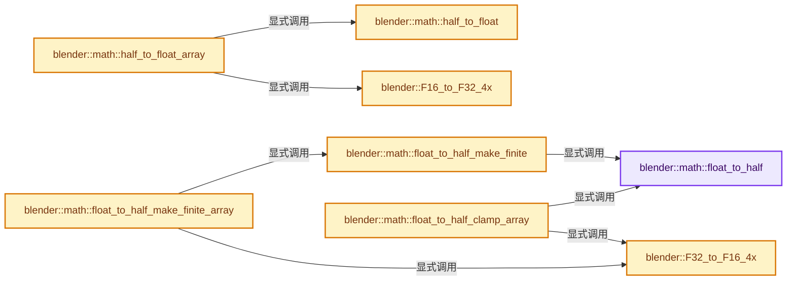
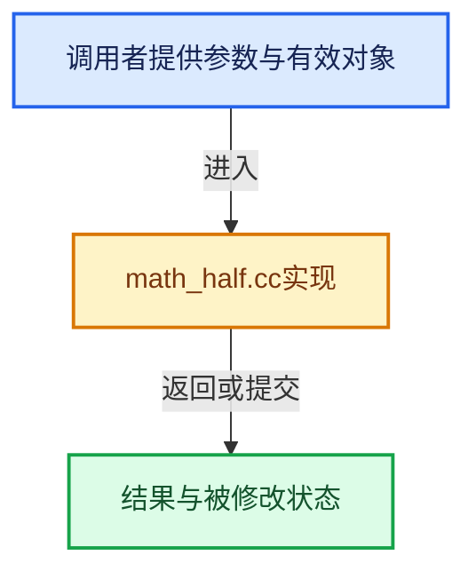

# 实现依赖专题：source/blender/blenlib/intern/math_half.cc

[方向导航](README.md) · [符号索引](../%E7%AC%A6%E5%8F%B7%E4%BE%9D%E8%B5%96%E4%B8%8E%E5%AE%9E%E7%8E%B0%E7%B4%A2%E5%BC%95.md)

本专题从正文实际调用进入，集中保存共享实现。函数有稳定锚点，可从调用处直接跳到对应完整函数；递归与互相调用通过回链组织。

## 本文件的实现关系






## 完整成员与函数实现

<a id="f-7dd8046c65d563c1"></a>

### `blender::math::float_to_half`

实现位置：[source/blender/blenlib/intern/math_half.cc](../../../../../source/blender/blenlib/intern/math_half.cc) · L32—L94。

接口参数：

- `float v`

**教学注释版**

<!-- annotated:c1d88ebe82777d -->

```cpp
uint16_t math::float_to_half(float v)
{
#if defined(USE_HARDWARE_FP16_NEON)
  float16x4_t h4 = vcvt_f16_f32(vdupq_n_f32(v));
  float16_t h = vget_lane_f16(h4, 0);
  return *reinterpret_cast<uint16_t *>(&h);
#else
  /* Based on float_to_half_fast3_rtne from public domain https://gist.github.com/rygorous/2156668
   * see corresponding blog post https://fgiesen.wordpress.com/2012/03/28/half-to-float-done-quic/
   */
  union FP32 {
    uint32_t u;
    float f;
  };
  FP32 f;
  f.f = v;
  FP32 f32infty = {255 << 23};
  FP32 f16max = {(127 + 16) << 23};
  FP32 denorm_magic = {((127 - 15) + (23 - 10) + 1) << 23};
  uint32_t sign_mask = 0x80000000u;
  uint16_t o = {0};

  uint32_t sign = f.u & sign_mask;
  f.u ^= sign;

  /*
   * NOTE all the integer compares in this function can be safely
   * compiled into signed compares since all operands are below
   * 0x80000000. Important if you want fast straight SSE2 code
   * (since there's no unsigned PCMPGTD).
   */
  if (f.u >= f16max.u) {
    /* result is Inf or NaN (all exponent bits set) */
    o = (f.u > f32infty.u) ? 0x7e00 : 0x7c00; /* NaN->qNaN and Inf->Inf */
  }
  else {
    /* (De)normalized number or zero */
    if (f.u < (113 << 23)) {
      /* Resulting FP16 is subnormal or zero.
       * Use a magic value to align our 10 mantissa bits at the bottom of
       * the float. as long as FP addition is round-to-nearest-even this
       * just works. */
      f.f += denorm_magic.f;

      /* and one integer subtract of the bias later, we have our final float! */
      o = f.u - denorm_magic.u;
    }
    else {
      uint32_t mant_odd = (f.u >> 13) & 1; /* resulting mantissa is odd */

      /* update exponent, rounding bias part 1 */
      f.u += (uint32_t(15 - 127) << 23) + 0xfff;
      /* rounding bias part 2 */
      f.u += mant_odd;
      /* take the bits! */
      o = f.u >> 13;
    }
  }

  o |= sign >> 16;
  return o;
#endif
}
```

<details>
<summary>核对原始源码：source/blender/blenlib/intern/math_half.cc · L32—L94</summary>

<!-- original:c1d88ebe82777d:source/blender/blenlib/intern/math_half.cc:32:94 -->

```cpp
uint16_t math::float_to_half(float v)
{
#if defined(USE_HARDWARE_FP16_NEON)
  float16x4_t h4 = vcvt_f16_f32(vdupq_n_f32(v));
  float16_t h = vget_lane_f16(h4, 0);
  return *reinterpret_cast<uint16_t *>(&h);
#else
  /* Based on float_to_half_fast3_rtne from public domain https://gist.github.com/rygorous/2156668
   * see corresponding blog post https://fgiesen.wordpress.com/2012/03/28/half-to-float-done-quic/
   */
  union FP32 {
    uint32_t u;
    float f;
  };
  FP32 f;
  f.f = v;
  FP32 f32infty = {255 << 23};
  FP32 f16max = {(127 + 16) << 23};
  FP32 denorm_magic = {((127 - 15) + (23 - 10) + 1) << 23};
  uint32_t sign_mask = 0x80000000u;
  uint16_t o = {0};

  uint32_t sign = f.u & sign_mask;
  f.u ^= sign;

  /*
   * NOTE all the integer compares in this function can be safely
   * compiled into signed compares since all operands are below
   * 0x80000000. Important if you want fast straight SSE2 code
   * (since there's no unsigned PCMPGTD).
   */
  if (f.u >= f16max.u) {
    /* result is Inf or NaN (all exponent bits set) */
    o = (f.u > f32infty.u) ? 0x7e00 : 0x7c00; /* NaN->qNaN and Inf->Inf */
  }
  else {
    /* (De)normalized number or zero */
    if (f.u < (113 << 23)) {
      /* Resulting FP16 is subnormal or zero.
       * Use a magic value to align our 10 mantissa bits at the bottom of
       * the float. as long as FP addition is round-to-nearest-even this
       * just works. */
      f.f += denorm_magic.f;

      /* and one integer subtract of the bias later, we have our final float! */
      o = f.u - denorm_magic.u;
    }
    else {
      uint32_t mant_odd = (f.u >> 13) & 1; /* resulting mantissa is odd */

      /* update exponent, rounding bias part 1 */
      f.u += (uint32_t(15 - 127) << 23) + 0xfff;
      /* rounding bias part 2 */
      f.u += mant_odd;
      /* take the bits! */
      o = f.u >> 13;
    }
  }

  o |= sign >> 16;
  return o;
#endif
}
```

</details>

**沿实际写入检查状态**

- `f.f = v;`
- `o = (f.u > f32infty.u) ? 0x7e00 : 0x7c00; /* NaN->qNaN and Inf->Inf */`
- `f.f += denorm_magic.f;`
- `o = f.u - denorm_magic.u;`
- `f.u += (uint32_t(15 - 127) << 23) + 0xfff;`
- `f.u += mant_odd;`
- `o = f.u >> 13;`
- `o |= sign >> 16;`

**结果出口**

- `return *reinterpret_cast<uint16_t *>(&h);`
- `return o;`

**继续追踪实现**

- `vcvt_f16_f32` → [调用协议](../%E6%A8%A1%E6%9D%BF%E5%AE%8F%E4%B8%8E%E5%8A%A8%E6%80%81%E5%88%86%E6%B4%BE%E5%8D%8F%E8%AE%AE.md)：函数指针、局部可调用对象或未展开的宏；必须结合调用者环境。调用位置L35。
- `vdupq_n_f32` → [调用协议](../%E6%A8%A1%E6%9D%BF%E5%AE%8F%E4%B8%8E%E5%8A%A8%E6%80%81%E5%88%86%E6%B4%BE%E5%8D%8F%E8%AE%AE.md)：函数指针、局部可调用对象或未展开的宏；必须结合调用者环境。调用位置L35。
- `vget_lane_f16` → [调用协议](../%E6%A8%A1%E6%9D%BF%E5%AE%8F%E4%B8%8E%E5%8A%A8%E6%80%81%E5%88%86%E6%B4%BE%E5%8D%8F%E8%AE%AE.md)：函数指针、局部可调用对象或未展开的宏；必须结合调用者环境。调用位置L36。

<a id="f-df9b5805974abda5"></a>

### `blender::math::float_to_half_make_finite`

实现位置：[source/blender/blenlib/intern/math_half.cc](../../../../../source/blender/blenlib/intern/math_half.cc) · L96—L111。

接口参数：

- `float v`

**教学注释版**

<!-- annotated:01f938c5d36dd3 -->

```cpp
uint16_t math::float_to_half_make_finite(float v)
{
  uint16_t h = float_to_half(v);
  /* Infinity or NaN? */
  if ((h & 0x7c00) == 0x7c00) {
    if ((h & 0x03ff) == 0) {
      /* +/- infinity: +/- max value. */
      h ^= 0x07ff;
    }
    else {
      /* +/- Nan: +/- zero. */
      h &= 0x8000;
    }
  }
  return h;
}
```

<details>
<summary>核对原始源码：source/blender/blenlib/intern/math_half.cc · L96—L111</summary>

<!-- original:01f938c5d36dd3:source/blender/blenlib/intern/math_half.cc:96:111 -->

```cpp
uint16_t math::float_to_half_make_finite(float v)
{
  uint16_t h = float_to_half(v);
  /* Infinity or NaN? */
  if ((h & 0x7c00) == 0x7c00) {
    if ((h & 0x03ff) == 0) {
      /* +/- infinity: +/- max value. */
      h ^= 0x07ff;
    }
    else {
      /* +/- Nan: +/- zero. */
      h &= 0x8000;
    }
  }
  return h;
}
```

</details>

**沿实际写入检查状态**

- `h &= 0x8000;`

**结果出口**

- `return h;`

**继续追踪实现**

- `float_to_half` → [blender::math::float_to_half · L32](%E4%BE%9D%E8%B5%96-math_half-7f3d7c.md#f-7dd8046c65d563c1)。

<a id="f-c24855fbf0de756c"></a>

### `blender::math::half_to_float`

实现位置：[source/blender/blenlib/intern/math_half.cc](../../../../../source/blender/blenlib/intern/math_half.cc) · L113—L148。

接口参数：

- `uint16_t v`

**教学注释版**

<!-- annotated:5b767156b96032 -->

```cpp
float math::half_to_float(uint16_t v)
{
#if defined(USE_HARDWARE_FP16_NEON)
  uint16x4_t v4 = vdup_n_u16(v);
  float16x4_t h4 = vreinterpret_f16_u16(v4);
  float32x4_t f4 = vcvt_f32_f16(h4);
  return vgetq_lane_f32(f4, 0);
#else
  /* Based on half_to_float_fast4 from public domain https://gist.github.com/rygorous/2144712
   * see corresponding blog post https://fgiesen.wordpress.com/2012/03/28/half-to-float-done-quic/
   */
  union FP32 {
    uint32_t u;
    float f;
  };
  constexpr FP32 magic = {113 << 23};
  constexpr uint32_t shifted_exp = 0x7c00 << 13; /* exponent mask after shift */
  FP32 o;

  o.u = (v & 0x7fff) << 13;         /* exponent/mantissa bits */
  uint32_t exp = shifted_exp & o.u; /* just the exponent */
  o.u += (127 - 15) << 23;          /* exponent adjust */

  /* handle exponent special cases */
  if (exp == shifted_exp) {  /* Inf/NaN? */
    o.u += (128 - 16) << 23; /* extra exp adjust */
  }
  else if (exp == 0) { /* Zero/Denormal? */
    o.u += 1 << 23;    /* extra exp adjust */
    o.f -= magic.f;    /* renormalize */
  }

  o.u |= (v & 0x8000) << 16; /* sign bit */
  return o.f;
#endif
}
```

<details>
<summary>核对原始源码：source/blender/blenlib/intern/math_half.cc · L113—L148</summary>

<!-- original:5b767156b96032:source/blender/blenlib/intern/math_half.cc:113:148 -->

```cpp
float math::half_to_float(uint16_t v)
{
#if defined(USE_HARDWARE_FP16_NEON)
  uint16x4_t v4 = vdup_n_u16(v);
  float16x4_t h4 = vreinterpret_f16_u16(v4);
  float32x4_t f4 = vcvt_f32_f16(h4);
  return vgetq_lane_f32(f4, 0);
#else
  /* Based on half_to_float_fast4 from public domain https://gist.github.com/rygorous/2144712
   * see corresponding blog post https://fgiesen.wordpress.com/2012/03/28/half-to-float-done-quic/
   */
  union FP32 {
    uint32_t u;
    float f;
  };
  constexpr FP32 magic = {113 << 23};
  constexpr uint32_t shifted_exp = 0x7c00 << 13; /* exponent mask after shift */
  FP32 o;

  o.u = (v & 0x7fff) << 13;         /* exponent/mantissa bits */
  uint32_t exp = shifted_exp & o.u; /* just the exponent */
  o.u += (127 - 15) << 23;          /* exponent adjust */

  /* handle exponent special cases */
  if (exp == shifted_exp) {  /* Inf/NaN? */
    o.u += (128 - 16) << 23; /* extra exp adjust */
  }
  else if (exp == 0) { /* Zero/Denormal? */
    o.u += 1 << 23;    /* extra exp adjust */
    o.f -= magic.f;    /* renormalize */
  }

  o.u |= (v & 0x8000) << 16; /* sign bit */
  return o.f;
#endif
}
```

</details>

**沿实际写入检查状态**

- `o.u = (v & 0x7fff) << 13;         /* exponent/mantissa bits */`
- `o.u += (127 - 15) << 23;          /* exponent adjust */`
- `o.u += (128 - 16) << 23; /* extra exp adjust */`
- `o.u += 1 << 23;    /* extra exp adjust */`
- `o.f -= magic.f;    /* renormalize */`
- `o.u |= (v & 0x8000) << 16; /* sign bit */`

**结果出口**

- `return vgetq_lane_f32(f4, 0);`
- `return o.f;`

**继续追踪实现**

- `vdup_n_u16` → [调用协议](../%E6%A8%A1%E6%9D%BF%E5%AE%8F%E4%B8%8E%E5%8A%A8%E6%80%81%E5%88%86%E6%B4%BE%E5%8D%8F%E8%AE%AE.md)：函数指针、局部可调用对象或未展开的宏；必须结合调用者环境。调用位置L116。
- `vreinterpret_f16_u16` → [调用协议](../%E6%A8%A1%E6%9D%BF%E5%AE%8F%E4%B8%8E%E5%8A%A8%E6%80%81%E5%88%86%E6%B4%BE%E5%8D%8F%E8%AE%AE.md)：函数指针、局部可调用对象或未展开的宏；必须结合调用者环境。调用位置L117。
- `vcvt_f32_f16` → [调用协议](../%E6%A8%A1%E6%9D%BF%E5%AE%8F%E4%B8%8E%E5%8A%A8%E6%80%81%E5%88%86%E6%B4%BE%E5%8D%8F%E8%AE%AE.md)：函数指针、局部可调用对象或未展开的宏；必须结合调用者环境。调用位置L118。
- `vgetq_lane_f32` → [调用协议](../%E6%A8%A1%E6%9D%BF%E5%AE%8F%E4%B8%8E%E5%8A%A8%E6%80%81%E5%88%86%E6%B4%BE%E5%8D%8F%E8%AE%AE.md)：函数指针、局部可调用对象或未展开的宏；必须结合调用者环境。调用位置L119。

<a id="f-4a71bd0520fef70f"></a>

### `blender::F32_to_F16_4x`

实现位置：[source/blender/blenlib/intern/math_half.cc](../../../../../source/blender/blenlib/intern/math_half.cc) · L156—L212。

接口参数：

- `const __m128 &f`

**教学注释版**

<!-- annotated:bcd0d35cabe81e -->

```cpp
static inline __m128i F32_to_F16_4x(const __m128 &f)
{
  const __m128 mask_sign = _mm_set1_ps(-0.0f);
  /* all FP32 values >=this round to +inf */
  const __m128i c_f16max = _mm_set1_epi32((127 + 16) << 23);
  const __m128i c_nanbit = _mm_set1_epi32(0x200);
  const __m128i c_nanlobits = _mm_set1_epi32(0x1ff);
  const __m128i c_infty_as_fp16 = _mm_set1_epi32(0x7c00);
  /* smallest FP32 that yields a normalized FP16 */
  const __m128i c_min_normal = _mm_set1_epi32((127 - 14) << 23);
  const __m128i c_subnorm_magic = _mm_set1_epi32(((127 - 15) + (23 - 10) + 1) << 23);
  /* adjust exponent and add mantissa rounding */
  const __m128i c_normal_bias = _mm_set1_epi32(0xfff - ((127 - 15) << 23));

  __m128 justsign = _mm_and_ps(f, mask_sign);
  __m128 absf = _mm_andnot_ps(mask_sign, f); /* f & ~mask_sign */
  /* the cast is "free" (extra bypass latency, but no throughput hit) */
  __m128i absf_int = _mm_castps_si128(absf);
  __m128 b_isnan = _mm_cmpunord_ps(absf, absf);              /* is this a NaN? */
  __m128i b_isregular = _mm_cmpgt_epi32(c_f16max, absf_int); /* (sub)normalized or special? */
  __m128i nan_payload = _mm_and_si128(_mm_srli_epi32(absf_int, 13),
                                      c_nanlobits);        /* payload bits for NaNs */
  __m128i nan_quiet = _mm_or_si128(nan_payload, c_nanbit); /* and set quiet bit */
  __m128i nanfinal = _mm_and_si128(_mm_castps_si128(b_isnan), nan_quiet);
  __m128i inf_or_nan = _mm_or_si128(nanfinal, c_infty_as_fp16); /* output for specials */

  /* subnormal? */
  __m128i b_issub = _mm_cmpgt_epi32(c_min_normal, absf_int);

  /* "result is subnormal" path */
  __m128 subnorm1 = _mm_add_ps(
      absf, _mm_castsi128_ps(c_subnorm_magic)); /* magic value to round output mantissa */
  __m128i subnorm2 = _mm_sub_epi32(_mm_castps_si128(subnorm1),
                                   c_subnorm_magic); /* subtract out bias */

  /* "result is normal" path */
  __m128i mantoddbit = _mm_slli_epi32(absf_int, 31 - 13); /* shift bit 13 (mantissa LSB) to sign */
  __m128i mantodd = _mm_srai_epi32(mantoddbit, 31);       /* -1 if FP16 mantissa odd, else 0 */

  __m128i round1 = _mm_add_epi32(absf_int, c_normal_bias);
  /* if mantissa LSB odd, bias towards rounding up (RTNE) */
  __m128i round2 = _mm_sub_epi32(round1, mantodd);
  __m128i normal = _mm_srli_epi32(round2, 13); /* rounded result */

  /* combine the two non-specials */
  __m128i nonspecial = _mm_or_si128(_mm_and_si128(subnorm2, b_issub),
                                    _mm_andnot_si128(b_issub, normal));

  /* merge in specials as well */
  __m128i joined = _mm_or_si128(_mm_and_si128(nonspecial, b_isregular),
                                _mm_andnot_si128(b_isregular, inf_or_nan));

  __m128i sign_shift = _mm_srai_epi32(_mm_castps_si128(justsign), 16);
  __m128i result = _mm_or_si128(joined, sign_shift);

  return result;
}
```

<details>
<summary>核对原始源码：source/blender/blenlib/intern/math_half.cc · L156—L212</summary>

<!-- original:bcd0d35cabe81e:source/blender/blenlib/intern/math_half.cc:156:212 -->

```cpp
static inline __m128i F32_to_F16_4x(const __m128 &f)
{
  const __m128 mask_sign = _mm_set1_ps(-0.0f);
  /* all FP32 values >=this round to +inf */
  const __m128i c_f16max = _mm_set1_epi32((127 + 16) << 23);
  const __m128i c_nanbit = _mm_set1_epi32(0x200);
  const __m128i c_nanlobits = _mm_set1_epi32(0x1ff);
  const __m128i c_infty_as_fp16 = _mm_set1_epi32(0x7c00);
  /* smallest FP32 that yields a normalized FP16 */
  const __m128i c_min_normal = _mm_set1_epi32((127 - 14) << 23);
  const __m128i c_subnorm_magic = _mm_set1_epi32(((127 - 15) + (23 - 10) + 1) << 23);
  /* adjust exponent and add mantissa rounding */
  const __m128i c_normal_bias = _mm_set1_epi32(0xfff - ((127 - 15) << 23));

  __m128 justsign = _mm_and_ps(f, mask_sign);
  __m128 absf = _mm_andnot_ps(mask_sign, f); /* f & ~mask_sign */
  /* the cast is "free" (extra bypass latency, but no throughput hit) */
  __m128i absf_int = _mm_castps_si128(absf);
  __m128 b_isnan = _mm_cmpunord_ps(absf, absf);              /* is this a NaN? */
  __m128i b_isregular = _mm_cmpgt_epi32(c_f16max, absf_int); /* (sub)normalized or special? */
  __m128i nan_payload = _mm_and_si128(_mm_srli_epi32(absf_int, 13),
                                      c_nanlobits);        /* payload bits for NaNs */
  __m128i nan_quiet = _mm_or_si128(nan_payload, c_nanbit); /* and set quiet bit */
  __m128i nanfinal = _mm_and_si128(_mm_castps_si128(b_isnan), nan_quiet);
  __m128i inf_or_nan = _mm_or_si128(nanfinal, c_infty_as_fp16); /* output for specials */

  /* subnormal? */
  __m128i b_issub = _mm_cmpgt_epi32(c_min_normal, absf_int);

  /* "result is subnormal" path */
  __m128 subnorm1 = _mm_add_ps(
      absf, _mm_castsi128_ps(c_subnorm_magic)); /* magic value to round output mantissa */
  __m128i subnorm2 = _mm_sub_epi32(_mm_castps_si128(subnorm1),
                                   c_subnorm_magic); /* subtract out bias */

  /* "result is normal" path */
  __m128i mantoddbit = _mm_slli_epi32(absf_int, 31 - 13); /* shift bit 13 (mantissa LSB) to sign */
  __m128i mantodd = _mm_srai_epi32(mantoddbit, 31);       /* -1 if FP16 mantissa odd, else 0 */

  __m128i round1 = _mm_add_epi32(absf_int, c_normal_bias);
  /* if mantissa LSB odd, bias towards rounding up (RTNE) */
  __m128i round2 = _mm_sub_epi32(round1, mantodd);
  __m128i normal = _mm_srli_epi32(round2, 13); /* rounded result */

  /* combine the two non-specials */
  __m128i nonspecial = _mm_or_si128(_mm_and_si128(subnorm2, b_issub),
                                    _mm_andnot_si128(b_issub, normal));

  /* merge in specials as well */
  __m128i joined = _mm_or_si128(_mm_and_si128(nonspecial, b_isregular),
                                _mm_andnot_si128(b_isregular, inf_or_nan));

  __m128i sign_shift = _mm_srai_epi32(_mm_castps_si128(justsign), 16);
  __m128i result = _mm_or_si128(joined, sign_shift);

  return result;
}
```

</details>

**结果出口**

- `return result;`

**继续追踪实现**

- `_mm_set1_ps` → [调用协议](../%E6%A8%A1%E6%9D%BF%E5%AE%8F%E4%B8%8E%E5%8A%A8%E6%80%81%E5%88%86%E6%B4%BE%E5%8D%8F%E8%AE%AE.md)：函数指针、局部可调用对象或未展开的宏；必须结合调用者环境。调用位置L158。
- `_mm_set1_epi32` → [调用协议](../%E6%A8%A1%E6%9D%BF%E5%AE%8F%E4%B8%8E%E5%8A%A8%E6%80%81%E5%88%86%E6%B4%BE%E5%8D%8F%E8%AE%AE.md)：函数指针、局部可调用对象或未展开的宏；必须结合调用者环境。调用位置L160。
- `_mm_and_ps` → [调用协议](../%E6%A8%A1%E6%9D%BF%E5%AE%8F%E4%B8%8E%E5%8A%A8%E6%80%81%E5%88%86%E6%B4%BE%E5%8D%8F%E8%AE%AE.md)：函数指针、局部可调用对象或未展开的宏；必须结合调用者环境。调用位置L170。
- `_mm_andnot_ps` → [调用协议](../%E6%A8%A1%E6%9D%BF%E5%AE%8F%E4%B8%8E%E5%8A%A8%E6%80%81%E5%88%86%E6%B4%BE%E5%8D%8F%E8%AE%AE.md)：函数指针、局部可调用对象或未展开的宏；必须结合调用者环境。调用位置L171。
- `_mm_castps_si128` → [调用协议](../%E6%A8%A1%E6%9D%BF%E5%AE%8F%E4%B8%8E%E5%8A%A8%E6%80%81%E5%88%86%E6%B4%BE%E5%8D%8F%E8%AE%AE.md)：函数指针、局部可调用对象或未展开的宏；必须结合调用者环境。调用位置L173。
- `_mm_cmpunord_ps` → [调用协议](../%E6%A8%A1%E6%9D%BF%E5%AE%8F%E4%B8%8E%E5%8A%A8%E6%80%81%E5%88%86%E6%B4%BE%E5%8D%8F%E8%AE%AE.md)：函数指针、局部可调用对象或未展开的宏；必须结合调用者环境。调用位置L174。
- `_mm_cmpgt_epi32` → [调用协议](../%E6%A8%A1%E6%9D%BF%E5%AE%8F%E4%B8%8E%E5%8A%A8%E6%80%81%E5%88%86%E6%B4%BE%E5%8D%8F%E8%AE%AE.md)：函数指针、局部可调用对象或未展开的宏；必须结合调用者环境。调用位置L175。
- `_mm_and_si128` → [调用协议](../%E6%A8%A1%E6%9D%BF%E5%AE%8F%E4%B8%8E%E5%8A%A8%E6%80%81%E5%88%86%E6%B4%BE%E5%8D%8F%E8%AE%AE.md)：函数指针、局部可调用对象或未展开的宏；必须结合调用者环境。调用位置L176。
- `_mm_srli_epi32` → [调用协议](../%E6%A8%A1%E6%9D%BF%E5%AE%8F%E4%B8%8E%E5%8A%A8%E6%80%81%E5%88%86%E6%B4%BE%E5%8D%8F%E8%AE%AE.md)：函数指针、局部可调用对象或未展开的宏；必须结合调用者环境。调用位置L176。
- `_mm_or_si128` → [调用协议](../%E6%A8%A1%E6%9D%BF%E5%AE%8F%E4%B8%8E%E5%8A%A8%E6%80%81%E5%88%86%E6%B4%BE%E5%8D%8F%E8%AE%AE.md)：函数指针、局部可调用对象或未展开的宏；必须结合调用者环境。调用位置L178。
- `_mm_add_ps` → [调用协议](../%E6%A8%A1%E6%9D%BF%E5%AE%8F%E4%B8%8E%E5%8A%A8%E6%80%81%E5%88%86%E6%B4%BE%E5%8D%8F%E8%AE%AE.md)：函数指针、局部可调用对象或未展开的宏；必须结合调用者环境。调用位置L186。
- `_mm_castsi128_ps` → [调用协议](../%E6%A8%A1%E6%9D%BF%E5%AE%8F%E4%B8%8E%E5%8A%A8%E6%80%81%E5%88%86%E6%B4%BE%E5%8D%8F%E8%AE%AE.md)：函数指针、局部可调用对象或未展开的宏；必须结合调用者环境。调用位置L187。
- `_mm_sub_epi32` → [调用协议](../%E6%A8%A1%E6%9D%BF%E5%AE%8F%E4%B8%8E%E5%8A%A8%E6%80%81%E5%88%86%E6%B4%BE%E5%8D%8F%E8%AE%AE.md)：函数指针、局部可调用对象或未展开的宏；必须结合调用者环境。调用位置L188。
- `_mm_slli_epi32` → [调用协议](../%E6%A8%A1%E6%9D%BF%E5%AE%8F%E4%B8%8E%E5%8A%A8%E6%80%81%E5%88%86%E6%B4%BE%E5%8D%8F%E8%AE%AE.md)：函数指针、局部可调用对象或未展开的宏；必须结合调用者环境。调用位置L192。
- `_mm_srai_epi32` → [调用协议](../%E6%A8%A1%E6%9D%BF%E5%AE%8F%E4%B8%8E%E5%8A%A8%E6%80%81%E5%88%86%E6%B4%BE%E5%8D%8F%E8%AE%AE.md)：函数指针、局部可调用对象或未展开的宏；必须结合调用者环境。调用位置L193。
- `_mm_add_epi32` → [调用协议](../%E6%A8%A1%E6%9D%BF%E5%AE%8F%E4%B8%8E%E5%8A%A8%E6%80%81%E5%88%86%E6%B4%BE%E5%8D%8F%E8%AE%AE.md)：函数指针、局部可调用对象或未展开的宏；必须结合调用者环境。调用位置L195。
- `_mm_andnot_si128` → [调用协议](../%E6%A8%A1%E6%9D%BF%E5%AE%8F%E4%B8%8E%E5%8A%A8%E6%80%81%E5%88%86%E6%B4%BE%E5%8D%8F%E8%AE%AE.md)：函数指针、局部可调用对象或未展开的宏；必须结合调用者环境。调用位置L202。

<a id="f-df6420fb1c3fa677"></a>

### `blender::F16_to_F32_4x`

实现位置：[source/blender/blenlib/intern/math_half.cc](../../../../../source/blender/blenlib/intern/math_half.cc) · L215—L252。

接口参数：

- `const __m128i &h`

**教学注释版**

<!-- annotated:441033d42a1ebf -->

```cpp
static inline __m128 F16_to_F32_4x(const __m128i &h)
{
  const __m128i mask_nosign = _mm_set1_epi32(0x7fff);
  /* Scaling the shifted exponent and mantissa by 2^112 is done by adding to the exponent
   * field instead of multiplying, so that subnormal halves do not go through a subnormal
   * float as intermediate value. Such a value would be flushed to zero when the CPU runs
   * with flush-to-zero / denormals-are-zero enabled. Subnormal halves have a zero exponent
   * and need a bias that makes them normal floats, with the implicit leading one that
   * introduces subtracted again afterwards. */
  const __m128i min_normal = _mm_set1_epi32(1 << 23);
  const __m128i normal_bias = _mm_set1_epi32((254 - 15 - 127) << 23);
  const __m128i subnorm_bias = _mm_set1_epi32((254 - 15 - 126) << 23);
  const __m128i was_infnan = _mm_set1_epi32(0x7bff);
  const __m128 exp_infnan = _mm_castsi128_ps(_mm_set1_epi32(255 << 23));
  const __m128i was_nan = _mm_set1_epi32(0x7c00);
  const __m128i nan_quiet = _mm_set1_epi32(1 << 22);

  __m128i expmant = _mm_and_si128(mask_nosign, h);
  __m128i justsign = _mm_xor_si128(h, expmant);
  __m128i shifted = _mm_slli_epi32(expmant, 13);
  __m128i b_wassubnorm = _mm_cmpgt_epi32(min_normal, shifted);
  __m128 scaled_normal = _mm_castsi128_ps(_mm_add_epi32(shifted, normal_bias));
  __m128 scaled_subnorm = _mm_sub_ps(_mm_castsi128_ps(_mm_add_epi32(shifted, subnorm_bias)),
                                     _mm_castsi128_ps(subnorm_bias));
  __m128 scaled = _mm_or_ps(_mm_and_ps(_mm_castsi128_ps(b_wassubnorm), scaled_subnorm),
                            _mm_andnot_ps(_mm_castsi128_ps(b_wassubnorm), scaled_normal));
  __m128i b_wasinfnan = _mm_cmpgt_epi32(expmant, was_infnan);
  __m128i sign = _mm_slli_epi32(justsign, 16);
  __m128 infnanexp = _mm_and_ps(_mm_castsi128_ps(b_wasinfnan), exp_infnan);
  __m128i b_wasnan = _mm_cmpgt_epi32(expmant, was_nan);
  __m128i nanquiet = _mm_and_si128(b_wasnan, nan_quiet);
  __m128 infnandone = _mm_or_ps(infnanexp, _mm_castsi128_ps(nanquiet));

  __m128 sign_inf = _mm_or_ps(_mm_castsi128_ps(sign), infnandone);
  __m128 result = _mm_or_ps(scaled, sign_inf);

  return result;
}
```

<details>
<summary>核对原始源码：source/blender/blenlib/intern/math_half.cc · L215—L252</summary>

<!-- original:441033d42a1ebf:source/blender/blenlib/intern/math_half.cc:215:252 -->

```cpp
static inline __m128 F16_to_F32_4x(const __m128i &h)
{
  const __m128i mask_nosign = _mm_set1_epi32(0x7fff);
  /* Scaling the shifted exponent and mantissa by 2^112 is done by adding to the exponent
   * field instead of multiplying, so that subnormal halves do not go through a subnormal
   * float as intermediate value. Such a value would be flushed to zero when the CPU runs
   * with flush-to-zero / denormals-are-zero enabled. Subnormal halves have a zero exponent
   * and need a bias that makes them normal floats, with the implicit leading one that
   * introduces subtracted again afterwards. */
  const __m128i min_normal = _mm_set1_epi32(1 << 23);
  const __m128i normal_bias = _mm_set1_epi32((254 - 15 - 127) << 23);
  const __m128i subnorm_bias = _mm_set1_epi32((254 - 15 - 126) << 23);
  const __m128i was_infnan = _mm_set1_epi32(0x7bff);
  const __m128 exp_infnan = _mm_castsi128_ps(_mm_set1_epi32(255 << 23));
  const __m128i was_nan = _mm_set1_epi32(0x7c00);
  const __m128i nan_quiet = _mm_set1_epi32(1 << 22);

  __m128i expmant = _mm_and_si128(mask_nosign, h);
  __m128i justsign = _mm_xor_si128(h, expmant);
  __m128i shifted = _mm_slli_epi32(expmant, 13);
  __m128i b_wassubnorm = _mm_cmpgt_epi32(min_normal, shifted);
  __m128 scaled_normal = _mm_castsi128_ps(_mm_add_epi32(shifted, normal_bias));
  __m128 scaled_subnorm = _mm_sub_ps(_mm_castsi128_ps(_mm_add_epi32(shifted, subnorm_bias)),
                                     _mm_castsi128_ps(subnorm_bias));
  __m128 scaled = _mm_or_ps(_mm_and_ps(_mm_castsi128_ps(b_wassubnorm), scaled_subnorm),
                            _mm_andnot_ps(_mm_castsi128_ps(b_wassubnorm), scaled_normal));
  __m128i b_wasinfnan = _mm_cmpgt_epi32(expmant, was_infnan);
  __m128i sign = _mm_slli_epi32(justsign, 16);
  __m128 infnanexp = _mm_and_ps(_mm_castsi128_ps(b_wasinfnan), exp_infnan);
  __m128i b_wasnan = _mm_cmpgt_epi32(expmant, was_nan);
  __m128i nanquiet = _mm_and_si128(b_wasnan, nan_quiet);
  __m128 infnandone = _mm_or_ps(infnanexp, _mm_castsi128_ps(nanquiet));

  __m128 sign_inf = _mm_or_ps(_mm_castsi128_ps(sign), infnandone);
  __m128 result = _mm_or_ps(scaled, sign_inf);

  return result;
}
```

</details>

**结果出口**

- `return result;`

**继续追踪实现**

- `_mm_set1_epi32` → [调用协议](../%E6%A8%A1%E6%9D%BF%E5%AE%8F%E4%B8%8E%E5%8A%A8%E6%80%81%E5%88%86%E6%B4%BE%E5%8D%8F%E8%AE%AE.md)：函数指针、局部可调用对象或未展开的宏；必须结合调用者环境。调用位置L217。
- `_mm_castsi128_ps` → [调用协议](../%E6%A8%A1%E6%9D%BF%E5%AE%8F%E4%B8%8E%E5%8A%A8%E6%80%81%E5%88%86%E6%B4%BE%E5%8D%8F%E8%AE%AE.md)：函数指针、局部可调用对象或未展开的宏；必须结合调用者环境。调用位置L228。
- `_mm_and_si128` → [调用协议](../%E6%A8%A1%E6%9D%BF%E5%AE%8F%E4%B8%8E%E5%8A%A8%E6%80%81%E5%88%86%E6%B4%BE%E5%8D%8F%E8%AE%AE.md)：函数指针、局部可调用对象或未展开的宏；必须结合调用者环境。调用位置L232。
- `_mm_xor_si128` → [调用协议](../%E6%A8%A1%E6%9D%BF%E5%AE%8F%E4%B8%8E%E5%8A%A8%E6%80%81%E5%88%86%E6%B4%BE%E5%8D%8F%E8%AE%AE.md)：函数指针、局部可调用对象或未展开的宏；必须结合调用者环境。调用位置L233。
- `_mm_slli_epi32` → [调用协议](../%E6%A8%A1%E6%9D%BF%E5%AE%8F%E4%B8%8E%E5%8A%A8%E6%80%81%E5%88%86%E6%B4%BE%E5%8D%8F%E8%AE%AE.md)：函数指针、局部可调用对象或未展开的宏；必须结合调用者环境。调用位置L234。
- `_mm_cmpgt_epi32` → [调用协议](../%E6%A8%A1%E6%9D%BF%E5%AE%8F%E4%B8%8E%E5%8A%A8%E6%80%81%E5%88%86%E6%B4%BE%E5%8D%8F%E8%AE%AE.md)：函数指针、局部可调用对象或未展开的宏；必须结合调用者环境。调用位置L235。
- `_mm_add_epi32` → [调用协议](../%E6%A8%A1%E6%9D%BF%E5%AE%8F%E4%B8%8E%E5%8A%A8%E6%80%81%E5%88%86%E6%B4%BE%E5%8D%8F%E8%AE%AE.md)：函数指针、局部可调用对象或未展开的宏；必须结合调用者环境。调用位置L236。
- `_mm_sub_ps` → [调用协议](../%E6%A8%A1%E6%9D%BF%E5%AE%8F%E4%B8%8E%E5%8A%A8%E6%80%81%E5%88%86%E6%B4%BE%E5%8D%8F%E8%AE%AE.md)：函数指针、局部可调用对象或未展开的宏；必须结合调用者环境。调用位置L237。
- `_mm_or_ps` → [调用协议](../%E6%A8%A1%E6%9D%BF%E5%AE%8F%E4%B8%8E%E5%8A%A8%E6%80%81%E5%88%86%E6%B4%BE%E5%8D%8F%E8%AE%AE.md)：函数指针、局部可调用对象或未展开的宏；必须结合调用者环境。调用位置L239。
- `_mm_and_ps` → [调用协议](../%E6%A8%A1%E6%9D%BF%E5%AE%8F%E4%B8%8E%E5%8A%A8%E6%80%81%E5%88%86%E6%B4%BE%E5%8D%8F%E8%AE%AE.md)：函数指针、局部可调用对象或未展开的宏；必须结合调用者环境。调用位置L239。
- `_mm_andnot_ps` → [调用协议](../%E6%A8%A1%E6%9D%BF%E5%AE%8F%E4%B8%8E%E5%8A%A8%E6%80%81%E5%88%86%E6%B4%BE%E5%8D%8F%E8%AE%AE.md)：函数指针、局部可调用对象或未展开的宏；必须结合调用者环境。调用位置L240。

<a id="f-3d6ee1224af46737"></a>

### `blender::math::float_to_half_clamp_array`

实现位置：[source/blender/blenlib/intern/math_half.cc](../../../../../source/blender/blenlib/intern/math_half.cc) · L292—L353。

接口参数：

- `const float *src`
- `uint16_t *dst`
- `size_t length`
- `float min_value`
- `float max_value`

**教学注释版**

<!-- annotated:fb7ba98e9659ca -->

```cpp
void math::float_to_half_clamp_array(
    const float *src, uint16_t *dst, size_t length, float min_value, float max_value)
{
  size_t i = 0;
#if defined(USE_HARDWARE_FP16_F16C) /* 8-wide loop using AVX2 F16C */
  __m256 min8 = _mm256_set1_ps(min_value);
  __m256 max8 = _mm256_set1_ps(max_value);
  for (; i + 7 < length; i += 8) {
    __m256 src8 = _mm256_loadu_ps(src);
    /* Turn NaNs into zeroes. */
    __m256 not_nans_mask = _mm256_cmp_ps(src8, src8, _CMP_EQ_OQ);
    src8 = _mm256_and_ps(src8, not_nans_mask);
    /* Clamp between min & max. */
    src8 = _mm256_min_ps(_mm256_max_ps(src8, min8), max8);

    __m128i h8 = _mm256_cvtps_ph(src8, _MM_FROUND_TO_NEAREST_INT);
    _mm_storeu_si128((__m128i *)dst, h8);
    src += 8;
    dst += 8;
  }
#elif (defined(USE_SSE2_FP16) && defined(__SSE4_1__)) /* 4-wide loop using SSE2 and SSE4.1 */
  __m128 min4 = _mm_set1_ps(min_value);
  __m128 max4 = _mm_set1_ps(max_value);
  for (; i + 3 < length; i += 4) {
    __m128 src4 = _mm_loadu_ps(src);
    /* Turn NaNs into zeroes. */
    __m128 not_nans_mask = _mm_cmpeq_ps(src4, src4);
    src4 = _mm_and_ps(src4, not_nans_mask);
    /* Clamp between min & max. */
    src4 = _mm_min_ps(_mm_max_ps(src4, min4), max4);

    __m128i h4 = F32_to_F16_4x(src4);
    __m128i h4_packed = _mm_packs_epi32(h4, h4);
    _mm_storeu_si64(dst, h4_packed);
    src += 4;
    dst += 4;
  }
#elif defined(USE_HARDWARE_FP16_NEON)                 /* 4-wide loop using NEON */
  float32x4_t min4 = vdupq_n_f32(min_value);
  float32x4_t max4 = vdupq_n_f32(max_value);
  for (; i + 3 < length; i += 4) {
    float32x4_t src4 = vld1q_f32(src);
    /* Turn NaNs into zeroes. */
    uint32x4_t not_nans_mask = vceqq_f32(src4, src4);
    src4 = vreinterpretq_f32_u32(vandq_u32(vreinterpretq_u32_f32(src4), not_nans_mask));
    src4 = vminq_f32(vmaxq_f32(src4, min4), max4);
    float16x4_t h4 = vcvt_f16_f32(src4);
    vst1_f16((float16_t *)dst, h4);
    src += 4;
    dst += 4;
  }
#endif
  /* Use scalar path to convert the tail of array (or whole array if none of
   * wider paths above were used). */
  for (; i < length; i++) {
    float v = clamp(*src++, min_value, max_value);
    if (std::isnan(v)) { /* clamp does not handle NaNs */
      v = 0.0f;
    }
    *dst++ = float_to_half(v);
  }
}
```

<details>
<summary>核对原始源码：source/blender/blenlib/intern/math_half.cc · L292—L353</summary>

<!-- original:fb7ba98e9659ca:source/blender/blenlib/intern/math_half.cc:292:353 -->

```cpp
void math::float_to_half_clamp_array(
    const float *src, uint16_t *dst, size_t length, float min_value, float max_value)
{
  size_t i = 0;
#if defined(USE_HARDWARE_FP16_F16C) /* 8-wide loop using AVX2 F16C */
  __m256 min8 = _mm256_set1_ps(min_value);
  __m256 max8 = _mm256_set1_ps(max_value);
  for (; i + 7 < length; i += 8) {
    __m256 src8 = _mm256_loadu_ps(src);
    /* Turn NaNs into zeroes. */
    __m256 not_nans_mask = _mm256_cmp_ps(src8, src8, _CMP_EQ_OQ);
    src8 = _mm256_and_ps(src8, not_nans_mask);
    /* Clamp between min & max. */
    src8 = _mm256_min_ps(_mm256_max_ps(src8, min8), max8);

    __m128i h8 = _mm256_cvtps_ph(src8, _MM_FROUND_TO_NEAREST_INT);
    _mm_storeu_si128((__m128i *)dst, h8);
    src += 8;
    dst += 8;
  }
#elif (defined(USE_SSE2_FP16) && defined(__SSE4_1__)) /* 4-wide loop using SSE2 and SSE4.1 */
  __m128 min4 = _mm_set1_ps(min_value);
  __m128 max4 = _mm_set1_ps(max_value);
  for (; i + 3 < length; i += 4) {
    __m128 src4 = _mm_loadu_ps(src);
    /* Turn NaNs into zeroes. */
    __m128 not_nans_mask = _mm_cmpeq_ps(src4, src4);
    src4 = _mm_and_ps(src4, not_nans_mask);
    /* Clamp between min & max. */
    src4 = _mm_min_ps(_mm_max_ps(src4, min4), max4);

    __m128i h4 = F32_to_F16_4x(src4);
    __m128i h4_packed = _mm_packs_epi32(h4, h4);
    _mm_storeu_si64(dst, h4_packed);
    src += 4;
    dst += 4;
  }
#elif defined(USE_HARDWARE_FP16_NEON)                 /* 4-wide loop using NEON */
  float32x4_t min4 = vdupq_n_f32(min_value);
  float32x4_t max4 = vdupq_n_f32(max_value);
  for (; i + 3 < length; i += 4) {
    float32x4_t src4 = vld1q_f32(src);
    /* Turn NaNs into zeroes. */
    uint32x4_t not_nans_mask = vceqq_f32(src4, src4);
    src4 = vreinterpretq_f32_u32(vandq_u32(vreinterpretq_u32_f32(src4), not_nans_mask));
    src4 = vminq_f32(vmaxq_f32(src4, min4), max4);
    float16x4_t h4 = vcvt_f16_f32(src4);
    vst1_f16((float16_t *)dst, h4);
    src += 4;
    dst += 4;
  }
#endif
  /* Use scalar path to convert the tail of array (or whole array if none of
   * wider paths above were used). */
  for (; i < length; i++) {
    float v = clamp(*src++, min_value, max_value);
    if (std::isnan(v)) { /* clamp does not handle NaNs */
      v = 0.0f;
    }
    *dst++ = float_to_half(v);
  }
}
```

</details>

**沿实际写入检查状态**

- `src8 = _mm256_and_ps(src8, not_nans_mask);`
- `src8 = _mm256_min_ps(_mm256_max_ps(src8, min8), max8);`
- `src += 8;`
- `dst += 8;`
- `src4 = _mm_and_ps(src4, not_nans_mask);`
- `src4 = _mm_min_ps(_mm_max_ps(src4, min4), max4);`
- `src += 4;`
- `dst += 4;`
- `src4 = vreinterpretq_f32_u32(vandq_u32(vreinterpretq_u32_f32(src4), not_nans_mask));`
- `src4 = vminq_f32(vmaxq_f32(src4, min4), max4);`
- `v = 0.0f;`

**继续追踪实现**

- `_mm256_set1_ps` → [调用协议](../%E6%A8%A1%E6%9D%BF%E5%AE%8F%E4%B8%8E%E5%8A%A8%E6%80%81%E5%88%86%E6%B4%BE%E5%8D%8F%E8%AE%AE.md)：函数指针、局部可调用对象或未展开的宏；必须结合调用者环境。调用位置L297。
- `_mm256_loadu_ps` → [调用协议](../%E6%A8%A1%E6%9D%BF%E5%AE%8F%E4%B8%8E%E5%8A%A8%E6%80%81%E5%88%86%E6%B4%BE%E5%8D%8F%E8%AE%AE.md)：函数指针、局部可调用对象或未展开的宏；必须结合调用者环境。调用位置L300。
- `_mm256_cmp_ps` → [调用协议](../%E6%A8%A1%E6%9D%BF%E5%AE%8F%E4%B8%8E%E5%8A%A8%E6%80%81%E5%88%86%E6%B4%BE%E5%8D%8F%E8%AE%AE.md)：函数指针、局部可调用对象或未展开的宏；必须结合调用者环境。调用位置L302。
- `_mm256_and_ps` → [调用协议](../%E6%A8%A1%E6%9D%BF%E5%AE%8F%E4%B8%8E%E5%8A%A8%E6%80%81%E5%88%86%E6%B4%BE%E5%8D%8F%E8%AE%AE.md)：函数指针、局部可调用对象或未展开的宏；必须结合调用者环境。调用位置L303。
- `_mm256_min_ps` → [调用协议](../%E6%A8%A1%E6%9D%BF%E5%AE%8F%E4%B8%8E%E5%8A%A8%E6%80%81%E5%88%86%E6%B4%BE%E5%8D%8F%E8%AE%AE.md)：函数指针、局部可调用对象或未展开的宏；必须结合调用者环境。调用位置L305。
- `_mm256_max_ps` → [调用协议](../%E6%A8%A1%E6%9D%BF%E5%AE%8F%E4%B8%8E%E5%8A%A8%E6%80%81%E5%88%86%E6%B4%BE%E5%8D%8F%E8%AE%AE.md)：函数指针、局部可调用对象或未展开的宏；必须结合调用者环境。调用位置L305。
- `_mm256_cvtps_ph` → [调用协议](../%E6%A8%A1%E6%9D%BF%E5%AE%8F%E4%B8%8E%E5%8A%A8%E6%80%81%E5%88%86%E6%B4%BE%E5%8D%8F%E8%AE%AE.md)：函数指针、局部可调用对象或未展开的宏；必须结合调用者环境。调用位置L307。
- `_mm_storeu_si128` → [调用协议](../%E6%A8%A1%E6%9D%BF%E5%AE%8F%E4%B8%8E%E5%8A%A8%E6%80%81%E5%88%86%E6%B4%BE%E5%8D%8F%E8%AE%AE.md)：函数指针、局部可调用对象或未展开的宏；必须结合调用者环境。调用位置L308。
- `_mm_set1_ps` → [调用协议](../%E6%A8%A1%E6%9D%BF%E5%AE%8F%E4%B8%8E%E5%8A%A8%E6%80%81%E5%88%86%E6%B4%BE%E5%8D%8F%E8%AE%AE.md)：函数指针、局部可调用对象或未展开的宏；必须结合调用者环境。调用位置L313。
- `_mm_loadu_ps` → [调用协议](../%E6%A8%A1%E6%9D%BF%E5%AE%8F%E4%B8%8E%E5%8A%A8%E6%80%81%E5%88%86%E6%B4%BE%E5%8D%8F%E8%AE%AE.md)：函数指针、局部可调用对象或未展开的宏；必须结合调用者环境。调用位置L316。
- `_mm_cmpeq_ps` → [调用协议](../%E6%A8%A1%E6%9D%BF%E5%AE%8F%E4%B8%8E%E5%8A%A8%E6%80%81%E5%88%86%E6%B4%BE%E5%8D%8F%E8%AE%AE.md)：函数指针、局部可调用对象或未展开的宏；必须结合调用者环境。调用位置L318。
- `_mm_and_ps` → [调用协议](../%E6%A8%A1%E6%9D%BF%E5%AE%8F%E4%B8%8E%E5%8A%A8%E6%80%81%E5%88%86%E6%B4%BE%E5%8D%8F%E8%AE%AE.md)：函数指针、局部可调用对象或未展开的宏；必须结合调用者环境。调用位置L319。
- `_mm_min_ps` → [调用协议](../%E6%A8%A1%E6%9D%BF%E5%AE%8F%E4%B8%8E%E5%8A%A8%E6%80%81%E5%88%86%E6%B4%BE%E5%8D%8F%E8%AE%AE.md)：函数指针、局部可调用对象或未展开的宏；必须结合调用者环境。调用位置L321。
- `_mm_max_ps` → [调用协议](../%E6%A8%A1%E6%9D%BF%E5%AE%8F%E4%B8%8E%E5%8A%A8%E6%80%81%E5%88%86%E6%B4%BE%E5%8D%8F%E8%AE%AE.md)：函数指针、局部可调用对象或未展开的宏；必须结合调用者环境。调用位置L321。
- `F32_to_F16_4x` → [blender::F32_to_F16_4x · L156](%E4%BE%9D%E8%B5%96-math_half-7f3d7c.md#f-4a71bd0520fef70f)。
- `_mm_packs_epi32` → [调用协议](../%E6%A8%A1%E6%9D%BF%E5%AE%8F%E4%B8%8E%E5%8A%A8%E6%80%81%E5%88%86%E6%B4%BE%E5%8D%8F%E8%AE%AE.md)：函数指针、局部可调用对象或未展开的宏；必须结合调用者环境。调用位置L324。
- `_mm_storeu_si64` → [调用协议](../%E6%A8%A1%E6%9D%BF%E5%AE%8F%E4%B8%8E%E5%8A%A8%E6%80%81%E5%88%86%E6%B4%BE%E5%8D%8F%E8%AE%AE.md)：函数指针、局部可调用对象或未展开的宏；必须结合调用者环境。调用位置L325。
- `vdupq_n_f32` → [调用协议](../%E6%A8%A1%E6%9D%BF%E5%AE%8F%E4%B8%8E%E5%8A%A8%E6%80%81%E5%88%86%E6%B4%BE%E5%8D%8F%E8%AE%AE.md)：函数指针、局部可调用对象或未展开的宏；必须结合调用者环境。调用位置L330。
- `vld1q_f32` → [调用协议](../%E6%A8%A1%E6%9D%BF%E5%AE%8F%E4%B8%8E%E5%8A%A8%E6%80%81%E5%88%86%E6%B4%BE%E5%8D%8F%E8%AE%AE.md)：函数指针、局部可调用对象或未展开的宏；必须结合调用者环境。调用位置L333。
- `vceqq_f32` → [调用协议](../%E6%A8%A1%E6%9D%BF%E5%AE%8F%E4%B8%8E%E5%8A%A8%E6%80%81%E5%88%86%E6%B4%BE%E5%8D%8F%E8%AE%AE.md)：函数指针、局部可调用对象或未展开的宏；必须结合调用者环境。调用位置L335。
- `vreinterpretq_f32_u32` → [调用协议](../%E6%A8%A1%E6%9D%BF%E5%AE%8F%E4%B8%8E%E5%8A%A8%E6%80%81%E5%88%86%E6%B4%BE%E5%8D%8F%E8%AE%AE.md)：函数指针、局部可调用对象或未展开的宏；必须结合调用者环境。调用位置L336。
- `vandq_u32` → [调用协议](../%E6%A8%A1%E6%9D%BF%E5%AE%8F%E4%B8%8E%E5%8A%A8%E6%80%81%E5%88%86%E6%B4%BE%E5%8D%8F%E8%AE%AE.md)：函数指针、局部可调用对象或未展开的宏；必须结合调用者环境。调用位置L336。
- `vreinterpretq_u32_f32` → [调用协议](../%E6%A8%A1%E6%9D%BF%E5%AE%8F%E4%B8%8E%E5%8A%A8%E6%80%81%E5%88%86%E6%B4%BE%E5%8D%8F%E8%AE%AE.md)：函数指针、局部可调用对象或未展开的宏；必须结合调用者环境。调用位置L336。
- `vminq_f32` → [调用协议](../%E6%A8%A1%E6%9D%BF%E5%AE%8F%E4%B8%8E%E5%8A%A8%E6%80%81%E5%88%86%E6%B4%BE%E5%8D%8F%E8%AE%AE.md)：函数指针、局部可调用对象或未展开的宏；必须结合调用者环境。调用位置L337。
- `vmaxq_f32` → [调用协议](../%E6%A8%A1%E6%9D%BF%E5%AE%8F%E4%B8%8E%E5%8A%A8%E6%80%81%E5%88%86%E6%B4%BE%E5%8D%8F%E8%AE%AE.md)：函数指针、局部可调用对象或未展开的宏；必须结合调用者环境。调用位置L337。
- `vcvt_f16_f32` → [调用协议](../%E6%A8%A1%E6%9D%BF%E5%AE%8F%E4%B8%8E%E5%8A%A8%E6%80%81%E5%88%86%E6%B4%BE%E5%8D%8F%E8%AE%AE.md)：函数指针、局部可调用对象或未展开的宏；必须结合调用者环境。调用位置L338。
- `vst1_f16` → [调用协议](../%E6%A8%A1%E6%9D%BF%E5%AE%8F%E4%B8%8E%E5%8A%A8%E6%80%81%E5%88%86%E6%B4%BE%E5%8D%8F%E8%AE%AE.md)：函数指针、局部可调用对象或未展开的宏；必须结合调用者环境。调用位置L339。
- `clamp` → [调用协议](../%E6%A8%A1%E6%9D%BF%E5%AE%8F%E4%B8%8E%E5%8A%A8%E6%80%81%E5%88%86%E6%B4%BE%E5%8D%8F%E8%AE%AE.md)：函数指针、局部可调用对象或未展开的宏；必须结合调用者环境。调用位置L347。
- `std::isnan` → [外部契约](https://eel.is/c++draft/)：这个边界按实际表达式及所属类型核对参数、返回值、寿命与失败行为。这里提供接口入口，不声称已解释该第三方版本的内部实现。
- `float_to_half` → [blender::math::float_to_half · L32](%E4%BE%9D%E8%B5%96-math_half-7f3d7c.md#f-7dd8046c65d563c1)。

<a id="f-ccbb2502bea18165"></a>

### `blender::math::float_to_half_make_finite_array`

实现位置：[source/blender/blenlib/intern/math_half.cc](../../../../../source/blender/blenlib/intern/math_half.cc) · L355—L447。

接口参数：

- `const float *src`
- `uint16_t *dst`
- `size_t length`

**教学注释版**

<!-- annotated:faa177b719e2f3 -->

```cpp
void math::float_to_half_make_finite_array(const float *src, uint16_t *dst, size_t length)
{
  size_t i = 0;
#if defined(USE_HARDWARE_FP16_F16C) /* 8-wide loop using AVX2 F16C */
  for (; i + 7 < length; i += 8) {
    __m256 src8 = _mm256_loadu_ps(src);
    __m128i h8 = _mm256_cvtps_ph(src8, _MM_FROUND_TO_NEAREST_INT);
    /* Handle inf/nan. */
    {
      const __m128i exp_mask = _mm_set1_epi16(0x7c00u);
      __m128i exp_all_ones = _mm_cmpeq_epi16(_mm_and_si128(h8, exp_mask), exp_mask);
      const __m128i mant_mask = _mm_set1_epi16(0x03ffu);
      const __m128i zero = _mm_setzero_si128();
      __m128i mant_is_zero = _mm_cmpeq_epi16(_mm_and_si128(h8, mant_mask), zero);
      __m128i is_inf = _mm_and_si128(exp_all_ones, mant_is_zero);
      const __m128i all_ones = _mm_cmpeq_epi16(zero, zero);
      __m128i is_nan = _mm_and_si128(exp_all_ones, _mm_andnot_si128(mant_is_zero, all_ones));
      const __m128i sign_mask = _mm_set1_epi16(0x8000u);
      __m128i signbits = _mm_and_si128(h8, sign_mask);
      __m128i inf_res = _mm_or_si128(signbits, _mm_set1_epi16(0x7bffu)); /* +/- 65504 */
      __m128i nan_res = signbits;                                        /* +/- 0 */
      /* Select final result. */
      h8 = _mm_blendv_epi8(h8, inf_res, is_inf);
      h8 = _mm_blendv_epi8(h8, nan_res, is_nan);
    }
    _mm_storeu_si128((__m128i *)dst, h8);
    src += 8;
    dst += 8;
  }
#elif (defined(USE_SSE2_FP16) && defined(__SSE4_1__)) /* 4-wide loop using SSE2 and SSE4.1 */
  for (; i + 3 < length; i += 4) {
    __m128 src4 = _mm_loadu_ps(src);
    __m128i h4 = F32_to_F16_4x(src4);
    /* Handle inf/nan. */
    {
      __m128i hi_part = _mm_and_si128(h4, _mm_set1_epi32(0xffff0000u));
      const __m128i exp_mask = _mm_set1_epi16(0x7c00u);
      __m128i exp_all_ones = _mm_cmpeq_epi16(_mm_and_si128(h4, exp_mask), exp_mask);
      const __m128i mant_mask = _mm_set1_epi16(0x03ffu);
      const __m128i zero = _mm_setzero_si128();
      __m128i mant_is_zero = _mm_cmpeq_epi16(_mm_and_si128(h4, mant_mask), zero);
      __m128i is_inf = _mm_and_si128(exp_all_ones, mant_is_zero);
      const __m128i all_ones = _mm_cmpeq_epi16(zero, zero);
      __m128i is_nan = _mm_and_si128(exp_all_ones, _mm_andnot_si128(mant_is_zero, all_ones));
      const __m128i sign_mask = _mm_set1_epi16(0x8000u);
      __m128i signbits = _mm_and_si128(h4, sign_mask);
      __m128i inf_res = _mm_or_si128(signbits, _mm_set1_epi16(0x7bffu)); /* +/- 65504 */
      __m128i nan_res = signbits;                                        /* +/- 0 */
      /* Select final result. */
      h4 = _mm_blendv_epi8(h4, inf_res, is_inf);
      h4 = _mm_blendv_epi8(h4, nan_res, is_nan);
      h4 = _mm_and_si128(h4, _mm_set1_epi32(0xffff));
      h4 = _mm_or_si128(h4, hi_part);
    }
    __m128i h4_packed = _mm_packs_epi32(h4, h4);
    _mm_storeu_si64(dst, h4_packed);
    src += 4;
    dst += 4;
  }
#elif defined(USE_HARDWARE_FP16_NEON)                 /* 4-wide loop using NEON */
  for (; i + 3 < length; i += 4) {
    float32x4_t src4 = vld1q_f32(src);
    float16x4_t h4 = vcvt_f16_f32(src4);
    /* Handle inf/nan. */
    {
      uint16x4_t hu4 = vreinterpret_u16_f16(h4);
      const uint16x4_t exp_mask = vdup_n_u16(0x7c00u);
      uint16x4_t exp_all_ones = vceq_u16(vand_u16(hu4, exp_mask), exp_mask);
      const uint16x4_t mant_mask = vdup_n_u16(0x03ffu);
      const uint16x4_t zero = vdup_n_u16(0);
      uint16x4_t mant_is_zero = vceq_u16(vand_u16(hu4, mant_mask), zero);
      uint16x4_t is_inf = vand_u16(exp_all_ones, mant_is_zero);
      uint16x4_t is_nan = vand_u16(exp_all_ones, vmvn_u16(mant_is_zero));
      const uint16x4_t sign_mask = vdup_n_u16(0x8000u);
      uint16x4_t signbits = vand_u16(hu4, sign_mask);
      uint16x4_t inf_res = vorr_u16(signbits, vdup_n_u16(0x7bffu)); /* +/- 65504 */
      uint16x4_t nan_res = signbits;                                /* +/- 0 */
      /* Select final result. */
      hu4 = vbsl_u16(is_inf, inf_res, hu4);
      hu4 = vbsl_u16(is_nan, nan_res, hu4);
      h4 = vreinterpret_f16_u16(hu4);
    }
    vst1_f16((float16_t *)dst, h4);
    src += 4;
    dst += 4;
  }
#endif
  /* Use scalar path to convert the tail of array (or whole array if none of
   * wider paths above were used). */
  for (; i < length; i++) {
    *dst++ = float_to_half_make_finite(*src++);
  }
}
```

<details>
<summary>核对原始源码：source/blender/blenlib/intern/math_half.cc · L355—L447</summary>

<!-- original:faa177b719e2f3:source/blender/blenlib/intern/math_half.cc:355:447 -->

```cpp
void math::float_to_half_make_finite_array(const float *src, uint16_t *dst, size_t length)
{
  size_t i = 0;
#if defined(USE_HARDWARE_FP16_F16C) /* 8-wide loop using AVX2 F16C */
  for (; i + 7 < length; i += 8) {
    __m256 src8 = _mm256_loadu_ps(src);
    __m128i h8 = _mm256_cvtps_ph(src8, _MM_FROUND_TO_NEAREST_INT);
    /* Handle inf/nan. */
    {
      const __m128i exp_mask = _mm_set1_epi16(0x7c00u);
      __m128i exp_all_ones = _mm_cmpeq_epi16(_mm_and_si128(h8, exp_mask), exp_mask);
      const __m128i mant_mask = _mm_set1_epi16(0x03ffu);
      const __m128i zero = _mm_setzero_si128();
      __m128i mant_is_zero = _mm_cmpeq_epi16(_mm_and_si128(h8, mant_mask), zero);
      __m128i is_inf = _mm_and_si128(exp_all_ones, mant_is_zero);
      const __m128i all_ones = _mm_cmpeq_epi16(zero, zero);
      __m128i is_nan = _mm_and_si128(exp_all_ones, _mm_andnot_si128(mant_is_zero, all_ones));
      const __m128i sign_mask = _mm_set1_epi16(0x8000u);
      __m128i signbits = _mm_and_si128(h8, sign_mask);
      __m128i inf_res = _mm_or_si128(signbits, _mm_set1_epi16(0x7bffu)); /* +/- 65504 */
      __m128i nan_res = signbits;                                        /* +/- 0 */
      /* Select final result. */
      h8 = _mm_blendv_epi8(h8, inf_res, is_inf);
      h8 = _mm_blendv_epi8(h8, nan_res, is_nan);
    }
    _mm_storeu_si128((__m128i *)dst, h8);
    src += 8;
    dst += 8;
  }
#elif (defined(USE_SSE2_FP16) && defined(__SSE4_1__)) /* 4-wide loop using SSE2 and SSE4.1 */
  for (; i + 3 < length; i += 4) {
    __m128 src4 = _mm_loadu_ps(src);
    __m128i h4 = F32_to_F16_4x(src4);
    /* Handle inf/nan. */
    {
      __m128i hi_part = _mm_and_si128(h4, _mm_set1_epi32(0xffff0000u));
      const __m128i exp_mask = _mm_set1_epi16(0x7c00u);
      __m128i exp_all_ones = _mm_cmpeq_epi16(_mm_and_si128(h4, exp_mask), exp_mask);
      const __m128i mant_mask = _mm_set1_epi16(0x03ffu);
      const __m128i zero = _mm_setzero_si128();
      __m128i mant_is_zero = _mm_cmpeq_epi16(_mm_and_si128(h4, mant_mask), zero);
      __m128i is_inf = _mm_and_si128(exp_all_ones, mant_is_zero);
      const __m128i all_ones = _mm_cmpeq_epi16(zero, zero);
      __m128i is_nan = _mm_and_si128(exp_all_ones, _mm_andnot_si128(mant_is_zero, all_ones));
      const __m128i sign_mask = _mm_set1_epi16(0x8000u);
      __m128i signbits = _mm_and_si128(h4, sign_mask);
      __m128i inf_res = _mm_or_si128(signbits, _mm_set1_epi16(0x7bffu)); /* +/- 65504 */
      __m128i nan_res = signbits;                                        /* +/- 0 */
      /* Select final result. */
      h4 = _mm_blendv_epi8(h4, inf_res, is_inf);
      h4 = _mm_blendv_epi8(h4, nan_res, is_nan);
      h4 = _mm_and_si128(h4, _mm_set1_epi32(0xffff));
      h4 = _mm_or_si128(h4, hi_part);
    }
    __m128i h4_packed = _mm_packs_epi32(h4, h4);
    _mm_storeu_si64(dst, h4_packed);
    src += 4;
    dst += 4;
  }
#elif defined(USE_HARDWARE_FP16_NEON)                 /* 4-wide loop using NEON */
  for (; i + 3 < length; i += 4) {
    float32x4_t src4 = vld1q_f32(src);
    float16x4_t h4 = vcvt_f16_f32(src4);
    /* Handle inf/nan. */
    {
      uint16x4_t hu4 = vreinterpret_u16_f16(h4);
      const uint16x4_t exp_mask = vdup_n_u16(0x7c00u);
      uint16x4_t exp_all_ones = vceq_u16(vand_u16(hu4, exp_mask), exp_mask);
      const uint16x4_t mant_mask = vdup_n_u16(0x03ffu);
      const uint16x4_t zero = vdup_n_u16(0);
      uint16x4_t mant_is_zero = vceq_u16(vand_u16(hu4, mant_mask), zero);
      uint16x4_t is_inf = vand_u16(exp_all_ones, mant_is_zero);
      uint16x4_t is_nan = vand_u16(exp_all_ones, vmvn_u16(mant_is_zero));
      const uint16x4_t sign_mask = vdup_n_u16(0x8000u);
      uint16x4_t signbits = vand_u16(hu4, sign_mask);
      uint16x4_t inf_res = vorr_u16(signbits, vdup_n_u16(0x7bffu)); /* +/- 65504 */
      uint16x4_t nan_res = signbits;                                /* +/- 0 */
      /* Select final result. */
      hu4 = vbsl_u16(is_inf, inf_res, hu4);
      hu4 = vbsl_u16(is_nan, nan_res, hu4);
      h4 = vreinterpret_f16_u16(hu4);
    }
    vst1_f16((float16_t *)dst, h4);
    src += 4;
    dst += 4;
  }
#endif
  /* Use scalar path to convert the tail of array (or whole array if none of
   * wider paths above were used). */
  for (; i < length; i++) {
    *dst++ = float_to_half_make_finite(*src++);
  }
}
```

</details>

**沿实际写入检查状态**

- `h8 = _mm_blendv_epi8(h8, inf_res, is_inf);`
- `h8 = _mm_blendv_epi8(h8, nan_res, is_nan);`
- `src += 8;`
- `dst += 8;`
- `h4 = _mm_blendv_epi8(h4, inf_res, is_inf);`
- `h4 = _mm_blendv_epi8(h4, nan_res, is_nan);`
- `h4 = _mm_and_si128(h4, _mm_set1_epi32(0xffff));`
- `h4 = _mm_or_si128(h4, hi_part);`
- `src += 4;`
- `dst += 4;`
- `hu4 = vbsl_u16(is_inf, inf_res, hu4);`
- `hu4 = vbsl_u16(is_nan, nan_res, hu4);`
- `h4 = vreinterpret_f16_u16(hu4);`

**继续追踪实现**

- `_mm256_loadu_ps` → [调用协议](../%E6%A8%A1%E6%9D%BF%E5%AE%8F%E4%B8%8E%E5%8A%A8%E6%80%81%E5%88%86%E6%B4%BE%E5%8D%8F%E8%AE%AE.md)：函数指针、局部可调用对象或未展开的宏；必须结合调用者环境。调用位置L360。
- `_mm256_cvtps_ph` → [调用协议](../%E6%A8%A1%E6%9D%BF%E5%AE%8F%E4%B8%8E%E5%8A%A8%E6%80%81%E5%88%86%E6%B4%BE%E5%8D%8F%E8%AE%AE.md)：函数指针、局部可调用对象或未展开的宏；必须结合调用者环境。调用位置L361。
- `_mm_set1_epi16` → [调用协议](../%E6%A8%A1%E6%9D%BF%E5%AE%8F%E4%B8%8E%E5%8A%A8%E6%80%81%E5%88%86%E6%B4%BE%E5%8D%8F%E8%AE%AE.md)：函数指针、局部可调用对象或未展开的宏；必须结合调用者环境。调用位置L364。
- `_mm_cmpeq_epi16` → [调用协议](../%E6%A8%A1%E6%9D%BF%E5%AE%8F%E4%B8%8E%E5%8A%A8%E6%80%81%E5%88%86%E6%B4%BE%E5%8D%8F%E8%AE%AE.md)：函数指针、局部可调用对象或未展开的宏；必须结合调用者环境。调用位置L365。
- `_mm_and_si128` → [调用协议](../%E6%A8%A1%E6%9D%BF%E5%AE%8F%E4%B8%8E%E5%8A%A8%E6%80%81%E5%88%86%E6%B4%BE%E5%8D%8F%E8%AE%AE.md)：函数指针、局部可调用对象或未展开的宏；必须结合调用者环境。调用位置L365。
- `_mm_setzero_si128` → [调用协议](../%E6%A8%A1%E6%9D%BF%E5%AE%8F%E4%B8%8E%E5%8A%A8%E6%80%81%E5%88%86%E6%B4%BE%E5%8D%8F%E8%AE%AE.md)：函数指针、局部可调用对象或未展开的宏；必须结合调用者环境。调用位置L367。
- `_mm_andnot_si128` → [调用协议](../%E6%A8%A1%E6%9D%BF%E5%AE%8F%E4%B8%8E%E5%8A%A8%E6%80%81%E5%88%86%E6%B4%BE%E5%8D%8F%E8%AE%AE.md)：函数指针、局部可调用对象或未展开的宏；必须结合调用者环境。调用位置L371。
- `_mm_or_si128` → [调用协议](../%E6%A8%A1%E6%9D%BF%E5%AE%8F%E4%B8%8E%E5%8A%A8%E6%80%81%E5%88%86%E6%B4%BE%E5%8D%8F%E8%AE%AE.md)：函数指针、局部可调用对象或未展开的宏；必须结合调用者环境。调用位置L374。
- `_mm_blendv_epi8` → [调用协议](../%E6%A8%A1%E6%9D%BF%E5%AE%8F%E4%B8%8E%E5%8A%A8%E6%80%81%E5%88%86%E6%B4%BE%E5%8D%8F%E8%AE%AE.md)：函数指针、局部可调用对象或未展开的宏；必须结合调用者环境。调用位置L377。
- `_mm_storeu_si128` → [调用协议](../%E6%A8%A1%E6%9D%BF%E5%AE%8F%E4%B8%8E%E5%8A%A8%E6%80%81%E5%88%86%E6%B4%BE%E5%8D%8F%E8%AE%AE.md)：函数指针、局部可调用对象或未展开的宏；必须结合调用者环境。调用位置L380。
- `_mm_loadu_ps` → [调用协议](../%E6%A8%A1%E6%9D%BF%E5%AE%8F%E4%B8%8E%E5%8A%A8%E6%80%81%E5%88%86%E6%B4%BE%E5%8D%8F%E8%AE%AE.md)：函数指针、局部可调用对象或未展开的宏；必须结合调用者环境。调用位置L386。
- `F32_to_F16_4x` → [blender::F32_to_F16_4x · L156](%E4%BE%9D%E8%B5%96-math_half-7f3d7c.md#f-4a71bd0520fef70f)。
- `_mm_set1_epi32` → [调用协议](../%E6%A8%A1%E6%9D%BF%E5%AE%8F%E4%B8%8E%E5%8A%A8%E6%80%81%E5%88%86%E6%B4%BE%E5%8D%8F%E8%AE%AE.md)：函数指针、局部可调用对象或未展开的宏；必须结合调用者环境。调用位置L390。
- `_mm_packs_epi32` → [调用协议](../%E6%A8%A1%E6%9D%BF%E5%AE%8F%E4%B8%8E%E5%8A%A8%E6%80%81%E5%88%86%E6%B4%BE%E5%8D%8F%E8%AE%AE.md)：函数指针、局部可调用对象或未展开的宏；必须结合调用者环境。调用位置L409。
- `_mm_storeu_si64` → [调用协议](../%E6%A8%A1%E6%9D%BF%E5%AE%8F%E4%B8%8E%E5%8A%A8%E6%80%81%E5%88%86%E6%B4%BE%E5%8D%8F%E8%AE%AE.md)：函数指针、局部可调用对象或未展开的宏；必须结合调用者环境。调用位置L410。
- `vld1q_f32` → [调用协议](../%E6%A8%A1%E6%9D%BF%E5%AE%8F%E4%B8%8E%E5%8A%A8%E6%80%81%E5%88%86%E6%B4%BE%E5%8D%8F%E8%AE%AE.md)：函数指针、局部可调用对象或未展开的宏；必须结合调用者环境。调用位置L416。
- `vcvt_f16_f32` → [调用协议](../%E6%A8%A1%E6%9D%BF%E5%AE%8F%E4%B8%8E%E5%8A%A8%E6%80%81%E5%88%86%E6%B4%BE%E5%8D%8F%E8%AE%AE.md)：函数指针、局部可调用对象或未展开的宏；必须结合调用者环境。调用位置L417。
- `vreinterpret_u16_f16` → [调用协议](../%E6%A8%A1%E6%9D%BF%E5%AE%8F%E4%B8%8E%E5%8A%A8%E6%80%81%E5%88%86%E6%B4%BE%E5%8D%8F%E8%AE%AE.md)：函数指针、局部可调用对象或未展开的宏；必须结合调用者环境。调用位置L420。
- `vdup_n_u16` → [调用协议](../%E6%A8%A1%E6%9D%BF%E5%AE%8F%E4%B8%8E%E5%8A%A8%E6%80%81%E5%88%86%E6%B4%BE%E5%8D%8F%E8%AE%AE.md)：函数指针、局部可调用对象或未展开的宏；必须结合调用者环境。调用位置L421。
- `vceq_u16` → [调用协议](../%E6%A8%A1%E6%9D%BF%E5%AE%8F%E4%B8%8E%E5%8A%A8%E6%80%81%E5%88%86%E6%B4%BE%E5%8D%8F%E8%AE%AE.md)：函数指针、局部可调用对象或未展开的宏；必须结合调用者环境。调用位置L422。
- `vand_u16` → [调用协议](../%E6%A8%A1%E6%9D%BF%E5%AE%8F%E4%B8%8E%E5%8A%A8%E6%80%81%E5%88%86%E6%B4%BE%E5%8D%8F%E8%AE%AE.md)：函数指针、局部可调用对象或未展开的宏；必须结合调用者环境。调用位置L422。
- `vmvn_u16` → [调用协议](../%E6%A8%A1%E6%9D%BF%E5%AE%8F%E4%B8%8E%E5%8A%A8%E6%80%81%E5%88%86%E6%B4%BE%E5%8D%8F%E8%AE%AE.md)：函数指针、局部可调用对象或未展开的宏；必须结合调用者环境。调用位置L427。
- `vorr_u16` → [调用协议](../%E6%A8%A1%E6%9D%BF%E5%AE%8F%E4%B8%8E%E5%8A%A8%E6%80%81%E5%88%86%E6%B4%BE%E5%8D%8F%E8%AE%AE.md)：函数指针、局部可调用对象或未展开的宏；必须结合调用者环境。调用位置L430。
- `vbsl_u16` → [调用协议](../%E6%A8%A1%E6%9D%BF%E5%AE%8F%E4%B8%8E%E5%8A%A8%E6%80%81%E5%88%86%E6%B4%BE%E5%8D%8F%E8%AE%AE.md)：函数指针、局部可调用对象或未展开的宏；必须结合调用者环境。调用位置L433。
- `vreinterpret_f16_u16` → [调用协议](../%E6%A8%A1%E6%9D%BF%E5%AE%8F%E4%B8%8E%E5%8A%A8%E6%80%81%E5%88%86%E6%B4%BE%E5%8D%8F%E8%AE%AE.md)：函数指针、局部可调用对象或未展开的宏；必须结合调用者环境。调用位置L435。
- `vst1_f16` → [调用协议](../%E6%A8%A1%E6%9D%BF%E5%AE%8F%E4%B8%8E%E5%8A%A8%E6%80%81%E5%88%86%E6%B4%BE%E5%8D%8F%E8%AE%AE.md)：函数指针、局部可调用对象或未展开的宏；必须结合调用者环境。调用位置L437。
- `float_to_half_make_finite` → [blender::math::float_to_half_make_finite · L96](%E4%BE%9D%E8%B5%96-math_half-7f3d7c.md#f-df9b5805974abda5)。

<a id="f-be221f7500494cf9"></a>

### `blender::math::half_to_float_array`

实现位置：[source/blender/blenlib/intern/math_half.cc](../../../../../source/blender/blenlib/intern/math_half.cc) · L449—L483。

接口参数：

- `const uint16_t *src`
- `float *dst`
- `size_t length`

**教学注释版**

<!-- annotated:7cccd25d4fc001 -->

```cpp
void math::half_to_float_array(const uint16_t *src, float *dst, size_t length)
{
  size_t i = 0;
#if defined(USE_HARDWARE_FP16_F16C) /* 8-wide loop using F16C and AVX */
  for (; i + 7 < length; i += 8) {
    __m128i src8 = _mm_loadu_si128((__m128i *)src); /* SSE2 */
    __m256 f8 = _mm256_cvtph_ps(src8);              /* F16C */
    _mm256_storeu_ps(dst, f8);                      /* AVX */
    src += 8;
    dst += 8;
  }
#elif defined(USE_SSE2_FP16)          /* 4-wide loop using SSE2 */
  for (; i + 3 < length; i += 4) {
    __m128i src4 = _mm_loadu_si64(src);
    src4 = _mm_unpacklo_epi16(src4, src4);
    __m128 f4 = F16_to_F32_4x(src4);
    _mm_storeu_ps(dst, f4);
    src += 4;
    dst += 4;
  }
#elif defined(USE_HARDWARE_FP16_NEON) /* 4-wide loop using NEON */
  for (; i + 3 < length; i += 4) {
    float16x4_t src4 = vld1_f16((const float16_t *)src);
    float32x4_t f4 = vcvt_f32_f16(src4);
    vst1q_f32(dst, f4);
    src += 4;
    dst += 4;
  }
#endif
  /* Use scalar path to convert the tail of array (or whole array if none of
   * wider paths above were used). */
  for (; i < length; i++) {
    *dst++ = half_to_float(*src++);
  }
}
```

<details>
<summary>核对原始源码：source/blender/blenlib/intern/math_half.cc · L449—L483</summary>

<!-- original:7cccd25d4fc001:source/blender/blenlib/intern/math_half.cc:449:483 -->

```cpp
void math::half_to_float_array(const uint16_t *src, float *dst, size_t length)
{
  size_t i = 0;
#if defined(USE_HARDWARE_FP16_F16C) /* 8-wide loop using F16C and AVX */
  for (; i + 7 < length; i += 8) {
    __m128i src8 = _mm_loadu_si128((__m128i *)src); /* SSE2 */
    __m256 f8 = _mm256_cvtph_ps(src8);              /* F16C */
    _mm256_storeu_ps(dst, f8);                      /* AVX */
    src += 8;
    dst += 8;
  }
#elif defined(USE_SSE2_FP16)          /* 4-wide loop using SSE2 */
  for (; i + 3 < length; i += 4) {
    __m128i src4 = _mm_loadu_si64(src);
    src4 = _mm_unpacklo_epi16(src4, src4);
    __m128 f4 = F16_to_F32_4x(src4);
    _mm_storeu_ps(dst, f4);
    src += 4;
    dst += 4;
  }
#elif defined(USE_HARDWARE_FP16_NEON) /* 4-wide loop using NEON */
  for (; i + 3 < length; i += 4) {
    float16x4_t src4 = vld1_f16((const float16_t *)src);
    float32x4_t f4 = vcvt_f32_f16(src4);
    vst1q_f32(dst, f4);
    src += 4;
    dst += 4;
  }
#endif
  /* Use scalar path to convert the tail of array (or whole array if none of
   * wider paths above were used). */
  for (; i < length; i++) {
    *dst++ = half_to_float(*src++);
  }
}
```

</details>

**沿实际写入检查状态**

- `src += 8;`
- `dst += 8;`
- `src4 = _mm_unpacklo_epi16(src4, src4);`
- `src += 4;`
- `dst += 4;`

**继续追踪实现**

- `_mm_loadu_si128` → [调用协议](../%E6%A8%A1%E6%9D%BF%E5%AE%8F%E4%B8%8E%E5%8A%A8%E6%80%81%E5%88%86%E6%B4%BE%E5%8D%8F%E8%AE%AE.md)：函数指针、局部可调用对象或未展开的宏；必须结合调用者环境。调用位置L454。
- `_mm256_cvtph_ps` → [调用协议](../%E6%A8%A1%E6%9D%BF%E5%AE%8F%E4%B8%8E%E5%8A%A8%E6%80%81%E5%88%86%E6%B4%BE%E5%8D%8F%E8%AE%AE.md)：函数指针、局部可调用对象或未展开的宏；必须结合调用者环境。调用位置L455。
- `_mm256_storeu_ps` → [调用协议](../%E6%A8%A1%E6%9D%BF%E5%AE%8F%E4%B8%8E%E5%8A%A8%E6%80%81%E5%88%86%E6%B4%BE%E5%8D%8F%E8%AE%AE.md)：函数指针、局部可调用对象或未展开的宏；必须结合调用者环境。调用位置L456。
- `_mm_loadu_si64` → [调用协议](../%E6%A8%A1%E6%9D%BF%E5%AE%8F%E4%B8%8E%E5%8A%A8%E6%80%81%E5%88%86%E6%B4%BE%E5%8D%8F%E8%AE%AE.md)：函数指针、局部可调用对象或未展开的宏；必须结合调用者环境。调用位置L462。
- `_mm_unpacklo_epi16` → [调用协议](../%E6%A8%A1%E6%9D%BF%E5%AE%8F%E4%B8%8E%E5%8A%A8%E6%80%81%E5%88%86%E6%B4%BE%E5%8D%8F%E8%AE%AE.md)：函数指针、局部可调用对象或未展开的宏；必须结合调用者环境。调用位置L463。
- `F16_to_F32_4x` → [blender::F16_to_F32_4x · L215](%E4%BE%9D%E8%B5%96-math_half-7f3d7c.md#f-df6420fb1c3fa677)。
- `_mm_storeu_ps` → [调用协议](../%E6%A8%A1%E6%9D%BF%E5%AE%8F%E4%B8%8E%E5%8A%A8%E6%80%81%E5%88%86%E6%B4%BE%E5%8D%8F%E8%AE%AE.md)：函数指针、局部可调用对象或未展开的宏；必须结合调用者环境。调用位置L465。
- `vld1_f16` → [调用协议](../%E6%A8%A1%E6%9D%BF%E5%AE%8F%E4%B8%8E%E5%8A%A8%E6%80%81%E5%88%86%E6%B4%BE%E5%8D%8F%E8%AE%AE.md)：函数指针、局部可调用对象或未展开的宏；必须结合调用者环境。调用位置L471。
- `vcvt_f32_f16` → [调用协议](../%E6%A8%A1%E6%9D%BF%E5%AE%8F%E4%B8%8E%E5%8A%A8%E6%80%81%E5%88%86%E6%B4%BE%E5%8D%8F%E8%AE%AE.md)：函数指针、局部可调用对象或未展开的宏；必须结合调用者环境。调用位置L472。
- `vst1q_f32` → [调用协议](../%E6%A8%A1%E6%9D%BF%E5%AE%8F%E4%B8%8E%E5%8A%A8%E6%80%81%E5%88%86%E6%B4%BE%E5%8D%8F%E8%AE%AE.md)：函数指针、局部可调用对象或未展开的宏；必须结合调用者环境。调用位置L473。
- `half_to_float` → [blender::math::half_to_float · L113](%E4%BE%9D%E8%B5%96-math_half-7f3d7c.md#f-c24855fbf0de756c)。
