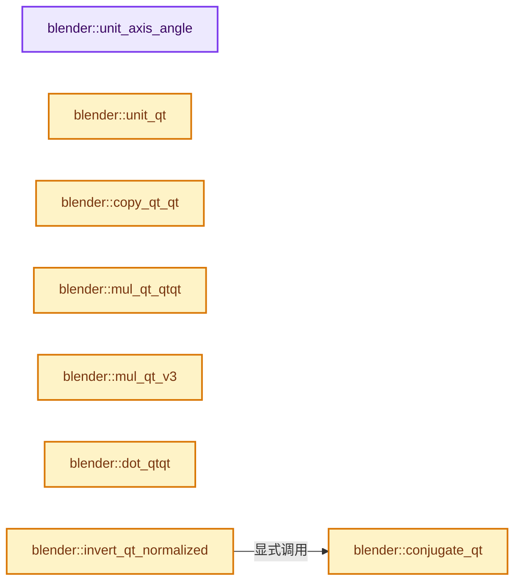

# 实现依赖专题：source/blender/blenlib/intern/math_rotation_c.cc

[方向导航](README.md) · [符号索引](../%E7%AC%A6%E5%8F%B7%E4%BE%9D%E8%B5%96%E4%B8%8E%E5%AE%9E%E7%8E%B0%E7%B4%A2%E5%BC%95.md)

本专题从正文实际调用进入，集中保存共享实现。函数有稳定锚点，可从调用处直接跳到对应完整函数；递归与互相调用通过回链组织。

## 本文件的实现关系




## 完整成员与函数实现

<a id="f-cd4add707042a7a3"></a>

### `blender::unit_axis_angle`

实现位置：[source/blender/blenlib/intern/math_rotation_c.cc](../../../../../source/blender/blenlib/intern/math_rotation_c.cc) · L37—L43。

接口参数：

- `float axis[3]`
- `float *angle`

**教学注释版**

<!-- annotated:09a15c048425ac -->

```cpp
void unit_axis_angle(float axis[3], float *angle)
{
  axis[0] = 0.0f;
  axis[1] = 1.0f;
  axis[2] = 0.0f;
  *angle = 0.0f;
}
```

<details>
<summary>核对原始源码：source/blender/blenlib/intern/math_rotation_c.cc · L37—L43</summary>

<!-- original:09a15c048425ac:source/blender/blenlib/intern/math_rotation_c.cc:37:43 -->

```cpp
void unit_axis_angle(float axis[3], float *angle)
{
  axis[0] = 0.0f;
  axis[1] = 1.0f;
  axis[2] = 0.0f;
  *angle = 0.0f;
}
```

</details>

**沿实际写入检查状态**

- `axis[0] = 0.0f;`
- `axis[1] = 1.0f;`
- `axis[2] = 0.0f;`

**继续追踪实现**

本实现没有需要继续展开的显式调用；检查返回表达式、对象转换和调用者前置条件。

<a id="f-6323eadd66d3989a"></a>

### `blender::unit_qt`

实现位置：[source/blender/blenlib/intern/math_rotation_c.cc](../../../../../source/blender/blenlib/intern/math_rotation_c.cc) · L45—L49。

接口参数：

- `float q[4]`

**教学注释版**

<!-- annotated:17e2ca7a57d089 -->

```cpp
void unit_qt(float q[4])
{
  q[0] = 1.0f;
  q[1] = q[2] = q[3] = 0.0f;
}
```

<details>
<summary>核对原始源码：source/blender/blenlib/intern/math_rotation_c.cc · L45—L49</summary>

<!-- original:17e2ca7a57d089:source/blender/blenlib/intern/math_rotation_c.cc:45:49 -->

```cpp
void unit_qt(float q[4])
{
  q[0] = 1.0f;
  q[1] = q[2] = q[3] = 0.0f;
}
```

</details>

**沿实际写入检查状态**

- `q[0] = 1.0f;`
- `q[1] = q[2] = q[3] = 0.0f;`

**继续追踪实现**

本实现没有需要继续展开的显式调用；检查返回表达式、对象转换和调用者前置条件。

<a id="f-503531a8e10b755b"></a>

### `blender::copy_qt_qt`

实现位置：[source/blender/blenlib/intern/math_rotation_c.cc](../../../../../source/blender/blenlib/intern/math_rotation_c.cc) · L51—L57。

接口参数：

- `float q[4]`
- `const float a[4]`

**教学注释版**

<!-- annotated:041eaa53244900 -->

```cpp
void copy_qt_qt(float q[4], const float a[4])
{
  q[0] = a[0];
  q[1] = a[1];
  q[2] = a[2];
  q[3] = a[3];
}
```

<details>
<summary>核对原始源码：source/blender/blenlib/intern/math_rotation_c.cc · L51—L57</summary>

<!-- original:041eaa53244900:source/blender/blenlib/intern/math_rotation_c.cc:51:57 -->

```cpp
void copy_qt_qt(float q[4], const float a[4])
{
  q[0] = a[0];
  q[1] = a[1];
  q[2] = a[2];
  q[3] = a[3];
}
```

</details>

**沿实际写入检查状态**

- `q[0] = a[0];`
- `q[1] = a[1];`
- `q[2] = a[2];`
- `q[3] = a[3];`

**继续追踪实现**

本实现没有需要继续展开的显式调用；检查返回表达式、对象转换和调用者前置条件。

<a id="f-a42c1e370be54b71"></a>

### `blender::mul_qt_qtqt`

实现位置：[source/blender/blenlib/intern/math_rotation_c.cc](../../../../../source/blender/blenlib/intern/math_rotation_c.cc) · L64—L75。

接口参数：

- `float q[4]`
- `const float a[4]`
- `const float b[4]`

**教学注释版**

<!-- annotated:a63f01143d9eba -->

```cpp
void mul_qt_qtqt(float q[4], const float a[4], const float b[4])
{
  float t0, t1, t2;

  t0 = a[0] * b[0] - a[1] * b[1] - a[2] * b[2] - a[3] * b[3];
  t1 = a[0] * b[1] + a[1] * b[0] + a[2] * b[3] - a[3] * b[2];
  t2 = a[0] * b[2] + a[2] * b[0] + a[3] * b[1] - a[1] * b[3];
  q[3] = a[0] * b[3] + a[3] * b[0] + a[1] * b[2] - a[2] * b[1];
  q[0] = t0;
  q[1] = t1;
  q[2] = t2;
}
```

<details>
<summary>核对原始源码：source/blender/blenlib/intern/math_rotation_c.cc · L64—L75</summary>

<!-- original:a63f01143d9eba:source/blender/blenlib/intern/math_rotation_c.cc:64:75 -->

```cpp
void mul_qt_qtqt(float q[4], const float a[4], const float b[4])
{
  float t0, t1, t2;

  t0 = a[0] * b[0] - a[1] * b[1] - a[2] * b[2] - a[3] * b[3];
  t1 = a[0] * b[1] + a[1] * b[0] + a[2] * b[3] - a[3] * b[2];
  t2 = a[0] * b[2] + a[2] * b[0] + a[3] * b[1] - a[1] * b[3];
  q[3] = a[0] * b[3] + a[3] * b[0] + a[1] * b[2] - a[2] * b[1];
  q[0] = t0;
  q[1] = t1;
  q[2] = t2;
}
```

</details>

**沿实际写入检查状态**

- `t0 = a[0] * b[0] - a[1] * b[1] - a[2] * b[2] - a[3] * b[3];`
- `t1 = a[0] * b[1] + a[1] * b[0] + a[2] * b[3] - a[3] * b[2];`
- `t2 = a[0] * b[2] + a[2] * b[0] + a[3] * b[1] - a[1] * b[3];`
- `q[3] = a[0] * b[3] + a[3] * b[0] + a[1] * b[2] - a[2] * b[1];`
- `q[0] = t0;`
- `q[1] = t1;`
- `q[2] = t2;`

**继续追踪实现**

本实现没有需要继续展开的显式调用；检查返回表达式、对象转换和调用者前置条件。

<a id="f-de1eaa8cb3a56e7b"></a>

### `blender::mul_qt_v3`

实现位置：[source/blender/blenlib/intern/math_rotation_c.cc](../../../../../source/blender/blenlib/intern/math_rotation_c.cc) · L77—L93。

接口参数：

- `const float q[4]`
- `float r[3]`

**教学注释版**

<!-- annotated:de2c5ba15772e6 -->

```cpp
void mul_qt_v3(const float q[4], float r[3])
{
  float t0, t1, t2;

  t0 = -q[1] * r[0] - q[2] * r[1] - q[3] * r[2];
  t1 = q[0] * r[0] + q[2] * r[2] - q[3] * r[1];
  t2 = q[0] * r[1] + q[3] * r[0] - q[1] * r[2];
  r[2] = q[0] * r[2] + q[1] * r[1] - q[2] * r[0];
  r[0] = t1;
  r[1] = t2;

  t1 = t0 * -q[1] + r[0] * q[0] - r[1] * q[3] + r[2] * q[2];
  t2 = t0 * -q[2] + r[1] * q[0] - r[2] * q[1] + r[0] * q[3];
  r[2] = t0 * -q[3] + r[2] * q[0] - r[0] * q[2] + r[1] * q[1];
  r[0] = t1;
  r[1] = t2;
}
```

<details>
<summary>核对原始源码：source/blender/blenlib/intern/math_rotation_c.cc · L77—L93</summary>

<!-- original:de2c5ba15772e6:source/blender/blenlib/intern/math_rotation_c.cc:77:93 -->

```cpp
void mul_qt_v3(const float q[4], float r[3])
{
  float t0, t1, t2;

  t0 = -q[1] * r[0] - q[2] * r[1] - q[3] * r[2];
  t1 = q[0] * r[0] + q[2] * r[2] - q[3] * r[1];
  t2 = q[0] * r[1] + q[3] * r[0] - q[1] * r[2];
  r[2] = q[0] * r[2] + q[1] * r[1] - q[2] * r[0];
  r[0] = t1;
  r[1] = t2;

  t1 = t0 * -q[1] + r[0] * q[0] - r[1] * q[3] + r[2] * q[2];
  t2 = t0 * -q[2] + r[1] * q[0] - r[2] * q[1] + r[0] * q[3];
  r[2] = t0 * -q[3] + r[2] * q[0] - r[0] * q[2] + r[1] * q[1];
  r[0] = t1;
  r[1] = t2;
}
```

</details>

**沿实际写入检查状态**

- `t0 = -q[1] * r[0] - q[2] * r[1] - q[3] * r[2];`
- `t1 = q[0] * r[0] + q[2] * r[2] - q[3] * r[1];`
- `t2 = q[0] * r[1] + q[3] * r[0] - q[1] * r[2];`
- `r[2] = q[0] * r[2] + q[1] * r[1] - q[2] * r[0];`
- `r[0] = t1;`
- `r[1] = t2;`
- `t1 = t0 * -q[1] + r[0] * q[0] - r[1] * q[3] + r[2] * q[2];`
- `t2 = t0 * -q[2] + r[1] * q[0] - r[2] * q[1] + r[0] * q[3];`
- `r[2] = t0 * -q[3] + r[2] * q[0] - r[0] * q[2] + r[1] * q[1];`

**继续追踪实现**

本实现没有需要继续展开的显式调用；检查返回表达式、对象转换和调用者前置条件。

<a id="f-84997f5457a2aae1"></a>

### `blender::conjugate_qt`

实现位置：[source/blender/blenlib/intern/math_rotation_c.cc](../../../../../source/blender/blenlib/intern/math_rotation_c.cc) · L103—L108。

接口参数：

- `float q[4]`

**教学注释版**

<!-- annotated:03645e35fc9294 -->

```cpp
void conjugate_qt(float q[4])
{
  q[1] = -q[1];
  q[2] = -q[2];
  q[3] = -q[3];
}
```

<details>
<summary>核对原始源码：source/blender/blenlib/intern/math_rotation_c.cc · L103—L108</summary>

<!-- original:03645e35fc9294:source/blender/blenlib/intern/math_rotation_c.cc:103:108 -->

```cpp
void conjugate_qt(float q[4])
{
  q[1] = -q[1];
  q[2] = -q[2];
  q[3] = -q[3];
}
```

</details>

**沿实际写入检查状态**

- `q[1] = -q[1];`
- `q[2] = -q[2];`
- `q[3] = -q[3];`

**继续追踪实现**

本实现没有需要继续展开的显式调用；检查返回表达式、对象转换和调用者前置条件。

<a id="f-a41b054e19f63b88"></a>

### `blender::dot_qtqt`

实现位置：[source/blender/blenlib/intern/math_rotation_c.cc](../../../../../source/blender/blenlib/intern/math_rotation_c.cc) · L110—L113。

接口参数：

- `const float a[4]`
- `const float b[4]`

**教学注释版**

<!-- annotated:c6c9264836f324 -->

```cpp
float dot_qtqt(const float a[4], const float b[4])
{
  return a[0] * b[0] + a[1] * b[1] + a[2] * b[2] + a[3] * b[3];
}
```

<details>
<summary>核对原始源码：source/blender/blenlib/intern/math_rotation_c.cc · L110—L113</summary>

<!-- original:c6c9264836f324:source/blender/blenlib/intern/math_rotation_c.cc:110:113 -->

```cpp
float dot_qtqt(const float a[4], const float b[4])
{
  return a[0] * b[0] + a[1] * b[1] + a[2] * b[2] + a[3] * b[3];
}
```

</details>

**结果出口**

- `return a[0] * b[0] + a[1] * b[1] + a[2] * b[2] + a[3] * b[3];`

**继续追踪实现**

本实现没有需要继续展开的显式调用；检查返回表达式、对象转换和调用者前置条件。

<a id="f-aa50889fb1fa54a1"></a>

### `blender::invert_qt_normalized`

实现位置：[source/blender/blenlib/intern/math_rotation_c.cc](../../../../../source/blender/blenlib/intern/math_rotation_c.cc) · L133—L137。

接口参数：

- `float q[4]`

**教学注释版**

<!-- annotated:b15b0e692dec43 -->

```cpp
void invert_qt_normalized(float q[4])
{
  BLI_ASSERT_UNIT_QUAT(q);
  conjugate_qt(q);
}
```

<details>
<summary>核对原始源码：source/blender/blenlib/intern/math_rotation_c.cc · L133—L137</summary>

<!-- original:b15b0e692dec43:source/blender/blenlib/intern/math_rotation_c.cc:133:137 -->

```cpp
void invert_qt_normalized(float q[4])
{
  BLI_ASSERT_UNIT_QUAT(q);
  conjugate_qt(q);
}
```

</details>

**继续追踪实现**

- `BLI_ASSERT_UNIT_QUAT` → [BLI_ASSERT_UNIT_QUAT · L331](%E4%BE%9D%E8%B5%96-BLI_math_base_c-171dae.md#m-b94b0325bbe6)；[BLI_ASSERT_UNIT_QUAT · L360](%E4%BE%9D%E8%B5%96-BLI_math_base_c-171dae.md#m-977015ef7725)。宏定义由构建条件选择。
- `conjugate_qt` → [blender::conjugate_qt · L103](%E4%BE%9D%E8%B5%96-math_rotation_c-8e57f4.md#f-84997f5457a2aae1)。

<a id="f-5d0341030dea1234"></a>

### `blender::invert_qt_qt_normalized`

实现位置：[source/blender/blenlib/intern/math_rotation_c.cc](../../../../../source/blender/blenlib/intern/math_rotation_c.cc) · L139—L143。

接口参数：

- `float q1[4]`
- `const float q2[4]`

**教学注释版**

<!-- annotated:1644e2f02a1f47 -->

```cpp
void invert_qt_qt_normalized(float q1[4], const float q2[4])
{
  copy_qt_qt(q1, q2);
  invert_qt_normalized(q1);
}
```

<details>
<summary>核对原始源码：source/blender/blenlib/intern/math_rotation_c.cc · L139—L143</summary>

<!-- original:1644e2f02a1f47:source/blender/blenlib/intern/math_rotation_c.cc:139:143 -->

```cpp
void invert_qt_qt_normalized(float q1[4], const float q2[4])
{
  copy_qt_qt(q1, q2);
  invert_qt_normalized(q1);
}
```

</details>

**继续追踪实现**

- `copy_qt_qt` → [blender::copy_qt_qt · L51](%E4%BE%9D%E8%B5%96-math_rotation_c-8e57f4.md#f-503531a8e10b755b)。
- `invert_qt_normalized` → [blender::invert_qt_normalized · L133](%E4%BE%9D%E8%B5%96-math_rotation_c-8e57f4.md#f-aa50889fb1fa54a1)。

<a id="f-79819d80ce132087"></a>

### `blender::mul_qt_fl`

实现位置：[source/blender/blenlib/intern/math_rotation_c.cc](../../../../../source/blender/blenlib/intern/math_rotation_c.cc) · L145—L151。

接口参数：

- `float q[4]`
- `const float f`

**教学注释版**

<!-- annotated:074b74384e088e -->

```cpp
void mul_qt_fl(float q[4], const float f)
{
  q[0] *= f;
  q[1] *= f;
  q[2] *= f;
  q[3] *= f;
}
```

<details>
<summary>核对原始源码：source/blender/blenlib/intern/math_rotation_c.cc · L145—L151</summary>

<!-- original:074b74384e088e:source/blender/blenlib/intern/math_rotation_c.cc:145:151 -->

```cpp
void mul_qt_fl(float q[4], const float f)
{
  q[0] *= f;
  q[1] *= f;
  q[2] *= f;
  q[3] *= f;
}
```

</details>

**沿实际写入检查状态**

- `q[0] *= f;`
- `q[1] *= f;`
- `q[2] *= f;`
- `q[3] *= f;`

**继续追踪实现**

本实现没有需要继续展开的显式调用；检查返回表达式、对象转换和调用者前置条件。

<a id="f-c003026efa0a7134"></a>

### `blender::sub_qt_qtqt`

实现位置：[source/blender/blenlib/intern/math_rotation_c.cc](../../../../../source/blender/blenlib/intern/math_rotation_c.cc) · L153—L163。

接口参数：

- `float q[4]`
- `const float a[4]`
- `const float b[4]`

**教学注释版**

<!-- annotated:fa20e2ad4c444b -->

```cpp
void sub_qt_qtqt(float q[4], const float a[4], const float b[4])
{
  float n_b[4];

  n_b[0] = -b[0];
  n_b[1] = b[1];
  n_b[2] = b[2];
  n_b[3] = b[3];

  mul_qt_qtqt(q, a, n_b);
}
```

<details>
<summary>核对原始源码：source/blender/blenlib/intern/math_rotation_c.cc · L153—L163</summary>

<!-- original:fa20e2ad4c444b:source/blender/blenlib/intern/math_rotation_c.cc:153:163 -->

```cpp
void sub_qt_qtqt(float q[4], const float a[4], const float b[4])
{
  float n_b[4];

  n_b[0] = -b[0];
  n_b[1] = b[1];
  n_b[2] = b[2];
  n_b[3] = b[3];

  mul_qt_qtqt(q, a, n_b);
}
```

</details>

**沿实际写入检查状态**

- `n_b[0] = -b[0];`
- `n_b[1] = b[1];`
- `n_b[2] = b[2];`
- `n_b[3] = b[3];`

**继续追踪实现**

- `mul_qt_qtqt` → [blender::mul_qt_qtqt · L64](%E4%BE%9D%E8%B5%96-math_rotation_c-8e57f4.md#f-a42c1e370be54b71)。

<a id="f-454ae6606d3afac1"></a>

### `blender::pow_qt_fl_normalized`

实现位置：[source/blender/blenlib/intern/math_rotation_c.cc](../../../../../source/blender/blenlib/intern/math_rotation_c.cc) · L165—L174。

接口参数：

- `float q[4]`
- `const float fac`

**教学注释版**

<!-- annotated:d0900f4a4aa2fc -->

```cpp
void pow_qt_fl_normalized(float q[4], const float fac)
{
  BLI_ASSERT_UNIT_QUAT(q);
  const float angle = fac * safe_acosf(q[0]); /* quat[0] = cos(0.5 * angle),
                                               * but now the 0.5 and 2.0 rule out */
  const float co = cosf(angle);
  const float si = sinf(angle);
  q[0] = co;
  normalize_v3_length(q + 1, si);
}
```

<details>
<summary>核对原始源码：source/blender/blenlib/intern/math_rotation_c.cc · L165—L174</summary>

<!-- original:d0900f4a4aa2fc:source/blender/blenlib/intern/math_rotation_c.cc:165:174 -->

```cpp
void pow_qt_fl_normalized(float q[4], const float fac)
{
  BLI_ASSERT_UNIT_QUAT(q);
  const float angle = fac * safe_acosf(q[0]); /* quat[0] = cos(0.5 * angle),
                                               * but now the 0.5 and 2.0 rule out */
  const float co = cosf(angle);
  const float si = sinf(angle);
  q[0] = co;
  normalize_v3_length(q + 1, si);
}
```

</details>

**沿实际写入检查状态**

- `q[0] = co;`

**继续追踪实现**

- `BLI_ASSERT_UNIT_QUAT` → [BLI_ASSERT_UNIT_QUAT · L331](%E4%BE%9D%E8%B5%96-BLI_math_base_c-171dae.md#m-b94b0325bbe6)；[BLI_ASSERT_UNIT_QUAT · L360](%E4%BE%9D%E8%B5%96-BLI_math_base_c-171dae.md#m-977015ef7725)。宏定义由构建条件选择。
- `safe_acosf` → [blender::safe_acosf · L55](%E4%BE%9D%E8%B5%96-math_base_safe_inline-c0d62b.md#f-ea1b330e846761a7)。
- `cosf` → [cosf · L20](../05-%E5%87%A0%E4%BD%95%E5%AD%98%E5%82%A8%E4%B8%8E%E6%8B%93%E6%89%91%E6%98%A0%E5%B0%84/%E4%BE%9D%E8%B5%96-radial_tiling_shared-98abf9.md#m-cee9ebf67d86)；[cosf · L42](../05-%E5%87%A0%E4%BD%95%E5%AD%98%E5%82%A8%E4%B8%8E%E6%8B%93%E6%89%91%E6%98%A0%E5%B0%84/%E4%BE%9D%E8%B5%96-radial_tiling_shared-98abf9.md#m-346533627567)；[cosf · L73](../05-%E5%87%A0%E4%BD%95%E5%AD%98%E5%82%A8%E4%B8%8E%E6%8B%93%E6%89%91%E6%98%A0%E5%B0%84/%E4%BE%9D%E8%B5%96-radial_tiling_shared-98abf9.md#m-e01b94a43b72)；[cosf · L24](../01-%E5%9F%BA%E7%A1%80%E5%AE%B9%E5%99%A8%E4%B8%8E%E7%8E%B0%E4%BB%A3CPP/%E4%BE%9D%E8%B5%96-radial_tiling_shared-7989a4.md#m-c317cb08dec6)；[cosf · L46](../01-%E5%9F%BA%E7%A1%80%E5%AE%B9%E5%99%A8%E4%B8%8E%E7%8E%B0%E4%BB%A3CPP/%E4%BE%9D%E8%B5%96-radial_tiling_shared-7989a4.md#m-93325b515297)；[cosf · L77](../01-%E5%9F%BA%E7%A1%80%E5%AE%B9%E5%99%A8%E4%B8%8E%E7%8E%B0%E4%BB%A3CPP/%E4%BE%9D%E8%B5%96-radial_tiling_shared-7989a4.md#m-d3058af0b490)；[cosf · L20](../05-%E5%87%A0%E4%BD%95%E5%AD%98%E5%82%A8%E4%B8%8E%E6%8B%93%E6%89%91%E6%98%A0%E5%B0%84/%E4%BE%9D%E8%B5%96-node_radial_tiling_shared-b14bc2.md#m-4c6aea22a560)；[cosf · L42](../05-%E5%87%A0%E4%BD%95%E5%AD%98%E5%82%A8%E4%B8%8E%E6%8B%93%E6%89%91%E6%98%A0%E5%B0%84/%E4%BE%9D%E8%B5%96-node_radial_tiling_shared-b14bc2.md#m-1fd6a5414477)；[cosf · L73](../05-%E5%87%A0%E4%BD%95%E5%AD%98%E5%82%A8%E4%B8%8E%E6%8B%93%E6%89%91%E6%98%A0%E5%B0%84/%E4%BE%9D%E8%B5%96-node_radial_tiling_shared-b14bc2.md#m-de2402f85270)；[cosf · L186](../05-%E5%87%A0%E4%BD%95%E5%AD%98%E5%82%A8%E4%B8%8E%E6%8B%93%E6%89%91%E6%98%A0%E5%B0%84/%E4%BE%9D%E8%B5%96-compat-56205c.md#m-7fdbd99009e0)；[cosf · L288](../05-%E5%87%A0%E4%BD%95%E5%AD%98%E5%82%A8%E4%B8%8E%E6%8B%93%E6%89%91%E6%98%A0%E5%B0%84/%E4%BE%9D%E8%B5%96-compat-efe0e9.md#m-68fe984e8b68)；[cosf · L93](../05-%E5%87%A0%E4%BD%95%E5%AD%98%E5%82%A8%E4%B8%8E%E6%8B%93%E6%89%91%E6%98%A0%E5%B0%84/%E4%BE%9D%E8%B5%96-compat-9e0a25.md#m-21bb557a23f1)；[cosf · L91](../05-%E5%87%A0%E4%BD%95%E5%AD%98%E5%82%A8%E4%B8%8E%E6%8B%93%E6%89%91%E6%98%A0%E5%B0%84/%E4%BE%9D%E8%B5%96-compat-e9eab7.md#m-7721be419a49)；[cosf · L43](../05-%E5%87%A0%E4%BD%95%E5%AD%98%E5%82%A8%E4%B8%8E%E6%8B%93%E6%89%91%E6%98%A0%E5%B0%84/%E4%BE%9D%E8%B5%96-GPU_shader_shared_utils-0adda3.md#m-25d02fd11b3b)；[cosf · L64](../05-%E5%87%A0%E4%BD%95%E5%AD%98%E5%82%A8%E4%B8%8E%E6%8B%93%E6%89%91%E6%98%A0%E5%B0%84/%E4%BE%9D%E8%B5%96-GPU_shader_shared_utils-0adda3.md#m-698fc51ccda3)。宏定义由构建条件选择。
- `sinf` → [sinf · L27](../05-%E5%87%A0%E4%BD%95%E5%AD%98%E5%82%A8%E4%B8%8E%E6%8B%93%E6%89%91%E6%98%A0%E5%B0%84/%E4%BE%9D%E8%B5%96-radial_tiling_shared-98abf9.md#m-40547e913688)；[sinf · L49](../05-%E5%87%A0%E4%BD%95%E5%AD%98%E5%82%A8%E4%B8%8E%E6%8B%93%E6%89%91%E6%98%A0%E5%B0%84/%E4%BE%9D%E8%B5%96-radial_tiling_shared-98abf9.md#m-8908e5f49833)；[sinf · L80](../05-%E5%87%A0%E4%BD%95%E5%AD%98%E5%82%A8%E4%B8%8E%E6%8B%93%E6%89%91%E6%98%A0%E5%B0%84/%E4%BE%9D%E8%B5%96-radial_tiling_shared-98abf9.md#m-71130f6adcc4)；[sinf · L31](../01-%E5%9F%BA%E7%A1%80%E5%AE%B9%E5%99%A8%E4%B8%8E%E7%8E%B0%E4%BB%A3CPP/%E4%BE%9D%E8%B5%96-radial_tiling_shared-7989a4.md#m-a51a6c88deca)；[sinf · L53](../01-%E5%9F%BA%E7%A1%80%E5%AE%B9%E5%99%A8%E4%B8%8E%E7%8E%B0%E4%BB%A3CPP/%E4%BE%9D%E8%B5%96-radial_tiling_shared-7989a4.md#m-9a4db95358ff)；[sinf · L84](../01-%E5%9F%BA%E7%A1%80%E5%AE%B9%E5%99%A8%E4%B8%8E%E7%8E%B0%E4%BB%A3CPP/%E4%BE%9D%E8%B5%96-radial_tiling_shared-7989a4.md#m-d26cdafe5b93)；[sinf · L27](../05-%E5%87%A0%E4%BD%95%E5%AD%98%E5%82%A8%E4%B8%8E%E6%8B%93%E6%89%91%E6%98%A0%E5%B0%84/%E4%BE%9D%E8%B5%96-node_radial_tiling_shared-b14bc2.md#m-9f80b4d363af)；[sinf · L49](../05-%E5%87%A0%E4%BD%95%E5%AD%98%E5%82%A8%E4%B8%8E%E6%8B%93%E6%89%91%E6%98%A0%E5%B0%84/%E4%BE%9D%E8%B5%96-node_radial_tiling_shared-b14bc2.md#m-f52c29b37ed1)；[sinf · L80](../05-%E5%87%A0%E4%BD%95%E5%AD%98%E5%82%A8%E4%B8%8E%E6%8B%93%E6%89%91%E6%98%A0%E5%B0%84/%E4%BE%9D%E8%B5%96-node_radial_tiling_shared-b14bc2.md#m-7f1f234ef9ec)；[sinf · L187](../05-%E5%87%A0%E4%BD%95%E5%AD%98%E5%82%A8%E4%B8%8E%E6%8B%93%E6%89%91%E6%98%A0%E5%B0%84/%E4%BE%9D%E8%B5%96-compat-56205c.md#m-aab07e522dda)；[sinf · L287](../05-%E5%87%A0%E4%BD%95%E5%AD%98%E5%82%A8%E4%B8%8E%E6%8B%93%E6%89%91%E6%98%A0%E5%B0%84/%E4%BE%9D%E8%B5%96-compat-efe0e9.md#m-7009b99c07ca)；[sinf · L94](../05-%E5%87%A0%E4%BD%95%E5%AD%98%E5%82%A8%E4%B8%8E%E6%8B%93%E6%89%91%E6%98%A0%E5%B0%84/%E4%BE%9D%E8%B5%96-compat-9e0a25.md#m-4a1f5d760325)；[sinf · L92](../05-%E5%87%A0%E4%BD%95%E5%AD%98%E5%82%A8%E4%B8%8E%E6%8B%93%E6%89%91%E6%98%A0%E5%B0%84/%E4%BE%9D%E8%B5%96-compat-e9eab7.md#m-e63872738f13)；[sinf · L44](../05-%E5%87%A0%E4%BD%95%E5%AD%98%E5%82%A8%E4%B8%8E%E6%8B%93%E6%89%91%E6%98%A0%E5%B0%84/%E4%BE%9D%E8%B5%96-GPU_shader_shared_utils-0adda3.md#m-a916f31e38c4)；[sinf · L65](../05-%E5%87%A0%E4%BD%95%E5%AD%98%E5%82%A8%E4%B8%8E%E6%8B%93%E6%89%91%E6%98%A0%E5%B0%84/%E4%BE%9D%E8%B5%96-GPU_shader_shared_utils-0adda3.md#m-268edbf6d41e)。宏定义由构建条件选择。
- `normalize_v3_length` → [blender::normalize_v3_length · L928](%E4%BE%9D%E8%B5%96-math_vector_inline-0c8541.md#f-1438a0c9967461de)。

<a id="f-963370fb52a740b7"></a>

### `blender::quat_to_mat3_no_error`

实现位置：[source/blender/blenlib/intern/math_rotation_c.cc](../../../../../source/blender/blenlib/intern/math_rotation_c.cc) · L198—L228。

接口参数：

- `float m[3][3]`
- `const float q[4]`

**教学注释版**

<!-- annotated:7fc0f27a0c7eab -->

```cpp
static void quat_to_mat3_no_error(float m[3][3], const float q[4])
{
  double q0, q1, q2, q3, qda, qdb, qdc, qaa, qab, qac, qbb, qbc, qcc;

  q0 = M_SQRT2 * double(q[0]);
  q1 = M_SQRT2 * double(q[1]);
  q2 = M_SQRT2 * double(q[2]);
  q3 = M_SQRT2 * double(q[3]);

  qda = q0 * q1;
  qdb = q0 * q2;
  qdc = q0 * q3;
  qaa = q1 * q1;
  qab = q1 * q2;
  qac = q1 * q3;
  qbb = q2 * q2;
  qbc = q2 * q3;
  qcc = q3 * q3;

  m[0][0] = float(1.0 - qbb - qcc);
  m[0][1] = float(qdc + qab);
  m[0][2] = float(-qdb + qac);

  m[1][0] = float(-qdc + qab);
  m[1][1] = float(1.0 - qaa - qcc);
  m[1][2] = float(qda + qbc);

  m[2][0] = float(qdb + qac);
  m[2][1] = float(-qda + qbc);
  m[2][2] = float(1.0 - qaa - qbb);
}
```

<details>
<summary>核对原始源码：source/blender/blenlib/intern/math_rotation_c.cc · L198—L228</summary>

<!-- original:7fc0f27a0c7eab:source/blender/blenlib/intern/math_rotation_c.cc:198:228 -->

```cpp
static void quat_to_mat3_no_error(float m[3][3], const float q[4])
{
  double q0, q1, q2, q3, qda, qdb, qdc, qaa, qab, qac, qbb, qbc, qcc;

  q0 = M_SQRT2 * double(q[0]);
  q1 = M_SQRT2 * double(q[1]);
  q2 = M_SQRT2 * double(q[2]);
  q3 = M_SQRT2 * double(q[3]);

  qda = q0 * q1;
  qdb = q0 * q2;
  qdc = q0 * q3;
  qaa = q1 * q1;
  qab = q1 * q2;
  qac = q1 * q3;
  qbb = q2 * q2;
  qbc = q2 * q3;
  qcc = q3 * q3;

  m[0][0] = float(1.0 - qbb - qcc);
  m[0][1] = float(qdc + qab);
  m[0][2] = float(-qdb + qac);

  m[1][0] = float(-qdc + qab);
  m[1][1] = float(1.0 - qaa - qcc);
  m[1][2] = float(qda + qbc);

  m[2][0] = float(qdb + qac);
  m[2][1] = float(-qda + qbc);
  m[2][2] = float(1.0 - qaa - qbb);
}
```

</details>

**沿实际写入检查状态**

- `q0 = M_SQRT2 * double(q[0]);`
- `q1 = M_SQRT2 * double(q[1]);`
- `q2 = M_SQRT2 * double(q[2]);`
- `q3 = M_SQRT2 * double(q[3]);`
- `qda = q0 * q1;`
- `qdb = q0 * q2;`
- `qdc = q0 * q3;`
- `qaa = q1 * q1;`
- `qab = q1 * q2;`
- `qac = q1 * q3;`
- `qbb = q2 * q2;`
- `qbc = q2 * q3;`
- `qcc = q3 * q3;`
- `m[0][0] = float(1.0 - qbb - qcc);`
- `m[0][1] = float(qdc + qab);`
- `m[0][2] = float(-qdb + qac);`
- `m[1][0] = float(-qdc + qab);`
- `m[1][1] = float(1.0 - qaa - qcc);`
- `m[1][2] = float(qda + qbc);`
- `m[2][0] = float(qdb + qac);`
- `m[2][1] = float(-qda + qbc);`
- `m[2][2] = float(1.0 - qaa - qbb);`

**继续追踪实现**

本实现没有需要继续展开的显式调用；检查返回表达式、对象转换和调用者前置条件。

<a id="f-0bd397cf0e2222a3"></a>

### `blender::quat_to_mat3`

实现位置：[source/blender/blenlib/intern/math_rotation_c.cc](../../../../../source/blender/blenlib/intern/math_rotation_c.cc) · L230—L242。

接口参数：

- `float m[3][3]`
- `const float q[4]`

**教学注释版**

<!-- annotated:1dc6416aebdf14 -->

```cpp
void quat_to_mat3(float m[3][3], const float q[4])
{
#ifndef NDEBUG
  float f;
  if (!((f = dot_qtqt(q, q)) == 0.0f || (fabsf(f - 1.0f) < float(QUAT_EPSILON)))) {
    fprintf(stderr,
            "Warning! quat_to_mat3() called with non-normalized: size %.8f *** report a bug ***\n",
            f);
  }
#endif

  quat_to_mat3_no_error(m, q);
}
```

<details>
<summary>核对原始源码：source/blender/blenlib/intern/math_rotation_c.cc · L230—L242</summary>

<!-- original:1dc6416aebdf14:source/blender/blenlib/intern/math_rotation_c.cc:230:242 -->

```cpp
void quat_to_mat3(float m[3][3], const float q[4])
{
#ifndef NDEBUG
  float f;
  if (!((f = dot_qtqt(q, q)) == 0.0f || (fabsf(f - 1.0f) < float(QUAT_EPSILON)))) {
    fprintf(stderr,
            "Warning! quat_to_mat3() called with non-normalized: size %.8f *** report a bug ***\n",
            f);
  }
#endif

  quat_to_mat3_no_error(m, q);
}
```

</details>

**继续追踪实现**

- `dot_qtqt` → [blender::dot_qtqt · L110](%E4%BE%9D%E8%B5%96-math_rotation_c-8e57f4.md#f-a41b054e19f63b88)。
- `fabsf` → [fabsf · L21](../05-%E5%87%A0%E4%BD%95%E5%AD%98%E5%82%A8%E4%B8%8E%E6%8B%93%E6%89%91%E6%98%A0%E5%B0%84/%E4%BE%9D%E8%B5%96-radial_tiling_shared-98abf9.md#m-02cc4c69cfb3)；[fabsf · L43](../05-%E5%87%A0%E4%BD%95%E5%AD%98%E5%82%A8%E4%B8%8E%E6%8B%93%E6%89%91%E6%98%A0%E5%B0%84/%E4%BE%9D%E8%B5%96-radial_tiling_shared-98abf9.md#m-04effe61803b)；[fabsf · L74](../05-%E5%87%A0%E4%BD%95%E5%AD%98%E5%82%A8%E4%B8%8E%E6%8B%93%E6%89%91%E6%98%A0%E5%B0%84/%E4%BE%9D%E8%B5%96-radial_tiling_shared-98abf9.md#m-927dd4eba7dc)；[fabsf · L25](../01-%E5%9F%BA%E7%A1%80%E5%AE%B9%E5%99%A8%E4%B8%8E%E7%8E%B0%E4%BB%A3CPP/%E4%BE%9D%E8%B5%96-radial_tiling_shared-7989a4.md#m-8348d6b3d08f)；[fabsf · L47](../01-%E5%9F%BA%E7%A1%80%E5%AE%B9%E5%99%A8%E4%B8%8E%E7%8E%B0%E4%BB%A3CPP/%E4%BE%9D%E8%B5%96-radial_tiling_shared-7989a4.md#m-13b7e0b6d84f)；[fabsf · L78](../01-%E5%9F%BA%E7%A1%80%E5%AE%B9%E5%99%A8%E4%B8%8E%E7%8E%B0%E4%BB%A3CPP/%E4%BE%9D%E8%B5%96-radial_tiling_shared-7989a4.md#m-326c83464a0d)；[fabsf · L21](../05-%E5%87%A0%E4%BD%95%E5%AD%98%E5%82%A8%E4%B8%8E%E6%8B%93%E6%89%91%E6%98%A0%E5%B0%84/%E4%BE%9D%E8%B5%96-node_radial_tiling_shared-b14bc2.md#m-7c3ee12fc119)；[fabsf · L43](../05-%E5%87%A0%E4%BD%95%E5%AD%98%E5%82%A8%E4%B8%8E%E6%8B%93%E6%89%91%E6%98%A0%E5%B0%84/%E4%BE%9D%E8%B5%96-node_radial_tiling_shared-b14bc2.md#m-9112db0e2dd1)；[fabsf · L74](../05-%E5%87%A0%E4%BD%95%E5%AD%98%E5%82%A8%E4%B8%8E%E6%8B%93%E6%89%91%E6%98%A0%E5%B0%84/%E4%BE%9D%E8%B5%96-node_radial_tiling_shared-b14bc2.md#m-ee4e61908a6f)；[fabsf · L167](../05-%E5%87%A0%E4%BD%95%E5%AD%98%E5%82%A8%E4%B8%8E%E6%8B%93%E6%89%91%E6%98%A0%E5%B0%84/%E4%BE%9D%E8%B5%96-compat-56205c.md#m-b039ee6c1601)；[fabsf · L265](../05-%E5%87%A0%E4%BD%95%E5%AD%98%E5%82%A8%E4%B8%8E%E6%8B%93%E6%89%91%E6%98%A0%E5%B0%84/%E4%BE%9D%E8%B5%96-compat-efe0e9.md#m-6b21869e9f3f)。宏定义由构建条件选择。
- `fprintf` → [外部契约](https://eel.is/c++draft/)：这个边界按实际表达式及所属类型核对参数、返回值、寿命与失败行为。这里提供接口入口，不声称已解释该第三方版本的内部实现。
- `quat_to_mat3_no_error` → [blender::quat_to_mat3_no_error · L198](%E4%BE%9D%E8%B5%96-math_rotation_c-8e57f4.md#f-963370fb52a740b7)。

<a id="f-bc5e4af4dfd4dff1"></a>

### `blender::quat_to_mat4`

实现位置：[source/blender/blenlib/intern/math_rotation_c.cc](../../../../../source/blender/blenlib/intern/math_rotation_c.cc) · L244—L288。

接口参数：

- `float m[4][4]`
- `const float q[4]`

**教学注释版**

<!-- annotated:89e11ab2a6424e -->

```cpp
void quat_to_mat4(float m[4][4], const float q[4])
{
  double q0, q1, q2, q3, qda, qdb, qdc, qaa, qab, qac, qbb, qbc, qcc;

#ifndef NDEBUG
  if (!((q0 = dot_qtqt(q, q)) == 0.0 || (fabs(q0 - 1.0) < QUAT_EPSILON))) {
    fprintf(stderr,
            "Warning! quat_to_mat4() called with non-normalized: size %.8f *** report a bug ***\n",
            float(q0));
  }
#endif

  q0 = M_SQRT2 * double(q[0]);
  q1 = M_SQRT2 * double(q[1]);
  q2 = M_SQRT2 * double(q[2]);
  q3 = M_SQRT2 * double(q[3]);

  qda = q0 * q1;
  qdb = q0 * q2;
  qdc = q0 * q3;
  qaa = q1 * q1;
  qab = q1 * q2;
  qac = q1 * q3;
  qbb = q2 * q2;
  qbc = q2 * q3;
  qcc = q3 * q3;

  m[0][0] = float(1.0 - qbb - qcc);
  m[0][1] = float(qdc + qab);
  m[0][2] = float(-qdb + qac);
  m[0][3] = 0.0f;

  m[1][0] = float(-qdc + qab);
  m[1][1] = float(1.0 - qaa - qcc);
  m[1][2] = float(qda + qbc);
  m[1][3] = 0.0f;

  m[2][0] = float(qdb + qac);
  m[2][1] = float(-qda + qbc);
  m[2][2] = float(1.0 - qaa - qbb);
  m[2][3] = 0.0f;

  m[3][0] = m[3][1] = m[3][2] = 0.0f;
  m[3][3] = 1.0f;
}
```

<details>
<summary>核对原始源码：source/blender/blenlib/intern/math_rotation_c.cc · L244—L288</summary>

<!-- original:89e11ab2a6424e:source/blender/blenlib/intern/math_rotation_c.cc:244:288 -->

```cpp
void quat_to_mat4(float m[4][4], const float q[4])
{
  double q0, q1, q2, q3, qda, qdb, qdc, qaa, qab, qac, qbb, qbc, qcc;

#ifndef NDEBUG
  if (!((q0 = dot_qtqt(q, q)) == 0.0 || (fabs(q0 - 1.0) < QUAT_EPSILON))) {
    fprintf(stderr,
            "Warning! quat_to_mat4() called with non-normalized: size %.8f *** report a bug ***\n",
            float(q0));
  }
#endif

  q0 = M_SQRT2 * double(q[0]);
  q1 = M_SQRT2 * double(q[1]);
  q2 = M_SQRT2 * double(q[2]);
  q3 = M_SQRT2 * double(q[3]);

  qda = q0 * q1;
  qdb = q0 * q2;
  qdc = q0 * q3;
  qaa = q1 * q1;
  qab = q1 * q2;
  qac = q1 * q3;
  qbb = q2 * q2;
  qbc = q2 * q3;
  qcc = q3 * q3;

  m[0][0] = float(1.0 - qbb - qcc);
  m[0][1] = float(qdc + qab);
  m[0][2] = float(-qdb + qac);
  m[0][3] = 0.0f;

  m[1][0] = float(-qdc + qab);
  m[1][1] = float(1.0 - qaa - qcc);
  m[1][2] = float(qda + qbc);
  m[1][3] = 0.0f;

  m[2][0] = float(qdb + qac);
  m[2][1] = float(-qda + qbc);
  m[2][2] = float(1.0 - qaa - qbb);
  m[2][3] = 0.0f;

  m[3][0] = m[3][1] = m[3][2] = 0.0f;
  m[3][3] = 1.0f;
}
```

</details>

**沿实际写入检查状态**

- `q0 = M_SQRT2 * double(q[0]);`
- `q1 = M_SQRT2 * double(q[1]);`
- `q2 = M_SQRT2 * double(q[2]);`
- `q3 = M_SQRT2 * double(q[3]);`
- `qda = q0 * q1;`
- `qdb = q0 * q2;`
- `qdc = q0 * q3;`
- `qaa = q1 * q1;`
- `qab = q1 * q2;`
- `qac = q1 * q3;`
- `qbb = q2 * q2;`
- `qbc = q2 * q3;`
- `qcc = q3 * q3;`
- `m[0][0] = float(1.0 - qbb - qcc);`
- `m[0][1] = float(qdc + qab);`
- `m[0][2] = float(-qdb + qac);`
- `m[0][3] = 0.0f;`
- `m[1][0] = float(-qdc + qab);`
- `m[1][1] = float(1.0 - qaa - qcc);`
- `m[1][2] = float(qda + qbc);`
- `m[1][3] = 0.0f;`
- `m[2][0] = float(qdb + qac);`
- `m[2][1] = float(-qda + qbc);`
- `m[2][2] = float(1.0 - qaa - qbb);`
- `m[2][3] = 0.0f;`
- `m[3][0] = m[3][1] = m[3][2] = 0.0f;`
- `m[3][3] = 1.0f;`

**继续追踪实现**

- `dot_qtqt` → [blender::dot_qtqt · L110](%E4%BE%9D%E8%B5%96-math_rotation_c-8e57f4.md#f-a41b054e19f63b88)。
- `fabs` → [外部契约](https://eel.is/c++draft/)：这个边界按实际表达式及所属类型核对参数、返回值、寿命与失败行为。这里提供接口入口，不声称已解释该第三方版本的内部实现。
- `fprintf` → [外部契约](https://eel.is/c++draft/)：这个边界按实际表达式及所属类型核对参数、返回值、寿命与失败行为。这里提供接口入口，不声称已解释该第三方版本的内部实现。

<a id="f-e3ca5087bb0f2bca"></a>

### `blender::mat3_normalized_to_quat_fast`

实现位置：[source/blender/blenlib/intern/math_rotation_c.cc](../../../../../source/blender/blenlib/intern/math_rotation_c.cc) · L290—L382。

接口参数：

- `float q[4]`
- `const float mat[3][3]`

**教学注释版**

<!-- annotated:b5597ce0affadf -->

```cpp
void mat3_normalized_to_quat_fast(float q[4], const float mat[3][3])
{
  BLI_ASSERT_UNIT_M3(mat);
  /* Caller must ensure matrices aren't negative for valid results, see: #24291, #94231. */
  BLI_assert(!is_negative_m3(mat));

  /* Method outlined by Mike Day, ref: https://math.stackexchange.com/a/3183435/220949
   * with an additional `sqrtf(..)` for higher precision result.
   * Removing the `sqrt` causes tests to fail unless the precision is set to 1e-6 or larger. */

  if (mat[2][2] < 0.0f) {
    if (mat[0][0] > mat[1][1]) {
      const float trace = 1.0f + mat[0][0] - mat[1][1] - mat[2][2];
      float s = 2.0f * sqrtf(trace);
      if (mat[1][2] < mat[2][1]) {
        /* Ensure W is non-negative for a canonical result. */
        s = -s;
      }
      q[1] = 0.25f * s;
      s = 1.0f / s;
      q[0] = (mat[1][2] - mat[2][1]) * s;
      q[2] = (mat[0][1] + mat[1][0]) * s;
      q[3] = (mat[2][0] + mat[0][2]) * s;
      if ((trace == 1.0f) && (q[0] == 0.0f && q[2] == 0.0f && q[3] == 0.0f)) [[unlikely]] {
        /* Avoids the need to normalize the degenerate case. */
        q[1] = 1.0f;
      }
    }
    else {
      const float trace = 1.0f - mat[0][0] + mat[1][1] - mat[2][2];
      float s = 2.0f * sqrtf(trace);
      if (mat[2][0] < mat[0][2]) {
        /* Ensure W is non-negative for a canonical result. */
        s = -s;
      }
      q[2] = 0.25f * s;
      s = 1.0f / s;
      q[0] = (mat[2][0] - mat[0][2]) * s;
      q[1] = (mat[0][1] + mat[1][0]) * s;
      q[3] = (mat[1][2] + mat[2][1]) * s;
      if ((trace == 1.0f) && (q[0] == 0.0f && q[1] == 0.0f && q[3] == 0.0f)) [[unlikely]] {
        /* Avoids the need to normalize the degenerate case. */
        q[2] = 1.0f;
      }
    }
  }
  else {
    if (mat[0][0] < -mat[1][1]) {
      const float trace = 1.0f - mat[0][0] - mat[1][1] + mat[2][2];
      float s = 2.0f * sqrtf(trace);
      if (mat[0][1] < mat[1][0]) {
        /* Ensure W is non-negative for a canonical result. */
        s = -s;
      }
      q[3] = 0.25f * s;
      s = 1.0f / s;
      q[0] = (mat[0][1] - mat[1][0]) * s;
      q[1] = (mat[2][0] + mat[0][2]) * s;
      q[2] = (mat[1][2] + mat[2][1]) * s;
      if ((trace == 1.0f) && (q[0] == 0.0f && q[1] == 0.0f && q[2] == 0.0f)) [[unlikely]] {
        /* Avoids the need to normalize the degenerate case. */
        q[3] = 1.0f;
      }
    }
    else {
      /* NOTE(@ideasman42): A zero matrix will fall through to this block,
       * needed so a zero scaled matrices to return a quaternion without rotation, see: #101848. */
      const float trace = 1.0f + mat[0][0] + mat[1][1] + mat[2][2];
      float s = 2.0f * sqrtf(trace);
      q[0] = 0.25f * s;
      s = 1.0f / s;
      q[1] = (mat[1][2] - mat[2][1]) * s;
      q[2] = (mat[2][0] - mat[0][2]) * s;
      q[3] = (mat[0][1] - mat[1][0]) * s;
      if ((trace == 1.0f) && (q[1] == 0.0f && q[2] == 0.0f && q[3] == 0.0f)) [[unlikely]] {
        /* Avoids the need to normalize the degenerate case. */
        q[0] = 1.0f;
      }
    }
  }

  BLI_assert(!(q[0] < 0.0f));

  /* Sometimes normalization is necessary due to round-off errors in the above
   * calculations. The comparison here uses tighter tolerances than
   * BLI_ASSERT_UNIT_QUAT(), so it's likely that even after a few more
   * transformations the quaternion will still be considered unit-ish. */
  const float q_len_squared = dot_qtqt(q, q);
  const float threshold = 0.0002f /* #BLI_ASSERT_UNIT_EPSILON */ * 3;
  if (fabs(q_len_squared - 1.0f) >= threshold) {
    normalize_qt(q);
  }
}
```

<details>
<summary>核对原始源码：source/blender/blenlib/intern/math_rotation_c.cc · L290—L382</summary>

<!-- original:b5597ce0affadf:source/blender/blenlib/intern/math_rotation_c.cc:290:382 -->

```cpp
void mat3_normalized_to_quat_fast(float q[4], const float mat[3][3])
{
  BLI_ASSERT_UNIT_M3(mat);
  /* Caller must ensure matrices aren't negative for valid results, see: #24291, #94231. */
  BLI_assert(!is_negative_m3(mat));

  /* Method outlined by Mike Day, ref: https://math.stackexchange.com/a/3183435/220949
   * with an additional `sqrtf(..)` for higher precision result.
   * Removing the `sqrt` causes tests to fail unless the precision is set to 1e-6 or larger. */

  if (mat[2][2] < 0.0f) {
    if (mat[0][0] > mat[1][1]) {
      const float trace = 1.0f + mat[0][0] - mat[1][1] - mat[2][2];
      float s = 2.0f * sqrtf(trace);
      if (mat[1][2] < mat[2][1]) {
        /* Ensure W is non-negative for a canonical result. */
        s = -s;
      }
      q[1] = 0.25f * s;
      s = 1.0f / s;
      q[0] = (mat[1][2] - mat[2][1]) * s;
      q[2] = (mat[0][1] + mat[1][0]) * s;
      q[3] = (mat[2][0] + mat[0][2]) * s;
      if ((trace == 1.0f) && (q[0] == 0.0f && q[2] == 0.0f && q[3] == 0.0f)) [[unlikely]] {
        /* Avoids the need to normalize the degenerate case. */
        q[1] = 1.0f;
      }
    }
    else {
      const float trace = 1.0f - mat[0][0] + mat[1][1] - mat[2][2];
      float s = 2.0f * sqrtf(trace);
      if (mat[2][0] < mat[0][2]) {
        /* Ensure W is non-negative for a canonical result. */
        s = -s;
      }
      q[2] = 0.25f * s;
      s = 1.0f / s;
      q[0] = (mat[2][0] - mat[0][2]) * s;
      q[1] = (mat[0][1] + mat[1][0]) * s;
      q[3] = (mat[1][2] + mat[2][1]) * s;
      if ((trace == 1.0f) && (q[0] == 0.0f && q[1] == 0.0f && q[3] == 0.0f)) [[unlikely]] {
        /* Avoids the need to normalize the degenerate case. */
        q[2] = 1.0f;
      }
    }
  }
  else {
    if (mat[0][0] < -mat[1][1]) {
      const float trace = 1.0f - mat[0][0] - mat[1][1] + mat[2][2];
      float s = 2.0f * sqrtf(trace);
      if (mat[0][1] < mat[1][0]) {
        /* Ensure W is non-negative for a canonical result. */
        s = -s;
      }
      q[3] = 0.25f * s;
      s = 1.0f / s;
      q[0] = (mat[0][1] - mat[1][0]) * s;
      q[1] = (mat[2][0] + mat[0][2]) * s;
      q[2] = (mat[1][2] + mat[2][1]) * s;
      if ((trace == 1.0f) && (q[0] == 0.0f && q[1] == 0.0f && q[2] == 0.0f)) [[unlikely]] {
        /* Avoids the need to normalize the degenerate case. */
        q[3] = 1.0f;
      }
    }
    else {
      /* NOTE(@ideasman42): A zero matrix will fall through to this block,
       * needed so a zero scaled matrices to return a quaternion without rotation, see: #101848. */
      const float trace = 1.0f + mat[0][0] + mat[1][1] + mat[2][2];
      float s = 2.0f * sqrtf(trace);
      q[0] = 0.25f * s;
      s = 1.0f / s;
      q[1] = (mat[1][2] - mat[2][1]) * s;
      q[2] = (mat[2][0] - mat[0][2]) * s;
      q[3] = (mat[0][1] - mat[1][0]) * s;
      if ((trace == 1.0f) && (q[1] == 0.0f && q[2] == 0.0f && q[3] == 0.0f)) [[unlikely]] {
        /* Avoids the need to normalize the degenerate case. */
        q[0] = 1.0f;
      }
    }
  }

  BLI_assert(!(q[0] < 0.0f));

  /* Sometimes normalization is necessary due to round-off errors in the above
   * calculations. The comparison here uses tighter tolerances than
   * BLI_ASSERT_UNIT_QUAT(), so it's likely that even after a few more
   * transformations the quaternion will still be considered unit-ish. */
  const float q_len_squared = dot_qtqt(q, q);
  const float threshold = 0.0002f /* #BLI_ASSERT_UNIT_EPSILON */ * 3;
  if (fabs(q_len_squared - 1.0f) >= threshold) {
    normalize_qt(q);
  }
}
```

</details>

**沿实际写入检查状态**

- `s = -s;`
- `q[1] = 0.25f * s;`
- `s = 1.0f / s;`
- `q[0] = (mat[1][2] - mat[2][1]) * s;`
- `q[2] = (mat[0][1] + mat[1][0]) * s;`
- `q[3] = (mat[2][0] + mat[0][2]) * s;`
- `q[1] = 1.0f;`
- `q[2] = 0.25f * s;`
- `q[0] = (mat[2][0] - mat[0][2]) * s;`
- `q[1] = (mat[0][1] + mat[1][0]) * s;`
- `q[3] = (mat[1][2] + mat[2][1]) * s;`
- `q[2] = 1.0f;`
- `q[3] = 0.25f * s;`
- `q[0] = (mat[0][1] - mat[1][0]) * s;`
- `q[1] = (mat[2][0] + mat[0][2]) * s;`
- `q[2] = (mat[1][2] + mat[2][1]) * s;`
- `q[3] = 1.0f;`
- `q[0] = 0.25f * s;`
- `q[1] = (mat[1][2] - mat[2][1]) * s;`
- `q[2] = (mat[2][0] - mat[0][2]) * s;`
- `q[3] = (mat[0][1] - mat[1][0]) * s;`
- `q[0] = 1.0f;`

**继续追踪实现**

- `BLI_ASSERT_UNIT_M3` → [BLI_ASSERT_UNIT_M3 · L350](%E4%BE%9D%E8%B5%96-BLI_math_base_c-171dae.md#m-735f4437389d)；[BLI_ASSERT_UNIT_M3 · L363](%E4%BE%9D%E8%B5%96-BLI_math_base_c-171dae.md#m-d1d5b51e70b3)。宏定义由构建条件选择。
- `BLI_assert` → [BLI_assert · L48](../01-%E5%9F%BA%E7%A1%80%E5%AE%B9%E5%99%A8%E4%B8%8E%E7%8E%B0%E4%BB%A3CPP/%E4%BE%9D%E8%B5%96-BLI_assert-cc98e8.md#m-57a88495704d)；[BLI_assert · L63](../01-%E5%9F%BA%E7%A1%80%E5%AE%B9%E5%99%A8%E4%B8%8E%E7%8E%B0%E4%BB%A3CPP/%E4%BE%9D%E8%B5%96-BLI_assert-cc98e8.md#m-d07050020cb5)。宏定义由构建条件选择。
- `is_negative_m3` → [blender::is_negative_m3 · L2292](%E4%BE%9D%E8%B5%96-math_matrix_c-004123.md#f-1e69555345fc4790)。
- `sqrtf` → [外部契约](https://eel.is/c++draft/)：这个边界按实际表达式及所属类型核对参数、返回值、寿命与失败行为。这里提供接口入口，不声称已解释该第三方版本的内部实现。
- `dot_qtqt` → [blender::dot_qtqt · L110](%E4%BE%9D%E8%B5%96-math_rotation_c-8e57f4.md#f-a41b054e19f63b88)。
- `fabs` → [外部契约](https://eel.is/c++draft/)：这个边界按实际表达式及所属类型核对参数、返回值、寿命与失败行为。这里提供接口入口，不声称已解释该第三方版本的内部实现。
- `normalize_qt` → [blender::normalize_qt · L472](%E4%BE%9D%E8%B5%96-math_rotation_c-8e57f4.md#f-375ad5b9de98fb74)。

<a id="f-aa74558b493c8b4c"></a>

### `blender::mat3_normalized_to_quat_with_checks`

实现位置：[source/blender/blenlib/intern/math_rotation_c.cc](../../../../../source/blender/blenlib/intern/math_rotation_c.cc) · L384—L394。

接口参数：

- `float q[4]`
- `float mat[3][3]`

**教学注释版**

<!-- annotated:30c758d36a897b -->

```cpp
static void mat3_normalized_to_quat_with_checks(float q[4], float mat[3][3])
{
  const float det = determinant_m3_array(mat);
  if (!isfinite(det)) [[unlikely]] {
    unit_m3(mat);
  }
  else if (det < 0.0f) [[unlikely]] {
    negate_m3(mat);
  }
  mat3_normalized_to_quat_fast(q, mat);
}
```

<details>
<summary>核对原始源码：source/blender/blenlib/intern/math_rotation_c.cc · L384—L394</summary>

<!-- original:30c758d36a897b:source/blender/blenlib/intern/math_rotation_c.cc:384:394 -->

```cpp
static void mat3_normalized_to_quat_with_checks(float q[4], float mat[3][3])
{
  const float det = determinant_m3_array(mat);
  if (!isfinite(det)) [[unlikely]] {
    unit_m3(mat);
  }
  else if (det < 0.0f) [[unlikely]] {
    negate_m3(mat);
  }
  mat3_normalized_to_quat_fast(q, mat);
}
```

</details>

**继续追踪实现**

- `determinant_m3_array` → [blender::determinant_m3_array · L1004](%E4%BE%9D%E8%B5%96-math_matrix_c-004123.md#f-83bebb835699846e)。
- `isfinite` → [isfinite · L125](../05-%E5%87%A0%E4%BD%95%E5%AD%98%E5%82%A8%E4%B8%8E%E6%8B%93%E6%89%91%E6%98%A0%E5%B0%84/%E4%BE%9D%E8%B5%96-math_base-b01ba9.md#m-ec002db2e0ff)。宏定义由构建条件选择。
- `unit_m3` → [blender::unit_m3 · L47](%E4%BE%9D%E8%B5%96-math_matrix_c-004123.md#f-85e0073adca4ccff)。
- `negate_m3` → [blender::negate_m3 · L916](%E4%BE%9D%E8%B5%96-math_matrix_c-004123.md#f-f0fba3192107fad0)。
- `mat3_normalized_to_quat_fast` → [blender::mat3_normalized_to_quat_fast · L290](%E4%BE%9D%E8%B5%96-math_rotation_c-8e57f4.md#f-e3ca5087bb0f2bca)。

<a id="f-002a59d928a2dc6c"></a>

### `blender::mat3_normalized_to_quat`

实现位置：[source/blender/blenlib/intern/math_rotation_c.cc](../../../../../source/blender/blenlib/intern/math_rotation_c.cc) · L396—L401。

接口参数：

- `float q[4]`
- `const float mat[3][3]`

**教学注释版**

<!-- annotated:4f43e84f1a9033 -->

```cpp
void mat3_normalized_to_quat(float q[4], const float mat[3][3])
{
  float unit_mat_abs[3][3];
  copy_m3_m3(unit_mat_abs, mat);
  mat3_normalized_to_quat_with_checks(q, unit_mat_abs);
}
```

<details>
<summary>核对原始源码：source/blender/blenlib/intern/math_rotation_c.cc · L396—L401</summary>

<!-- original:4f43e84f1a9033:source/blender/blenlib/intern/math_rotation_c.cc:396:401 -->

```cpp
void mat3_normalized_to_quat(float q[4], const float mat[3][3])
{
  float unit_mat_abs[3][3];
  copy_m3_m3(unit_mat_abs, mat);
  mat3_normalized_to_quat_with_checks(q, unit_mat_abs);
}
```

</details>

**继续追踪实现**

- `copy_m3_m3` → [blender::copy_m3_m3 · L78](%E4%BE%9D%E8%B5%96-math_matrix_c-004123.md#f-c73aa9bdf12f5c76)。
- `mat3_normalized_to_quat_with_checks` → [blender::mat3_normalized_to_quat_with_checks · L384](%E4%BE%9D%E8%B5%96-math_rotation_c-8e57f4.md#f-aa74558b493c8b4c)。

<a id="f-2ec601d2a48b83c5"></a>

### `blender::mat3_to_quat`

实现位置：[source/blender/blenlib/intern/math_rotation_c.cc](../../../../../source/blender/blenlib/intern/math_rotation_c.cc) · L403—L408。

接口参数：

- `float q[4]`
- `const float mat[3][3]`

**教学注释版**

<!-- annotated:29719c79a7f1c3 -->

```cpp
void mat3_to_quat(float q[4], const float mat[3][3])
{
  float unit_mat_abs[3][3];
  normalize_m3_m3(unit_mat_abs, mat);
  mat3_normalized_to_quat_with_checks(q, unit_mat_abs);
}
```

<details>
<summary>核对原始源码：source/blender/blenlib/intern/math_rotation_c.cc · L403—L408</summary>

<!-- original:29719c79a7f1c3:source/blender/blenlib/intern/math_rotation_c.cc:403:408 -->

```cpp
void mat3_to_quat(float q[4], const float mat[3][3])
{
  float unit_mat_abs[3][3];
  normalize_m3_m3(unit_mat_abs, mat);
  mat3_normalized_to_quat_with_checks(q, unit_mat_abs);
}
```

</details>

**继续追踪实现**

- `normalize_m3_m3` → [blender::normalize_m3_m3 · L1761](%E4%BE%9D%E8%B5%96-math_matrix_c-004123.md#f-88fc8cd1125a898a)。
- `mat3_normalized_to_quat_with_checks` → [blender::mat3_normalized_to_quat_with_checks · L384](%E4%BE%9D%E8%B5%96-math_rotation_c-8e57f4.md#f-aa74558b493c8b4c)。

<a id="f-504759742542c99d"></a>

### `blender::mat4_normalized_to_quat`

实现位置：[source/blender/blenlib/intern/math_rotation_c.cc](../../../../../source/blender/blenlib/intern/math_rotation_c.cc) · L410—L415。

接口参数：

- `float q[4]`
- `const float mat[4][4]`

**教学注释版**

<!-- annotated:5fc68eb0a0a842 -->

```cpp
void mat4_normalized_to_quat(float q[4], const float mat[4][4])
{
  float unit_mat_abs[3][3];
  copy_m3_m4(unit_mat_abs, mat);
  mat3_normalized_to_quat_with_checks(q, unit_mat_abs);
}
```

<details>
<summary>核对原始源码：source/blender/blenlib/intern/math_rotation_c.cc · L410—L415</summary>

<!-- original:5fc68eb0a0a842:source/blender/blenlib/intern/math_rotation_c.cc:410:415 -->

```cpp
void mat4_normalized_to_quat(float q[4], const float mat[4][4])
{
  float unit_mat_abs[3][3];
  copy_m3_m4(unit_mat_abs, mat);
  mat3_normalized_to_quat_with_checks(q, unit_mat_abs);
}
```

</details>

**继续追踪实现**

- `copy_m3_m4` → [blender::copy_m3_m4 · L94](%E4%BE%9D%E8%B5%96-math_matrix_c-004123.md#f-1141cb3624c754b0)。
- `mat3_normalized_to_quat_with_checks` → [blender::mat3_normalized_to_quat_with_checks · L384](%E4%BE%9D%E8%B5%96-math_rotation_c-8e57f4.md#f-aa74558b493c8b4c)。

<a id="f-99ff19524e58cf1b"></a>

### `blender::mat4_to_quat`

实现位置：[source/blender/blenlib/intern/math_rotation_c.cc](../../../../../source/blender/blenlib/intern/math_rotation_c.cc) · L417—L423。

接口参数：

- `float q[4]`
- `const float mat[4][4]`

**教学注释版**

<!-- annotated:4c64ecee158da6 -->

```cpp
void mat4_to_quat(float q[4], const float mat[4][4])
{
  float unit_mat_abs[3][3];
  copy_m3_m4(unit_mat_abs, mat);
  normalize_m3(unit_mat_abs);
  mat3_normalized_to_quat_with_checks(q, unit_mat_abs);
}
```

<details>
<summary>核对原始源码：source/blender/blenlib/intern/math_rotation_c.cc · L417—L423</summary>

<!-- original:4c64ecee158da6:source/blender/blenlib/intern/math_rotation_c.cc:417:423 -->

```cpp
void mat4_to_quat(float q[4], const float mat[4][4])
{
  float unit_mat_abs[3][3];
  copy_m3_m4(unit_mat_abs, mat);
  normalize_m3(unit_mat_abs);
  mat3_normalized_to_quat_with_checks(q, unit_mat_abs);
}
```

</details>

**继续追踪实现**

- `copy_m3_m4` → [blender::copy_m3_m4 · L94](%E4%BE%9D%E8%B5%96-math_matrix_c-004123.md#f-1141cb3624c754b0)。
- `normalize_m3` → [blender::normalize_m3 · L1753](%E4%BE%9D%E8%B5%96-math_matrix_c-004123.md#f-4e593667eb71952f)。
- `mat3_normalized_to_quat_with_checks` → [blender::mat3_normalized_to_quat_with_checks · L384](%E4%BE%9D%E8%B5%96-math_rotation_c-8e57f4.md#f-aa74558b493c8b4c)。

<a id="f-57e8a82f14c7d0ab"></a>

### `blender::mat3_to_quat_legacy`

实现位置：[source/blender/blenlib/intern/math_rotation_c.cc](../../../../../source/blender/blenlib/intern/math_rotation_c.cc) · L425—L470。

接口参数：

- `float q[4]`
- `const float wmat[3][3]`

**教学注释版**

<!-- annotated:af3c6838eceda8 -->

```cpp
void mat3_to_quat_legacy(float q[4], const float wmat[3][3])
{
  /* Legacy version of #mat3_to_quat which has slightly different behavior.
   * Keep for particle-system & boids since replacing this will make subtle changes
   * that impact hair in existing files. See: D15772. */

  float mat[3][3], matr[3][3], matn[3][3], q1[4], q2[4], angle, si, co, nor[3];

  /* work on a copy */
  copy_m3_m3(mat, wmat);
  normalize_m3(mat);

  /* rotate z-axis of matrix to z-axis */

  nor[0] = mat[2][1]; /* cross product with (0,0,1) */
  nor[1] = -mat[2][0];
  nor[2] = 0.0;
  normalize_v3(nor);

  co = mat[2][2];
  angle = 0.5f * safe_acosf(co);

  co = cosf(angle);
  si = sinf(angle);
  q1[0] = co;
  q1[1] = -nor[0] * si; /* negative here, but why? */
  q1[2] = -nor[1] * si;
  q1[3] = -nor[2] * si;

  /* rotate back x-axis from mat, using inverse q1 */
  quat_to_mat3_no_error(matr, q1);
  invert_m3_m3(matn, matr);
  mul_m3_v3(matn, mat[0]);

  /* and align x-axes */
  angle = 0.5f * atan2f(mat[0][1], mat[0][0]);

  co = cosf(angle);
  si = sinf(angle);
  q2[0] = co;
  q2[1] = 0.0f;
  q2[2] = 0.0f;
  q2[3] = si;

  mul_qt_qtqt(q, q1, q2);
}
```

<details>
<summary>核对原始源码：source/blender/blenlib/intern/math_rotation_c.cc · L425—L470</summary>

<!-- original:af3c6838eceda8:source/blender/blenlib/intern/math_rotation_c.cc:425:470 -->

```cpp
void mat3_to_quat_legacy(float q[4], const float wmat[3][3])
{
  /* Legacy version of #mat3_to_quat which has slightly different behavior.
   * Keep for particle-system & boids since replacing this will make subtle changes
   * that impact hair in existing files. See: D15772. */

  float mat[3][3], matr[3][3], matn[3][3], q1[4], q2[4], angle, si, co, nor[3];

  /* work on a copy */
  copy_m3_m3(mat, wmat);
  normalize_m3(mat);

  /* rotate z-axis of matrix to z-axis */

  nor[0] = mat[2][1]; /* cross product with (0,0,1) */
  nor[1] = -mat[2][0];
  nor[2] = 0.0;
  normalize_v3(nor);

  co = mat[2][2];
  angle = 0.5f * safe_acosf(co);

  co = cosf(angle);
  si = sinf(angle);
  q1[0] = co;
  q1[1] = -nor[0] * si; /* negative here, but why? */
  q1[2] = -nor[1] * si;
  q1[3] = -nor[2] * si;

  /* rotate back x-axis from mat, using inverse q1 */
  quat_to_mat3_no_error(matr, q1);
  invert_m3_m3(matn, matr);
  mul_m3_v3(matn, mat[0]);

  /* and align x-axes */
  angle = 0.5f * atan2f(mat[0][1], mat[0][0]);

  co = cosf(angle);
  si = sinf(angle);
  q2[0] = co;
  q2[1] = 0.0f;
  q2[2] = 0.0f;
  q2[3] = si;

  mul_qt_qtqt(q, q1, q2);
}
```

</details>

**沿实际写入检查状态**

- `nor[0] = mat[2][1]; /* cross product with (0,0,1) */`
- `nor[1] = -mat[2][0];`
- `nor[2] = 0.0;`
- `co = mat[2][2];`
- `angle = 0.5f * safe_acosf(co);`
- `co = cosf(angle);`
- `si = sinf(angle);`
- `q1[0] = co;`
- `q1[1] = -nor[0] * si; /* negative here, but why? */`
- `q1[2] = -nor[1] * si;`
- `q1[3] = -nor[2] * si;`
- `angle = 0.5f * atan2f(mat[0][1], mat[0][0]);`
- `q2[0] = co;`
- `q2[1] = 0.0f;`
- `q2[2] = 0.0f;`
- `q2[3] = si;`

**继续追踪实现**

- `copy_m3_m3` → [blender::copy_m3_m3 · L78](%E4%BE%9D%E8%B5%96-math_matrix_c-004123.md#f-c73aa9bdf12f5c76)。
- `normalize_m3` → [blender::normalize_m3 · L1753](%E4%BE%9D%E8%B5%96-math_matrix_c-004123.md#f-4e593667eb71952f)。
- `normalize_v3` → [blender::normalize_v3 · L933](%E4%BE%9D%E8%B5%96-math_vector_inline-0c8541.md#f-5f3257e657ef732c)。
- `safe_acosf` → [blender::safe_acosf · L55](%E4%BE%9D%E8%B5%96-math_base_safe_inline-c0d62b.md#f-ea1b330e846761a7)。
- `cosf` → [cosf · L20](../05-%E5%87%A0%E4%BD%95%E5%AD%98%E5%82%A8%E4%B8%8E%E6%8B%93%E6%89%91%E6%98%A0%E5%B0%84/%E4%BE%9D%E8%B5%96-radial_tiling_shared-98abf9.md#m-cee9ebf67d86)；[cosf · L42](../05-%E5%87%A0%E4%BD%95%E5%AD%98%E5%82%A8%E4%B8%8E%E6%8B%93%E6%89%91%E6%98%A0%E5%B0%84/%E4%BE%9D%E8%B5%96-radial_tiling_shared-98abf9.md#m-346533627567)；[cosf · L73](../05-%E5%87%A0%E4%BD%95%E5%AD%98%E5%82%A8%E4%B8%8E%E6%8B%93%E6%89%91%E6%98%A0%E5%B0%84/%E4%BE%9D%E8%B5%96-radial_tiling_shared-98abf9.md#m-e01b94a43b72)；[cosf · L24](../01-%E5%9F%BA%E7%A1%80%E5%AE%B9%E5%99%A8%E4%B8%8E%E7%8E%B0%E4%BB%A3CPP/%E4%BE%9D%E8%B5%96-radial_tiling_shared-7989a4.md#m-c317cb08dec6)；[cosf · L46](../01-%E5%9F%BA%E7%A1%80%E5%AE%B9%E5%99%A8%E4%B8%8E%E7%8E%B0%E4%BB%A3CPP/%E4%BE%9D%E8%B5%96-radial_tiling_shared-7989a4.md#m-93325b515297)；[cosf · L77](../01-%E5%9F%BA%E7%A1%80%E5%AE%B9%E5%99%A8%E4%B8%8E%E7%8E%B0%E4%BB%A3CPP/%E4%BE%9D%E8%B5%96-radial_tiling_shared-7989a4.md#m-d3058af0b490)；[cosf · L20](../05-%E5%87%A0%E4%BD%95%E5%AD%98%E5%82%A8%E4%B8%8E%E6%8B%93%E6%89%91%E6%98%A0%E5%B0%84/%E4%BE%9D%E8%B5%96-node_radial_tiling_shared-b14bc2.md#m-4c6aea22a560)；[cosf · L42](../05-%E5%87%A0%E4%BD%95%E5%AD%98%E5%82%A8%E4%B8%8E%E6%8B%93%E6%89%91%E6%98%A0%E5%B0%84/%E4%BE%9D%E8%B5%96-node_radial_tiling_shared-b14bc2.md#m-1fd6a5414477)；[cosf · L73](../05-%E5%87%A0%E4%BD%95%E5%AD%98%E5%82%A8%E4%B8%8E%E6%8B%93%E6%89%91%E6%98%A0%E5%B0%84/%E4%BE%9D%E8%B5%96-node_radial_tiling_shared-b14bc2.md#m-de2402f85270)；[cosf · L186](../05-%E5%87%A0%E4%BD%95%E5%AD%98%E5%82%A8%E4%B8%8E%E6%8B%93%E6%89%91%E6%98%A0%E5%B0%84/%E4%BE%9D%E8%B5%96-compat-56205c.md#m-7fdbd99009e0)；[cosf · L288](../05-%E5%87%A0%E4%BD%95%E5%AD%98%E5%82%A8%E4%B8%8E%E6%8B%93%E6%89%91%E6%98%A0%E5%B0%84/%E4%BE%9D%E8%B5%96-compat-efe0e9.md#m-68fe984e8b68)；[cosf · L93](../05-%E5%87%A0%E4%BD%95%E5%AD%98%E5%82%A8%E4%B8%8E%E6%8B%93%E6%89%91%E6%98%A0%E5%B0%84/%E4%BE%9D%E8%B5%96-compat-9e0a25.md#m-21bb557a23f1)；[cosf · L91](../05-%E5%87%A0%E4%BD%95%E5%AD%98%E5%82%A8%E4%B8%8E%E6%8B%93%E6%89%91%E6%98%A0%E5%B0%84/%E4%BE%9D%E8%B5%96-compat-e9eab7.md#m-7721be419a49)；[cosf · L43](../05-%E5%87%A0%E4%BD%95%E5%AD%98%E5%82%A8%E4%B8%8E%E6%8B%93%E6%89%91%E6%98%A0%E5%B0%84/%E4%BE%9D%E8%B5%96-GPU_shader_shared_utils-0adda3.md#m-25d02fd11b3b)；[cosf · L64](../05-%E5%87%A0%E4%BD%95%E5%AD%98%E5%82%A8%E4%B8%8E%E6%8B%93%E6%89%91%E6%98%A0%E5%B0%84/%E4%BE%9D%E8%B5%96-GPU_shader_shared_utils-0adda3.md#m-698fc51ccda3)。宏定义由构建条件选择。
- `sinf` → [sinf · L27](../05-%E5%87%A0%E4%BD%95%E5%AD%98%E5%82%A8%E4%B8%8E%E6%8B%93%E6%89%91%E6%98%A0%E5%B0%84/%E4%BE%9D%E8%B5%96-radial_tiling_shared-98abf9.md#m-40547e913688)；[sinf · L49](../05-%E5%87%A0%E4%BD%95%E5%AD%98%E5%82%A8%E4%B8%8E%E6%8B%93%E6%89%91%E6%98%A0%E5%B0%84/%E4%BE%9D%E8%B5%96-radial_tiling_shared-98abf9.md#m-8908e5f49833)；[sinf · L80](../05-%E5%87%A0%E4%BD%95%E5%AD%98%E5%82%A8%E4%B8%8E%E6%8B%93%E6%89%91%E6%98%A0%E5%B0%84/%E4%BE%9D%E8%B5%96-radial_tiling_shared-98abf9.md#m-71130f6adcc4)；[sinf · L31](../01-%E5%9F%BA%E7%A1%80%E5%AE%B9%E5%99%A8%E4%B8%8E%E7%8E%B0%E4%BB%A3CPP/%E4%BE%9D%E8%B5%96-radial_tiling_shared-7989a4.md#m-a51a6c88deca)；[sinf · L53](../01-%E5%9F%BA%E7%A1%80%E5%AE%B9%E5%99%A8%E4%B8%8E%E7%8E%B0%E4%BB%A3CPP/%E4%BE%9D%E8%B5%96-radial_tiling_shared-7989a4.md#m-9a4db95358ff)；[sinf · L84](../01-%E5%9F%BA%E7%A1%80%E5%AE%B9%E5%99%A8%E4%B8%8E%E7%8E%B0%E4%BB%A3CPP/%E4%BE%9D%E8%B5%96-radial_tiling_shared-7989a4.md#m-d26cdafe5b93)；[sinf · L27](../05-%E5%87%A0%E4%BD%95%E5%AD%98%E5%82%A8%E4%B8%8E%E6%8B%93%E6%89%91%E6%98%A0%E5%B0%84/%E4%BE%9D%E8%B5%96-node_radial_tiling_shared-b14bc2.md#m-9f80b4d363af)；[sinf · L49](../05-%E5%87%A0%E4%BD%95%E5%AD%98%E5%82%A8%E4%B8%8E%E6%8B%93%E6%89%91%E6%98%A0%E5%B0%84/%E4%BE%9D%E8%B5%96-node_radial_tiling_shared-b14bc2.md#m-f52c29b37ed1)；[sinf · L80](../05-%E5%87%A0%E4%BD%95%E5%AD%98%E5%82%A8%E4%B8%8E%E6%8B%93%E6%89%91%E6%98%A0%E5%B0%84/%E4%BE%9D%E8%B5%96-node_radial_tiling_shared-b14bc2.md#m-7f1f234ef9ec)；[sinf · L187](../05-%E5%87%A0%E4%BD%95%E5%AD%98%E5%82%A8%E4%B8%8E%E6%8B%93%E6%89%91%E6%98%A0%E5%B0%84/%E4%BE%9D%E8%B5%96-compat-56205c.md#m-aab07e522dda)；[sinf · L287](../05-%E5%87%A0%E4%BD%95%E5%AD%98%E5%82%A8%E4%B8%8E%E6%8B%93%E6%89%91%E6%98%A0%E5%B0%84/%E4%BE%9D%E8%B5%96-compat-efe0e9.md#m-7009b99c07ca)；[sinf · L94](../05-%E5%87%A0%E4%BD%95%E5%AD%98%E5%82%A8%E4%B8%8E%E6%8B%93%E6%89%91%E6%98%A0%E5%B0%84/%E4%BE%9D%E8%B5%96-compat-9e0a25.md#m-4a1f5d760325)；[sinf · L92](../05-%E5%87%A0%E4%BD%95%E5%AD%98%E5%82%A8%E4%B8%8E%E6%8B%93%E6%89%91%E6%98%A0%E5%B0%84/%E4%BE%9D%E8%B5%96-compat-e9eab7.md#m-e63872738f13)；[sinf · L44](../05-%E5%87%A0%E4%BD%95%E5%AD%98%E5%82%A8%E4%B8%8E%E6%8B%93%E6%89%91%E6%98%A0%E5%B0%84/%E4%BE%9D%E8%B5%96-GPU_shader_shared_utils-0adda3.md#m-a916f31e38c4)；[sinf · L65](../05-%E5%87%A0%E4%BD%95%E5%AD%98%E5%82%A8%E4%B8%8E%E6%8B%93%E6%89%91%E6%98%A0%E5%B0%84/%E4%BE%9D%E8%B5%96-GPU_shader_shared_utils-0adda3.md#m-268edbf6d41e)。宏定义由构建条件选择。
- `quat_to_mat3_no_error` → [blender::quat_to_mat3_no_error · L198](%E4%BE%9D%E8%B5%96-math_rotation_c-8e57f4.md#f-963370fb52a740b7)。
- `invert_m3_m3` → [blender::invert_m3_m3 · L1043](%E4%BE%9D%E8%B5%96-math_matrix_c-004123.md#f-3807bacd2e4afbad)。
- `mul_m3_v3` → [blender::mul_m3_v3 · L853](%E4%BE%9D%E8%B5%96-math_matrix_c-004123.md#f-8dbb02b9a9a2d195)。
- `atan2f` → [atan2f · L18](../05-%E5%87%A0%E4%BD%95%E5%AD%98%E5%82%A8%E4%B8%8E%E6%8B%93%E6%89%91%E6%98%A0%E5%B0%84/%E4%BE%9D%E8%B5%96-radial_tiling_shared-98abf9.md#m-a77af3382db2)；[atan2f · L40](../05-%E5%87%A0%E4%BD%95%E5%AD%98%E5%82%A8%E4%B8%8E%E6%8B%93%E6%89%91%E6%98%A0%E5%B0%84/%E4%BE%9D%E8%B5%96-radial_tiling_shared-98abf9.md#m-cec47b2ce998)；[atan2f · L71](../05-%E5%87%A0%E4%BD%95%E5%AD%98%E5%82%A8%E4%B8%8E%E6%8B%93%E6%89%91%E6%98%A0%E5%B0%84/%E4%BE%9D%E8%B5%96-radial_tiling_shared-98abf9.md#m-bd31b1779092)；[atan2f · L22](../01-%E5%9F%BA%E7%A1%80%E5%AE%B9%E5%99%A8%E4%B8%8E%E7%8E%B0%E4%BB%A3CPP/%E4%BE%9D%E8%B5%96-radial_tiling_shared-7989a4.md#m-9b9c2a707484)；[atan2f · L44](../01-%E5%9F%BA%E7%A1%80%E5%AE%B9%E5%99%A8%E4%B8%8E%E7%8E%B0%E4%BB%A3CPP/%E4%BE%9D%E8%B5%96-radial_tiling_shared-7989a4.md#m-63f49b7d81dc)；[atan2f · L75](../01-%E5%9F%BA%E7%A1%80%E5%AE%B9%E5%99%A8%E4%B8%8E%E7%8E%B0%E4%BB%A3CPP/%E4%BE%9D%E8%B5%96-radial_tiling_shared-7989a4.md#m-4201e8b4c423)；[atan2f · L18](../05-%E5%87%A0%E4%BD%95%E5%AD%98%E5%82%A8%E4%B8%8E%E6%8B%93%E6%89%91%E6%98%A0%E5%B0%84/%E4%BE%9D%E8%B5%96-node_radial_tiling_shared-b14bc2.md#m-ec4f8238af32)；[atan2f · L40](../05-%E5%87%A0%E4%BD%95%E5%AD%98%E5%82%A8%E4%B8%8E%E6%8B%93%E6%89%91%E6%98%A0%E5%B0%84/%E4%BE%9D%E8%B5%96-node_radial_tiling_shared-b14bc2.md#m-980162d675e3)；[atan2f · L71](../05-%E5%87%A0%E4%BD%95%E5%AD%98%E5%82%A8%E4%B8%8E%E6%8B%93%E6%89%91%E6%98%A0%E5%B0%84/%E4%BE%9D%E8%B5%96-node_radial_tiling_shared-b14bc2.md#m-bcd4c102a83d)；[atan2f · L179](../05-%E5%87%A0%E4%BD%95%E5%AD%98%E5%82%A8%E4%B8%8E%E6%8B%93%E6%89%91%E6%98%A0%E5%B0%84/%E4%BE%9D%E8%B5%96-compat-56205c.md#m-5be26d38bfa7)；[atan2f · L274](../05-%E5%87%A0%E4%BD%95%E5%AD%98%E5%82%A8%E4%B8%8E%E6%8B%93%E6%89%91%E6%98%A0%E5%B0%84/%E4%BE%9D%E8%B5%96-compat-efe0e9.md#m-1b9636d3b02f)。宏定义由构建条件选择。
- `mul_qt_qtqt` → [blender::mul_qt_qtqt · L64](%E4%BE%9D%E8%B5%96-math_rotation_c-8e57f4.md#f-a42c1e370be54b71)。

<a id="f-375ad5b9de98fb74"></a>

### `blender::normalize_qt`

实现位置：[source/blender/blenlib/intern/math_rotation_c.cc](../../../../../source/blender/blenlib/intern/math_rotation_c.cc) · L472—L485。

接口参数：

- `float q[4]`

**教学注释版**

<!-- annotated:aab1a0ca249246 -->

```cpp
float normalize_qt(float q[4])
{
  const float len = sqrtf(dot_qtqt(q, q));

  if (len != 0.0f) {
    mul_qt_fl(q, 1.0f / len);
  }
  else {
    q[1] = 1.0f;
    q[0] = q[2] = q[3] = 0.0f;
  }

  return len;
}
```

<details>
<summary>核对原始源码：source/blender/blenlib/intern/math_rotation_c.cc · L472—L485</summary>

<!-- original:aab1a0ca249246:source/blender/blenlib/intern/math_rotation_c.cc:472:485 -->

```cpp
float normalize_qt(float q[4])
{
  const float len = sqrtf(dot_qtqt(q, q));

  if (len != 0.0f) {
    mul_qt_fl(q, 1.0f / len);
  }
  else {
    q[1] = 1.0f;
    q[0] = q[2] = q[3] = 0.0f;
  }

  return len;
}
```

</details>

**沿实际写入检查状态**

- `q[1] = 1.0f;`
- `q[0] = q[2] = q[3] = 0.0f;`

**结果出口**

- `return len;`

**继续追踪实现**

- `sqrtf` → [外部契约](https://eel.is/c++draft/)：这个边界按实际表达式及所属类型核对参数、返回值、寿命与失败行为。这里提供接口入口，不声称已解释该第三方版本的内部实现。
- `dot_qtqt` → [blender::dot_qtqt · L110](%E4%BE%9D%E8%B5%96-math_rotation_c-8e57f4.md#f-a41b054e19f63b88)。
- `mul_qt_fl` → [blender::mul_qt_fl · L145](%E4%BE%9D%E8%B5%96-math_rotation_c-8e57f4.md#f-79819d80ce132087)。

<a id="f-31c9b1438bd6234a"></a>

### `blender::normalize_qt_qt`

实现位置：[source/blender/blenlib/intern/math_rotation_c.cc](../../../../../source/blender/blenlib/intern/math_rotation_c.cc) · L487—L491。

接口参数：

- `float r[4]`
- `const float q[4]`

**教学注释版**

<!-- annotated:649664eebfe7dd -->

```cpp
float normalize_qt_qt(float r[4], const float q[4])
{
  copy_qt_qt(r, q);
  return normalize_qt(r);
}
```

<details>
<summary>核对原始源码：source/blender/blenlib/intern/math_rotation_c.cc · L487—L491</summary>

<!-- original:649664eebfe7dd:source/blender/blenlib/intern/math_rotation_c.cc:487:491 -->

```cpp
float normalize_qt_qt(float r[4], const float q[4])
{
  copy_qt_qt(r, q);
  return normalize_qt(r);
}
```

</details>

**结果出口**

- `return normalize_qt(r);`

**继续追踪实现**

- `copy_qt_qt` → [blender::copy_qt_qt · L51](%E4%BE%9D%E8%B5%96-math_rotation_c-8e57f4.md#f-503531a8e10b755b)。
- `normalize_qt` → [blender::normalize_qt · L472](%E4%BE%9D%E8%B5%96-math_rotation_c-8e57f4.md#f-375ad5b9de98fb74)。

<a id="f-1fe616353bac360c"></a>

### `blender::rotation_between_vecs_to_mat3`

实现位置：[source/blender/blenlib/intern/math_rotation_c.cc](../../../../../source/blender/blenlib/intern/math_rotation_c.cc) · L493—L528。

接口参数：

- `float m[3][3]`
- `const float v1[3]`
- `const float v2[3]`

**教学注释版**

<!-- annotated:d5b11cc39d8a7b -->

```cpp
void rotation_between_vecs_to_mat3(float m[3][3], const float v1[3], const float v2[3])
{
  float axis[3];
  /* avoid calculating the angle */
  float angle_sin;
  float angle_cos;

  BLI_ASSERT_UNIT_V3(v1);
  BLI_ASSERT_UNIT_V3(v2);

  cross_v3_v3v3(axis, v1, v2);

  angle_sin = normalize_v3(axis);
  angle_cos = dot_v3v3(v1, v2);

  if (angle_sin > FLT_EPSILON) {
  axis_calc:
    BLI_ASSERT_UNIT_V3(axis);
    axis_angle_normalized_to_mat3_ex(m, axis, angle_sin, angle_cos);
    BLI_ASSERT_UNIT_M3(m);
  }
  else {
    if (angle_cos > 0.0f) {
      /* Same vectors, zero rotation... */
      unit_m3(m);
    }
    else {
      /* Colinear but opposed vectors, 180 rotation... */
      ortho_v3_v3(axis, v1);
      normalize_v3(axis);
      angle_sin = 0.0f;  /* sin(M_PI) */
      angle_cos = -1.0f; /* cos(M_PI) */
      goto axis_calc;
    }
  }
}
```

<details>
<summary>核对原始源码：source/blender/blenlib/intern/math_rotation_c.cc · L493—L528</summary>

<!-- original:d5b11cc39d8a7b:source/blender/blenlib/intern/math_rotation_c.cc:493:528 -->

```cpp
void rotation_between_vecs_to_mat3(float m[3][3], const float v1[3], const float v2[3])
{
  float axis[3];
  /* avoid calculating the angle */
  float angle_sin;
  float angle_cos;

  BLI_ASSERT_UNIT_V3(v1);
  BLI_ASSERT_UNIT_V3(v2);

  cross_v3_v3v3(axis, v1, v2);

  angle_sin = normalize_v3(axis);
  angle_cos = dot_v3v3(v1, v2);

  if (angle_sin > FLT_EPSILON) {
  axis_calc:
    BLI_ASSERT_UNIT_V3(axis);
    axis_angle_normalized_to_mat3_ex(m, axis, angle_sin, angle_cos);
    BLI_ASSERT_UNIT_M3(m);
  }
  else {
    if (angle_cos > 0.0f) {
      /* Same vectors, zero rotation... */
      unit_m3(m);
    }
    else {
      /* Colinear but opposed vectors, 180 rotation... */
      ortho_v3_v3(axis, v1);
      normalize_v3(axis);
      angle_sin = 0.0f;  /* sin(M_PI) */
      angle_cos = -1.0f; /* cos(M_PI) */
      goto axis_calc;
    }
  }
}
```

</details>

**沿实际写入检查状态**

- `angle_sin = normalize_v3(axis);`
- `angle_cos = dot_v3v3(v1, v2);`
- `angle_sin = 0.0f;  /* sin(M_PI) */`
- `angle_cos = -1.0f; /* cos(M_PI) */`

**继续追踪实现**

- `BLI_ASSERT_UNIT_V3` → [BLI_ASSERT_UNIT_V3 · L315](%E4%BE%9D%E8%B5%96-BLI_math_base_c-171dae.md#m-7f347402189a)；[BLI_ASSERT_UNIT_V3 · L359](%E4%BE%9D%E8%B5%96-BLI_math_base_c-171dae.md#m-fe91af053d50)。宏定义由构建条件选择。
- `cross_v3_v3v3` → [blender::cross_v3_v3v3 · L690](%E4%BE%9D%E8%B5%96-math_vector_inline-0c8541.md#f-ac8d04405fb5dad4)。
- `normalize_v3` → [blender::normalize_v3 · L933](%E4%BE%9D%E8%B5%96-math_vector_inline-0c8541.md#f-5f3257e657ef732c)。
- `dot_v3v3` → [blender::dot_v3v3 · L646](%E4%BE%9D%E8%B5%96-math_vector_inline-0c8541.md#f-c88befa67d07591a)。
- `axis_angle_normalized_to_mat3_ex` → [blender::axis_angle_normalized_to_mat3_ex · L1138](%E4%BE%9D%E8%B5%96-math_rotation_c-8e57f4.md#f-104330fc28b41776)。
- `BLI_ASSERT_UNIT_M3` → [BLI_ASSERT_UNIT_M3 · L350](%E4%BE%9D%E8%B5%96-BLI_math_base_c-171dae.md#m-735f4437389d)；[BLI_ASSERT_UNIT_M3 · L363](%E4%BE%9D%E8%B5%96-BLI_math_base_c-171dae.md#m-d1d5b51e70b3)。宏定义由构建条件选择。
- `unit_m3` → [blender::unit_m3 · L47](%E4%BE%9D%E8%B5%96-math_matrix_c-004123.md#f-85e0073adca4ccff)。
- `ortho_v3_v3` → [blender::ortho_v3_v3 · L593](%E4%BE%9D%E8%B5%96-math_vector-5f35fa.md#f-9d97c1f8835dda73)。

<a id="f-4d07743fc9f21b3a"></a>

### `blender::rotation_between_vecs_to_quat`

实现位置：[source/blender/blenlib/intern/math_rotation_c.cc](../../../../../source/blender/blenlib/intern/math_rotation_c.cc) · L530—L556。

接口参数：

- `float q[4]`
- `const float v1[3]`
- `const float v2[3]`

**教学注释版**

<!-- annotated:ef34b4470e45f0 -->

```cpp
void rotation_between_vecs_to_quat(float q[4], const float v1[3], const float v2[3])
{
  float axis[3];

  cross_v3_v3v3(axis, v1, v2);

  if (normalize_v3(axis) > FLT_EPSILON) {
    float angle;

    angle = angle_normalized_v3v3(v1, v2);

    axis_angle_normalized_to_quat(q, axis, angle);
  }
  else {
    /* degenerate case */

    if (dot_v3v3(v1, v2) > 0.0f) {
      /* Same vectors, zero rotation... */
      unit_qt(q);
    }
    else {
      /* Colinear but opposed vectors, 180 rotation... */
      ortho_v3_v3(axis, v1);
      axis_angle_to_quat(q, axis, float(M_PI));
    }
  }
}
```

<details>
<summary>核对原始源码：source/blender/blenlib/intern/math_rotation_c.cc · L530—L556</summary>

<!-- original:ef34b4470e45f0:source/blender/blenlib/intern/math_rotation_c.cc:530:556 -->

```cpp
void rotation_between_vecs_to_quat(float q[4], const float v1[3], const float v2[3])
{
  float axis[3];

  cross_v3_v3v3(axis, v1, v2);

  if (normalize_v3(axis) > FLT_EPSILON) {
    float angle;

    angle = angle_normalized_v3v3(v1, v2);

    axis_angle_normalized_to_quat(q, axis, angle);
  }
  else {
    /* degenerate case */

    if (dot_v3v3(v1, v2) > 0.0f) {
      /* Same vectors, zero rotation... */
      unit_qt(q);
    }
    else {
      /* Colinear but opposed vectors, 180 rotation... */
      ortho_v3_v3(axis, v1);
      axis_angle_to_quat(q, axis, float(M_PI));
    }
  }
}
```

</details>

**沿实际写入检查状态**

- `angle = angle_normalized_v3v3(v1, v2);`

**继续追踪实现**

- `cross_v3_v3v3` → [blender::cross_v3_v3v3 · L690](%E4%BE%9D%E8%B5%96-math_vector_inline-0c8541.md#f-ac8d04405fb5dad4)。
- `normalize_v3` → [blender::normalize_v3 · L933](%E4%BE%9D%E8%B5%96-math_vector_inline-0c8541.md#f-5f3257e657ef732c)。
- `angle_normalized_v3v3` → [blender::angle_normalized_v3v3 · L336](%E4%BE%9D%E8%B5%96-math_vector-5f35fa.md#f-46a4c8a9d1ed895e)。
- `axis_angle_normalized_to_quat` → [blender::axis_angle_normalized_to_quat · L1065](%E4%BE%9D%E8%B5%96-math_rotation_c-8e57f4.md#f-c1a6c1641b581f39)。
- `dot_v3v3` → [blender::dot_v3v3 · L646](%E4%BE%9D%E8%B5%96-math_vector_inline-0c8541.md#f-c88befa67d07591a)。
- `unit_qt` → [blender::unit_qt · L45](%E4%BE%9D%E8%B5%96-math_rotation_c-8e57f4.md#f-6323eadd66d3989a)。
- `ortho_v3_v3` → [blender::ortho_v3_v3 · L593](%E4%BE%9D%E8%B5%96-math_vector-5f35fa.md#f-9d97c1f8835dda73)。
- `axis_angle_to_quat` → [blender::axis_angle_to_quat · L1075](%E4%BE%9D%E8%B5%96-math_rotation_c-8e57f4.md#f-c1fc0c33fafbf227)。

<a id="f-35cf20bfe03d5e02"></a>

### `blender::quat_split_swing_and_twist`

实现位置：[source/blender/blenlib/intern/math_rotation_c.cc](../../../../../source/blender/blenlib/intern/math_rotation_c.cc) · L569—L614。

接口参数：

- `const float q_in[4]`
- `const int axis`
- `float r_swing[4]`
- `float r_twist[4]`

**教学注释版**

<!-- annotated:d0b035ae5d6f8e -->

```cpp
float quat_split_swing_and_twist(const float q_in[4],
                                 const int axis,
                                 float r_swing[4],
                                 float r_twist[4])
{
  BLI_assert(axis >= 0 && axis <= 2);

  /* The calculation requires a canonical quaternion. */
  float q[4];

  if (q_in[0] < 0) {
    negate_v4_v4(q, q_in);
  }
  else {
    copy_v4_v4(q, q_in);
  }

  /* Half-twist angle can be computed directly. */
  float t = atan2f(q[axis + 1], q[0]);

  if (r_swing || r_twist) {
    float sin_t = sinf(t), cos_t = cosf(t);

    /* Compute swing by multiplying the original quaternion by inverted twist. */
    if (r_swing) {
      float twist_inv[4];

      twist_inv[0] = cos_t;
      zero_v3(twist_inv + 1);
      twist_inv[axis + 1] = -sin_t;

      mul_qt_qtqt(r_swing, q, twist_inv);

      BLI_assert(fabsf(r_swing[axis + 1]) < BLI_ASSERT_UNIT_EPSILON);
    }

    /* Output twist last just in case q overlaps r_twist. */
    if (r_twist) {
      r_twist[0] = cos_t;
      zero_v3(r_twist + 1);
      r_twist[axis + 1] = sin_t;
    }
  }

  return 2.0f * t;
}
```

<details>
<summary>核对原始源码：source/blender/blenlib/intern/math_rotation_c.cc · L569—L614</summary>

<!-- original:d0b035ae5d6f8e:source/blender/blenlib/intern/math_rotation_c.cc:569:614 -->

```cpp
float quat_split_swing_and_twist(const float q_in[4],
                                 const int axis,
                                 float r_swing[4],
                                 float r_twist[4])
{
  BLI_assert(axis >= 0 && axis <= 2);

  /* The calculation requires a canonical quaternion. */
  float q[4];

  if (q_in[0] < 0) {
    negate_v4_v4(q, q_in);
  }
  else {
    copy_v4_v4(q, q_in);
  }

  /* Half-twist angle can be computed directly. */
  float t = atan2f(q[axis + 1], q[0]);

  if (r_swing || r_twist) {
    float sin_t = sinf(t), cos_t = cosf(t);

    /* Compute swing by multiplying the original quaternion by inverted twist. */
    if (r_swing) {
      float twist_inv[4];

      twist_inv[0] = cos_t;
      zero_v3(twist_inv + 1);
      twist_inv[axis + 1] = -sin_t;

      mul_qt_qtqt(r_swing, q, twist_inv);

      BLI_assert(fabsf(r_swing[axis + 1]) < BLI_ASSERT_UNIT_EPSILON);
    }

    /* Output twist last just in case q overlaps r_twist. */
    if (r_twist) {
      r_twist[0] = cos_t;
      zero_v3(r_twist + 1);
      r_twist[axis + 1] = sin_t;
    }
  }

  return 2.0f * t;
}
```

</details>

**沿实际写入检查状态**

- `twist_inv[0] = cos_t;`
- `r_twist[0] = cos_t;`

**结果出口**

- `return 2.0f * t;`

**继续追踪实现**

- `BLI_assert` → [BLI_assert · L48](../01-%E5%9F%BA%E7%A1%80%E5%AE%B9%E5%99%A8%E4%B8%8E%E7%8E%B0%E4%BB%A3CPP/%E4%BE%9D%E8%B5%96-BLI_assert-cc98e8.md#m-57a88495704d)；[BLI_assert · L63](../01-%E5%9F%BA%E7%A1%80%E5%AE%B9%E5%99%A8%E4%B8%8E%E7%8E%B0%E4%BB%A3CPP/%E4%BE%9D%E8%B5%96-BLI_assert-cc98e8.md#m-d07050020cb5)。宏定义由构建条件选择。
- `negate_v4_v4` → [blender::negate_v4_v4 · L593](%E4%BE%9D%E8%B5%96-math_vector_inline-0c8541.md#f-a2f31c322a8fde98)。
- `copy_v4_v4` → [blender::copy_v4_v4 · L54](%E4%BE%9D%E8%B5%96-math_vector_inline-0c8541.md#f-0cf225fc326edf4a)。
- `atan2f` → [atan2f · L18](../05-%E5%87%A0%E4%BD%95%E5%AD%98%E5%82%A8%E4%B8%8E%E6%8B%93%E6%89%91%E6%98%A0%E5%B0%84/%E4%BE%9D%E8%B5%96-radial_tiling_shared-98abf9.md#m-a77af3382db2)；[atan2f · L40](../05-%E5%87%A0%E4%BD%95%E5%AD%98%E5%82%A8%E4%B8%8E%E6%8B%93%E6%89%91%E6%98%A0%E5%B0%84/%E4%BE%9D%E8%B5%96-radial_tiling_shared-98abf9.md#m-cec47b2ce998)；[atan2f · L71](../05-%E5%87%A0%E4%BD%95%E5%AD%98%E5%82%A8%E4%B8%8E%E6%8B%93%E6%89%91%E6%98%A0%E5%B0%84/%E4%BE%9D%E8%B5%96-radial_tiling_shared-98abf9.md#m-bd31b1779092)；[atan2f · L22](../01-%E5%9F%BA%E7%A1%80%E5%AE%B9%E5%99%A8%E4%B8%8E%E7%8E%B0%E4%BB%A3CPP/%E4%BE%9D%E8%B5%96-radial_tiling_shared-7989a4.md#m-9b9c2a707484)；[atan2f · L44](../01-%E5%9F%BA%E7%A1%80%E5%AE%B9%E5%99%A8%E4%B8%8E%E7%8E%B0%E4%BB%A3CPP/%E4%BE%9D%E8%B5%96-radial_tiling_shared-7989a4.md#m-63f49b7d81dc)；[atan2f · L75](../01-%E5%9F%BA%E7%A1%80%E5%AE%B9%E5%99%A8%E4%B8%8E%E7%8E%B0%E4%BB%A3CPP/%E4%BE%9D%E8%B5%96-radial_tiling_shared-7989a4.md#m-4201e8b4c423)；[atan2f · L18](../05-%E5%87%A0%E4%BD%95%E5%AD%98%E5%82%A8%E4%B8%8E%E6%8B%93%E6%89%91%E6%98%A0%E5%B0%84/%E4%BE%9D%E8%B5%96-node_radial_tiling_shared-b14bc2.md#m-ec4f8238af32)；[atan2f · L40](../05-%E5%87%A0%E4%BD%95%E5%AD%98%E5%82%A8%E4%B8%8E%E6%8B%93%E6%89%91%E6%98%A0%E5%B0%84/%E4%BE%9D%E8%B5%96-node_radial_tiling_shared-b14bc2.md#m-980162d675e3)；[atan2f · L71](../05-%E5%87%A0%E4%BD%95%E5%AD%98%E5%82%A8%E4%B8%8E%E6%8B%93%E6%89%91%E6%98%A0%E5%B0%84/%E4%BE%9D%E8%B5%96-node_radial_tiling_shared-b14bc2.md#m-bcd4c102a83d)；[atan2f · L179](../05-%E5%87%A0%E4%BD%95%E5%AD%98%E5%82%A8%E4%B8%8E%E6%8B%93%E6%89%91%E6%98%A0%E5%B0%84/%E4%BE%9D%E8%B5%96-compat-56205c.md#m-5be26d38bfa7)；[atan2f · L274](../05-%E5%87%A0%E4%BD%95%E5%AD%98%E5%82%A8%E4%B8%8E%E6%8B%93%E6%89%91%E6%98%A0%E5%B0%84/%E4%BE%9D%E8%B5%96-compat-efe0e9.md#m-1b9636d3b02f)。宏定义由构建条件选择。
- `sinf` → [sinf · L27](../05-%E5%87%A0%E4%BD%95%E5%AD%98%E5%82%A8%E4%B8%8E%E6%8B%93%E6%89%91%E6%98%A0%E5%B0%84/%E4%BE%9D%E8%B5%96-radial_tiling_shared-98abf9.md#m-40547e913688)；[sinf · L49](../05-%E5%87%A0%E4%BD%95%E5%AD%98%E5%82%A8%E4%B8%8E%E6%8B%93%E6%89%91%E6%98%A0%E5%B0%84/%E4%BE%9D%E8%B5%96-radial_tiling_shared-98abf9.md#m-8908e5f49833)；[sinf · L80](../05-%E5%87%A0%E4%BD%95%E5%AD%98%E5%82%A8%E4%B8%8E%E6%8B%93%E6%89%91%E6%98%A0%E5%B0%84/%E4%BE%9D%E8%B5%96-radial_tiling_shared-98abf9.md#m-71130f6adcc4)；[sinf · L31](../01-%E5%9F%BA%E7%A1%80%E5%AE%B9%E5%99%A8%E4%B8%8E%E7%8E%B0%E4%BB%A3CPP/%E4%BE%9D%E8%B5%96-radial_tiling_shared-7989a4.md#m-a51a6c88deca)；[sinf · L53](../01-%E5%9F%BA%E7%A1%80%E5%AE%B9%E5%99%A8%E4%B8%8E%E7%8E%B0%E4%BB%A3CPP/%E4%BE%9D%E8%B5%96-radial_tiling_shared-7989a4.md#m-9a4db95358ff)；[sinf · L84](../01-%E5%9F%BA%E7%A1%80%E5%AE%B9%E5%99%A8%E4%B8%8E%E7%8E%B0%E4%BB%A3CPP/%E4%BE%9D%E8%B5%96-radial_tiling_shared-7989a4.md#m-d26cdafe5b93)；[sinf · L27](../05-%E5%87%A0%E4%BD%95%E5%AD%98%E5%82%A8%E4%B8%8E%E6%8B%93%E6%89%91%E6%98%A0%E5%B0%84/%E4%BE%9D%E8%B5%96-node_radial_tiling_shared-b14bc2.md#m-9f80b4d363af)；[sinf · L49](../05-%E5%87%A0%E4%BD%95%E5%AD%98%E5%82%A8%E4%B8%8E%E6%8B%93%E6%89%91%E6%98%A0%E5%B0%84/%E4%BE%9D%E8%B5%96-node_radial_tiling_shared-b14bc2.md#m-f52c29b37ed1)；[sinf · L80](../05-%E5%87%A0%E4%BD%95%E5%AD%98%E5%82%A8%E4%B8%8E%E6%8B%93%E6%89%91%E6%98%A0%E5%B0%84/%E4%BE%9D%E8%B5%96-node_radial_tiling_shared-b14bc2.md#m-7f1f234ef9ec)；[sinf · L187](../05-%E5%87%A0%E4%BD%95%E5%AD%98%E5%82%A8%E4%B8%8E%E6%8B%93%E6%89%91%E6%98%A0%E5%B0%84/%E4%BE%9D%E8%B5%96-compat-56205c.md#m-aab07e522dda)；[sinf · L287](../05-%E5%87%A0%E4%BD%95%E5%AD%98%E5%82%A8%E4%B8%8E%E6%8B%93%E6%89%91%E6%98%A0%E5%B0%84/%E4%BE%9D%E8%B5%96-compat-efe0e9.md#m-7009b99c07ca)；[sinf · L94](../05-%E5%87%A0%E4%BD%95%E5%AD%98%E5%82%A8%E4%B8%8E%E6%8B%93%E6%89%91%E6%98%A0%E5%B0%84/%E4%BE%9D%E8%B5%96-compat-9e0a25.md#m-4a1f5d760325)；[sinf · L92](../05-%E5%87%A0%E4%BD%95%E5%AD%98%E5%82%A8%E4%B8%8E%E6%8B%93%E6%89%91%E6%98%A0%E5%B0%84/%E4%BE%9D%E8%B5%96-compat-e9eab7.md#m-e63872738f13)；[sinf · L44](../05-%E5%87%A0%E4%BD%95%E5%AD%98%E5%82%A8%E4%B8%8E%E6%8B%93%E6%89%91%E6%98%A0%E5%B0%84/%E4%BE%9D%E8%B5%96-GPU_shader_shared_utils-0adda3.md#m-a916f31e38c4)；[sinf · L65](../05-%E5%87%A0%E4%BD%95%E5%AD%98%E5%82%A8%E4%B8%8E%E6%8B%93%E6%89%91%E6%98%A0%E5%B0%84/%E4%BE%9D%E8%B5%96-GPU_shader_shared_utils-0adda3.md#m-268edbf6d41e)。宏定义由构建条件选择。
- `cosf` → [cosf · L20](../05-%E5%87%A0%E4%BD%95%E5%AD%98%E5%82%A8%E4%B8%8E%E6%8B%93%E6%89%91%E6%98%A0%E5%B0%84/%E4%BE%9D%E8%B5%96-radial_tiling_shared-98abf9.md#m-cee9ebf67d86)；[cosf · L42](../05-%E5%87%A0%E4%BD%95%E5%AD%98%E5%82%A8%E4%B8%8E%E6%8B%93%E6%89%91%E6%98%A0%E5%B0%84/%E4%BE%9D%E8%B5%96-radial_tiling_shared-98abf9.md#m-346533627567)；[cosf · L73](../05-%E5%87%A0%E4%BD%95%E5%AD%98%E5%82%A8%E4%B8%8E%E6%8B%93%E6%89%91%E6%98%A0%E5%B0%84/%E4%BE%9D%E8%B5%96-radial_tiling_shared-98abf9.md#m-e01b94a43b72)；[cosf · L24](../01-%E5%9F%BA%E7%A1%80%E5%AE%B9%E5%99%A8%E4%B8%8E%E7%8E%B0%E4%BB%A3CPP/%E4%BE%9D%E8%B5%96-radial_tiling_shared-7989a4.md#m-c317cb08dec6)；[cosf · L46](../01-%E5%9F%BA%E7%A1%80%E5%AE%B9%E5%99%A8%E4%B8%8E%E7%8E%B0%E4%BB%A3CPP/%E4%BE%9D%E8%B5%96-radial_tiling_shared-7989a4.md#m-93325b515297)；[cosf · L77](../01-%E5%9F%BA%E7%A1%80%E5%AE%B9%E5%99%A8%E4%B8%8E%E7%8E%B0%E4%BB%A3CPP/%E4%BE%9D%E8%B5%96-radial_tiling_shared-7989a4.md#m-d3058af0b490)；[cosf · L20](../05-%E5%87%A0%E4%BD%95%E5%AD%98%E5%82%A8%E4%B8%8E%E6%8B%93%E6%89%91%E6%98%A0%E5%B0%84/%E4%BE%9D%E8%B5%96-node_radial_tiling_shared-b14bc2.md#m-4c6aea22a560)；[cosf · L42](../05-%E5%87%A0%E4%BD%95%E5%AD%98%E5%82%A8%E4%B8%8E%E6%8B%93%E6%89%91%E6%98%A0%E5%B0%84/%E4%BE%9D%E8%B5%96-node_radial_tiling_shared-b14bc2.md#m-1fd6a5414477)；[cosf · L73](../05-%E5%87%A0%E4%BD%95%E5%AD%98%E5%82%A8%E4%B8%8E%E6%8B%93%E6%89%91%E6%98%A0%E5%B0%84/%E4%BE%9D%E8%B5%96-node_radial_tiling_shared-b14bc2.md#m-de2402f85270)；[cosf · L186](../05-%E5%87%A0%E4%BD%95%E5%AD%98%E5%82%A8%E4%B8%8E%E6%8B%93%E6%89%91%E6%98%A0%E5%B0%84/%E4%BE%9D%E8%B5%96-compat-56205c.md#m-7fdbd99009e0)；[cosf · L288](../05-%E5%87%A0%E4%BD%95%E5%AD%98%E5%82%A8%E4%B8%8E%E6%8B%93%E6%89%91%E6%98%A0%E5%B0%84/%E4%BE%9D%E8%B5%96-compat-efe0e9.md#m-68fe984e8b68)；[cosf · L93](../05-%E5%87%A0%E4%BD%95%E5%AD%98%E5%82%A8%E4%B8%8E%E6%8B%93%E6%89%91%E6%98%A0%E5%B0%84/%E4%BE%9D%E8%B5%96-compat-9e0a25.md#m-21bb557a23f1)；[cosf · L91](../05-%E5%87%A0%E4%BD%95%E5%AD%98%E5%82%A8%E4%B8%8E%E6%8B%93%E6%89%91%E6%98%A0%E5%B0%84/%E4%BE%9D%E8%B5%96-compat-e9eab7.md#m-7721be419a49)；[cosf · L43](../05-%E5%87%A0%E4%BD%95%E5%AD%98%E5%82%A8%E4%B8%8E%E6%8B%93%E6%89%91%E6%98%A0%E5%B0%84/%E4%BE%9D%E8%B5%96-GPU_shader_shared_utils-0adda3.md#m-25d02fd11b3b)；[cosf · L64](../05-%E5%87%A0%E4%BD%95%E5%AD%98%E5%82%A8%E4%B8%8E%E6%8B%93%E6%89%91%E6%98%A0%E5%B0%84/%E4%BE%9D%E8%B5%96-GPU_shader_shared_utils-0adda3.md#m-698fc51ccda3)。宏定义由构建条件选择。
- `zero_v3` → [blender::zero_v3 · L26](%E4%BE%9D%E8%B5%96-math_vector_inline-0c8541.md#f-13235b08fdecb098)。
- `mul_qt_qtqt` → [blender::mul_qt_qtqt · L64](%E4%BE%9D%E8%B5%96-math_rotation_c-8e57f4.md#f-a42c1e370be54b71)。
- `fabsf` → [fabsf · L21](../05-%E5%87%A0%E4%BD%95%E5%AD%98%E5%82%A8%E4%B8%8E%E6%8B%93%E6%89%91%E6%98%A0%E5%B0%84/%E4%BE%9D%E8%B5%96-radial_tiling_shared-98abf9.md#m-02cc4c69cfb3)；[fabsf · L43](../05-%E5%87%A0%E4%BD%95%E5%AD%98%E5%82%A8%E4%B8%8E%E6%8B%93%E6%89%91%E6%98%A0%E5%B0%84/%E4%BE%9D%E8%B5%96-radial_tiling_shared-98abf9.md#m-04effe61803b)；[fabsf · L74](../05-%E5%87%A0%E4%BD%95%E5%AD%98%E5%82%A8%E4%B8%8E%E6%8B%93%E6%89%91%E6%98%A0%E5%B0%84/%E4%BE%9D%E8%B5%96-radial_tiling_shared-98abf9.md#m-927dd4eba7dc)；[fabsf · L25](../01-%E5%9F%BA%E7%A1%80%E5%AE%B9%E5%99%A8%E4%B8%8E%E7%8E%B0%E4%BB%A3CPP/%E4%BE%9D%E8%B5%96-radial_tiling_shared-7989a4.md#m-8348d6b3d08f)；[fabsf · L47](../01-%E5%9F%BA%E7%A1%80%E5%AE%B9%E5%99%A8%E4%B8%8E%E7%8E%B0%E4%BB%A3CPP/%E4%BE%9D%E8%B5%96-radial_tiling_shared-7989a4.md#m-13b7e0b6d84f)；[fabsf · L78](../01-%E5%9F%BA%E7%A1%80%E5%AE%B9%E5%99%A8%E4%B8%8E%E7%8E%B0%E4%BB%A3CPP/%E4%BE%9D%E8%B5%96-radial_tiling_shared-7989a4.md#m-326c83464a0d)；[fabsf · L21](../05-%E5%87%A0%E4%BD%95%E5%AD%98%E5%82%A8%E4%B8%8E%E6%8B%93%E6%89%91%E6%98%A0%E5%B0%84/%E4%BE%9D%E8%B5%96-node_radial_tiling_shared-b14bc2.md#m-7c3ee12fc119)；[fabsf · L43](../05-%E5%87%A0%E4%BD%95%E5%AD%98%E5%82%A8%E4%B8%8E%E6%8B%93%E6%89%91%E6%98%A0%E5%B0%84/%E4%BE%9D%E8%B5%96-node_radial_tiling_shared-b14bc2.md#m-9112db0e2dd1)；[fabsf · L74](../05-%E5%87%A0%E4%BD%95%E5%AD%98%E5%82%A8%E4%B8%8E%E6%8B%93%E6%89%91%E6%98%A0%E5%B0%84/%E4%BE%9D%E8%B5%96-node_radial_tiling_shared-b14bc2.md#m-ee4e61908a6f)；[fabsf · L167](../05-%E5%87%A0%E4%BD%95%E5%AD%98%E5%82%A8%E4%B8%8E%E6%8B%93%E6%89%91%E6%98%A0%E5%B0%84/%E4%BE%9D%E8%B5%96-compat-56205c.md#m-b039ee6c1601)；[fabsf · L265](../05-%E5%87%A0%E4%BD%95%E5%AD%98%E5%82%A8%E4%B8%8E%E6%8B%93%E6%89%91%E6%98%A0%E5%B0%84/%E4%BE%9D%E8%B5%96-compat-efe0e9.md#m-6b21869e9f3f)。宏定义由构建条件选择。

<a id="f-69dcc29d8103988c"></a>

### `blender::vec_to_quat`

实现位置：[source/blender/blenlib/intern/math_rotation_c.cc](../../../../../source/blender/blenlib/intern/math_rotation_c.cc) · L722—L832。

接口参数：

- `float q[4]`
- `const float vec[3]`
- `short axis`
- `const short upflag`

**教学注释版**

<!-- annotated:9f62ff1908758c -->

```cpp
void vec_to_quat(float q[4], const float vec[3], short axis, const short upflag)
{
  const float eps = 1e-4f;
  float nor[3], tvec[3];
  float angle, si, co, len;

  BLI_assert(axis >= 0 && axis <= 5);
  BLI_assert(upflag >= 0 && upflag <= 2);

  /* first set the quat to unit */
  unit_qt(q);

  len = len_v3(vec);

  if (len == 0.0f) [[unlikely]] {
    return;
  }

  /* rotate to axis */
  if (axis > 2) {
    copy_v3_v3(tvec, vec);
    axis = short(axis - 3);
  }
  else {
    negate_v3_v3(tvec, vec);
  }

  /* nasty! I need a good routine for this...
   * problem is a rotation of an Y axis to the negative Y-axis for example.
   */

  if (axis == 0) { /* x-axis */
    nor[0] = 0.0;
    nor[1] = -tvec[2];
    nor[2] = tvec[1];

    if (fabsf(tvec[1]) + fabsf(tvec[2]) < eps) {
      nor[1] = 1.0f;
    }

    co = tvec[0];
  }
  else if (axis == 1) { /* y-axis */
    nor[0] = tvec[2];
    nor[1] = 0.0;
    nor[2] = -tvec[0];

    if (fabsf(tvec[0]) + fabsf(tvec[2]) < eps) {
      nor[2] = 1.0f;
    }

    co = tvec[1];
  }
  else { /* z-axis */
    nor[0] = -tvec[1];
    nor[1] = tvec[0];
    nor[2] = 0.0;

    if (fabsf(tvec[0]) + fabsf(tvec[1]) < eps) {
      nor[0] = 1.0f;
    }

    co = tvec[2];
  }
  co /= len;

  normalize_v3(nor);

  axis_angle_normalized_to_quat(q, nor, safe_acosf(co));

  if (axis != upflag) {
    float mat[3][3];
    float q2[4];
    const float *fp = mat[2];
    quat_to_mat3(mat, q);

    if (axis == 0) {
      if (upflag == 1) {
        angle = 0.5f * atan2f(fp[2], fp[1]);
      }
      else {
        angle = -0.5f * atan2f(fp[1], fp[2]);
      }
    }
    else if (axis == 1) {
      if (upflag == 0) {
        angle = -0.5f * atan2f(fp[2], fp[0]);
      }
      else {
        angle = 0.5f * atan2f(fp[0], fp[2]);
      }
    }
    else {
      if (upflag == 0) {
        angle = 0.5f * atan2f(-fp[1], -fp[0]);
      }
      else {
        angle = -0.5f * atan2f(-fp[0], -fp[1]);
      }
    }

    co = cosf(angle);
    si = sinf(angle) / len;
    q2[0] = co;
    q2[1] = tvec[0] * si;
    q2[2] = tvec[1] * si;
    q2[3] = tvec[2] * si;

    mul_qt_qtqt(q, q2, q);
  }
}
```

<details>
<summary>核对原始源码：source/blender/blenlib/intern/math_rotation_c.cc · L722—L832</summary>

<!-- original:9f62ff1908758c:source/blender/blenlib/intern/math_rotation_c.cc:722:832 -->

```cpp
void vec_to_quat(float q[4], const float vec[3], short axis, const short upflag)
{
  const float eps = 1e-4f;
  float nor[3], tvec[3];
  float angle, si, co, len;

  BLI_assert(axis >= 0 && axis <= 5);
  BLI_assert(upflag >= 0 && upflag <= 2);

  /* first set the quat to unit */
  unit_qt(q);

  len = len_v3(vec);

  if (len == 0.0f) [[unlikely]] {
    return;
  }

  /* rotate to axis */
  if (axis > 2) {
    copy_v3_v3(tvec, vec);
    axis = short(axis - 3);
  }
  else {
    negate_v3_v3(tvec, vec);
  }

  /* nasty! I need a good routine for this...
   * problem is a rotation of an Y axis to the negative Y-axis for example.
   */

  if (axis == 0) { /* x-axis */
    nor[0] = 0.0;
    nor[1] = -tvec[2];
    nor[2] = tvec[1];

    if (fabsf(tvec[1]) + fabsf(tvec[2]) < eps) {
      nor[1] = 1.0f;
    }

    co = tvec[0];
  }
  else if (axis == 1) { /* y-axis */
    nor[0] = tvec[2];
    nor[1] = 0.0;
    nor[2] = -tvec[0];

    if (fabsf(tvec[0]) + fabsf(tvec[2]) < eps) {
      nor[2] = 1.0f;
    }

    co = tvec[1];
  }
  else { /* z-axis */
    nor[0] = -tvec[1];
    nor[1] = tvec[0];
    nor[2] = 0.0;

    if (fabsf(tvec[0]) + fabsf(tvec[1]) < eps) {
      nor[0] = 1.0f;
    }

    co = tvec[2];
  }
  co /= len;

  normalize_v3(nor);

  axis_angle_normalized_to_quat(q, nor, safe_acosf(co));

  if (axis != upflag) {
    float mat[3][3];
    float q2[4];
    const float *fp = mat[2];
    quat_to_mat3(mat, q);

    if (axis == 0) {
      if (upflag == 1) {
        angle = 0.5f * atan2f(fp[2], fp[1]);
      }
      else {
        angle = -0.5f * atan2f(fp[1], fp[2]);
      }
    }
    else if (axis == 1) {
      if (upflag == 0) {
        angle = -0.5f * atan2f(fp[2], fp[0]);
      }
      else {
        angle = 0.5f * atan2f(fp[0], fp[2]);
      }
    }
    else {
      if (upflag == 0) {
        angle = 0.5f * atan2f(-fp[1], -fp[0]);
      }
      else {
        angle = -0.5f * atan2f(-fp[0], -fp[1]);
      }
    }

    co = cosf(angle);
    si = sinf(angle) / len;
    q2[0] = co;
    q2[1] = tvec[0] * si;
    q2[2] = tvec[1] * si;
    q2[3] = tvec[2] * si;

    mul_qt_qtqt(q, q2, q);
  }
}
```

</details>

**沿实际写入检查状态**

- `len = len_v3(vec);`
- `axis = short(axis - 3);`
- `nor[0] = 0.0;`
- `nor[1] = -tvec[2];`
- `nor[2] = tvec[1];`
- `nor[1] = 1.0f;`
- `co = tvec[0];`
- `nor[0] = tvec[2];`
- `nor[1] = 0.0;`
- `nor[2] = -tvec[0];`
- `nor[2] = 1.0f;`
- `co = tvec[1];`
- `nor[0] = -tvec[1];`
- `nor[1] = tvec[0];`
- `nor[2] = 0.0;`
- `nor[0] = 1.0f;`
- `co = tvec[2];`
- `angle = 0.5f * atan2f(fp[2], fp[1]);`
- `angle = -0.5f * atan2f(fp[1], fp[2]);`
- `angle = -0.5f * atan2f(fp[2], fp[0]);`
- `angle = 0.5f * atan2f(fp[0], fp[2]);`
- `angle = 0.5f * atan2f(-fp[1], -fp[0]);`
- `angle = -0.5f * atan2f(-fp[0], -fp[1]);`
- `co = cosf(angle);`
- `si = sinf(angle) / len;`
- `q2[0] = co;`
- `q2[1] = tvec[0] * si;`
- `q2[2] = tvec[1] * si;`
- `q2[3] = tvec[2] * si;`

**继续追踪实现**

- `BLI_assert` → [BLI_assert · L48](../01-%E5%9F%BA%E7%A1%80%E5%AE%B9%E5%99%A8%E4%B8%8E%E7%8E%B0%E4%BB%A3CPP/%E4%BE%9D%E8%B5%96-BLI_assert-cc98e8.md#m-57a88495704d)；[BLI_assert · L63](../01-%E5%9F%BA%E7%A1%80%E5%AE%B9%E5%99%A8%E4%B8%8E%E7%8E%B0%E4%BB%A3CPP/%E4%BE%9D%E8%B5%96-BLI_assert-cc98e8.md#m-d07050020cb5)。宏定义由构建条件选择。
- `unit_qt` → [blender::unit_qt · L45](%E4%BE%9D%E8%B5%96-math_rotation_c-8e57f4.md#f-6323eadd66d3989a)。
- `len_v3` → [blender::len_v3 · L781](%E4%BE%9D%E8%B5%96-math_vector_inline-0c8541.md#f-4ad88eb0aa8d70ab)。
- `copy_v3_v3` → [blender::copy_v3_v3 · L47](%E4%BE%9D%E8%B5%96-math_vector_inline-0c8541.md#f-037a0d5fa5060bd6)。
- `negate_v3_v3` → [blender::negate_v3_v3 · L578](%E4%BE%9D%E8%B5%96-math_vector_inline-0c8541.md#f-b680e10c32373391)。
- `fabsf` → [fabsf · L21](../05-%E5%87%A0%E4%BD%95%E5%AD%98%E5%82%A8%E4%B8%8E%E6%8B%93%E6%89%91%E6%98%A0%E5%B0%84/%E4%BE%9D%E8%B5%96-radial_tiling_shared-98abf9.md#m-02cc4c69cfb3)；[fabsf · L43](../05-%E5%87%A0%E4%BD%95%E5%AD%98%E5%82%A8%E4%B8%8E%E6%8B%93%E6%89%91%E6%98%A0%E5%B0%84/%E4%BE%9D%E8%B5%96-radial_tiling_shared-98abf9.md#m-04effe61803b)；[fabsf · L74](../05-%E5%87%A0%E4%BD%95%E5%AD%98%E5%82%A8%E4%B8%8E%E6%8B%93%E6%89%91%E6%98%A0%E5%B0%84/%E4%BE%9D%E8%B5%96-radial_tiling_shared-98abf9.md#m-927dd4eba7dc)；[fabsf · L25](../01-%E5%9F%BA%E7%A1%80%E5%AE%B9%E5%99%A8%E4%B8%8E%E7%8E%B0%E4%BB%A3CPP/%E4%BE%9D%E8%B5%96-radial_tiling_shared-7989a4.md#m-8348d6b3d08f)；[fabsf · L47](../01-%E5%9F%BA%E7%A1%80%E5%AE%B9%E5%99%A8%E4%B8%8E%E7%8E%B0%E4%BB%A3CPP/%E4%BE%9D%E8%B5%96-radial_tiling_shared-7989a4.md#m-13b7e0b6d84f)；[fabsf · L78](../01-%E5%9F%BA%E7%A1%80%E5%AE%B9%E5%99%A8%E4%B8%8E%E7%8E%B0%E4%BB%A3CPP/%E4%BE%9D%E8%B5%96-radial_tiling_shared-7989a4.md#m-326c83464a0d)；[fabsf · L21](../05-%E5%87%A0%E4%BD%95%E5%AD%98%E5%82%A8%E4%B8%8E%E6%8B%93%E6%89%91%E6%98%A0%E5%B0%84/%E4%BE%9D%E8%B5%96-node_radial_tiling_shared-b14bc2.md#m-7c3ee12fc119)；[fabsf · L43](../05-%E5%87%A0%E4%BD%95%E5%AD%98%E5%82%A8%E4%B8%8E%E6%8B%93%E6%89%91%E6%98%A0%E5%B0%84/%E4%BE%9D%E8%B5%96-node_radial_tiling_shared-b14bc2.md#m-9112db0e2dd1)；[fabsf · L74](../05-%E5%87%A0%E4%BD%95%E5%AD%98%E5%82%A8%E4%B8%8E%E6%8B%93%E6%89%91%E6%98%A0%E5%B0%84/%E4%BE%9D%E8%B5%96-node_radial_tiling_shared-b14bc2.md#m-ee4e61908a6f)；[fabsf · L167](../05-%E5%87%A0%E4%BD%95%E5%AD%98%E5%82%A8%E4%B8%8E%E6%8B%93%E6%89%91%E6%98%A0%E5%B0%84/%E4%BE%9D%E8%B5%96-compat-56205c.md#m-b039ee6c1601)；[fabsf · L265](../05-%E5%87%A0%E4%BD%95%E5%AD%98%E5%82%A8%E4%B8%8E%E6%8B%93%E6%89%91%E6%98%A0%E5%B0%84/%E4%BE%9D%E8%B5%96-compat-efe0e9.md#m-6b21869e9f3f)。宏定义由构建条件选择。
- `normalize_v3` → [blender::normalize_v3 · L933](%E4%BE%9D%E8%B5%96-math_vector_inline-0c8541.md#f-5f3257e657ef732c)。
- `axis_angle_normalized_to_quat` → [blender::axis_angle_normalized_to_quat · L1065](%E4%BE%9D%E8%B5%96-math_rotation_c-8e57f4.md#f-c1a6c1641b581f39)。
- `safe_acosf` → [blender::safe_acosf · L55](%E4%BE%9D%E8%B5%96-math_base_safe_inline-c0d62b.md#f-ea1b330e846761a7)。
- `quat_to_mat3` → [blender::quat_to_mat3 · L230](%E4%BE%9D%E8%B5%96-math_rotation_c-8e57f4.md#f-0bd397cf0e2222a3)。
- `atan2f` → [atan2f · L18](../05-%E5%87%A0%E4%BD%95%E5%AD%98%E5%82%A8%E4%B8%8E%E6%8B%93%E6%89%91%E6%98%A0%E5%B0%84/%E4%BE%9D%E8%B5%96-radial_tiling_shared-98abf9.md#m-a77af3382db2)；[atan2f · L40](../05-%E5%87%A0%E4%BD%95%E5%AD%98%E5%82%A8%E4%B8%8E%E6%8B%93%E6%89%91%E6%98%A0%E5%B0%84/%E4%BE%9D%E8%B5%96-radial_tiling_shared-98abf9.md#m-cec47b2ce998)；[atan2f · L71](../05-%E5%87%A0%E4%BD%95%E5%AD%98%E5%82%A8%E4%B8%8E%E6%8B%93%E6%89%91%E6%98%A0%E5%B0%84/%E4%BE%9D%E8%B5%96-radial_tiling_shared-98abf9.md#m-bd31b1779092)；[atan2f · L22](../01-%E5%9F%BA%E7%A1%80%E5%AE%B9%E5%99%A8%E4%B8%8E%E7%8E%B0%E4%BB%A3CPP/%E4%BE%9D%E8%B5%96-radial_tiling_shared-7989a4.md#m-9b9c2a707484)；[atan2f · L44](../01-%E5%9F%BA%E7%A1%80%E5%AE%B9%E5%99%A8%E4%B8%8E%E7%8E%B0%E4%BB%A3CPP/%E4%BE%9D%E8%B5%96-radial_tiling_shared-7989a4.md#m-63f49b7d81dc)；[atan2f · L75](../01-%E5%9F%BA%E7%A1%80%E5%AE%B9%E5%99%A8%E4%B8%8E%E7%8E%B0%E4%BB%A3CPP/%E4%BE%9D%E8%B5%96-radial_tiling_shared-7989a4.md#m-4201e8b4c423)；[atan2f · L18](../05-%E5%87%A0%E4%BD%95%E5%AD%98%E5%82%A8%E4%B8%8E%E6%8B%93%E6%89%91%E6%98%A0%E5%B0%84/%E4%BE%9D%E8%B5%96-node_radial_tiling_shared-b14bc2.md#m-ec4f8238af32)；[atan2f · L40](../05-%E5%87%A0%E4%BD%95%E5%AD%98%E5%82%A8%E4%B8%8E%E6%8B%93%E6%89%91%E6%98%A0%E5%B0%84/%E4%BE%9D%E8%B5%96-node_radial_tiling_shared-b14bc2.md#m-980162d675e3)；[atan2f · L71](../05-%E5%87%A0%E4%BD%95%E5%AD%98%E5%82%A8%E4%B8%8E%E6%8B%93%E6%89%91%E6%98%A0%E5%B0%84/%E4%BE%9D%E8%B5%96-node_radial_tiling_shared-b14bc2.md#m-bcd4c102a83d)；[atan2f · L179](../05-%E5%87%A0%E4%BD%95%E5%AD%98%E5%82%A8%E4%B8%8E%E6%8B%93%E6%89%91%E6%98%A0%E5%B0%84/%E4%BE%9D%E8%B5%96-compat-56205c.md#m-5be26d38bfa7)；[atan2f · L274](../05-%E5%87%A0%E4%BD%95%E5%AD%98%E5%82%A8%E4%B8%8E%E6%8B%93%E6%89%91%E6%98%A0%E5%B0%84/%E4%BE%9D%E8%B5%96-compat-efe0e9.md#m-1b9636d3b02f)。宏定义由构建条件选择。
- `cosf` → [cosf · L20](../05-%E5%87%A0%E4%BD%95%E5%AD%98%E5%82%A8%E4%B8%8E%E6%8B%93%E6%89%91%E6%98%A0%E5%B0%84/%E4%BE%9D%E8%B5%96-radial_tiling_shared-98abf9.md#m-cee9ebf67d86)；[cosf · L42](../05-%E5%87%A0%E4%BD%95%E5%AD%98%E5%82%A8%E4%B8%8E%E6%8B%93%E6%89%91%E6%98%A0%E5%B0%84/%E4%BE%9D%E8%B5%96-radial_tiling_shared-98abf9.md#m-346533627567)；[cosf · L73](../05-%E5%87%A0%E4%BD%95%E5%AD%98%E5%82%A8%E4%B8%8E%E6%8B%93%E6%89%91%E6%98%A0%E5%B0%84/%E4%BE%9D%E8%B5%96-radial_tiling_shared-98abf9.md#m-e01b94a43b72)；[cosf · L24](../01-%E5%9F%BA%E7%A1%80%E5%AE%B9%E5%99%A8%E4%B8%8E%E7%8E%B0%E4%BB%A3CPP/%E4%BE%9D%E8%B5%96-radial_tiling_shared-7989a4.md#m-c317cb08dec6)；[cosf · L46](../01-%E5%9F%BA%E7%A1%80%E5%AE%B9%E5%99%A8%E4%B8%8E%E7%8E%B0%E4%BB%A3CPP/%E4%BE%9D%E8%B5%96-radial_tiling_shared-7989a4.md#m-93325b515297)；[cosf · L77](../01-%E5%9F%BA%E7%A1%80%E5%AE%B9%E5%99%A8%E4%B8%8E%E7%8E%B0%E4%BB%A3CPP/%E4%BE%9D%E8%B5%96-radial_tiling_shared-7989a4.md#m-d3058af0b490)；[cosf · L20](../05-%E5%87%A0%E4%BD%95%E5%AD%98%E5%82%A8%E4%B8%8E%E6%8B%93%E6%89%91%E6%98%A0%E5%B0%84/%E4%BE%9D%E8%B5%96-node_radial_tiling_shared-b14bc2.md#m-4c6aea22a560)；[cosf · L42](../05-%E5%87%A0%E4%BD%95%E5%AD%98%E5%82%A8%E4%B8%8E%E6%8B%93%E6%89%91%E6%98%A0%E5%B0%84/%E4%BE%9D%E8%B5%96-node_radial_tiling_shared-b14bc2.md#m-1fd6a5414477)；[cosf · L73](../05-%E5%87%A0%E4%BD%95%E5%AD%98%E5%82%A8%E4%B8%8E%E6%8B%93%E6%89%91%E6%98%A0%E5%B0%84/%E4%BE%9D%E8%B5%96-node_radial_tiling_shared-b14bc2.md#m-de2402f85270)；[cosf · L186](../05-%E5%87%A0%E4%BD%95%E5%AD%98%E5%82%A8%E4%B8%8E%E6%8B%93%E6%89%91%E6%98%A0%E5%B0%84/%E4%BE%9D%E8%B5%96-compat-56205c.md#m-7fdbd99009e0)；[cosf · L288](../05-%E5%87%A0%E4%BD%95%E5%AD%98%E5%82%A8%E4%B8%8E%E6%8B%93%E6%89%91%E6%98%A0%E5%B0%84/%E4%BE%9D%E8%B5%96-compat-efe0e9.md#m-68fe984e8b68)；[cosf · L93](../05-%E5%87%A0%E4%BD%95%E5%AD%98%E5%82%A8%E4%B8%8E%E6%8B%93%E6%89%91%E6%98%A0%E5%B0%84/%E4%BE%9D%E8%B5%96-compat-9e0a25.md#m-21bb557a23f1)；[cosf · L91](../05-%E5%87%A0%E4%BD%95%E5%AD%98%E5%82%A8%E4%B8%8E%E6%8B%93%E6%89%91%E6%98%A0%E5%B0%84/%E4%BE%9D%E8%B5%96-compat-e9eab7.md#m-7721be419a49)；[cosf · L43](../05-%E5%87%A0%E4%BD%95%E5%AD%98%E5%82%A8%E4%B8%8E%E6%8B%93%E6%89%91%E6%98%A0%E5%B0%84/%E4%BE%9D%E8%B5%96-GPU_shader_shared_utils-0adda3.md#m-25d02fd11b3b)；[cosf · L64](../05-%E5%87%A0%E4%BD%95%E5%AD%98%E5%82%A8%E4%B8%8E%E6%8B%93%E6%89%91%E6%98%A0%E5%B0%84/%E4%BE%9D%E8%B5%96-GPU_shader_shared_utils-0adda3.md#m-698fc51ccda3)。宏定义由构建条件选择。
- `sinf` → [sinf · L27](../05-%E5%87%A0%E4%BD%95%E5%AD%98%E5%82%A8%E4%B8%8E%E6%8B%93%E6%89%91%E6%98%A0%E5%B0%84/%E4%BE%9D%E8%B5%96-radial_tiling_shared-98abf9.md#m-40547e913688)；[sinf · L49](../05-%E5%87%A0%E4%BD%95%E5%AD%98%E5%82%A8%E4%B8%8E%E6%8B%93%E6%89%91%E6%98%A0%E5%B0%84/%E4%BE%9D%E8%B5%96-radial_tiling_shared-98abf9.md#m-8908e5f49833)；[sinf · L80](../05-%E5%87%A0%E4%BD%95%E5%AD%98%E5%82%A8%E4%B8%8E%E6%8B%93%E6%89%91%E6%98%A0%E5%B0%84/%E4%BE%9D%E8%B5%96-radial_tiling_shared-98abf9.md#m-71130f6adcc4)；[sinf · L31](../01-%E5%9F%BA%E7%A1%80%E5%AE%B9%E5%99%A8%E4%B8%8E%E7%8E%B0%E4%BB%A3CPP/%E4%BE%9D%E8%B5%96-radial_tiling_shared-7989a4.md#m-a51a6c88deca)；[sinf · L53](../01-%E5%9F%BA%E7%A1%80%E5%AE%B9%E5%99%A8%E4%B8%8E%E7%8E%B0%E4%BB%A3CPP/%E4%BE%9D%E8%B5%96-radial_tiling_shared-7989a4.md#m-9a4db95358ff)；[sinf · L84](../01-%E5%9F%BA%E7%A1%80%E5%AE%B9%E5%99%A8%E4%B8%8E%E7%8E%B0%E4%BB%A3CPP/%E4%BE%9D%E8%B5%96-radial_tiling_shared-7989a4.md#m-d26cdafe5b93)；[sinf · L27](../05-%E5%87%A0%E4%BD%95%E5%AD%98%E5%82%A8%E4%B8%8E%E6%8B%93%E6%89%91%E6%98%A0%E5%B0%84/%E4%BE%9D%E8%B5%96-node_radial_tiling_shared-b14bc2.md#m-9f80b4d363af)；[sinf · L49](../05-%E5%87%A0%E4%BD%95%E5%AD%98%E5%82%A8%E4%B8%8E%E6%8B%93%E6%89%91%E6%98%A0%E5%B0%84/%E4%BE%9D%E8%B5%96-node_radial_tiling_shared-b14bc2.md#m-f52c29b37ed1)；[sinf · L80](../05-%E5%87%A0%E4%BD%95%E5%AD%98%E5%82%A8%E4%B8%8E%E6%8B%93%E6%89%91%E6%98%A0%E5%B0%84/%E4%BE%9D%E8%B5%96-node_radial_tiling_shared-b14bc2.md#m-7f1f234ef9ec)；[sinf · L187](../05-%E5%87%A0%E4%BD%95%E5%AD%98%E5%82%A8%E4%B8%8E%E6%8B%93%E6%89%91%E6%98%A0%E5%B0%84/%E4%BE%9D%E8%B5%96-compat-56205c.md#m-aab07e522dda)；[sinf · L287](../05-%E5%87%A0%E4%BD%95%E5%AD%98%E5%82%A8%E4%B8%8E%E6%8B%93%E6%89%91%E6%98%A0%E5%B0%84/%E4%BE%9D%E8%B5%96-compat-efe0e9.md#m-7009b99c07ca)；[sinf · L94](../05-%E5%87%A0%E4%BD%95%E5%AD%98%E5%82%A8%E4%B8%8E%E6%8B%93%E6%89%91%E6%98%A0%E5%B0%84/%E4%BE%9D%E8%B5%96-compat-9e0a25.md#m-4a1f5d760325)；[sinf · L92](../05-%E5%87%A0%E4%BD%95%E5%AD%98%E5%82%A8%E4%B8%8E%E6%8B%93%E6%89%91%E6%98%A0%E5%B0%84/%E4%BE%9D%E8%B5%96-compat-e9eab7.md#m-e63872738f13)；[sinf · L44](../05-%E5%87%A0%E4%BD%95%E5%AD%98%E5%82%A8%E4%B8%8E%E6%8B%93%E6%89%91%E6%98%A0%E5%B0%84/%E4%BE%9D%E8%B5%96-GPU_shader_shared_utils-0adda3.md#m-a916f31e38c4)；[sinf · L65](../05-%E5%87%A0%E4%BD%95%E5%AD%98%E5%82%A8%E4%B8%8E%E6%8B%93%E6%89%91%E6%98%A0%E5%B0%84/%E4%BE%9D%E8%B5%96-GPU_shader_shared_utils-0adda3.md#m-268edbf6d41e)。宏定义由构建条件选择。
- `mul_qt_qtqt` → [blender::mul_qt_qtqt · L64](%E4%BE%9D%E8%B5%96-math_rotation_c-8e57f4.md#f-a42c1e370be54b71)。

<a id="f-77f9f143c4f3bac9"></a>

### `blender::interp_dot_slerp`

实现位置：[source/blender/blenlib/intern/math_rotation_c.cc](../../../../../source/blender/blenlib/intern/math_rotation_c.cc) · L878—L898。

接口参数：

- `const float t`
- `const float cosom`
- `float r_w[2]`

**教学注释版**

<!-- annotated:e3deaec741a257 -->

```cpp
void interp_dot_slerp(const float t, const float cosom, float r_w[2])
{
  const float eps = 1e-4f;

  BLI_assert(IN_RANGE_INCL(cosom, -1.0001f, 1.0001f));

  /* within [-1..1] range, avoid aligned axis */
  if (fabsf(cosom) < (1.0f - eps)) [[likely]] {
    float omega, sinom;

    omega = acosf(cosom);
    sinom = sinf(omega);
    r_w[0] = sinf((1.0f - t) * omega) / sinom;
    r_w[1] = sinf(t * omega) / sinom;
  }
  else {
    /* fall back to lerp */
    r_w[0] = 1.0f - t;
    r_w[1] = t;
  }
}
```

<details>
<summary>核对原始源码：source/blender/blenlib/intern/math_rotation_c.cc · L878—L898</summary>

<!-- original:e3deaec741a257:source/blender/blenlib/intern/math_rotation_c.cc:878:898 -->

```cpp
void interp_dot_slerp(const float t, const float cosom, float r_w[2])
{
  const float eps = 1e-4f;

  BLI_assert(IN_RANGE_INCL(cosom, -1.0001f, 1.0001f));

  /* within [-1..1] range, avoid aligned axis */
  if (fabsf(cosom) < (1.0f - eps)) [[likely]] {
    float omega, sinom;

    omega = acosf(cosom);
    sinom = sinf(omega);
    r_w[0] = sinf((1.0f - t) * omega) / sinom;
    r_w[1] = sinf(t * omega) / sinom;
  }
  else {
    /* fall back to lerp */
    r_w[0] = 1.0f - t;
    r_w[1] = t;
  }
}
```

</details>

**沿实际写入检查状态**

- `omega = acosf(cosom);`
- `sinom = sinf(omega);`
- `r_w[0] = sinf((1.0f - t) * omega) / sinom;`
- `r_w[1] = sinf(t * omega) / sinom;`
- `r_w[0] = 1.0f - t;`
- `r_w[1] = t;`

**继续追踪实现**

- `BLI_assert` → [BLI_assert · L48](../01-%E5%9F%BA%E7%A1%80%E5%AE%B9%E5%99%A8%E4%B8%8E%E7%8E%B0%E4%BB%A3CPP/%E4%BE%9D%E8%B5%96-BLI_assert-cc98e8.md#m-57a88495704d)；[BLI_assert · L63](../01-%E5%9F%BA%E7%A1%80%E5%AE%B9%E5%99%A8%E4%B8%8E%E7%8E%B0%E4%BB%A3CPP/%E4%BE%9D%E8%B5%96-BLI_assert-cc98e8.md#m-d07050020cb5)。宏定义由构建条件选择。
- `IN_RANGE_INCL` → [IN_RANGE_INCL · L157](../01-%E5%9F%BA%E7%A1%80%E5%AE%B9%E5%99%A8%E4%B8%8E%E7%8E%B0%E4%BB%A3CPP/%E4%BE%9D%E8%B5%96-BLI_utildefines-293a0a.md#m-867ccd307864)。宏定义由构建条件选择。
- `fabsf` → [fabsf · L21](../05-%E5%87%A0%E4%BD%95%E5%AD%98%E5%82%A8%E4%B8%8E%E6%8B%93%E6%89%91%E6%98%A0%E5%B0%84/%E4%BE%9D%E8%B5%96-radial_tiling_shared-98abf9.md#m-02cc4c69cfb3)；[fabsf · L43](../05-%E5%87%A0%E4%BD%95%E5%AD%98%E5%82%A8%E4%B8%8E%E6%8B%93%E6%89%91%E6%98%A0%E5%B0%84/%E4%BE%9D%E8%B5%96-radial_tiling_shared-98abf9.md#m-04effe61803b)；[fabsf · L74](../05-%E5%87%A0%E4%BD%95%E5%AD%98%E5%82%A8%E4%B8%8E%E6%8B%93%E6%89%91%E6%98%A0%E5%B0%84/%E4%BE%9D%E8%B5%96-radial_tiling_shared-98abf9.md#m-927dd4eba7dc)；[fabsf · L25](../01-%E5%9F%BA%E7%A1%80%E5%AE%B9%E5%99%A8%E4%B8%8E%E7%8E%B0%E4%BB%A3CPP/%E4%BE%9D%E8%B5%96-radial_tiling_shared-7989a4.md#m-8348d6b3d08f)；[fabsf · L47](../01-%E5%9F%BA%E7%A1%80%E5%AE%B9%E5%99%A8%E4%B8%8E%E7%8E%B0%E4%BB%A3CPP/%E4%BE%9D%E8%B5%96-radial_tiling_shared-7989a4.md#m-13b7e0b6d84f)；[fabsf · L78](../01-%E5%9F%BA%E7%A1%80%E5%AE%B9%E5%99%A8%E4%B8%8E%E7%8E%B0%E4%BB%A3CPP/%E4%BE%9D%E8%B5%96-radial_tiling_shared-7989a4.md#m-326c83464a0d)；[fabsf · L21](../05-%E5%87%A0%E4%BD%95%E5%AD%98%E5%82%A8%E4%B8%8E%E6%8B%93%E6%89%91%E6%98%A0%E5%B0%84/%E4%BE%9D%E8%B5%96-node_radial_tiling_shared-b14bc2.md#m-7c3ee12fc119)；[fabsf · L43](../05-%E5%87%A0%E4%BD%95%E5%AD%98%E5%82%A8%E4%B8%8E%E6%8B%93%E6%89%91%E6%98%A0%E5%B0%84/%E4%BE%9D%E8%B5%96-node_radial_tiling_shared-b14bc2.md#m-9112db0e2dd1)；[fabsf · L74](../05-%E5%87%A0%E4%BD%95%E5%AD%98%E5%82%A8%E4%B8%8E%E6%8B%93%E6%89%91%E6%98%A0%E5%B0%84/%E4%BE%9D%E8%B5%96-node_radial_tiling_shared-b14bc2.md#m-ee4e61908a6f)；[fabsf · L167](../05-%E5%87%A0%E4%BD%95%E5%AD%98%E5%82%A8%E4%B8%8E%E6%8B%93%E6%89%91%E6%98%A0%E5%B0%84/%E4%BE%9D%E8%B5%96-compat-56205c.md#m-b039ee6c1601)；[fabsf · L265](../05-%E5%87%A0%E4%BD%95%E5%AD%98%E5%82%A8%E4%B8%8E%E6%8B%93%E6%89%91%E6%98%A0%E5%B0%84/%E4%BE%9D%E8%B5%96-compat-efe0e9.md#m-6b21869e9f3f)。宏定义由构建条件选择。
- `acosf` → [acosf · L170](../05-%E5%87%A0%E4%BD%95%E5%AD%98%E5%82%A8%E4%B8%8E%E6%8B%93%E6%89%91%E6%98%A0%E5%B0%84/%E4%BE%9D%E8%B5%96-compat-56205c.md#m-68452ab01424)；[acosf · L268](../05-%E5%87%A0%E4%BD%95%E5%AD%98%E5%82%A8%E4%B8%8E%E6%8B%93%E6%89%91%E6%98%A0%E5%B0%84/%E4%BE%9D%E8%B5%96-compat-efe0e9.md#m-a0383e8919c5)；[acosf · L46](../05-%E5%87%A0%E4%BD%95%E5%AD%98%E5%82%A8%E4%B8%8E%E6%8B%93%E6%89%91%E6%98%A0%E5%B0%84/%E4%BE%9D%E8%B5%96-GPU_shader_shared_utils-0adda3.md#m-68745dafe7bd)；[acosf · L67](../05-%E5%87%A0%E4%BD%95%E5%AD%98%E5%82%A8%E4%B8%8E%E6%8B%93%E6%89%91%E6%98%A0%E5%B0%84/%E4%BE%9D%E8%B5%96-GPU_shader_shared_utils-0adda3.md#m-a19449c3be49)。宏定义由构建条件选择。
- `sinf` → [sinf · L27](../05-%E5%87%A0%E4%BD%95%E5%AD%98%E5%82%A8%E4%B8%8E%E6%8B%93%E6%89%91%E6%98%A0%E5%B0%84/%E4%BE%9D%E8%B5%96-radial_tiling_shared-98abf9.md#m-40547e913688)；[sinf · L49](../05-%E5%87%A0%E4%BD%95%E5%AD%98%E5%82%A8%E4%B8%8E%E6%8B%93%E6%89%91%E6%98%A0%E5%B0%84/%E4%BE%9D%E8%B5%96-radial_tiling_shared-98abf9.md#m-8908e5f49833)；[sinf · L80](../05-%E5%87%A0%E4%BD%95%E5%AD%98%E5%82%A8%E4%B8%8E%E6%8B%93%E6%89%91%E6%98%A0%E5%B0%84/%E4%BE%9D%E8%B5%96-radial_tiling_shared-98abf9.md#m-71130f6adcc4)；[sinf · L31](../01-%E5%9F%BA%E7%A1%80%E5%AE%B9%E5%99%A8%E4%B8%8E%E7%8E%B0%E4%BB%A3CPP/%E4%BE%9D%E8%B5%96-radial_tiling_shared-7989a4.md#m-a51a6c88deca)；[sinf · L53](../01-%E5%9F%BA%E7%A1%80%E5%AE%B9%E5%99%A8%E4%B8%8E%E7%8E%B0%E4%BB%A3CPP/%E4%BE%9D%E8%B5%96-radial_tiling_shared-7989a4.md#m-9a4db95358ff)；[sinf · L84](../01-%E5%9F%BA%E7%A1%80%E5%AE%B9%E5%99%A8%E4%B8%8E%E7%8E%B0%E4%BB%A3CPP/%E4%BE%9D%E8%B5%96-radial_tiling_shared-7989a4.md#m-d26cdafe5b93)；[sinf · L27](../05-%E5%87%A0%E4%BD%95%E5%AD%98%E5%82%A8%E4%B8%8E%E6%8B%93%E6%89%91%E6%98%A0%E5%B0%84/%E4%BE%9D%E8%B5%96-node_radial_tiling_shared-b14bc2.md#m-9f80b4d363af)；[sinf · L49](../05-%E5%87%A0%E4%BD%95%E5%AD%98%E5%82%A8%E4%B8%8E%E6%8B%93%E6%89%91%E6%98%A0%E5%B0%84/%E4%BE%9D%E8%B5%96-node_radial_tiling_shared-b14bc2.md#m-f52c29b37ed1)；[sinf · L80](../05-%E5%87%A0%E4%BD%95%E5%AD%98%E5%82%A8%E4%B8%8E%E6%8B%93%E6%89%91%E6%98%A0%E5%B0%84/%E4%BE%9D%E8%B5%96-node_radial_tiling_shared-b14bc2.md#m-7f1f234ef9ec)；[sinf · L187](../05-%E5%87%A0%E4%BD%95%E5%AD%98%E5%82%A8%E4%B8%8E%E6%8B%93%E6%89%91%E6%98%A0%E5%B0%84/%E4%BE%9D%E8%B5%96-compat-56205c.md#m-aab07e522dda)；[sinf · L287](../05-%E5%87%A0%E4%BD%95%E5%AD%98%E5%82%A8%E4%B8%8E%E6%8B%93%E6%89%91%E6%98%A0%E5%B0%84/%E4%BE%9D%E8%B5%96-compat-efe0e9.md#m-7009b99c07ca)；[sinf · L94](../05-%E5%87%A0%E4%BD%95%E5%AD%98%E5%82%A8%E4%B8%8E%E6%8B%93%E6%89%91%E6%98%A0%E5%B0%84/%E4%BE%9D%E8%B5%96-compat-9e0a25.md#m-4a1f5d760325)；[sinf · L92](../05-%E5%87%A0%E4%BD%95%E5%AD%98%E5%82%A8%E4%B8%8E%E6%8B%93%E6%89%91%E6%98%A0%E5%B0%84/%E4%BE%9D%E8%B5%96-compat-e9eab7.md#m-e63872738f13)；[sinf · L44](../05-%E5%87%A0%E4%BD%95%E5%AD%98%E5%82%A8%E4%B8%8E%E6%8B%93%E6%89%91%E6%98%A0%E5%B0%84/%E4%BE%9D%E8%B5%96-GPU_shader_shared_utils-0adda3.md#m-a916f31e38c4)；[sinf · L65](../05-%E5%87%A0%E4%BD%95%E5%AD%98%E5%82%A8%E4%B8%8E%E6%8B%93%E6%89%91%E6%98%A0%E5%B0%84/%E4%BE%9D%E8%B5%96-GPU_shader_shared_utils-0adda3.md#m-268edbf6d41e)。宏定义由构建条件选择。

<a id="f-f74c2afc010cc3f9"></a>

### `blender::interp_qt_qtqt`

实现位置：[source/blender/blenlib/intern/math_rotation_c.cc](../../../../../source/blender/blenlib/intern/math_rotation_c.cc) · L900—L924。

接口参数：

- `float q[4]`
- `const float a[4]`
- `const float b[4]`
- `const float t`

**教学注释版**

<!-- annotated:1729d1221ad34a -->

```cpp
void interp_qt_qtqt(float q[4], const float a[4], const float b[4], const float t)
{
  float quat[4], cosom, w[2];

  BLI_ASSERT_UNIT_QUAT(a);
  BLI_ASSERT_UNIT_QUAT(b);

  cosom = dot_qtqt(a, b);

  /* rotate around shortest angle */
  if (cosom < 0.0f) {
    cosom = -cosom;
    negate_v4_v4(quat, a);
  }
  else {
    copy_qt_qt(quat, a);
  }

  interp_dot_slerp(t, cosom, w);

  q[0] = w[0] * quat[0] + w[1] * b[0];
  q[1] = w[0] * quat[1] + w[1] * b[1];
  q[2] = w[0] * quat[2] + w[1] * b[2];
  q[3] = w[0] * quat[3] + w[1] * b[3];
}
```

<details>
<summary>核对原始源码：source/blender/blenlib/intern/math_rotation_c.cc · L900—L924</summary>

<!-- original:1729d1221ad34a:source/blender/blenlib/intern/math_rotation_c.cc:900:924 -->

```cpp
void interp_qt_qtqt(float q[4], const float a[4], const float b[4], const float t)
{
  float quat[4], cosom, w[2];

  BLI_ASSERT_UNIT_QUAT(a);
  BLI_ASSERT_UNIT_QUAT(b);

  cosom = dot_qtqt(a, b);

  /* rotate around shortest angle */
  if (cosom < 0.0f) {
    cosom = -cosom;
    negate_v4_v4(quat, a);
  }
  else {
    copy_qt_qt(quat, a);
  }

  interp_dot_slerp(t, cosom, w);

  q[0] = w[0] * quat[0] + w[1] * b[0];
  q[1] = w[0] * quat[1] + w[1] * b[1];
  q[2] = w[0] * quat[2] + w[1] * b[2];
  q[3] = w[0] * quat[3] + w[1] * b[3];
}
```

</details>

**沿实际写入检查状态**

- `cosom = dot_qtqt(a, b);`
- `cosom = -cosom;`
- `q[0] = w[0] * quat[0] + w[1] * b[0];`
- `q[1] = w[0] * quat[1] + w[1] * b[1];`
- `q[2] = w[0] * quat[2] + w[1] * b[2];`
- `q[3] = w[0] * quat[3] + w[1] * b[3];`

**继续追踪实现**

- `BLI_ASSERT_UNIT_QUAT` → [BLI_ASSERT_UNIT_QUAT · L331](%E4%BE%9D%E8%B5%96-BLI_math_base_c-171dae.md#m-b94b0325bbe6)；[BLI_ASSERT_UNIT_QUAT · L360](%E4%BE%9D%E8%B5%96-BLI_math_base_c-171dae.md#m-977015ef7725)。宏定义由构建条件选择。
- `dot_qtqt` → [blender::dot_qtqt · L110](%E4%BE%9D%E8%B5%96-math_rotation_c-8e57f4.md#f-a41b054e19f63b88)。
- `negate_v4_v4` → [blender::negate_v4_v4 · L593](%E4%BE%9D%E8%B5%96-math_vector_inline-0c8541.md#f-a2f31c322a8fde98)。
- `copy_qt_qt` → [blender::copy_qt_qt · L51](%E4%BE%9D%E8%B5%96-math_rotation_c-8e57f4.md#f-503531a8e10b755b)。
- `interp_dot_slerp` → [blender::interp_dot_slerp · L878](%E4%BE%9D%E8%B5%96-math_rotation_c-8e57f4.md#f-77f9f143c4f3bac9)。

<a id="f-a587bb2af9539780"></a>

### `blender::tri_to_quat_ex`

实现位置：[source/blender/blenlib/intern/math_rotation_c.cc](../../../../../source/blender/blenlib/intern/math_rotation_c.cc) · L934—L984。

接口参数：

- `float quat[4]`
- `const float v1[3]`
- `const float v2[3]`
- `const float v3[3]`
- `const float no_orig[3]`

**教学注释版**

<!-- annotated:65b7d91c32572b -->

```cpp
void tri_to_quat_ex(
    float quat[4], const float v1[3], const float v2[3], const float v3[3], const float no_orig[3])
{
  /* imaginary x-axis, y-axis triangle is being rotated */
  float vec[3], q1[4], q2[4], n[3], si, co, angle, mat[3][3], imat[3][3];

  /* move z-axis to face-normal */
#if 0
  normal_tri_v3(vec, v1, v2, v3);
#else
  copy_v3_v3(vec, no_orig);
  (void)v3;
#endif

  n[0] = vec[1];
  n[1] = -vec[0];
  n[2] = 0.0f;
  normalize_v3(n);

  if (n[0] == 0.0f && n[1] == 0.0f) {
    n[0] = 1.0f;
  }

  angle = -0.5f * safe_acosf(vec[2]);
  co = cosf(angle);
  si = sinf(angle);
  q1[0] = co;
  q1[1] = n[0] * si;
  q1[2] = n[1] * si;
  q1[3] = 0.0f;

  /* rotate back line v1-v2 */
  quat_to_mat3(mat, q1);
  invert_m3_m3(imat, mat);
  sub_v3_v3v3(vec, v2, v1);
  mul_m3_v3(imat, vec);

  /* what angle has this line with x-axis? */
  vec[2] = 0.0f;
  normalize_v3(vec);

  angle = 0.5f * atan2f(vec[1], vec[0]);
  co = cosf(angle);
  si = sinf(angle);
  q2[0] = co;
  q2[1] = 0.0f;
  q2[2] = 0.0f;
  q2[3] = si;

  mul_qt_qtqt(quat, q1, q2);
}
```

<details>
<summary>核对原始源码：source/blender/blenlib/intern/math_rotation_c.cc · L934—L984</summary>

<!-- original:65b7d91c32572b:source/blender/blenlib/intern/math_rotation_c.cc:934:984 -->

```cpp
void tri_to_quat_ex(
    float quat[4], const float v1[3], const float v2[3], const float v3[3], const float no_orig[3])
{
  /* imaginary x-axis, y-axis triangle is being rotated */
  float vec[3], q1[4], q2[4], n[3], si, co, angle, mat[3][3], imat[3][3];

  /* move z-axis to face-normal */
#if 0
  normal_tri_v3(vec, v1, v2, v3);
#else
  copy_v3_v3(vec, no_orig);
  (void)v3;
#endif

  n[0] = vec[1];
  n[1] = -vec[0];
  n[2] = 0.0f;
  normalize_v3(n);

  if (n[0] == 0.0f && n[1] == 0.0f) {
    n[0] = 1.0f;
  }

  angle = -0.5f * safe_acosf(vec[2]);
  co = cosf(angle);
  si = sinf(angle);
  q1[0] = co;
  q1[1] = n[0] * si;
  q1[2] = n[1] * si;
  q1[3] = 0.0f;

  /* rotate back line v1-v2 */
  quat_to_mat3(mat, q1);
  invert_m3_m3(imat, mat);
  sub_v3_v3v3(vec, v2, v1);
  mul_m3_v3(imat, vec);

  /* what angle has this line with x-axis? */
  vec[2] = 0.0f;
  normalize_v3(vec);

  angle = 0.5f * atan2f(vec[1], vec[0]);
  co = cosf(angle);
  si = sinf(angle);
  q2[0] = co;
  q2[1] = 0.0f;
  q2[2] = 0.0f;
  q2[3] = si;

  mul_qt_qtqt(quat, q1, q2);
}
```

</details>

**沿实际写入检查状态**

- `n[0] = vec[1];`
- `n[1] = -vec[0];`
- `n[2] = 0.0f;`
- `n[0] = 1.0f;`
- `angle = -0.5f * safe_acosf(vec[2]);`
- `co = cosf(angle);`
- `si = sinf(angle);`
- `q1[0] = co;`
- `q1[1] = n[0] * si;`
- `q1[2] = n[1] * si;`
- `q1[3] = 0.0f;`
- `vec[2] = 0.0f;`
- `angle = 0.5f * atan2f(vec[1], vec[0]);`
- `q2[0] = co;`
- `q2[1] = 0.0f;`
- `q2[2] = 0.0f;`
- `q2[3] = si;`

**继续追踪实现**

- `normal_tri_v3` → [blender::normal_tri_v3 · L45](%E4%BE%9D%E8%B5%96-math_geom-8d91a3.md#f-f574cdfe156b33d2)。
- `copy_v3_v3` → [blender::copy_v3_v3 · L47](%E4%BE%9D%E8%B5%96-math_vector_inline-0c8541.md#f-037a0d5fa5060bd6)。
- `normalize_v3` → [blender::normalize_v3 · L933](%E4%BE%9D%E8%B5%96-math_vector_inline-0c8541.md#f-5f3257e657ef732c)。
- `safe_acosf` → [blender::safe_acosf · L55](%E4%BE%9D%E8%B5%96-math_base_safe_inline-c0d62b.md#f-ea1b330e846761a7)。
- `cosf` → [cosf · L20](../05-%E5%87%A0%E4%BD%95%E5%AD%98%E5%82%A8%E4%B8%8E%E6%8B%93%E6%89%91%E6%98%A0%E5%B0%84/%E4%BE%9D%E8%B5%96-radial_tiling_shared-98abf9.md#m-cee9ebf67d86)；[cosf · L42](../05-%E5%87%A0%E4%BD%95%E5%AD%98%E5%82%A8%E4%B8%8E%E6%8B%93%E6%89%91%E6%98%A0%E5%B0%84/%E4%BE%9D%E8%B5%96-radial_tiling_shared-98abf9.md#m-346533627567)；[cosf · L73](../05-%E5%87%A0%E4%BD%95%E5%AD%98%E5%82%A8%E4%B8%8E%E6%8B%93%E6%89%91%E6%98%A0%E5%B0%84/%E4%BE%9D%E8%B5%96-radial_tiling_shared-98abf9.md#m-e01b94a43b72)；[cosf · L24](../01-%E5%9F%BA%E7%A1%80%E5%AE%B9%E5%99%A8%E4%B8%8E%E7%8E%B0%E4%BB%A3CPP/%E4%BE%9D%E8%B5%96-radial_tiling_shared-7989a4.md#m-c317cb08dec6)；[cosf · L46](../01-%E5%9F%BA%E7%A1%80%E5%AE%B9%E5%99%A8%E4%B8%8E%E7%8E%B0%E4%BB%A3CPP/%E4%BE%9D%E8%B5%96-radial_tiling_shared-7989a4.md#m-93325b515297)；[cosf · L77](../01-%E5%9F%BA%E7%A1%80%E5%AE%B9%E5%99%A8%E4%B8%8E%E7%8E%B0%E4%BB%A3CPP/%E4%BE%9D%E8%B5%96-radial_tiling_shared-7989a4.md#m-d3058af0b490)；[cosf · L20](../05-%E5%87%A0%E4%BD%95%E5%AD%98%E5%82%A8%E4%B8%8E%E6%8B%93%E6%89%91%E6%98%A0%E5%B0%84/%E4%BE%9D%E8%B5%96-node_radial_tiling_shared-b14bc2.md#m-4c6aea22a560)；[cosf · L42](../05-%E5%87%A0%E4%BD%95%E5%AD%98%E5%82%A8%E4%B8%8E%E6%8B%93%E6%89%91%E6%98%A0%E5%B0%84/%E4%BE%9D%E8%B5%96-node_radial_tiling_shared-b14bc2.md#m-1fd6a5414477)；[cosf · L73](../05-%E5%87%A0%E4%BD%95%E5%AD%98%E5%82%A8%E4%B8%8E%E6%8B%93%E6%89%91%E6%98%A0%E5%B0%84/%E4%BE%9D%E8%B5%96-node_radial_tiling_shared-b14bc2.md#m-de2402f85270)；[cosf · L186](../05-%E5%87%A0%E4%BD%95%E5%AD%98%E5%82%A8%E4%B8%8E%E6%8B%93%E6%89%91%E6%98%A0%E5%B0%84/%E4%BE%9D%E8%B5%96-compat-56205c.md#m-7fdbd99009e0)；[cosf · L288](../05-%E5%87%A0%E4%BD%95%E5%AD%98%E5%82%A8%E4%B8%8E%E6%8B%93%E6%89%91%E6%98%A0%E5%B0%84/%E4%BE%9D%E8%B5%96-compat-efe0e9.md#m-68fe984e8b68)；[cosf · L93](../05-%E5%87%A0%E4%BD%95%E5%AD%98%E5%82%A8%E4%B8%8E%E6%8B%93%E6%89%91%E6%98%A0%E5%B0%84/%E4%BE%9D%E8%B5%96-compat-9e0a25.md#m-21bb557a23f1)；[cosf · L91](../05-%E5%87%A0%E4%BD%95%E5%AD%98%E5%82%A8%E4%B8%8E%E6%8B%93%E6%89%91%E6%98%A0%E5%B0%84/%E4%BE%9D%E8%B5%96-compat-e9eab7.md#m-7721be419a49)；[cosf · L43](../05-%E5%87%A0%E4%BD%95%E5%AD%98%E5%82%A8%E4%B8%8E%E6%8B%93%E6%89%91%E6%98%A0%E5%B0%84/%E4%BE%9D%E8%B5%96-GPU_shader_shared_utils-0adda3.md#m-25d02fd11b3b)；[cosf · L64](../05-%E5%87%A0%E4%BD%95%E5%AD%98%E5%82%A8%E4%B8%8E%E6%8B%93%E6%89%91%E6%98%A0%E5%B0%84/%E4%BE%9D%E8%B5%96-GPU_shader_shared_utils-0adda3.md#m-698fc51ccda3)。宏定义由构建条件选择。
- `sinf` → [sinf · L27](../05-%E5%87%A0%E4%BD%95%E5%AD%98%E5%82%A8%E4%B8%8E%E6%8B%93%E6%89%91%E6%98%A0%E5%B0%84/%E4%BE%9D%E8%B5%96-radial_tiling_shared-98abf9.md#m-40547e913688)；[sinf · L49](../05-%E5%87%A0%E4%BD%95%E5%AD%98%E5%82%A8%E4%B8%8E%E6%8B%93%E6%89%91%E6%98%A0%E5%B0%84/%E4%BE%9D%E8%B5%96-radial_tiling_shared-98abf9.md#m-8908e5f49833)；[sinf · L80](../05-%E5%87%A0%E4%BD%95%E5%AD%98%E5%82%A8%E4%B8%8E%E6%8B%93%E6%89%91%E6%98%A0%E5%B0%84/%E4%BE%9D%E8%B5%96-radial_tiling_shared-98abf9.md#m-71130f6adcc4)；[sinf · L31](../01-%E5%9F%BA%E7%A1%80%E5%AE%B9%E5%99%A8%E4%B8%8E%E7%8E%B0%E4%BB%A3CPP/%E4%BE%9D%E8%B5%96-radial_tiling_shared-7989a4.md#m-a51a6c88deca)；[sinf · L53](../01-%E5%9F%BA%E7%A1%80%E5%AE%B9%E5%99%A8%E4%B8%8E%E7%8E%B0%E4%BB%A3CPP/%E4%BE%9D%E8%B5%96-radial_tiling_shared-7989a4.md#m-9a4db95358ff)；[sinf · L84](../01-%E5%9F%BA%E7%A1%80%E5%AE%B9%E5%99%A8%E4%B8%8E%E7%8E%B0%E4%BB%A3CPP/%E4%BE%9D%E8%B5%96-radial_tiling_shared-7989a4.md#m-d26cdafe5b93)；[sinf · L27](../05-%E5%87%A0%E4%BD%95%E5%AD%98%E5%82%A8%E4%B8%8E%E6%8B%93%E6%89%91%E6%98%A0%E5%B0%84/%E4%BE%9D%E8%B5%96-node_radial_tiling_shared-b14bc2.md#m-9f80b4d363af)；[sinf · L49](../05-%E5%87%A0%E4%BD%95%E5%AD%98%E5%82%A8%E4%B8%8E%E6%8B%93%E6%89%91%E6%98%A0%E5%B0%84/%E4%BE%9D%E8%B5%96-node_radial_tiling_shared-b14bc2.md#m-f52c29b37ed1)；[sinf · L80](../05-%E5%87%A0%E4%BD%95%E5%AD%98%E5%82%A8%E4%B8%8E%E6%8B%93%E6%89%91%E6%98%A0%E5%B0%84/%E4%BE%9D%E8%B5%96-node_radial_tiling_shared-b14bc2.md#m-7f1f234ef9ec)；[sinf · L187](../05-%E5%87%A0%E4%BD%95%E5%AD%98%E5%82%A8%E4%B8%8E%E6%8B%93%E6%89%91%E6%98%A0%E5%B0%84/%E4%BE%9D%E8%B5%96-compat-56205c.md#m-aab07e522dda)；[sinf · L287](../05-%E5%87%A0%E4%BD%95%E5%AD%98%E5%82%A8%E4%B8%8E%E6%8B%93%E6%89%91%E6%98%A0%E5%B0%84/%E4%BE%9D%E8%B5%96-compat-efe0e9.md#m-7009b99c07ca)；[sinf · L94](../05-%E5%87%A0%E4%BD%95%E5%AD%98%E5%82%A8%E4%B8%8E%E6%8B%93%E6%89%91%E6%98%A0%E5%B0%84/%E4%BE%9D%E8%B5%96-compat-9e0a25.md#m-4a1f5d760325)；[sinf · L92](../05-%E5%87%A0%E4%BD%95%E5%AD%98%E5%82%A8%E4%B8%8E%E6%8B%93%E6%89%91%E6%98%A0%E5%B0%84/%E4%BE%9D%E8%B5%96-compat-e9eab7.md#m-e63872738f13)；[sinf · L44](../05-%E5%87%A0%E4%BD%95%E5%AD%98%E5%82%A8%E4%B8%8E%E6%8B%93%E6%89%91%E6%98%A0%E5%B0%84/%E4%BE%9D%E8%B5%96-GPU_shader_shared_utils-0adda3.md#m-a916f31e38c4)；[sinf · L65](../05-%E5%87%A0%E4%BD%95%E5%AD%98%E5%82%A8%E4%B8%8E%E6%8B%93%E6%89%91%E6%98%A0%E5%B0%84/%E4%BE%9D%E8%B5%96-GPU_shader_shared_utils-0adda3.md#m-268edbf6d41e)。宏定义由构建条件选择。
- `quat_to_mat3` → [blender::quat_to_mat3 · L230](%E4%BE%9D%E8%B5%96-math_rotation_c-8e57f4.md#f-0bd397cf0e2222a3)。
- `invert_m3_m3` → [blender::invert_m3_m3 · L1043](%E4%BE%9D%E8%B5%96-math_matrix_c-004123.md#f-3807bacd2e4afbad)。
- `sub_v3_v3v3` → [blender::sub_v3_v3v3 · L360](%E4%BE%9D%E8%B5%96-math_vector_inline-0c8541.md#f-23781c252db8b30c)。
- `mul_m3_v3` → [blender::mul_m3_v3 · L853](%E4%BE%9D%E8%B5%96-math_matrix_c-004123.md#f-8dbb02b9a9a2d195)。
- `atan2f` → [atan2f · L18](../05-%E5%87%A0%E4%BD%95%E5%AD%98%E5%82%A8%E4%B8%8E%E6%8B%93%E6%89%91%E6%98%A0%E5%B0%84/%E4%BE%9D%E8%B5%96-radial_tiling_shared-98abf9.md#m-a77af3382db2)；[atan2f · L40](../05-%E5%87%A0%E4%BD%95%E5%AD%98%E5%82%A8%E4%B8%8E%E6%8B%93%E6%89%91%E6%98%A0%E5%B0%84/%E4%BE%9D%E8%B5%96-radial_tiling_shared-98abf9.md#m-cec47b2ce998)；[atan2f · L71](../05-%E5%87%A0%E4%BD%95%E5%AD%98%E5%82%A8%E4%B8%8E%E6%8B%93%E6%89%91%E6%98%A0%E5%B0%84/%E4%BE%9D%E8%B5%96-radial_tiling_shared-98abf9.md#m-bd31b1779092)；[atan2f · L22](../01-%E5%9F%BA%E7%A1%80%E5%AE%B9%E5%99%A8%E4%B8%8E%E7%8E%B0%E4%BB%A3CPP/%E4%BE%9D%E8%B5%96-radial_tiling_shared-7989a4.md#m-9b9c2a707484)；[atan2f · L44](../01-%E5%9F%BA%E7%A1%80%E5%AE%B9%E5%99%A8%E4%B8%8E%E7%8E%B0%E4%BB%A3CPP/%E4%BE%9D%E8%B5%96-radial_tiling_shared-7989a4.md#m-63f49b7d81dc)；[atan2f · L75](../01-%E5%9F%BA%E7%A1%80%E5%AE%B9%E5%99%A8%E4%B8%8E%E7%8E%B0%E4%BB%A3CPP/%E4%BE%9D%E8%B5%96-radial_tiling_shared-7989a4.md#m-4201e8b4c423)；[atan2f · L18](../05-%E5%87%A0%E4%BD%95%E5%AD%98%E5%82%A8%E4%B8%8E%E6%8B%93%E6%89%91%E6%98%A0%E5%B0%84/%E4%BE%9D%E8%B5%96-node_radial_tiling_shared-b14bc2.md#m-ec4f8238af32)；[atan2f · L40](../05-%E5%87%A0%E4%BD%95%E5%AD%98%E5%82%A8%E4%B8%8E%E6%8B%93%E6%89%91%E6%98%A0%E5%B0%84/%E4%BE%9D%E8%B5%96-node_radial_tiling_shared-b14bc2.md#m-980162d675e3)；[atan2f · L71](../05-%E5%87%A0%E4%BD%95%E5%AD%98%E5%82%A8%E4%B8%8E%E6%8B%93%E6%89%91%E6%98%A0%E5%B0%84/%E4%BE%9D%E8%B5%96-node_radial_tiling_shared-b14bc2.md#m-bcd4c102a83d)；[atan2f · L179](../05-%E5%87%A0%E4%BD%95%E5%AD%98%E5%82%A8%E4%B8%8E%E6%8B%93%E6%89%91%E6%98%A0%E5%B0%84/%E4%BE%9D%E8%B5%96-compat-56205c.md#m-5be26d38bfa7)；[atan2f · L274](../05-%E5%87%A0%E4%BD%95%E5%AD%98%E5%82%A8%E4%B8%8E%E6%8B%93%E6%89%91%E6%98%A0%E5%B0%84/%E4%BE%9D%E8%B5%96-compat-efe0e9.md#m-1b9636d3b02f)。宏定义由构建条件选择。
- `mul_qt_qtqt` → [blender::mul_qt_qtqt · L64](%E4%BE%9D%E8%B5%96-math_rotation_c-8e57f4.md#f-a42c1e370be54b71)。

<a id="f-1d487908eaef7ee0"></a>

### `blender::tri_to_quat`

实现位置：[source/blender/blenlib/intern/math_rotation_c.cc](../../../../../source/blender/blenlib/intern/math_rotation_c.cc) · L986—L993。

接口参数：

- `float q[4]`
- `const float a[3]`
- `const float b[3]`
- `const float c[3]`

**教学注释版**

<!-- annotated:7fa1a138f1cec7 -->

```cpp
float tri_to_quat(float q[4], const float a[3], const float b[3], const float c[3])
{
  float vec[3];
  const float len = normal_tri_v3(vec, a, b, c);

  tri_to_quat_ex(q, a, b, c, vec);
  return len;
}
```

<details>
<summary>核对原始源码：source/blender/blenlib/intern/math_rotation_c.cc · L986—L993</summary>

<!-- original:7fa1a138f1cec7:source/blender/blenlib/intern/math_rotation_c.cc:986:993 -->

```cpp
float tri_to_quat(float q[4], const float a[3], const float b[3], const float c[3])
{
  float vec[3];
  const float len = normal_tri_v3(vec, a, b, c);

  tri_to_quat_ex(q, a, b, c, vec);
  return len;
}
```

</details>

**结果出口**

- `return len;`

**继续追踪实现**

- `normal_tri_v3` → [blender::normal_tri_v3 · L45](%E4%BE%9D%E8%B5%96-math_geom-8d91a3.md#f-f574cdfe156b33d2)。
- `tri_to_quat_ex` → [blender::tri_to_quat_ex · L934](%E4%BE%9D%E8%B5%96-math_rotation_c-8e57f4.md#f-a587bb2af9539780)。

<a id="f-c1a6c1641b581f39"></a>

### `blender::axis_angle_normalized_to_quat`

实现位置：[source/blender/blenlib/intern/math_rotation_c.cc](../../../../../source/blender/blenlib/intern/math_rotation_c.cc) · L1065—L1073。

接口参数：

- `float r[4]`
- `const float axis[3]`
- `const float angle`

**教学注释版**

<!-- annotated:4d2c06ed331f09 -->

```cpp
void axis_angle_normalized_to_quat(float r[4], const float axis[3], const float angle)
{
  const float phi = 0.5f * angle;
  const float si = sinf(phi);
  const float co = cosf(phi);
  BLI_ASSERT_UNIT_V3(axis);
  r[0] = co;
  mul_v3_v3fl(r + 1, axis, si);
}
```

<details>
<summary>核对原始源码：source/blender/blenlib/intern/math_rotation_c.cc · L1065—L1073</summary>

<!-- original:4d2c06ed331f09:source/blender/blenlib/intern/math_rotation_c.cc:1065:1073 -->

```cpp
void axis_angle_normalized_to_quat(float r[4], const float axis[3], const float angle)
{
  const float phi = 0.5f * angle;
  const float si = sinf(phi);
  const float co = cosf(phi);
  BLI_ASSERT_UNIT_V3(axis);
  r[0] = co;
  mul_v3_v3fl(r + 1, axis, si);
}
```

</details>

**沿实际写入检查状态**

- `r[0] = co;`

**继续追踪实现**

- `sinf` → [sinf · L27](../05-%E5%87%A0%E4%BD%95%E5%AD%98%E5%82%A8%E4%B8%8E%E6%8B%93%E6%89%91%E6%98%A0%E5%B0%84/%E4%BE%9D%E8%B5%96-radial_tiling_shared-98abf9.md#m-40547e913688)；[sinf · L49](../05-%E5%87%A0%E4%BD%95%E5%AD%98%E5%82%A8%E4%B8%8E%E6%8B%93%E6%89%91%E6%98%A0%E5%B0%84/%E4%BE%9D%E8%B5%96-radial_tiling_shared-98abf9.md#m-8908e5f49833)；[sinf · L80](../05-%E5%87%A0%E4%BD%95%E5%AD%98%E5%82%A8%E4%B8%8E%E6%8B%93%E6%89%91%E6%98%A0%E5%B0%84/%E4%BE%9D%E8%B5%96-radial_tiling_shared-98abf9.md#m-71130f6adcc4)；[sinf · L31](../01-%E5%9F%BA%E7%A1%80%E5%AE%B9%E5%99%A8%E4%B8%8E%E7%8E%B0%E4%BB%A3CPP/%E4%BE%9D%E8%B5%96-radial_tiling_shared-7989a4.md#m-a51a6c88deca)；[sinf · L53](../01-%E5%9F%BA%E7%A1%80%E5%AE%B9%E5%99%A8%E4%B8%8E%E7%8E%B0%E4%BB%A3CPP/%E4%BE%9D%E8%B5%96-radial_tiling_shared-7989a4.md#m-9a4db95358ff)；[sinf · L84](../01-%E5%9F%BA%E7%A1%80%E5%AE%B9%E5%99%A8%E4%B8%8E%E7%8E%B0%E4%BB%A3CPP/%E4%BE%9D%E8%B5%96-radial_tiling_shared-7989a4.md#m-d26cdafe5b93)；[sinf · L27](../05-%E5%87%A0%E4%BD%95%E5%AD%98%E5%82%A8%E4%B8%8E%E6%8B%93%E6%89%91%E6%98%A0%E5%B0%84/%E4%BE%9D%E8%B5%96-node_radial_tiling_shared-b14bc2.md#m-9f80b4d363af)；[sinf · L49](../05-%E5%87%A0%E4%BD%95%E5%AD%98%E5%82%A8%E4%B8%8E%E6%8B%93%E6%89%91%E6%98%A0%E5%B0%84/%E4%BE%9D%E8%B5%96-node_radial_tiling_shared-b14bc2.md#m-f52c29b37ed1)；[sinf · L80](../05-%E5%87%A0%E4%BD%95%E5%AD%98%E5%82%A8%E4%B8%8E%E6%8B%93%E6%89%91%E6%98%A0%E5%B0%84/%E4%BE%9D%E8%B5%96-node_radial_tiling_shared-b14bc2.md#m-7f1f234ef9ec)；[sinf · L187](../05-%E5%87%A0%E4%BD%95%E5%AD%98%E5%82%A8%E4%B8%8E%E6%8B%93%E6%89%91%E6%98%A0%E5%B0%84/%E4%BE%9D%E8%B5%96-compat-56205c.md#m-aab07e522dda)；[sinf · L287](../05-%E5%87%A0%E4%BD%95%E5%AD%98%E5%82%A8%E4%B8%8E%E6%8B%93%E6%89%91%E6%98%A0%E5%B0%84/%E4%BE%9D%E8%B5%96-compat-efe0e9.md#m-7009b99c07ca)；[sinf · L94](../05-%E5%87%A0%E4%BD%95%E5%AD%98%E5%82%A8%E4%B8%8E%E6%8B%93%E6%89%91%E6%98%A0%E5%B0%84/%E4%BE%9D%E8%B5%96-compat-9e0a25.md#m-4a1f5d760325)；[sinf · L92](../05-%E5%87%A0%E4%BD%95%E5%AD%98%E5%82%A8%E4%B8%8E%E6%8B%93%E6%89%91%E6%98%A0%E5%B0%84/%E4%BE%9D%E8%B5%96-compat-e9eab7.md#m-e63872738f13)；[sinf · L44](../05-%E5%87%A0%E4%BD%95%E5%AD%98%E5%82%A8%E4%B8%8E%E6%8B%93%E6%89%91%E6%98%A0%E5%B0%84/%E4%BE%9D%E8%B5%96-GPU_shader_shared_utils-0adda3.md#m-a916f31e38c4)；[sinf · L65](../05-%E5%87%A0%E4%BD%95%E5%AD%98%E5%82%A8%E4%B8%8E%E6%8B%93%E6%89%91%E6%98%A0%E5%B0%84/%E4%BE%9D%E8%B5%96-GPU_shader_shared_utils-0adda3.md#m-268edbf6d41e)。宏定义由构建条件选择。
- `cosf` → [cosf · L20](../05-%E5%87%A0%E4%BD%95%E5%AD%98%E5%82%A8%E4%B8%8E%E6%8B%93%E6%89%91%E6%98%A0%E5%B0%84/%E4%BE%9D%E8%B5%96-radial_tiling_shared-98abf9.md#m-cee9ebf67d86)；[cosf · L42](../05-%E5%87%A0%E4%BD%95%E5%AD%98%E5%82%A8%E4%B8%8E%E6%8B%93%E6%89%91%E6%98%A0%E5%B0%84/%E4%BE%9D%E8%B5%96-radial_tiling_shared-98abf9.md#m-346533627567)；[cosf · L73](../05-%E5%87%A0%E4%BD%95%E5%AD%98%E5%82%A8%E4%B8%8E%E6%8B%93%E6%89%91%E6%98%A0%E5%B0%84/%E4%BE%9D%E8%B5%96-radial_tiling_shared-98abf9.md#m-e01b94a43b72)；[cosf · L24](../01-%E5%9F%BA%E7%A1%80%E5%AE%B9%E5%99%A8%E4%B8%8E%E7%8E%B0%E4%BB%A3CPP/%E4%BE%9D%E8%B5%96-radial_tiling_shared-7989a4.md#m-c317cb08dec6)；[cosf · L46](../01-%E5%9F%BA%E7%A1%80%E5%AE%B9%E5%99%A8%E4%B8%8E%E7%8E%B0%E4%BB%A3CPP/%E4%BE%9D%E8%B5%96-radial_tiling_shared-7989a4.md#m-93325b515297)；[cosf · L77](../01-%E5%9F%BA%E7%A1%80%E5%AE%B9%E5%99%A8%E4%B8%8E%E7%8E%B0%E4%BB%A3CPP/%E4%BE%9D%E8%B5%96-radial_tiling_shared-7989a4.md#m-d3058af0b490)；[cosf · L20](../05-%E5%87%A0%E4%BD%95%E5%AD%98%E5%82%A8%E4%B8%8E%E6%8B%93%E6%89%91%E6%98%A0%E5%B0%84/%E4%BE%9D%E8%B5%96-node_radial_tiling_shared-b14bc2.md#m-4c6aea22a560)；[cosf · L42](../05-%E5%87%A0%E4%BD%95%E5%AD%98%E5%82%A8%E4%B8%8E%E6%8B%93%E6%89%91%E6%98%A0%E5%B0%84/%E4%BE%9D%E8%B5%96-node_radial_tiling_shared-b14bc2.md#m-1fd6a5414477)；[cosf · L73](../05-%E5%87%A0%E4%BD%95%E5%AD%98%E5%82%A8%E4%B8%8E%E6%8B%93%E6%89%91%E6%98%A0%E5%B0%84/%E4%BE%9D%E8%B5%96-node_radial_tiling_shared-b14bc2.md#m-de2402f85270)；[cosf · L186](../05-%E5%87%A0%E4%BD%95%E5%AD%98%E5%82%A8%E4%B8%8E%E6%8B%93%E6%89%91%E6%98%A0%E5%B0%84/%E4%BE%9D%E8%B5%96-compat-56205c.md#m-7fdbd99009e0)；[cosf · L288](../05-%E5%87%A0%E4%BD%95%E5%AD%98%E5%82%A8%E4%B8%8E%E6%8B%93%E6%89%91%E6%98%A0%E5%B0%84/%E4%BE%9D%E8%B5%96-compat-efe0e9.md#m-68fe984e8b68)；[cosf · L93](../05-%E5%87%A0%E4%BD%95%E5%AD%98%E5%82%A8%E4%B8%8E%E6%8B%93%E6%89%91%E6%98%A0%E5%B0%84/%E4%BE%9D%E8%B5%96-compat-9e0a25.md#m-21bb557a23f1)；[cosf · L91](../05-%E5%87%A0%E4%BD%95%E5%AD%98%E5%82%A8%E4%B8%8E%E6%8B%93%E6%89%91%E6%98%A0%E5%B0%84/%E4%BE%9D%E8%B5%96-compat-e9eab7.md#m-7721be419a49)；[cosf · L43](../05-%E5%87%A0%E4%BD%95%E5%AD%98%E5%82%A8%E4%B8%8E%E6%8B%93%E6%89%91%E6%98%A0%E5%B0%84/%E4%BE%9D%E8%B5%96-GPU_shader_shared_utils-0adda3.md#m-25d02fd11b3b)；[cosf · L64](../05-%E5%87%A0%E4%BD%95%E5%AD%98%E5%82%A8%E4%B8%8E%E6%8B%93%E6%89%91%E6%98%A0%E5%B0%84/%E4%BE%9D%E8%B5%96-GPU_shader_shared_utils-0adda3.md#m-698fc51ccda3)。宏定义由构建条件选择。
- `BLI_ASSERT_UNIT_V3` → [BLI_ASSERT_UNIT_V3 · L315](%E4%BE%9D%E8%B5%96-BLI_math_base_c-171dae.md#m-7f347402189a)；[BLI_ASSERT_UNIT_V3 · L359](%E4%BE%9D%E8%B5%96-BLI_math_base_c-171dae.md#m-fe91af053d50)。宏定义由构建条件选择。
- `mul_v3_v3fl` → [blender::mul_v3_v3fl · L428](%E4%BE%9D%E8%B5%96-math_vector_inline-0c8541.md#f-c3cb822497b967a8)。

<a id="f-c1fc0c33fafbf227"></a>

### `blender::axis_angle_to_quat`

实现位置：[source/blender/blenlib/intern/math_rotation_c.cc](../../../../../source/blender/blenlib/intern/math_rotation_c.cc) · L1075—L1085。

接口参数：

- `float r[4]`
- `const float axis[3]`
- `const float angle`

**教学注释版**

<!-- annotated:06aa06ea25ed1c -->

```cpp
void axis_angle_to_quat(float r[4], const float axis[3], const float angle)
{
  float nor[3];

  if (normalize_v3_v3(nor, axis) != 0.0f) [[likely]] {
    axis_angle_normalized_to_quat(r, nor, angle);
  }
  else {
    unit_qt(r);
  }
}
```

<details>
<summary>核对原始源码：source/blender/blenlib/intern/math_rotation_c.cc · L1075—L1085</summary>

<!-- original:06aa06ea25ed1c:source/blender/blenlib/intern/math_rotation_c.cc:1075:1085 -->

```cpp
void axis_angle_to_quat(float r[4], const float axis[3], const float angle)
{
  float nor[3];

  if (normalize_v3_v3(nor, axis) != 0.0f) [[likely]] {
    axis_angle_normalized_to_quat(r, nor, angle);
  }
  else {
    unit_qt(r);
  }
}
```

</details>

**继续追踪实现**

- `normalize_v3_v3` → [blender::normalize_v3_v3 · L895](%E4%BE%9D%E8%B5%96-math_vector_inline-0c8541.md#f-ebb89b456f034ce2)。
- `axis_angle_normalized_to_quat` → [blender::axis_angle_normalized_to_quat · L1065](%E4%BE%9D%E8%B5%96-math_rotation_c-8e57f4.md#f-c1a6c1641b581f39)。
- `unit_qt` → [blender::unit_qt · L45](%E4%BE%9D%E8%B5%96-math_rotation_c-8e57f4.md#f-6323eadd66d3989a)。

<a id="f-b58b4edce4119f26"></a>

### `blender::quat_to_axis_angle`

实现位置：[source/blender/blenlib/intern/math_rotation_c.cc](../../../../../source/blender/blenlib/intern/math_rotation_c.cc) · L1087—L1118。

接口参数：

- `float axis[3]`
- `float *angle`
- `const float q[4]`

**教学注释版**

<!-- annotated:5796dd12261bd2 -->

```cpp
void quat_to_axis_angle(float axis[3], float *angle, const float q[4])
{
  float ha, si;

#ifndef NDEBUG
  if (!((ha = dot_qtqt(q, q)) == 0.0f || (fabsf(ha - 1.0f) < float(QUAT_EPSILON)))) {
    fprintf(stderr,
            "Warning! quat_to_axis_angle() called with non-normalized: size %.8f *** report a bug "
            "***\n",
            ha);
  }
#endif

  /* calculate angle/2, and sin(angle/2) */
  ha = acosf(q[0]);
  si = sinf(ha);

  /* from half-angle to angle */
  *angle = ha * 2;

  /* prevent division by zero for axis conversion */
  if (fabsf(si) < 0.0005f) {
    si = 1.0f;
  }

  axis[0] = q[1] / si;
  axis[1] = q[2] / si;
  axis[2] = q[3] / si;
  if (is_zero_v3(axis)) {
    axis[1] = 1.0f;
  }
}
```

<details>
<summary>核对原始源码：source/blender/blenlib/intern/math_rotation_c.cc · L1087—L1118</summary>

<!-- original:5796dd12261bd2:source/blender/blenlib/intern/math_rotation_c.cc:1087:1118 -->

```cpp
void quat_to_axis_angle(float axis[3], float *angle, const float q[4])
{
  float ha, si;

#ifndef NDEBUG
  if (!((ha = dot_qtqt(q, q)) == 0.0f || (fabsf(ha - 1.0f) < float(QUAT_EPSILON)))) {
    fprintf(stderr,
            "Warning! quat_to_axis_angle() called with non-normalized: size %.8f *** report a bug "
            "***\n",
            ha);
  }
#endif

  /* calculate angle/2, and sin(angle/2) */
  ha = acosf(q[0]);
  si = sinf(ha);

  /* from half-angle to angle */
  *angle = ha * 2;

  /* prevent division by zero for axis conversion */
  if (fabsf(si) < 0.0005f) {
    si = 1.0f;
  }

  axis[0] = q[1] / si;
  axis[1] = q[2] / si;
  axis[2] = q[3] / si;
  if (is_zero_v3(axis)) {
    axis[1] = 1.0f;
  }
}
```

</details>

**沿实际写入检查状态**

- `ha = acosf(q[0]);`
- `si = sinf(ha);`
- `si = 1.0f;`
- `axis[0] = q[1] / si;`
- `axis[1] = q[2] / si;`
- `axis[2] = q[3] / si;`
- `axis[1] = 1.0f;`

**继续追踪实现**

- `dot_qtqt` → [blender::dot_qtqt · L110](%E4%BE%9D%E8%B5%96-math_rotation_c-8e57f4.md#f-a41b054e19f63b88)。
- `fabsf` → [fabsf · L21](../05-%E5%87%A0%E4%BD%95%E5%AD%98%E5%82%A8%E4%B8%8E%E6%8B%93%E6%89%91%E6%98%A0%E5%B0%84/%E4%BE%9D%E8%B5%96-radial_tiling_shared-98abf9.md#m-02cc4c69cfb3)；[fabsf · L43](../05-%E5%87%A0%E4%BD%95%E5%AD%98%E5%82%A8%E4%B8%8E%E6%8B%93%E6%89%91%E6%98%A0%E5%B0%84/%E4%BE%9D%E8%B5%96-radial_tiling_shared-98abf9.md#m-04effe61803b)；[fabsf · L74](../05-%E5%87%A0%E4%BD%95%E5%AD%98%E5%82%A8%E4%B8%8E%E6%8B%93%E6%89%91%E6%98%A0%E5%B0%84/%E4%BE%9D%E8%B5%96-radial_tiling_shared-98abf9.md#m-927dd4eba7dc)；[fabsf · L25](../01-%E5%9F%BA%E7%A1%80%E5%AE%B9%E5%99%A8%E4%B8%8E%E7%8E%B0%E4%BB%A3CPP/%E4%BE%9D%E8%B5%96-radial_tiling_shared-7989a4.md#m-8348d6b3d08f)；[fabsf · L47](../01-%E5%9F%BA%E7%A1%80%E5%AE%B9%E5%99%A8%E4%B8%8E%E7%8E%B0%E4%BB%A3CPP/%E4%BE%9D%E8%B5%96-radial_tiling_shared-7989a4.md#m-13b7e0b6d84f)；[fabsf · L78](../01-%E5%9F%BA%E7%A1%80%E5%AE%B9%E5%99%A8%E4%B8%8E%E7%8E%B0%E4%BB%A3CPP/%E4%BE%9D%E8%B5%96-radial_tiling_shared-7989a4.md#m-326c83464a0d)；[fabsf · L21](../05-%E5%87%A0%E4%BD%95%E5%AD%98%E5%82%A8%E4%B8%8E%E6%8B%93%E6%89%91%E6%98%A0%E5%B0%84/%E4%BE%9D%E8%B5%96-node_radial_tiling_shared-b14bc2.md#m-7c3ee12fc119)；[fabsf · L43](../05-%E5%87%A0%E4%BD%95%E5%AD%98%E5%82%A8%E4%B8%8E%E6%8B%93%E6%89%91%E6%98%A0%E5%B0%84/%E4%BE%9D%E8%B5%96-node_radial_tiling_shared-b14bc2.md#m-9112db0e2dd1)；[fabsf · L74](../05-%E5%87%A0%E4%BD%95%E5%AD%98%E5%82%A8%E4%B8%8E%E6%8B%93%E6%89%91%E6%98%A0%E5%B0%84/%E4%BE%9D%E8%B5%96-node_radial_tiling_shared-b14bc2.md#m-ee4e61908a6f)；[fabsf · L167](../05-%E5%87%A0%E4%BD%95%E5%AD%98%E5%82%A8%E4%B8%8E%E6%8B%93%E6%89%91%E6%98%A0%E5%B0%84/%E4%BE%9D%E8%B5%96-compat-56205c.md#m-b039ee6c1601)；[fabsf · L265](../05-%E5%87%A0%E4%BD%95%E5%AD%98%E5%82%A8%E4%B8%8E%E6%8B%93%E6%89%91%E6%98%A0%E5%B0%84/%E4%BE%9D%E8%B5%96-compat-efe0e9.md#m-6b21869e9f3f)。宏定义由构建条件选择。
- `fprintf` → [外部契约](https://eel.is/c++draft/)：这个边界按实际表达式及所属类型核对参数、返回值、寿命与失败行为。这里提供接口入口，不声称已解释该第三方版本的内部实现。
- `acosf` → [acosf · L170](../05-%E5%87%A0%E4%BD%95%E5%AD%98%E5%82%A8%E4%B8%8E%E6%8B%93%E6%89%91%E6%98%A0%E5%B0%84/%E4%BE%9D%E8%B5%96-compat-56205c.md#m-68452ab01424)；[acosf · L268](../05-%E5%87%A0%E4%BD%95%E5%AD%98%E5%82%A8%E4%B8%8E%E6%8B%93%E6%89%91%E6%98%A0%E5%B0%84/%E4%BE%9D%E8%B5%96-compat-efe0e9.md#m-a0383e8919c5)；[acosf · L46](../05-%E5%87%A0%E4%BD%95%E5%AD%98%E5%82%A8%E4%B8%8E%E6%8B%93%E6%89%91%E6%98%A0%E5%B0%84/%E4%BE%9D%E8%B5%96-GPU_shader_shared_utils-0adda3.md#m-68745dafe7bd)；[acosf · L67](../05-%E5%87%A0%E4%BD%95%E5%AD%98%E5%82%A8%E4%B8%8E%E6%8B%93%E6%89%91%E6%98%A0%E5%B0%84/%E4%BE%9D%E8%B5%96-GPU_shader_shared_utils-0adda3.md#m-a19449c3be49)。宏定义由构建条件选择。
- `sinf` → [sinf · L27](../05-%E5%87%A0%E4%BD%95%E5%AD%98%E5%82%A8%E4%B8%8E%E6%8B%93%E6%89%91%E6%98%A0%E5%B0%84/%E4%BE%9D%E8%B5%96-radial_tiling_shared-98abf9.md#m-40547e913688)；[sinf · L49](../05-%E5%87%A0%E4%BD%95%E5%AD%98%E5%82%A8%E4%B8%8E%E6%8B%93%E6%89%91%E6%98%A0%E5%B0%84/%E4%BE%9D%E8%B5%96-radial_tiling_shared-98abf9.md#m-8908e5f49833)；[sinf · L80](../05-%E5%87%A0%E4%BD%95%E5%AD%98%E5%82%A8%E4%B8%8E%E6%8B%93%E6%89%91%E6%98%A0%E5%B0%84/%E4%BE%9D%E8%B5%96-radial_tiling_shared-98abf9.md#m-71130f6adcc4)；[sinf · L31](../01-%E5%9F%BA%E7%A1%80%E5%AE%B9%E5%99%A8%E4%B8%8E%E7%8E%B0%E4%BB%A3CPP/%E4%BE%9D%E8%B5%96-radial_tiling_shared-7989a4.md#m-a51a6c88deca)；[sinf · L53](../01-%E5%9F%BA%E7%A1%80%E5%AE%B9%E5%99%A8%E4%B8%8E%E7%8E%B0%E4%BB%A3CPP/%E4%BE%9D%E8%B5%96-radial_tiling_shared-7989a4.md#m-9a4db95358ff)；[sinf · L84](../01-%E5%9F%BA%E7%A1%80%E5%AE%B9%E5%99%A8%E4%B8%8E%E7%8E%B0%E4%BB%A3CPP/%E4%BE%9D%E8%B5%96-radial_tiling_shared-7989a4.md#m-d26cdafe5b93)；[sinf · L27](../05-%E5%87%A0%E4%BD%95%E5%AD%98%E5%82%A8%E4%B8%8E%E6%8B%93%E6%89%91%E6%98%A0%E5%B0%84/%E4%BE%9D%E8%B5%96-node_radial_tiling_shared-b14bc2.md#m-9f80b4d363af)；[sinf · L49](../05-%E5%87%A0%E4%BD%95%E5%AD%98%E5%82%A8%E4%B8%8E%E6%8B%93%E6%89%91%E6%98%A0%E5%B0%84/%E4%BE%9D%E8%B5%96-node_radial_tiling_shared-b14bc2.md#m-f52c29b37ed1)；[sinf · L80](../05-%E5%87%A0%E4%BD%95%E5%AD%98%E5%82%A8%E4%B8%8E%E6%8B%93%E6%89%91%E6%98%A0%E5%B0%84/%E4%BE%9D%E8%B5%96-node_radial_tiling_shared-b14bc2.md#m-7f1f234ef9ec)；[sinf · L187](../05-%E5%87%A0%E4%BD%95%E5%AD%98%E5%82%A8%E4%B8%8E%E6%8B%93%E6%89%91%E6%98%A0%E5%B0%84/%E4%BE%9D%E8%B5%96-compat-56205c.md#m-aab07e522dda)；[sinf · L287](../05-%E5%87%A0%E4%BD%95%E5%AD%98%E5%82%A8%E4%B8%8E%E6%8B%93%E6%89%91%E6%98%A0%E5%B0%84/%E4%BE%9D%E8%B5%96-compat-efe0e9.md#m-7009b99c07ca)；[sinf · L94](../05-%E5%87%A0%E4%BD%95%E5%AD%98%E5%82%A8%E4%B8%8E%E6%8B%93%E6%89%91%E6%98%A0%E5%B0%84/%E4%BE%9D%E8%B5%96-compat-9e0a25.md#m-4a1f5d760325)；[sinf · L92](../05-%E5%87%A0%E4%BD%95%E5%AD%98%E5%82%A8%E4%B8%8E%E6%8B%93%E6%89%91%E6%98%A0%E5%B0%84/%E4%BE%9D%E8%B5%96-compat-e9eab7.md#m-e63872738f13)；[sinf · L44](../05-%E5%87%A0%E4%BD%95%E5%AD%98%E5%82%A8%E4%B8%8E%E6%8B%93%E6%89%91%E6%98%A0%E5%B0%84/%E4%BE%9D%E8%B5%96-GPU_shader_shared_utils-0adda3.md#m-a916f31e38c4)；[sinf · L65](../05-%E5%87%A0%E4%BD%95%E5%AD%98%E5%82%A8%E4%B8%8E%E6%8B%93%E6%89%91%E6%98%A0%E5%B0%84/%E4%BE%9D%E8%B5%96-GPU_shader_shared_utils-0adda3.md#m-268edbf6d41e)。宏定义由构建条件选择。
- `is_zero_v3` → [blender::is_zero_v3 · L963](%E4%BE%9D%E8%B5%96-math_vector_inline-0c8541.md#f-80d0c8ecffdfad5b)。

<a id="f-104330fc28b41776"></a>

### `blender::axis_angle_normalized_to_mat3_ex`

实现位置：[source/blender/blenlib/intern/math_rotation_c.cc](../../../../../source/blender/blenlib/intern/math_rotation_c.cc) · L1138—L1171。

接口参数：

- `float mat[3][3]`
- `const float axis[3]`
- `const float angle_sin`
- `const float angle_cos`

**教学注释版**

<!-- annotated:12d900c34c6361 -->

```cpp
void axis_angle_normalized_to_mat3_ex(float mat[3][3],
                                      const float axis[3],
                                      const float angle_sin,
                                      const float angle_cos)
{
  float nsi[3], ico;
  float n_00, n_01, n_11, n_02, n_12, n_22;

  BLI_ASSERT_UNIT_V3(axis);

  /* now convert this to a 3x3 matrix */

  ico = (1.0f - angle_cos);
  nsi[0] = axis[0] * angle_sin;
  nsi[1] = axis[1] * angle_sin;
  nsi[2] = axis[2] * angle_sin;

  n_00 = (axis[0] * axis[0]) * ico;
  n_01 = (axis[0] * axis[1]) * ico;
  n_11 = (axis[1] * axis[1]) * ico;
  n_02 = (axis[0] * axis[2]) * ico;
  n_12 = (axis[1] * axis[2]) * ico;
  n_22 = (axis[2] * axis[2]) * ico;

  mat[0][0] = n_00 + angle_cos;
  mat[0][1] = n_01 + nsi[2];
  mat[0][2] = n_02 - nsi[1];
  mat[1][0] = n_01 - nsi[2];
  mat[1][1] = n_11 + angle_cos;
  mat[1][2] = n_12 + nsi[0];
  mat[2][0] = n_02 + nsi[1];
  mat[2][1] = n_12 - nsi[0];
  mat[2][2] = n_22 + angle_cos;
}
```

<details>
<summary>核对原始源码：source/blender/blenlib/intern/math_rotation_c.cc · L1138—L1171</summary>

<!-- original:12d900c34c6361:source/blender/blenlib/intern/math_rotation_c.cc:1138:1171 -->

```cpp
void axis_angle_normalized_to_mat3_ex(float mat[3][3],
                                      const float axis[3],
                                      const float angle_sin,
                                      const float angle_cos)
{
  float nsi[3], ico;
  float n_00, n_01, n_11, n_02, n_12, n_22;

  BLI_ASSERT_UNIT_V3(axis);

  /* now convert this to a 3x3 matrix */

  ico = (1.0f - angle_cos);
  nsi[0] = axis[0] * angle_sin;
  nsi[1] = axis[1] * angle_sin;
  nsi[2] = axis[2] * angle_sin;

  n_00 = (axis[0] * axis[0]) * ico;
  n_01 = (axis[0] * axis[1]) * ico;
  n_11 = (axis[1] * axis[1]) * ico;
  n_02 = (axis[0] * axis[2]) * ico;
  n_12 = (axis[1] * axis[2]) * ico;
  n_22 = (axis[2] * axis[2]) * ico;

  mat[0][0] = n_00 + angle_cos;
  mat[0][1] = n_01 + nsi[2];
  mat[0][2] = n_02 - nsi[1];
  mat[1][0] = n_01 - nsi[2];
  mat[1][1] = n_11 + angle_cos;
  mat[1][2] = n_12 + nsi[0];
  mat[2][0] = n_02 + nsi[1];
  mat[2][1] = n_12 - nsi[0];
  mat[2][2] = n_22 + angle_cos;
}
```

</details>

**沿实际写入检查状态**

- `ico = (1.0f - angle_cos);`
- `nsi[0] = axis[0] * angle_sin;`
- `nsi[1] = axis[1] * angle_sin;`
- `nsi[2] = axis[2] * angle_sin;`
- `n_00 = (axis[0] * axis[0]) * ico;`
- `n_01 = (axis[0] * axis[1]) * ico;`
- `n_11 = (axis[1] * axis[1]) * ico;`
- `n_02 = (axis[0] * axis[2]) * ico;`
- `n_12 = (axis[1] * axis[2]) * ico;`
- `n_22 = (axis[2] * axis[2]) * ico;`
- `mat[0][0] = n_00 + angle_cos;`
- `mat[0][1] = n_01 + nsi[2];`
- `mat[0][2] = n_02 - nsi[1];`
- `mat[1][0] = n_01 - nsi[2];`
- `mat[1][1] = n_11 + angle_cos;`
- `mat[1][2] = n_12 + nsi[0];`
- `mat[2][0] = n_02 + nsi[1];`
- `mat[2][1] = n_12 - nsi[0];`
- `mat[2][2] = n_22 + angle_cos;`

**继续追踪实现**

- `BLI_ASSERT_UNIT_V3` → [BLI_ASSERT_UNIT_V3 · L315](%E4%BE%9D%E8%B5%96-BLI_math_base_c-171dae.md#m-7f347402189a)；[BLI_ASSERT_UNIT_V3 · L359](%E4%BE%9D%E8%B5%96-BLI_math_base_c-171dae.md#m-fe91af053d50)。宏定义由构建条件选择。

<a id="f-36c222e5be313b4c"></a>

### `blender::axis_angle_normalized_to_mat3`

实现位置：[source/blender/blenlib/intern/math_rotation_c.cc](../../../../../source/blender/blenlib/intern/math_rotation_c.cc) · L1173—L1176。

接口参数：

- `float R[3][3]`
- `const float axis[3]`
- `const float angle`

**教学注释版**

<!-- annotated:ea61db4fe8e5b5 -->

```cpp
void axis_angle_normalized_to_mat3(float R[3][3], const float axis[3], const float angle)
{
  axis_angle_normalized_to_mat3_ex(R, axis, sinf(angle), cosf(angle));
}
```

<details>
<summary>核对原始源码：source/blender/blenlib/intern/math_rotation_c.cc · L1173—L1176</summary>

<!-- original:ea61db4fe8e5b5:source/blender/blenlib/intern/math_rotation_c.cc:1173:1176 -->

```cpp
void axis_angle_normalized_to_mat3(float R[3][3], const float axis[3], const float angle)
{
  axis_angle_normalized_to_mat3_ex(R, axis, sinf(angle), cosf(angle));
}
```

</details>

**继续追踪实现**

- `axis_angle_normalized_to_mat3_ex` → [blender::axis_angle_normalized_to_mat3_ex · L1138](%E4%BE%9D%E8%B5%96-math_rotation_c-8e57f4.md#f-104330fc28b41776)。
- `sinf` → [sinf · L27](../05-%E5%87%A0%E4%BD%95%E5%AD%98%E5%82%A8%E4%B8%8E%E6%8B%93%E6%89%91%E6%98%A0%E5%B0%84/%E4%BE%9D%E8%B5%96-radial_tiling_shared-98abf9.md#m-40547e913688)；[sinf · L49](../05-%E5%87%A0%E4%BD%95%E5%AD%98%E5%82%A8%E4%B8%8E%E6%8B%93%E6%89%91%E6%98%A0%E5%B0%84/%E4%BE%9D%E8%B5%96-radial_tiling_shared-98abf9.md#m-8908e5f49833)；[sinf · L80](../05-%E5%87%A0%E4%BD%95%E5%AD%98%E5%82%A8%E4%B8%8E%E6%8B%93%E6%89%91%E6%98%A0%E5%B0%84/%E4%BE%9D%E8%B5%96-radial_tiling_shared-98abf9.md#m-71130f6adcc4)；[sinf · L31](../01-%E5%9F%BA%E7%A1%80%E5%AE%B9%E5%99%A8%E4%B8%8E%E7%8E%B0%E4%BB%A3CPP/%E4%BE%9D%E8%B5%96-radial_tiling_shared-7989a4.md#m-a51a6c88deca)；[sinf · L53](../01-%E5%9F%BA%E7%A1%80%E5%AE%B9%E5%99%A8%E4%B8%8E%E7%8E%B0%E4%BB%A3CPP/%E4%BE%9D%E8%B5%96-radial_tiling_shared-7989a4.md#m-9a4db95358ff)；[sinf · L84](../01-%E5%9F%BA%E7%A1%80%E5%AE%B9%E5%99%A8%E4%B8%8E%E7%8E%B0%E4%BB%A3CPP/%E4%BE%9D%E8%B5%96-radial_tiling_shared-7989a4.md#m-d26cdafe5b93)；[sinf · L27](../05-%E5%87%A0%E4%BD%95%E5%AD%98%E5%82%A8%E4%B8%8E%E6%8B%93%E6%89%91%E6%98%A0%E5%B0%84/%E4%BE%9D%E8%B5%96-node_radial_tiling_shared-b14bc2.md#m-9f80b4d363af)；[sinf · L49](../05-%E5%87%A0%E4%BD%95%E5%AD%98%E5%82%A8%E4%B8%8E%E6%8B%93%E6%89%91%E6%98%A0%E5%B0%84/%E4%BE%9D%E8%B5%96-node_radial_tiling_shared-b14bc2.md#m-f52c29b37ed1)；[sinf · L80](../05-%E5%87%A0%E4%BD%95%E5%AD%98%E5%82%A8%E4%B8%8E%E6%8B%93%E6%89%91%E6%98%A0%E5%B0%84/%E4%BE%9D%E8%B5%96-node_radial_tiling_shared-b14bc2.md#m-7f1f234ef9ec)；[sinf · L187](../05-%E5%87%A0%E4%BD%95%E5%AD%98%E5%82%A8%E4%B8%8E%E6%8B%93%E6%89%91%E6%98%A0%E5%B0%84/%E4%BE%9D%E8%B5%96-compat-56205c.md#m-aab07e522dda)；[sinf · L287](../05-%E5%87%A0%E4%BD%95%E5%AD%98%E5%82%A8%E4%B8%8E%E6%8B%93%E6%89%91%E6%98%A0%E5%B0%84/%E4%BE%9D%E8%B5%96-compat-efe0e9.md#m-7009b99c07ca)；[sinf · L94](../05-%E5%87%A0%E4%BD%95%E5%AD%98%E5%82%A8%E4%B8%8E%E6%8B%93%E6%89%91%E6%98%A0%E5%B0%84/%E4%BE%9D%E8%B5%96-compat-9e0a25.md#m-4a1f5d760325)；[sinf · L92](../05-%E5%87%A0%E4%BD%95%E5%AD%98%E5%82%A8%E4%B8%8E%E6%8B%93%E6%89%91%E6%98%A0%E5%B0%84/%E4%BE%9D%E8%B5%96-compat-e9eab7.md#m-e63872738f13)；[sinf · L44](../05-%E5%87%A0%E4%BD%95%E5%AD%98%E5%82%A8%E4%B8%8E%E6%8B%93%E6%89%91%E6%98%A0%E5%B0%84/%E4%BE%9D%E8%B5%96-GPU_shader_shared_utils-0adda3.md#m-a916f31e38c4)；[sinf · L65](../05-%E5%87%A0%E4%BD%95%E5%AD%98%E5%82%A8%E4%B8%8E%E6%8B%93%E6%89%91%E6%98%A0%E5%B0%84/%E4%BE%9D%E8%B5%96-GPU_shader_shared_utils-0adda3.md#m-268edbf6d41e)。宏定义由构建条件选择。
- `cosf` → [cosf · L20](../05-%E5%87%A0%E4%BD%95%E5%AD%98%E5%82%A8%E4%B8%8E%E6%8B%93%E6%89%91%E6%98%A0%E5%B0%84/%E4%BE%9D%E8%B5%96-radial_tiling_shared-98abf9.md#m-cee9ebf67d86)；[cosf · L42](../05-%E5%87%A0%E4%BD%95%E5%AD%98%E5%82%A8%E4%B8%8E%E6%8B%93%E6%89%91%E6%98%A0%E5%B0%84/%E4%BE%9D%E8%B5%96-radial_tiling_shared-98abf9.md#m-346533627567)；[cosf · L73](../05-%E5%87%A0%E4%BD%95%E5%AD%98%E5%82%A8%E4%B8%8E%E6%8B%93%E6%89%91%E6%98%A0%E5%B0%84/%E4%BE%9D%E8%B5%96-radial_tiling_shared-98abf9.md#m-e01b94a43b72)；[cosf · L24](../01-%E5%9F%BA%E7%A1%80%E5%AE%B9%E5%99%A8%E4%B8%8E%E7%8E%B0%E4%BB%A3CPP/%E4%BE%9D%E8%B5%96-radial_tiling_shared-7989a4.md#m-c317cb08dec6)；[cosf · L46](../01-%E5%9F%BA%E7%A1%80%E5%AE%B9%E5%99%A8%E4%B8%8E%E7%8E%B0%E4%BB%A3CPP/%E4%BE%9D%E8%B5%96-radial_tiling_shared-7989a4.md#m-93325b515297)；[cosf · L77](../01-%E5%9F%BA%E7%A1%80%E5%AE%B9%E5%99%A8%E4%B8%8E%E7%8E%B0%E4%BB%A3CPP/%E4%BE%9D%E8%B5%96-radial_tiling_shared-7989a4.md#m-d3058af0b490)；[cosf · L20](../05-%E5%87%A0%E4%BD%95%E5%AD%98%E5%82%A8%E4%B8%8E%E6%8B%93%E6%89%91%E6%98%A0%E5%B0%84/%E4%BE%9D%E8%B5%96-node_radial_tiling_shared-b14bc2.md#m-4c6aea22a560)；[cosf · L42](../05-%E5%87%A0%E4%BD%95%E5%AD%98%E5%82%A8%E4%B8%8E%E6%8B%93%E6%89%91%E6%98%A0%E5%B0%84/%E4%BE%9D%E8%B5%96-node_radial_tiling_shared-b14bc2.md#m-1fd6a5414477)；[cosf · L73](../05-%E5%87%A0%E4%BD%95%E5%AD%98%E5%82%A8%E4%B8%8E%E6%8B%93%E6%89%91%E6%98%A0%E5%B0%84/%E4%BE%9D%E8%B5%96-node_radial_tiling_shared-b14bc2.md#m-de2402f85270)；[cosf · L186](../05-%E5%87%A0%E4%BD%95%E5%AD%98%E5%82%A8%E4%B8%8E%E6%8B%93%E6%89%91%E6%98%A0%E5%B0%84/%E4%BE%9D%E8%B5%96-compat-56205c.md#m-7fdbd99009e0)；[cosf · L288](../05-%E5%87%A0%E4%BD%95%E5%AD%98%E5%82%A8%E4%B8%8E%E6%8B%93%E6%89%91%E6%98%A0%E5%B0%84/%E4%BE%9D%E8%B5%96-compat-efe0e9.md#m-68fe984e8b68)；[cosf · L93](../05-%E5%87%A0%E4%BD%95%E5%AD%98%E5%82%A8%E4%B8%8E%E6%8B%93%E6%89%91%E6%98%A0%E5%B0%84/%E4%BE%9D%E8%B5%96-compat-9e0a25.md#m-21bb557a23f1)；[cosf · L91](../05-%E5%87%A0%E4%BD%95%E5%AD%98%E5%82%A8%E4%B8%8E%E6%8B%93%E6%89%91%E6%98%A0%E5%B0%84/%E4%BE%9D%E8%B5%96-compat-e9eab7.md#m-7721be419a49)；[cosf · L43](../05-%E5%87%A0%E4%BD%95%E5%AD%98%E5%82%A8%E4%B8%8E%E6%8B%93%E6%89%91%E6%98%A0%E5%B0%84/%E4%BE%9D%E8%B5%96-GPU_shader_shared_utils-0adda3.md#m-25d02fd11b3b)；[cosf · L64](../05-%E5%87%A0%E4%BD%95%E5%AD%98%E5%82%A8%E4%B8%8E%E6%8B%93%E6%89%91%E6%98%A0%E5%B0%84/%E4%BE%9D%E8%B5%96-GPU_shader_shared_utils-0adda3.md#m-698fc51ccda3)。宏定义由构建条件选择。

<a id="f-eaceb2d9d875fb83"></a>

### `blender::axis_angle_to_mat3`

实现位置：[source/blender/blenlib/intern/math_rotation_c.cc](../../../../../source/blender/blenlib/intern/math_rotation_c.cc) · L1178—L1189。

接口参数：

- `float R[3][3]`
- `const float axis[3]`
- `const float angle`

**教学注释版**

<!-- annotated:8ed1f2f34a552f -->

```cpp
void axis_angle_to_mat3(float R[3][3], const float axis[3], const float angle)
{
  float nor[3];

  /* normalize the axis first (to remove unwanted scaling) */
  if (normalize_v3_v3(nor, axis) == 0.0f) {
    unit_m3(R);
    return;
  }

  axis_angle_normalized_to_mat3(R, nor, angle);
}
```

<details>
<summary>核对原始源码：source/blender/blenlib/intern/math_rotation_c.cc · L1178—L1189</summary>

<!-- original:8ed1f2f34a552f:source/blender/blenlib/intern/math_rotation_c.cc:1178:1189 -->

```cpp
void axis_angle_to_mat3(float R[3][3], const float axis[3], const float angle)
{
  float nor[3];

  /* normalize the axis first (to remove unwanted scaling) */
  if (normalize_v3_v3(nor, axis) == 0.0f) {
    unit_m3(R);
    return;
  }

  axis_angle_normalized_to_mat3(R, nor, angle);
}
```

</details>

**继续追踪实现**

- `normalize_v3_v3` → [blender::normalize_v3_v3 · L895](%E4%BE%9D%E8%B5%96-math_vector_inline-0c8541.md#f-ebb89b456f034ce2)。
- `unit_m3` → [blender::unit_m3 · L47](%E4%BE%9D%E8%B5%96-math_matrix_c-004123.md#f-85e0073adca4ccff)。
- `axis_angle_normalized_to_mat3` → [blender::axis_angle_normalized_to_mat3 · L1173](%E4%BE%9D%E8%B5%96-math_rotation_c-8e57f4.md#f-36c222e5be313b4c)。

<a id="f-9f657756b0675ceb"></a>

### `blender::mat4_to_axis_angle`

实现位置：[source/blender/blenlib/intern/math_rotation_c.cc](../../../../../source/blender/blenlib/intern/math_rotation_c.cc) · L1229—L1237。

接口参数：

- `float axis[3]`
- `float *angle`
- `const float mat[4][4]`

**教学注释版**

<!-- annotated:4699267ec2e761 -->

```cpp
void mat4_to_axis_angle(float axis[3], float *angle, const float mat[4][4])
{
  float q[4];

  /* use quaternions as intermediate representation */
  /* TODO: it would be nicer to go straight there... */
  mat4_to_quat(q, mat);
  quat_to_axis_angle(axis, angle, q);
}
```

<details>
<summary>核对原始源码：source/blender/blenlib/intern/math_rotation_c.cc · L1229—L1237</summary>

<!-- original:4699267ec2e761:source/blender/blenlib/intern/math_rotation_c.cc:1229:1237 -->

```cpp
void mat4_to_axis_angle(float axis[3], float *angle, const float mat[4][4])
{
  float q[4];

  /* use quaternions as intermediate representation */
  /* TODO: it would be nicer to go straight there... */
  mat4_to_quat(q, mat);
  quat_to_axis_angle(axis, angle, q);
}
```

</details>

**继续追踪实现**

- `mat4_to_quat` → [blender::mat4_to_quat · L417](%E4%BE%9D%E8%B5%96-math_rotation_c-8e57f4.md#f-99ff19524e58cf1b)。
- `quat_to_axis_angle` → [blender::quat_to_axis_angle · L1087](%E4%BE%9D%E8%B5%96-math_rotation_c-8e57f4.md#f-b58b4edce4119f26)。

<a id="f-865ce72e3206a077"></a>

### `blender::axis_angle_to_mat3_single`

实现位置：[source/blender/blenlib/intern/math_rotation_c.cc](../../../../../source/blender/blenlib/intern/math_rotation_c.cc) · L1246—L1289。

接口参数：

- `float R[3][3]`
- `const char axis`
- `const float angle`

**教学注释版**

<!-- annotated:cdadd12230e68f -->

```cpp
void axis_angle_to_mat3_single(float R[3][3], const char axis, const float angle)
{
  const float angle_cos = cosf(angle);
  const float angle_sin = sinf(angle);

  switch (axis) {
    case 'X': /* rotation around X */
      R[0][0] = 1.0f;
      R[0][1] = 0.0f;
      R[0][2] = 0.0f;
      R[1][0] = 0.0f;
      R[1][1] = angle_cos;
      R[1][2] = angle_sin;
      R[2][0] = 0.0f;
      R[2][1] = -angle_sin;
      R[2][2] = angle_cos;
      break;
    case 'Y': /* rotation around Y */
      R[0][0] = angle_cos;
      R[0][1] = 0.0f;
      R[0][2] = -angle_sin;
      R[1][0] = 0.0f;
      R[1][1] = 1.0f;
      R[1][2] = 0.0f;
      R[2][0] = angle_sin;
      R[2][1] = 0.0f;
      R[2][2] = angle_cos;
      break;
    case 'Z': /* rotation around Z */
      R[0][0] = angle_cos;
      R[0][1] = angle_sin;
      R[0][2] = 0.0f;
      R[1][0] = -angle_sin;
      R[1][1] = angle_cos;
      R[1][2] = 0.0f;
      R[2][0] = 0.0f;
      R[2][1] = 0.0f;
      R[2][2] = 1.0f;
      break;
    default:
      BLI_assert_unreachable();
      break;
  }
}
```

<details>
<summary>核对原始源码：source/blender/blenlib/intern/math_rotation_c.cc · L1246—L1289</summary>

<!-- original:cdadd12230e68f:source/blender/blenlib/intern/math_rotation_c.cc:1246:1289 -->

```cpp
void axis_angle_to_mat3_single(float R[3][3], const char axis, const float angle)
{
  const float angle_cos = cosf(angle);
  const float angle_sin = sinf(angle);

  switch (axis) {
    case 'X': /* rotation around X */
      R[0][0] = 1.0f;
      R[0][1] = 0.0f;
      R[0][2] = 0.0f;
      R[1][0] = 0.0f;
      R[1][1] = angle_cos;
      R[1][2] = angle_sin;
      R[2][0] = 0.0f;
      R[2][1] = -angle_sin;
      R[2][2] = angle_cos;
      break;
    case 'Y': /* rotation around Y */
      R[0][0] = angle_cos;
      R[0][1] = 0.0f;
      R[0][2] = -angle_sin;
      R[1][0] = 0.0f;
      R[1][1] = 1.0f;
      R[1][2] = 0.0f;
      R[2][0] = angle_sin;
      R[2][1] = 0.0f;
      R[2][2] = angle_cos;
      break;
    case 'Z': /* rotation around Z */
      R[0][0] = angle_cos;
      R[0][1] = angle_sin;
      R[0][2] = 0.0f;
      R[1][0] = -angle_sin;
      R[1][1] = angle_cos;
      R[1][2] = 0.0f;
      R[2][0] = 0.0f;
      R[2][1] = 0.0f;
      R[2][2] = 1.0f;
      break;
    default:
      BLI_assert_unreachable();
      break;
  }
}
```

</details>

**沿实际写入检查状态**

- `R[0][0] = 1.0f;`
- `R[0][1] = 0.0f;`
- `R[0][2] = 0.0f;`
- `R[1][0] = 0.0f;`
- `R[1][1] = angle_cos;`
- `R[1][2] = angle_sin;`
- `R[2][0] = 0.0f;`
- `R[2][1] = -angle_sin;`
- `R[2][2] = angle_cos;`
- `R[0][0] = angle_cos;`
- `R[0][2] = -angle_sin;`
- `R[1][1] = 1.0f;`
- `R[1][2] = 0.0f;`
- `R[2][0] = angle_sin;`
- `R[2][1] = 0.0f;`
- `R[0][1] = angle_sin;`
- `R[1][0] = -angle_sin;`
- `R[2][2] = 1.0f;`

**继续追踪实现**

- `cosf` → [cosf · L20](../05-%E5%87%A0%E4%BD%95%E5%AD%98%E5%82%A8%E4%B8%8E%E6%8B%93%E6%89%91%E6%98%A0%E5%B0%84/%E4%BE%9D%E8%B5%96-radial_tiling_shared-98abf9.md#m-cee9ebf67d86)；[cosf · L42](../05-%E5%87%A0%E4%BD%95%E5%AD%98%E5%82%A8%E4%B8%8E%E6%8B%93%E6%89%91%E6%98%A0%E5%B0%84/%E4%BE%9D%E8%B5%96-radial_tiling_shared-98abf9.md#m-346533627567)；[cosf · L73](../05-%E5%87%A0%E4%BD%95%E5%AD%98%E5%82%A8%E4%B8%8E%E6%8B%93%E6%89%91%E6%98%A0%E5%B0%84/%E4%BE%9D%E8%B5%96-radial_tiling_shared-98abf9.md#m-e01b94a43b72)；[cosf · L24](../01-%E5%9F%BA%E7%A1%80%E5%AE%B9%E5%99%A8%E4%B8%8E%E7%8E%B0%E4%BB%A3CPP/%E4%BE%9D%E8%B5%96-radial_tiling_shared-7989a4.md#m-c317cb08dec6)；[cosf · L46](../01-%E5%9F%BA%E7%A1%80%E5%AE%B9%E5%99%A8%E4%B8%8E%E7%8E%B0%E4%BB%A3CPP/%E4%BE%9D%E8%B5%96-radial_tiling_shared-7989a4.md#m-93325b515297)；[cosf · L77](../01-%E5%9F%BA%E7%A1%80%E5%AE%B9%E5%99%A8%E4%B8%8E%E7%8E%B0%E4%BB%A3CPP/%E4%BE%9D%E8%B5%96-radial_tiling_shared-7989a4.md#m-d3058af0b490)；[cosf · L20](../05-%E5%87%A0%E4%BD%95%E5%AD%98%E5%82%A8%E4%B8%8E%E6%8B%93%E6%89%91%E6%98%A0%E5%B0%84/%E4%BE%9D%E8%B5%96-node_radial_tiling_shared-b14bc2.md#m-4c6aea22a560)；[cosf · L42](../05-%E5%87%A0%E4%BD%95%E5%AD%98%E5%82%A8%E4%B8%8E%E6%8B%93%E6%89%91%E6%98%A0%E5%B0%84/%E4%BE%9D%E8%B5%96-node_radial_tiling_shared-b14bc2.md#m-1fd6a5414477)；[cosf · L73](../05-%E5%87%A0%E4%BD%95%E5%AD%98%E5%82%A8%E4%B8%8E%E6%8B%93%E6%89%91%E6%98%A0%E5%B0%84/%E4%BE%9D%E8%B5%96-node_radial_tiling_shared-b14bc2.md#m-de2402f85270)；[cosf · L186](../05-%E5%87%A0%E4%BD%95%E5%AD%98%E5%82%A8%E4%B8%8E%E6%8B%93%E6%89%91%E6%98%A0%E5%B0%84/%E4%BE%9D%E8%B5%96-compat-56205c.md#m-7fdbd99009e0)；[cosf · L288](../05-%E5%87%A0%E4%BD%95%E5%AD%98%E5%82%A8%E4%B8%8E%E6%8B%93%E6%89%91%E6%98%A0%E5%B0%84/%E4%BE%9D%E8%B5%96-compat-efe0e9.md#m-68fe984e8b68)；[cosf · L93](../05-%E5%87%A0%E4%BD%95%E5%AD%98%E5%82%A8%E4%B8%8E%E6%8B%93%E6%89%91%E6%98%A0%E5%B0%84/%E4%BE%9D%E8%B5%96-compat-9e0a25.md#m-21bb557a23f1)；[cosf · L91](../05-%E5%87%A0%E4%BD%95%E5%AD%98%E5%82%A8%E4%B8%8E%E6%8B%93%E6%89%91%E6%98%A0%E5%B0%84/%E4%BE%9D%E8%B5%96-compat-e9eab7.md#m-7721be419a49)；[cosf · L43](../05-%E5%87%A0%E4%BD%95%E5%AD%98%E5%82%A8%E4%B8%8E%E6%8B%93%E6%89%91%E6%98%A0%E5%B0%84/%E4%BE%9D%E8%B5%96-GPU_shader_shared_utils-0adda3.md#m-25d02fd11b3b)；[cosf · L64](../05-%E5%87%A0%E4%BD%95%E5%AD%98%E5%82%A8%E4%B8%8E%E6%8B%93%E6%89%91%E6%98%A0%E5%B0%84/%E4%BE%9D%E8%B5%96-GPU_shader_shared_utils-0adda3.md#m-698fc51ccda3)。宏定义由构建条件选择。
- `sinf` → [sinf · L27](../05-%E5%87%A0%E4%BD%95%E5%AD%98%E5%82%A8%E4%B8%8E%E6%8B%93%E6%89%91%E6%98%A0%E5%B0%84/%E4%BE%9D%E8%B5%96-radial_tiling_shared-98abf9.md#m-40547e913688)；[sinf · L49](../05-%E5%87%A0%E4%BD%95%E5%AD%98%E5%82%A8%E4%B8%8E%E6%8B%93%E6%89%91%E6%98%A0%E5%B0%84/%E4%BE%9D%E8%B5%96-radial_tiling_shared-98abf9.md#m-8908e5f49833)；[sinf · L80](../05-%E5%87%A0%E4%BD%95%E5%AD%98%E5%82%A8%E4%B8%8E%E6%8B%93%E6%89%91%E6%98%A0%E5%B0%84/%E4%BE%9D%E8%B5%96-radial_tiling_shared-98abf9.md#m-71130f6adcc4)；[sinf · L31](../01-%E5%9F%BA%E7%A1%80%E5%AE%B9%E5%99%A8%E4%B8%8E%E7%8E%B0%E4%BB%A3CPP/%E4%BE%9D%E8%B5%96-radial_tiling_shared-7989a4.md#m-a51a6c88deca)；[sinf · L53](../01-%E5%9F%BA%E7%A1%80%E5%AE%B9%E5%99%A8%E4%B8%8E%E7%8E%B0%E4%BB%A3CPP/%E4%BE%9D%E8%B5%96-radial_tiling_shared-7989a4.md#m-9a4db95358ff)；[sinf · L84](../01-%E5%9F%BA%E7%A1%80%E5%AE%B9%E5%99%A8%E4%B8%8E%E7%8E%B0%E4%BB%A3CPP/%E4%BE%9D%E8%B5%96-radial_tiling_shared-7989a4.md#m-d26cdafe5b93)；[sinf · L27](../05-%E5%87%A0%E4%BD%95%E5%AD%98%E5%82%A8%E4%B8%8E%E6%8B%93%E6%89%91%E6%98%A0%E5%B0%84/%E4%BE%9D%E8%B5%96-node_radial_tiling_shared-b14bc2.md#m-9f80b4d363af)；[sinf · L49](../05-%E5%87%A0%E4%BD%95%E5%AD%98%E5%82%A8%E4%B8%8E%E6%8B%93%E6%89%91%E6%98%A0%E5%B0%84/%E4%BE%9D%E8%B5%96-node_radial_tiling_shared-b14bc2.md#m-f52c29b37ed1)；[sinf · L80](../05-%E5%87%A0%E4%BD%95%E5%AD%98%E5%82%A8%E4%B8%8E%E6%8B%93%E6%89%91%E6%98%A0%E5%B0%84/%E4%BE%9D%E8%B5%96-node_radial_tiling_shared-b14bc2.md#m-7f1f234ef9ec)；[sinf · L187](../05-%E5%87%A0%E4%BD%95%E5%AD%98%E5%82%A8%E4%B8%8E%E6%8B%93%E6%89%91%E6%98%A0%E5%B0%84/%E4%BE%9D%E8%B5%96-compat-56205c.md#m-aab07e522dda)；[sinf · L287](../05-%E5%87%A0%E4%BD%95%E5%AD%98%E5%82%A8%E4%B8%8E%E6%8B%93%E6%89%91%E6%98%A0%E5%B0%84/%E4%BE%9D%E8%B5%96-compat-efe0e9.md#m-7009b99c07ca)；[sinf · L94](../05-%E5%87%A0%E4%BD%95%E5%AD%98%E5%82%A8%E4%B8%8E%E6%8B%93%E6%89%91%E6%98%A0%E5%B0%84/%E4%BE%9D%E8%B5%96-compat-9e0a25.md#m-4a1f5d760325)；[sinf · L92](../05-%E5%87%A0%E4%BD%95%E5%AD%98%E5%82%A8%E4%B8%8E%E6%8B%93%E6%89%91%E6%98%A0%E5%B0%84/%E4%BE%9D%E8%B5%96-compat-e9eab7.md#m-e63872738f13)；[sinf · L44](../05-%E5%87%A0%E4%BD%95%E5%AD%98%E5%82%A8%E4%B8%8E%E6%8B%93%E6%89%91%E6%98%A0%E5%B0%84/%E4%BE%9D%E8%B5%96-GPU_shader_shared_utils-0adda3.md#m-a916f31e38c4)；[sinf · L65](../05-%E5%87%A0%E4%BD%95%E5%AD%98%E5%82%A8%E4%B8%8E%E6%8B%93%E6%89%91%E6%98%A0%E5%B0%84/%E4%BE%9D%E8%B5%96-GPU_shader_shared_utils-0adda3.md#m-268edbf6d41e)。宏定义由构建条件选择。
- `BLI_assert_unreachable` → [BLI_assert_unreachable · L77](../01-%E5%9F%BA%E7%A1%80%E5%AE%B9%E5%99%A8%E4%B8%8E%E7%8E%B0%E4%BB%A3CPP/%E4%BE%9D%E8%B5%96-BLI_assert-cc98e8.md#m-7a2d91a67d8e)。宏定义由构建条件选择。

<a id="f-8dbc2c5865ab8a03"></a>

### `blender::eul_to_mat3`

实现位置：[source/blender/blenlib/intern/math_rotation_c.cc](../../../../../source/blender/blenlib/intern/math_rotation_c.cc) · L1362—L1386。

接口参数：

- `float mat[3][3]`
- `const float eul[3]`

**教学注释版**

<!-- annotated:88b3c5e7382ef0 -->

```cpp
void eul_to_mat3(float mat[3][3], const float eul[3])
{
  double ci, cj, ch, si, sj, sh, cc, cs, sc, ss;

  ci = cos(eul[0]);
  cj = cos(eul[1]);
  ch = cos(eul[2]);
  si = sin(eul[0]);
  sj = sin(eul[1]);
  sh = sin(eul[2]);
  cc = ci * ch;
  cs = ci * sh;
  sc = si * ch;
  ss = si * sh;

  mat[0][0] = float(cj * ch);
  mat[1][0] = float(sj * sc - cs);
  mat[2][0] = float(sj * cc + ss);
  mat[0][1] = float(cj * sh);
  mat[1][1] = float(sj * ss + cc);
  mat[2][1] = float(sj * cs - sc);
  mat[0][2] = float(-sj);
  mat[1][2] = float(cj * si);
  mat[2][2] = float(cj * ci);
}
```

<details>
<summary>核对原始源码：source/blender/blenlib/intern/math_rotation_c.cc · L1362—L1386</summary>

<!-- original:88b3c5e7382ef0:source/blender/blenlib/intern/math_rotation_c.cc:1362:1386 -->

```cpp
void eul_to_mat3(float mat[3][3], const float eul[3])
{
  double ci, cj, ch, si, sj, sh, cc, cs, sc, ss;

  ci = cos(eul[0]);
  cj = cos(eul[1]);
  ch = cos(eul[2]);
  si = sin(eul[0]);
  sj = sin(eul[1]);
  sh = sin(eul[2]);
  cc = ci * ch;
  cs = ci * sh;
  sc = si * ch;
  ss = si * sh;

  mat[0][0] = float(cj * ch);
  mat[1][0] = float(sj * sc - cs);
  mat[2][0] = float(sj * cc + ss);
  mat[0][1] = float(cj * sh);
  mat[1][1] = float(sj * ss + cc);
  mat[2][1] = float(sj * cs - sc);
  mat[0][2] = float(-sj);
  mat[1][2] = float(cj * si);
  mat[2][2] = float(cj * ci);
}
```

</details>

**沿实际写入检查状态**

- `ci = cos(eul[0]);`
- `cj = cos(eul[1]);`
- `ch = cos(eul[2]);`
- `si = sin(eul[0]);`
- `sj = sin(eul[1]);`
- `sh = sin(eul[2]);`
- `cc = ci * ch;`
- `cs = ci * sh;`
- `sc = si * ch;`
- `ss = si * sh;`
- `mat[0][0] = float(cj * ch);`
- `mat[1][0] = float(sj * sc - cs);`
- `mat[2][0] = float(sj * cc + ss);`
- `mat[0][1] = float(cj * sh);`
- `mat[1][1] = float(sj * ss + cc);`
- `mat[2][1] = float(sj * cs - sc);`
- `mat[0][2] = float(-sj);`
- `mat[1][2] = float(cj * si);`
- `mat[2][2] = float(cj * ci);`

**继续追踪实现**

- `cos` → [外部契约](https://eel.is/c++draft/)：这个边界按实际表达式及所属类型核对参数、返回值、寿命与失败行为。这里提供接口入口，不声称已解释该第三方版本的内部实现。
- `sin` → [外部契约](https://eel.is/c++draft/)：这个边界按实际表达式及所属类型核对参数、返回值、寿命与失败行为。这里提供接口入口，不声称已解释该第三方版本的内部实现。

<a id="f-13853c0fd671c3e9"></a>

### `blender::eul_to_quat`

实现位置：[source/blender/blenlib/intern/math_rotation_c.cc](../../../../../source/blender/blenlib/intern/math_rotation_c.cc) · L1487—L1509。

接口参数：

- `float quat[4]`
- `const float eul[3]`

**教学注释版**

<!-- annotated:a14c06507139a7 -->

```cpp
void eul_to_quat(float quat[4], const float eul[3])
{
  float ti, tj, th, ci, cj, ch, si, sj, sh, cc, cs, sc, ss;

  ti = eul[0] * 0.5f;
  tj = eul[1] * 0.5f;
  th = eul[2] * 0.5f;
  ci = cosf(ti);
  cj = cosf(tj);
  ch = cosf(th);
  si = sinf(ti);
  sj = sinf(tj);
  sh = sinf(th);
  cc = ci * ch;
  cs = ci * sh;
  sc = si * ch;
  ss = si * sh;

  quat[0] = cj * cc + sj * ss;
  quat[1] = cj * sc - sj * cs;
  quat[2] = cj * ss + sj * cc;
  quat[3] = cj * cs - sj * sc;
}
```

<details>
<summary>核对原始源码：source/blender/blenlib/intern/math_rotation_c.cc · L1487—L1509</summary>

<!-- original:a14c06507139a7:source/blender/blenlib/intern/math_rotation_c.cc:1487:1509 -->

```cpp
void eul_to_quat(float quat[4], const float eul[3])
{
  float ti, tj, th, ci, cj, ch, si, sj, sh, cc, cs, sc, ss;

  ti = eul[0] * 0.5f;
  tj = eul[1] * 0.5f;
  th = eul[2] * 0.5f;
  ci = cosf(ti);
  cj = cosf(tj);
  ch = cosf(th);
  si = sinf(ti);
  sj = sinf(tj);
  sh = sinf(th);
  cc = ci * ch;
  cs = ci * sh;
  sc = si * ch;
  ss = si * sh;

  quat[0] = cj * cc + sj * ss;
  quat[1] = cj * sc - sj * cs;
  quat[2] = cj * ss + sj * cc;
  quat[3] = cj * cs - sj * sc;
}
```

</details>

**沿实际写入检查状态**

- `ti = eul[0] * 0.5f;`
- `tj = eul[1] * 0.5f;`
- `th = eul[2] * 0.5f;`
- `ci = cosf(ti);`
- `cj = cosf(tj);`
- `ch = cosf(th);`
- `si = sinf(ti);`
- `sj = sinf(tj);`
- `sh = sinf(th);`
- `cc = ci * ch;`
- `cs = ci * sh;`
- `sc = si * ch;`
- `ss = si * sh;`
- `quat[0] = cj * cc + sj * ss;`
- `quat[1] = cj * sc - sj * cs;`
- `quat[2] = cj * ss + sj * cc;`
- `quat[3] = cj * cs - sj * sc;`

**继续追踪实现**

- `cosf` → [cosf · L20](../05-%E5%87%A0%E4%BD%95%E5%AD%98%E5%82%A8%E4%B8%8E%E6%8B%93%E6%89%91%E6%98%A0%E5%B0%84/%E4%BE%9D%E8%B5%96-radial_tiling_shared-98abf9.md#m-cee9ebf67d86)；[cosf · L42](../05-%E5%87%A0%E4%BD%95%E5%AD%98%E5%82%A8%E4%B8%8E%E6%8B%93%E6%89%91%E6%98%A0%E5%B0%84/%E4%BE%9D%E8%B5%96-radial_tiling_shared-98abf9.md#m-346533627567)；[cosf · L73](../05-%E5%87%A0%E4%BD%95%E5%AD%98%E5%82%A8%E4%B8%8E%E6%8B%93%E6%89%91%E6%98%A0%E5%B0%84/%E4%BE%9D%E8%B5%96-radial_tiling_shared-98abf9.md#m-e01b94a43b72)；[cosf · L24](../01-%E5%9F%BA%E7%A1%80%E5%AE%B9%E5%99%A8%E4%B8%8E%E7%8E%B0%E4%BB%A3CPP/%E4%BE%9D%E8%B5%96-radial_tiling_shared-7989a4.md#m-c317cb08dec6)；[cosf · L46](../01-%E5%9F%BA%E7%A1%80%E5%AE%B9%E5%99%A8%E4%B8%8E%E7%8E%B0%E4%BB%A3CPP/%E4%BE%9D%E8%B5%96-radial_tiling_shared-7989a4.md#m-93325b515297)；[cosf · L77](../01-%E5%9F%BA%E7%A1%80%E5%AE%B9%E5%99%A8%E4%B8%8E%E7%8E%B0%E4%BB%A3CPP/%E4%BE%9D%E8%B5%96-radial_tiling_shared-7989a4.md#m-d3058af0b490)；[cosf · L20](../05-%E5%87%A0%E4%BD%95%E5%AD%98%E5%82%A8%E4%B8%8E%E6%8B%93%E6%89%91%E6%98%A0%E5%B0%84/%E4%BE%9D%E8%B5%96-node_radial_tiling_shared-b14bc2.md#m-4c6aea22a560)；[cosf · L42](../05-%E5%87%A0%E4%BD%95%E5%AD%98%E5%82%A8%E4%B8%8E%E6%8B%93%E6%89%91%E6%98%A0%E5%B0%84/%E4%BE%9D%E8%B5%96-node_radial_tiling_shared-b14bc2.md#m-1fd6a5414477)；[cosf · L73](../05-%E5%87%A0%E4%BD%95%E5%AD%98%E5%82%A8%E4%B8%8E%E6%8B%93%E6%89%91%E6%98%A0%E5%B0%84/%E4%BE%9D%E8%B5%96-node_radial_tiling_shared-b14bc2.md#m-de2402f85270)；[cosf · L186](../05-%E5%87%A0%E4%BD%95%E5%AD%98%E5%82%A8%E4%B8%8E%E6%8B%93%E6%89%91%E6%98%A0%E5%B0%84/%E4%BE%9D%E8%B5%96-compat-56205c.md#m-7fdbd99009e0)；[cosf · L288](../05-%E5%87%A0%E4%BD%95%E5%AD%98%E5%82%A8%E4%B8%8E%E6%8B%93%E6%89%91%E6%98%A0%E5%B0%84/%E4%BE%9D%E8%B5%96-compat-efe0e9.md#m-68fe984e8b68)；[cosf · L93](../05-%E5%87%A0%E4%BD%95%E5%AD%98%E5%82%A8%E4%B8%8E%E6%8B%93%E6%89%91%E6%98%A0%E5%B0%84/%E4%BE%9D%E8%B5%96-compat-9e0a25.md#m-21bb557a23f1)；[cosf · L91](../05-%E5%87%A0%E4%BD%95%E5%AD%98%E5%82%A8%E4%B8%8E%E6%8B%93%E6%89%91%E6%98%A0%E5%B0%84/%E4%BE%9D%E8%B5%96-compat-e9eab7.md#m-7721be419a49)；[cosf · L43](../05-%E5%87%A0%E4%BD%95%E5%AD%98%E5%82%A8%E4%B8%8E%E6%8B%93%E6%89%91%E6%98%A0%E5%B0%84/%E4%BE%9D%E8%B5%96-GPU_shader_shared_utils-0adda3.md#m-25d02fd11b3b)；[cosf · L64](../05-%E5%87%A0%E4%BD%95%E5%AD%98%E5%82%A8%E4%B8%8E%E6%8B%93%E6%89%91%E6%98%A0%E5%B0%84/%E4%BE%9D%E8%B5%96-GPU_shader_shared_utils-0adda3.md#m-698fc51ccda3)。宏定义由构建条件选择。
- `sinf` → [sinf · L27](../05-%E5%87%A0%E4%BD%95%E5%AD%98%E5%82%A8%E4%B8%8E%E6%8B%93%E6%89%91%E6%98%A0%E5%B0%84/%E4%BE%9D%E8%B5%96-radial_tiling_shared-98abf9.md#m-40547e913688)；[sinf · L49](../05-%E5%87%A0%E4%BD%95%E5%AD%98%E5%82%A8%E4%B8%8E%E6%8B%93%E6%89%91%E6%98%A0%E5%B0%84/%E4%BE%9D%E8%B5%96-radial_tiling_shared-98abf9.md#m-8908e5f49833)；[sinf · L80](../05-%E5%87%A0%E4%BD%95%E5%AD%98%E5%82%A8%E4%B8%8E%E6%8B%93%E6%89%91%E6%98%A0%E5%B0%84/%E4%BE%9D%E8%B5%96-radial_tiling_shared-98abf9.md#m-71130f6adcc4)；[sinf · L31](../01-%E5%9F%BA%E7%A1%80%E5%AE%B9%E5%99%A8%E4%B8%8E%E7%8E%B0%E4%BB%A3CPP/%E4%BE%9D%E8%B5%96-radial_tiling_shared-7989a4.md#m-a51a6c88deca)；[sinf · L53](../01-%E5%9F%BA%E7%A1%80%E5%AE%B9%E5%99%A8%E4%B8%8E%E7%8E%B0%E4%BB%A3CPP/%E4%BE%9D%E8%B5%96-radial_tiling_shared-7989a4.md#m-9a4db95358ff)；[sinf · L84](../01-%E5%9F%BA%E7%A1%80%E5%AE%B9%E5%99%A8%E4%B8%8E%E7%8E%B0%E4%BB%A3CPP/%E4%BE%9D%E8%B5%96-radial_tiling_shared-7989a4.md#m-d26cdafe5b93)；[sinf · L27](../05-%E5%87%A0%E4%BD%95%E5%AD%98%E5%82%A8%E4%B8%8E%E6%8B%93%E6%89%91%E6%98%A0%E5%B0%84/%E4%BE%9D%E8%B5%96-node_radial_tiling_shared-b14bc2.md#m-9f80b4d363af)；[sinf · L49](../05-%E5%87%A0%E4%BD%95%E5%AD%98%E5%82%A8%E4%B8%8E%E6%8B%93%E6%89%91%E6%98%A0%E5%B0%84/%E4%BE%9D%E8%B5%96-node_radial_tiling_shared-b14bc2.md#m-f52c29b37ed1)；[sinf · L80](../05-%E5%87%A0%E4%BD%95%E5%AD%98%E5%82%A8%E4%B8%8E%E6%8B%93%E6%89%91%E6%98%A0%E5%B0%84/%E4%BE%9D%E8%B5%96-node_radial_tiling_shared-b14bc2.md#m-7f1f234ef9ec)；[sinf · L187](../05-%E5%87%A0%E4%BD%95%E5%AD%98%E5%82%A8%E4%B8%8E%E6%8B%93%E6%89%91%E6%98%A0%E5%B0%84/%E4%BE%9D%E8%B5%96-compat-56205c.md#m-aab07e522dda)；[sinf · L287](../05-%E5%87%A0%E4%BD%95%E5%AD%98%E5%82%A8%E4%B8%8E%E6%8B%93%E6%89%91%E6%98%A0%E5%B0%84/%E4%BE%9D%E8%B5%96-compat-efe0e9.md#m-7009b99c07ca)；[sinf · L94](../05-%E5%87%A0%E4%BD%95%E5%AD%98%E5%82%A8%E4%B8%8E%E6%8B%93%E6%89%91%E6%98%A0%E5%B0%84/%E4%BE%9D%E8%B5%96-compat-9e0a25.md#m-4a1f5d760325)；[sinf · L92](../05-%E5%87%A0%E4%BD%95%E5%AD%98%E5%82%A8%E4%B8%8E%E6%8B%93%E6%89%91%E6%98%A0%E5%B0%84/%E4%BE%9D%E8%B5%96-compat-e9eab7.md#m-e63872738f13)；[sinf · L44](../05-%E5%87%A0%E4%BD%95%E5%AD%98%E5%82%A8%E4%B8%8E%E6%8B%93%E6%89%91%E6%98%A0%E5%B0%84/%E4%BE%9D%E8%B5%96-GPU_shader_shared_utils-0adda3.md#m-a916f31e38c4)；[sinf · L65](../05-%E5%87%A0%E4%BD%95%E5%AD%98%E5%82%A8%E4%B8%8E%E6%8B%93%E6%89%91%E6%98%A0%E5%B0%84/%E4%BE%9D%E8%B5%96-GPU_shader_shared_utils-0adda3.md#m-268edbf6d41e)。宏定义由构建条件选择。

<a id="f-41539f7e787aba6f"></a>

### `blender::compatible_eul`

实现位置：[source/blender/blenlib/intern/math_rotation_c.cc](../../../../../source/blender/blenlib/intern/math_rotation_c.cc) · L1536—L1575。

接口参数：

- `float eul[3]`
- `const float oldrot[3]`

**教学注释版**

<!-- annotated:c04f821c298407 -->

```cpp
void compatible_eul(float eul[3], const float oldrot[3])
{
  /* When the rotation exceeds 180 degrees, it can be wrapped by 360 degrees
   * to produce a closer match.
   * NOTE: Values between `pi` & `2 * pi` work, where `pi` has the lowest number of
   * discontinuities and values approaching `2 * pi` center the resulting rotation around zero,
   * at the expense of the result being less compatible, see !104856. */
  const float pi_thresh = float(M_PI);
  const float pi_x2 = (2.0f * float(M_PI));

  float deul[3];
  uint i;

  /* Correct differences around 360 degrees first. */
  for (i = 0; i < 3; i++) {
    deul[i] = eul[i] - oldrot[i];
    if (deul[i] > pi_thresh) {
      eul[i] -= floorf((deul[i] / pi_x2) + 0.5f) * pi_x2;
      deul[i] = eul[i] - oldrot[i];
    }
    else if (deul[i] < -pi_thresh) {
      eul[i] += floorf((-deul[i] / pi_x2) + 0.5f) * pi_x2;
      deul[i] = eul[i] - oldrot[i];
    }
  }

  uint j = 1, k = 2;
  for (i = 0; i < 3; j = k, k = i++) {
    /* Check if this axis of rotations larger than 180 degrees and
     * the others are smaller than 90 degrees. */
    if (fabsf(deul[i]) > M_PI && fabsf(deul[j]) < M_PI_2 && fabsf(deul[k]) < M_PI_2) {
      if (deul[i] > 0.0f) {
        eul[i] -= pi_x2;
      }
      else {
        eul[i] += pi_x2;
      }
    }
  }
}
```

<details>
<summary>核对原始源码：source/blender/blenlib/intern/math_rotation_c.cc · L1536—L1575</summary>

<!-- original:c04f821c298407:source/blender/blenlib/intern/math_rotation_c.cc:1536:1575 -->

```cpp
void compatible_eul(float eul[3], const float oldrot[3])
{
  /* When the rotation exceeds 180 degrees, it can be wrapped by 360 degrees
   * to produce a closer match.
   * NOTE: Values between `pi` & `2 * pi` work, where `pi` has the lowest number of
   * discontinuities and values approaching `2 * pi` center the resulting rotation around zero,
   * at the expense of the result being less compatible, see !104856. */
  const float pi_thresh = float(M_PI);
  const float pi_x2 = (2.0f * float(M_PI));

  float deul[3];
  uint i;

  /* Correct differences around 360 degrees first. */
  for (i = 0; i < 3; i++) {
    deul[i] = eul[i] - oldrot[i];
    if (deul[i] > pi_thresh) {
      eul[i] -= floorf((deul[i] / pi_x2) + 0.5f) * pi_x2;
      deul[i] = eul[i] - oldrot[i];
    }
    else if (deul[i] < -pi_thresh) {
      eul[i] += floorf((-deul[i] / pi_x2) + 0.5f) * pi_x2;
      deul[i] = eul[i] - oldrot[i];
    }
  }

  uint j = 1, k = 2;
  for (i = 0; i < 3; j = k, k = i++) {
    /* Check if this axis of rotations larger than 180 degrees and
     * the others are smaller than 90 degrees. */
    if (fabsf(deul[i]) > M_PI && fabsf(deul[j]) < M_PI_2 && fabsf(deul[k]) < M_PI_2) {
      if (deul[i] > 0.0f) {
        eul[i] -= pi_x2;
      }
      else {
        eul[i] += pi_x2;
      }
    }
  }
}
```

</details>

**沿实际写入检查状态**

- `deul[i] = eul[i] - oldrot[i];`
- `eul[i] -= floorf((deul[i] / pi_x2) + 0.5f) * pi_x2;`
- `eul[i] += floorf((-deul[i] / pi_x2) + 0.5f) * pi_x2;`
- `eul[i] -= pi_x2;`
- `eul[i] += pi_x2;`

**继续追踪实现**

- `floorf` → [floorf · L22](../05-%E5%87%A0%E4%BD%95%E5%AD%98%E5%82%A8%E4%B8%8E%E6%8B%93%E6%89%91%E6%98%A0%E5%B0%84/%E4%BE%9D%E8%B5%96-radial_tiling_shared-98abf9.md#m-fb64dda1b0f0)；[floorf · L44](../05-%E5%87%A0%E4%BD%95%E5%AD%98%E5%82%A8%E4%B8%8E%E6%8B%93%E6%89%91%E6%98%A0%E5%B0%84/%E4%BE%9D%E8%B5%96-radial_tiling_shared-98abf9.md#m-25e4a157b53d)；[floorf · L75](../05-%E5%87%A0%E4%BD%95%E5%AD%98%E5%82%A8%E4%B8%8E%E6%8B%93%E6%89%91%E6%98%A0%E5%B0%84/%E4%BE%9D%E8%B5%96-radial_tiling_shared-98abf9.md#m-e128f662cbe8)；[floorf · L26](../01-%E5%9F%BA%E7%A1%80%E5%AE%B9%E5%99%A8%E4%B8%8E%E7%8E%B0%E4%BB%A3CPP/%E4%BE%9D%E8%B5%96-radial_tiling_shared-7989a4.md#m-ebadf845d492)；[floorf · L48](../01-%E5%9F%BA%E7%A1%80%E5%AE%B9%E5%99%A8%E4%B8%8E%E7%8E%B0%E4%BB%A3CPP/%E4%BE%9D%E8%B5%96-radial_tiling_shared-7989a4.md#m-efe0b148573a)；[floorf · L79](../01-%E5%9F%BA%E7%A1%80%E5%AE%B9%E5%99%A8%E4%B8%8E%E7%8E%B0%E4%BB%A3CPP/%E4%BE%9D%E8%B5%96-radial_tiling_shared-7989a4.md#m-9df2f26758e8)；[floorf · L22](../05-%E5%87%A0%E4%BD%95%E5%AD%98%E5%82%A8%E4%B8%8E%E6%8B%93%E6%89%91%E6%98%A0%E5%B0%84/%E4%BE%9D%E8%B5%96-node_radial_tiling_shared-b14bc2.md#m-6b2e29ad4b19)；[floorf · L44](../05-%E5%87%A0%E4%BD%95%E5%AD%98%E5%82%A8%E4%B8%8E%E6%8B%93%E6%89%91%E6%98%A0%E5%B0%84/%E4%BE%9D%E8%B5%96-node_radial_tiling_shared-b14bc2.md#m-f90222d9b445)；[floorf · L75](../05-%E5%87%A0%E4%BD%95%E5%AD%98%E5%82%A8%E4%B8%8E%E6%8B%93%E6%89%91%E6%98%A0%E5%B0%84/%E4%BE%9D%E8%B5%96-node_radial_tiling_shared-b14bc2.md#m-938380992bb5)；[floorf · L172](../05-%E5%87%A0%E4%BD%95%E5%AD%98%E5%82%A8%E4%B8%8E%E6%8B%93%E6%89%91%E6%98%A0%E5%B0%84/%E4%BE%9D%E8%B5%96-compat-56205c.md#m-176475a253a6)；[floorf · L270](../05-%E5%87%A0%E4%BD%95%E5%AD%98%E5%82%A8%E4%B8%8E%E6%8B%93%E6%89%91%E6%98%A0%E5%B0%84/%E4%BE%9D%E8%B5%96-compat-efe0e9.md#m-fb37dbc77698)；[floorf · L49](../05-%E5%87%A0%E4%BD%95%E5%AD%98%E5%82%A8%E4%B8%8E%E6%8B%93%E6%89%91%E6%98%A0%E5%B0%84/%E4%BE%9D%E8%B5%96-GPU_shader_shared_utils-0adda3.md#m-e7115fdd7560)；[floorf · L70](../05-%E5%87%A0%E4%BD%95%E5%AD%98%E5%82%A8%E4%B8%8E%E6%8B%93%E6%89%91%E6%98%A0%E5%B0%84/%E4%BE%9D%E8%B5%96-GPU_shader_shared_utils-0adda3.md#m-aee5f6a438e4)。宏定义由构建条件选择。
- `fabsf` → [fabsf · L21](../05-%E5%87%A0%E4%BD%95%E5%AD%98%E5%82%A8%E4%B8%8E%E6%8B%93%E6%89%91%E6%98%A0%E5%B0%84/%E4%BE%9D%E8%B5%96-radial_tiling_shared-98abf9.md#m-02cc4c69cfb3)；[fabsf · L43](../05-%E5%87%A0%E4%BD%95%E5%AD%98%E5%82%A8%E4%B8%8E%E6%8B%93%E6%89%91%E6%98%A0%E5%B0%84/%E4%BE%9D%E8%B5%96-radial_tiling_shared-98abf9.md#m-04effe61803b)；[fabsf · L74](../05-%E5%87%A0%E4%BD%95%E5%AD%98%E5%82%A8%E4%B8%8E%E6%8B%93%E6%89%91%E6%98%A0%E5%B0%84/%E4%BE%9D%E8%B5%96-radial_tiling_shared-98abf9.md#m-927dd4eba7dc)；[fabsf · L25](../01-%E5%9F%BA%E7%A1%80%E5%AE%B9%E5%99%A8%E4%B8%8E%E7%8E%B0%E4%BB%A3CPP/%E4%BE%9D%E8%B5%96-radial_tiling_shared-7989a4.md#m-8348d6b3d08f)；[fabsf · L47](../01-%E5%9F%BA%E7%A1%80%E5%AE%B9%E5%99%A8%E4%B8%8E%E7%8E%B0%E4%BB%A3CPP/%E4%BE%9D%E8%B5%96-radial_tiling_shared-7989a4.md#m-13b7e0b6d84f)；[fabsf · L78](../01-%E5%9F%BA%E7%A1%80%E5%AE%B9%E5%99%A8%E4%B8%8E%E7%8E%B0%E4%BB%A3CPP/%E4%BE%9D%E8%B5%96-radial_tiling_shared-7989a4.md#m-326c83464a0d)；[fabsf · L21](../05-%E5%87%A0%E4%BD%95%E5%AD%98%E5%82%A8%E4%B8%8E%E6%8B%93%E6%89%91%E6%98%A0%E5%B0%84/%E4%BE%9D%E8%B5%96-node_radial_tiling_shared-b14bc2.md#m-7c3ee12fc119)；[fabsf · L43](../05-%E5%87%A0%E4%BD%95%E5%AD%98%E5%82%A8%E4%B8%8E%E6%8B%93%E6%89%91%E6%98%A0%E5%B0%84/%E4%BE%9D%E8%B5%96-node_radial_tiling_shared-b14bc2.md#m-9112db0e2dd1)；[fabsf · L74](../05-%E5%87%A0%E4%BD%95%E5%AD%98%E5%82%A8%E4%B8%8E%E6%8B%93%E6%89%91%E6%98%A0%E5%B0%84/%E4%BE%9D%E8%B5%96-node_radial_tiling_shared-b14bc2.md#m-ee4e61908a6f)；[fabsf · L167](../05-%E5%87%A0%E4%BD%95%E5%AD%98%E5%82%A8%E4%B8%8E%E6%8B%93%E6%89%91%E6%98%A0%E5%B0%84/%E4%BE%9D%E8%B5%96-compat-56205c.md#m-b039ee6c1601)；[fabsf · L265](../05-%E5%87%A0%E4%BD%95%E5%AD%98%E5%82%A8%E4%B8%8E%E6%8B%93%E6%89%91%E6%98%A0%E5%B0%84/%E4%BE%9D%E8%B5%96-compat-efe0e9.md#m-6b21869e9f3f)。宏定义由构建条件选择。

<a id="f-9b5d1a8bebdb6be9"></a>

### `blender::get_rotation_order_info`

实现位置：[source/blender/blenlib/intern/math_rotation_c.cc](../../../../../source/blender/blenlib/intern/math_rotation_c.cc) · L1652—L1663。

接口参数：

- `const short order`

**教学注释版**

<!-- annotated:265a922be931f4 -->

```cpp
static const RotOrderInfo *get_rotation_order_info(const short order)
{
  BLI_assert(order >= 0 && order <= 6);
  if (order < 1) {
    return &rotOrders[0];
  }
  if (order < 6) {
    return &rotOrders[order - 1];
  }

  return &rotOrders[5];
}
```

<details>
<summary>核对原始源码：source/blender/blenlib/intern/math_rotation_c.cc · L1652—L1663</summary>

<!-- original:265a922be931f4:source/blender/blenlib/intern/math_rotation_c.cc:1652:1663 -->

```cpp
static const RotOrderInfo *get_rotation_order_info(const short order)
{
  BLI_assert(order >= 0 && order <= 6);
  if (order < 1) {
    return &rotOrders[0];
  }
  if (order < 6) {
    return &rotOrders[order - 1];
  }

  return &rotOrders[5];
}
```

</details>

**结果出口**

- `return &rotOrders[0];`
- `return &rotOrders[order - 1];`
- `return &rotOrders[5];`

**继续追踪实现**

- `BLI_assert` → [BLI_assert · L48](../01-%E5%9F%BA%E7%A1%80%E5%AE%B9%E5%99%A8%E4%B8%8E%E7%8E%B0%E4%BB%A3CPP/%E4%BE%9D%E8%B5%96-BLI_assert-cc98e8.md#m-57a88495704d)；[BLI_assert · L63](../01-%E5%9F%BA%E7%A1%80%E5%AE%B9%E5%99%A8%E4%B8%8E%E7%8E%B0%E4%BB%A3CPP/%E4%BE%9D%E8%B5%96-BLI_assert-cc98e8.md#m-d07050020cb5)。宏定义由构建条件选择。

<a id="f-69b7d16a2b97daa3"></a>

### `blender::eulO_to_quat`

实现位置：[source/blender/blenlib/intern/math_rotation_c.cc](../../../../../source/blender/blenlib/intern/math_rotation_c.cc) · L1665—L1700。

接口参数：

- `float q[4]`
- `const float e[3]`
- `const short order`

**教学注释版**

<!-- annotated:a2e725a01eab51 -->

```cpp
void eulO_to_quat(float q[4], const float e[3], const short order)
{
  const RotOrderInfo *R = get_rotation_order_info(order);
  short i = R->axis[0], j = R->axis[1], k = R->axis[2];
  double ti, tj, th, ci, cj, ch, si, sj, sh, cc, cs, sc, ss;
  double a[3];

  ti = double(e[i]) * 0.5;
  tj = double(e[j]) * (R->parity ? -0.5 : 0.5);
  th = double(e[k]) * 0.5;

  ci = cos(ti);
  cj = cos(tj);
  ch = cos(th);
  si = sin(ti);
  sj = sin(tj);
  sh = sin(th);

  cc = ci * ch;
  cs = ci * sh;
  sc = si * ch;
  ss = si * sh;

  a[i] = cj * sc - sj * cs;
  a[j] = cj * ss + sj * cc;
  a[k] = cj * cs - sj * sc;

  q[0] = float(cj * cc + sj * ss);
  q[1] = float(a[0]);
  q[2] = float(a[1]);
  q[3] = float(a[2]);

  if (R->parity) {
    q[j + 1] = -q[j + 1];
  }
}
```

<details>
<summary>核对原始源码：source/blender/blenlib/intern/math_rotation_c.cc · L1665—L1700</summary>

<!-- original:a2e725a01eab51:source/blender/blenlib/intern/math_rotation_c.cc:1665:1700 -->

```cpp
void eulO_to_quat(float q[4], const float e[3], const short order)
{
  const RotOrderInfo *R = get_rotation_order_info(order);
  short i = R->axis[0], j = R->axis[1], k = R->axis[2];
  double ti, tj, th, ci, cj, ch, si, sj, sh, cc, cs, sc, ss;
  double a[3];

  ti = double(e[i]) * 0.5;
  tj = double(e[j]) * (R->parity ? -0.5 : 0.5);
  th = double(e[k]) * 0.5;

  ci = cos(ti);
  cj = cos(tj);
  ch = cos(th);
  si = sin(ti);
  sj = sin(tj);
  sh = sin(th);

  cc = ci * ch;
  cs = ci * sh;
  sc = si * ch;
  ss = si * sh;

  a[i] = cj * sc - sj * cs;
  a[j] = cj * ss + sj * cc;
  a[k] = cj * cs - sj * sc;

  q[0] = float(cj * cc + sj * ss);
  q[1] = float(a[0]);
  q[2] = float(a[1]);
  q[3] = float(a[2]);

  if (R->parity) {
    q[j + 1] = -q[j + 1];
  }
}
```

</details>

**沿实际写入检查状态**

- `ti = double(e[i]) * 0.5;`
- `tj = double(e[j]) * (R->parity ? -0.5 : 0.5);`
- `th = double(e[k]) * 0.5;`
- `ci = cos(ti);`
- `cj = cos(tj);`
- `ch = cos(th);`
- `si = sin(ti);`
- `sj = sin(tj);`
- `sh = sin(th);`
- `cc = ci * ch;`
- `cs = ci * sh;`
- `sc = si * ch;`
- `ss = si * sh;`
- `a[i] = cj * sc - sj * cs;`
- `a[j] = cj * ss + sj * cc;`
- `a[k] = cj * cs - sj * sc;`
- `q[0] = float(cj * cc + sj * ss);`
- `q[1] = float(a[0]);`
- `q[2] = float(a[1]);`
- `q[3] = float(a[2]);`

**继续追踪实现**

- `get_rotation_order_info` → [blender::get_rotation_order_info · L1652](%E4%BE%9D%E8%B5%96-math_rotation_c-8e57f4.md#f-9b5d1a8bebdb6be9)。
- `cos` → [外部契约](https://eel.is/c++draft/)：这个边界按实际表达式及所属类型核对参数、返回值、寿命与失败行为。这里提供接口入口，不声称已解释该第三方版本的内部实现。
- `sin` → [外部契约](https://eel.is/c++draft/)：这个边界按实际表达式及所属类型核对参数、返回值、寿命与失败行为。这里提供接口入口，不声称已解释该第三方版本的内部实现。

<a id="f-debcfeb720c990b5"></a>

### `blender::quat_to_eulO`

实现位置：[source/blender/blenlib/intern/math_rotation_c.cc](../../../../../source/blender/blenlib/intern/math_rotation_c.cc) · L1702—L1708。

接口参数：

- `float e[3]`
- `short const order`
- `const float q[4]`

**教学注释版**

<!-- annotated:c8e390beac06fd -->

```cpp
void quat_to_eulO(float e[3], short const order, const float q[4])
{
  float unit_mat[3][3];

  quat_to_mat3(unit_mat, q);
  mat3_normalized_to_eulO(e, order, unit_mat);
}
```

<details>
<summary>核对原始源码：source/blender/blenlib/intern/math_rotation_c.cc · L1702—L1708</summary>

<!-- original:c8e390beac06fd:source/blender/blenlib/intern/math_rotation_c.cc:1702:1708 -->

```cpp
void quat_to_eulO(float e[3], short const order, const float q[4])
{
  float unit_mat[3][3];

  quat_to_mat3(unit_mat, q);
  mat3_normalized_to_eulO(e, order, unit_mat);
}
```

</details>

**继续追踪实现**

- `quat_to_mat3` → [blender::quat_to_mat3 · L230](%E4%BE%9D%E8%B5%96-math_rotation_c-8e57f4.md#f-0bd397cf0e2222a3)。
- `mat3_normalized_to_eulO` → [blender::mat3_normalized_to_eulO · L1796](%E4%BE%9D%E8%B5%96-math_rotation_c-8e57f4.md#f-7ef907a78c754d58)。

<a id="f-d7eadeedf38b621d"></a>

### `blender::eulO_to_mat3`

实现位置：[source/blender/blenlib/intern/math_rotation_c.cc](../../../../../source/blender/blenlib/intern/math_rotation_c.cc) · L1710—L1748。

接口参数：

- `float M[3][3]`
- `const float e[3]`
- `const short order`

**教学注释版**

<!-- annotated:b5f3ea5c9bd9b1 -->

```cpp
void eulO_to_mat3(float M[3][3], const float e[3], const short order)
{
  const RotOrderInfo *R = get_rotation_order_info(order);
  short i = R->axis[0], j = R->axis[1], k = R->axis[2];
  double ti, tj, th, ci, cj, ch, si, sj, sh, cc, cs, sc, ss;

  if (R->parity) {
    ti = -e[i];
    tj = -e[j];
    th = -e[k];
  }
  else {
    ti = e[i];
    tj = e[j];
    th = e[k];
  }

  ci = cos(ti);
  cj = cos(tj);
  ch = cos(th);
  si = sin(ti);
  sj = sin(tj);
  sh = sin(th);

  cc = ci * ch;
  cs = ci * sh;
  sc = si * ch;
  ss = si * sh;

  M[i][i] = float(cj * ch);
  M[j][i] = float(sj * sc - cs);
  M[k][i] = float(sj * cc + ss);
  M[i][j] = float(cj * sh);
  M[j][j] = float(sj * ss + cc);
  M[k][j] = float(sj * cs - sc);
  M[i][k] = float(-sj);
  M[j][k] = float(cj * si);
  M[k][k] = float(cj * ci);
}
```

<details>
<summary>核对原始源码：source/blender/blenlib/intern/math_rotation_c.cc · L1710—L1748</summary>

<!-- original:b5f3ea5c9bd9b1:source/blender/blenlib/intern/math_rotation_c.cc:1710:1748 -->

```cpp
void eulO_to_mat3(float M[3][3], const float e[3], const short order)
{
  const RotOrderInfo *R = get_rotation_order_info(order);
  short i = R->axis[0], j = R->axis[1], k = R->axis[2];
  double ti, tj, th, ci, cj, ch, si, sj, sh, cc, cs, sc, ss;

  if (R->parity) {
    ti = -e[i];
    tj = -e[j];
    th = -e[k];
  }
  else {
    ti = e[i];
    tj = e[j];
    th = e[k];
  }

  ci = cos(ti);
  cj = cos(tj);
  ch = cos(th);
  si = sin(ti);
  sj = sin(tj);
  sh = sin(th);

  cc = ci * ch;
  cs = ci * sh;
  sc = si * ch;
  ss = si * sh;

  M[i][i] = float(cj * ch);
  M[j][i] = float(sj * sc - cs);
  M[k][i] = float(sj * cc + ss);
  M[i][j] = float(cj * sh);
  M[j][j] = float(sj * ss + cc);
  M[k][j] = float(sj * cs - sc);
  M[i][k] = float(-sj);
  M[j][k] = float(cj * si);
  M[k][k] = float(cj * ci);
}
```

</details>

**沿实际写入检查状态**

- `ti = -e[i];`
- `tj = -e[j];`
- `th = -e[k];`
- `ti = e[i];`
- `tj = e[j];`
- `th = e[k];`
- `ci = cos(ti);`
- `cj = cos(tj);`
- `ch = cos(th);`
- `si = sin(ti);`
- `sj = sin(tj);`
- `sh = sin(th);`
- `cc = ci * ch;`
- `cs = ci * sh;`
- `sc = si * ch;`
- `ss = si * sh;`
- `M[i][i] = float(cj * ch);`
- `M[j][i] = float(sj * sc - cs);`
- `M[k][i] = float(sj * cc + ss);`
- `M[i][j] = float(cj * sh);`
- `M[j][j] = float(sj * ss + cc);`
- `M[k][j] = float(sj * cs - sc);`
- `M[i][k] = float(-sj);`
- `M[j][k] = float(cj * si);`
- `M[k][k] = float(cj * ci);`

**继续追踪实现**

- `get_rotation_order_info` → [blender::get_rotation_order_info · L1652](%E4%BE%9D%E8%B5%96-math_rotation_c-8e57f4.md#f-9b5d1a8bebdb6be9)。
- `cos` → [外部契约](https://eel.is/c++draft/)：这个边界按实际表达式及所属类型核对参数、返回值、寿命与失败行为。这里提供接口入口，不声称已解释该第三方版本的内部实现。
- `sin` → [外部契约](https://eel.is/c++draft/)：这个边界按实际表达式及所属类型核对参数、返回值、寿命与失败行为。这里提供接口入口，不声称已解释该第三方版本的内部实现。

<a id="f-ae5d2f9cdd624166"></a>

### `blender::mat3_normalized_to_eulo2`

实现位置：[source/blender/blenlib/intern/math_rotation_c.cc](../../../../../source/blender/blenlib/intern/math_rotation_c.cc) · L1751—L1785。

接口参数：

- `const float mat[3][3]`
- `float eul1[3]`
- `float eul2[3]`
- `const short order`

**教学注释版**

<!-- annotated:158f5ae5625008 -->

```cpp
static void mat3_normalized_to_eulo2(const float mat[3][3],
                                     float eul1[3],
                                     float eul2[3],
                                     const short order)
{
  const RotOrderInfo *R = get_rotation_order_info(order);
  short i = R->axis[0], j = R->axis[1], k = R->axis[2];
  float cy;

  BLI_ASSERT_UNIT_M3(mat);

  cy = hypotf(mat[i][i], mat[i][j]);

  if (cy > float(EULER_HYPOT_EPSILON)) {
    eul1[i] = atan2f(mat[j][k], mat[k][k]);
    eul1[j] = atan2f(-mat[i][k], cy);
    eul1[k] = atan2f(mat[i][j], mat[i][i]);

    eul2[i] = atan2f(-mat[j][k], -mat[k][k]);
    eul2[j] = atan2f(-mat[i][k], -cy);
    eul2[k] = atan2f(-mat[i][j], -mat[i][i]);
  }
  else {
    eul1[i] = atan2f(-mat[k][j], mat[j][j]);
    eul1[j] = atan2f(-mat[i][k], cy);
    eul1[k] = 0;

    copy_v3_v3(eul2, eul1);
  }

  if (R->parity) {
    negate_v3(eul1);
    negate_v3(eul2);
  }
}
```

<details>
<summary>核对原始源码：source/blender/blenlib/intern/math_rotation_c.cc · L1751—L1785</summary>

<!-- original:158f5ae5625008:source/blender/blenlib/intern/math_rotation_c.cc:1751:1785 -->

```cpp
static void mat3_normalized_to_eulo2(const float mat[3][3],
                                     float eul1[3],
                                     float eul2[3],
                                     const short order)
{
  const RotOrderInfo *R = get_rotation_order_info(order);
  short i = R->axis[0], j = R->axis[1], k = R->axis[2];
  float cy;

  BLI_ASSERT_UNIT_M3(mat);

  cy = hypotf(mat[i][i], mat[i][j]);

  if (cy > float(EULER_HYPOT_EPSILON)) {
    eul1[i] = atan2f(mat[j][k], mat[k][k]);
    eul1[j] = atan2f(-mat[i][k], cy);
    eul1[k] = atan2f(mat[i][j], mat[i][i]);

    eul2[i] = atan2f(-mat[j][k], -mat[k][k]);
    eul2[j] = atan2f(-mat[i][k], -cy);
    eul2[k] = atan2f(-mat[i][j], -mat[i][i]);
  }
  else {
    eul1[i] = atan2f(-mat[k][j], mat[j][j]);
    eul1[j] = atan2f(-mat[i][k], cy);
    eul1[k] = 0;

    copy_v3_v3(eul2, eul1);
  }

  if (R->parity) {
    negate_v3(eul1);
    negate_v3(eul2);
  }
}
```

</details>

**沿实际写入检查状态**

- `cy = hypotf(mat[i][i], mat[i][j]);`
- `eul1[i] = atan2f(mat[j][k], mat[k][k]);`
- `eul1[j] = atan2f(-mat[i][k], cy);`
- `eul1[k] = atan2f(mat[i][j], mat[i][i]);`
- `eul2[i] = atan2f(-mat[j][k], -mat[k][k]);`
- `eul2[j] = atan2f(-mat[i][k], -cy);`
- `eul2[k] = atan2f(-mat[i][j], -mat[i][i]);`
- `eul1[i] = atan2f(-mat[k][j], mat[j][j]);`
- `eul1[k] = 0;`

**继续追踪实现**

- `get_rotation_order_info` → [blender::get_rotation_order_info · L1652](%E4%BE%9D%E8%B5%96-math_rotation_c-8e57f4.md#f-9b5d1a8bebdb6be9)。
- `BLI_ASSERT_UNIT_M3` → [BLI_ASSERT_UNIT_M3 · L350](%E4%BE%9D%E8%B5%96-BLI_math_base_c-171dae.md#m-735f4437389d)；[BLI_ASSERT_UNIT_M3 · L363](%E4%BE%9D%E8%B5%96-BLI_math_base_c-171dae.md#m-d1d5b51e70b3)。宏定义由构建条件选择。
- `hypotf` → [hypotf · L178](../05-%E5%87%A0%E4%BD%95%E5%AD%98%E5%82%A8%E4%B8%8E%E6%8B%93%E6%89%91%E6%98%A0%E5%B0%84/%E4%BE%9D%E8%B5%96-compat-56205c.md#m-53c69e247d72)；[hypotf · L273](../05-%E5%87%A0%E4%BD%95%E5%AD%98%E5%82%A8%E4%B8%8E%E6%8B%93%E6%89%91%E6%98%A0%E5%B0%84/%E4%BE%9D%E8%B5%96-compat-efe0e9.md#m-1dec60f6749a)。宏定义由构建条件选择。
- `atan2f` → [atan2f · L18](../05-%E5%87%A0%E4%BD%95%E5%AD%98%E5%82%A8%E4%B8%8E%E6%8B%93%E6%89%91%E6%98%A0%E5%B0%84/%E4%BE%9D%E8%B5%96-radial_tiling_shared-98abf9.md#m-a77af3382db2)；[atan2f · L40](../05-%E5%87%A0%E4%BD%95%E5%AD%98%E5%82%A8%E4%B8%8E%E6%8B%93%E6%89%91%E6%98%A0%E5%B0%84/%E4%BE%9D%E8%B5%96-radial_tiling_shared-98abf9.md#m-cec47b2ce998)；[atan2f · L71](../05-%E5%87%A0%E4%BD%95%E5%AD%98%E5%82%A8%E4%B8%8E%E6%8B%93%E6%89%91%E6%98%A0%E5%B0%84/%E4%BE%9D%E8%B5%96-radial_tiling_shared-98abf9.md#m-bd31b1779092)；[atan2f · L22](../01-%E5%9F%BA%E7%A1%80%E5%AE%B9%E5%99%A8%E4%B8%8E%E7%8E%B0%E4%BB%A3CPP/%E4%BE%9D%E8%B5%96-radial_tiling_shared-7989a4.md#m-9b9c2a707484)；[atan2f · L44](../01-%E5%9F%BA%E7%A1%80%E5%AE%B9%E5%99%A8%E4%B8%8E%E7%8E%B0%E4%BB%A3CPP/%E4%BE%9D%E8%B5%96-radial_tiling_shared-7989a4.md#m-63f49b7d81dc)；[atan2f · L75](../01-%E5%9F%BA%E7%A1%80%E5%AE%B9%E5%99%A8%E4%B8%8E%E7%8E%B0%E4%BB%A3CPP/%E4%BE%9D%E8%B5%96-radial_tiling_shared-7989a4.md#m-4201e8b4c423)；[atan2f · L18](../05-%E5%87%A0%E4%BD%95%E5%AD%98%E5%82%A8%E4%B8%8E%E6%8B%93%E6%89%91%E6%98%A0%E5%B0%84/%E4%BE%9D%E8%B5%96-node_radial_tiling_shared-b14bc2.md#m-ec4f8238af32)；[atan2f · L40](../05-%E5%87%A0%E4%BD%95%E5%AD%98%E5%82%A8%E4%B8%8E%E6%8B%93%E6%89%91%E6%98%A0%E5%B0%84/%E4%BE%9D%E8%B5%96-node_radial_tiling_shared-b14bc2.md#m-980162d675e3)；[atan2f · L71](../05-%E5%87%A0%E4%BD%95%E5%AD%98%E5%82%A8%E4%B8%8E%E6%8B%93%E6%89%91%E6%98%A0%E5%B0%84/%E4%BE%9D%E8%B5%96-node_radial_tiling_shared-b14bc2.md#m-bcd4c102a83d)；[atan2f · L179](../05-%E5%87%A0%E4%BD%95%E5%AD%98%E5%82%A8%E4%B8%8E%E6%8B%93%E6%89%91%E6%98%A0%E5%B0%84/%E4%BE%9D%E8%B5%96-compat-56205c.md#m-5be26d38bfa7)；[atan2f · L274](../05-%E5%87%A0%E4%BD%95%E5%AD%98%E5%82%A8%E4%B8%8E%E6%8B%93%E6%89%91%E6%98%A0%E5%B0%84/%E4%BE%9D%E8%B5%96-compat-efe0e9.md#m-1b9636d3b02f)。宏定义由构建条件选择。
- `copy_v3_v3` → [blender::copy_v3_v3 · L47](%E4%BE%9D%E8%B5%96-math_vector_inline-0c8541.md#f-037a0d5fa5060bd6)。
- `negate_v3` → [blender::negate_v3 · L571](%E4%BE%9D%E8%B5%96-math_vector_inline-0c8541.md#f-10baf09f690bcba8)。

<a id="f-f63305b860a1bb67"></a>

### `blender::eulO_to_mat4`

实现位置：[source/blender/blenlib/intern/math_rotation_c.cc](../../../../../source/blender/blenlib/intern/math_rotation_c.cc) · L1787—L1794。

接口参数：

- `float mat[4][4]`
- `const float e[3]`
- `const short order`

**教学注释版**

<!-- annotated:07ec54d481a719 -->

```cpp
void eulO_to_mat4(float mat[4][4], const float e[3], const short order)
{
  float unit_mat[3][3];

  /* for now, we'll just do this the slow way (i.e. copying matrices) */
  eulO_to_mat3(unit_mat, e, order);
  copy_m4_m3(mat, unit_mat);
}
```

<details>
<summary>核对原始源码：source/blender/blenlib/intern/math_rotation_c.cc · L1787—L1794</summary>

<!-- original:07ec54d481a719:source/blender/blenlib/intern/math_rotation_c.cc:1787:1794 -->

```cpp
void eulO_to_mat4(float mat[4][4], const float e[3], const short order)
{
  float unit_mat[3][3];

  /* for now, we'll just do this the slow way (i.e. copying matrices) */
  eulO_to_mat3(unit_mat, e, order);
  copy_m4_m3(mat, unit_mat);
}
```

</details>

**继续追踪实现**

- `eulO_to_mat3` → [blender::eulO_to_mat3 · L1710](%E4%BE%9D%E8%B5%96-math_rotation_c-8e57f4.md#f-d7eadeedf38b621d)。
- `copy_m4_m3` → [blender::copy_m4_m3 · L109](%E4%BE%9D%E8%B5%96-math_matrix_c-004123.md#f-6915e4040afabeb8)。

<a id="f-7ef907a78c754d58"></a>

### `blender::mat3_normalized_to_eulO`

实现位置：[source/blender/blenlib/intern/math_rotation_c.cc](../../../../../source/blender/blenlib/intern/math_rotation_c.cc) · L1796—L1813。

接口参数：

- `float eul[3]`
- `const short order`
- `const float m[3][3]`

**教学注释版**

<!-- annotated:6de03e7630c080 -->

```cpp
void mat3_normalized_to_eulO(float eul[3], const short order, const float m[3][3])
{
  float eul1[3], eul2[3];
  float d1, d2;

  mat3_normalized_to_eulo2(m, eul1, eul2, order);

  d1 = fabsf(eul1[0]) + fabsf(eul1[1]) + fabsf(eul1[2]);
  d2 = fabsf(eul2[0]) + fabsf(eul2[1]) + fabsf(eul2[2]);

  /* return best, which is just the one with lowest values it in */
  if (d1 > d2) {
    copy_v3_v3(eul, eul2);
  }
  else {
    copy_v3_v3(eul, eul1);
  }
}
```

<details>
<summary>核对原始源码：source/blender/blenlib/intern/math_rotation_c.cc · L1796—L1813</summary>

<!-- original:6de03e7630c080:source/blender/blenlib/intern/math_rotation_c.cc:1796:1813 -->

```cpp
void mat3_normalized_to_eulO(float eul[3], const short order, const float m[3][3])
{
  float eul1[3], eul2[3];
  float d1, d2;

  mat3_normalized_to_eulo2(m, eul1, eul2, order);

  d1 = fabsf(eul1[0]) + fabsf(eul1[1]) + fabsf(eul1[2]);
  d2 = fabsf(eul2[0]) + fabsf(eul2[1]) + fabsf(eul2[2]);

  /* return best, which is just the one with lowest values it in */
  if (d1 > d2) {
    copy_v3_v3(eul, eul2);
  }
  else {
    copy_v3_v3(eul, eul1);
  }
}
```

</details>

**沿实际写入检查状态**

- `d1 = fabsf(eul1[0]) + fabsf(eul1[1]) + fabsf(eul1[2]);`
- `d2 = fabsf(eul2[0]) + fabsf(eul2[1]) + fabsf(eul2[2]);`

**继续追踪实现**

- `mat3_normalized_to_eulo2` → [blender::mat3_normalized_to_eulo2 · L1751](%E4%BE%9D%E8%B5%96-math_rotation_c-8e57f4.md#f-ae5d2f9cdd624166)。
- `fabsf` → [fabsf · L21](../05-%E5%87%A0%E4%BD%95%E5%AD%98%E5%82%A8%E4%B8%8E%E6%8B%93%E6%89%91%E6%98%A0%E5%B0%84/%E4%BE%9D%E8%B5%96-radial_tiling_shared-98abf9.md#m-02cc4c69cfb3)；[fabsf · L43](../05-%E5%87%A0%E4%BD%95%E5%AD%98%E5%82%A8%E4%B8%8E%E6%8B%93%E6%89%91%E6%98%A0%E5%B0%84/%E4%BE%9D%E8%B5%96-radial_tiling_shared-98abf9.md#m-04effe61803b)；[fabsf · L74](../05-%E5%87%A0%E4%BD%95%E5%AD%98%E5%82%A8%E4%B8%8E%E6%8B%93%E6%89%91%E6%98%A0%E5%B0%84/%E4%BE%9D%E8%B5%96-radial_tiling_shared-98abf9.md#m-927dd4eba7dc)；[fabsf · L25](../01-%E5%9F%BA%E7%A1%80%E5%AE%B9%E5%99%A8%E4%B8%8E%E7%8E%B0%E4%BB%A3CPP/%E4%BE%9D%E8%B5%96-radial_tiling_shared-7989a4.md#m-8348d6b3d08f)；[fabsf · L47](../01-%E5%9F%BA%E7%A1%80%E5%AE%B9%E5%99%A8%E4%B8%8E%E7%8E%B0%E4%BB%A3CPP/%E4%BE%9D%E8%B5%96-radial_tiling_shared-7989a4.md#m-13b7e0b6d84f)；[fabsf · L78](../01-%E5%9F%BA%E7%A1%80%E5%AE%B9%E5%99%A8%E4%B8%8E%E7%8E%B0%E4%BB%A3CPP/%E4%BE%9D%E8%B5%96-radial_tiling_shared-7989a4.md#m-326c83464a0d)；[fabsf · L21](../05-%E5%87%A0%E4%BD%95%E5%AD%98%E5%82%A8%E4%B8%8E%E6%8B%93%E6%89%91%E6%98%A0%E5%B0%84/%E4%BE%9D%E8%B5%96-node_radial_tiling_shared-b14bc2.md#m-7c3ee12fc119)；[fabsf · L43](../05-%E5%87%A0%E4%BD%95%E5%AD%98%E5%82%A8%E4%B8%8E%E6%8B%93%E6%89%91%E6%98%A0%E5%B0%84/%E4%BE%9D%E8%B5%96-node_radial_tiling_shared-b14bc2.md#m-9112db0e2dd1)；[fabsf · L74](../05-%E5%87%A0%E4%BD%95%E5%AD%98%E5%82%A8%E4%B8%8E%E6%8B%93%E6%89%91%E6%98%A0%E5%B0%84/%E4%BE%9D%E8%B5%96-node_radial_tiling_shared-b14bc2.md#m-ee4e61908a6f)；[fabsf · L167](../05-%E5%87%A0%E4%BD%95%E5%AD%98%E5%82%A8%E4%B8%8E%E6%8B%93%E6%89%91%E6%98%A0%E5%B0%84/%E4%BE%9D%E8%B5%96-compat-56205c.md#m-b039ee6c1601)；[fabsf · L265](../05-%E5%87%A0%E4%BD%95%E5%AD%98%E5%82%A8%E4%B8%8E%E6%8B%93%E6%89%91%E6%98%A0%E5%B0%84/%E4%BE%9D%E8%B5%96-compat-efe0e9.md#m-6b21869e9f3f)。宏定义由构建条件选择。
- `copy_v3_v3` → [blender::copy_v3_v3 · L47](%E4%BE%9D%E8%B5%96-math_vector_inline-0c8541.md#f-037a0d5fa5060bd6)。

<a id="f-e19c9e6dac3a0bdb"></a>

### `blender::mat4_to_eulO`

实现位置：[source/blender/blenlib/intern/math_rotation_c.cc](../../../../../source/blender/blenlib/intern/math_rotation_c.cc) · L1830—L1836。

接口参数：

- `float eul[3]`
- `const short order`
- `const float m[4][4]`

**教学注释版**

<!-- annotated:267c89dec7944c -->

```cpp
void mat4_to_eulO(float eul[3], const short order, const float m[4][4])
{
  float mat3[3][3];
  copy_m3_m4(mat3, m);
  normalize_m3(mat3);
  mat3_normalized_to_eulO(eul, order, mat3);
}
```

<details>
<summary>核对原始源码：source/blender/blenlib/intern/math_rotation_c.cc · L1830—L1836</summary>

<!-- original:267c89dec7944c:source/blender/blenlib/intern/math_rotation_c.cc:1830:1836 -->

```cpp
void mat4_to_eulO(float eul[3], const short order, const float m[4][4])
{
  float mat3[3][3];
  copy_m3_m4(mat3, m);
  normalize_m3(mat3);
  mat3_normalized_to_eulO(eul, order, mat3);
}
```

</details>

**继续追踪实现**

- `copy_m3_m4` → [blender::copy_m3_m4 · L94](%E4%BE%9D%E8%B5%96-math_matrix_c-004123.md#f-1141cb3624c754b0)。
- `normalize_m3` → [blender::normalize_m3 · L1753](%E4%BE%9D%E8%B5%96-math_matrix_c-004123.md#f-4e593667eb71952f)。
- `mat3_normalized_to_eulO` → [blender::mat3_normalized_to_eulO · L1796](%E4%BE%9D%E8%B5%96-math_rotation_c-8e57f4.md#f-7ef907a78c754d58)。

<a id="f-93faf7dde3c72067"></a>

### `blender::mat3_normalized_to_compatible_eulO`

实现位置：[source/blender/blenlib/intern/math_rotation_c.cc](../../../../../source/blender/blenlib/intern/math_rotation_c.cc) · L1838—L1861。

接口参数：

- `float eul[3]`
- `const float oldrot[3]`
- `const short order`
- `const float mat[3][3]`

**教学注释版**

<!-- annotated:ff5e8a217cbfeb -->

```cpp
void mat3_normalized_to_compatible_eulO(float eul[3],
                                        const float oldrot[3],
                                        const short order,
                                        const float mat[3][3])
{
  float eul1[3], eul2[3];
  float d1, d2;

  mat3_normalized_to_eulo2(mat, eul1, eul2, order);

  compatible_eul(eul1, oldrot);
  compatible_eul(eul2, oldrot);

  d1 = fabsf(eul1[0] - oldrot[0]) + fabsf(eul1[1] - oldrot[1]) + fabsf(eul1[2] - oldrot[2]);
  d2 = fabsf(eul2[0] - oldrot[0]) + fabsf(eul2[1] - oldrot[1]) + fabsf(eul2[2] - oldrot[2]);

  /* return best, which is just the one with lowest difference */
  if (d1 > d2) {
    copy_v3_v3(eul, eul2);
  }
  else {
    copy_v3_v3(eul, eul1);
  }
}
```

<details>
<summary>核对原始源码：source/blender/blenlib/intern/math_rotation_c.cc · L1838—L1861</summary>

<!-- original:ff5e8a217cbfeb:source/blender/blenlib/intern/math_rotation_c.cc:1838:1861 -->

```cpp
void mat3_normalized_to_compatible_eulO(float eul[3],
                                        const float oldrot[3],
                                        const short order,
                                        const float mat[3][3])
{
  float eul1[3], eul2[3];
  float d1, d2;

  mat3_normalized_to_eulo2(mat, eul1, eul2, order);

  compatible_eul(eul1, oldrot);
  compatible_eul(eul2, oldrot);

  d1 = fabsf(eul1[0] - oldrot[0]) + fabsf(eul1[1] - oldrot[1]) + fabsf(eul1[2] - oldrot[2]);
  d2 = fabsf(eul2[0] - oldrot[0]) + fabsf(eul2[1] - oldrot[1]) + fabsf(eul2[2] - oldrot[2]);

  /* return best, which is just the one with lowest difference */
  if (d1 > d2) {
    copy_v3_v3(eul, eul2);
  }
  else {
    copy_v3_v3(eul, eul1);
  }
}
```

</details>

**沿实际写入检查状态**

- `d1 = fabsf(eul1[0] - oldrot[0]) + fabsf(eul1[1] - oldrot[1]) + fabsf(eul1[2] - oldrot[2]);`
- `d2 = fabsf(eul2[0] - oldrot[0]) + fabsf(eul2[1] - oldrot[1]) + fabsf(eul2[2] - oldrot[2]);`

**继续追踪实现**

- `mat3_normalized_to_eulo2` → [blender::mat3_normalized_to_eulo2 · L1751](%E4%BE%9D%E8%B5%96-math_rotation_c-8e57f4.md#f-ae5d2f9cdd624166)。
- `compatible_eul` → [blender::compatible_eul · L1536](%E4%BE%9D%E8%B5%96-math_rotation_c-8e57f4.md#f-41539f7e787aba6f)。
- `fabsf` → [fabsf · L21](../05-%E5%87%A0%E4%BD%95%E5%AD%98%E5%82%A8%E4%B8%8E%E6%8B%93%E6%89%91%E6%98%A0%E5%B0%84/%E4%BE%9D%E8%B5%96-radial_tiling_shared-98abf9.md#m-02cc4c69cfb3)；[fabsf · L43](../05-%E5%87%A0%E4%BD%95%E5%AD%98%E5%82%A8%E4%B8%8E%E6%8B%93%E6%89%91%E6%98%A0%E5%B0%84/%E4%BE%9D%E8%B5%96-radial_tiling_shared-98abf9.md#m-04effe61803b)；[fabsf · L74](../05-%E5%87%A0%E4%BD%95%E5%AD%98%E5%82%A8%E4%B8%8E%E6%8B%93%E6%89%91%E6%98%A0%E5%B0%84/%E4%BE%9D%E8%B5%96-radial_tiling_shared-98abf9.md#m-927dd4eba7dc)；[fabsf · L25](../01-%E5%9F%BA%E7%A1%80%E5%AE%B9%E5%99%A8%E4%B8%8E%E7%8E%B0%E4%BB%A3CPP/%E4%BE%9D%E8%B5%96-radial_tiling_shared-7989a4.md#m-8348d6b3d08f)；[fabsf · L47](../01-%E5%9F%BA%E7%A1%80%E5%AE%B9%E5%99%A8%E4%B8%8E%E7%8E%B0%E4%BB%A3CPP/%E4%BE%9D%E8%B5%96-radial_tiling_shared-7989a4.md#m-13b7e0b6d84f)；[fabsf · L78](../01-%E5%9F%BA%E7%A1%80%E5%AE%B9%E5%99%A8%E4%B8%8E%E7%8E%B0%E4%BB%A3CPP/%E4%BE%9D%E8%B5%96-radial_tiling_shared-7989a4.md#m-326c83464a0d)；[fabsf · L21](../05-%E5%87%A0%E4%BD%95%E5%AD%98%E5%82%A8%E4%B8%8E%E6%8B%93%E6%89%91%E6%98%A0%E5%B0%84/%E4%BE%9D%E8%B5%96-node_radial_tiling_shared-b14bc2.md#m-7c3ee12fc119)；[fabsf · L43](../05-%E5%87%A0%E4%BD%95%E5%AD%98%E5%82%A8%E4%B8%8E%E6%8B%93%E6%89%91%E6%98%A0%E5%B0%84/%E4%BE%9D%E8%B5%96-node_radial_tiling_shared-b14bc2.md#m-9112db0e2dd1)；[fabsf · L74](../05-%E5%87%A0%E4%BD%95%E5%AD%98%E5%82%A8%E4%B8%8E%E6%8B%93%E6%89%91%E6%98%A0%E5%B0%84/%E4%BE%9D%E8%B5%96-node_radial_tiling_shared-b14bc2.md#m-ee4e61908a6f)；[fabsf · L167](../05-%E5%87%A0%E4%BD%95%E5%AD%98%E5%82%A8%E4%B8%8E%E6%8B%93%E6%89%91%E6%98%A0%E5%B0%84/%E4%BE%9D%E8%B5%96-compat-56205c.md#m-b039ee6c1601)；[fabsf · L265](../05-%E5%87%A0%E4%BD%95%E5%AD%98%E5%82%A8%E4%B8%8E%E6%8B%93%E6%89%91%E6%98%A0%E5%B0%84/%E4%BE%9D%E8%B5%96-compat-efe0e9.md#m-6b21869e9f3f)。宏定义由构建条件选择。
- `copy_v3_v3` → [blender::copy_v3_v3 · L47](%E4%BE%9D%E8%B5%96-math_vector_inline-0c8541.md#f-037a0d5fa5060bd6)。

<a id="f-d8d64cab960d9be2"></a>

### `blender::quat_to_compatible_eulO`

实现位置：[source/blender/blenlib/intern/math_rotation_c.cc](../../../../../source/blender/blenlib/intern/math_rotation_c.cc) · L1897—L1906。

接口参数：

- `float eul[3]`
- `const float oldrot[3]`
- `const short order`
- `const float quat[4]`

**教学注释版**

<!-- annotated:07f7302b1ed4b7 -->

```cpp
void quat_to_compatible_eulO(float eul[3],
                             const float oldrot[3],
                             const short order,
                             const float quat[4])
{
  float unit_mat[3][3];

  quat_to_mat3(unit_mat, quat);
  mat3_normalized_to_compatible_eulO(eul, oldrot, order, unit_mat);
}
```

<details>
<summary>核对原始源码：source/blender/blenlib/intern/math_rotation_c.cc · L1897—L1906</summary>

<!-- original:07f7302b1ed4b7:source/blender/blenlib/intern/math_rotation_c.cc:1897:1906 -->

```cpp
void quat_to_compatible_eulO(float eul[3],
                             const float oldrot[3],
                             const short order,
                             const float quat[4])
{
  float unit_mat[3][3];

  quat_to_mat3(unit_mat, quat);
  mat3_normalized_to_compatible_eulO(eul, oldrot, order, unit_mat);
}
```

</details>

**继续追踪实现**

- `quat_to_mat3` → [blender::quat_to_mat3 · L230](%E4%BE%9D%E8%B5%96-math_rotation_c-8e57f4.md#f-0bd397cf0e2222a3)。
- `mat3_normalized_to_compatible_eulO` → [blender::mat3_normalized_to_compatible_eulO · L1838](%E4%BE%9D%E8%B5%96-math_rotation_c-8e57f4.md#f-93faf7dde3c72067)。

<a id="f-2dc7f8ff98134f2b"></a>

### `blender::mat4_to_dquat`

实现位置：[source/blender/blenlib/intern/math_rotation_c.cc](../../../../../source/blender/blenlib/intern/math_rotation_c.cc) · L2002—L2059。

接口参数：

- `DualQuat *dq`
- `const float basemat[4][4]`
- `const float mat[4][4]`

**教学注释版**

<!-- annotated:1de468148e0921 -->

```cpp
void mat4_to_dquat(DualQuat *dq, const float basemat[4][4], const float mat[4][4])
{
  float dscale[3], scale[3], basequat[4], mat3[3][3];
  float baseRS[4][4], baseinv[4][4], baseR[4][4], baseRinv[4][4];
  float R[4][4], S[4][4];

  /* split scaling and rotation, there is probably a faster way to do
   * this, it's done like this now to correctly get negative scaling */
  mul_m4_m4m4(baseRS, mat, basemat);
  mat4_to_size(scale, baseRS);

  dscale[0] = scale[0] - 1.0f;
  dscale[1] = scale[1] - 1.0f;
  dscale[2] = scale[2] - 1.0f;

  copy_m3_m4(mat3, mat);

  if (!is_orthonormal_m3(mat3) || (determinant_m4(mat) < 0.0f) ||
      len_squared_v3(dscale) > square_f(1e-4f))
  {
    /* Extract R and S. */
    float tmp[4][4];

    /* extra orthogonalize, to avoid flipping with stretched bones */
    copy_m4_m4(tmp, baseRS);
    orthogonalize_m4(tmp, 1);
    mat4_to_quat(basequat, tmp);

    quat_to_mat4(baseR, basequat);
    copy_v3_v3(baseR[3], baseRS[3]);

    invert_m4_m4(baseinv, basemat);
    mul_m4_m4m4(R, baseR, baseinv);

    invert_m4_m4(baseRinv, baseR);
    mul_m4_m4m4(S, baseRinv, baseRS);

    /* set scaling part */
    mul_m4_series(dq->scale, basemat, S, baseinv);
    dq->scale_weight = 1.0f;
  }
  else {
    /* matrix does not contain scaling */
    copy_m4_m4(R, mat);
    dq->scale_weight = 0.0f;
  }

  /* non-dual part */
  mat4_to_quat(dq->quat, R);

  /* dual part */
  const float *t = R[3];
  const float *q = dq->quat;
  dq->trans[0] = -0.5f * (t[0] * q[1] + t[1] * q[2] + t[2] * q[3]);
  dq->trans[1] = 0.5f * (t[0] * q[0] + t[1] * q[3] - t[2] * q[2]);
  dq->trans[2] = 0.5f * (-t[0] * q[3] + t[1] * q[0] + t[2] * q[1]);
  dq->trans[3] = 0.5f * (t[0] * q[2] - t[1] * q[1] + t[2] * q[0]);
}
```

<details>
<summary>核对原始源码：source/blender/blenlib/intern/math_rotation_c.cc · L2002—L2059</summary>

<!-- original:1de468148e0921:source/blender/blenlib/intern/math_rotation_c.cc:2002:2059 -->

```cpp
void mat4_to_dquat(DualQuat *dq, const float basemat[4][4], const float mat[4][4])
{
  float dscale[3], scale[3], basequat[4], mat3[3][3];
  float baseRS[4][4], baseinv[4][4], baseR[4][4], baseRinv[4][4];
  float R[4][4], S[4][4];

  /* split scaling and rotation, there is probably a faster way to do
   * this, it's done like this now to correctly get negative scaling */
  mul_m4_m4m4(baseRS, mat, basemat);
  mat4_to_size(scale, baseRS);

  dscale[0] = scale[0] - 1.0f;
  dscale[1] = scale[1] - 1.0f;
  dscale[2] = scale[2] - 1.0f;

  copy_m3_m4(mat3, mat);

  if (!is_orthonormal_m3(mat3) || (determinant_m4(mat) < 0.0f) ||
      len_squared_v3(dscale) > square_f(1e-4f))
  {
    /* Extract R and S. */
    float tmp[4][4];

    /* extra orthogonalize, to avoid flipping with stretched bones */
    copy_m4_m4(tmp, baseRS);
    orthogonalize_m4(tmp, 1);
    mat4_to_quat(basequat, tmp);

    quat_to_mat4(baseR, basequat);
    copy_v3_v3(baseR[3], baseRS[3]);

    invert_m4_m4(baseinv, basemat);
    mul_m4_m4m4(R, baseR, baseinv);

    invert_m4_m4(baseRinv, baseR);
    mul_m4_m4m4(S, baseRinv, baseRS);

    /* set scaling part */
    mul_m4_series(dq->scale, basemat, S, baseinv);
    dq->scale_weight = 1.0f;
  }
  else {
    /* matrix does not contain scaling */
    copy_m4_m4(R, mat);
    dq->scale_weight = 0.0f;
  }

  /* non-dual part */
  mat4_to_quat(dq->quat, R);

  /* dual part */
  const float *t = R[3];
  const float *q = dq->quat;
  dq->trans[0] = -0.5f * (t[0] * q[1] + t[1] * q[2] + t[2] * q[3]);
  dq->trans[1] = 0.5f * (t[0] * q[0] + t[1] * q[3] - t[2] * q[2]);
  dq->trans[2] = 0.5f * (-t[0] * q[3] + t[1] * q[0] + t[2] * q[1]);
  dq->trans[3] = 0.5f * (t[0] * q[2] - t[1] * q[1] + t[2] * q[0]);
}
```

</details>

**沿实际写入检查状态**

- `dscale[0] = scale[0] - 1.0f;`
- `dscale[1] = scale[1] - 1.0f;`
- `dscale[2] = scale[2] - 1.0f;`
- `dq->scale_weight = 1.0f;`
- `dq->scale_weight = 0.0f;`
- `dq->trans[0] = -0.5f * (t[0] * q[1] + t[1] * q[2] + t[2] * q[3]);`
- `dq->trans[1] = 0.5f * (t[0] * q[0] + t[1] * q[3] - t[2] * q[2]);`
- `dq->trans[2] = 0.5f * (-t[0] * q[3] + t[1] * q[0] + t[2] * q[1]);`
- `dq->trans[3] = 0.5f * (t[0] * q[2] - t[1] * q[1] + t[2] * q[0]);`

**继续追踪实现**

- `mul_m4_m4m4` → [blender::mul_m4_m4m4 · L217](%E4%BE%9D%E8%B5%96-math_matrix_c-004123.md#f-b5272136b543b73b)。
- `mat4_to_size` → [blender::mat4_to_size · L1973](%E4%BE%9D%E8%B5%96-math_matrix_c-004123.md#f-1a66af933c403533)。
- `copy_m3_m4` → [blender::copy_m3_m4 · L94](%E4%BE%9D%E8%B5%96-math_matrix_c-004123.md#f-1141cb3624c754b0)。
- `is_orthonormal_m3` → [blender::is_orthonormal_m3 · L1666](%E4%BE%9D%E8%B5%96-math_matrix_c-004123.md#f-bc0ca1533c4ac121)。
- `determinant_m4` → [blender::determinant_m4 · L1894](%E4%BE%9D%E8%B5%96-math_matrix_c-004123.md#f-6180e00728e5d061)。
- `len_squared_v3` → [blender::len_squared_v3 · L724](%E4%BE%9D%E8%B5%96-math_vector_inline-0c8541.md#f-089409f6f09f82ef)。
- `square_f` → [blender::square_f · L302](%E4%BE%9D%E8%B5%96-math_base_inline-546b00.md#f-30f1dde493a37e0d)。
- `copy_m4_m4` → [blender::copy_m4_m4 · L84](%E4%BE%9D%E8%B5%96-math_matrix_c-004123.md#f-b4390cf8c94710f5)。
- `orthogonalize_m4` → [blender::orthogonalize_m4 · L1390](%E4%BE%9D%E8%B5%96-math_matrix_c-004123.md#f-05726d44b8626949)。
- `mat4_to_quat` → [blender::mat4_to_quat · L417](%E4%BE%9D%E8%B5%96-math_rotation_c-8e57f4.md#f-99ff19524e58cf1b)。
- `quat_to_mat4` → [blender::quat_to_mat4 · L244](%E4%BE%9D%E8%B5%96-math_rotation_c-8e57f4.md#f-bc5e4af4dfd4dff1)。
- `copy_v3_v3` → [blender::copy_v3_v3 · L47](%E4%BE%9D%E8%B5%96-math_vector_inline-0c8541.md#f-037a0d5fa5060bd6)。
- `invert_m4_m4` → [blender::invert_m4_m4 · L1150](%E4%BE%9D%E8%B5%96-math_matrix_c-004123.md#f-c75789f10cdd5b92)。
- `mul_m4_series` → [mul_m4_series · L175](%E4%BE%9D%E8%B5%96-BLI_math_matrix_c-8ca9e4.md#m-5c76fa91d8c7)。宏定义由构建条件选择。

<a id="f-f0ab5012bca7d1ef"></a>

### `blender::add_weighted_dq_dq`

实现位置：[source/blender/blenlib/intern/math_rotation_c.cc](../../../../../source/blender/blenlib/intern/math_rotation_c.cc) · L2091—L2128。

接口参数：

- `DualQuat *dq_sum`
- `const DualQuat *dq`
- `float weight`

**教学注释版**

<!-- annotated:9724dc0f8b5f13 -->

```cpp
void add_weighted_dq_dq(DualQuat *dq_sum, const DualQuat *dq, float weight)
{
  bool flipped = false;

  /* make sure we interpolate quats in the right direction */
  if (dot_qtqt(dq->quat, dq_sum->quat) < 0) {
    flipped = true;
    weight = -weight;
  }

  /* interpolate rotation and translation */
  dq_sum->quat[0] += weight * dq->quat[0];
  dq_sum->quat[1] += weight * dq->quat[1];
  dq_sum->quat[2] += weight * dq->quat[2];
  dq_sum->quat[3] += weight * dq->quat[3];

  dq_sum->trans[0] += weight * dq->trans[0];
  dq_sum->trans[1] += weight * dq->trans[1];
  dq_sum->trans[2] += weight * dq->trans[2];
  dq_sum->trans[3] += weight * dq->trans[3];

  /* Interpolate scale - but only if there is scale present. If any dual
   * quaternions without scale are added, they will be compensated for in
   * normalize_dq. */
  if (dq->scale_weight) {
    float wmat[4][4];

    if (flipped) {
      /* we don't want negative weights for scaling */
      weight = -weight;
    }

    copy_m4_m4(wmat, const_cast<float (*)[4]>(dq->scale));
    mul_m4_fl(wmat, weight);
    add_m4_m4m4(dq_sum->scale, dq_sum->scale, wmat);
    dq_sum->scale_weight += weight;
  }
}
```

<details>
<summary>核对原始源码：source/blender/blenlib/intern/math_rotation_c.cc · L2091—L2128</summary>

<!-- original:9724dc0f8b5f13:source/blender/blenlib/intern/math_rotation_c.cc:2091:2128 -->

```cpp
void add_weighted_dq_dq(DualQuat *dq_sum, const DualQuat *dq, float weight)
{
  bool flipped = false;

  /* make sure we interpolate quats in the right direction */
  if (dot_qtqt(dq->quat, dq_sum->quat) < 0) {
    flipped = true;
    weight = -weight;
  }

  /* interpolate rotation and translation */
  dq_sum->quat[0] += weight * dq->quat[0];
  dq_sum->quat[1] += weight * dq->quat[1];
  dq_sum->quat[2] += weight * dq->quat[2];
  dq_sum->quat[3] += weight * dq->quat[3];

  dq_sum->trans[0] += weight * dq->trans[0];
  dq_sum->trans[1] += weight * dq->trans[1];
  dq_sum->trans[2] += weight * dq->trans[2];
  dq_sum->trans[3] += weight * dq->trans[3];

  /* Interpolate scale - but only if there is scale present. If any dual
   * quaternions without scale are added, they will be compensated for in
   * normalize_dq. */
  if (dq->scale_weight) {
    float wmat[4][4];

    if (flipped) {
      /* we don't want negative weights for scaling */
      weight = -weight;
    }

    copy_m4_m4(wmat, const_cast<float (*)[4]>(dq->scale));
    mul_m4_fl(wmat, weight);
    add_m4_m4m4(dq_sum->scale, dq_sum->scale, wmat);
    dq_sum->scale_weight += weight;
  }
}
```

</details>

**沿实际写入检查状态**

- `flipped = true;`
- `weight = -weight;`
- `dq_sum->quat[0] += weight * dq->quat[0];`
- `dq_sum->quat[1] += weight * dq->quat[1];`
- `dq_sum->quat[2] += weight * dq->quat[2];`
- `dq_sum->quat[3] += weight * dq->quat[3];`
- `dq_sum->trans[0] += weight * dq->trans[0];`
- `dq_sum->trans[1] += weight * dq->trans[1];`
- `dq_sum->trans[2] += weight * dq->trans[2];`
- `dq_sum->trans[3] += weight * dq->trans[3];`
- `dq_sum->scale_weight += weight;`

**继续追踪实现**

- `dot_qtqt` → [blender::dot_qtqt · L110](%E4%BE%9D%E8%B5%96-math_rotation_c-8e57f4.md#f-a41b054e19f63b88)。
- `copy_m4_m4` → [blender::copy_m4_m4 · L84](%E4%BE%9D%E8%B5%96-math_matrix_c-004123.md#f-b4390cf8c94710f5)。
- `mul_m4_fl` → [blender::mul_m4_fl · L894](%E4%BE%9D%E8%B5%96-math_matrix_c-004123.md#f-f23534f1ad70fe27)。
- `add_m4_m4m4` → [blender::add_m4_m4m4 · L960](%E4%BE%9D%E8%B5%96-math_matrix_c-004123.md#f-beb1f2cde95d02fe)。

<a id="f-02795da7f9fd5d52"></a>

### `blender::add_weighted_dq_dq_pivot`

实现位置：[source/blender/blenlib/intern/math_rotation_c.cc](../../../../../source/blender/blenlib/intern/math_rotation_c.cc) · L2130—L2171。

接口参数：

- `DualQuat *dq_sum`
- `const DualQuat *dq`
- `const float pivot[3]`
- `const float weight`
- `const bool compute_scale_matrix`

**教学注释版**

<!-- annotated:fb6815527a98c9 -->

```cpp
void add_weighted_dq_dq_pivot(DualQuat *dq_sum,
                              const DualQuat *dq,
                              const float pivot[3],
                              const float weight,
                              const bool compute_scale_matrix)
{
  /* NOTE: If the resulting dual quaternion would only be used to transform the pivot point itself,
   * this function can avoid fully computing the combined scale matrix to get a performance
   * boost without affecting the result. */

  /* FIX #32022, #43188, #100373 - bad deformation when combining scaling and rotation. */
  if (dq->scale_weight) {
    DualQuat mdq = *dq;

    /* Compute the translation induced by scale at the pivot point. */
    float dst[3];
    mul_v3_m4v3(dst, mdq.scale, pivot);
    sub_v3_v3(dst, pivot);

    /* Apply the scale translation to the translation part of the DualQuat. */
    mdq.trans[0] -= .5f * (mdq.quat[1] * dst[0] + mdq.quat[2] * dst[1] + mdq.quat[3] * dst[2]);
    mdq.trans[1] += .5f * (mdq.quat[0] * dst[0] + mdq.quat[2] * dst[2] - mdq.quat[3] * dst[1]);
    mdq.trans[2] += .5f * (mdq.quat[0] * dst[1] + mdq.quat[3] * dst[0] - mdq.quat[1] * dst[2]);
    mdq.trans[3] += .5f * (mdq.quat[0] * dst[2] + mdq.quat[1] * dst[1] - mdq.quat[2] * dst[0]);

    /* Neutralize the scale matrix at the pivot point. */
    if (compute_scale_matrix) {
      /* This translates the matrix to transform the pivot point to itself. */
      sub_v3_v3(mdq.scale[3], dst);
    }
    else {
      /* This completely discards the scale matrix - if the resulting DualQuat
       * is converted to a matrix, it would have no scale or shear. */
      mdq.scale_weight = 0.0f;
    }

    add_weighted_dq_dq(dq_sum, &mdq, weight);
  }
  else {
    add_weighted_dq_dq(dq_sum, dq, weight);
  }
}
```

<details>
<summary>核对原始源码：source/blender/blenlib/intern/math_rotation_c.cc · L2130—L2171</summary>

<!-- original:fb6815527a98c9:source/blender/blenlib/intern/math_rotation_c.cc:2130:2171 -->

```cpp
void add_weighted_dq_dq_pivot(DualQuat *dq_sum,
                              const DualQuat *dq,
                              const float pivot[3],
                              const float weight,
                              const bool compute_scale_matrix)
{
  /* NOTE: If the resulting dual quaternion would only be used to transform the pivot point itself,
   * this function can avoid fully computing the combined scale matrix to get a performance
   * boost without affecting the result. */

  /* FIX #32022, #43188, #100373 - bad deformation when combining scaling and rotation. */
  if (dq->scale_weight) {
    DualQuat mdq = *dq;

    /* Compute the translation induced by scale at the pivot point. */
    float dst[3];
    mul_v3_m4v3(dst, mdq.scale, pivot);
    sub_v3_v3(dst, pivot);

    /* Apply the scale translation to the translation part of the DualQuat. */
    mdq.trans[0] -= .5f * (mdq.quat[1] * dst[0] + mdq.quat[2] * dst[1] + mdq.quat[3] * dst[2]);
    mdq.trans[1] += .5f * (mdq.quat[0] * dst[0] + mdq.quat[2] * dst[2] - mdq.quat[3] * dst[1]);
    mdq.trans[2] += .5f * (mdq.quat[0] * dst[1] + mdq.quat[3] * dst[0] - mdq.quat[1] * dst[2]);
    mdq.trans[3] += .5f * (mdq.quat[0] * dst[2] + mdq.quat[1] * dst[1] - mdq.quat[2] * dst[0]);

    /* Neutralize the scale matrix at the pivot point. */
    if (compute_scale_matrix) {
      /* This translates the matrix to transform the pivot point to itself. */
      sub_v3_v3(mdq.scale[3], dst);
    }
    else {
      /* This completely discards the scale matrix - if the resulting DualQuat
       * is converted to a matrix, it would have no scale or shear. */
      mdq.scale_weight = 0.0f;
    }

    add_weighted_dq_dq(dq_sum, &mdq, weight);
  }
  else {
    add_weighted_dq_dq(dq_sum, dq, weight);
  }
}
```

</details>

**沿实际写入检查状态**

- `mdq.trans[0] -= .5f * (mdq.quat[1] * dst[0] + mdq.quat[2] * dst[1] + mdq.quat[3] * dst[2]);`
- `mdq.trans[1] += .5f * (mdq.quat[0] * dst[0] + mdq.quat[2] * dst[2] - mdq.quat[3] * dst[1]);`
- `mdq.trans[2] += .5f * (mdq.quat[0] * dst[1] + mdq.quat[3] * dst[0] - mdq.quat[1] * dst[2]);`
- `mdq.trans[3] += .5f * (mdq.quat[0] * dst[2] + mdq.quat[1] * dst[1] - mdq.quat[2] * dst[0]);`
- `mdq.scale_weight = 0.0f;`

**继续追踪实现**

- `mul_v3_m4v3` → [blender::mul_v3_m4v3 · L687](%E4%BE%9D%E8%B5%96-math_matrix_c-004123.md#f-31076c71c40783a8)。
- `sub_v3_v3` → [blender::sub_v3_v3 · L353](%E4%BE%9D%E8%B5%96-math_vector_inline-0c8541.md#f-da39d7342c417f4b)。
- `add_weighted_dq_dq` → [blender::add_weighted_dq_dq · L2091](%E4%BE%9D%E8%B5%96-math_rotation_c-8e57f4.md#f-f0ab5012bca7d1ef)。

<a id="f-b8b5645999b67907"></a>

### `blender::normalize_dq`

实现位置：[source/blender/blenlib/intern/math_rotation_c.cc](../../../../../source/blender/blenlib/intern/math_rotation_c.cc) · L2173—L2196。

接口参数：

- `DualQuat *dq`
- `float totweight`

**教学注释版**

<!-- annotated:5f9f1cc2d4d829 -->

```cpp
void normalize_dq(DualQuat *dq, float totweight)
{
  const float scale = 1.0f / totweight;

  mul_qt_fl(dq->quat, scale);
  mul_qt_fl(dq->trans, scale);

  /* Handle scale if needed. */
  if (dq->scale_weight) {
    /* Compensate for any dual quaternions added without scale. This is an
     * optimization so that we can skip the scale part when not needed. */
    float addweight = totweight - dq->scale_weight;

    if (addweight) {
      dq->scale[0][0] += addweight;
      dq->scale[1][1] += addweight;
      dq->scale[2][2] += addweight;
      dq->scale[3][3] += addweight;
    }

    mul_m4_fl(dq->scale, scale);
    dq->scale_weight = 1.0f;
  }
}
```

<details>
<summary>核对原始源码：source/blender/blenlib/intern/math_rotation_c.cc · L2173—L2196</summary>

<!-- original:5f9f1cc2d4d829:source/blender/blenlib/intern/math_rotation_c.cc:2173:2196 -->

```cpp
void normalize_dq(DualQuat *dq, float totweight)
{
  const float scale = 1.0f / totweight;

  mul_qt_fl(dq->quat, scale);
  mul_qt_fl(dq->trans, scale);

  /* Handle scale if needed. */
  if (dq->scale_weight) {
    /* Compensate for any dual quaternions added without scale. This is an
     * optimization so that we can skip the scale part when not needed. */
    float addweight = totweight - dq->scale_weight;

    if (addweight) {
      dq->scale[0][0] += addweight;
      dq->scale[1][1] += addweight;
      dq->scale[2][2] += addweight;
      dq->scale[3][3] += addweight;
    }

    mul_m4_fl(dq->scale, scale);
    dq->scale_weight = 1.0f;
  }
}
```

</details>

**沿实际写入检查状态**

- `dq->scale[0][0] += addweight;`
- `dq->scale[1][1] += addweight;`
- `dq->scale[2][2] += addweight;`
- `dq->scale[3][3] += addweight;`
- `dq->scale_weight = 1.0f;`

**继续追踪实现**

- `mul_qt_fl` → [blender::mul_qt_fl · L145](%E4%BE%9D%E8%B5%96-math_rotation_c-8e57f4.md#f-79819d80ce132087)。
- `mul_m4_fl` → [blender::mul_m4_fl · L894](%E4%BE%9D%E8%B5%96-math_matrix_c-004123.md#f-f23534f1ad70fe27)。

<a id="f-6a0473a6bc0e2f62"></a>

### `blender::mul_v3m3_dq`

实现位置：[source/blender/blenlib/intern/math_rotation_c.cc](../../../../../source/blender/blenlib/intern/math_rotation_c.cc) · L2198—L2249。

接口参数：

- `float r[3]`
- `float R[3][3]`
- `DualQuat *dq`

**教学注释版**

<!-- annotated:c64fa608b90bb2 -->

```cpp
void mul_v3m3_dq(float r[3], float R[3][3], DualQuat *dq)
{
  float M[3][3], t[3], scalemat[3][3], len2;
  float w = dq->quat[0], x = dq->quat[1], y = dq->quat[2], z = dq->quat[3];
  float t0 = dq->trans[0], t1 = dq->trans[1], t2 = dq->trans[2], t3 = dq->trans[3];

  /* rotation matrix */
  M[0][0] = w * w + x * x - y * y - z * z;
  M[1][0] = 2 * (x * y - w * z);
  M[2][0] = 2 * (x * z + w * y);

  M[0][1] = 2 * (x * y + w * z);
  M[1][1] = w * w + y * y - x * x - z * z;
  M[2][1] = 2 * (y * z - w * x);

  M[0][2] = 2 * (x * z - w * y);
  M[1][2] = 2 * (y * z + w * x);
  M[2][2] = w * w + z * z - x * x - y * y;

  len2 = dot_qtqt(dq->quat, dq->quat);
  if (len2 > 0.0f) {
    len2 = 1.0f / len2;
  }

  /* translation */
  t[0] = 2 * (-t0 * x + w * t1 - t2 * z + y * t3);
  t[1] = 2 * (-t0 * y + t1 * z - x * t3 + w * t2);
  t[2] = 2 * (-t0 * z + x * t2 + w * t3 - t1 * y);

  /* apply scaling */
  if (dq->scale_weight) {
    mul_m4_v3(dq->scale, r);
  }

  /* apply rotation and translation */
  mul_m3_v3(M, r);
  r[0] = (r[0] + t[0]) * len2;
  r[1] = (r[1] + t[1]) * len2;
  r[2] = (r[2] + t[2]) * len2;

  /* Compute crazy-space correction matrix. */
  if (R) {
    if (dq->scale_weight) {
      copy_m3_m4(scalemat, dq->scale);
      mul_m3_m3m3(R, M, scalemat);
    }
    else {
      copy_m3_m3(R, M);
    }
    mul_m3_fl(R, len2);
  }
}
```

<details>
<summary>核对原始源码：source/blender/blenlib/intern/math_rotation_c.cc · L2198—L2249</summary>

<!-- original:c64fa608b90bb2:source/blender/blenlib/intern/math_rotation_c.cc:2198:2249 -->

```cpp
void mul_v3m3_dq(float r[3], float R[3][3], DualQuat *dq)
{
  float M[3][3], t[3], scalemat[3][3], len2;
  float w = dq->quat[0], x = dq->quat[1], y = dq->quat[2], z = dq->quat[3];
  float t0 = dq->trans[0], t1 = dq->trans[1], t2 = dq->trans[2], t3 = dq->trans[3];

  /* rotation matrix */
  M[0][0] = w * w + x * x - y * y - z * z;
  M[1][0] = 2 * (x * y - w * z);
  M[2][0] = 2 * (x * z + w * y);

  M[0][1] = 2 * (x * y + w * z);
  M[1][1] = w * w + y * y - x * x - z * z;
  M[2][1] = 2 * (y * z - w * x);

  M[0][2] = 2 * (x * z - w * y);
  M[1][2] = 2 * (y * z + w * x);
  M[2][2] = w * w + z * z - x * x - y * y;

  len2 = dot_qtqt(dq->quat, dq->quat);
  if (len2 > 0.0f) {
    len2 = 1.0f / len2;
  }

  /* translation */
  t[0] = 2 * (-t0 * x + w * t1 - t2 * z + y * t3);
  t[1] = 2 * (-t0 * y + t1 * z - x * t3 + w * t2);
  t[2] = 2 * (-t0 * z + x * t2 + w * t3 - t1 * y);

  /* apply scaling */
  if (dq->scale_weight) {
    mul_m4_v3(dq->scale, r);
  }

  /* apply rotation and translation */
  mul_m3_v3(M, r);
  r[0] = (r[0] + t[0]) * len2;
  r[1] = (r[1] + t[1]) * len2;
  r[2] = (r[2] + t[2]) * len2;

  /* Compute crazy-space correction matrix. */
  if (R) {
    if (dq->scale_weight) {
      copy_m3_m4(scalemat, dq->scale);
      mul_m3_m3m3(R, M, scalemat);
    }
    else {
      copy_m3_m3(R, M);
    }
    mul_m3_fl(R, len2);
  }
}
```

</details>

**沿实际写入检查状态**

- `M[0][0] = w * w + x * x - y * y - z * z;`
- `M[1][0] = 2 * (x * y - w * z);`
- `M[2][0] = 2 * (x * z + w * y);`
- `M[0][1] = 2 * (x * y + w * z);`
- `M[1][1] = w * w + y * y - x * x - z * z;`
- `M[2][1] = 2 * (y * z - w * x);`
- `M[0][2] = 2 * (x * z - w * y);`
- `M[1][2] = 2 * (y * z + w * x);`
- `M[2][2] = w * w + z * z - x * x - y * y;`
- `len2 = dot_qtqt(dq->quat, dq->quat);`
- `len2 = 1.0f / len2;`
- `t[0] = 2 * (-t0 * x + w * t1 - t2 * z + y * t3);`
- `t[1] = 2 * (-t0 * y + t1 * z - x * t3 + w * t2);`
- `t[2] = 2 * (-t0 * z + x * t2 + w * t3 - t1 * y);`
- `r[0] = (r[0] + t[0]) * len2;`
- `r[1] = (r[1] + t[1]) * len2;`
- `r[2] = (r[2] + t[2]) * len2;`

**继续追踪实现**

- `dot_qtqt` → [blender::dot_qtqt · L110](%E4%BE%9D%E8%B5%96-math_rotation_c-8e57f4.md#f-a41b054e19f63b88)。
- `mul_m4_v3` → [blender::mul_m4_v3 · L677](%E4%BE%9D%E8%B5%96-math_matrix_c-004123.md#f-14a8c267710d47a3)。
- `mul_m3_v3` → [blender::mul_m3_v3 · L853](%E4%BE%9D%E8%B5%96-math_matrix_c-004123.md#f-8dbb02b9a9a2d195)。
- `copy_m3_m4` → [blender::copy_m3_m4 · L94](%E4%BE%9D%E8%B5%96-math_matrix_c-004123.md#f-1141cb3624c754b0)。
- `mul_m3_m3m3` → [blender::mul_m3_m3m3 · L319](%E4%BE%9D%E8%B5%96-math_matrix_c-004123.md#f-a94832ebc0ebc84d)。
- `copy_m3_m3` → [blender::copy_m3_m3 · L78](%E4%BE%9D%E8%B5%96-math_matrix_c-004123.md#f-c73aa9bdf12f5c76)。
- `mul_m3_fl` → [blender::mul_m3_fl · L883](%E4%BE%9D%E8%B5%96-math_matrix_c-004123.md#f-1b8e2359a1158ff7)。

<a id="f-d51e02d6a58d729a"></a>

### `blender::quat_apply_track`

实现位置：[source/blender/blenlib/intern/math_rotation_c.cc](../../../../../source/blender/blenlib/intern/math_rotation_c.cc) · L2256—L2292。

接口参数：

- `float quat[4]`
- `short axis`
- `short upflag`

**教学注释版**

<!-- annotated:53bebae42be6e2 -->

```cpp
void quat_apply_track(float quat[4], short axis, short upflag)
{
  /* rotations are hard coded to match vec_to_quat */
  const float sqrt_1_2 = float(M_SQRT1_2);
  const float quat_track[][4] = {
      /* pos-y90 */
      {sqrt_1_2, 0.0, -sqrt_1_2, 0.0},
      /* Quaternion((1,0,0), radians(90)) * Quaternion((0,1,0), radians(90)) */
      {0.5, 0.5, 0.5, 0.5},
      /* pos-z90 */
      {sqrt_1_2, 0.0, 0.0, sqrt_1_2},
      /* neg-y90 */
      {sqrt_1_2, 0.0, sqrt_1_2, 0.0},
      /* Quaternion((1,0,0), radians(-90)) * Quaternion((0,1,0), radians(-90)) */
      {0.5, -0.5, -0.5, 0.5},
      /* no rotation */
      {0.0, sqrt_1_2, sqrt_1_2, 0.0},
  };

  BLI_assert(axis >= 0 && axis <= 5);
  BLI_assert(upflag >= 0 && upflag <= 2);

  mul_qt_qtqt(quat, quat, quat_track[axis]);

  if (axis > 2) {
    axis = short(axis - 3);
  }

  /* there are 2 possible up-axis for each axis used, the 'quat_track' applies so the first
   * up axis is used X->Y, Y->X, Z->X, if this first up axis isn't used then rotate 90d
   * the strange bit shift below just find the low axis {X:Y, Y:X, Z:X} */
  if (upflag != (2 - axis) >> 1) {
    float q[4] = {sqrt_1_2, 0.0, 0.0, 0.0};           /* assign 90d rotation axis */
    q[axis + 1] = (axis == 1) ? sqrt_1_2 : -sqrt_1_2; /* flip non Y axis */
    mul_qt_qtqt(quat, quat, q);
  }
}
```

<details>
<summary>核对原始源码：source/blender/blenlib/intern/math_rotation_c.cc · L2256—L2292</summary>

<!-- original:53bebae42be6e2:source/blender/blenlib/intern/math_rotation_c.cc:2256:2292 -->

```cpp
void quat_apply_track(float quat[4], short axis, short upflag)
{
  /* rotations are hard coded to match vec_to_quat */
  const float sqrt_1_2 = float(M_SQRT1_2);
  const float quat_track[][4] = {
      /* pos-y90 */
      {sqrt_1_2, 0.0, -sqrt_1_2, 0.0},
      /* Quaternion((1,0,0), radians(90)) * Quaternion((0,1,0), radians(90)) */
      {0.5, 0.5, 0.5, 0.5},
      /* pos-z90 */
      {sqrt_1_2, 0.0, 0.0, sqrt_1_2},
      /* neg-y90 */
      {sqrt_1_2, 0.0, sqrt_1_2, 0.0},
      /* Quaternion((1,0,0), radians(-90)) * Quaternion((0,1,0), radians(-90)) */
      {0.5, -0.5, -0.5, 0.5},
      /* no rotation */
      {0.0, sqrt_1_2, sqrt_1_2, 0.0},
  };

  BLI_assert(axis >= 0 && axis <= 5);
  BLI_assert(upflag >= 0 && upflag <= 2);

  mul_qt_qtqt(quat, quat, quat_track[axis]);

  if (axis > 2) {
    axis = short(axis - 3);
  }

  /* there are 2 possible up-axis for each axis used, the 'quat_track' applies so the first
   * up axis is used X->Y, Y->X, Z->X, if this first up axis isn't used then rotate 90d
   * the strange bit shift below just find the low axis {X:Y, Y:X, Z:X} */
  if (upflag != (2 - axis) >> 1) {
    float q[4] = {sqrt_1_2, 0.0, 0.0, 0.0};           /* assign 90d rotation axis */
    q[axis + 1] = (axis == 1) ? sqrt_1_2 : -sqrt_1_2; /* flip non Y axis */
    mul_qt_qtqt(quat, quat, q);
  }
}
```

</details>

**沿实际写入检查状态**

- `axis = short(axis - 3);`

**继续追踪实现**

- `BLI_assert` → [BLI_assert · L48](../01-%E5%9F%BA%E7%A1%80%E5%AE%B9%E5%99%A8%E4%B8%8E%E7%8E%B0%E4%BB%A3CPP/%E4%BE%9D%E8%B5%96-BLI_assert-cc98e8.md#m-57a88495704d)；[BLI_assert · L63](../01-%E5%9F%BA%E7%A1%80%E5%AE%B9%E5%99%A8%E4%B8%8E%E7%8E%B0%E4%BB%A3CPP/%E4%BE%9D%E8%B5%96-BLI_assert-cc98e8.md#m-d07050020cb5)。宏定义由构建条件选择。
- `mul_qt_qtqt` → [blender::mul_qt_qtqt · L64](%E4%BE%9D%E8%B5%96-math_rotation_c-8e57f4.md#f-a42c1e370be54b71)。

<a id="f-eca9b7c22bf10fd6"></a>

### `blender::vec_apply_track`

实现位置：[source/blender/blenlib/intern/math_rotation_c.cc](../../../../../source/blender/blenlib/intern/math_rotation_c.cc) · L2294—L2334。

接口参数：

- `float vec[3]`
- `short axis`

**教学注释版**

<!-- annotated:610329641a19df -->

```cpp
void vec_apply_track(float vec[3], short axis)
{
  float tvec[3];

  BLI_assert(axis >= 0 && axis <= 5);

  copy_v3_v3(tvec, vec);

  switch (axis) {
    case 0: /* POS-X. */
      // vec[0] =  0.0;
      vec[1] = tvec[2];
      vec[2] = -tvec[1];
      break;
    case 1: /* POS-Y. */
      // vec[0] = tvec[0];
      // vec[1] =  0.0;
      // vec[2] = tvec[2];
      break;
    case 2: /* POS-Z. */
      // vec[0] = tvec[0];
      // vec[1] = tvec[1];
      // vec[2] =  0.0;
      break;
    case 3: /* NEG-X. */
      // vec[0] =  0.0;
      vec[1] = tvec[2];
      vec[2] = -tvec[1];
      break;
    case 4: /* NEG-Y. */
      vec[0] = -tvec[2];
      // vec[1] =  0.0;
      vec[2] = tvec[0];
      break;
    case 5: /* NEG-Z. */
      vec[0] = -tvec[0];
      vec[1] = -tvec[1];
      // vec[2] =  0.0;
      break;
  }
}
```

<details>
<summary>核对原始源码：source/blender/blenlib/intern/math_rotation_c.cc · L2294—L2334</summary>

<!-- original:610329641a19df:source/blender/blenlib/intern/math_rotation_c.cc:2294:2334 -->

```cpp
void vec_apply_track(float vec[3], short axis)
{
  float tvec[3];

  BLI_assert(axis >= 0 && axis <= 5);

  copy_v3_v3(tvec, vec);

  switch (axis) {
    case 0: /* POS-X. */
      // vec[0] =  0.0;
      vec[1] = tvec[2];
      vec[2] = -tvec[1];
      break;
    case 1: /* POS-Y. */
      // vec[0] = tvec[0];
      // vec[1] =  0.0;
      // vec[2] = tvec[2];
      break;
    case 2: /* POS-Z. */
      // vec[0] = tvec[0];
      // vec[1] = tvec[1];
      // vec[2] =  0.0;
      break;
    case 3: /* NEG-X. */
      // vec[0] =  0.0;
      vec[1] = tvec[2];
      vec[2] = -tvec[1];
      break;
    case 4: /* NEG-Y. */
      vec[0] = -tvec[2];
      // vec[1] =  0.0;
      vec[2] = tvec[0];
      break;
    case 5: /* NEG-Z. */
      vec[0] = -tvec[0];
      vec[1] = -tvec[1];
      // vec[2] =  0.0;
      break;
  }
}
```

</details>

**沿实际写入检查状态**

- `vec[1] = tvec[2];`
- `vec[2] = -tvec[1];`
- `vec[0] = -tvec[2];`
- `vec[2] = tvec[0];`
- `vec[0] = -tvec[0];`
- `vec[1] = -tvec[1];`

**继续追踪实现**

- `BLI_assert` → [BLI_assert · L48](../01-%E5%9F%BA%E7%A1%80%E5%AE%B9%E5%99%A8%E4%B8%8E%E7%8E%B0%E4%BB%A3CPP/%E4%BE%9D%E8%B5%96-BLI_assert-cc98e8.md#m-57a88495704d)；[BLI_assert · L63](../01-%E5%9F%BA%E7%A1%80%E5%AE%B9%E5%99%A8%E4%B8%8E%E7%8E%B0%E4%BB%A3CPP/%E4%BE%9D%E8%B5%96-BLI_assert-cc98e8.md#m-d07050020cb5)。宏定义由构建条件选择。
- `copy_v3_v3` → [blender::copy_v3_v3 · L47](%E4%BE%9D%E8%B5%96-math_vector_inline-0c8541.md#f-037a0d5fa5060bd6)。

<a id="f-e8999e0a3cdf4071"></a>

### `blender::focallength_to_fov`

实现位置：[source/blender/blenlib/intern/math_rotation_c.cc](../../../../../source/blender/blenlib/intern/math_rotation_c.cc) · L2336—L2339。

接口参数：

- `float focal_length`
- `float sensor`

**教学注释版**

<!-- annotated:464dc719530d53 -->

```cpp
float focallength_to_fov(float focal_length, float sensor)
{
  return 2.0f * atanf((sensor / 2.0f) / focal_length);
}
```

<details>
<summary>核对原始源码：source/blender/blenlib/intern/math_rotation_c.cc · L2336—L2339</summary>

<!-- original:464dc719530d53:source/blender/blenlib/intern/math_rotation_c.cc:2336:2339 -->

```cpp
float focallength_to_fov(float focal_length, float sensor)
{
  return 2.0f * atanf((sensor / 2.0f) / focal_length);
}
```

</details>

**结果出口**

- `return 2.0f * atanf((sensor / 2.0f) / focal_length);`

**继续追踪实现**

- `atanf` → [atanf · L17](../05-%E5%87%A0%E4%BD%95%E5%AD%98%E5%82%A8%E4%B8%8E%E6%8B%93%E6%89%91%E6%98%A0%E5%B0%84/%E4%BE%9D%E8%B5%96-radial_tiling_shared-98abf9.md#m-b0b88656637a)；[atanf · L39](../05-%E5%87%A0%E4%BD%95%E5%AD%98%E5%82%A8%E4%B8%8E%E6%8B%93%E6%89%91%E6%98%A0%E5%B0%84/%E4%BE%9D%E8%B5%96-radial_tiling_shared-98abf9.md#m-506bd97c52ec)；[atanf · L70](../05-%E5%87%A0%E4%BD%95%E5%AD%98%E5%82%A8%E4%B8%8E%E6%8B%93%E6%89%91%E6%98%A0%E5%B0%84/%E4%BE%9D%E8%B5%96-radial_tiling_shared-98abf9.md#m-f423567b08e4)；[atanf · L21](../01-%E5%9F%BA%E7%A1%80%E5%AE%B9%E5%99%A8%E4%B8%8E%E7%8E%B0%E4%BB%A3CPP/%E4%BE%9D%E8%B5%96-radial_tiling_shared-7989a4.md#m-4dfefa39d9e9)；[atanf · L43](../01-%E5%9F%BA%E7%A1%80%E5%AE%B9%E5%99%A8%E4%B8%8E%E7%8E%B0%E4%BB%A3CPP/%E4%BE%9D%E8%B5%96-radial_tiling_shared-7989a4.md#m-4271cb81cd13)；[atanf · L74](../01-%E5%9F%BA%E7%A1%80%E5%AE%B9%E5%99%A8%E4%B8%8E%E7%8E%B0%E4%BB%A3CPP/%E4%BE%9D%E8%B5%96-radial_tiling_shared-7989a4.md#m-f82cd410ea0a)；[atanf · L17](../05-%E5%87%A0%E4%BD%95%E5%AD%98%E5%82%A8%E4%B8%8E%E6%8B%93%E6%89%91%E6%98%A0%E5%B0%84/%E4%BE%9D%E8%B5%96-node_radial_tiling_shared-b14bc2.md#m-f6de2a0fc473)；[atanf · L39](../05-%E5%87%A0%E4%BD%95%E5%AD%98%E5%82%A8%E4%B8%8E%E6%8B%93%E6%89%91%E6%98%A0%E5%B0%84/%E4%BE%9D%E8%B5%96-node_radial_tiling_shared-b14bc2.md#m-b7ee5082bb01)；[atanf · L70](../05-%E5%87%A0%E4%BD%95%E5%AD%98%E5%82%A8%E4%B8%8E%E6%8B%93%E6%89%91%E6%98%A0%E5%B0%84/%E4%BE%9D%E8%B5%96-node_radial_tiling_shared-b14bc2.md#m-ec33435831ce)；[atanf · L171](../05-%E5%87%A0%E4%BD%95%E5%AD%98%E5%82%A8%E4%B8%8E%E6%8B%93%E6%89%91%E6%98%A0%E5%B0%84/%E4%BE%9D%E8%B5%96-compat-56205c.md#m-caeefe73fc01)；[atanf · L269](../05-%E5%87%A0%E4%BD%95%E5%AD%98%E5%82%A8%E4%B8%8E%E6%8B%93%E6%89%91%E6%98%A0%E5%B0%84/%E4%BE%9D%E8%B5%96-compat-efe0e9.md#m-da3e3271f62f)；[atanf · L48](../05-%E5%87%A0%E4%BD%95%E5%AD%98%E5%82%A8%E4%B8%8E%E6%8B%93%E6%89%91%E6%98%A0%E5%B0%84/%E4%BE%9D%E8%B5%96-GPU_shader_shared_utils-0adda3.md#m-1866f68d50ab)；[atanf · L69](../05-%E5%87%A0%E4%BD%95%E5%AD%98%E5%82%A8%E4%B8%8E%E6%8B%93%E6%89%91%E6%98%A0%E5%B0%84/%E4%BE%9D%E8%B5%96-GPU_shader_shared_utils-0adda3.md#m-37b533001f22)。宏定义由构建条件选择。

<a id="f-d1ec841509396626"></a>

### `blender::_axis_signed`

实现位置：[source/blender/blenlib/intern/math_rotation_c.cc](../../../../../source/blender/blenlib/intern/math_rotation_c.cc) · L2445—L2448。

接口参数：

- `const int axis`

**教学注释版**

<!-- annotated:26fc61643bb71d -->

```cpp
BLI_INLINE int _axis_signed(const int axis)
{
  return (axis < 3) ? axis : axis - 3;
}
```

<details>
<summary>核对原始源码：source/blender/blenlib/intern/math_rotation_c.cc · L2445—L2448</summary>

<!-- original:26fc61643bb71d:source/blender/blenlib/intern/math_rotation_c.cc:2445:2448 -->

```cpp
BLI_INLINE int _axis_signed(const int axis)
{
  return (axis < 3) ? axis : axis - 3;
}
```

</details>

**结果出口**

- `return (axis < 3) ? axis : axis - 3;`

**继续追踪实现**

本实现没有需要继续展开的显式调用；检查返回表达式、对象转换和调用者前置条件。

<a id="f-6b72083bfc902fe6"></a>

### `blender::mat3_from_axis_conversion`

实现位置：[source/blender/blenlib/intern/math_rotation_c.cc](../../../../../source/blender/blenlib/intern/math_rotation_c.cc) · L2450—L2481。

接口参数：

- `int src_forward`
- `int src_up`
- `int dst_forward`
- `int dst_up`
- `float r_mat[3][3]`

**教学注释版**

<!-- annotated:fab4cb342ebdbd -->

```cpp
bool mat3_from_axis_conversion(
    int src_forward, int src_up, int dst_forward, int dst_up, float r_mat[3][3])
{
  int value;

  if (src_forward == dst_forward && src_up == dst_up) {
    unit_m3(r_mat);
    return false;
  }

  if ((_axis_signed(src_forward) == _axis_signed(src_up)) ||
      (_axis_signed(dst_forward) == _axis_signed(dst_up)))
  {
    /* we could assert here! */
    unit_m3(r_mat);
    return false;
  }

  value = ((src_forward << (0 * 3)) | (src_up << (1 * 3)) | (dst_forward << (2 * 3)) |
           (dst_up << (3 * 3)));

  for (uint i = 0; i < ARRAY_SIZE(_axis_convert_matrix); i++) {
    for (uint j = 0; j < ARRAY_SIZE(*_axis_convert_lut); j++) {
      if (_axis_convert_lut[i][j] == value) {
        copy_m3_m3(r_mat, _axis_convert_matrix[i]);
        return true;
      }
    }
  }
  //  BLI_assert(0);
  return false;
}
```

<details>
<summary>核对原始源码：source/blender/blenlib/intern/math_rotation_c.cc · L2450—L2481</summary>

<!-- original:fab4cb342ebdbd:source/blender/blenlib/intern/math_rotation_c.cc:2450:2481 -->

```cpp
bool mat3_from_axis_conversion(
    int src_forward, int src_up, int dst_forward, int dst_up, float r_mat[3][3])
{
  int value;

  if (src_forward == dst_forward && src_up == dst_up) {
    unit_m3(r_mat);
    return false;
  }

  if ((_axis_signed(src_forward) == _axis_signed(src_up)) ||
      (_axis_signed(dst_forward) == _axis_signed(dst_up)))
  {
    /* we could assert here! */
    unit_m3(r_mat);
    return false;
  }

  value = ((src_forward << (0 * 3)) | (src_up << (1 * 3)) | (dst_forward << (2 * 3)) |
           (dst_up << (3 * 3)));

  for (uint i = 0; i < ARRAY_SIZE(_axis_convert_matrix); i++) {
    for (uint j = 0; j < ARRAY_SIZE(*_axis_convert_lut); j++) {
      if (_axis_convert_lut[i][j] == value) {
        copy_m3_m3(r_mat, _axis_convert_matrix[i]);
        return true;
      }
    }
  }
  //  BLI_assert(0);
  return false;
}
```

</details>

**沿实际写入检查状态**

- `value = ((src_forward << (0 * 3)) | (src_up << (1 * 3)) | (dst_forward << (2 * 3)) |`

**结果出口**

- `return false;`
- `return true;`

**继续追踪实现**

- `unit_m3` → [blender::unit_m3 · L47](%E4%BE%9D%E8%B5%96-math_matrix_c-004123.md#f-85e0073adca4ccff)。
- `_axis_signed` → [blender::_axis_signed · L2445](%E4%BE%9D%E8%B5%96-math_rotation_c-8e57f4.md#f-d1ec841509396626)。
- `ARRAY_SIZE` → [blender::ARRAY_SIZE · L608](../01-%E5%9F%BA%E7%A1%80%E5%AE%B9%E5%99%A8%E4%B8%8E%E7%8E%B0%E4%BB%A3CPP/%E4%BE%9D%E8%B5%96-BLI_utildefines-293a0a.md#f-eaec3a7e47b85c7c)。
- `copy_m3_m3` → [blender::copy_m3_m3 · L78](%E4%BE%9D%E8%B5%96-math_matrix_c-004123.md#f-c73aa9bdf12f5c76)。
