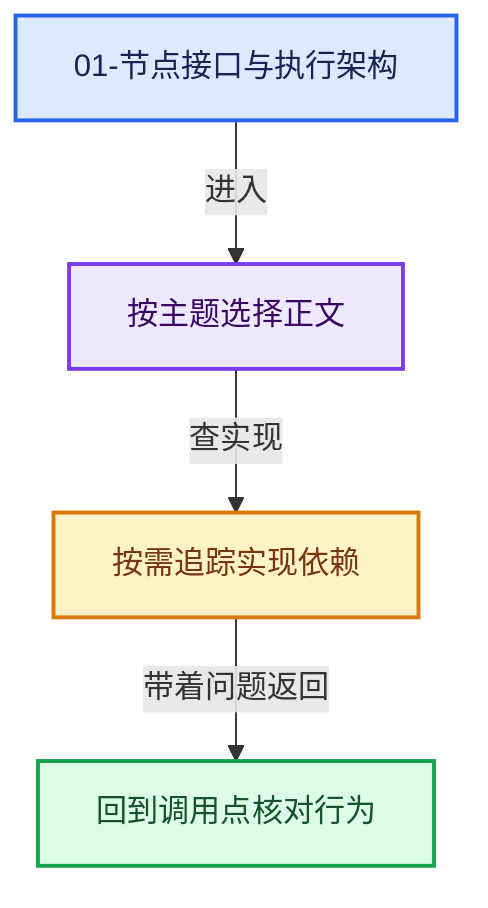
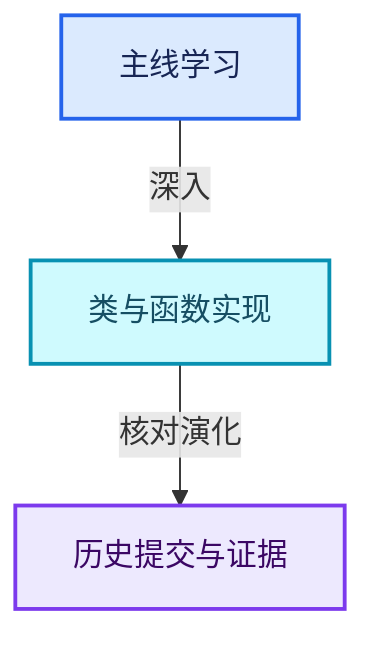

# 01-节点接口与执行架构

[几何节点总导航](../README.md) · [总入口](../../README.md)

- [GN-01 几何节点从编辑树到执行结果的全景](扩展01-几何节点从编辑树到执行结果的全景.md)
- [GN-02 节点注册声明与引用关系契约](扩展02-节点注册声明与引用关系契约.md)
- [GN-03 GeoNodeExecParams参数适配与移动语义](扩展03-GeoNodeExecParams参数适配与移动语义.md)
- [GN-04 SocketValueVariant异构值与转换边界](扩展04-SocketValueVariant异构值与转换边界.md)
- [GN-05 执行图构建缓存与树副本所有权](扩展05-执行图构建缓存与树副本所有权.md)
- [GN-06 按需执行匿名输出与Switch需求传播](扩展06-按需执行匿名输出与Switch需求传播.md)
- [GN-07 数学节点从MultiFunction到FieldOperation](扩展01-数学节点从MultiFunction到FieldOperation.md)
- [GN-22 ComputeContext日志映射与副作用根](扩展07-ComputeContext日志映射与副作用根.md)
- [GN-24 Jacques与Hans提交中的架构演化](扩展08-Jacques与Hans提交中的架构演化.md)

