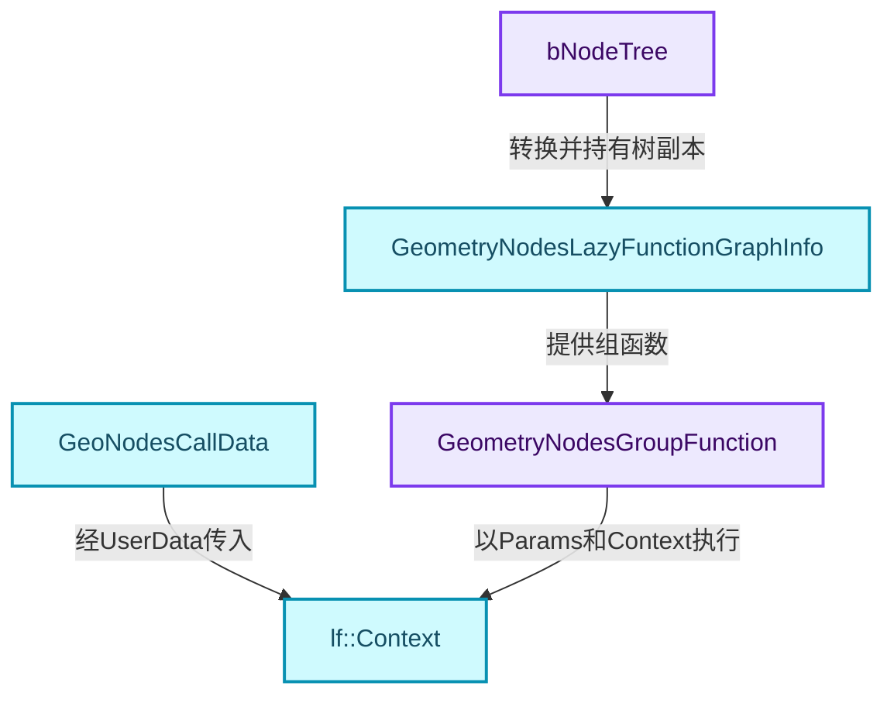
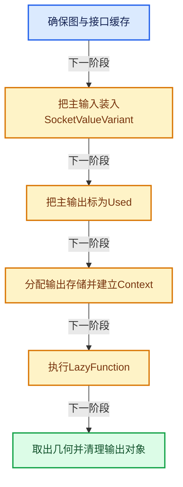
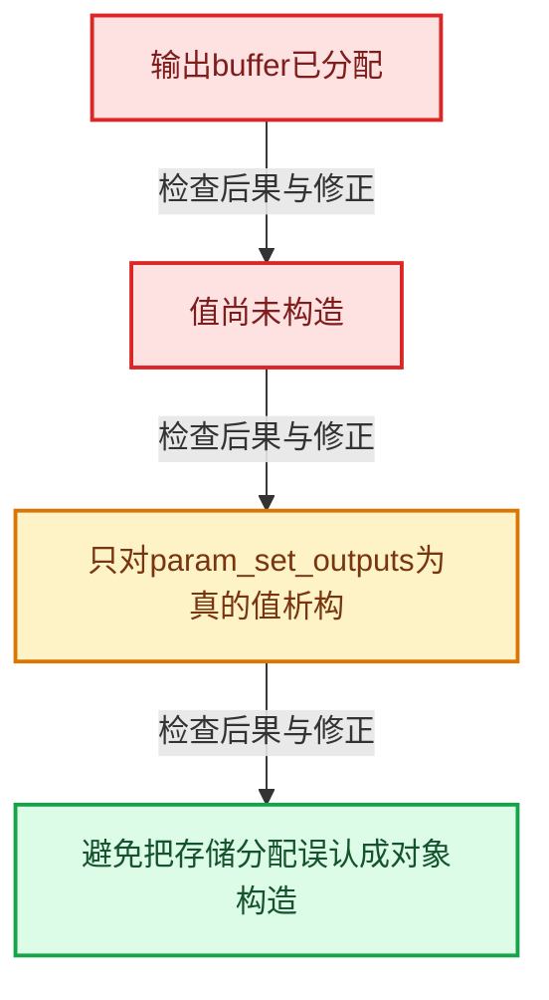

# GN-01 几何节点从编辑树到执行结果的全景

[几何节点学习地图](../README.md) · [专题分组导航](README.md) · [全局实现索引](../../00-课程指南/02-源码与提交索引/符号依赖与实现索引.md)

基准：`cbda6b96c26c0dee3c3b5cbb93960c4ac06a6b30`；文件哈希及连续摘录区间记录在[新增专题证据](../../_evidence/geometry-extension.json)。本篇围绕所选函数解释核心机制，辅助依赖明确列出已定位实现与尚需类型确认的边界，不宣称相关整个文件已全文复核。

## 先回答一个具体问题

节点编辑器里的一张树，怎样变成能按需执行、能跨线程工作、还能返回GeometrySet的程序？

## 相关类与数据的职责

- **`bNodeTree`**：可编辑及可序列化的节点、插槽和连接。 定义入口：[source/blender/makesdna/DNA_node_types.h · L1891](../../../../../../source/blender/makesdna/DNA_node_types.h)。
- **`GeometryNodesLazyFunctionGraphInfo`**：持有执行图、树副本、资源和编辑插槽映射。 定义入口：[source/blender/nodes/NOD_geometry_nodes_lazy_function.hh · L427](../../../../../../source/blender/nodes/NOD_geometry_nodes_lazy_function.hh)。
- **`GeometryNodesGroupFunction`**：定义主输入输出和需求信息的索引区间。 定义入口：[source/blender/nodes/NOD_geometry_nodes_lazy_function.hh · L381](../../../../../../source/blender/nodes/NOD_geometry_nodes_lazy_function.hh)。
- **`GeoNodesCallData`**：一次调用的外部环境，例如修改器或操作器数据。 定义入口：[source/blender/nodes/NOD_geometry_nodes_lazy_function.hh · L214](../../../../../../source/blender/nodes/NOD_geometry_nodes_lazy_function.hh)。
- **`lf::Context`**：本次执行的storage、共享用户数据和局部用户数据。 定义入口：[source/blender/functions/FN_lazy_function.hh · L83](../../../../../../source/blender/functions/FN_lazy_function.hh)。



上图箭头文字区分拥有、借用、调用和数据依赖。连线不表示这些类型存在同名继承关系；只有源码明确声明的继承才按继承理解。

## 设计推导与扩展知识

### 推导1

编辑树描述用户程序，执行图描述执行策略。编译式转换可以插入类型转换、默认输入、使用信息和引用集合节点，所以执行图通常不能和界面节点一一对应。

### 推导2

execute_geometry_nodes_on_geometry将外部属性映射到组接口，Geometry输入的第一个插槽获得传入几何，其余输入由init_socket_cpp_value根据接口和属性初始化。RNA在这里属于配置适配层，不能把RNA访问散布到所有几何内核。

### 推导3

主输出需求与“哪些输入被用到”的辅助输出分别设置ValueUsage。前者要求结果，后者本次可以不关心；辅助通道存在不表示每次都必须对外返回它们。

### 推导4

输出buffer先通过CPPType对应的尺寸与对齐分配，值是否已构造由param_set_outputs跟踪。最后只析构已设置的输出，避免对未初始化存储调用析构。

### 推导5

执行结果要离开当前作用域，Bundle中的直接数据必须满足拥有条件；匿名属性又因越出Geometry Nodes后无法可靠追踪寿命而被移除。这是输出边界的语义处理，不能简化成一次return。

## 实际处理阶段



这张图概括本篇所讨论的主路径；等待输入、构建失败与不同策略的分支以下方完整代码为准，不能把概括图当作每次都会执行的无条件顺序。

## 教学注释代码与分段机制

<a id="f-4bcc40f845ef0bc0"></a>

### `blender::nodes::execute_geometry_nodes_on_geometry` · L555—L673

按输入准备、需求设置、资源分配、执行、输出收尾六段阅读。ResourceScope持有输入临时值；输出对象的析构是后面显式进行的，不能把两者混淆。

实现位置：[source/blender/nodes/intern/geometry_nodes_execute.cc](../../../../../../source/blender/nodes/intern/geometry_nodes_execute.cc)。

**教学注释版**

<!-- annotated:93e61b563cf86a -->

```cpp
bke::GeometrySet execute_geometry_nodes_on_geometry(const bNodeTree &btree,
                                                    const PointerRNA &properties_ptr,
                                                    const ComputeContext &base_compute_context,
                                                    GeoNodesCallData &call_data,
                                                    bke::GeometrySet input_geometry)
{
  PRF_scope(ProfileCategory::Default);
  const GeometryNodesLazyFunctionGraphInfo &lf_graph_info =
      *ensure_geometry_nodes_lazy_function_graph(btree);
  const GeometryNodesGroupFunction &function = lf_graph_info.function;
  const lf::LazyFunction &lazy_function = *function.function;
  const int num_inputs = lazy_function.inputs().size();
  const int num_outputs = lazy_function.outputs().size();

  Array<GMutablePointer> param_inputs(num_inputs);
  Array<GMutablePointer> param_outputs(num_outputs);
  Array<std::optional<lf::ValueUsage>> param_input_usages(num_inputs);
  Array<lf::ValueUsage> param_output_usages(num_outputs);
  Array<bool> param_set_outputs(num_outputs, false);

  /* We want to evaluate the main outputs, but don't care about which inputs are used for now. */
  param_output_usages.as_mutable_span().slice(function.outputs.main).fill(lf::ValueUsage::Used);
  param_output_usages.as_mutable_span()
      .slice(function.outputs.input_usages)
      .fill(lf::ValueUsage::Unused);

  call_data.call_depth_limit = U.nodes_stack_limit;

  GeoNodesUserData user_data;
  user_data.call_data = &call_data;
  call_data.root_ntree = &btree;

  user_data.compute_context = &base_compute_context;

  ResourceScope scope;
  LinearAllocator<> &allocator = scope.allocator();

  btree.ensure_interface_cache();

  PointerRNA inputs_ptr = RNA_pointer_get(const_cast<PointerRNA *>(&properties_ptr), "inputs");

  /* Prepare main inputs. */
  for (const int i : btree.interface_inputs().index_range()) {
    const bNodeTreeInterfaceSocket &interface_socket = *btree.interface_inputs()[i];
    const bke::bNodeSocketType *typeinfo = interface_socket.socket_typeinfo();
    const eNodeSocketDatatype socket_type = typeinfo ? typeinfo->type : SOCK_CUSTOM;
    if (socket_type == SOCK_GEOMETRY && i == 0) {
      bke::SocketValueVariant &value = scope.construct<bke::SocketValueVariant>(
          bke::SocketValueVariant::from(std::move(input_geometry)));
      param_inputs[function.inputs.main[0]] = &value;
      continue;
    }

    PointerRNA input_props_ptr = RNA_pointer_get(&inputs_ptr, interface_socket.identifier);
    bke::SocketValueVariant value = init_socket_cpp_value(
        &call_data, &input_props_ptr, btree, interface_socket);
    param_inputs[function.inputs.main[i]] = &scope.construct<bke::SocketValueVariant>(
        std::move(value));
  }

  /* Prepare used-outputs inputs. */
  Array<bool> output_used_inputs(btree.interface_outputs().size(), true);
  for (const int i : btree.interface_outputs().index_range()) {
    param_inputs[function.inputs.output_usages[i]] = &output_used_inputs[i];
  }

  /* No anonymous attributes have to be propagated. */
  Array<bke::GeometryNodesReferenceSet> references_to_propagate(
      function.inputs.references_to_propagate.geometry_outputs.size());
  for (const int i : references_to_propagate.index_range()) {
    param_inputs[function.inputs.references_to_propagate.range[i]] = &references_to_propagate[i];
  }

  /* Prepare memory for output values. */
  for (const int i : IndexRange(num_outputs)) {
    const lf::Output &lf_output = lazy_function.outputs()[i];
    const CPPType &type = *lf_output.type;
    void *buffer = allocator.allocate(type);
    param_outputs[i] = {type, buffer};
  }

  GeoNodesLocalUserData local_user_data(user_data);

  lf::Context lf_context(lazy_function.init_storage(allocator), &user_data, &local_user_data);
  lf::BasicParams lf_params{lazy_function,
                            param_inputs,
                            param_outputs,
                            param_input_usages,
                            param_output_usages,
                            param_set_outputs};
  {
    ScopedComputeContextTimer timer{lf_context};
    lazy_function.execute(lf_params, lf_context);
  }
  lazy_function.destruct_storage(lf_context.storage);

  bke::GeometrySet output_geometry =
      param_outputs[0].get<bke::SocketValueVariant>()->extract<bke::GeometrySet>();
  store_output_attributes(output_geometry, btree, properties_ptr, param_outputs);

  for (const int i : IndexRange(num_outputs)) {
    // [讲解] 只销毁确实构造并设置的输出对象，不能析构仅分配的空存储。
    if (param_set_outputs[i]) {
      GMutablePointer &ptr = param_outputs[i];
      ptr.destruct();
    }
  }

  if (output_geometry.has_bundle()) {
    /* Ensure that the bundle data is properly owned by the geometry. Do not call this in the
     * geometry itself because it may just be referenced during modifier evaluation and an
     * unnecessary copy can be avoided. See #GeometryOwnershipType::Editable. */
    output_geometry.bundle_for_write().ensure_owns_direct_data();
  }

  /* Remove anonymous attributes because their lifetimes can't be tracked reliably outside of
   * Geometry Nodes. */
  // [讲解] 离开Geometry Nodes边界后匿名属性寿命难以追踪，清理后再返回。
  remove_anonymous_attributes(output_geometry);
  return output_geometry;
}
```

<details>
<summary>核对原始源码：source/blender/nodes/intern/geometry_nodes_execute.cc · L555—L673</summary>

<!-- original:93e61b563cf86a:source/blender/nodes/intern/geometry_nodes_execute.cc:555:673 -->

```cpp
bke::GeometrySet execute_geometry_nodes_on_geometry(const bNodeTree &btree,
                                                    const PointerRNA &properties_ptr,
                                                    const ComputeContext &base_compute_context,
                                                    GeoNodesCallData &call_data,
                                                    bke::GeometrySet input_geometry)
{
  PRF_scope(ProfileCategory::Default);
  const GeometryNodesLazyFunctionGraphInfo &lf_graph_info =
      *ensure_geometry_nodes_lazy_function_graph(btree);
  const GeometryNodesGroupFunction &function = lf_graph_info.function;
  const lf::LazyFunction &lazy_function = *function.function;
  const int num_inputs = lazy_function.inputs().size();
  const int num_outputs = lazy_function.outputs().size();

  Array<GMutablePointer> param_inputs(num_inputs);
  Array<GMutablePointer> param_outputs(num_outputs);
  Array<std::optional<lf::ValueUsage>> param_input_usages(num_inputs);
  Array<lf::ValueUsage> param_output_usages(num_outputs);
  Array<bool> param_set_outputs(num_outputs, false);

  /* We want to evaluate the main outputs, but don't care about which inputs are used for now. */
  param_output_usages.as_mutable_span().slice(function.outputs.main).fill(lf::ValueUsage::Used);
  param_output_usages.as_mutable_span()
      .slice(function.outputs.input_usages)
      .fill(lf::ValueUsage::Unused);

  call_data.call_depth_limit = U.nodes_stack_limit;

  GeoNodesUserData user_data;
  user_data.call_data = &call_data;
  call_data.root_ntree = &btree;

  user_data.compute_context = &base_compute_context;

  ResourceScope scope;
  LinearAllocator<> &allocator = scope.allocator();

  btree.ensure_interface_cache();

  PointerRNA inputs_ptr = RNA_pointer_get(const_cast<PointerRNA *>(&properties_ptr), "inputs");

  /* Prepare main inputs. */
  for (const int i : btree.interface_inputs().index_range()) {
    const bNodeTreeInterfaceSocket &interface_socket = *btree.interface_inputs()[i];
    const bke::bNodeSocketType *typeinfo = interface_socket.socket_typeinfo();
    const eNodeSocketDatatype socket_type = typeinfo ? typeinfo->type : SOCK_CUSTOM;
    if (socket_type == SOCK_GEOMETRY && i == 0) {
      bke::SocketValueVariant &value = scope.construct<bke::SocketValueVariant>(
          bke::SocketValueVariant::from(std::move(input_geometry)));
      param_inputs[function.inputs.main[0]] = &value;
      continue;
    }

    PointerRNA input_props_ptr = RNA_pointer_get(&inputs_ptr, interface_socket.identifier);
    bke::SocketValueVariant value = init_socket_cpp_value(
        &call_data, &input_props_ptr, btree, interface_socket);
    param_inputs[function.inputs.main[i]] = &scope.construct<bke::SocketValueVariant>(
        std::move(value));
  }

  /* Prepare used-outputs inputs. */
  Array<bool> output_used_inputs(btree.interface_outputs().size(), true);
  for (const int i : btree.interface_outputs().index_range()) {
    param_inputs[function.inputs.output_usages[i]] = &output_used_inputs[i];
  }

  /* No anonymous attributes have to be propagated. */
  Array<bke::GeometryNodesReferenceSet> references_to_propagate(
      function.inputs.references_to_propagate.geometry_outputs.size());
  for (const int i : references_to_propagate.index_range()) {
    param_inputs[function.inputs.references_to_propagate.range[i]] = &references_to_propagate[i];
  }

  /* Prepare memory for output values. */
  for (const int i : IndexRange(num_outputs)) {
    const lf::Output &lf_output = lazy_function.outputs()[i];
    const CPPType &type = *lf_output.type;
    void *buffer = allocator.allocate(type);
    param_outputs[i] = {type, buffer};
  }

  GeoNodesLocalUserData local_user_data(user_data);

  lf::Context lf_context(lazy_function.init_storage(allocator), &user_data, &local_user_data);
  lf::BasicParams lf_params{lazy_function,
                            param_inputs,
                            param_outputs,
                            param_input_usages,
                            param_output_usages,
                            param_set_outputs};
  {
    ScopedComputeContextTimer timer{lf_context};
    lazy_function.execute(lf_params, lf_context);
  }
  lazy_function.destruct_storage(lf_context.storage);

  bke::GeometrySet output_geometry =
      param_outputs[0].get<bke::SocketValueVariant>()->extract<bke::GeometrySet>();
  store_output_attributes(output_geometry, btree, properties_ptr, param_outputs);

  for (const int i : IndexRange(num_outputs)) {
    if (param_set_outputs[i]) {
      GMutablePointer &ptr = param_outputs[i];
      ptr.destruct();
    }
  }

  if (output_geometry.has_bundle()) {
    /* Ensure that the bundle data is properly owned by the geometry. Do not call this in the
     * geometry itself because it may just be referenced during modifier evaluation and an
     * unnecessary copy can be avoided. See #GeometryOwnershipType::Editable. */
    output_geometry.bundle_for_write().ensure_owns_direct_data();
  }

  /* Remove anonymous attributes because their lifetimes can't be tracked reliably outside of
   * Geometry Nodes. */
  remove_anonymous_attributes(output_geometry);
  return output_geometry;
}
```

</details>

<details>
<summary>实现依赖入口与尚需类型确认的调用</summary>

- `PRF_scope`：宏定义见[intern/profile/PRF_profile.hh](../../../../../../intern/profile/PRF_profile.hh), L51；按当前编译条件选择。
- `PRF_scope`：宏定义见[intern/profile/PRF_profile.hh](../../../../../../intern/profile/PRF_profile.hh), L90；按当前编译条件选择。
- `ensure_geometry_nodes_lazy_function_graph` → [blender::nodes::ensure_geometry_nodes_lazy_function_graph · L4334](../05-性能诊断/扩展01-几何节点性能诊断与架构训练.md#f-52501f045c159f79)。
- `lazy_function.inputs().size`：L566的类型或分派协议；接收对象类型依赖auto、返回值或模板实例；不按同名猜测目标。
- `lazy_function.inputs` → [blender::fn::lazy_function::inputs · L331](../../09-LazyFunction与节点执行架构/02-LazyFunction接口.md#f-bdcd40e6f47d0ad9)。
- `lazy_function.outputs().size`：L567的类型或分派协议；接收对象类型依赖auto、返回值或模板实例；不按同名猜测目标。
- `lazy_function.outputs` → [blender::fn::lazy_function::outputs · L336](../../09-LazyFunction与节点执行架构/02-LazyFunction接口.md#f-8131802149321817)。
- `param_output_usages.as_mutable_span().slice(function.outputs.main).fill`：L576的类型或分派协议；接收对象类型依赖auto、返回值或模板实例；不按同名猜测目标。
- `param_output_usages.as_mutable_span().slice`：L576的类型或分派协议；接收对象类型依赖auto、返回值或模板实例；不按同名猜测目标。
- `param_output_usages.as_mutable_span` → [blender::Array::as_mutable_span · L259](../../01-基础容器与现代CPP/08-Array复制移动与销毁.md#f-4e91de9f1337c144)。
- `param_output_usages.as_mutable_span() .slice(function.outputs.input_usages) .fill`：L577的类型或分派协议；接收对象类型依赖auto、返回值或模板实例；不按同名猜测目标。
- `param_output_usages.as_mutable_span() .slice`：L577的类型或分派协议；接收对象类型依赖auto、返回值或模板实例；不按同名猜测目标。
- `scope.allocator` → [blender::allocator · L236](../../03-内存分配与运行时类型/05-ResourceScope销毁责任.md#f-7ccba69e393aa150)。
- `btree.ensure_interface_cache` → [blender::ensure_interface_cache · L670](../../90-实现依赖专题/02-BKE几何与数据/BKE_node_runtime.hh.md#f-73fea7b58035b1f9)。
- `RNA_pointer_get` → [blender::RNA_pointer_get · L7040](../../90-实现依赖专题/08-其他Blender模块/makesrna/intern/rna_access.cc.md#f-3ccd96658ac85256)。
- `btree.interface_inputs().index_range`：L597的类型或分派协议；接收对象类型依赖auto、返回值或模板实例；不按同名猜测目标。
- `btree.interface_inputs` → [blender::interface_inputs · L675](../../90-实现依赖专题/02-BKE几何与数据/BKE_node_runtime.hh.md#f-b5decde7a09fbf57)；[blender::interface_inputs · L681](../../90-实现依赖专题/02-BKE几何与数据/BKE_node_runtime.hh.md#f-f999995c05009884)。多候选需按实参和重载规则确认。
- `interface_socket.socket_typeinfo` → [blender::socket_typeinfo · L770](../../90-实现依赖专题/02-BKE几何与数据/intern/node_tree_interface.cc.md#f-f6d586e3bc159207)。
- `scope.construct<bke::SocketValueVariant>` → [blender::construct · L219](../../03-内存分配与运行时类型/05-ResourceScope销毁责任.md#f-5b24624bb64539d5)。
- `bke::SocketValueVariant::from` → [blender::bke::from · L220](扩展04-SocketValueVariant异构值与转换边界.md#f-fa3c16e83ef6de45)。
- `std::move`：把表达式转换成可供移动重载选择的值类别；不保证真的移动，不结束源对象寿命，对const值可能选择复制。 [接口资料](https://eel.is/c++draft/utility.forward)。
- `init_socket_cpp_value` → [blender::nodes::init_socket_cpp_value · L133](../../90-实现依赖专题/04-Nodes节点系统/intern/geometry_nodes_execute.cc.md#f-6e881989c4eadbae)。
- `btree.interface_outputs().size`：L616的类型或分派协议；接收对象类型依赖auto、返回值或模板实例；不按同名猜测目标。
- `btree.interface_outputs` → [blender::interface_outputs · L687](../../90-实现依赖专题/02-BKE几何与数据/BKE_node_runtime.hh.md#f-6ce8b655d24a2365)；[blender::interface_outputs · L693](../../90-实现依赖专题/02-BKE几何与数据/BKE_node_runtime.hh.md#f-64e16fb2a089e741)。多候选需按实参和重载规则确认。
- `btree.interface_outputs().index_range`：L617的类型或分派协议；接收对象类型依赖auto、返回值或模板实例；不按同名猜测目标。
- `function.inputs.references_to_propagate.geometry_outputs.size`：L623的类型或分派协议；接收对象类型依赖auto、返回值或模板实例；不按同名猜测目标。
- `references_to_propagate.index_range` → [blender::Array::index_range · L371](../../01-基础容器与现代CPP/08-Array复制移动与销毁.md#f-50a09e14742887a0)。
- `IndexRange`：L629的类型或分派协议；构造或类型转换入口。
- `allocator.allocate` → [blender::LinearAllocator::allocate · L66](../../03-内存分配与运行时类型/02-LinearAllocator布局.md#f-26209c6a21e04bc0)；[blender::LinearAllocator::allocate · L99](../../03-内存分配与运行时类型/02-LinearAllocator布局.md#f-b34ac68f2e3d66f1)；[blender::LinearAllocator::allocate · L105](../../03-内存分配与运行时类型/02-LinearAllocator布局.md#f-96480f78749ba1c7)。多候选需按实参和重载规则确认。
- `lazy_function.init_storage` → [blender::fn::lazy_function::init_storage · L28](../../09-LazyFunction与节点执行架构/02-LazyFunction接口.md#f-bd7a0cc9756b5fb3)。
- `lazy_function.execute` → [blender::fn::lazy_function::execute · L341](../../09-LazyFunction与节点执行架构/02-LazyFunction接口.md#f-1d443709054d33d8)。
- `lazy_function.destruct_storage` → [blender::fn::lazy_function::destruct_storage · L33](../../09-LazyFunction与节点执行架构/02-LazyFunction接口.md#f-5cbebb5d2dfbeff5)。
- `param_outputs[0].get<bke::SocketValueVariant>()->extract<bke::GeometrySet>`：L652的类型或分派协议；接收对象类型依赖auto、返回值或模板实例；不按同名猜测目标。
- `param_outputs[0].get<bke::SocketValueVariant>`：L652的类型或分派协议；接收对象类型依赖auto、返回值或模板实例；不按同名猜测目标。
- `store_output_attributes` → [blender::nodes::store_output_attributes · L513](../../90-实现依赖专题/04-Nodes节点系统/intern/geometry_nodes_execute.cc.md#f-5ba06bd7acabedfe)。
- `ptr.destruct` → [blender::GMutablePointer::destruct · L77](../../03-内存分配与运行时类型/12-异构值存储实战.md#f-efdf3a1db12cc0a5)。
- `output_geometry.has_bundle` → [blender::bke::has_bundle · L759](../../06-隐式共享与缓存系统/05-GeometrySet读写与复制.md#f-607ccecfa5f4141f)。
- `output_geometry.bundle_for_write().ensure_owns_direct_data`：L666的类型或分派协议；接收对象类型依赖auto、返回值或模板实例；不按同名猜测目标。
- `output_geometry.bundle_for_write` → [blender::bke::bundle_for_write · L779](../../06-隐式共享与缓存系统/05-GeometrySet读写与复制.md#f-9f3eaefe0279cab7)。
- `remove_anonymous_attributes` → [blender::nodes::remove_anonymous_attributes · L456](../../90-实现依赖专题/04-Nodes节点系统/intern/geometry_nodes_execute.cc.md#f-f4a052251ca8c6f8)。

</details>

## 支撑类型的完整声明

### `GeometryNodesGroupFunction`

对照上方职责阅读成员：哪些成员拥有资源，哪些只是索引、引用或指针。成员声明体现布局；其中函数仍应按实际调用进入相应实现。

<!-- annotated:fa3b7fadb55c64 -->

```cpp
struct GeometryNodesGroupFunction {
  /**
   * The lazy-function that does what the node group does. Its inputs and outputs are described
   * below.
   */
  const LazyFunction *function = nullptr;

  struct {
    /**
     * Main input values that come out of the Group Input node.
     */
    IndexRange main;
    /**
     * A boolean for every group output that indicates whether that output is needed. It's ok if
     * those are set to true even when an output is not used, but the other way around will lead to
     * bugs. The node group uses those values to compute the lifetimes of anonymous attributes.
     */
    IndexRange output_usages;
    /**
     * Some node groups can propagate attributes from a geometry input to a geometry output. In
     * those cases, the caller of the node group has to decide which anonymous attributes have to
     * be kept alive on the geometry because the caller requires them.
     */
    struct {
      IndexRange range;
      Vector<int> geometry_outputs;
    } references_to_propagate;
  } inputs;

  struct {
    /**
     * Main output values that are passed into the Group Output node.
     */
    IndexRange main;
    /**
     * A boolean for every group input that indicates whether this input will be used. Oftentimes
     * this can be determined without actually computing much. This is used to compute anonymous
     * attribute lifetimes.
     */
    IndexRange input_usages;
  } outputs;
};
```

<details>
<summary>核对原始源码：source/blender/nodes/NOD_geometry_nodes_lazy_function.hh · L381—L422</summary>

<!-- original:fa3b7fadb55c64:source/blender/nodes/NOD_geometry_nodes_lazy_function.hh:381:422 -->

```cpp
struct GeometryNodesGroupFunction {
  /**
   * The lazy-function that does what the node group does. Its inputs and outputs are described
   * below.
   */
  const LazyFunction *function = nullptr;

  struct {
    /**
     * Main input values that come out of the Group Input node.
     */
    IndexRange main;
    /**
     * A boolean for every group output that indicates whether that output is needed. It's ok if
     * those are set to true even when an output is not used, but the other way around will lead to
     * bugs. The node group uses those values to compute the lifetimes of anonymous attributes.
     */
    IndexRange output_usages;
    /**
     * Some node groups can propagate attributes from a geometry input to a geometry output. In
     * those cases, the caller of the node group has to decide which anonymous attributes have to
     * be kept alive on the geometry because the caller requires them.
     */
    struct {
      IndexRange range;
      Vector<int> geometry_outputs;
    } references_to_propagate;
  } inputs;

  struct {
    /**
     * Main output values that are passed into the Group Output node.
     */
    IndexRange main;
    /**
     * A boolean for every group input that indicates whether this input will be used. Oftentimes
     * this can be determined without actually computing much. This is used to compute anonymous
     * attribute lifetimes.
     */
    IndexRange input_usages;
  } outputs;
};
```

</details>

## 用小数据走一遍

1. 输入：Mesh含3个点。
2. 主Geometry输出为Used。
3. 执行Set Position：只改选择点。
4. 输出提取后销毁已构造的参数值。


这是明确输入条件下的教学推演，不是本地性能实测。对源码的验证应同时检查数值、对象寿命、输出需求和数据是否存在。

## 反例与边界

- 输出buffer已分配。
- 值尚未构造。
- 只对param_set_outputs为真的值析构。
- 避免把存储分配误认成对象构造。



## 历史提交阅读

本地历史阅读样本：**Hans Goudey**，2026-09-30T14:52:03+02:00。

`662905e45c1030f9244b880aa4f6ff60d5ac2486`

提交标题：Refactor: Attributes: Remove AttributeInitMoveArray

[所选文件的真实diff](../../_evidence/geometry-history/GN-01.patch)。这是本地历史中匹配作者的近期样本，不冒称该系统的最初引入提交。阅读时先找变更前后的不变量，再检查新增分支与测试；本篇当前源码说明不混用历史签名。

## 独立实现与验收

画出一次Geometry输入的所有权变化，并解释为什么param_outputs不能只用void*数组。

<details>
<summary>参考思路</summary>

void*只能表示地址；CPPType提供类型操作，设置标记区分尚未构造与已构造，三者共同表达合法析构条件。

</details>

验收时保留一个能击穿错误设计的反例，再对照实际符号重走调用链。教学练习未在完整Blender中运行；本轮独立运行的模型验证另见新增专题验收报告。

## 继续阅读

- [GN-02 节点注册声明与引用关系契约](扩展02-节点注册声明与引用关系契约.md)
- [GN-03 GeoNodeExecParams参数适配与移动语义](扩展03-GeoNodeExecParams参数适配与移动语义.md)
- [GN-04 SocketValueVariant异构值与转换边界](扩展04-SocketValueVariant异构值与转换边界.md)
- [GN-05 执行图构建缓存与树副本所有权](扩展05-执行图构建缓存与树副本所有权.md)
- [GN-06 按需执行匿名输出与Switch需求传播](扩展06-按需执行匿名输出与Switch需求传播.md)
- [GN-22 ComputeContext日志映射与副作用根](扩展07-ComputeContext日志映射与副作用根.md)
- [GN-24 Jacques与Hans提交中的架构演化](扩展08-Jacques与Hans提交中的架构演化.md)
