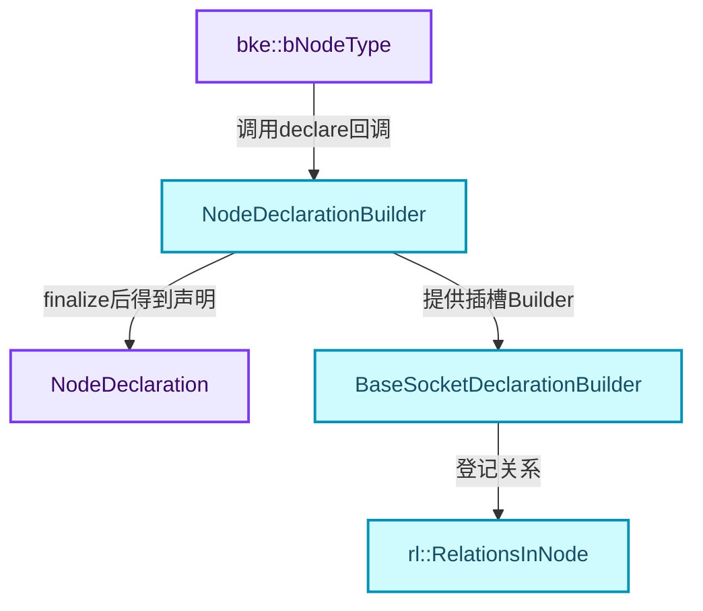
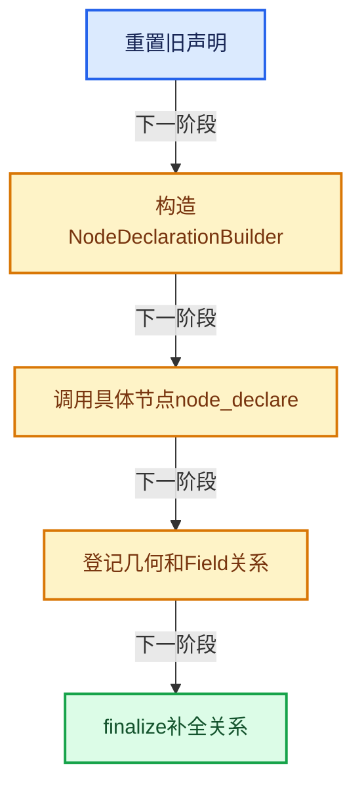
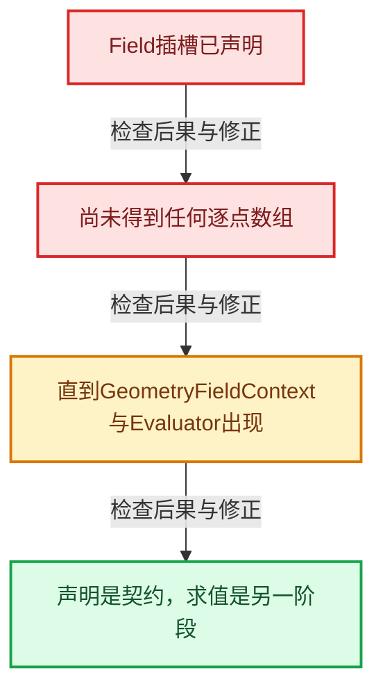

# GN-02 节点注册声明与引用关系契约

[几何节点学习地图](../README.md) · [专题分组导航](README.md) · [全局实现索引](../../00-课程指南/02-源码与提交索引/符号依赖与实现索引.md)

基准：`cbda6b96c26c0dee3c3b5cbb93960c4ac06a6b30`；文件哈希及连续摘录区间记录在[新增专题证据](../../_evidence/geometry-extension.json)。本篇围绕所选函数解释核心机制，辅助依赖明确列出已定位实现与尚需类型确认的边界，不宣称相关整个文件已全文复核。

## 先回答一个具体问题

node_declare为什么不仅是在画插槽？声明中的Field与propagate标记怎样影响执行？

## 相关类与数据的职责

- **`bke::bNodeType`**：保存类型标识与declare、geometry_node_execute等回调。 定义入口：[source/blender/blenkernel/BKE_node.hh · L265](../../../../../../source/blender/blenkernel/BKE_node.hh)。
- **`NodeDeclarationBuilder`**：构建插槽声明并积累待解析关系。 定义入口：[source/blender/nodes/NOD_node_declaration.hh · L655](../../../../../../source/blender/nodes/NOD_node_declaration.hh)。
- **`NodeDeclaration`**：保存声明结果，供节点接口匹配与图构建使用。 定义入口：[source/blender/nodes/NOD_node_declaration.hh · L603](../../../../../../source/blender/nodes/NOD_node_declaration.hh)。
- **`BaseSocketDeclarationBuilder`**：为单个插槽设置结构类型、使用与传播关系。 定义入口：[source/blender/nodes/NOD_node_declaration.hh · L288](../../../../../../source/blender/nodes/NOD_node_declaration.hh)。
- **`rl::RelationsInNode`**：描述引用在哪个数据输入上使用及向何处传播。 定义入口：[source/blender/nodes/NOD_node_declaration.hh · L111](../../../../../../source/blender/nodes/NOD_node_declaration.hh)。



上图箭头文字区分拥有、借用、调用和数据依赖。连线不表示这些类型存在同名继承关系；只有源码明确声明的继承才按继承理解。

## 设计推导与扩展知识

### 推导1

bNodeType把静态类型元信息与执行回调放在一起。node_register把函数地址登记进去；执行器之后调用该地址。NOD_REGISTER_NODE属于注册发现机制，不等于程序加载时马上求值几何。

### 推导2

build_node_declaration先reset，再调用typeinfo.declare，最后finalize。Builder是构建期间的临时对象，NodeDeclaration是需要保留的结果；不能把对Builder的引用保存给运行时使用。

### 推导3

evaluated_geometry_field()把插槽结构类型设为Field，并记录引用会在几何数据上被使用。带geometry_input_indices的重载明确指定数据输入索引；Instance on Points的{0}与两个几何输入的区别尤其重要。

### 推导4

propagate_all_geometry()此时只设置待处理标志；等所有插槽已知后再构建完整关系。延迟处理解决的是“当前还不知道后续有哪些插槽”的构建顺序问题。

### 推导5

链式调用返回*this，使多个约束在一条声明上组合。这种内部DSL方便审阅，但每个标记有独立语义，不能把description、UI对齐和引用传播一律归成显示配置。

## 实际处理阶段



这张图概括本篇所讨论的主路径；等待输入、构建失败与不同策略的分支以下方完整代码为准，不能把概括图当作每次都会执行的无条件顺序。

## 教学注释代码与分段机制

<a id="f-93b68548974cf22b"></a>

### `blender::nodes::node_geo_join_geometry_cc::node_register` · L37—L49

这里把declare和geometry_node_execute分别指向两个不同阶段。静态ntype保证登记对象有足够寿命；不能返回栈上临时类型描述。

实现位置：[source/blender/nodes/geometry/nodes/node_geo_join_geometry.cc](../../../../../../source/blender/nodes/geometry/nodes/node_geo_join_geometry.cc)。

**教学注释版**

<!-- annotated:35a62058db7086 -->

```cpp
static void node_register()
{
  static bke::bNodeType ntype;

  geo_node_type_base(&ntype, "GeometryNodeJoinGeometry"_ustr, GEO_NODE_JOIN_GEOMETRY);
  ntype.ui_name = "Join Geometry";
  ntype.ui_description = "Merge separately generated geometries into a single one";
  ntype.enum_name_legacy = "JOIN_GEOMETRY";
  ntype.nclass = NODE_CLASS_GEOMETRY;
  ntype.geometry_node_execute = node_geo_exec;
  ntype.declare = node_declare;
  bke::node_register_type(ntype);
}
```

<details>
<summary>核对原始源码：source/blender/nodes/geometry/nodes/node_geo_join_geometry.cc · L37—L49</summary>

<!-- original:35a62058db7086:source/blender/nodes/geometry/nodes/node_geo_join_geometry.cc:37:49 -->

```cpp
static void node_register()
{
  static bke::bNodeType ntype;

  geo_node_type_base(&ntype, "GeometryNodeJoinGeometry"_ustr, GEO_NODE_JOIN_GEOMETRY);
  ntype.ui_name = "Join Geometry";
  ntype.ui_description = "Merge separately generated geometries into a single one";
  ntype.enum_name_legacy = "JOIN_GEOMETRY";
  ntype.nclass = NODE_CLASS_GEOMETRY;
  ntype.geometry_node_execute = node_geo_exec;
  ntype.declare = node_declare;
  bke::node_register_type(ntype);
}
```

</details>

<details>
<summary>实现依赖入口与尚需类型确认的调用</summary>

本函数未纳入旧结构调用闭包；以上源码保留实际调用表达式，相关成员须按接收者类型继续定位。下方类关系入口提供对应定义。

</details>

<a id="f-648fedda72052819"></a>

### `blender::nodes::build_node_declaration` · L35—L44

reset、回调、finalize构成声明构建事务的顺序。这里没有计算几何。

实现位置：[source/blender/nodes/intern/node_declaration.cc](../../../../../../source/blender/nodes/intern/node_declaration.cc)。

**教学注释版**

<!-- annotated:7930a3e4ca09c6 -->

```cpp
void build_node_declaration(const bke::bNodeType &typeinfo,
                            NodeDeclaration &r_declaration,
                            const bNodeTree *ntree,
                            const bNode *node)
{
  // [讲解] 清理上次构建结果，再生成当前配置的声明；不是把新插槽继续追加到旧声明。
  reset_declaration(r_declaration);
  NodeDeclarationBuilder node_decl_builder{typeinfo, r_declaration, ntree, node};
  // [讲解] 调用具体节点登记的声明回调；该回调描述接口而不执行几何算法。
  typeinfo.declare(node_decl_builder);
  // [讲解] 全部插槽已知后补全延迟登记的关系与声明约束。
  node_decl_builder.finalize();
}
```

<details>
<summary>核对原始源码：source/blender/nodes/intern/node_declaration.cc · L35—L44</summary>

<!-- original:7930a3e4ca09c6:source/blender/nodes/intern/node_declaration.cc:35:44 -->

```cpp
void build_node_declaration(const bke::bNodeType &typeinfo,
                            NodeDeclaration &r_declaration,
                            const bNodeTree *ntree,
                            const bNode *node)
{
  reset_declaration(r_declaration);
  NodeDeclarationBuilder node_decl_builder{typeinfo, r_declaration, ntree, node};
  typeinfo.declare(node_decl_builder);
  node_decl_builder.finalize();
}
```

</details>

<details>
<summary>实现依赖入口与尚需类型确认的调用</summary>

- `reset_declaration` → [blender::nodes::reset_declaration · L29](../../90-实现依赖专题/04-Nodes节点系统/intern/node_declaration.cc.md#f-a66e5d5ed6c8075a)。
- `typeinfo.declare`：L42的类型或分派协议；由接收对象具体类型或运行时策略提供实现。
- `node_decl_builder.finalize` → [blender::nodes::finalize · L113](../../90-实现依赖专题/04-Nodes节点系统/intern/node_declaration.cc.md#f-b79863b072001b35)。

</details>

<a id="f-d5eba96bd6d7f28d"></a>

### `blender::nodes::evaluated_geometry_field` · L710—L717

两个重载分别表达全部几何数据或指定输入上的使用关系。逐项核对data_input与reference_input的方向。

实现位置：[source/blender/nodes/intern/node_declaration.cc](../../../../../../source/blender/nodes/intern/node_declaration.cc)。

**教学注释版**

<!-- annotated:395a825d1a5ef9 -->

```cpp
BaseSocketDeclarationBuilder &BaseSocketDeclarationBuilder::evaluated_geometry_field()
{
  BLI_assert(this->is_input());
  /* The corresponding relations are build after all socket declarations are known. */
  // [讲解] 此输入Field携带的引用会在几何输入数据上使用，记录给寿命分析。
  input_reference_used_on_all_data_ = true;
  // [讲解] 结构类型是Field，不表示这里已经创建逐元素数组。
  decl_base_->structure_type = StructureType::Field;
  return *this;
}
```

<details>
<summary>核对原始源码：source/blender/nodes/intern/node_declaration.cc · L710—L717</summary>

<!-- original:395a825d1a5ef9:source/blender/nodes/intern/node_declaration.cc:710:717 -->

```cpp
BaseSocketDeclarationBuilder &BaseSocketDeclarationBuilder::evaluated_geometry_field()
{
  BLI_assert(this->is_input());
  /* The corresponding relations are build after all socket declarations are known. */
  input_reference_used_on_all_data_ = true;
  decl_base_->structure_type = StructureType::Field;
  return *this;
}
```

</details>

<details>
<summary>实现依赖入口与尚需类型确认的调用</summary>

本函数未纳入旧结构调用闭包；以上源码保留实际调用表达式，相关成员须按接收者类型继续定位。下方类关系入口提供对应定义。

</details>

<a id="f-7e05e04b89f79466"></a>

### `blender::nodes::evaluated_geometry_field` · L719—L732

两个重载分别表达全部几何数据或指定输入上的使用关系。逐项核对data_input与reference_input的方向。

实现位置：[source/blender/nodes/intern/node_declaration.cc](../../../../../../source/blender/nodes/intern/node_declaration.cc)。

**教学注释版**

<!-- annotated:2395894d2ee26d -->

```cpp
BaseSocketDeclarationBuilder &BaseSocketDeclarationBuilder::evaluated_geometry_field(
    const Span<int> geometry_input_indices)
{
  BLI_assert(this->is_input());
  rl::RelationsInNode &relations = node_decl_builder_->get_reference_lifetime_relations();
  for (const int index : geometry_input_indices) {
    rl::UseRelation relation;
    // [讲解] 这是承载被读取数据的几何输入索引。
    relation.data_input = index;
    // [讲解] 这是携带引用的Field输入索引，与data_input方向不同。
    relation.reference_input = decl_base_->index;
    relations.use_relations.append(relation);
  }
  // [讲解] 结构类型是Field，不表示这里已经创建逐元素数组。
  decl_base_->structure_type = StructureType::Field;
  return *this;
}
```

<details>
<summary>核对原始源码：source/blender/nodes/intern/node_declaration.cc · L719—L732</summary>

<!-- original:2395894d2ee26d:source/blender/nodes/intern/node_declaration.cc:719:732 -->

```cpp
BaseSocketDeclarationBuilder &BaseSocketDeclarationBuilder::evaluated_geometry_field(
    const Span<int> geometry_input_indices)
{
  BLI_assert(this->is_input());
  rl::RelationsInNode &relations = node_decl_builder_->get_reference_lifetime_relations();
  for (const int index : geometry_input_indices) {
    rl::UseRelation relation;
    relation.data_input = index;
    relation.reference_input = decl_base_->index;
    relations.use_relations.append(relation);
  }
  decl_base_->structure_type = StructureType::Field;
  return *this;
}
```

</details>

<details>
<summary>实现依赖入口与尚需类型确认的调用</summary>

本函数未纳入旧结构调用闭包；以上源码保留实际调用表达式，相关成员须按接收者类型继续定位。下方类关系入口提供对应定义。

</details>

<a id="f-1a230a55f16cfdc6"></a>

### `blender::nodes::propagate_all_geometry` · L598—L603

只登记延迟构建标记，函数本身没有复制任何属性。

实现位置：[source/blender/nodes/intern/node_declaration.cc](../../../../../../source/blender/nodes/intern/node_declaration.cc)。

**教学注释版**

<!-- annotated:69c40cb566f4e1 -->

```cpp
BaseSocketDeclarationBuilder &BaseSocketDeclarationBuilder::propagate_all_geometry()
{
  /* The relations are build after all sockets are known. */
  // [讲解] 先登记传播意图，关系将在所有插槽已知后构建。
  propagate_all_input_data_from_geometry_ = true;
  return *this;
}
```

<details>
<summary>核对原始源码：source/blender/nodes/intern/node_declaration.cc · L598—L603</summary>

<!-- original:69c40cb566f4e1:source/blender/nodes/intern/node_declaration.cc:598:603 -->

```cpp
BaseSocketDeclarationBuilder &BaseSocketDeclarationBuilder::propagate_all_geometry()
{
  /* The relations are build after all sockets are known. */
  propagate_all_input_data_from_geometry_ = true;
  return *this;
}
```

</details>

<details>
<summary>实现依赖入口与尚需类型确认的调用</summary>

本函数未纳入旧结构调用闭包；以上源码保留实际调用表达式，相关成员须按接收者类型继续定位。下方类关系入口提供对应定义。

</details>

## 用小数据走一遍

1. Points是几何输入0，Instance是几何输入2。
2. Selection.evaluated_geometry_field({0})。
3. Selection读取Points上的属性。
4. 引用关系不能误连到Instance输入。

```mermaid
flowchart LR
  S0["Points是几何输入0，Instance是几何输入2"]:::input
  S1["Selection.evaluated_geometry_field({0})"]:::data
  S2["Selection读取Points上的属性"]:::data
  S3["引用关系不能误连到Instance输入"]:::result
  S0 -->|"推演"| S1
  S1 -->|"推演"| S2
  S2 -->|"推演"| S3
  classDef input fill:#DBEAFE,stroke:#2563EB,color:#172554,stroke-width:2px;
  classDef data fill:#CFFAFE,stroke:#0891B2,color:#164E63,stroke-width:2px;
  classDef abstraction fill:#EDE9FE,stroke:#7C3AED,color:#3B0764,stroke-width:2px;
  classDef compute fill:#FEF3C7,stroke:#D97706,color:#78350F,stroke-width:2px;
  classDef result fill:#DCFCE7,stroke:#16A34A,color:#14532D,stroke-width:2px;
  classDef error fill:#FEE2E2,stroke:#DC2626,color:#7F1D1D,stroke-width:2px;
```



这是明确输入条件下的教学推演，不是本地性能实测。对源码的验证应同时检查数值、对象寿命、输出需求和数据是否存在。

## 反例与边界

- Field插槽已声明。
- 尚未得到任何逐点数组。
- 直到GeometryFieldContext与Evaluator出现。
- 声明是契约，求值是另一阶段。



## 历史提交阅读

本地历史阅读样本：**Hans Goudey**，2026-04-09T17:21:51+02:00。

`64640aa853cc2970a2d2cfa3dd0a9de1c50efb7c`

提交标题：Refactor: Nodes: Use UString for idnames in some API functions

[所选文件的真实diff](../../_evidence/geometry-history/GN-02.patch)。这是本地历史中匹配作者的近期样本，不冒称该系统的最初引入提交。阅读时先找变更前后的不变量，再检查新增分支与测试；本篇当前源码说明不混用历史签名。

## 独立实现与验收

新建有两个几何输入的节点，为只依赖第一个几何的Field写出声明并解释索引。

<details>
<summary>参考思路</summary>

使用evaluated_geometry_field({第一个几何的输入索引})；索引属于输入声明序列，需核对完整插槽顺序。

</details>

验收时保留一个能击穿错误设计的反例，再对照实际符号重走调用链。教学练习未在完整Blender中运行；本轮独立运行的模型验证另见新增专题验收报告。

## 继续阅读

- [GN-01 几何节点从编辑树到执行结果的全景](扩展01-几何节点从编辑树到执行结果的全景.md)
- [GN-03 GeoNodeExecParams参数适配与移动语义](扩展03-GeoNodeExecParams参数适配与移动语义.md)
- [GN-04 SocketValueVariant异构值与转换边界](扩展04-SocketValueVariant异构值与转换边界.md)
- [GN-05 执行图构建缓存与树副本所有权](扩展05-执行图构建缓存与树副本所有权.md)
- [GN-06 按需执行匿名输出与Switch需求传播](扩展06-按需执行匿名输出与Switch需求传播.md)
- [GN-22 ComputeContext日志映射与副作用根](扩展07-ComputeContext日志映射与副作用根.md)
- [GN-24 Jacques与Hans提交中的架构演化](扩展08-Jacques与Hans提交中的架构演化.md)
