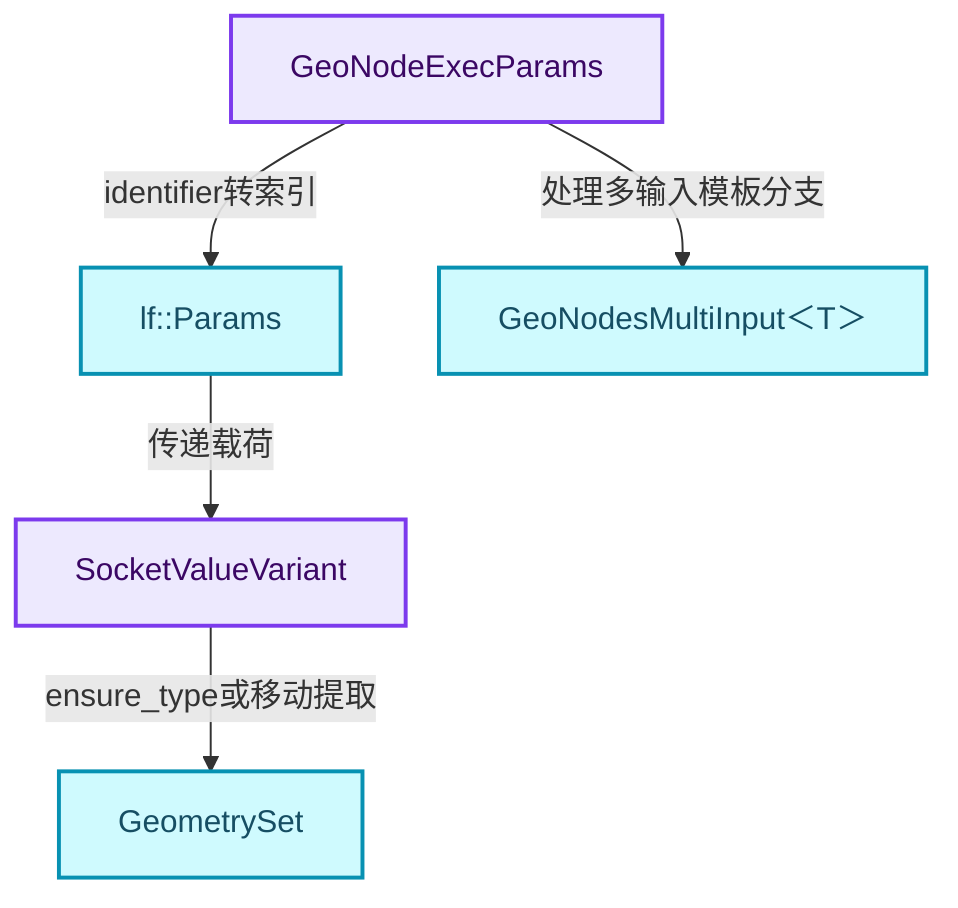
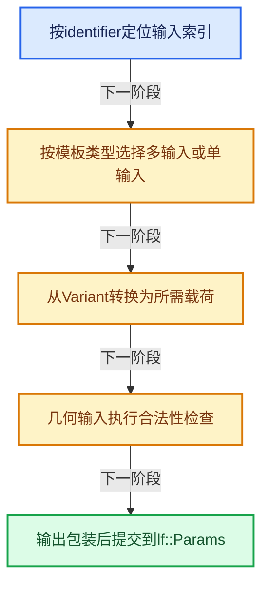
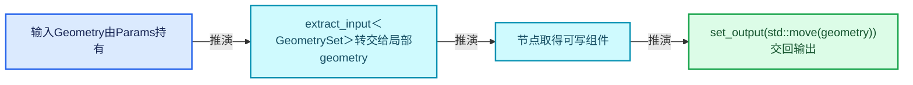
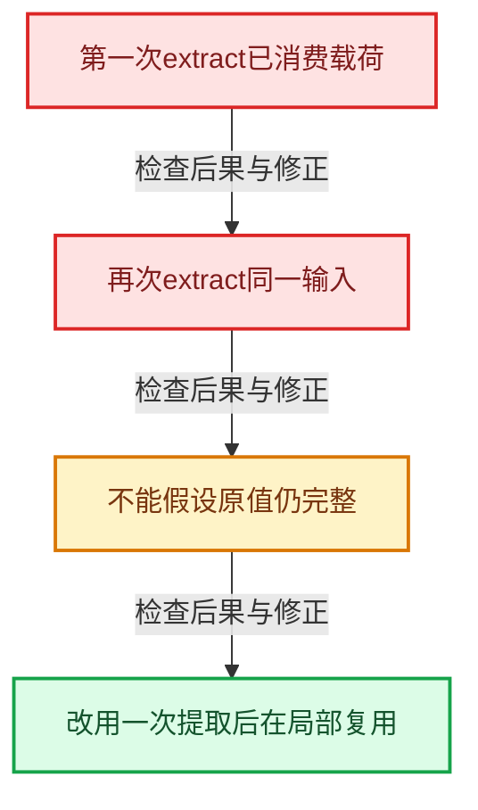

# GN-03 GeoNodeExecParams参数适配与移动语义

[几何节点学习地图](../README.md) · [专题分组导航](README.md) · [全局实现索引](../../00-课程指南/02-源码与提交索引/符号依赖与实现索引.md)

基准：`cbda6b96c26c0dee3c3b5cbb93960c4ac06a6b30`；文件哈希及连续摘录区间记录在[新增专题证据](../../_evidence/geometry-extension.json)。本篇围绕所选函数解释核心机制，辅助依赖明确列出已定位实现与尚需类型确认的边界，不宣称相关整个文件已全文复核。

## 先回答一个具体问题

为什么节点代码按插槽identifier取值，而执行器按整数索引存值？extract与get有什么不同？

## 相关类与数据的职责

- **`GeoNodeExecParams`**：借用node、lf::Params和Context，并适配identifier。 定义入口：[source/blender/nodes/NOD_geometry_exec.hh · L80](../../../../../../source/blender/nodes/NOD_geometry_exec.hh)。
- **`lf::Params`**：访问执行器输入输出，报告需求与输入不用。 定义入口：[source/blender/functions/FN_lazy_function.hh · L109](../../../../../../source/blender/functions/FN_lazy_function.hh)。
- **`SocketValueVariant`**：封装单值、Field、几何等实际载荷。 定义入口：[source/blender/blenkernel/BKE_node_socket_value.hh · L83](../../../../../../source/blender/blenkernel/BKE_node_socket_value.hh)。
- **`GeoNodesMultiInput<T>`**：按顺序保存多输入插槽的值。 定义入口：[source/blender/nodes/NOD_geometry_nodes_values.hh · L40](../../../../../../source/blender/nodes/NOD_geometry_nodes_values.hh)。
- **`GeometrySet`**：可以通过移动转交给节点或输出的几何载荷。 定义入口：[source/blender/blenkernel/BKE_geometry_set.hh · L151](../../../../../../source/blender/blenkernel/BKE_geometry_set.hh)。



上图箭头文字区分拥有、借用、调用和数据依赖。连线不表示这些类型存在同名继承关系；只有源码明确声明的继承才按继承理解。

## 设计推导与扩展知识

### 推导1

GeoNodeExecParams是适配器，不拥有整个执行图。它的引用成员要求被借用的node、Params和Context在本次回调期间有效；FunctionRef形式的匿名属性命名回调也需要由外层保证寿命。

### 推导2

extract_input文档要求每个identifier只取一次。实际实现从params_移动出SocketValueVariant，再从其内部移动所需T；移动GeometrySet不等于深拷贝所有顶点数组。

### 推导3

get_input返回的也是T值，不应仅凭get这个名字理解为const T&。实现会复制Variant或载荷；对于共享几何，复制通常先增加共享关系，后续写时才发生必要分离。

### 推导4

if constexpr在模板实例化时决定编译哪些分支。GeoNodesMultiInput<SocketValueVariant>可以直接取出；其他ValueT需逐个ensure_type并建立新的值集合。

### 推导5

set_output使用decay_t决定StoredT，再用forward保留调用者的值类别。传右值GeometrySet能转移载荷；传左值可能复制包装值。Geometry检查和类型包装也属于此边界的工作。

## 实际处理阶段



这张图概括本篇所讨论的主路径；等待输入、构建失败与不同策略的分支以下方完整代码为准，不能把概括图当作每次都会执行的无条件顺序。

## 教学注释代码与分段机制

<a id="f-0ff98bdbba2e2ab6"></a>

### `blender::nodes::GeoNodeExecParams::extract_input` · L111—L150

对照普通T、枚举和GeoNodesMultiInput三个模板路径。ensure_type可能转换或建立默认值，不是仅做reinterpret_cast。

实现位置：[source/blender/nodes/NOD_geometry_exec.hh](../../../../../../source/blender/nodes/NOD_geometry_exec.hh)。

**教学注释版**

<!-- annotated:8e8141cb466e31 -->

```cpp
  template<typename T> T extract_input(const UString identifier)
  {
#ifndef NDEBUG
    this->check_input_access(identifier);
#endif
    // [讲解] 将稳定的插槽identifier映射到本次执行参数索引。
    const int index = this->get_input_index(identifier);
    if constexpr (is_GeoNodesMultiInput_v<T>) {
      using ValueT = typename T::value_type;
      BLI_assert(node_.input_by_identifier(identifier)->is_multi_input());
      if constexpr (std::is_same_v<ValueT, SocketValueVariant>) {
        return params_.extract_input<T>(index);
      }
      else {
        auto values_variants = params_.extract_input<GeoNodesMultiInput<SocketValueVariant>>(
            index);
        GeoNodesMultiInput<ValueT> values;
        values.values.reserve(values_variants.values.size());
        for (const int i : values_variants.values.index_range()) {
          values.values.append(std::move(values_variants.values[i].ensure_type<ValueT>()));
        }
        return values;
      }
    }
    else {
      // [讲解] 消费此输入的包装值；不能假设随后可再次提取原载荷。
      SocketValueVariant value_variant = params_.extract_input<SocketValueVariant>(index);
      if constexpr (std::is_same_v<T, SocketValueVariant>) {
        return value_variant;
      }
      else if constexpr (std::is_enum_v<T>) {
        return T(value_variant.ensure_type<MenuValue>().value);
      }
      else {
        // [讲解] 先保证或转换载荷类型，再把其中的T移动到局部返回值。
        T value = std::move(value_variant.ensure_type<T>());
        if constexpr (std::is_same_v<T, GeometrySet>) {
          this->check_input_geometry_set(identifier, value);
        }
        return value;
      }
    }
  }
```

<details>
<summary>核对原始源码：source/blender/nodes/NOD_geometry_exec.hh · L111—L150</summary>

<!-- original:8e8141cb466e31:source/blender/nodes/NOD_geometry_exec.hh:111:150 -->

```cpp
  template<typename T> T extract_input(const UString identifier)
  {
#ifndef NDEBUG
    this->check_input_access(identifier);
#endif
    const int index = this->get_input_index(identifier);
    if constexpr (is_GeoNodesMultiInput_v<T>) {
      using ValueT = typename T::value_type;
      BLI_assert(node_.input_by_identifier(identifier)->is_multi_input());
      if constexpr (std::is_same_v<ValueT, SocketValueVariant>) {
        return params_.extract_input<T>(index);
      }
      else {
        auto values_variants = params_.extract_input<GeoNodesMultiInput<SocketValueVariant>>(
            index);
        GeoNodesMultiInput<ValueT> values;
        values.values.reserve(values_variants.values.size());
        for (const int i : values_variants.values.index_range()) {
          values.values.append(std::move(values_variants.values[i].ensure_type<ValueT>()));
        }
        return values;
      }
    }
    else {
      SocketValueVariant value_variant = params_.extract_input<SocketValueVariant>(index);
      if constexpr (std::is_same_v<T, SocketValueVariant>) {
        return value_variant;
      }
      else if constexpr (std::is_enum_v<T>) {
        return T(value_variant.ensure_type<MenuValue>().value);
      }
      else {
        T value = std::move(value_variant.ensure_type<T>());
        if constexpr (std::is_same_v<T, GeometrySet>) {
          this->check_input_geometry_set(identifier, value);
        }
        return value;
      }
    }
  }
```

</details>

<details>
<summary>实现依赖入口与尚需类型确认的调用</summary>

- `this->check_input_access` → [blender::nodes::check_input_access · L168](../../90-实现依赖专题/04-Nodes节点系统/intern/node_geometry_exec.cc.md#f-f7fbf25862b785db)。
- `this->get_input_index` → [blender::nodes::GeoNodeExecParams::get_input_index · L349](../../90-实现依赖专题/04-Nodes节点系统/NOD_geometry_exec.hh.md#f-b8cb36f086801bdf)。
- `BLI_assert`：宏定义见[source/blender/blenlib/BLI_assert.hh](../../../../../../source/blender/blenlib/BLI_assert.hh), L48；按当前编译条件选择。
- `BLI_assert`：宏定义见[source/blender/blenlib/BLI_assert.hh](../../../../../../source/blender/blenlib/BLI_assert.hh), L63；按当前编译条件选择。
- `node_.input_by_identifier(identifier)->is_multi_input`：L119的类型或分派协议；接收对象类型依赖auto、返回值或模板实例；不按同名猜测目标。
- `node_.input_by_identifier` → [blender::input_by_identifier · L842](../../90-实现依赖专题/02-BKE几何与数据/BKE_node_runtime.hh.md#f-d7bd2e97ab2dd5f4)；[blender::input_by_identifier · L854](../../90-实现依赖专题/02-BKE几何与数据/BKE_node_runtime.hh.md#f-37095a407a90a740)。多候选需按实参和重载规则确认。
- `params_.extract_input<T>` → [blender::fn::lazy_function::extract_input · L412](../../09-LazyFunction与节点执行架构/02-LazyFunction接口.md#f-037bdbe54ffc8fdd)。
- `params_.extract_input<GeoNodesMultiInput<SocketValueVariant>>` → [blender::fn::lazy_function::extract_input · L412](../../09-LazyFunction与节点执行架构/02-LazyFunction接口.md#f-037bdbe54ffc8fdd)。
- `values.values.reserve`：L127的类型或分派协议；接收对象类型依赖auto、返回值或模板实例；不按同名猜测目标。
- `values_variants.values.size`：L127的类型或分派协议；接收对象类型依赖auto、返回值或模板实例；不按同名猜测目标。
- `values_variants.values.index_range`：L128的类型或分派协议；接收对象类型依赖auto、返回值或模板实例；不按同名猜测目标。
- `values.values.append`：L129的类型或分派协议；接收对象类型依赖auto、返回值或模板实例；不按同名猜测目标。
- `std::move`：把表达式转换成可供移动重载选择的值类别；不保证真的移动，不结束源对象寿命，对const值可能选择复制。 [接口资料](https://eel.is/c++draft/utility.forward)。
- `values_variants.values[i].ensure_type<ValueT>`：L129的类型或分派协议；接收对象类型依赖auto、返回值或模板实例；不按同名猜测目标。
- `params_.extract_input<SocketValueVariant>` → [blender::fn::lazy_function::extract_input · L412](../../09-LazyFunction与节点执行架构/02-LazyFunction接口.md#f-037bdbe54ffc8fdd)。
- `T` → [T · L96](../../90-实现依赖专题/07-Intern运行时与平台/cycles/subd/split.cpp.md#f-d5d0885c790cc4e4)。
- `value_variant.ensure_type<MenuValue>` → [blender::bke::ensure_type · L271](扩展04-SocketValueVariant异构值与转换边界.md#f-36be485d1fc40c00)；[blender::bke::ensure_type · L279](扩展04-SocketValueVariant异构值与转换边界.md#f-417f182997393297)。多候选需按实参和重载规则确认。
- `value_variant.ensure_type<T>` → [blender::bke::ensure_type · L271](扩展04-SocketValueVariant异构值与转换边界.md#f-36be485d1fc40c00)；[blender::bke::ensure_type · L279](扩展04-SocketValueVariant异构值与转换边界.md#f-417f182997393297)。多候选需按实参和重载规则确认。
- `this->check_input_geometry_set` → [blender::nodes::check_input_geometry_set · L59](../../90-实现依赖专题/04-Nodes节点系统/intern/node_geometry_exec.cc.md#f-3a305c5390bc6662)。

</details>

<a id="f-592ea03803cd1e53"></a>

### `blender::nodes::GeoNodeExecParams::get_input` · L158—L195

重点核对返回类型T及局部value_variant的复制，避免以函数名猜借用语义。

实现位置：[source/blender/nodes/NOD_geometry_exec.hh](../../../../../../source/blender/nodes/NOD_geometry_exec.hh)。

**教学注释版**

<!-- annotated:53c49066b1131f -->

```cpp
  template<typename T> T get_input(const UString identifier) const
  {
#ifndef NDEBUG
    this->check_input_access(identifier);
#endif
    // [讲解] 将稳定的插槽identifier映射到本次执行参数索引。
    const int index = this->get_input_index(identifier);
    if constexpr (is_GeoNodesMultiInput_v<T>) {
      using ValueT = typename T::value_type;
      BLI_assert(node_.input_by_identifier(identifier)->is_multi_input());
      if constexpr (std::is_same_v<ValueT, SocketValueVariant>) {
        return params_.get_input<T>(index);
      }
      else {
        auto values_variants = params_.get_input<GeoNodesMultiInput<SocketValueVariant>>(index);
        Vector<ValueT> values(values_variants.values.size());
        for (const int i : values_variants.values.index_range()) {
          values[i] = values_variants.values[i].ensure_type<ValueT>();
        }
        return values;
      }
    }
    else {
      // [讲解] 取得包装值的副本；这里不是返回const引用。
      SocketValueVariant value_variant = params_.get_input<SocketValueVariant>(index);
      if constexpr (std::is_same_v<T, SocketValueVariant>) {
        return value_variant;
      }
      else if constexpr (std::is_enum_v<T>) {
        return T(value_variant.ensure_type<MenuValue>().value);
      }
      else {
        T value = value_variant.ensure_type<T>();
        if constexpr (std::is_same_v<T, GeometrySet>) {
          this->check_input_geometry_set(identifier, value);
        }
        return value;
      }
    }
  }
```

<details>
<summary>核对原始源码：source/blender/nodes/NOD_geometry_exec.hh · L158—L195</summary>

<!-- original:53c49066b1131f:source/blender/nodes/NOD_geometry_exec.hh:158:195 -->

```cpp
  template<typename T> T get_input(const UString identifier) const
  {
#ifndef NDEBUG
    this->check_input_access(identifier);
#endif
    const int index = this->get_input_index(identifier);
    if constexpr (is_GeoNodesMultiInput_v<T>) {
      using ValueT = typename T::value_type;
      BLI_assert(node_.input_by_identifier(identifier)->is_multi_input());
      if constexpr (std::is_same_v<ValueT, SocketValueVariant>) {
        return params_.get_input<T>(index);
      }
      else {
        auto values_variants = params_.get_input<GeoNodesMultiInput<SocketValueVariant>>(index);
        Vector<ValueT> values(values_variants.values.size());
        for (const int i : values_variants.values.index_range()) {
          values[i] = values_variants.values[i].ensure_type<ValueT>();
        }
        return values;
      }
    }
    else {
      SocketValueVariant value_variant = params_.get_input<SocketValueVariant>(index);
      if constexpr (std::is_same_v<T, SocketValueVariant>) {
        return value_variant;
      }
      else if constexpr (std::is_enum_v<T>) {
        return T(value_variant.ensure_type<MenuValue>().value);
      }
      else {
        T value = value_variant.ensure_type<T>();
        if constexpr (std::is_same_v<T, GeometrySet>) {
          this->check_input_geometry_set(identifier, value);
        }
        return value;
      }
    }
  }
```

</details>

<details>
<summary>实现依赖入口与尚需类型确认的调用</summary>

本函数未纳入旧结构调用闭包；以上源码保留实际调用表达式，相关成员须按接收者类型继续定位。下方类关系入口提供对应定义。

</details>

<a id="f-8e835b27ade93c45"></a>

### `blender::nodes::GeoNodeExecParams::set_output` · L210—L226

StoredT判断、Geometry验证、索引映射与forward分别解决类型、契约、位置和值类别。

实现位置：[source/blender/nodes/NOD_geometry_exec.hh](../../../../../../source/blender/nodes/NOD_geometry_exec.hh)。

**教学注释版**

<!-- annotated:98047a37dcc4f4 -->

```cpp
  template<typename T> void set_output(const UString identifier, T &&value)
  {
    // [讲解] 去掉引用和顶层const用于识别实际存储类型。
    using StoredT = std::decay_t<T>;
#ifndef NDEBUG
    this->check_output_access(identifier);
#endif
    if constexpr (std::is_same_v<StoredT, GeometrySet>) {
      this->check_output_geometry_set(value);
    }
    const int index = this->get_output_index(identifier);
    if constexpr (std::is_same_v<StoredT, SocketValueVariant>) {
      params_.set_output(index, std::forward<T>(value));
    }
    else {
      // [讲解] 包装载荷并保留调用实参值类别，交给执行器记录输出。
      params_.set_output(index, SocketValueVariant::from(std::forward<T>(value)));
    }
  }
```

<details>
<summary>核对原始源码：source/blender/nodes/NOD_geometry_exec.hh · L210—L226</summary>

<!-- original:98047a37dcc4f4:source/blender/nodes/NOD_geometry_exec.hh:210:226 -->

```cpp
  template<typename T> void set_output(const UString identifier, T &&value)
  {
    using StoredT = std::decay_t<T>;
#ifndef NDEBUG
    this->check_output_access(identifier);
#endif
    if constexpr (std::is_same_v<StoredT, GeometrySet>) {
      this->check_output_geometry_set(value);
    }
    const int index = this->get_output_index(identifier);
    if constexpr (std::is_same_v<StoredT, SocketValueVariant>) {
      params_.set_output(index, std::forward<T>(value));
    }
    else {
      params_.set_output(index, SocketValueVariant::from(std::forward<T>(value)));
    }
  }
```

</details>

<details>
<summary>实现依赖入口与尚需类型确认的调用</summary>

- `this->check_output_access` → [blender::nodes::check_output_access · L197](../../90-实现依赖专题/04-Nodes节点系统/intern/node_geometry_exec.cc.md#f-758f61efaf9bd08c)。
- `this->check_output_geometry_set` → [blender::nodes::check_output_geometry_set · L151](../../90-实现依赖专题/04-Nodes节点系统/intern/node_geometry_exec.cc.md#f-fcdedcc227a09a05)。
- `this->get_output_index` → [blender::nodes::GeoNodeExecParams::get_output_index · L365](../../90-实现依赖专题/04-Nodes节点系统/NOD_geometry_exec.hh.md#f-fc0a954571e75dbf)。
- `params_.set_output` → [blender::fn::lazy_function::set_output · L440](../../09-LazyFunction与节点执行架构/02-LazyFunction接口.md#f-993589d688de575d)。
- `std::forward<T>`：在转发引用中恢复调用者传入的值类别；依赖推导类型，不能与无条件move互换。 [接口资料](https://eel.is/c++draft/utility.forward)。
- `SocketValueVariant::from` → [blender::bke::from · L220](扩展04-SocketValueVariant异构值与转换边界.md#f-fa3c16e83ef6de45)。

</details>

## 用小数据走一遍

1. 输入Geometry由Params持有。
2. extract_input<GeometrySet>转交给局部geometry。
3. 节点取得可写组件。
4. set_output(std::move(geometry))交回输出。



这是明确输入条件下的教学推演，不是本地性能实测。对源码的验证应同时检查数值、对象寿命、输出需求和数据是否存在。

## 反例与边界

- 第一次extract已消费载荷。
- 再次extract同一输入。
- 不能假设原值仍完整。
- 改用一次提取后在局部复用。



## 历史提交阅读

本地历史阅读样本：**Jacques Lucke**，2026-09-03T22:24:57+02:00。

`f05d3fbf34f7052f9abba1be5169a12f44ac1371`

提交标题：Refactor: Geometry Nodes: generalize SocketValueVariant

[所选文件的真实diff](../../_evidence/geometry-history/GN-03.patch)。这是本地历史中匹配作者的近期样本，不冒称该系统的最初引入提交。阅读时先找变更前后的不变量，再检查新增分支与测试；本篇当前源码说明不混用历史签名。

## 独立实现与验收

同一节点需要把输入几何用于两条处理路径，设计局部变量的复制与移动顺序。

<details>
<summary>参考思路</summary>

只提取一次，再显式复制GeometrySet用于第二条路径；分别取得可写组件，由共享分离承担写隔离。不要重复extract。

</details>

验收时保留一个能击穿错误设计的反例，再对照实际符号重走调用链。教学练习未在完整Blender中运行；本轮独立运行的模型验证另见新增专题验收报告。

## 继续阅读

- [GN-01 几何节点从编辑树到执行结果的全景](扩展01-几何节点从编辑树到执行结果的全景.md)
- [GN-02 节点注册声明与引用关系契约](扩展02-节点注册声明与引用关系契约.md)
- [GN-04 SocketValueVariant异构值与转换边界](扩展04-SocketValueVariant异构值与转换边界.md)
- [GN-05 执行图构建缓存与树副本所有权](扩展05-执行图构建缓存与树副本所有权.md)
- [GN-06 按需执行匿名输出与Switch需求传播](扩展06-按需执行匿名输出与Switch需求传播.md)
- [GN-22 ComputeContext日志映射与副作用根](扩展07-ComputeContext日志映射与副作用根.md)
- [GN-24 Jacques与Hans提交中的架构演化](扩展08-Jacques与Hans提交中的架构演化.md)
