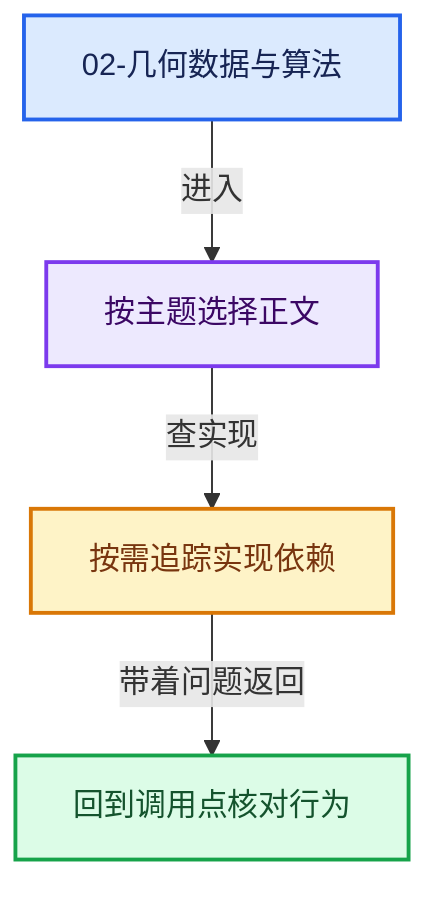
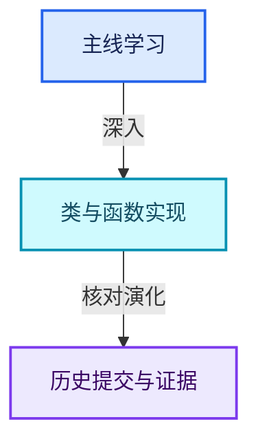

# 02-几何数据与算法

[几何节点总导航](../README.md) · [总入口](../../README.md)

- [GN-08 GeometrySet组件组合与写时分离](扩展01-GeometrySet组件组合与写时分离.md)
- [GN-12 属性捕获求值暂存与提交协议](扩展02-属性捕获求值暂存与提交协议.md)
- [GN-14 Instances引用表句柄与变换数组](扩展03-Instances引用表句柄与变换数组.md)
- [GN-15 InstanceOnPoints选择压缩与引用重映射](扩展04-InstanceOnPoints选择压缩与引用重映射.md)
- [GN-16 JoinGeometry组件分派与Realize复用](扩展05-JoinGeometry组件分派与Realize复用.md)
- [GN-17 RealizeInstances深度Field与任务流水线](扩展06-RealizeInstances深度Field与任务流水线.md)

