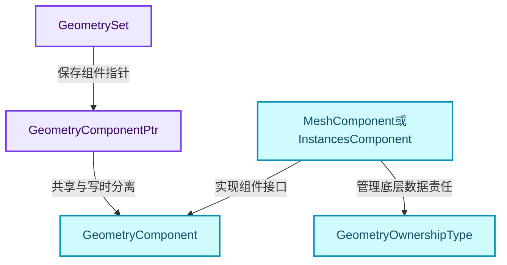
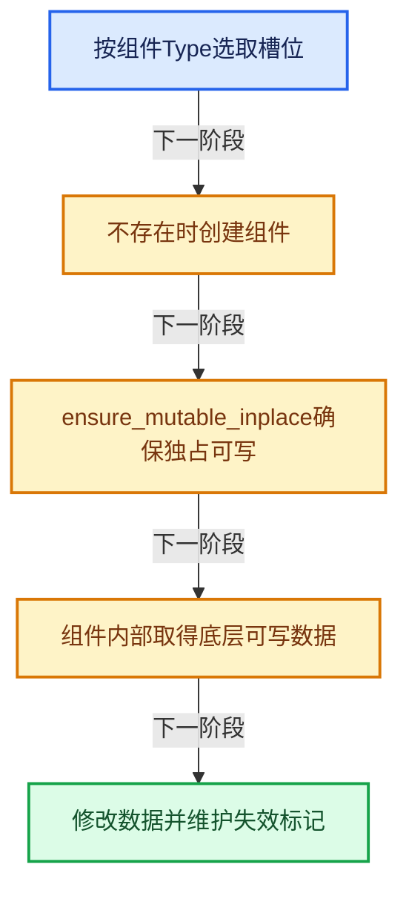
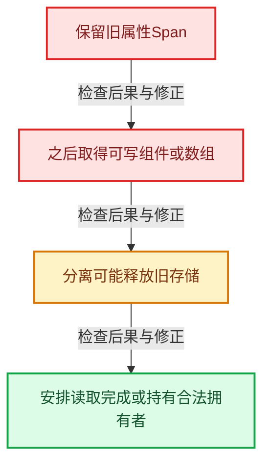

# GN-08 GeometrySet组件组合与写时分离

[几何节点学习地图](../README.md) · [专题分组导航](README.md) · [全局实现索引](../../00-课程指南/02-源码与提交索引/符号依赖与实现索引.md)

基准：`cbda6b96c26c0dee3c3b5cbb93960c4ac06a6b30`；文件哈希及连续摘录区间记录在[新增专题证据](../../_evidence/geometry-extension.json)。本篇围绕所选函数解释核心机制，辅助依赖明确列出已定位实现与尚需类型确认的边界，不宣称相关整个文件已全文复核。

## 先回答一个具体问题

为什么一份几何同时可以有Mesh、Curve和Instances？为什么get_component_for_write不是普通getter？

## 相关类与数据的职责

- **`GeometrySet`**：按组件类型组合几何载荷。 定义入口：[source/blender/blenkernel/BKE_geometry_set.hh · L151](../../../../../../source/blender/blenkernel/BKE_geometry_set.hh)。
- **`GeometryComponent`**：公共组件接口，继承隐式共享机制。 定义入口：[source/blender/blenkernel/BKE_geometry_set.hh · L69](../../../../../../source/blender/blenkernel/BKE_geometry_set.hh)。
- **`GeometryComponentPtr`**：持有共享组件并提供ensure_mutable_inplace。 定义入口：[source/blender/blenkernel/BKE_geometry_set.hh · L62](../../../../../../source/blender/blenkernel/BKE_geometry_set.hh)。
- **`MeshComponent或InstancesComponent`**：适配实际数据类型及其拥有方式。 定义入口：[source/blender/blenkernel/BKE_geometry_set.hh · L495](../../../../../../source/blender/blenkernel/BKE_geometry_set.hh)。
- **`GeometryOwnershipType`**：区分拥有、只读或可编辑引用等数据责任。 定义入口：[source/blender/blenkernel/BKE_geometry_set.hh · L53](../../../../../../source/blender/blenkernel/BKE_geometry_set.hh)。



上图箭头文字区分拥有、借用、调用和数据依赖。连线不表示这些类型存在同名继承关系；只有源码明确声明的继承才按继承理解。

## 设计推导与扩展知识

### 推导1

GeometrySet是组合模型，一份值可以同时携带多个几何类别。节点若只处理Mesh，应说明其他组件是保留、删除还是另行处理，不能默认GeometrySet就是Mesh指针的别名。

### 推导2

get_component_for_write首先可能创建缺失组件，其次可能复制共享组件。读接口和写接口的行为差异直接影响成本和指针寿命，调用者不应过早取得写权限。

### 推导3

组件独占与底层数组独占是不同层级。复制MeshComponent可能仍共享Mesh内部可共享数据；最终可写属性或变换访问还可能触发另一层分离。

### 推导4

GeometryOwnershipType描述组件对底层数据的责任。ensure_owns_direct_data用于保证当前直接载荷可安全持有；ensure_owns_all_data还会考虑实例引用中的几何，不能把二者混为完全递归复制。

### 推导5

隐式共享降低只读分支的复制成本，但不能替代并发写保护。两个线程写同一个GeometrySet对象，仍需独立对象、任务划分或明确同步协议。

## 实际处理阶段



这张图概括本篇所讨论的主路径；等待输入、构建失败与不同策略的分支以下方完整代码为准，不能把概括图当作每次都会执行的无条件顺序。

## 教学注释代码与分段机制

<a id="f-21eccb196f5b9a78"></a>

### `blender::bke::get_component_for_write` · L119—L127

按Type索引、缺失创建和ensure_mutable_inplace是完整的三个步骤。

实现位置：[source/blender/blenkernel/intern/geometry_set.cc](../../../../../../source/blender/blenkernel/intern/geometry_set.cc)。

**教学注释版**

<!-- annotated:5bbd80cc7c1de4 -->

```cpp
GeometryComponent &GeometrySet::get_component_for_write(GeometryComponent::Type component_type)
{
  GeometryComponentPtr &component_ptr = components_[size_t(component_type)];
  if (!component_ptr) {
    /* If the component did not exist before, create a new one. */
    component_ptr = GeometryComponent::create(component_type);
  }
  // [讲解] 共享组件在必要时分离；这不是无副作用的只读getter。
  return component_ptr.ensure_mutable_inplace();
}
```

<details>
<summary>核对原始源码：source/blender/blenkernel/intern/geometry_set.cc · L119—L127</summary>

<!-- original:5bbd80cc7c1de4:source/blender/blenkernel/intern/geometry_set.cc:119:127 -->

```cpp
GeometryComponent &GeometrySet::get_component_for_write(GeometryComponent::Type component_type)
{
  GeometryComponentPtr &component_ptr = components_[size_t(component_type)];
  if (!component_ptr) {
    /* If the component did not exist before, create a new one. */
    component_ptr = GeometryComponent::create(component_type);
  }
  return component_ptr.ensure_mutable_inplace();
}
```

</details>

<details>
<summary>实现依赖入口与尚需类型确认的调用</summary>

- `GeometryComponent::create` → [blender::bke::create · L41](../../06-隐式共享与缓存系统/05-GeometrySet读写与复制.md#f-057aed72adfa658c)。
- `component_ptr.ensure_mutable_inplace` → [blender::ImplicitSharingPtr::ensure_mutable_inplace · L144](../../06-隐式共享与缓存系统/03-Mixin与共享指针封装.md#f-d9e9b25281edf91a)。

</details>

<a id="f-9626a230081195a6"></a>

### `blender::bke::ensure_owns_direct_data` · L272—L284

逐组件处理直接拥有状态，不应推断为递归Realize。

实现位置：[source/blender/blenkernel/intern/geometry_set.cc](../../../../../../source/blender/blenkernel/intern/geometry_set.cc)。

**教学注释版**

<!-- annotated:f6081c7362213c -->

```cpp
void GeometrySet::ensure_owns_direct_data()
{
  for (GeometryComponentPtr &component_ptr : components_) {
    if (!component_ptr) {
      continue;
    }
    if (component_ptr->owns_direct_data()) {
      continue;
    }
    GeometryComponent &component_for_write = this->get_component_for_write(component_ptr->type());
    component_for_write.ensure_owns_direct_data();
  }
}
```

<details>
<summary>核对原始源码：source/blender/blenkernel/intern/geometry_set.cc · L272—L284</summary>

<!-- original:f6081c7362213c:source/blender/blenkernel/intern/geometry_set.cc:272:284 -->

```cpp
void GeometrySet::ensure_owns_direct_data()
{
  for (GeometryComponentPtr &component_ptr : components_) {
    if (!component_ptr) {
      continue;
    }
    if (component_ptr->owns_direct_data()) {
      continue;
    }
    GeometryComponent &component_for_write = this->get_component_for_write(component_ptr->type());
    component_for_write.ensure_owns_direct_data();
  }
}
```

</details>

<details>
<summary>实现依赖入口与尚需类型确认的调用</summary>

- `component_ptr->owns_direct_data`：L278的类型或分派协议；接收对象类型依赖auto、返回值或模板实例；不按同名猜测目标。
- `this->get_component_for_write` → [blender::bke::get_component_for_write · L119](../05-性能诊断/扩展01-几何节点性能诊断与架构训练.md#f-21eccb196f5b9a78)。
- `component_ptr->type`：L281的类型或分派协议；接收对象类型依赖auto、返回值或模板实例；不按同名猜测目标。
- `component_for_write.ensure_owns_direct_data` → [blender::bke::ensure_owns_direct_data · L272](扩展01-GeometrySet组件组合与写时分离.md#f-9626a230081195a6)。

</details>

<a id="f-80fb9cda8ab985dc"></a>

### `blender::bke::ensure_owns_all_data` · L286—L292

先ensure_geometry_instances规范化实例引用，再保证直接数据拥有；不能把函数名all理解为Realize或无条件深复制全部来源。

实现位置：[source/blender/blenkernel/intern/geometry_set.cc](../../../../../../source/blender/blenkernel/intern/geometry_set.cc)。

**教学注释版**

<!-- annotated:118dd8830e8372 -->

```cpp
void GeometrySet::ensure_owns_all_data()
{
  if (Instances *instances = this->get_instances_for_write()) {
    instances->ensure_geometry_instances();
  }
  // [讲解] 保证当前直接组件拥有所需数据；不要推断为展开全部实例。
  this->ensure_owns_direct_data();
}
```

<details>
<summary>核对原始源码：source/blender/blenkernel/intern/geometry_set.cc · L286—L292</summary>

<!-- original:118dd8830e8372:source/blender/blenkernel/intern/geometry_set.cc:286:292 -->

```cpp
void GeometrySet::ensure_owns_all_data()
{
  if (Instances *instances = this->get_instances_for_write()) {
    instances->ensure_geometry_instances();
  }
  this->ensure_owns_direct_data();
}
```

</details>

<details>
<summary>实现依赖入口与尚需类型确认的调用</summary>

- `this->get_instances_for_write` → [blender::bke::get_instances_for_write · L586](../../06-隐式共享与缓存系统/05-GeometrySet读写与复制.md#f-e2fefbfed77f753f)。
- `instances->ensure_geometry_instances` → [blender::bke::ensure_geometry_instances · L111](扩展01-GeometrySet组件组合与写时分离.md#f-c6c307192970c4f3)。
- `this->ensure_owns_direct_data` → [blender::bke::ensure_owns_direct_data · L272](扩展01-GeometrySet组件组合与写时分离.md#f-9626a230081195a6)。

</details>

<a id="f-c6c307192970c4f3"></a>

### `blender::bke::ensure_geometry_instances` · L111—L170

Object与Collection引用转换为对应几何表达，部分非几何对象保留对象引用；既有GeometrySet引用保持，不能统一说每项都被递归复制。

实现位置：[source/blender/blenkernel/intern/geometry_set_instances.cc](../../../../../../source/blender/blenkernel/intern/geometry_set_instances.cc)。

**教学注释版**

<!-- annotated:dadfa3fdd29abd -->

```cpp
void Instances::ensure_geometry_instances()
{
  Vector<InstanceReference> new_references;
  new_references.reserve(references_.size());
  for (const InstanceReference &reference : references_) {
    switch (reference.type()) {
      case InstanceReference::Type::None: {
        new_references.append(InstanceReference(GeometrySet{}));
        break;
      }
      case InstanceReference::Type::GeometrySet: {
        /* Those references can stay as their were. */
        new_references.append(reference);
        break;
      }
      case InstanceReference::Type::Object: {
        /* Create a new reference that contains the geometry set of the object. We may want to
         * treat e.g. lamps and similar object types separately here. */
        Object &object = reference.object();
        if (ELEM(object.type, OB_LAMP, OB_CAMERA, OB_SPEAKER, OB_ARMATURE)) {
          new_references.append(InstanceReference(object));
          break;
        }
        GeometrySet object_geometry_set = object_get_evaluated_geometry_set(object);
        object_geometry_set.set_name(BKE_id_name(object.id));
        if (object_geometry_set.has_instances()) {
          object_geometry_set.get_instances_for_write()->ensure_geometry_instances();
        }
        new_references.append(std::move(object_geometry_set));
        break;
      }
      case InstanceReference::Type::Collection: {
        /* Create a new reference that contains a geometry set that contains all objects from the
         * collection as instances. */
        Collection &collection = reference.collection();

        Vector<Object *, 8> objects;
        FOREACH_COLLECTION_OBJECT_RECURSIVE_BEGIN (&collection, object) {
          objects.append(object);
        }
        FOREACH_COLLECTION_OBJECT_RECURSIVE_END;

        auto instances = std::make_unique<Instances>(objects.size());
        MutableSpan<int> handles = instances->reference_handles_for_write();
        MutableSpan<float4x4> transforms = instances->transforms_for_write();
        for (const int i : objects.index_range()) {
          handles[i] = instances->add_reference(*objects[i]);
          transforms[i] = objects[i]->object_to_world();
          transforms[i].location() -= collection.instance_offset;
        }
        instances->ensure_geometry_instances();
        GeometrySet geometry_set = GeometrySet::from_instances(std::move(instances));
        geometry_set.set_name(BKE_id_name(collection.id));
        new_references.append(std::move(geometry_set));
        break;
      }
    }
  }
  references_ = std::move(new_references);
}
```

<details>
<summary>核对原始源码：source/blender/blenkernel/intern/geometry_set_instances.cc · L111—L170</summary>

<!-- original:dadfa3fdd29abd:source/blender/blenkernel/intern/geometry_set_instances.cc:111:170 -->

```cpp
void Instances::ensure_geometry_instances()
{
  Vector<InstanceReference> new_references;
  new_references.reserve(references_.size());
  for (const InstanceReference &reference : references_) {
    switch (reference.type()) {
      case InstanceReference::Type::None: {
        new_references.append(InstanceReference(GeometrySet{}));
        break;
      }
      case InstanceReference::Type::GeometrySet: {
        /* Those references can stay as their were. */
        new_references.append(reference);
        break;
      }
      case InstanceReference::Type::Object: {
        /* Create a new reference that contains the geometry set of the object. We may want to
         * treat e.g. lamps and similar object types separately here. */
        Object &object = reference.object();
        if (ELEM(object.type, OB_LAMP, OB_CAMERA, OB_SPEAKER, OB_ARMATURE)) {
          new_references.append(InstanceReference(object));
          break;
        }
        GeometrySet object_geometry_set = object_get_evaluated_geometry_set(object);
        object_geometry_set.set_name(BKE_id_name(object.id));
        if (object_geometry_set.has_instances()) {
          object_geometry_set.get_instances_for_write()->ensure_geometry_instances();
        }
        new_references.append(std::move(object_geometry_set));
        break;
      }
      case InstanceReference::Type::Collection: {
        /* Create a new reference that contains a geometry set that contains all objects from the
         * collection as instances. */
        Collection &collection = reference.collection();

        Vector<Object *, 8> objects;
        FOREACH_COLLECTION_OBJECT_RECURSIVE_BEGIN (&collection, object) {
          objects.append(object);
        }
        FOREACH_COLLECTION_OBJECT_RECURSIVE_END;

        auto instances = std::make_unique<Instances>(objects.size());
        MutableSpan<int> handles = instances->reference_handles_for_write();
        MutableSpan<float4x4> transforms = instances->transforms_for_write();
        for (const int i : objects.index_range()) {
          handles[i] = instances->add_reference(*objects[i]);
          transforms[i] = objects[i]->object_to_world();
          transforms[i].location() -= collection.instance_offset;
        }
        instances->ensure_geometry_instances();
        GeometrySet geometry_set = GeometrySet::from_instances(std::move(instances));
        geometry_set.set_name(BKE_id_name(collection.id));
        new_references.append(std::move(geometry_set));
        break;
      }
    }
  }
  references_ = std::move(new_references);
}
```

</details>

<details>
<summary>实现依赖入口与尚需类型确认的调用</summary>

- `new_references.reserve` → [blender::Vector::reserve · L405](../../01-基础容器与现代CPP/10-Vector扩容与增长.md#f-4cf9c0f00e01102e)。
- `references_.size`：L114的类型或分派协议；接收对象类型依赖auto、返回值或模板实例；不按同名猜测目标。
- `reference.type`：L116的类型或分派协议；接收对象类型依赖auto、返回值或模板实例；不按同名猜测目标。
- `new_references.append` → [blender::Vector::append · L498](../../01-基础容器与现代CPP/11-Vector插入删除与重排.md#f-5bde268a69e443ec)；[blender::Vector::append · L502](../../01-基础容器与现代CPP/11-Vector插入删除与重排.md#f-591e0b15e6308532)。多候选需按实参和重载规则确认。
- `InstanceReference` → [blender::bke::InstanceReference · L25](../../90-实现依赖专题/02-BKE几何与数据/intern/instances.cc.md#f-087c9bd8d14e53b8)；[blender::bke::InstanceReference · L31](../../90-实现依赖专题/02-BKE几何与数据/intern/instances.cc.md#f-3a1a225c151dca34)。多候选需按实参和重载规则确认。
- `reference.object`：L129的类型或分派协议；接收对象类型依赖auto、返回值或模板实例；不按同名猜测目标。
- `ELEM`：宏定义见[intern/ghost/intern/GHOST_utildefines.hh](../../../../../../intern/ghost/intern/GHOST_utildefines.hh), L88；按当前编译条件选择。
- `ELEM`：宏定义见[source/blender/blenlib/BLI_utildefines.hh](../../../../../../source/blender/blenlib/BLI_utildefines.hh), L135；按当前编译条件选择。
- `object_get_evaluated_geometry_set` → [blender::bke::object_get_evaluated_geometry_set · L46](../../90-实现依赖专题/02-BKE几何与数据/intern/geometry_set_instances.cc.md#f-47e721147bb67b7f)。
- `object_geometry_set.set_name` → [blender::bke::set_name · L805](../../06-隐式共享与缓存系统/05-GeometrySet读写与复制.md#f-8509f63d0760936e)。
- `BKE_id_name` → [blender::BKE_id_name · L1001](../../90-实现依赖专题/02-BKE几何与数据/BKE_lib_id.hh.md#f-b9397f1fe1fcc017)；[blender::BKE_id_name · L1005](../../90-实现依赖专题/02-BKE几何与数据/BKE_lib_id.hh.md#f-c026427d13979145)。多候选需按实参和重载规则确认。
- `object_geometry_set.has_instances` → [blender::bke::has_instances · L381](../../06-隐式共享与缓存系统/05-GeometrySet读写与复制.md#f-96f474fc46f602f1)。
- `object_geometry_set.get_instances_for_write()->ensure_geometry_instances`：L137的类型或分派协议；接收对象类型依赖auto、返回值或模板实例；不按同名猜测目标。
- `object_geometry_set.get_instances_for_write` → [blender::bke::get_instances_for_write · L586](../../06-隐式共享与缓存系统/05-GeometrySet读写与复制.md#f-e2fefbfed77f753f)。
- `std::move`：把表达式转换成可供移动重载选择的值类别；不保证真的移动，不结束源对象寿命，对const值可能选择复制。 [接口资料](https://eel.is/c++draft/utility.forward)。
- `reference.collection`：L145的类型或分派协议；接收对象类型依赖auto、返回值或模板实例；不按同名猜测目标。
- `FOREACH_COLLECTION_OBJECT_RECURSIVE_BEGIN`：宏定义见[source/blender/blenkernel/BKE_collection.hh](../../../../../../source/blender/blenkernel/BKE_collection.hh), L485；按当前编译条件选择。
- `objects.append` → [blender::Vector::append · L498](../../01-基础容器与现代CPP/11-Vector插入删除与重排.md#f-5bde268a69e443ec)；[blender::Vector::append · L502](../../01-基础容器与现代CPP/11-Vector插入删除与重排.md#f-591e0b15e6308532)。多候选需按实参和重载规则确认。
- `std::make_unique<Instances>`：创建独占拥有的对象，拥有关系可移动，get返回的借用指针不自动延长寿命。 [接口资料](https://eel.is/c++draft/unique.ptr.create)。
- `objects.size` → [blender::Vector::size · L780](../../01-基础容器与现代CPP/11-Vector插入删除与重排.md#f-714773731767349c)。
- `instances->reference_handles_for_write`：L154的类型或分派协议；接收对象类型依赖auto、返回值或模板实例；不按同名猜测目标。
- `instances->transforms_for_write`：L155的类型或分派协议；接收对象类型依赖auto、返回值或模板实例；不按同名猜测目标。
- `objects.index_range` → [blender::Vector::index_range · L1026](../../01-基础容器与现代CPP/12-Vector异常安全与边界.md#f-ac29cf36ef185ab9)。
- `instances->add_reference`：L157的类型或分派协议；接收对象类型依赖auto、返回值或模板实例；不按同名猜测目标。
- `objects[i]->object_to_world`：L158的类型或分派协议；接收对象类型依赖auto、返回值或模板实例；不按同名猜测目标。
- `transforms[i].location`：L159的类型或分派协议；接收对象类型依赖auto、返回值或模板实例；不按同名猜测目标。
- `instances->ensure_geometry_instances`：L161的类型或分派协议；接收对象类型依赖auto、返回值或模板实例；不按同名猜测目标。
- `GeometrySet::from_instances` → [blender::bke::from_instances · L455](../../06-隐式共享与缓存系统/05-GeometrySet读写与复制.md#f-0c23a168248fb2cb)；[blender::bke::from_instances · L462](../../06-隐式共享与缓存系统/05-GeometrySet读写与复制.md#f-447a100ea7cfda47)。多候选需按实参和重载规则确认。
- `geometry_set.set_name` → [blender::bke::set_name · L805](../../06-隐式共享与缓存系统/05-GeometrySet读写与复制.md#f-8509f63d0760936e)。

</details>

## 用小数据走一遍

1. GeometrySet A与B共享组件。
2. B调用get_component_for_write(Mesh)。
3. B的组件在必要时分离。
4. A继续观察原组件。


这是明确输入条件下的教学推演，不是本地性能实测。对源码的验证应同时检查数值、对象寿命、输出需求和数据是否存在。

## 反例与边界

- 保留旧属性Span。
- 之后取得可写组件或数组。
- 分离可能释放旧存储。
- 安排读取完成或持有合法拥有者。



## 历史提交阅读

本地历史阅读样本：**Hans Goudey**，2026-06-16T17:43:54+02:00。

`1422f044cbf962f01eef19aee3e758e7f8346026`

提交标题：Mesh: Improve and simplify modifier evaluation logic

[所选文件的真实diff](../../_evidence/geometry-history/GN-08.patch)。这是本地历史中匹配作者的近期样本，不冒称该系统的最初引入提交。阅读时先找变更前后的不变量，再检查新增分支与测试；本篇当前源码说明不混用历史签名。

## 独立实现与验收

给共享Mesh写入一个属性，分别标出GeometrySet层、组件层、属性数组层的可能复制。

<details>
<summary>参考思路</summary>

不要承诺三层一定都复制；判断各层共享计数、拥有方式与实际写接口，记录是哪一步可能改变地址。

</details>

验收时保留一个能击穿错误设计的反例，再对照实际符号重走调用链。教学练习未在完整Blender中运行；本轮独立运行的模型验证另见新增专题验收报告。

## 继续阅读

- [GN-07 数学节点从MultiFunction到FieldOperation](../01-节点接口与执行架构/扩展01-数学节点从MultiFunction到FieldOperation.md)
- [GN-09 几何FieldContext属性域与跨域求值](../03-Field与属性/扩展01-几何FieldContext属性域与跨域求值.md)
- [GN-12 属性捕获求值暂存与提交协议](扩展02-属性捕获求值暂存与提交协议.md)
- [GN-14 Instances引用表句柄与变换数组](扩展03-Instances引用表句柄与变换数组.md)
- [GN-15 InstanceOnPoints选择压缩与引用重映射](扩展04-InstanceOnPoints选择压缩与引用重映射.md)
- [GN-16 JoinGeometry组件分派与Realize复用](扩展05-JoinGeometry组件分派与Realize复用.md)
- [GN-17 RealizeInstances深度Field与任务流水线](扩展06-RealizeInstances深度Field与任务流水线.md)
