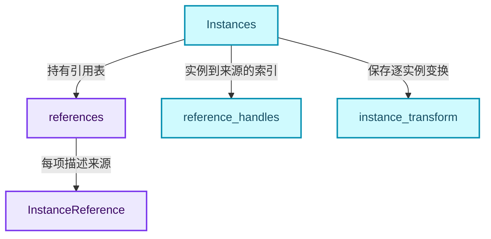
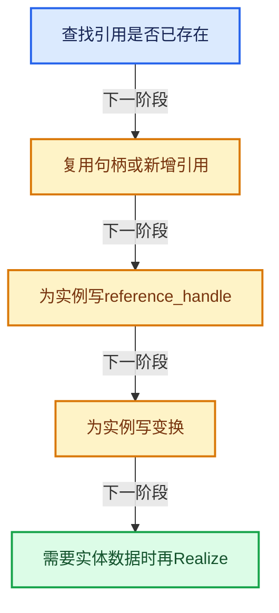
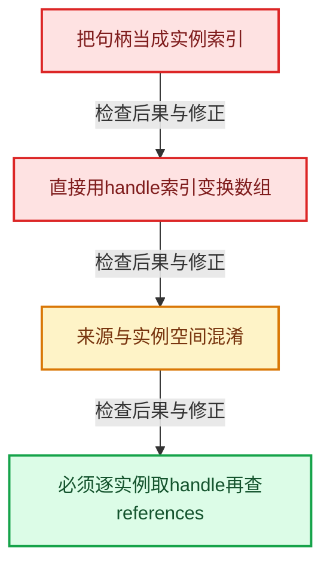

# GN-14 Instances引用表句柄与变换数组

[几何节点学习地图](../README.md) · [专题分组导航](README.md) · [全局实现索引](../../00-课程指南/02-源码与提交索引/符号依赖与实现索引.md)

基准：`cbda6b96c26c0dee3c3b5cbb93960c4ac06a6b30`；文件哈希及连续摘录区间记录在[新增专题证据](../../_evidence/geometry-extension.json)。本篇围绕所选函数解释核心机制，辅助依赖明确列出已定位实现与尚需类型确认的边界，不宣称相关整个文件已全文复核。

## 先回答一个具体问题

一百万个实例怎样避免复制一百万份Mesh？引用句柄为什么要与实例索引分开？

## 相关类与数据的职责

- **`InstanceReference`**：引用对象、集合或GeometrySet等实例来源。 定义入口：[source/blender/blenkernel/BKE_instances.hh · L56](../../../../../../source/blender/blenkernel/BKE_instances.hh)。
- **`Instances`**：管理引用表、逐实例句柄与属性。 定义入口：[source/blender/blenkernel/BKE_instances.hh · L115](../../../../../../source/blender/blenkernel/BKE_instances.hh)。
- **`references`**：少量可复用来源的表。
- **`reference_handles`**：每个实例选择哪个引用。
- **`instance_transform`**：每个实例自己的变换属性。



上图箭头文字区分拥有、借用、调用和数据依赖。连线不表示这些类型存在同名继承关系；只有源码明确声明的继承才按继承理解。

## 设计推导与扩展知识

### 推导1

引用表与实例序列是两个不同的索引空间。第100个实例可以引用表中第2个来源，第101个实例仍可引用同一来源但有不同变换。

### 推导2

add_reference先find_reference_handle，存在则复用；add_new_reference则表达调用者确信应新增的意图。句柄去重节省来源记录，但不能据此假定每次find都是常数复杂度，需看当前实现。

### 推导3

reference_handles与transforms通过属性系统取得，当前变换属性名为instance_transform。取得可写Span仍可能触发数据分离，不能把它当作永远指向固定Vector的数据地址。

### 推导4

Instances::resize调整实例数量，不等于复制引用几何；references数量与instances数量应分别统计。只看一个size很难发现悬空句柄或未清理引用。

### 推导5

实例化的成本优势来自复用源几何与独立变换。Realize才把被选实例转换成实际顶点等元素，成本取决于源规模和展开次数，可能发生数量级变化。

## 实际处理阶段



这张图概括本篇所讨论的主路径；等待输入、构建失败与不同策略的分支以下方完整代码为准，不能把概括图当作每次都会执行的无条件顺序。

## 教学注释代码与分段机制

<a id="f-e7eee339908d63f4"></a>

### `blender::bke::add_reference` · L268—L274

两个重载分别复制或移动新引用；已有引用直接返回既有句柄。

实现位置：[source/blender/blenkernel/intern/instances.cc](../../../../../../source/blender/blenkernel/intern/instances.cc)。

**教学注释版**

<!-- annotated:2403a156bce2c8 -->

```cpp
int Instances::add_reference(const InstanceReference &reference)
{
  if (std::optional<int> handle = this->find_reference_handle(reference)) {
    // [讲解] 复用的是来源引用表句柄，不是新增实例序号。
    return *handle;
  }
  return this->add_new_reference(reference);
}
```

<details>
<summary>核对原始源码：source/blender/blenkernel/intern/instances.cc · L268—L274</summary>

<!-- original:2403a156bce2c8:source/blender/blenkernel/intern/instances.cc:268:274 -->

```cpp
int Instances::add_reference(const InstanceReference &reference)
{
  if (std::optional<int> handle = this->find_reference_handle(reference)) {
    return *handle;
  }
  return this->add_new_reference(reference);
}
```

</details>

<details>
<summary>实现依赖入口与尚需类型确认的调用</summary>

本函数未纳入旧结构调用闭包；以上源码保留实际调用表达式，相关成员须按接收者类型继续定位。下方类关系入口提供对应定义。

</details>

<a id="f-adfebcd66974fcd2"></a>

### `blender::bke::add_reference` · L276—L282

两个重载分别复制或移动新引用；已有引用直接返回既有句柄。

实现位置：[source/blender/blenkernel/intern/instances.cc](../../../../../../source/blender/blenkernel/intern/instances.cc)。

**教学注释版**

<!-- annotated:fb822480031de6 -->

```cpp
int Instances::add_reference(InstanceReference &&reference)
{
  if (std::optional<int> handle = this->find_reference_handle(reference)) {
    // [讲解] 复用的是来源引用表句柄，不是新增实例序号。
    return *handle;
  }
  return this->add_new_reference(std::move(reference));
}
```

<details>
<summary>核对原始源码：source/blender/blenkernel/intern/instances.cc · L276—L282</summary>

<!-- original:fb822480031de6:source/blender/blenkernel/intern/instances.cc:276:282 -->

```cpp
int Instances::add_reference(InstanceReference &&reference)
{
  if (std::optional<int> handle = this->find_reference_handle(reference)) {
    return *handle;
  }
  return this->add_new_reference(std::move(reference));
}
```

</details>

<details>
<summary>实现依赖入口与尚需类型确认的调用</summary>

本函数未纳入旧结构调用闭包；以上源码保留实际调用表达式，相关成员须按接收者类型继续定位。下方类关系入口提供对应定义。

</details>

<a id="f-19f94c1339524daf"></a>

### `blender::bke::find_reference_handle` · L257—L266

当前实现逐项比较references_，时间随引用数量线性增长。不要因为上层提供句柄就猜这里一定用哈希表。

实现位置：[source/blender/blenkernel/intern/instances.cc](../../../../../../source/blender/blenkernel/intern/instances.cc)。

**教学注释版**

<!-- annotated:0e9b0a8d395556 -->

```cpp
std::optional<int> Instances::find_reference_handle(const InstanceReference &query)
{
  for (const int i : references_.index_range()) {
    const InstanceReference &reference = references_[i];
    if (reference == query) {
      return i;
    }
  }
  return std::nullopt;
}
```

<details>
<summary>核对原始源码：source/blender/blenkernel/intern/instances.cc · L257—L266</summary>

<!-- original:0e9b0a8d395556:source/blender/blenkernel/intern/instances.cc:257:266 -->

```cpp
std::optional<int> Instances::find_reference_handle(const InstanceReference &query)
{
  for (const int i : references_.index_range()) {
    const InstanceReference &reference = references_[i];
    if (reference == query) {
      return i;
    }
  }
  return std::nullopt;
}
```

</details>

<details>
<summary>实现依赖入口与尚需类型确认的调用</summary>

本函数未纳入旧结构调用闭包；以上源码保留实际调用表达式，相关成员须按接收者类型继续定位。下方类关系入口提供对应定义。

</details>

<a id="f-fde187bc84995b87"></a>

### `blender::bke::add_new_reference` · L284—L288

新增项的返回值属于引用表索引，不是新实例序号。

实现位置：[source/blender/blenkernel/intern/instances.cc](../../../../../../source/blender/blenkernel/intern/instances.cc)。

**教学注释版**

<!-- annotated:d8e44d9c4ccae3 -->

```cpp
int Instances::add_new_reference(InstanceReference reference)
{
  this->tag_reference_handles_changed();
  // [讲解] 新增来源引用，并返回其在references_中的索引。
  return references_.append_and_get_index(std::move(reference));
}
```

<details>
<summary>核对原始源码：source/blender/blenkernel/intern/instances.cc · L284—L288</summary>

<!-- original:d8e44d9c4ccae3:source/blender/blenkernel/intern/instances.cc:284:288 -->

```cpp
int Instances::add_new_reference(InstanceReference reference)
{
  this->tag_reference_handles_changed();
  return references_.append_and_get_index(std::move(reference));
}
```

</details>

<details>
<summary>实现依赖入口与尚需类型确认的调用</summary>

- `this->tag_reference_handles_changed` → [blender::bke::Instances::tag_reference_handles_changed · L222](../../90-实现依赖专题/02-BKE几何与数据/BKE_instances.hh.md#f-1e4f8467bc0a8283)。
- `references_.append_and_get_index`：L287的类型或分派协议；接收对象类型依赖auto、返回值或模板实例；不按同名猜测目标。
- `std::move`：把表达式转换成可供移动重载选择的值类别；不保证真的移动，不结束源对象寿命，对const值可能选择复制。 [接口资料](https://eel.is/c++draft/utility.forward)。

</details>

<a id="f-0350d6057ae379dc"></a>

### `blender::bke::transforms_for_write` · L242—L246

从属性系统取得instance_transform的MutableSpan，因此共享与属性存储规则仍然有效。

实现位置：[source/blender/blenkernel/intern/instances.cc](../../../../../../source/blender/blenkernel/intern/instances.cc)。

**教学注释版**

<!-- annotated:80b90db0ec502e -->

```cpp
MutableSpan<float4x4> Instances::transforms_for_write()
{
  return get_mutable_attribute<float4x4>(
      attributes_, AttrDomain::Instance, "instance_transform", instances_num_);
}
```

<details>
<summary>核对原始源码：source/blender/blenkernel/intern/instances.cc · L242—L246</summary>

<!-- original:80b90db0ec502e:source/blender/blenkernel/intern/instances.cc:242:246 -->

```cpp
MutableSpan<float4x4> Instances::transforms_for_write()
{
  return get_mutable_attribute<float4x4>(
      attributes_, AttrDomain::Instance, "instance_transform", instances_num_);
}
```

</details>

<details>
<summary>实现依赖入口与尚需类型确认的调用</summary>

- `get_mutable_attribute<float4x4>` → [blender::bke::get_mutable_attribute · L90](../../90-实现依赖专题/02-BKE几何与数据/intern/attribute_storage_access.hh.md#f-94948323441578df)；[blender::bke::get_mutable_attribute · L188](../../90-实现依赖专题/02-BKE几何与数据/intern/attribute_storage_access.cc.md#f-1dc04fa7db8e0dd3)。多候选需按实参和重载规则确认。

</details>

## 用小数据走一遍

1. 引用表0=Cube，1=Sphere。
2. 实例句柄[0,0,1]。
3. 三份变换T0、T1、T2。
4. 场景有3个实例但只有2个来源。


这是明确输入条件下的教学推演，不是本地性能实测。对源码的验证应同时检查数值、对象寿命、输出需求和数据是否存在。

## 反例与边界

- 把句柄当成实例索引。
- 直接用handle索引变换数组。
- 来源与实例空间混淆。
- 必须逐实例取handle再查references。



## 历史提交阅读

本地历史阅读样本：**Jacques Lucke**，2026-05-22T16:39:02+02:00。

`21d3dff40b2e67e504886c80b78d141ce0470aee`

提交标题：Refactor: Geometry Nodes: edit values recursively

[所选文件的真实diff](../../_evidence/geometry-history/GN-14.patch)。这是本地历史中匹配作者的近期样本，不冒称该系统的最初引入提交。阅读时先找变更前后的不变量，再检查新增分支与测试；本篇当前源码说明不混用历史签名。

## 独立实现与验收

合并两个Instances，两个来源表的句柄0分别代表不同几何，设计重映射。

<details>
<summary>参考思路</summary>

为每个源表建立old_handle→new_handle映射，再按源实例句柄gather到目标句柄数组，不能直接拼接整数。

</details>

验收时保留一个能击穿错误设计的反例，再对照实际符号重走调用链。教学练习未在完整Blender中运行；本轮独立运行的模型验证另见新增专题验收报告。

## 继续阅读

- [GN-08 GeometrySet组件组合与写时分离](扩展01-GeometrySet组件组合与写时分离.md)
- [GN-12 属性捕获求值暂存与提交协议](扩展02-属性捕获求值暂存与提交协议.md)
- [GN-13 CaptureAttribute匿名属性引用与清理](../03-Field与属性/扩展01-CaptureAttribute匿名属性引用与清理.md)
- [GN-15 InstanceOnPoints选择压缩与引用重映射](扩展04-InstanceOnPoints选择压缩与引用重映射.md)
- [GN-16 JoinGeometry组件分派与Realize复用](扩展05-JoinGeometry组件分派与Realize复用.md)
- [GN-17 RealizeInstances深度Field与任务流水线](扩展06-RealizeInstances深度Field与任务流水线.md)
