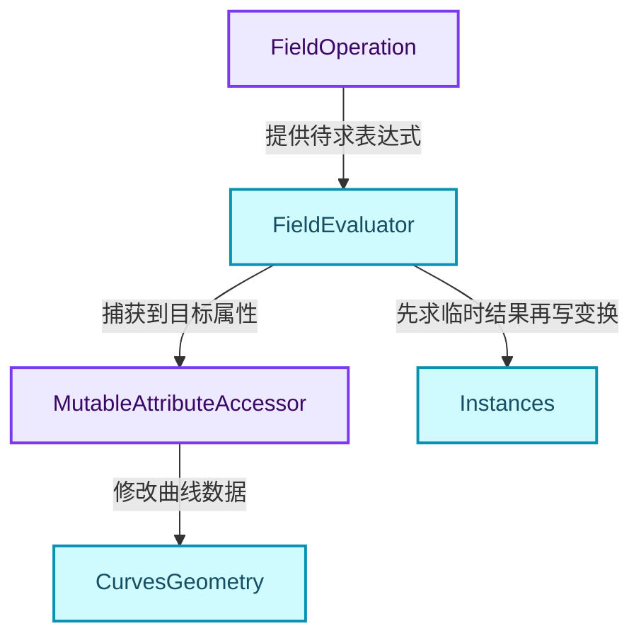
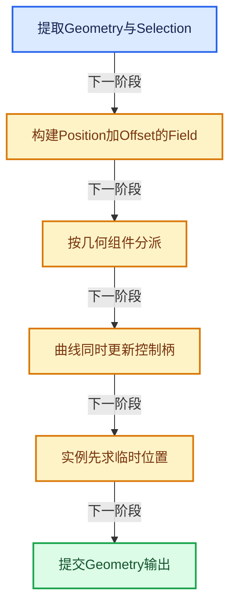
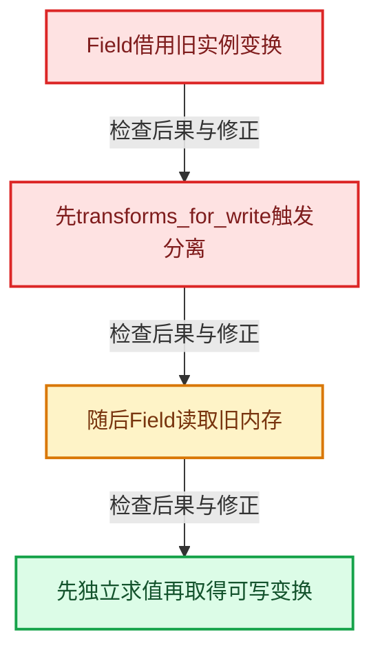

# GN-10 SetPosition读取写入与贝塞尔控制柄

[几何节点学习地图](../README.md) · [专题分组导航](README.md) · [全局实现索引](../../00-课程指南/02-源码与提交索引/符号依赖与实现索引.md)

基准：`cbda6b96c26c0dee3c3b5cbb93960c4ac06a6b30`；文件哈希及连续摘录区间记录在[新增专题证据](../../_evidence/geometry-extension.json)。本篇围绕所选函数解释核心机制，辅助依赖明确列出已定位实现与尚需类型确认的边界，不宣称相关整个文件已全文复核。

## 先回答一个具体问题

Set Position为什么不能只写一个positions[i] += offset[i]？曲线和实例需要哪些额外处理？

## 相关类与数据的职责

- **`FieldOperation`**：组合Position与Offset表达式。 定义入口：[source/blender/functions/FN_field.hh · L387](../../../../../../source/blender/functions/FN_field.hh)。
- **`FieldEvaluator`**：在上下文和Selection上求值。
- **`MutableAttributeAccessor`**：写入Mesh或曲线的属性。 定义入口：[source/blender/blenkernel/BKE_attribute.hh · L707](../../../../../../source/blender/blenkernel/BKE_attribute.hh)。
- **`CurvesGeometry`**：维护控制点、控制柄及自动柄。
- **`Instances`**：在变换矩阵中保存实例位置。 定义入口：[source/blender/blenkernel/BKE_instances.hh · L115](../../../../../../source/blender/blenkernel/BKE_instances.hh)。



上图箭头文字区分拥有、借用、调用和数据依赖。连线不表示这些类型存在同名继承关系；只有源码明确声明的继承才按继承理解。

## 设计推导与扩展知识

### 推导1

Position输入默认来源也是Field，Offset与它通过注册的float3加法MultiFunction组合。此处建立表达式，而不是立即在节点入口读出所有位置。

### 推导2

Mesh与PointCloud可以通过try_capture_field_on_geometry写position。曲线还需要考虑handle_left和handle_right：先计算新旧控制点差delta，再把同一delta加到控制柄，最后重算自动柄。

### 推导3

同一批捕获多个属性有助于先完成读取再写入，避免新position污染仍需旧position计算的控制柄表达式。要读懂具体求值工具的暂存与提交顺序，不能只凭表面循环顺序推断。

### 推导4

实例的位置位于变换矩阵location，不再一律作为普通position属性存储。set_instances_position先求到独立Array，再取得transforms_for_write，源码注释明确指出这是为了规避写时复制后的悬空读取。

### 推导5

selection之外的位置不应被改写。临时Array可能按全部实例数量分配，但只保证选择范围内已求值的数据可用于本次写入；不能顺手读取未选择位置的临时值。

## 实际处理阶段



这张图概括本篇所讨论的主路径；等待输入、构建失败与不同策略的分支以下方完整代码为准，不能把概括图当作每次都会执行的无条件顺序。

## 教学注释代码与分段机制

<a id="f-804816a7dfe0390a"></a>

### `blender::nodes::node_geo_set_position_cc::set_curves_position` · L59—L85

delta由新position减旧position构成；两种控制柄与position一并捕获，再计算自动柄。

实现位置：[source/blender/nodes/geometry/nodes/node_geo_set_position.cc](../../../../../../source/blender/nodes/geometry/nodes/node_geo_set_position.cc)。

**教学注释版**

<!-- annotated:49d75dcf9ecd40 -->

```cpp
static void set_curves_position(bke::CurvesGeometry &curves,
                                const fn::FieldContext &field_context,
                                const Field<bool> &selection_field,
                                const Field<float3> &position_field)
{
  MutableAttributeAccessor attributes = curves.attributes_for_write();

  Vector<StringRef> attribute_names;
  Vector<GField> fields;
  attribute_names.append("position");
  fields.append(position_field);

  if (attributes.contains("handle_right") && attributes.contains("handle_left")) {
    fn::Field<float3> delta(fn::FieldOperation::from(
        get_sub_fn(),
        {position_field, bke::AttributeFieldInput::get_field<float3, "position">()}));
    for (const StringRef name : {"handle_left", "handle_right"}) {
      attribute_names.append(name);
      fields.append(Field<float3>(fn::FieldOperation::from(
          get_add_fn(), {bke::AttributeFieldInput::from<float3>(name), delta})));
    }
  }

  bke::try_capture_fields_on_geometry(
      attributes, field_context, attribute_names, bke::AttrDomain::Point, selection_field, fields);
  // [讲解] 控制点与控制柄写入后，再按曲线规则更新自动柄。
  curves.calculate_bezier_auto_handles();
}
```

<details>
<summary>核对原始源码：source/blender/nodes/geometry/nodes/node_geo_set_position.cc · L59—L85</summary>

<!-- original:49d75dcf9ecd40:source/blender/nodes/geometry/nodes/node_geo_set_position.cc:59:85 -->

```cpp
static void set_curves_position(bke::CurvesGeometry &curves,
                                const fn::FieldContext &field_context,
                                const Field<bool> &selection_field,
                                const Field<float3> &position_field)
{
  MutableAttributeAccessor attributes = curves.attributes_for_write();

  Vector<StringRef> attribute_names;
  Vector<GField> fields;
  attribute_names.append("position");
  fields.append(position_field);

  if (attributes.contains("handle_right") && attributes.contains("handle_left")) {
    fn::Field<float3> delta(fn::FieldOperation::from(
        get_sub_fn(),
        {position_field, bke::AttributeFieldInput::get_field<float3, "position">()}));
    for (const StringRef name : {"handle_left", "handle_right"}) {
      attribute_names.append(name);
      fields.append(Field<float3>(fn::FieldOperation::from(
          get_add_fn(), {bke::AttributeFieldInput::from<float3>(name), delta})));
    }
  }

  bke::try_capture_fields_on_geometry(
      attributes, field_context, attribute_names, bke::AttrDomain::Point, selection_field, fields);
  curves.calculate_bezier_auto_handles();
}
```

</details>

<details>
<summary>实现依赖入口与尚需类型确认的调用</summary>

- `curves.attributes_for_write` → [blender::bke::attributes_for_write · L1913](../../90-实现依赖专题/02-BKE几何与数据/intern/curves_geometry.cc.md#f-4930091b34fa9663)。
- `attribute_names.append` → [blender::Vector::append · L498](../../01-基础容器与现代CPP/11-Vector插入删除与重排.md#f-5bde268a69e443ec)；[blender::Vector::append · L502](../../01-基础容器与现代CPP/11-Vector插入删除与重排.md#f-591e0b15e6308532)。多候选需按实参和重载规则确认。
- `fields.append` → [blender::Vector::append · L498](../../01-基础容器与现代CPP/11-Vector插入删除与重排.md#f-5bde268a69e443ec)；[blender::Vector::append · L502](../../01-基础容器与现代CPP/11-Vector插入删除与重排.md#f-591e0b15e6308532)。多候选需按实参和重载规则确认。
- `attributes.contains`：L71的类型或分派协议；由接收对象具体类型或运行时策略提供实现。
- `fn::FieldOperation::from` → [blender::fn::from · L252](../../08-Field表达式与求值/06-FieldContext上下文.md#f-d78060e8f5e1929f)；[blender::fn::from · L258](../../08-Field表达式与求值/06-FieldContext上下文.md#f-60a41b323ee8ceb7)。多候选需按实参和重载规则确认。
- `get_sub_fn` → [blender::nodes::node_geo_set_position_cc::get_sub_fn · L40](../../08-Field表达式与求值/11-SetPosition完整调用链.md#f-e548a51b73a69a7b)。
- `bke::AttributeFieldInput::get_field<float3, "position">` → [blender::bke::AttributeFieldInput::get_field · L353](../../08-Field表达式与求值/10-几何上下文与属性域.md#f-f06c472d9ae4678e)。
- `Field<float3>` → [blender::fn::Field · L495](../../08-Field表达式与求值/05-FieldOperation运算节点.md#f-0b2f3f4cecd8c44a)；[blender::fn::Field · L603](../../08-Field表达式与求值/05-FieldOperation运算节点.md#f-6fbbe0144f689448)；[blender::fn::Field · L605](../../08-Field表达式与求值/05-FieldOperation运算节点.md#f-b9fadbb0d8465bfe)；[blender::fn::Field · L608](../../08-Field表达式与求值/05-FieldOperation运算节点.md#f-be75a0525262720c)。多候选需按实参和重载规则确认。
- `get_add_fn` → [blender::nodes::node_geo_set_position_cc::get_add_fn · L34](../../08-Field表达式与求值/11-SetPosition完整调用链.md#f-49d6264bf81ac0b7)。
- `bke::AttributeFieldInput::from<float3>` → [blender::bke::AttributeFieldInput::from · L324](../../08-Field表达式与求值/10-几何上下文与属性域.md#f-f6704d8eed37d4e0)；[blender::bke::AttributeFieldInput::from · L331](../../08-Field表达式与求值/10-几何上下文与属性域.md#f-f4484f9c40661b54)。多候选需按实参和重载规则确认。
- `bke::try_capture_fields_on_geometry` → [blender::bke::try_capture_fields_on_geometry · L998](../02-几何数据与算法/扩展02-属性捕获求值暂存与提交协议.md#f-53d2a58a397bf570)；[blender::bke::try_capture_fields_on_geometry · L1144](../../05-几何存储与拓扑映射/09-属性域与转换.md#f-5d358ef05cd2c31e)；[blender::bke::try_capture_fields_on_geometry · L1193](../../05-几何存储与拓扑映射/09-属性域与转换.md#f-acecccde14dde369)。多候选需按实参和重载规则确认。
- `curves.calculate_bezier_auto_handles` → [blender::bke::calculate_bezier_auto_handles · L1288](../../90-实现依赖专题/02-BKE几何与数据/intern/curves_geometry.cc.md#f-a8727708cb335e36)。

</details>

<a id="f-b5e0b5109fe47e37"></a>

### `blender::nodes::node_geo_set_position_cc::set_instances_position` · L106—L126

独立Array与transforms_for_write的先后是正确性的关键，不只是优化选择。

实现位置：[source/blender/nodes/geometry/nodes/node_geo_set_position.cc](../../../../../../source/blender/nodes/geometry/nodes/node_geo_set_position.cc)。

**教学注释版**

<!-- annotated:500b8ac5276a26 -->

```cpp
static void set_instances_position(bke::Instances &instances,
                                   const Field<bool> &selection_field,
                                   const Field<float3> &position_field)
{
  const bke::InstancesFieldContext context(instances);
  fn::FieldEvaluator evaluator(context, instances.instances_num());
  evaluator.set_selection(selection_field);

  /* Use a temporary array for the output to avoid potentially reading from freed memory if
   * retrieving the transforms has to make a mutable copy (then we can't depend on the user count
   * of the original read-only data). */
  // [讲解] 独立结果存储隔开旧变换读取与后续可写分离。
  Array<float3> result(instances.instances_num());
  evaluator.add_with_destination(position_field, result.as_mutable_span());
  // [讲解] 完成本批登记Field与Selection求值，再进入后续结果读取或提交阶段。
  evaluator.evaluate();

  // [讲解] 稀疏选择保留原点索引，输出压缩位置要另行取得。
  const IndexMask selection = evaluator.get_evaluated_selection_as_mask();

  // [讲解] 求值完成后取得可写变换，避免分离破坏旧数据读取寿命。
  MutableSpan<float4x4> transforms = instances.transforms_for_write();
  selection.foreach_index_optimized<int>(
      [&](const int i) { transforms[i].location() = result[i]; }, exec_mode::grain_size(4096));
}
```

<details>
<summary>核对原始源码：source/blender/nodes/geometry/nodes/node_geo_set_position.cc · L106—L126</summary>

<!-- original:500b8ac5276a26:source/blender/nodes/geometry/nodes/node_geo_set_position.cc:106:126 -->

```cpp
static void set_instances_position(bke::Instances &instances,
                                   const Field<bool> &selection_field,
                                   const Field<float3> &position_field)
{
  const bke::InstancesFieldContext context(instances);
  fn::FieldEvaluator evaluator(context, instances.instances_num());
  evaluator.set_selection(selection_field);

  /* Use a temporary array for the output to avoid potentially reading from freed memory if
   * retrieving the transforms has to make a mutable copy (then we can't depend on the user count
   * of the original read-only data). */
  Array<float3> result(instances.instances_num());
  evaluator.add_with_destination(position_field, result.as_mutable_span());
  evaluator.evaluate();

  const IndexMask selection = evaluator.get_evaluated_selection_as_mask();

  MutableSpan<float4x4> transforms = instances.transforms_for_write();
  selection.foreach_index_optimized<int>(
      [&](const int i) { transforms[i].location() = result[i]; }, exec_mode::grain_size(4096));
}
```

</details>

<details>
<summary>实现依赖入口与尚需类型确认的调用</summary>

- `instances.instances_num` → [blender::bke::instances_num · L408](../../90-实现依赖专题/02-BKE几何与数据/intern/instances.cc.md#f-0284f09f6f4a3b4f)。
- `evaluator.set_selection` → [blender::fn::FieldEvaluator::set_selection · L68](../../08-Field表达式与求值/07-FieldEvaluator接口与使用.md#f-1d38e812a1e29e63)。
- `evaluator.add_with_destination` → [blender::fn::add_with_destination · L548](../../08-Field表达式与求值/09-生成Procedure与执行.md#f-165e23b00ea43ee4)；[blender::fn::add_with_destination · L556](../../08-Field表达式与求值/09-生成Procedure与执行.md#f-79ade07d74d08d73)；[blender::fn::FieldEvaluator::add_with_destination · L80](../../08-Field表达式与求值/07-FieldEvaluator接口与使用.md#f-3edfceb249cb5cad)；[blender::fn::FieldEvaluator::add_with_destination · L99](../../08-Field表达式与求值/07-FieldEvaluator接口与使用.md#f-03289f589afbd469)。多候选需按实参和重载规则确认。
- `result.as_mutable_span` → [blender::Array::as_mutable_span · L259](../../01-基础容器与现代CPP/08-Array复制移动与销毁.md#f-4e91de9f1337c144)。
- `evaluator.evaluate` → [blender::fn::evaluate · L590](../../08-Field表达式与求值/09-生成Procedure与执行.md#f-d2c4933d17ec204c)。
- `evaluator.get_evaluated_selection_as_mask` → [blender::fn::get_evaluated_selection_as_mask · L635](../../08-Field表达式与求值/09-生成Procedure与执行.md#f-fcf42f8a6ea87efa)。
- `instances.transforms_for_write` → [blender::bke::transforms_for_write · L242](../02-几何数据与算法/扩展03-Instances引用表句柄与变换数组.md#f-0350d6057ae379dc)。
- `selection.foreach_index_optimized<int>` → [blender::index_mask::foreach_index_optimized · L937](../../04-虚拟数组与索引选择/12-重构历史与基准练习.md#f-a2c3e7876407eaaf)。
- `transforms[i].location`：L125的类型或分派协议；接收对象类型依赖auto、返回值或模板实例；不按同名猜测目标。
- `exec_mode::grain_size` → [blender::exec_mode::grain_size · L79](../../90-实现依赖专题/01-BLI基础库/BLI_execution_mode.hh.md#f-0b4fc2f9fa6e66e7)。

</details>

<a id="f-458f69634436e36f"></a>

### `blender::nodes::node_geo_set_position_cc::node_geo_exec` · L128—L164

按组件逐项处理，不是互斥switch；GeometrySet可同时含多个组件。

实现位置：[source/blender/nodes/geometry/nodes/node_geo_set_position.cc](../../../../../../source/blender/nodes/geometry/nodes/node_geo_set_position.cc)。

**教学注释版**

<!-- annotated:c2c7560680e385 -->

```cpp
static void node_geo_exec(GeoNodeExecParams params)
{
  GeometrySet geometry = params.extract_input<GeometrySet>("Geometry"_ustr);
  const Field<bool> selection_field = params.extract_input<Field<bool>>("Selection"_ustr);
  const fn::Field<float3> position_field(
      fn::FieldOperation::from(get_add_fn(),
                               {params.extract_input<Field<float3>>("Position"_ustr),
                                params.extract_input<Field<float3>>("Offset"_ustr)}));

  if (Mesh *mesh = geometry.get_mesh_for_write()) {
    set_points_position(mesh->attributes_for_write(),
                        bke::MeshFieldContext(*mesh, bke::AttrDomain::Point),
                        selection_field,
                        position_field);
  }
  if (PointCloud *pointcloud = geometry.get_pointcloud_for_write()) {
    set_points_position(pointcloud->attributes_for_write(),
                        bke::PointCloudFieldContext(*pointcloud),
                        selection_field,
                        position_field);
  }
  if (Curves *curves_id = geometry.get_curves_for_write()) {
    bke::CurvesGeometry &curves = curves_id->geometry.wrap();
    set_curves_position(curves,
                        bke::CurvesFieldContext(*curves_id, bke::AttrDomain::Point),
                        selection_field,
                        position_field);
  }
  if (GreasePencil *grease_pencil = geometry.get_grease_pencil_for_write()) {
    set_position_in_grease_pencil(*grease_pencil, selection_field, position_field);
  }
  if (bke::Instances *instances = geometry.get_instances_for_write()) {
    set_instances_position(*instances, selection_field, position_field);
  }

  params.set_output("Geometry"_ustr, std::move(geometry));
}
```

<details>
<summary>核对原始源码：source/blender/nodes/geometry/nodes/node_geo_set_position.cc · L128—L164</summary>

<!-- original:c2c7560680e385:source/blender/nodes/geometry/nodes/node_geo_set_position.cc:128:164 -->

```cpp
static void node_geo_exec(GeoNodeExecParams params)
{
  GeometrySet geometry = params.extract_input<GeometrySet>("Geometry"_ustr);
  const Field<bool> selection_field = params.extract_input<Field<bool>>("Selection"_ustr);
  const fn::Field<float3> position_field(
      fn::FieldOperation::from(get_add_fn(),
                               {params.extract_input<Field<float3>>("Position"_ustr),
                                params.extract_input<Field<float3>>("Offset"_ustr)}));

  if (Mesh *mesh = geometry.get_mesh_for_write()) {
    set_points_position(mesh->attributes_for_write(),
                        bke::MeshFieldContext(*mesh, bke::AttrDomain::Point),
                        selection_field,
                        position_field);
  }
  if (PointCloud *pointcloud = geometry.get_pointcloud_for_write()) {
    set_points_position(pointcloud->attributes_for_write(),
                        bke::PointCloudFieldContext(*pointcloud),
                        selection_field,
                        position_field);
  }
  if (Curves *curves_id = geometry.get_curves_for_write()) {
    bke::CurvesGeometry &curves = curves_id->geometry.wrap();
    set_curves_position(curves,
                        bke::CurvesFieldContext(*curves_id, bke::AttrDomain::Point),
                        selection_field,
                        position_field);
  }
  if (GreasePencil *grease_pencil = geometry.get_grease_pencil_for_write()) {
    set_position_in_grease_pencil(*grease_pencil, selection_field, position_field);
  }
  if (bke::Instances *instances = geometry.get_instances_for_write()) {
    set_instances_position(*instances, selection_field, position_field);
  }

  params.set_output("Geometry"_ustr, std::move(geometry));
}
```

</details>

<details>
<summary>实现依赖入口与尚需类型确认的调用</summary>

- `params.extract_input<GeometrySet>` → [blender::nodes::GeoNodeExecParams::extract_input · L111](../01-节点接口与执行架构/扩展03-GeoNodeExecParams参数适配与移动语义.md#f-0ff98bdbba2e2ab6)。
- `params.extract_input<Field<bool>>` → [blender::nodes::GeoNodeExecParams::extract_input · L111](../01-节点接口与执行架构/扩展03-GeoNodeExecParams参数适配与移动语义.md#f-0ff98bdbba2e2ab6)。
- `fn::FieldOperation::from` → [blender::fn::from · L252](../../08-Field表达式与求值/06-FieldContext上下文.md#f-d78060e8f5e1929f)；[blender::fn::from · L258](../../08-Field表达式与求值/06-FieldContext上下文.md#f-60a41b323ee8ceb7)。多候选需按实参和重载规则确认。
- `get_add_fn` → [blender::nodes::node_geo_set_position_cc::get_add_fn · L34](../../08-Field表达式与求值/11-SetPosition完整调用链.md#f-49d6264bf81ac0b7)。
- `params.extract_input<Field<float3>>` → [blender::nodes::GeoNodeExecParams::extract_input · L111](../01-节点接口与执行架构/扩展03-GeoNodeExecParams参数适配与移动语义.md#f-0ff98bdbba2e2ab6)。
- `geometry.get_mesh_for_write` → [blender::bke::get_mesh_for_write · L562](../../06-隐式共享与缓存系统/05-GeometrySet读写与复制.md#f-0988a6845ad4e207)。
- `set_points_position` → [blender::nodes::node_geo_set_position_cc::set_points_position · L46](../../08-Field表达式与求值/11-SetPosition完整调用链.md#f-a6eabddb96f18d5f)。
- `mesh->attributes_for_write` → [attributes_for_write · L1303](../../05-几何存储与拓扑映射/03-MPoly迁移与兼容.md#f-ca7af2f1a15f0bc4)。
- `bke::MeshFieldContext` → [blender::bke::MeshFieldContext · L32](../../05-几何存储与拓扑映射/09-属性域与转换.md#f-5660a4d8efb6eaea)。
- `geometry.get_pointcloud_for_write` → [blender::bke::get_pointcloud_for_write · L568](../../06-隐式共享与缓存系统/05-GeometrySet读写与复制.md#f-eae41fb2ed3be0d5)。
- `pointcloud->attributes_for_write` → [blender::attributes_for_write · L312](../../90-实现依赖专题/02-BKE几何与数据/intern/pointcloud.cc.md#f-308c3c12507fb7fb)。
- `bke::PointCloudFieldContext` → [blender::bke::PointCloudFieldContext::PointCloudFieldContext · L82](../../05-几何存储与拓扑映射/09-属性域与转换.md#f-a4bb7d7ea8d7b008)。
- `geometry.get_curves_for_write` → [blender::bke::get_curves_for_write · L580](../../06-隐式共享与缓存系统/05-GeometrySet读写与复制.md#f-95199063db32b8f7)。
- `curves_id->geometry.wrap`：L150的类型或分派协议；接收对象类型依赖auto、返回值或模板实例；不按同名猜测目标。
- `set_curves_position` → [blender::nodes::node_geo_set_position_cc::set_curves_position · L59](扩展02-SetPosition读取写入与贝塞尔控制柄.md#f-804816a7dfe0390a)。
- `bke::CurvesFieldContext` → [blender::bke::CurvesFieldContext · L38](../../05-几何存储与拓扑映射/09-属性域与转换.md#f-c3b22ec14276311d)；[blender::bke::CurvesFieldContext · L44](../../05-几何存储与拓扑映射/09-属性域与转换.md#f-01111fea909d16de)。多候选需按实参和重载规则确认。
- `geometry.get_grease_pencil_for_write` → [blender::bke::get_grease_pencil_for_write · L622](../../06-隐式共享与缓存系统/05-GeometrySet读写与复制.md#f-bfc5e891a352651b)。
- `set_position_in_grease_pencil` → [blender::nodes::node_geo_set_position_cc::set_position_in_grease_pencil · L87](../../08-Field表达式与求值/11-SetPosition完整调用链.md#f-bb0313d4e9cd1fa8)。
- `geometry.get_instances_for_write` → [blender::bke::get_instances_for_write · L586](../../06-隐式共享与缓存系统/05-GeometrySet读写与复制.md#f-e2fefbfed77f753f)。
- `set_instances_position` → [blender::nodes::node_geo_set_position_cc::set_instances_position · L106](扩展02-SetPosition读取写入与贝塞尔控制柄.md#f-b5e0b5109fe47e37)。
- `params.set_output` → [blender::nodes::GeoNodeExecParams::set_output · L210](../01-节点接口与执行架构/扩展03-GeoNodeExecParams参数适配与移动语义.md#f-8e835b27ade93c45)。
- `std::move`：把表达式转换成可供移动重载选择的值类别；不保证真的移动，不结束源对象寿命，对const值可能选择复制。 [接口资料](https://eel.is/c++draft/utility.forward)。

</details>

## 用小数据走一遍

1. 旧控制点x=1，左右柄x=0和2。
2. 新控制点x=4，delta=3。
3. 新左右柄x=3和5。
4. 自动柄按曲线规则进一步更新。


这是明确输入条件下的教学推演，不是本地性能实测。对源码的验证应同时检查数值、对象寿命、输出需求和数据是否存在。

## 反例与边界

- Field借用旧实例变换。
- 先transforms_for_write触发分离。
- 随后Field读取旧内存。
- 先独立求值再取得可写变换。



## 历史提交阅读

本地历史阅读样本：**Jacques Lucke**，2026-05-22T23:42:11+02:00。

`3871d9d9f351c025e3a8cef99d1bc5139be0ac6f`

提交标题：Refactor: Geometry Nodes: improve naming for reference lifetimes in declaration

[所选文件的真实diff](../../_evidence/geometry-history/GN-10.patch)。这是本地历史中匹配作者的近期样本，不冒称该系统的最初引入提交。阅读时先找变更前后的不变量，再检查新增分支与测试；本篇当前源码说明不混用历史签名。

## 独立实现与验收

设计一个同时依赖旧position和旧控制柄的测试，检验写入先后次序。

<details>
<summary>参考思路</summary>

记录读取快照与最终结果；再建立共享实例数据触发分离，检查结果独立Array确实隔开读写寿命。

</details>

验收时保留一个能击穿错误设计的反例，再对照实际符号重走调用链。教学练习未在完整Blender中运行；本轮独立运行的模型验证另见新增专题验收报告。

## 继续阅读

- [GN-09 几何FieldContext属性域与跨域求值](扩展01-几何FieldContext属性域与跨域求值.md)
- [GN-11 StoreNamedAttribute类型域与部分写入](扩展03-StoreNamedAttribute类型域与部分写入.md)
