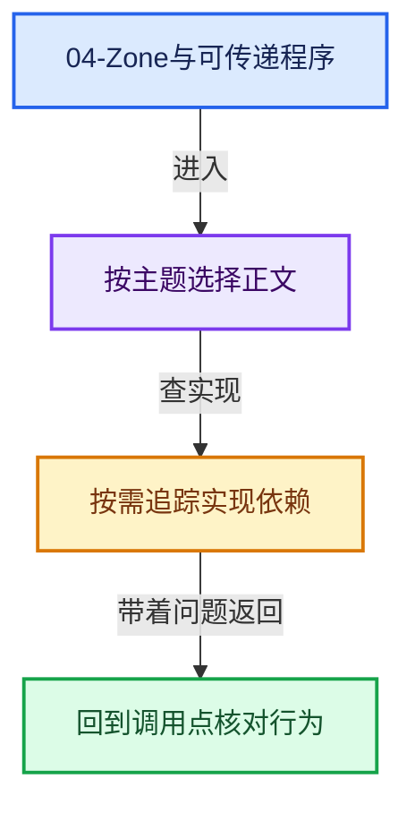
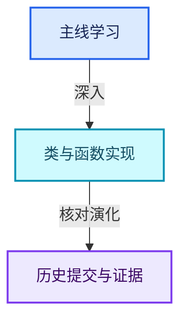

# 04-Zone与可传递程序

[几何节点总导航](../README.md) · [总入口](../../README.md)

- [GN-18 Simulation状态协议缓存与时间步](扩展02-Simulation状态协议缓存与时间步.md)
- [GN-19 Repeat与Foreach执行状态及上下文身份](扩展03-Repeat与Foreach执行状态及上下文身份.md)
- [GN-20 Closure可传递程序捕获与调用边界](扩展04-Closure可传递程序捕获与调用边界.md)
- [GN-21 Bundle嵌套值路径查找与写时复制](扩展05-Bundle嵌套值路径查找与写时复制.md)

