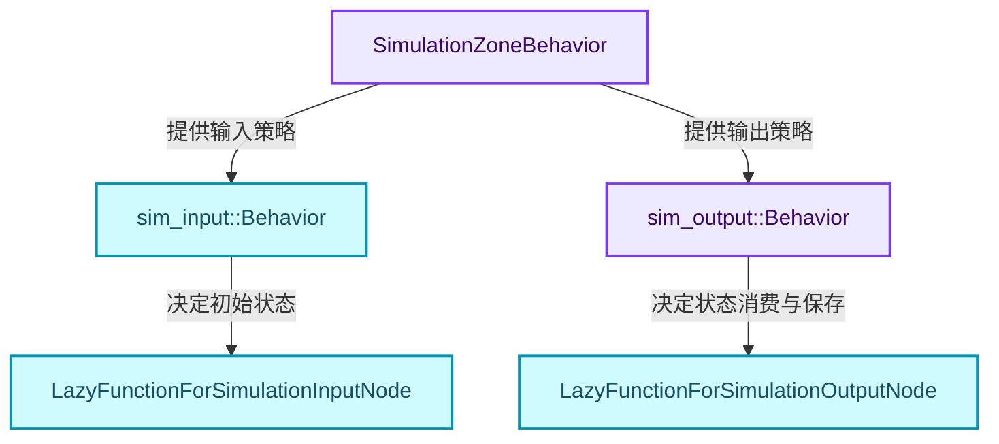
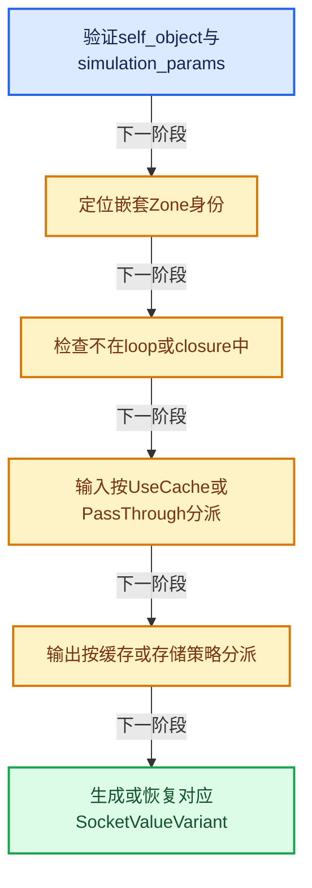
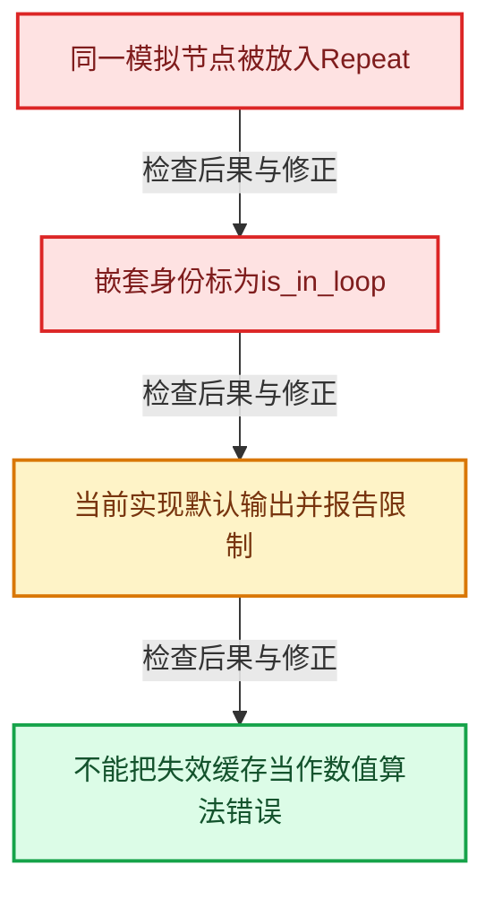

# GN-18 Simulation状态协议缓存与时间步

[几何节点学习地图](../README.md) · [专题分组导航](README.md) · [全局实现索引](../../00-课程指南/02-源码与提交索引/符号依赖与实现索引.md)

基准：`cbda6b96c26c0dee3c3b5cbb93960c4ac06a6b30`；文件哈希及连续摘录区间记录在[新增专题证据](../../_evidence/geometry-extension.json)。本篇围绕所选函数解释核心机制，辅助依赖明确列出已定位实现与尚需类型确认的边界，不宣称相关整个文件已全文复核。

## 先回答一个具体问题

Simulation为什么不是普通Repeat？缓存读取、插值、穿透与存新状态由谁决定？

## 相关类与数据的职责

- **`SimulationZoneBehavior`**：为本次求值选择输入与输出行为。 定义入口：[source/blender/nodes/NOD_geometry_nodes_lazy_function.hh · L122](../../../../../../source/blender/nodes/NOD_geometry_nodes_lazy_function.hh)。
- **`sim_input::Behavior`**：UseCache或PassThrough等输入策略。
- **`sim_output::Behavior`**：ReadSingle、ReadInterpolated、PassThrough、StoreNewState。
- **`LazyFunctionForSimulationInputNode`**：输出时间步和已有状态。 定义入口：[source/blender/nodes/geometry/nodes/node_geo_simulation.cc · L142](../../../../../../source/blender/nodes/geometry/nodes/node_geo_simulation.cc)。
- **`LazyFunctionForSimulationOutputNode`**：按策略读取、插值或保存结果。 定义入口：[source/blender/nodes/geometry/nodes/node_geo_simulation.cc · L383](../../../../../../source/blender/nodes/geometry/nodes/node_geo_simulation.cc)。



上图箭头文字区分拥有、借用、调用和数据依赖。连线不表示这些类型存在同名继承关系；只有源码明确声明的继承才按继承理解。

## 设计推导与扩展知识

### 推导1

Simulation跨求值保存状态，Repeat在一次执行内部推进循环状态，二者时间与拥有边界不同。不能通过把迭代次数换成帧数就实现完整Simulation。

### 推导2

输入节点从simulation_params取得ZoneBehavior。UseCache提供delta_time和状态；PassThrough时间步为0并走标准状态转换，保证匿名属性等数据处理一致。

### 推导3

输出节点使用std::get_if检查策略变体。ReadSingle、ReadInterpolated与StoreNewState需要不同数据，因此variant让不兼容状态具有不同结构，而不是用许多可同时为真的bool。当前头文件还声明ReadError；所选execute_impl没有独立处理该分支，而在末尾走unreachable，不能按枚举声明虚构一条已经实现的错误恢复路径。

### 推导4

当前执行会拒绝loop或closure内的Simulation，并在输出节点记录明确警告。限制由当前实现证据支持，不应扩展成所有未来架构都无法支持嵌套模拟的结论。

### 推导5

find_nested_node_id把可编辑节点身份映射到嵌套执行位置。缓存键需要区分实例化路径，否则同一节点组被调用两次可能读写错误的模拟状态。

### 推导6

状态转换函数处理BakeValues与SocketValueVariant，而非把任意运行时指针直接保存到下一帧。持久化意味着类型、数据块引用和匿名属性边界都需要协议。

## 实际处理阶段



这张图概括本篇所讨论的主路径；等待输入、构建失败与不同策略的分支以下方完整代码为准，不能把概括图当作每次都会执行的无条件顺序。

## 教学注释代码与分段机制

<a id="f-75b30d53830c6e30"></a>

### `blender::nodes::node_geo_simulation_cc::sim_input_node::LazyFunctionForSimulationInputNode::execute_impl` · L176—L220

输入包装器先检查环境，再按UseCache或PassThrough分派，最后设置delta_time输出。

实现位置：[source/blender/nodes/geometry/nodes/node_geo_simulation.cc](../../../../../../source/blender/nodes/geometry/nodes/node_geo_simulation.cc)。

**教学注释版**

<!-- annotated:86fcf67973a393 -->

```cpp
  void execute_impl(lf::Params &params, const lf::Context &context) const final
  {
    const GeoNodesUserData &user_data = *static_cast<const GeoNodesUserData *>(context.user_data);
    if (!user_data.call_data->simulation_params) {
      this->set_default_outputs(params);
      return;
    }
    if (!user_data.call_data->self_object()) {
      /* Self object is currently required for creating anonymous attribute names. */
      this->set_default_outputs(params);
      return;
    }
    std::optional<FoundNestedNodeID> found_id = find_nested_node_id(user_data, output_node_id_);
    if (!found_id) {
      this->set_default_outputs(params);
      return;
    }
    // [讲解] 当前实现拒绝这些嵌套位置，不能继续按普通模拟状态解释。
    if (found_id->is_in_loop || found_id->is_in_closure) {
      this->set_default_outputs(params);
      return;
    }
    SimulationZoneBehavior *zone_behavior = user_data.call_data->simulation_params->get(
        found_id->id);
    if (!zone_behavior) {
      this->set_default_outputs(params);
      return;
    }
    sim_input::Behavior &input_behavior = zone_behavior->input;
    float delta_time = 0.0f;
    if (auto *info = std::get_if<sim_input::UseCache>(&input_behavior)) {
      delta_time = info->delta_time;
      this->output_simulation_state(
          params, user_data, zone_behavior->data_block_map, std::move(info->values));
    }
    else if (std::get_if<sim_input::PassThrough>(&input_behavior)) {
      delta_time = 0.0f;
      this->pass_through(params, user_data, zone_behavior->data_block_map);
    }
    else {
      BLI_assert_unreachable();
    }
    if (!params.output_was_set(0)) {
      params.set_output(0, SocketValueVariant(delta_time));
    }
  }
```

<details>
<summary>核对原始源码：source/blender/nodes/geometry/nodes/node_geo_simulation.cc · L176—L220</summary>

<!-- original:86fcf67973a393:source/blender/nodes/geometry/nodes/node_geo_simulation.cc:176:220 -->

```cpp
  void execute_impl(lf::Params &params, const lf::Context &context) const final
  {
    const GeoNodesUserData &user_data = *static_cast<const GeoNodesUserData *>(context.user_data);
    if (!user_data.call_data->simulation_params) {
      this->set_default_outputs(params);
      return;
    }
    if (!user_data.call_data->self_object()) {
      /* Self object is currently required for creating anonymous attribute names. */
      this->set_default_outputs(params);
      return;
    }
    std::optional<FoundNestedNodeID> found_id = find_nested_node_id(user_data, output_node_id_);
    if (!found_id) {
      this->set_default_outputs(params);
      return;
    }
    if (found_id->is_in_loop || found_id->is_in_closure) {
      this->set_default_outputs(params);
      return;
    }
    SimulationZoneBehavior *zone_behavior = user_data.call_data->simulation_params->get(
        found_id->id);
    if (!zone_behavior) {
      this->set_default_outputs(params);
      return;
    }
    sim_input::Behavior &input_behavior = zone_behavior->input;
    float delta_time = 0.0f;
    if (auto *info = std::get_if<sim_input::UseCache>(&input_behavior)) {
      delta_time = info->delta_time;
      this->output_simulation_state(
          params, user_data, zone_behavior->data_block_map, std::move(info->values));
    }
    else if (std::get_if<sim_input::PassThrough>(&input_behavior)) {
      delta_time = 0.0f;
      this->pass_through(params, user_data, zone_behavior->data_block_map);
    }
    else {
      BLI_assert_unreachable();
    }
    if (!params.output_was_set(0)) {
      params.set_output(0, SocketValueVariant(delta_time));
    }
  }
```

</details>

<details>
<summary>实现依赖入口与尚需类型确认的调用</summary>

本函数未纳入旧结构调用闭包；以上源码保留实际调用表达式，相关成员须按接收者类型继续定位。下方类关系入口提供对应定义。

</details>

<a id="f-3d44fc09705c4759"></a>

### `blender::nodes::node_geo_simulation_cc::sim_output_node::LazyFunctionForSimulationOutputNode::execute_impl` · L438—L496

输出包装器的警告、嵌套限制和四种行为分支分别阅读。

实现位置：[source/blender/nodes/geometry/nodes/node_geo_simulation.cc](../../../../../../source/blender/nodes/geometry/nodes/node_geo_simulation.cc)。

**教学注释版**

<!-- annotated:71a4ccae955095 -->

```cpp
  void execute_impl(lf::Params &params, const lf::Context &context) const final
  {
    GeoNodesUserData &user_data = *static_cast<GeoNodesUserData *>(context.user_data);
    GeoNodesLocalUserData &local_user_data = *static_cast<GeoNodesLocalUserData *>(
        context.local_user_data);
    if (!user_data.call_data->self_object()) {
      /* The self object is currently required for generating anonymous attribute names. */
      this->set_default_outputs(params);
      return;
    }
    if (!user_data.call_data->simulation_params) {
      if (eval_log::NodeTreeLogger *tree_logger = local_user_data.try_get_tree_logger(user_data)) {
        tree_logger->node_warnings.append(
            *tree_logger->allocator,
            {node_.identifier,
             {NodeWarningType::Error, TIP_("Simulation zone is not supported")}});
      }
      this->set_default_outputs(params);
      return;
    }
    std::optional<FoundNestedNodeID> found_id = find_nested_node_id(user_data, node_.identifier);
    if (!found_id || found_id->is_in_loop || found_id->is_in_closure) {
      if (eval_log::NodeTreeLogger *tree_logger = local_user_data.try_get_tree_logger(user_data)) {
        const StringRefNull message = TIP_("Simulation must not be in a loop or closure");
        tree_logger->node_warnings.append(*tree_logger->allocator,
                                          {node_.identifier, {NodeWarningType::Error, message}});
      }
      this->set_default_outputs(params);
      return;
    }
    SimulationZoneBehavior *zone_behavior = user_data.call_data->simulation_params->get(
        found_id->id);
    if (!zone_behavior) {
      this->set_default_outputs(params);
      return;
    }
    // [讲解] 当前外部求值策略选择读缓存、插值、穿透或保存，不由节点自行猜帧状态。
    sim_output::Behavior &output_behavior = zone_behavior->output;
    if (auto *info = std::get_if<sim_output::ReadSingle>(&output_behavior)) {
      this->output_cached_state(
          params, user_data, zone_behavior->data_block_map, std::move(info->values));
    }
    else if (auto *info = std::get_if<sim_output::ReadInterpolated>(&output_behavior)) {
      this->output_mixed_cached_state(params,
                                      zone_behavior->data_block_map,
                                      *user_data.compute_context,
                                      std::move(info->prev_values),
                                      std::move(info->next_values),
                                      info->mix_factor);
    }
    else if (std::get_if<sim_output::PassThrough>(&output_behavior)) {
      this->pass_through(params, user_data, zone_behavior->data_block_map);
    }
    else if (auto *info = std::get_if<sim_output::StoreNewState>(&output_behavior)) {
      this->store_new_state(params, user_data, zone_behavior->data_block_map, *info);
    }
    else {
      BLI_assert_unreachable();
    }
  }
```

<details>
<summary>核对原始源码：source/blender/nodes/geometry/nodes/node_geo_simulation.cc · L438—L496</summary>

<!-- original:71a4ccae955095:source/blender/nodes/geometry/nodes/node_geo_simulation.cc:438:496 -->

```cpp
  void execute_impl(lf::Params &params, const lf::Context &context) const final
  {
    GeoNodesUserData &user_data = *static_cast<GeoNodesUserData *>(context.user_data);
    GeoNodesLocalUserData &local_user_data = *static_cast<GeoNodesLocalUserData *>(
        context.local_user_data);
    if (!user_data.call_data->self_object()) {
      /* The self object is currently required for generating anonymous attribute names. */
      this->set_default_outputs(params);
      return;
    }
    if (!user_data.call_data->simulation_params) {
      if (eval_log::NodeTreeLogger *tree_logger = local_user_data.try_get_tree_logger(user_data)) {
        tree_logger->node_warnings.append(
            *tree_logger->allocator,
            {node_.identifier,
             {NodeWarningType::Error, TIP_("Simulation zone is not supported")}});
      }
      this->set_default_outputs(params);
      return;
    }
    std::optional<FoundNestedNodeID> found_id = find_nested_node_id(user_data, node_.identifier);
    if (!found_id || found_id->is_in_loop || found_id->is_in_closure) {
      if (eval_log::NodeTreeLogger *tree_logger = local_user_data.try_get_tree_logger(user_data)) {
        const StringRefNull message = TIP_("Simulation must not be in a loop or closure");
        tree_logger->node_warnings.append(*tree_logger->allocator,
                                          {node_.identifier, {NodeWarningType::Error, message}});
      }
      this->set_default_outputs(params);
      return;
    }
    SimulationZoneBehavior *zone_behavior = user_data.call_data->simulation_params->get(
        found_id->id);
    if (!zone_behavior) {
      this->set_default_outputs(params);
      return;
    }
    sim_output::Behavior &output_behavior = zone_behavior->output;
    if (auto *info = std::get_if<sim_output::ReadSingle>(&output_behavior)) {
      this->output_cached_state(
          params, user_data, zone_behavior->data_block_map, std::move(info->values));
    }
    else if (auto *info = std::get_if<sim_output::ReadInterpolated>(&output_behavior)) {
      this->output_mixed_cached_state(params,
                                      zone_behavior->data_block_map,
                                      *user_data.compute_context,
                                      std::move(info->prev_values),
                                      std::move(info->next_values),
                                      info->mix_factor);
    }
    else if (std::get_if<sim_output::PassThrough>(&output_behavior)) {
      this->pass_through(params, user_data, zone_behavior->data_block_map);
    }
    else if (auto *info = std::get_if<sim_output::StoreNewState>(&output_behavior)) {
      this->store_new_state(params, user_data, zone_behavior->data_block_map, *info);
    }
    else {
      BLI_assert_unreachable();
    }
  }
```

</details>

<details>
<summary>实现依赖入口与尚需类型确认的调用</summary>

本函数未纳入旧结构调用闭包；以上源码保留实际调用表达式，相关成员须按接收者类型继续定位。下方类关系入口提供对应定义。

</details>

## 用小数据走一遍

1. 本次行为ReadSingle。
2. 从缓存恢复已有状态。
3. 无需把所有输入重新计算成新状态。
4. StoreNewState时才按保存协议收集输入。


这是明确输入条件下的教学推演，不是本地性能实测。对源码的验证应同时检查数值、对象寿命、输出需求和数据是否存在。

## 反例与边界

- 同一模拟节点被放入Repeat。
- 嵌套身份标为is_in_loop。
- 当前实现默认输出并报告限制。
- 不能把失效缓存当作数值算法错误。



## 历史提交阅读

本地历史阅读样本：**Jacques Lucke**，2026-09-03T22:24:57+02:00。

`f05d3fbf34f7052f9abba1be5169a12f44ac1371`

提交标题：Refactor: Geometry Nodes: generalize SocketValueVariant

[所选文件的真实diff](../../_evidence/geometry-history/GN-18.patch)。这是本地历史中匹配作者的近期样本，不冒称该系统的最初引入提交。阅读时先找变更前后的不变量，再检查新增分支与测试；本篇当前源码说明不混用历史签名。

## 独立实现与验收

画出UseCache、PassThrough、ReadInterpolated和StoreNewState所需数据，检查哪些状态互斥。

<details>
<summary>参考思路</summary>

分别以variant分支表达；时间步来自选定输入策略，插值需要前后状态和mix_factor，保存新状态需要本次计算输入。

</details>

验收时保留一个能击穿错误设计的反例，再对照实际符号重走调用链。教学练习未在完整Blender中运行；本轮独立运行的模型验证另见新增专题验收报告。

## 继续阅读

- [GN-13 CaptureAttribute匿名属性引用与清理](../03-Field与属性/扩展01-CaptureAttribute匿名属性引用与清理.md)
- [GN-17 RealizeInstances深度Field与任务流水线](../02-几何数据与算法/扩展06-RealizeInstances深度Field与任务流水线.md)
- [GN-19 Repeat与Foreach执行状态及上下文身份](扩展03-Repeat与Foreach执行状态及上下文身份.md)
- [GN-20 Closure可传递程序捕获与调用边界](扩展04-Closure可传递程序捕获与调用边界.md)
- [GN-21 Bundle嵌套值路径查找与写时复制](扩展05-Bundle嵌套值路径查找与写时复制.md)
