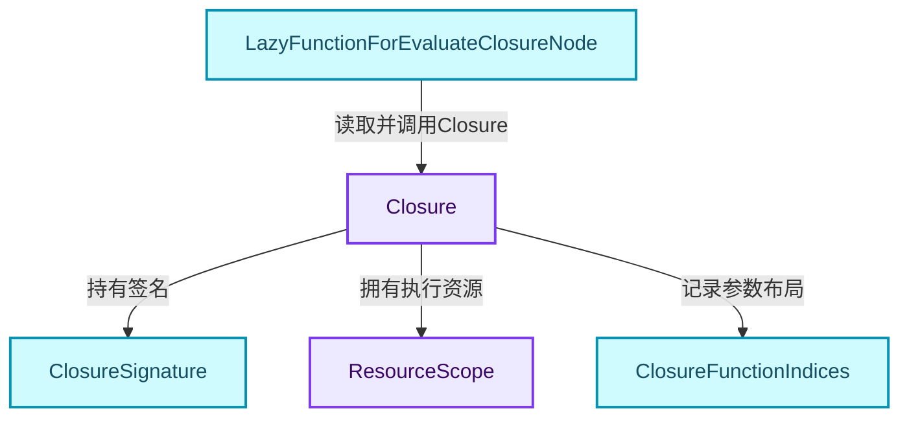
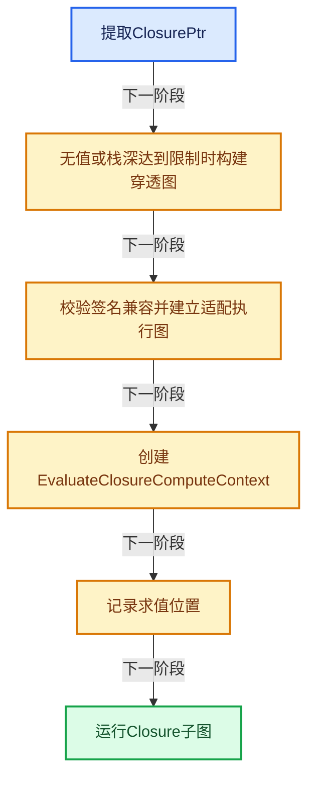
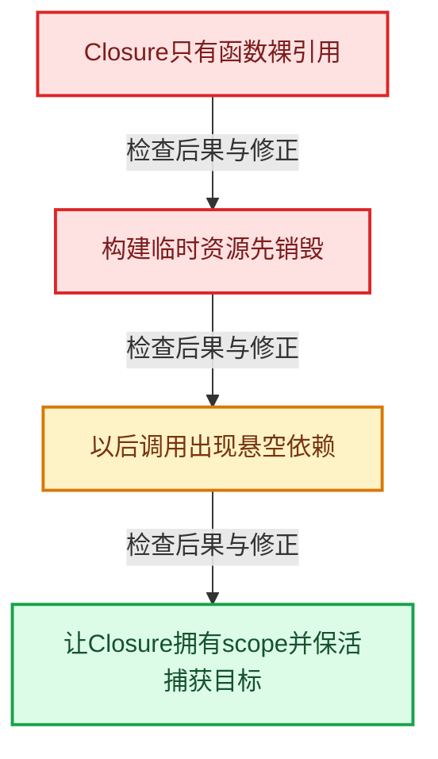

# GN-20 Closure可传递程序捕获与调用边界

[几何节点学习地图](../README.md) · [专题分组导航](README.md) · [全局实现索引](../../00-课程指南/02-源码与提交索引/符号依赖与实现索引.md)

基准：`cbda6b96c26c0dee3c3b5cbb93960c4ac06a6b30`；文件哈希及连续摘录区间记录在[新增专题证据](../../_evidence/geometry-extension.json)。本篇围绕所选函数解释核心机制，辅助依赖明确列出已定位实现与尚需类型确认的边界，不宣称相关整个文件已全文复核。

## 先回答一个具体问题

把一段节点程序作为值传给别处执行，需要保存哪些数据？捕获值是否也能按需请求？

## 相关类与数据的职责

- **`Closure`**：隐式共享的可调用程序值。 定义入口：[source/blender/nodes/NOD_geometry_nodes_closure.hh · L55](../../../../../../source/blender/nodes/NOD_geometry_nodes_closure.hh)。
- **`ClosureSignature`**：描述调用接口。 定义入口：[source/blender/nodes/NOD_geometry_nodes_closure_signature.hh · L20](../../../../../../source/blender/nodes/NOD_geometry_nodes_closure_signature.hh)。
- **`ResourceScope`**：拥有构建函数与相关资源。 定义入口：[source/blender/blenlib/BLI_resource_scope.hh · L37](../../../../../../source/blender/blenlib/BLI_resource_scope.hh)。
- **`ClosureFunctionIndices`**：记录主参数及需求、引用集合通道。 定义入口：[source/blender/nodes/NOD_geometry_nodes_closure.hh · L27](../../../../../../source/blender/nodes/NOD_geometry_nodes_closure.hh)。
- **`LazyFunctionForEvaluateClosureNode`**：建立调用适配图与ComputeContext。 定义入口：[source/blender/nodes/intern/geometry_nodes_closure_zone.cc · L298](../../../../../../source/blender/nodes/intern/geometry_nodes_closure_zone.cc)。



上图箭头文字区分拥有、借用、调用和数据依赖。连线不表示这些类型存在同名继承关系；只有源码明确声明的继承才按继承理解。

## 设计推导与扩展知识

### 推导1

Closure类似可以作为值传递的节点组，但它还携带捕获环境、签名、来源与资源拥有关系。只传一个LazyFunction裸指针会丢失这些条件。

### 推导2

Closure类中function_是引用，scope_用于拥有构建过程中分配的附加资源。captured_values_是指针集合，所以必须核对其实际指向存储由谁持有；指针Vector本身并不拥有每个目标对象。

### 推导3

头文件明确指出：调用输入可被惰性请求，但Closure Zone潜在捕获值尚不支持同样的惰性请求。不要把“Closure内部是lazy-function”推导成所有捕获也按需获取。

### 推导4

Evaluate节点首次调用提取Closure并建立适配图。空Closure按muted式穿透规则处理，栈限制也会退化为穿透并记录警告；这是显式失败策略而非静默无限递归。

### 推导5

调用上下文携带调用节点与Closure来源，用于日志和身份。相同Closure在不同地方调用，需要不同调用上下文；代码共享与执行身份再次分离。

### 推导6

设计可传递程序值时，应同时讨论签名兼容、默认输入、捕获寿命、递归限制、输出需求和诊断位置，不能只以std::function类比覆盖全部系统责任。

## 实际处理阶段



这张图概括本篇所讨论的主路径；等待输入、构建失败与不同策略的分支以下方完整代码为准，不能把概括图当作每次都会执行的无条件顺序。

## 教学注释代码与分段机制

<a id="f-25777200385dcdfa"></a>

### `blender::nodes::LazyFunctionForEvaluateClosureNode::execute_impl` · L353—L408

空值、栈限制、兼容警告、上下文和真正执行五部分独立分析。

实现位置：[source/blender/nodes/intern/geometry_nodes_closure_zone.cc](../../../../../../source/blender/nodes/intern/geometry_nodes_closure_zone.cc)。

**教学注释版**

<!-- annotated:a300c51b461c6e -->

```cpp
  void execute_impl(lf::Params &params, const lf::Context &context) const override
  {
    const ScopedNodeTimer node_timer{context, bnode_};

    auto &user_data = *static_cast<GeoNodesUserData *>(context.user_data);
    auto &eval_storage = *static_cast<EvaluateClosureEvalStorage *>(context.storage);
    auto local_user_data = *static_cast<GeoNodesLocalUserData *>(context.local_user_data);

    // [讲解] 本次求值第一次进入时建立执行器；之后可以复用storage继续推进。
    if (!eval_storage.graph_executor) {
      eval_storage.closure = params.extract_input<bke::SocketValueVariant>(indices_.inputs.main[0])
                                 .extract<ClosurePtr>();
      if (eval_storage.closure) {
        if (user_data.is_stack_limit_reached()) {
          this->initialize_pass_through_graph(eval_storage);
          if (eval_log::NodeTreeLogger *tree_logger = local_user_data.try_get_tree_logger(
                  user_data))
          {
            tree_logger->node_warnings.append(
                *tree_logger->allocator,
                {bnode_.identifier,
                 {NodeWarningType::Error,
                  TIP_("Stack limit reached. Closure becomes pass-through.")}});
          }
        }
        else {
          this->generate_closure_compatibility_warnings(*eval_storage.closure, context);
          this->initialize_execution_graph(eval_storage);

          const bNodeTree &btree_orig = *DEG_get_original(&btree_);
          ClosureEvalLocation eval_location{
              btree_orig.id.session_uid, bnode_.identifier, user_data.compute_context->hash()};
          eval_storage.closure->log_evaluation(eval_location);
        }
      }
      else {
        /* If no closure is provided, the Evaluate Closure node behaves as if it was muted. So some
         * values may be passed through if there are internal links. */
        this->initialize_pass_through_graph(eval_storage);
      }
    }

    const std::optional<ClosureSourceLocation> closure_source_location =
        eval_storage.closure ? eval_storage.closure->source_location() : std::nullopt;

    bke::EvaluateClosureComputeContext closure_compute_context{
        user_data.compute_context, bnode_.identifier, &btree_, closure_source_location};
    GeoNodesUserData closure_user_data = user_data;
    closure_user_data.compute_context = &closure_compute_context;
    closure_user_data.verbose_log = should_log_verbose_in_context(user_data,
                                                                  closure_compute_context.hash());
    GeoNodesLocalUserData closure_local_user_data{closure_user_data};

    lf::Context eval_graph_context{
        eval_storage.graph_executor_storage, &closure_user_data, &closure_local_user_data};
    eval_storage.graph_executor->execute(params, eval_graph_context);
  }
```

<details>
<summary>核对原始源码：source/blender/nodes/intern/geometry_nodes_closure_zone.cc · L353—L408</summary>

<!-- original:a300c51b461c6e:source/blender/nodes/intern/geometry_nodes_closure_zone.cc:353:408 -->

```cpp
  void execute_impl(lf::Params &params, const lf::Context &context) const override
  {
    const ScopedNodeTimer node_timer{context, bnode_};

    auto &user_data = *static_cast<GeoNodesUserData *>(context.user_data);
    auto &eval_storage = *static_cast<EvaluateClosureEvalStorage *>(context.storage);
    auto local_user_data = *static_cast<GeoNodesLocalUserData *>(context.local_user_data);

    if (!eval_storage.graph_executor) {
      eval_storage.closure = params.extract_input<bke::SocketValueVariant>(indices_.inputs.main[0])
                                 .extract<ClosurePtr>();
      if (eval_storage.closure) {
        if (user_data.is_stack_limit_reached()) {
          this->initialize_pass_through_graph(eval_storage);
          if (eval_log::NodeTreeLogger *tree_logger = local_user_data.try_get_tree_logger(
                  user_data))
          {
            tree_logger->node_warnings.append(
                *tree_logger->allocator,
                {bnode_.identifier,
                 {NodeWarningType::Error,
                  TIP_("Stack limit reached. Closure becomes pass-through.")}});
          }
        }
        else {
          this->generate_closure_compatibility_warnings(*eval_storage.closure, context);
          this->initialize_execution_graph(eval_storage);

          const bNodeTree &btree_orig = *DEG_get_original(&btree_);
          ClosureEvalLocation eval_location{
              btree_orig.id.session_uid, bnode_.identifier, user_data.compute_context->hash()};
          eval_storage.closure->log_evaluation(eval_location);
        }
      }
      else {
        /* If no closure is provided, the Evaluate Closure node behaves as if it was muted. So some
         * values may be passed through if there are internal links. */
        this->initialize_pass_through_graph(eval_storage);
      }
    }

    const std::optional<ClosureSourceLocation> closure_source_location =
        eval_storage.closure ? eval_storage.closure->source_location() : std::nullopt;

    bke::EvaluateClosureComputeContext closure_compute_context{
        user_data.compute_context, bnode_.identifier, &btree_, closure_source_location};
    GeoNodesUserData closure_user_data = user_data;
    closure_user_data.compute_context = &closure_compute_context;
    closure_user_data.verbose_log = should_log_verbose_in_context(user_data,
                                                                  closure_compute_context.hash());
    GeoNodesLocalUserData closure_local_user_data{closure_user_data};

    lf::Context eval_graph_context{
        eval_storage.graph_executor_storage, &closure_user_data, &closure_local_user_data};
    eval_storage.graph_executor->execute(params, eval_graph_context);
  }
```

</details>

<details>
<summary>实现依赖入口与尚需类型确认的调用</summary>

- `params.extract_input<bke::SocketValueVariant>(indices_.inputs.main[0]) .extract<ClosurePtr>`：L362的类型或分派协议；接收对象类型依赖auto、返回值或模板实例；不按同名猜测目标。
- `params.extract_input<bke::SocketValueVariant>` → [blender::fn::lazy_function::extract_input · L412](../../09-LazyFunction与节点执行架构/02-LazyFunction接口.md#f-037bdbe54ffc8fdd)。
- `user_data.is_stack_limit_reached`：L365的类型或分派协议；接收对象类型依赖auto、返回值或模板实例；不按同名猜测目标。
- `this->initialize_pass_through_graph` → [blender::nodes::LazyFunctionForEvaluateClosureNode::initialize_pass_through_graph · L698](../../10-引用生命周期与Closure/07-Closure求值与Zone.md#f-a8c8b494630313e1)。
- `local_user_data.try_get_tree_logger`：L367的类型或分派协议；接收对象类型依赖auto、返回值或模板实例；不按同名猜测目标。
- `tree_logger->node_warnings.append`：L370的类型或分派协议；接收对象类型依赖auto、返回值或模板实例；不按同名猜测目标。
- `TIP_`：宏定义见[source/blender/blentranslation/BLT_translation.hh](../../../../../../source/blender/blentranslation/BLT_translation.hh), L50；按当前编译条件选择。
- `this->generate_closure_compatibility_warnings` → [blender::nodes::LazyFunctionForEvaluateClosureNode::generate_closure_compatibility_warnings · L437](../../10-引用生命周期与Closure/07-Closure求值与Zone.md#f-17fc43baeca7c33d)。
- `this->initialize_execution_graph` → [blender::nodes::LazyFunctionForEvaluateClosureNode::initialize_execution_graph · L535](../../10-引用生命周期与Closure/07-Closure求值与Zone.md#f-aae59901b5675b45)。
- `DEG_get_original` → [blender::DEG_get_original · L128](../../90-实现依赖专题/06-Depsgraph依赖图/DEG_depsgraph_query.hh.md#f-79782eab82a92d86)；[blender::DEG_get_original · L134](../../90-实现依赖专题/06-Depsgraph依赖图/DEG_depsgraph_query.hh.md#f-c032f06e9ef8f0cb)。多候选需按实参和重载规则确认。
- `user_data.compute_context->hash`：L383的类型或分派协议；接收对象类型依赖auto、返回值或模板实例；不按同名猜测目标。
- `eval_storage.closure->log_evaluation`：L384的类型或分派协议；接收对象类型依赖auto、返回值或模板实例；不按同名猜测目标。
- `eval_storage.closure->source_location`：L395的类型或分派协议；接收对象类型依赖auto、返回值或模板实例；不按同名猜测目标。
- `should_log_verbose_in_context` → [blender::nodes::should_log_verbose_in_context · L1122](../../09-LazyFunction与节点执行架构/09-几何节点图构建器.md#f-836bece1420cf33c)。
- `closure_compute_context.hash`：宏定义见[source/blender/blenlib/intern/rand.cc](../../../../../../source/blender/blenlib/intern/rand.cc), L30；按当前编译条件选择。
- `closure_compute_context.hash`：宏定义见[source/blender/blenlib/intern/noise_c.cc](../../../../../../source/blender/blenlib/intern/noise_c.cc), L156；按当前编译条件选择。
- `eval_storage.graph_executor->execute`：L407的类型或分派协议；接收对象类型依赖auto、返回值或模板实例；不按同名猜测目标。

</details>

<a id="f-5ca25804a1b4352a"></a>

### `blender::nodes::Closure::Closure` · L73—L90

构造器把scope和默认输入等转入成员；function引用与captured_values指针的寿命仍由调用构建协议保证。

实现位置：[source/blender/nodes/NOD_geometry_nodes_closure.hh](../../../../../../source/blender/nodes/NOD_geometry_nodes_closure.hh)。

**教学注释版**

<!-- annotated:dc4bea6377c735 -->

```cpp
  Closure(std::shared_ptr<ClosureSignature> signature,
          std::unique_ptr<ResourceScope> scope,
          const fn::lazy_function::LazyFunction &function,
          ClosureFunctionIndices indices,
          Vector<bke::SocketValueVariant> default_input_values,
          std::optional<ClosureSourceLocation> source_location,
          std::shared_ptr<ClosureEvalLog> eval_log,
          Vector<const bke::SocketValueVariant *> captured_values)
      : signature_(signature),
        source_location_(source_location),
        eval_log_(eval_log),
        scope_(std::move(scope)),
        function_(function),
        indices_(indices),
        default_input_values_(std::move(default_input_values)),
        captured_values_(std::move(captured_values))
  {
  }
```

<details>
<summary>核对原始源码：source/blender/nodes/NOD_geometry_nodes_closure.hh · L73—L90</summary>

<!-- original:dc4bea6377c735:source/blender/nodes/NOD_geometry_nodes_closure.hh:73:90 -->

```cpp
  Closure(std::shared_ptr<ClosureSignature> signature,
          std::unique_ptr<ResourceScope> scope,
          const fn::lazy_function::LazyFunction &function,
          ClosureFunctionIndices indices,
          Vector<bke::SocketValueVariant> default_input_values,
          std::optional<ClosureSourceLocation> source_location,
          std::shared_ptr<ClosureEvalLog> eval_log,
          Vector<const bke::SocketValueVariant *> captured_values)
      : signature_(signature),
        source_location_(source_location),
        eval_log_(eval_log),
        scope_(std::move(scope)),
        function_(function),
        indices_(indices),
        default_input_values_(std::move(default_input_values)),
        captured_values_(std::move(captured_values))
  {
  }
```

</details>

<details>
<summary>实现依赖入口与尚需类型确认的调用</summary>

本函数未纳入旧结构调用闭包；以上源码保留实际调用表达式，相关成员须按接收者类型继续定位。下方类关系入口提供对应定义。

</details>

## 支撑类型的完整声明

### `ClosureFunctionIndices`

对照上方职责阅读成员：哪些成员拥有资源，哪些只是索引、引用或指针。成员声明体现布局；其中函数仍应按实际调用进入相应实现。

<!-- annotated:6c41b2918c3370 -->

```cpp
struct ClosureFunctionIndices {
  struct {
    IndexRange main;
    /** A boolean input for each output indicating whether that output is used. */
    IndexRange output_usages;
    /**
     * A #GeometryNodesReferenceSet input for a subset of the outputs. This is used to tell the
     * closure which attributes it has to propagate to the outputs.
     *
     * Main output index -> input `lf` socket index.
     */
    Map<int, int> output_data_reference_sets;
  } inputs;
  struct {
    IndexRange main;
    /** A boolean output for each input indicating whether that input is used. */
    IndexRange input_usages;
  } outputs;
};
```

<details>
<summary>核对原始源码：source/blender/nodes/NOD_geometry_nodes_closure.hh · L27—L45</summary>

<!-- original:6c41b2918c3370:source/blender/nodes/NOD_geometry_nodes_closure.hh:27:45 -->

```cpp
struct ClosureFunctionIndices {
  struct {
    IndexRange main;
    /** A boolean input for each output indicating whether that output is used. */
    IndexRange output_usages;
    /**
     * A #GeometryNodesReferenceSet input for a subset of the outputs. This is used to tell the
     * closure which attributes it has to propagate to the outputs.
     *
     * Main output index -> input `lf` socket index.
     */
    Map<int, int> output_data_reference_sets;
  } inputs;
  struct {
    IndexRange main;
    /** A boolean output for each input indicating whether that input is used. */
    IndexRange input_usages;
  } outputs;
};
```

</details>

## 用小数据走一遍

1. Closure C从Zone输出。
2. 两个Evaluate节点分别调用C。
3. 共享C的程序资源。
4. 调用上下文按两个位置区分。


这是明确输入条件下的教学推演，不是本地性能实测。对源码的验证应同时检查数值、对象寿命、输出需求和数据是否存在。

## 反例与边界

- Closure只有函数裸引用。
- 构建临时资源先销毁。
- 以后调用出现悬空依赖。
- 让Closure拥有scope并保活捕获目标。



## 历史提交阅读

本地历史阅读样本：**Jacques Lucke**，2026-09-03T22:24:57+02:00。

`f05d3fbf34f7052f9abba1be5169a12f44ac1371`

提交标题：Refactor: Geometry Nodes: generalize SocketValueVariant

[所选文件的真实diff](../../_evidence/geometry-history/GN-20.patch)。这是本地历史中匹配作者的近期样本，不冒称该系统的最初引入提交。阅读时先找变更前后的不变量，再检查新增分支与测试；本篇当前源码说明不混用历史签名。

## 独立实现与验收

设计一个捕获GeometrySet并输出Field的Closure，画出资源与捕获指针寿命。

<details>
<summary>参考思路</summary>

逐个标明函数对象、树副本、GeometrySet、Field引用和scope的拥有者；任何仅画指针箭头而没有拥有者的目标都需要继续核查。

</details>

验收时保留一个能击穿错误设计的反例，再对照实际符号重走调用链。教学练习未在完整Blender中运行；本轮独立运行的模型验证另见新增专题验收报告。

## 继续阅读

- [GN-13 CaptureAttribute匿名属性引用与清理](../03-Field与属性/扩展01-CaptureAttribute匿名属性引用与清理.md)
- [GN-18 Simulation状态协议缓存与时间步](扩展02-Simulation状态协议缓存与时间步.md)
- [GN-19 Repeat与Foreach执行状态及上下文身份](扩展03-Repeat与Foreach执行状态及上下文身份.md)
- [GN-21 Bundle嵌套值路径查找与写时复制](扩展05-Bundle嵌套值路径查找与写时复制.md)
