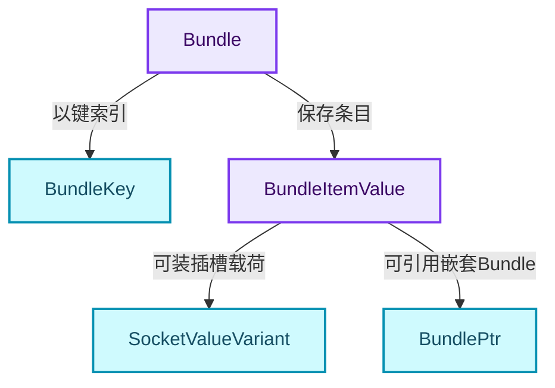
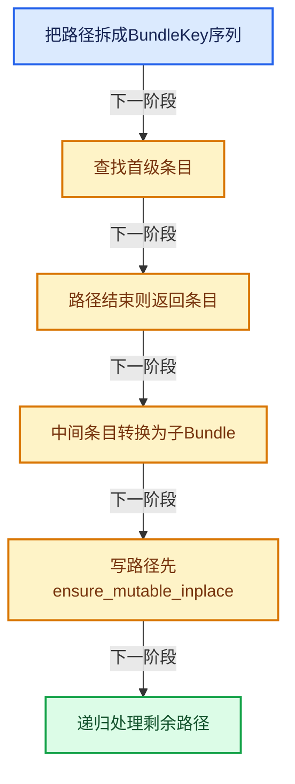
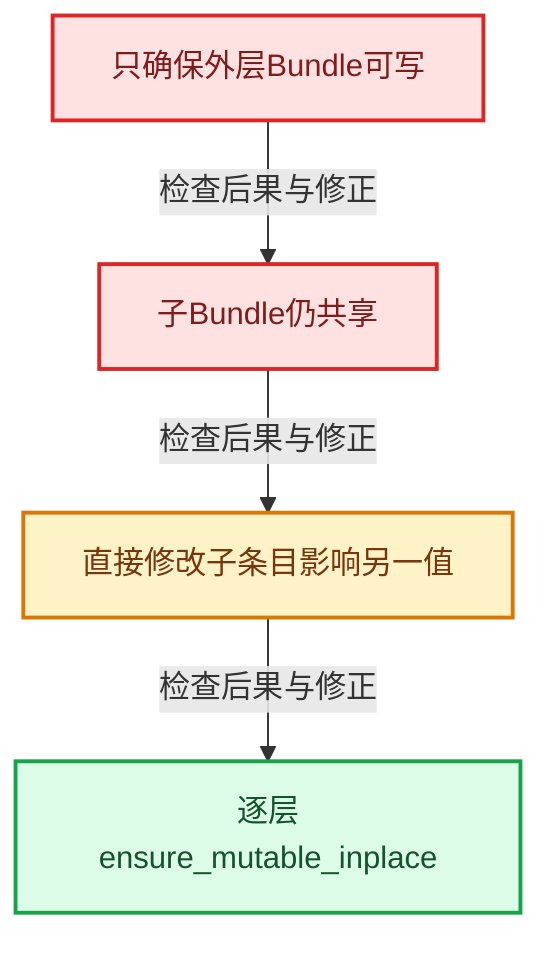

# GN-21 Bundle嵌套值路径查找与写时复制

[几何节点学习地图](../README.md) · [专题分组导航](README.md) · [全局实现索引](../../00-课程指南/02-源码与提交索引/符号依赖与实现索引.md)

基准：`cbda6b96c26c0dee3c3b5cbb93960c4ac06a6b30`；文件哈希及连续摘录区间记录在[新增专题证据](../../_evidence/geometry-extension.json)。本篇围绕所选函数解释核心机制，辅助依赖明确列出已定位实现与尚需类型确认的边界，不宣称相关整个文件已全文复核。

## 先回答一个具体问题

Bundle为什么不只是Map<string,Value>？读路径与写路径需要怎样不同的拥有协议？

## 相关类与数据的职责

- **`Bundle`**：隐式共享的键值容器，可包含嵌套Bundle。 定义入口：[source/blender/nodes/NOD_geometry_nodes_bundle.hh · L90](../../../../../../source/blender/nodes/NOD_geometry_nodes_bundle.hh)。
- **`BundleKey`**：限制字符并提供稳定键身份。 定义入口：[source/blender/nodes/NOD_geometry_nodes_bundle.hh · L63](../../../../../../source/blender/nodes/NOD_geometry_nodes_bundle.hh)。
- **`BundleItemValue`**：区分插槽值和自定义内部值。 定义入口：[source/blender/nodes/NOD_geometry_nodes_bundle.hh · L44](../../../../../../source/blender/nodes/NOD_geometry_nodes_bundle.hh)。
- **`BundlePtr`**：持有共享Bundle并确保可写独占。
- **`SocketValueVariant`**：嵌套条目的一种载荷。 定义入口：[source/blender/blenkernel/BKE_node_socket_value.hh · L83](../../../../../../source/blender/blenkernel/BKE_node_socket_value.hh)。



上图箭头文字区分拥有、借用、调用和数据依赖。连线不表示这些类型存在同名继承关系；只有源码明确声明的继承才按继承理解。

## 设计推导与扩展知识

### 推导1

Bundle支持root/child/data这样的路径，键限制字符是为了给路径与表达式语法留空间。直接使用任意字符串作为键会引入无法区分分隔符与字面内容的问题。

### 推导2

BundleItemValue内部variant区分常规插槽值与内部扩展对象，后者通过Mixin提供类型名称等协议。扩展值不是任意void*，仍需要共享、销毁和访问规则。

### 推导3

const lookup_path通过as<BundlePtr>取得子容器并递归读取；lookup_path_for_write需要拿到可修改的BundlePtr，再ensure_mutable_inplace后继续。这正是嵌套写时复制不能只复制最外层的原因。

### 推导4

任一级名称不存在、不是子Bundle或子指针为空都返回nullptr。路径合法性断言与查找失败返回是不同层次，非法路径不能自动视为“键不存在”。

### 推导5

从Bundle查出的条目指针借用容器存储。后续添加、删除或写时分离可能改变底层地址，调用者应限制借用范围或持有稳定值，不应长期缓存内部条目指针。

### 推导6

ensure_owns_direct_data用于让离开执行边界的载荷拥有必要存储。共享容器自身存活，并不自动保证条目内部借用的几何或其他数据也可以无限期使用。

## 实际处理阶段



这张图概括本篇所讨论的主路径；等待输入、构建失败与不同策略的分支以下方完整代码为准，不能把概括图当作每次都会执行的无条件顺序。

## 教学注释代码与分段机制

<a id="f-0db09ce658d6a12d"></a>

### `blender::nodes::lookup_path` · L196—L212

两个重载分别接收已拆路径和字符串路径；检查空指针返回与递归drop_front。

实现位置：[source/blender/nodes/intern/geometry_nodes_bundle.cc](../../../../../../source/blender/nodes/intern/geometry_nodes_bundle.cc)。

**教学注释版**

<!-- annotated:7d9a32fa2f2e94 -->

```cpp
const BundleItemValue *Bundle::lookup_path(const Span<BundleKey> path) const
{
  BLI_assert(!path.is_empty());
  const BundleKey first_elem = path[0];
  const BundleItemValue *item = this->lookup(first_elem);
  if (!item) {
    return nullptr;
  }
  if (path.size() == 1) {
    return item;
  }
  // [讲解] 读路径只取得共享子Bundle；中间条目不兼容或为空则查找失败。
  const BundlePtr child_bundle = item->as<BundlePtr>().value_or(nullptr);
  if (!child_bundle) {
    return nullptr;
  }
  return child_bundle->lookup_path(path.drop_front(1));
}
```

<details>
<summary>核对原始源码：source/blender/nodes/intern/geometry_nodes_bundle.cc · L196—L212</summary>

<!-- original:7d9a32fa2f2e94:source/blender/nodes/intern/geometry_nodes_bundle.cc:196:212 -->

```cpp
const BundleItemValue *Bundle::lookup_path(const Span<BundleKey> path) const
{
  BLI_assert(!path.is_empty());
  const BundleKey first_elem = path[0];
  const BundleItemValue *item = this->lookup(first_elem);
  if (!item) {
    return nullptr;
  }
  if (path.size() == 1) {
    return item;
  }
  const BundlePtr child_bundle = item->as<BundlePtr>().value_or(nullptr);
  if (!child_bundle) {
    return nullptr;
  }
  return child_bundle->lookup_path(path.drop_front(1));
}
```

</details>

<details>
<summary>实现依赖入口与尚需类型确认的调用</summary>

- `BLI_assert`：宏定义见[source/blender/blenlib/BLI_assert.hh](../../../../../../source/blender/blenlib/BLI_assert.hh), L48；按当前编译条件选择。
- `BLI_assert`：宏定义见[source/blender/blenlib/BLI_assert.hh](../../../../../../source/blender/blenlib/BLI_assert.hh), L63；按当前编译条件选择。
- `path.is_empty` → [blender::Span::is_empty · L264](../../01-基础容器与现代CPP/05-Span只读连续视图.md#f-8cc1d7ba8feb50e6)。
- `this->lookup` → [blender::nodes::lookup · L186](../../10-引用生命周期与Closure/05-Bundle值组合.md#f-ab104e20fea01b7b)；[blender::nodes::lookup · L191](../../10-引用生命周期与Closure/05-Bundle值组合.md#f-8c688818796b1bfd)。多候选需按实参和重载规则确认。
- `path.size` → [blender::Span::size · L256](../../01-基础容器与现代CPP/05-Span只读连续视图.md#f-5f80fa006089c998)。
- `item->as<BundlePtr>().value_or`：L207的类型或分派协议；接收对象类型依赖auto、返回值或模板实例；不按同名猜测目标。
- `item->as<BundlePtr>` → [blender::nodes::as · L261](../../90-实现依赖专题/04-Nodes节点系统/NOD_geometry_nodes_bundle.hh.md#f-250bf8b6a94ed2b1)。
- `child_bundle->lookup_path` → [blender::nodes::lookup_path · L196](扩展05-Bundle嵌套值路径查找与写时复制.md#f-0db09ce658d6a12d)；[blender::nodes::lookup_path · L214](扩展05-Bundle嵌套值路径查找与写时复制.md#f-2765e91b5514bd71)。多候选需按实参和重载规则确认。
- `path.drop_front` → [blender::Span::drop_front · L175](../../01-基础容器与现代CPP/05-Span只读连续视图.md#f-932897accbde3413)。

</details>

<a id="f-2765e91b5514bd71"></a>

### `blender::nodes::lookup_path` · L214—L219

两个重载分别接收已拆路径和字符串路径；检查空指针返回与递归drop_front。

实现位置：[source/blender/nodes/intern/geometry_nodes_bundle.cc](../../../../../../source/blender/nodes/intern/geometry_nodes_bundle.cc)。

**教学注释版**

<!-- annotated:33871e607ca05e -->

```cpp
const BundleItemValue *Bundle::lookup_path(const StringRef path) const
{
  BLI_assert(is_valid_path(path));
  const Vector<BundleKey> path_elems = *split_path(path);
  return this->lookup_path(path_elems);
}
```

<details>
<summary>核对原始源码：source/blender/nodes/intern/geometry_nodes_bundle.cc · L214—L219</summary>

<!-- original:33871e607ca05e:source/blender/nodes/intern/geometry_nodes_bundle.cc:214:219 -->

```cpp
const BundleItemValue *Bundle::lookup_path(const StringRef path) const
{
  BLI_assert(is_valid_path(path));
  const Vector<BundleKey> path_elems = *split_path(path);
  return this->lookup_path(path_elems);
}
```

</details>

<details>
<summary>实现依赖入口与尚需类型确认的调用</summary>

- `BLI_assert`：宏定义见[source/blender/blenlib/BLI_assert.hh](../../../../../../source/blender/blenlib/BLI_assert.hh), L48；按当前编译条件选择。
- `BLI_assert`：宏定义见[source/blender/blenlib/BLI_assert.hh](../../../../../../source/blender/blenlib/BLI_assert.hh), L63；按当前编译条件选择。
- `is_valid_path` → [blender::nodes::is_valid_path · L52](../../10-引用生命周期与Closure/05-Bundle值组合.md#f-de824016abdd7b56)。
- `split_path` → [blender::nodes::split_path · L57](../../10-引用生命周期与Closure/05-Bundle值组合.md#f-6be8a5b6ff42af9a)。
- `this->lookup_path` → [blender::nodes::lookup_path · L196](扩展05-Bundle嵌套值路径查找与写时复制.md#f-0db09ce658d6a12d)；[blender::nodes::lookup_path · L214](扩展05-Bundle嵌套值路径查找与写时复制.md#f-2765e91b5514bd71)。多候选需按实参和重载规则确认。

</details>

<a id="f-bbf4231d04b83f66"></a>

### `blender::nodes::lookup_path_for_write` · L221—L241

写路径取得子BundlePtr后ensure_mutable_inplace，再递归。

实现位置：[source/blender/nodes/intern/geometry_nodes_bundle.cc](../../../../../../source/blender/nodes/intern/geometry_nodes_bundle.cc)。

**教学注释版**

<!-- annotated:3ec50cf91ff24f -->

```cpp
BundleItemValue *Bundle::lookup_path_for_write(Span<BundleKey> path)
{
  BLI_assert(!path.is_empty());
  const BundleKey first_elem = path[0];
  BundleItemValue *item = this->lookup(first_elem);
  if (!item) {
    return nullptr;
  }
  if (path.size() == 1) {
    return item;
  }
  BundlePtr *child_bundle_ptr = item->as_pointer<BundlePtr>();
  if (!child_bundle_ptr) {
    return nullptr;
  }
  if (!*child_bundle_ptr) {
    return nullptr;
  }
  // [讲解] 写路径对嵌套子容器也执行必要分离，不能只处理最外层。
  Bundle &child_bundle = child_bundle_ptr->ensure_mutable_inplace();
  return child_bundle.lookup_path_for_write(path.drop_front(1));
}
```

<details>
<summary>核对原始源码：source/blender/nodes/intern/geometry_nodes_bundle.cc · L221—L241</summary>

<!-- original:3ec50cf91ff24f:source/blender/nodes/intern/geometry_nodes_bundle.cc:221:241 -->

```cpp
BundleItemValue *Bundle::lookup_path_for_write(Span<BundleKey> path)
{
  BLI_assert(!path.is_empty());
  const BundleKey first_elem = path[0];
  BundleItemValue *item = this->lookup(first_elem);
  if (!item) {
    return nullptr;
  }
  if (path.size() == 1) {
    return item;
  }
  BundlePtr *child_bundle_ptr = item->as_pointer<BundlePtr>();
  if (!child_bundle_ptr) {
    return nullptr;
  }
  if (!*child_bundle_ptr) {
    return nullptr;
  }
  Bundle &child_bundle = child_bundle_ptr->ensure_mutable_inplace();
  return child_bundle.lookup_path_for_write(path.drop_front(1));
}
```

</details>

<details>
<summary>实现依赖入口与尚需类型确认的调用</summary>

- `BLI_assert`：宏定义见[source/blender/blenlib/BLI_assert.hh](../../../../../../source/blender/blenlib/BLI_assert.hh), L48；按当前编译条件选择。
- `BLI_assert`：宏定义见[source/blender/blenlib/BLI_assert.hh](../../../../../../source/blender/blenlib/BLI_assert.hh), L63；按当前编译条件选择。
- `path.is_empty` → [blender::Span::is_empty · L264](../../01-基础容器与现代CPP/05-Span只读连续视图.md#f-8cc1d7ba8feb50e6)。
- `this->lookup` → [blender::nodes::lookup · L186](../../10-引用生命周期与Closure/05-Bundle值组合.md#f-ab104e20fea01b7b)；[blender::nodes::lookup · L191](../../10-引用生命周期与Closure/05-Bundle值组合.md#f-8c688818796b1bfd)。多候选需按实参和重载规则确认。
- `path.size` → [blender::Span::size · L256](../../01-基础容器与现代CPP/05-Span只读连续视图.md#f-5f80fa006089c998)。
- `item->as_pointer<BundlePtr>` → [blender::nodes::as_pointer · L214](../../90-实现依赖专题/04-Nodes节点系统/NOD_geometry_nodes_bundle.hh.md#f-f165f4b9fea6638b)；[blender::nodes::as_pointer · L218](../../90-实现依赖专题/04-Nodes节点系统/NOD_geometry_nodes_bundle.hh.md#f-879002168837b5f6)。多候选需按实参和重载规则确认。
- `child_bundle_ptr->ensure_mutable_inplace` → [blender::ImplicitSharingPtr::ensure_mutable_inplace · L144](../../06-隐式共享与缓存系统/03-Mixin与共享指针封装.md#f-d9e9b25281edf91a)。
- `child_bundle.lookup_path_for_write` → [blender::nodes::lookup_path_for_write · L221](扩展05-Bundle嵌套值路径查找与写时复制.md#f-bbf4231d04b83f66)；[blender::nodes::lookup_path_for_write · L243](../../10-引用生命周期与Closure/05-Bundle值组合.md#f-ddd6cfd6bbacec2f)。多候选需按实参和重载规则确认。
- `path.drop_front` → [blender::Span::drop_front · L175](../../01-基础容器与现代CPP/05-Span只读连续视图.md#f-932897accbde3413)。

</details>

## 用小数据走一遍

1. Bundle A与B共享child。
2. B写child/value。
3. 写路径先分离child。
4. A的child/value保持原值。


这是明确输入条件下的教学推演，不是本地性能实测。对源码的验证应同时检查数值、对象寿命、输出需求和数据是否存在。

## 反例与边界

- 只确保外层Bundle可写。
- 子Bundle仍共享。
- 直接修改子条目影响另一值。
- 逐层ensure_mutable_inplace。



## 历史提交阅读

本地历史阅读样本：**Jacques Lucke**，2026-09-03T22:24:57+02:00。

`f05d3fbf34f7052f9abba1be5169a12f44ac1371`

提交标题：Refactor: Geometry Nodes: generalize SocketValueVariant

[所选文件的真实diff](../../_evidence/geometry-history/GN-21.patch)。这是本地历史中匹配作者的近期样本，不冒称该系统的最初引入提交。阅读时先找变更前后的不变量，再检查新增分支与测试；本篇当前源码说明不混用历史签名。

## 独立实现与验收

给三级嵌套Bundle写一个叶值，标出每层可能发生的复制和借用失效。

<details>
<summary>参考思路</summary>

只在共享层发生必要分离；已有指向旧层内部的指针不能自动转向新层，必须重新取得目标条目。

</details>

验收时保留一个能击穿错误设计的反例，再对照实际符号重走调用链。教学练习未在完整Blender中运行；本轮独立运行的模型验证另见新增专题验收报告。

## 继续阅读

- [GN-13 CaptureAttribute匿名属性引用与清理](../03-Field与属性/扩展01-CaptureAttribute匿名属性引用与清理.md)
- [GN-18 Simulation状态协议缓存与时间步](扩展02-Simulation状态协议缓存与时间步.md)
- [GN-19 Repeat与Foreach执行状态及上下文身份](扩展03-Repeat与Foreach执行状态及上下文身份.md)
- [GN-20 Closure可传递程序捕获与调用边界](扩展04-Closure可传递程序捕获与调用边界.md)
- [GN-22 ComputeContext日志映射与副作用根](../01-节点接口与执行架构/扩展07-ComputeContext日志映射与副作用根.md)
