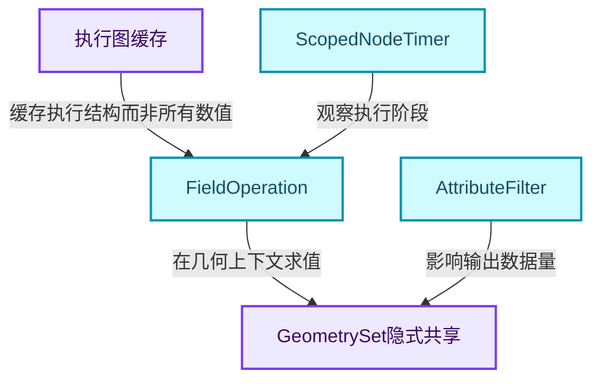
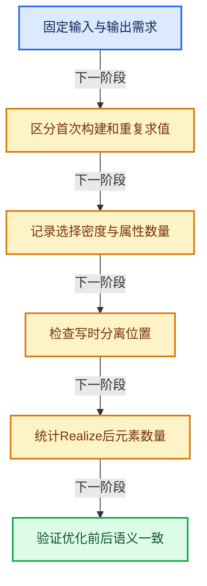
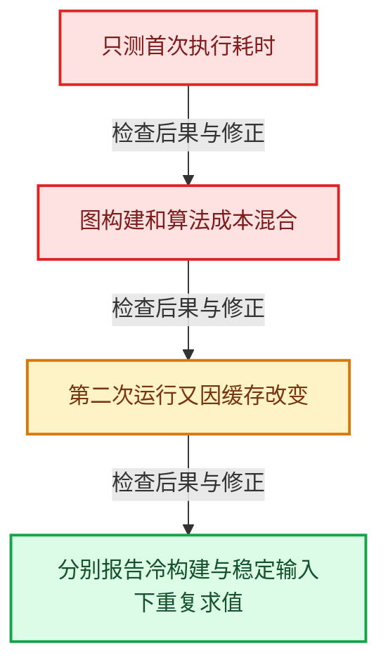

# GN-23 几何节点性能诊断与架构训练

[几何节点学习地图](../README.md) · [专题分组导航](README.md) · [全局实现索引](../../00-课程指南/02-源码与提交索引/符号依赖与实现索引.md)

基准：`cbda6b96c26c0dee3c3b5cbb93960c4ac06a6b30`；文件哈希及连续摘录区间记录在[新增专题证据](../../_evidence/geometry-extension.json)。本篇围绕所选函数解释核心机制，辅助依赖明确列出已定位实现与尚需类型确认的边界，不宣称相关整个文件已全文复核。

## 先回答一个具体问题

节点很慢时，怎样分清图构建、Field求值、复制、属性传播和实例展开的成本？

## 相关类与数据的职责

- **`执行图缓存`**：减少重复构建，但不缓存所有几何结果。
- **`FieldOperation`**：延迟表达式，可能共享子计算。 定义入口：[source/blender/functions/FN_field.hh · L387](../../../../../../source/blender/functions/FN_field.hh)。
- **`GeometrySet隐式共享`**：延迟必要复制到写接口。
- **`AttributeFilter`**：减少不需要的属性传播。 定义入口：[source/blender/blenkernel/BKE_attribute_filter.hh · L26](../../../../../../source/blender/blenkernel/BKE_attribute_filter.hh)。
- **`ScopedNodeTimer`**：在具体执行上下文记录节点耗时。



上图箭头文字区分拥有、借用、调用和数据依赖。连线不表示这些类型存在同名继承关系；只有源码明确声明的继承才按继承理解。

## 设计推导与扩展知识

### 推导1

性能分析先固定问题规模：点数、实例引用数、选择密度、属性数量、嵌套深度和实际需要的输出。只写“有100个节点”很难解释开销。

### 推导2

缓存执行图与缓存数值结果不同。ensure_geometry_nodes_lazy_function_graph复用的是执行结构；输入几何、时间或外部对象变化时，相关节点仍需重新求值。

### 推导3

单值虚拟数组、空Selection、单组件Join、共享属性捕获都是重要快捷路径。优化应先确认测试确实触发目标路径，避免用空输入测出看似惊人的吞吐量。

### 推导4

写时复制把成本推迟到写接口。一次get_*_for_write可能是耗时突增的真实位置；复制GeometrySet包装值便宜不代表整个修改操作也便宜。

### 推导5

实例展开和属性传播会改变输出规模。优化内层算术前先检查是否能保持实例、过滤不需传播的属性或避免过早物化，这通常属于架构层选择。

### 推导6

所有性能数字都应来自固定版本与实际测试。本专题只提供实验设计和代码证据，不把复杂度推演或教学模型标成实测加速比。

## 实际处理阶段



这张图概括本篇所讨论的主路径；等待输入、构建失败与不同策略的分支以下方完整代码为准，不能把概括图当作每次都会执行的无条件顺序。

## 教学注释代码与分段机制

<a id="f-52501f045c159f79"></a>

### `blender::nodes::ensure_geometry_nodes_lazy_function_graph` · L4334—L4342

用缓存入口区分结构准备与数值求值成本。

实现位置：[source/blender/nodes/intern/geometry_nodes_lazy_function.cc](../../../../../../source/blender/nodes/intern/geometry_nodes_lazy_function.cc)。

**教学注释版**

<!-- annotated:0ca6b9b3b3f1f8 -->

```cpp
const std::shared_ptr<const GeometryNodesLazyFunctionGraphInfo> &
ensure_geometry_nodes_lazy_function_graph(const bNodeTree &btree)
{
  btree.runtime->geometry_nodes_lazy_function_graph_info_mutex.ensure([&]() {
    btree.runtime->geometry_nodes_lazy_function_graph_info =
        ensure_geometry_nodes_lazy_function_graph_impl(btree);
  });
  return btree.runtime->geometry_nodes_lazy_function_graph_info;
}
```

<details>
<summary>核对原始源码：source/blender/nodes/intern/geometry_nodes_lazy_function.cc · L4334—L4342</summary>

<!-- original:0ca6b9b3b3f1f8:source/blender/nodes/intern/geometry_nodes_lazy_function.cc:4334:4342 -->

```cpp
const std::shared_ptr<const GeometryNodesLazyFunctionGraphInfo> &
ensure_geometry_nodes_lazy_function_graph(const bNodeTree &btree)
{
  btree.runtime->geometry_nodes_lazy_function_graph_info_mutex.ensure([&]() {
    btree.runtime->geometry_nodes_lazy_function_graph_info =
        ensure_geometry_nodes_lazy_function_graph_impl(btree);
  });
  return btree.runtime->geometry_nodes_lazy_function_graph_info;
}
```

</details>

<details>
<summary>实现依赖入口与尚需类型确认的调用</summary>

- `btree.runtime->geometry_nodes_lazy_function_graph_info_mutex.ensure`：L4337的类型或分派协议；接收对象类型依赖auto、返回值或模板实例；不按同名猜测目标。
- `ensure_geometry_nodes_lazy_function_graph_impl` → [blender::nodes::ensure_geometry_nodes_lazy_function_graph_impl · L4265](../01-节点接口与执行架构/扩展05-执行图构建缓存与树副本所有权.md#f-f6e0aacd05eb7a34)。

</details>

<a id="f-21eccb196f5b9a78"></a>

### `blender::bke::get_component_for_write` · L119—L127

记录共享状态变化与地址变化，定位延迟复制成本。

实现位置：[source/blender/blenkernel/intern/geometry_set.cc](../../../../../../source/blender/blenkernel/intern/geometry_set.cc)。

**教学注释版**

<!-- annotated:5bbd80cc7c1de4 -->

```cpp
GeometryComponent &GeometrySet::get_component_for_write(GeometryComponent::Type component_type)
{
  GeometryComponentPtr &component_ptr = components_[size_t(component_type)];
  if (!component_ptr) {
    /* If the component did not exist before, create a new one. */
    component_ptr = GeometryComponent::create(component_type);
  }
  // [讲解] 共享组件在必要时分离；这不是无副作用的只读getter。
  return component_ptr.ensure_mutable_inplace();
}
```

<details>
<summary>核对原始源码：source/blender/blenkernel/intern/geometry_set.cc · L119—L127</summary>

<!-- original:5bbd80cc7c1de4:source/blender/blenkernel/intern/geometry_set.cc:119:127 -->

```cpp
GeometryComponent &GeometrySet::get_component_for_write(GeometryComponent::Type component_type)
{
  GeometryComponentPtr &component_ptr = components_[size_t(component_type)];
  if (!component_ptr) {
    /* If the component did not exist before, create a new one. */
    component_ptr = GeometryComponent::create(component_type);
  }
  return component_ptr.ensure_mutable_inplace();
}
```

</details>

<details>
<summary>实现依赖入口与尚需类型确认的调用</summary>

- `GeometryComponent::create` → [blender::bke::create · L41](../../06-隐式共享与缓存系统/05-GeometrySet读写与复制.md#f-057aed72adfa658c)。
- `component_ptr.ensure_mutable_inplace` → [blender::ImplicitSharingPtr::ensure_mutable_inplace · L144](../../06-隐式共享与缓存系统/03-Mixin与共享指针封装.md#f-d9e9b25281edf91a)。

</details>

## 用小数据走一遍

1. 相同源Mesh有1000个实例。
2. 保持Instances只存引用与变换。
3. Realize生成大量实际元素。
4. 分别测数量和峰值内存再谈加法优化。


这是明确输入条件下的教学推演，不是本地性能实测。对源码的验证应同时检查数值、对象寿命、输出需求和数据是否存在。

## 反例与边界

- 只测首次执行耗时。
- 图构建和算法成本混合。
- 第二次运行又因缓存改变。
- 分别报告冷构建与稳定输入下重复求值。



## 历史提交阅读

本地历史阅读样本：**Jacques Lucke**，2026-09-13T00:12:00+02:00。

`954a62b3420b287de83ca92ab80b3ddaf5208aa0`

提交标题：Refactor: Nodes: use separate type for internal links

[所选文件的真实diff](../../_evidence/geometry-history/GN-23.patch)。这是本地历史中匹配作者的近期样本，不冒称该系统的最初引入提交。阅读时先找变更前后的不变量，再检查新增分支与测试；本篇当前源码说明不混用历史签名。

## 独立实现与验收

实现一个小型节点系统：声明、Value、Field、需求调度、共享几何与日志，分阶段验收。

<details>
<summary>参考思路</summary>

先做单值DAG，再加缺输入请求，之后Field上下文、写时分离与副作用根。每阶段用反例证明契约；不要一次复制Blender所有类型。

</details>

验收时保留一个能击穿错误设计的反例，再对照实际符号重走调用链。教学练习未在完整Blender中运行；本轮独立运行的模型验证另见新增专题验收报告。

## 继续阅读

- [GN-22 ComputeContext日志映射与副作用根](../01-节点接口与执行架构/扩展07-ComputeContext日志映射与副作用根.md)
- [GN-24 Jacques与Hans提交中的架构演化](../01-节点接口与执行架构/扩展08-Jacques与Hans提交中的架构演化.md)
