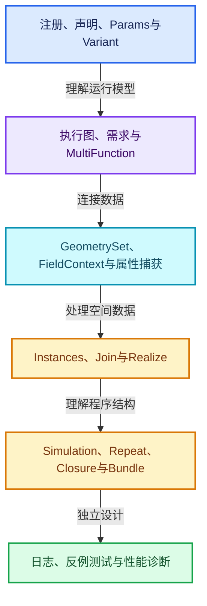
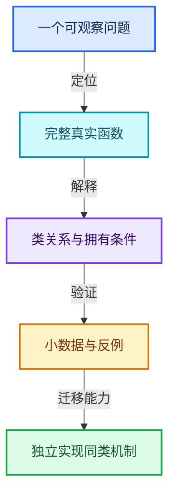

# 几何节点专题

24篇专题集中在本文件夹的五个主题分组中。建议先读架构与参数，再读几何表示和属性，最后进入实例与Zone；共享依赖专题按需进入。

## 五个主题分组

- [01-节点接口与执行架构 · 9篇](01-节点接口与执行架构/README.md)
- [02-几何数据与算法 · 6篇](02-几何数据与算法/README.md)
- [03-Field与属性 · 4篇](03-Field与属性/README.md)
- [04-Zone与可传递程序 · 4篇](04-Zone与可传递程序/README.md)
- [05-性能诊断 · 1篇](05-性能诊断/README.md)

## 主线与专题入口

| 编号 | 专题 | 所选完整函数数 |
|---|---|---|
| GN-01 | [几何节点从编辑树到执行结果的全景](01-节点接口与执行架构/扩展01-几何节点从编辑树到执行结果的全景.md) | 1 |
| GN-02 | [节点注册声明与引用关系契约](01-节点接口与执行架构/扩展02-节点注册声明与引用关系契约.md) | 5 |
| GN-03 | [GeoNodeExecParams参数适配与移动语义](01-节点接口与执行架构/扩展03-GeoNodeExecParams参数适配与移动语义.md) | 3 |
| GN-04 | [SocketValueVariant异构值与转换边界](01-节点接口与执行架构/扩展04-SocketValueVariant异构值与转换边界.md) | 6 |
| GN-05 | [执行图构建缓存与树副本所有权](01-节点接口与执行架构/扩展05-执行图构建缓存与树副本所有权.md) | 3 |
| GN-06 | [按需执行匿名输出与Switch需求传播](01-节点接口与执行架构/扩展06-按需执行匿名输出与Switch需求传播.md) | 2 |
| GN-07 | [数学节点从MultiFunction到FieldOperation](01-节点接口与执行架构/扩展01-数学节点从MultiFunction到FieldOperation.md) | 2 |
| GN-08 | [GeometrySet组件组合与写时分离](02-几何数据与算法/扩展01-GeometrySet组件组合与写时分离.md) | 4 |
| GN-09 | [几何FieldContext属性域与跨域求值](03-Field与属性/扩展01-几何FieldContext属性域与跨域求值.md) | 2 |
| GN-10 | [SetPosition读取写入与贝塞尔控制柄](03-Field与属性/扩展02-SetPosition读取写入与贝塞尔控制柄.md) | 3 |
| GN-11 | [StoreNamedAttribute类型域与部分写入](03-Field与属性/扩展03-StoreNamedAttribute类型域与部分写入.md) | 2 |
| GN-12 | [属性捕获求值暂存与提交协议](02-几何数据与算法/扩展02-属性捕获求值暂存与提交协议.md) | 2 |
| GN-13 | [CaptureAttribute匿名属性引用与清理](03-Field与属性/扩展01-CaptureAttribute匿名属性引用与清理.md) | 2 |
| GN-14 | [Instances引用表句柄与变换数组](02-几何数据与算法/扩展03-Instances引用表句柄与变换数组.md) | 5 |
| GN-15 | [InstanceOnPoints选择压缩与引用重映射](02-几何数据与算法/扩展04-InstanceOnPoints选择压缩与引用重映射.md) | 1 |
| GN-16 | [JoinGeometry组件分派与Realize复用](02-几何数据与算法/扩展05-JoinGeometry组件分派与Realize复用.md) | 3 |
| GN-17 | [RealizeInstances深度Field与任务流水线](02-几何数据与算法/扩展06-RealizeInstances深度Field与任务流水线.md) | 3 |
| GN-18 | [Simulation状态协议缓存与时间步](04-Zone与可传递程序/扩展02-Simulation状态协议缓存与时间步.md) | 2 |
| GN-19 | [Repeat与Foreach执行状态及上下文身份](04-Zone与可传递程序/扩展03-Repeat与Foreach执行状态及上下文身份.md) | 3 |
| GN-20 | [Closure可传递程序捕获与调用边界](04-Zone与可传递程序/扩展04-Closure可传递程序捕获与调用边界.md) | 2 |
| GN-21 | [Bundle嵌套值路径查找与写时复制](04-Zone与可传递程序/扩展05-Bundle嵌套值路径查找与写时复制.md) | 3 |
| GN-22 | [ComputeContext日志映射与副作用根](01-节点接口与执行架构/扩展07-ComputeContext日志映射与副作用根.md) | 2 |
| GN-23 | [几何节点性能诊断与架构训练](05-性能诊断/扩展01-几何节点性能诊断与架构训练.md) | 2 |
| GN-24 | [Jacques与Hans提交中的架构演化](01-节点接口与执行架构/扩展08-Jacques与Hans提交中的架构演化.md) | 2 |

## 六阶段学习路线

## 扩展知识怎样对应代码

| 扩展概念 | 对应专题 | 训练目标 |
|---|---|---|
| 编译器中间表示与解释执行 | [GN-01](01-节点接口与执行架构/扩展01-几何节点从编辑树到执行结果的全景.md) | 区分编辑表示与运行表示 |
| 内部DSL与声明式契约 | [GN-02](01-节点接口与执行架构/扩展02-节点注册声明与引用关系契约.md) | 从Builder生成可分析关系 |
| 类型擦除、模板与移动语义 | [GN-03](01-节点接口与执行架构/扩展03-GeoNodeExecParams参数适配与移动语义.md) | 明确接口值和存储值 |
| 异构值转换与失败策略 | [GN-04](01-节点接口与执行架构/扩展04-SocketValueVariant异构值与转换边界.md) | 分离查询、转换与默认值 |
| 程序资源寿命与缓存 | [GN-05](01-节点接口与执行架构/扩展05-执行图构建缓存与树副本所有权.md) | 让产物持有必要资源 |
| 需求传播与保守分析 | [GN-06](01-节点接口与执行架构/扩展06-按需执行匿名输出与Switch需求传播.md) | 不能用单值分支裁掉Field分支 |
| 数据并行与表达式共享 | [GN-07](01-节点接口与执行架构/扩展01-数学节点从MultiFunction到FieldOperation.md) | 复用计算内核而非复制业务 |
| 写时复制与分层拥有 | [GN-08](02-几何数据与算法/扩展01-GeometrySet组件组合与写时分离.md) | 区分组件独占与数组独占 |
| 拓扑域映射 | [GN-09](03-Field与属性/扩展01-几何FieldContext属性域与跨域求值.md) | 不要用相同索引替代邻接关系 |
| 两阶段求值与提交 | [GN-12](02-几何数据与算法/扩展02-属性捕获求值暂存与提交协议.md) | 避免写入污染尚未完成的读取 |
| 符号引用与数据寿命 | [GN-13](03-Field与属性/扩展01-CaptureAttribute匿名属性引用与清理.md) | 让引用与承载数据共同传播 |
| 索引空间与句柄重映射 | [GN-14](02-几何数据与算法/扩展03-Instances引用表句柄与变换数组.md) | 区分来源、实例和紧凑输出位置 |
| 任务预处理与不相交写入 | [GN-17](02-几何数据与算法/扩展06-RealizeInstances深度Field与任务流水线.md) | 先确定输出布局再执行任务 |
| 状态机与策略variant | [GN-18](04-Zone与可传递程序/扩展02-Simulation状态协议缓存与时间步.md) | 明确互斥状态及所需数据 |
| 执行身份与副作用 | [GN-19](04-Zone与可传递程序/扩展03-Repeat与Foreach执行状态及上下文身份.md) | 复用函数同时区分调用位置 |
| 可传递程序与捕获环境 | [GN-20](04-Zone与可传递程序/扩展04-Closure可传递程序捕获与调用边界.md) | 同时设计函数寿命和捕获寿命 |
| 嵌套结构的写时复制 | [GN-21](04-Zone与可传递程序/扩展05-Bundle嵌套值路径查找与写时复制.md) | 逐层分离共享容器 |
| 可观察性与性能实验 | [GN-23](05-性能诊断/扩展01-几何节点性能诊断与架构训练.md) | 先测真实瓶颈再改架构 |

[新增专题验收报告](验收报告.md) · [全套入口](../README.md)
