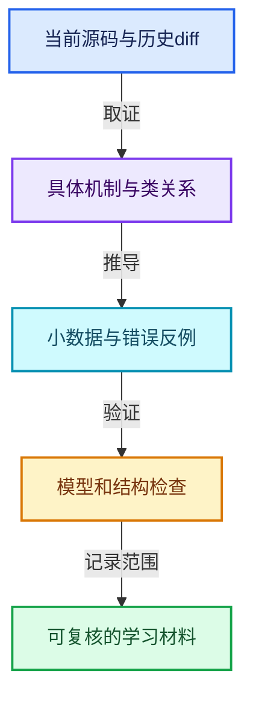
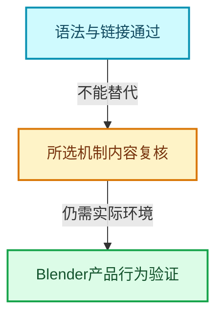

# 几何节点专题验收

24篇专题集中在13-几何节点专题的五个主题分组中。基准HEAD：`cbda6b96c26c0dee3c3b5cbb93960c4ac06a6b30`。

[专题学习地图](README.md) · [原有全套报告](../00-课程指南/03-验收报告/验收报告.md)

## 内容与范围

- 65个完整函数讲解单元，按完整函数边界摘录；其中重复跨专题解释的函数另有阅读目的。
- 71个源码摘录；正文摘录与类定义入口共涉及47个当前源码文件，SHA-256逐项记录。
- 正文共96张专用彩色图，每篇4张，分别表达类与数据关系、处理阶段、小数据推演和反例边界。
- 27个历史阅读记录；最后一篇专门分析4个已读取实际diff的Jacques/Hans提交，其他篇提供与主讲文件相关的历史样本。

机制包括注册声明、GeoNodeExecParams、SocketValueVariant、执行图缓存、需求传播、MultiFunction转Field、组件共享、域适配、Set Position、命名与匿名属性、实例引用、Join/Realize、Simulation、Repeat/Foreach、Closure、Bundle、日志与性能诊断。

## 验证结果

| 检查 | 结果 |
|---|---|
| 源码和教学代码 | 本轮检查包含24篇新增正文及全部根目录和方向导航，原文区间、源码哈希、去掉新增注释后的代码一致性均检查。 |
| Markdown与链接 | 本轮结构检查错误0个；覆盖本地文件与显式锚点、围栏、图数。 |
| Mermaid | 最新全局语法检查7717张，错误0个；新增正文既有视觉校验记录96/96张。本次目录整理仅解析，没有重新生成图片。 |
| 教学模型 | 11组模型验证通过，包含200组固定种子的随机句柄重映射；不是Blender集成测试。 |

## 模型验证的具体责任

验证了引用表重映射、稀疏选择到紧凑输出、负索引绕回、先求值后提交、部分写入保留未选值、单值与Field条件的需求区别、嵌套容器分离、调用上下文身份、缺输入恢复执行和32位元素计数边界。模型源码使用assert执行，不以文字示例充当运行证据。

模型仅验证本文用于推理的状态关系，未调用Blender的GeometrySet或执行器。原有Vector真实头文件测试仍是独立证据，不借它宣称几何节点已通过产品测试。

## 仍需区分的边界

- 所选函数中1个带结构解析恢复标记；对应摘录可与原文核对，不能称为全部预处理配置下的编译器边界证明。
- 新正文保留121个需要实际类型、模板实例或回调环境进一步确认的调用记录；没有用同名函数强行冒充确定目标。
- 本轮按所选机制补充讲解，不声称所涉及47个文件或原有全套课程全部完成逐行语义审查。
- 不提供未经测量的性能数字；历史提交中的动机与本地测试结果分开标识。
- 未运行完整Blender或交互节点树测试；复杂拓扑、曲线域插值、Simulation持久化和Closure兼容的生产行为仍应在Blender测试环境中验证。

## 文档清单

| 编号 | 文档 | 行数 | 完整函数单元 |
|---|---|---|---|
| GN-01 | [扩展01-几何节点从编辑树到执行结果的全景](01-节点接口与执行架构/扩展01-几何节点从编辑树到执行结果的全景.md) | 586 | 1 |
| GN-02 | [扩展02-节点注册声明与引用关系契约](01-节点接口与执行架构/扩展02-节点注册声明与引用关系契约.md) | 441 | 5 |
| GN-03 | [扩展03-GeoNodeExecParams参数适配与移动语义](01-节点接口与执行架构/扩展03-GeoNodeExecParams参数适配与移动语义.md) | 484 | 3 |
| GN-04 | [扩展04-SocketValueVariant异构值与转换边界](01-节点接口与执行架构/扩展04-SocketValueVariant异构值与转换边界.md) | 504 | 6 |
| GN-05 | [扩展05-执行图构建缓存与树副本所有权](01-节点接口与执行架构/扩展05-执行图构建缓存与树副本所有权.md) | 581 | 3 |
| GN-06 | [扩展06-按需执行匿名输出与Switch需求传播](01-节点接口与执行架构/扩展06-按需执行匿名输出与Switch需求传播.md) | 407 | 2 |
| GN-07 | [扩展01-数学节点从MultiFunction到FieldOperation](01-节点接口与执行架构/扩展01-数学节点从MultiFunction到FieldOperation.md) | 382 | 2 |
| GN-08 | [扩展01-GeometrySet组件组合与写时分离](02-几何数据与算法/扩展01-GeometrySet组件组合与写时分离.md) | 510 | 4 |
| GN-09 | [扩展01-几何FieldContext属性域与跨域求值](03-Field与属性/扩展01-几何FieldContext属性域与跨域求值.md) | 396 | 2 |
| GN-10 | [扩展02-SetPosition读取写入与贝塞尔控制柄](03-Field与属性/扩展02-SetPosition读取写入与贝塞尔控制柄.md) | 477 | 3 |
| GN-11 | [扩展03-StoreNamedAttribute类型域与部分写入](03-Field与属性/扩展03-StoreNamedAttribute类型域与部分写入.md) | 498 | 2 |
| GN-12 | [扩展02-属性捕获求值暂存与提交协议](02-几何数据与算法/扩展02-属性捕获求值暂存与提交协议.md) | 641 | 2 |
| GN-13 | [扩展01-CaptureAttribute匿名属性引用与清理](03-Field与属性/扩展01-CaptureAttribute匿名属性引用与清理.md) | 496 | 2 |
| GN-14 | [扩展03-Instances引用表句柄与变换数组](02-几何数据与算法/扩展03-Instances引用表句柄与变换数组.md) | 400 | 5 |
| GN-15 | [扩展04-InstanceOnPoints选择压缩与引用重映射](02-几何数据与算法/扩展04-InstanceOnPoints选择压缩与引用重映射.md) | 497 | 1 |
| GN-16 | [扩展05-JoinGeometry组件分派与Realize复用](02-几何数据与算法/扩展05-JoinGeometry组件分派与Realize复用.md) | 538 | 3 |
| GN-17 | [扩展06-RealizeInstances深度Field与任务流水线](02-几何数据与算法/扩展06-RealizeInstances深度Field与任务流水线.md) | 806 | 3 |
| GN-18 | [扩展02-Simulation状态协议缓存与时间步](04-Zone与可传递程序/扩展02-Simulation状态协议缓存与时间步.md) | 446 | 2 |
| GN-19 | [扩展03-Repeat与Foreach执行状态及上下文身份](04-Zone与可传递程序/扩展03-Repeat与Foreach执行状态及上下文身份.md) | 455 | 3 |
| GN-20 | [扩展04-Closure可传递程序捕获与调用边界](04-Zone与可传递程序/扩展04-Closure可传递程序捕获与调用边界.md) | 459 | 2 |
| GN-21 | [扩展05-Bundle嵌套值路径查找与写时复制](04-Zone与可传递程序/扩展05-Bundle嵌套值路径查找与写时复制.md) | 378 | 3 |
| GN-22 | [扩展07-ComputeContext日志映射与副作用根](01-节点接口与执行架构/扩展07-ComputeContext日志映射与副作用根.md) | 361 | 2 |
| GN-23 | [扩展01-几何节点性能诊断与架构训练](05-性能诊断/扩展01-几何节点性能诊断与架构训练.md) | 272 | 2 |
| GN-24 | [扩展08-Jacques与Hans提交中的架构演化](01-节点接口与执行架构/扩展08-Jacques与Hans提交中的架构演化.md) | 344 | 2 |

## 证据与维护入口

- [geometry-extension.json](../_evidence/geometry-extension.json)
- [geometry-models-test.json](../_evidence/geometry-models-test.json)
- [geometry-extension-check.json](../_evidence/geometry-extension-check.json)
- [revision-check.json](../_evidence/revision-check.json)
- [mermaid-check.json](../_evidence/mermaid-check.json)

内容维护：`_tools/geometry_topics.py`；生成：`_tools/build_geometry_extension.py`；模型验证：`_tools/geometry_models_test.py`。来源哈希不匹配时生成脚本停止，要求先刷新结构索引后重新核对。

