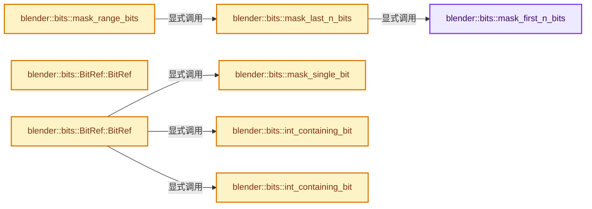
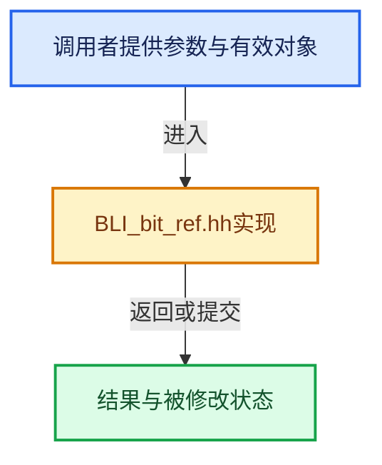

# 实现依赖专题：source/blender/blenlib/BLI_bit_ref.hh

[实现依赖导航](../README.md) · [符号索引](../../00-课程指南/02-源码与提交索引/符号依赖与实现索引.md)

本专题从正文实际调用进入，集中保存共享实现。函数有稳定锚点，可从调用处直接跳到对应完整函数；递归与互相调用通过回链组织。

## 本文件的实现关系






## 完整成员与函数实现

<a id="f-7c64d5504e3e9925"></a>

### `blender::bits::mask_first_n_bits`

实现位置：[source/blender/blenlib/BLI_bit_ref.hh](../../../../../../source/blender/blenlib/BLI_bit_ref.hh) · L38—L46。

接口参数：

- `const int64_t n`

**教学注释版**

<!-- annotated:40007c96551eeb -->

```cpp
inline BitInt mask_first_n_bits(const int64_t n)
{
  BLI_assert(n >= 0);
  BLI_assert(n <= BitsPerInt);
  if (n == BitsPerInt) {
    return BitInt(-1);
  }
  return (BitInt(1) << n) - 1;
}
```

<details>
<summary>核对原始源码：source/blender/blenlib/BLI_bit_ref.hh · L38—L46</summary>

<!-- original:40007c96551eeb:source/blender/blenlib/BLI_bit_ref.hh:38:46 -->

```cpp
inline BitInt mask_first_n_bits(const int64_t n)
{
  BLI_assert(n >= 0);
  BLI_assert(n <= BitsPerInt);
  if (n == BitsPerInt) {
    return BitInt(-1);
  }
  return (BitInt(1) << n) - 1;
}
```

</details>

**结果出口**

- `return BitInt(-1);`
- `return (BitInt(1) << n) - 1;`

**继续追踪实现**

- `BLI_assert` → [BLI_assert · L48](BLI_assert.hh.md#m-57a88495704d)；[BLI_assert · L63](BLI_assert.hh.md#m-d07050020cb5)。宏定义由构建条件选择。
- `BitInt` → [调用协议](../../00-课程指南/01-路线与规范/模板宏与动态分派协议.md)：函数指针、局部可调用对象或未展开的宏；必须结合调用者环境。调用位置L43。

<a id="f-0efb0abeb4bd9f41"></a>

### `blender::bits::mask_last_n_bits`

实现位置：[source/blender/blenlib/BLI_bit_ref.hh](../../../../../../source/blender/blenlib/BLI_bit_ref.hh) · L48—L51。

接口参数：

- `const int64_t n`

**教学注释版**

<!-- annotated:f922ac43f9b969 -->

```cpp
inline BitInt mask_last_n_bits(const int64_t n)
{
  return ~mask_first_n_bits(BitsPerInt - n);
}
```

<details>
<summary>核对原始源码：source/blender/blenlib/BLI_bit_ref.hh · L48—L51</summary>

<!-- original:f922ac43f9b969:source/blender/blenlib/BLI_bit_ref.hh:48:51 -->

```cpp
inline BitInt mask_last_n_bits(const int64_t n)
{
  return ~mask_first_n_bits(BitsPerInt - n);
}
```

</details>

**结果出口**

- `return ~mask_first_n_bits(BitsPerInt - n);`

**继续追踪实现**

- `mask_first_n_bits` → [blender::bits::mask_first_n_bits · L38](BLI_bit_ref.hh.md#f-7c64d5504e3e9925)。

<a id="f-ceb0021a5b4da156"></a>

### `blender::bits::mask_range_bits`

实现位置：[source/blender/blenlib/BLI_bit_ref.hh](../../../../../../source/blender/blenlib/BLI_bit_ref.hh) · L53—L63。

接口参数：

- `const int64_t start`
- `const int64_t size`

**教学注释版**

<!-- annotated:12a65c53a0b7e1 -->

```cpp
inline BitInt mask_range_bits(const int64_t start, const int64_t size)
{
  BLI_assert(start >= 0);
  BLI_assert(size >= 0);
  const int64_t end = start + size;
  BLI_assert(end <= BitsPerInt);
  if (end == BitsPerInt) {
    return mask_last_n_bits(size);
  }
  return ((BitInt(1) << end) - 1) & ~((BitInt(1) << start) - 1);
}
```

<details>
<summary>核对原始源码：source/blender/blenlib/BLI_bit_ref.hh · L53—L63</summary>

<!-- original:12a65c53a0b7e1:source/blender/blenlib/BLI_bit_ref.hh:53:63 -->

```cpp
inline BitInt mask_range_bits(const int64_t start, const int64_t size)
{
  BLI_assert(start >= 0);
  BLI_assert(size >= 0);
  const int64_t end = start + size;
  BLI_assert(end <= BitsPerInt);
  if (end == BitsPerInt) {
    return mask_last_n_bits(size);
  }
  return ((BitInt(1) << end) - 1) & ~((BitInt(1) << start) - 1);
}
```

</details>

**结果出口**

- `return mask_last_n_bits(size);`
- `return ((BitInt(1) << end) - 1) & ~((BitInt(1) << start) - 1);`

**继续追踪实现**

- `BLI_assert` → [BLI_assert · L48](BLI_assert.hh.md#m-57a88495704d)；[BLI_assert · L63](BLI_assert.hh.md#m-d07050020cb5)。宏定义由构建条件选择。
- `mask_last_n_bits` → [blender::bits::mask_last_n_bits · L48](BLI_bit_ref.hh.md#f-0efb0abeb4bd9f41)。
- `BitInt` → [调用协议](../../00-课程指南/01-路线与规范/模板宏与动态分派协议.md)：函数指针、局部可调用对象或未展开的宏；必须结合调用者环境。调用位置L62。

<a id="f-eaa58e04adaf300e"></a>

### `blender::bits::mask_single_bit`

实现位置：[source/blender/blenlib/BLI_bit_ref.hh](../../../../../../source/blender/blenlib/BLI_bit_ref.hh) · L65—L70。

接口参数：

- `const int64_t bit_index`

**教学注释版**

<!-- annotated:c26c4de012a980 -->

```cpp
inline BitInt mask_single_bit(const int64_t bit_index)
{
  BLI_assert(bit_index >= 0);
  BLI_assert(bit_index < BitsPerInt);
  return BitInt(1) << bit_index;
}
```

<details>
<summary>核对原始源码：source/blender/blenlib/BLI_bit_ref.hh · L65—L70</summary>

<!-- original:c26c4de012a980:source/blender/blenlib/BLI_bit_ref.hh:65:70 -->

```cpp
inline BitInt mask_single_bit(const int64_t bit_index)
{
  BLI_assert(bit_index >= 0);
  BLI_assert(bit_index < BitsPerInt);
  return BitInt(1) << bit_index;
}
```

</details>

**结果出口**

- `return BitInt(1) << bit_index;`

**继续追踪实现**

- `BLI_assert` → [BLI_assert · L48](BLI_assert.hh.md#m-57a88495704d)；[BLI_assert · L63](BLI_assert.hh.md#m-d07050020cb5)。宏定义由构建条件选择。
- `BitInt` → [调用协议](../../00-课程指南/01-路线与规范/模板宏与动态分派协议.md)：函数指针、局部可调用对象或未展开的宏；必须结合调用者环境。调用位置L69。

<a id="f-dddfb68bb10f0356"></a>

### `blender::bits::int_containing_bit`

实现位置：[source/blender/blenlib/BLI_bit_ref.hh](../../../../../../source/blender/blenlib/BLI_bit_ref.hh) · L72—L75。

接口参数：

- `BitInt *data`
- `const int64_t bit_index`

**教学注释版**

<!-- annotated:d06a8c18e6066a -->

```cpp
inline BitInt *int_containing_bit(BitInt *data, const int64_t bit_index)
{
  return data + (bit_index >> BitToIntIndexShift);
}
```

<details>
<summary>核对原始源码：source/blender/blenlib/BLI_bit_ref.hh · L72—L75</summary>

<!-- original:d06a8c18e6066a:source/blender/blenlib/BLI_bit_ref.hh:72:75 -->

```cpp
inline BitInt *int_containing_bit(BitInt *data, const int64_t bit_index)
{
  return data + (bit_index >> BitToIntIndexShift);
}
```

</details>

**结果出口**

- `return data + (bit_index >> BitToIntIndexShift);`

**继续追踪实现**

本实现没有需要继续展开的显式调用；检查返回表达式、对象转换和调用者前置条件。

<a id="f-6ea7b9235ac9dbab"></a>

### `blender::bits::int_containing_bit`

实现位置：[source/blender/blenlib/BLI_bit_ref.hh](../../../../../../source/blender/blenlib/BLI_bit_ref.hh) · L77—L80。

接口参数：

- `const BitInt *data`
- `const int64_t bit_index`

**教学注释版**

<!-- annotated:49a64e9f0e394d -->

```cpp
inline const BitInt *int_containing_bit(const BitInt *data, const int64_t bit_index)
{
  return data + (bit_index >> BitToIntIndexShift);
}
```

<details>
<summary>核对原始源码：source/blender/blenlib/BLI_bit_ref.hh · L77—L80</summary>

<!-- original:49a64e9f0e394d:source/blender/blenlib/BLI_bit_ref.hh:77:80 -->

```cpp
inline const BitInt *int_containing_bit(const BitInt *data, const int64_t bit_index)
{
  return data + (bit_index >> BitToIntIndexShift);
}
```

</details>

**结果出口**

- `return data + (bit_index >> BitToIntIndexShift);`

**继续追踪实现**

本实现没有需要继续展开的显式调用；检查返回表达式、对象转换和调用者前置条件。

<a id="f-3232b097aac6b63c"></a>

### `blender::bits::BitRef::BitRef`

实现位置：[source/blender/blenlib/BLI_bit_ref.hh](../../../../../../source/blender/blenlib/BLI_bit_ref.hh) · L96—L96。

**教学注释版**

<!-- annotated:a890de65914b59 -->

```cpp
  BitRef() = default;
```

<details>
<summary>核对原始源码：source/blender/blenlib/BLI_bit_ref.hh · L96—L96</summary>

<!-- original:a890de65914b59:source/blender/blenlib/BLI_bit_ref.hh:96:96 -->

```cpp
  BitRef() = default;
```

</details>

**继续追踪实现**

本实现没有需要继续展开的显式调用；检查返回表达式、对象转换和调用者前置条件。

<a id="f-bc1f6add7403fe2f"></a>

### `blender::bits::BitRef::BitRef`

实现位置：[source/blender/blenlib/BLI_bit_ref.hh](../../../../../../source/blender/blenlib/BLI_bit_ref.hh) · L102—L106。

接口参数：

- `const BitInt *data`
- `const int64_t bit_index`

**教学注释版**

<!-- annotated:0031138c9a5164 -->

```cpp
  BitRef(const BitInt *data, const int64_t bit_index)
  {
    int_ = int_containing_bit(data, bit_index);
    mask_ = mask_single_bit(bit_index & BitIndexMask);
  }
```

<details>
<summary>核对原始源码：source/blender/blenlib/BLI_bit_ref.hh · L102—L106</summary>

<!-- original:0031138c9a5164:source/blender/blenlib/BLI_bit_ref.hh:102:106 -->

```cpp
  BitRef(const BitInt *data, const int64_t bit_index)
  {
    int_ = int_containing_bit(data, bit_index);
    mask_ = mask_single_bit(bit_index & BitIndexMask);
  }
```

</details>

**沿实际写入检查状态**

- `int_ = int_containing_bit(data, bit_index);`
- `mask_ = mask_single_bit(bit_index & BitIndexMask);`

**继续追踪实现**

- `int_containing_bit` → [blender::bits::int_containing_bit · L72](BLI_bit_ref.hh.md#f-dddfb68bb10f0356)；[blender::bits::int_containing_bit · L77](BLI_bit_ref.hh.md#f-6ea7b9235ac9dbab)。同名重载需按实参类型选择。
- `mask_single_bit` → [blender::bits::mask_single_bit · L65](BLI_bit_ref.hh.md#f-eaa58e04adaf300e)。

<a id="f-23b4dd05da7142b5"></a>

### `blender::bits::MutableBitRef::MutableBitRef`

实现位置：[source/blender/blenlib/BLI_bit_ref.hh](../../../../../../source/blender/blenlib/BLI_bit_ref.hh) · L135—L135。

**教学注释版**

<!-- annotated:c1b94dc0f35ea7 -->

```cpp
  MutableBitRef() = default;
```

<details>
<summary>核对原始源码：source/blender/blenlib/BLI_bit_ref.hh · L135—L135</summary>

<!-- original:c1b94dc0f35ea7:source/blender/blenlib/BLI_bit_ref.hh:135:135 -->

```cpp
  MutableBitRef() = default;
```

</details>

**继续追踪实现**

本实现没有需要继续展开的显式调用；检查返回表达式、对象转换和调用者前置条件。

<a id="f-10beea2cd369d835"></a>

### `blender::bits::MutableBitRef::MutableBitRef`

实现位置：[source/blender/blenlib/BLI_bit_ref.hh](../../../../../../source/blender/blenlib/BLI_bit_ref.hh) · L141—L145。

接口参数：

- `BitInt *data`
- `const int64_t bit_index`

**教学注释版**

<!-- annotated:521df5a0c74690 -->

```cpp
  MutableBitRef(BitInt *data, const int64_t bit_index)
  {
    int_ = int_containing_bit(data, bit_index);
    mask_ = mask_single_bit(bit_index & BitIndexMask);
  }
```

<details>
<summary>核对原始源码：source/blender/blenlib/BLI_bit_ref.hh · L141—L145</summary>

<!-- original:521df5a0c74690:source/blender/blenlib/BLI_bit_ref.hh:141:145 -->

```cpp
  MutableBitRef(BitInt *data, const int64_t bit_index)
  {
    int_ = int_containing_bit(data, bit_index);
    mask_ = mask_single_bit(bit_index & BitIndexMask);
  }
```

</details>

**沿实际写入检查状态**

- `int_ = int_containing_bit(data, bit_index);`
- `mask_ = mask_single_bit(bit_index & BitIndexMask);`

**继续追踪实现**

- `int_containing_bit` → [blender::bits::int_containing_bit · L72](BLI_bit_ref.hh.md#f-dddfb68bb10f0356)；[blender::bits::int_containing_bit · L77](BLI_bit_ref.hh.md#f-6ea7b9235ac9dbab)。同名重载需按实参类型选择。
- `mask_single_bit` → [blender::bits::mask_single_bit · L65](BLI_bit_ref.hh.md#f-eaa58e04adaf300e)。

<a id="f-598a402a4d1cd233"></a>

### `blender::bits::MutableBitRef::set`

实现位置：[source/blender/blenlib/BLI_bit_ref.hh](../../../../../../source/blender/blenlib/BLI_bit_ref.hh) · L176—L179。

**教学注释版**

<!-- annotated:d5873302e5f992 -->

```cpp
  void set()
  {
    *int_ |= mask_;
  }
```

<details>
<summary>核对原始源码：source/blender/blenlib/BLI_bit_ref.hh · L176—L179</summary>

<!-- original:d5873302e5f992:source/blender/blenlib/BLI_bit_ref.hh:176:179 -->

```cpp
  void set()
  {
    *int_ |= mask_;
  }
```

</details>

**继续追踪实现**

本实现没有需要继续展开的显式调用；检查返回表达式、对象转换和调用者前置条件。

<a id="f-01fe39af8226fc4a"></a>

### `blender::bits::MutableBitRef::reset`

实现位置：[source/blender/blenlib/BLI_bit_ref.hh](../../../../../../source/blender/blenlib/BLI_bit_ref.hh) · L184—L187。

**教学注释版**

<!-- annotated:97b245722a1d00 -->

```cpp
  void reset()
  {
    *int_ &= ~mask_;
  }
```

<details>
<summary>核对原始源码：source/blender/blenlib/BLI_bit_ref.hh · L184—L187</summary>

<!-- original:97b245722a1d00:source/blender/blenlib/BLI_bit_ref.hh:184:187 -->

```cpp
  void reset()
  {
    *int_ &= ~mask_;
  }
```

</details>

**继续追踪实现**

本实现没有需要继续展开的显式调用；检查返回表达式、对象转换和调用者前置条件。

<a id="f-aefc2b6946e75707"></a>

### `blender::bits::MutableBitRef::set`

实现位置：[source/blender/blenlib/BLI_bit_ref.hh](../../../../../../source/blender/blenlib/BLI_bit_ref.hh) · L193—L201。

接口参数：

- `const bool value`

**教学注释版**

<!-- annotated:3c59b7c505b4d6 -->

```cpp
  void set(const bool value)
  {
    if (value) {
      this->set();
    }
    else {
      this->reset();
    }
  }
```

<details>
<summary>核对原始源码：source/blender/blenlib/BLI_bit_ref.hh · L193—L201</summary>

<!-- original:3c59b7c505b4d6:source/blender/blenlib/BLI_bit_ref.hh:193:201 -->

```cpp
  void set(const bool value)
  {
    if (value) {
      this->set();
    }
    else {
      this->reset();
    }
  }
```

</details>

**继续追踪实现**

- `this->set` → [blender::bits::MutableBitRef::set · L176](BLI_bit_ref.hh.md#f-598a402a4d1cd233)；[blender::bits::MutableBitRef::set · L193](BLI_bit_ref.hh.md#f-aefc2b6946e75707)。同名重载需按实参类型选择。
- `this->reset` → [blender::bits::MutableBitRef::reset · L184](BLI_bit_ref.hh.md#f-01fe39af8226fc4a)。
