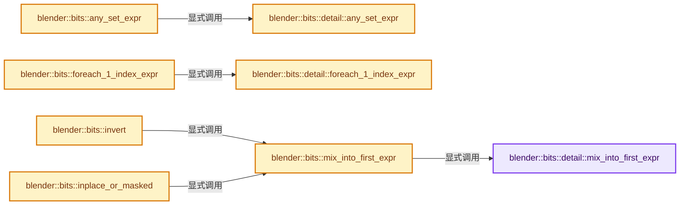

# 实现依赖专题：source/blender/blenlib/BLI_bit_span_ops.hh

[实现依赖导航](../README.md) · [符号索引](../../00-课程指南/02-源码与提交索引/符号依赖与实现索引.md)

本专题从正文实际调用进入，集中保存共享实现。函数有稳定锚点，可从调用处直接跳到对应完整函数；递归与互相调用通过回链组织。

## 本文件的实现关系




## 完整成员与函数实现

<a id="f-207feb524e74e6f1"></a>

### `blender::bits::detail::mix_into_first_expr`

实现位置：[source/blender/blenlib/BLI_bit_span_ops.hh](../../../../../../source/blender/blenlib/BLI_bit_span_ops.hh) · L24—L61。

接口参数：

- `ExprFn &&expr`
- `const FirstBitSpanT &first_arg`

**教学注释版**

<!-- annotated:c7b6fd04f247ff -->

```cpp
template<typename ExprFn, typename FirstBitSpanT, typename... BitSpanT>
inline void mix_into_first_expr(ExprFn &&expr,
                                const FirstBitSpanT &first_arg,
                                const BitSpanT &...args)
{
  const int64_t size = first_arg.size();
  BLI_assert(((size == args.size()) && ...));
  if (size == 0) {
    return;
  }

  if constexpr (all_bounded_spans<FirstBitSpanT, BitSpanT...>) {
    BitInt *first_data = first_arg.data();
    const int64_t first_offset = first_arg.offset();
    const int64_t full_ints_num = first_arg.full_ints_num();
    /* Compute expression without any masking, all the spans are expected to be aligned to the
     * beginning of a #BitInt. */
    for (const int64_t i : IndexRange(full_ints_num)) {
      first_data[i] = expr(first_data[i], args.data()[i]...);
    }
    /* Compute expression for the remaining bits. */
    if (const int64_t final_bits = first_arg.final_bits_num()) {
      const BitInt result = expr(first_data[full_ints_num] >> first_offset,
                                 (args.data()[full_ints_num] >> args.offset())...);
      const BitInt mask = mask_range_bits(first_offset, final_bits);
      first_data[full_ints_num] = ((result << first_offset) & mask) |
                                  (first_data[full_ints_num] & ~mask);
    }
  }
  else {
    /* Fallback for arbitrary bit spans. This could be implemented more efficiently but adds more
     * complexity and is not necessary yet. */
    for (const int64_t i : IndexRange(size)) {
      const bool result = expr(BitInt(first_arg[i].test()), BitInt(args[i].test())...) != 0;
      first_arg[i].set(result);
    }
  }
}
```

<details>
<summary>核对原始源码：source/blender/blenlib/BLI_bit_span_ops.hh · L24—L61</summary>

<!-- original:c7b6fd04f247ff:source/blender/blenlib/BLI_bit_span_ops.hh:24:61 -->

```cpp
template<typename ExprFn, typename FirstBitSpanT, typename... BitSpanT>
inline void mix_into_first_expr(ExprFn &&expr,
                                const FirstBitSpanT &first_arg,
                                const BitSpanT &...args)
{
  const int64_t size = first_arg.size();
  BLI_assert(((size == args.size()) && ...));
  if (size == 0) {
    return;
  }

  if constexpr (all_bounded_spans<FirstBitSpanT, BitSpanT...>) {
    BitInt *first_data = first_arg.data();
    const int64_t first_offset = first_arg.offset();
    const int64_t full_ints_num = first_arg.full_ints_num();
    /* Compute expression without any masking, all the spans are expected to be aligned to the
     * beginning of a #BitInt. */
    for (const int64_t i : IndexRange(full_ints_num)) {
      first_data[i] = expr(first_data[i], args.data()[i]...);
    }
    /* Compute expression for the remaining bits. */
    if (const int64_t final_bits = first_arg.final_bits_num()) {
      const BitInt result = expr(first_data[full_ints_num] >> first_offset,
                                 (args.data()[full_ints_num] >> args.offset())...);
      const BitInt mask = mask_range_bits(first_offset, final_bits);
      first_data[full_ints_num] = ((result << first_offset) & mask) |
                                  (first_data[full_ints_num] & ~mask);
    }
  }
  else {
    /* Fallback for arbitrary bit spans. This could be implemented more efficiently but adds more
     * complexity and is not necessary yet. */
    for (const int64_t i : IndexRange(size)) {
      const bool result = expr(BitInt(first_arg[i].test()), BitInt(args[i].test())...) != 0;
      first_arg[i].set(result);
    }
  }
}
```

</details>

**沿实际写入检查状态**

- `first_data[i] = expr(first_data[i], args.data()[i]...);`
- `first_data[full_ints_num] = ((result << first_offset) & mask) |`

**继续追踪实现**

- `first_arg.size` → [调用协议](../../00-课程指南/01-路线与规范/模板宏与动态分派协议.md)：由接收对象具体类型或运行时策略提供实现。调用位置L29。
- `BLI_assert` → [BLI_assert · L48](BLI_assert.hh.md#m-57a88495704d)；[BLI_assert · L63](BLI_assert.hh.md#m-d07050020cb5)。宏定义由构建条件选择。
- `args.size` → [调用协议](../../00-课程指南/01-路线与规范/模板宏与动态分派协议.md)：接收对象类型依赖auto、返回值或模板实例；不按同名猜测目标。调用位置L30。
- `first_arg.data` → [调用协议](../../00-课程指南/01-路线与规范/模板宏与动态分派协议.md)：由接收对象具体类型或运行时策略提供实现。调用位置L36。
- `first_arg.offset` → [调用协议](../../00-课程指南/01-路线与规范/模板宏与动态分派协议.md)：由接收对象具体类型或运行时策略提供实现。调用位置L37。
- `first_arg.full_ints_num` → [调用协议](../../00-课程指南/01-路线与规范/模板宏与动态分派协议.md)：由接收对象具体类型或运行时策略提供实现。调用位置L38。
- `IndexRange` → [blender::IndexRange](BLI_index_range.hh.md#t-caa3466d6776)；[blender::gpu::shader::parser::IndexRange](../08-其他Blender模块/gpu/shader_tool/utils.hh.md#t-82d2bd4ea71c)；[blender::IndexRange](../08-其他Blender模块/makesdna/DNA_node_types.h.md#t-0448cc889d39)。
- `expr` → [调用协议](../../00-课程指南/01-路线与规范/模板宏与动态分派协议.md)：局部可调用对象，须结合其初始化与捕获环境。调用位置L42。
- `args.data` → [调用协议](../../00-课程指南/01-路线与规范/模板宏与动态分派协议.md)：接收对象类型依赖auto、返回值或模板实例；不按同名猜测目标。调用位置L42。
- `first_arg.final_bits_num` → [调用协议](../../00-课程指南/01-路线与规范/模板宏与动态分派协议.md)：由接收对象具体类型或运行时策略提供实现。调用位置L45。
- `args.offset` → [调用协议](../../00-课程指南/01-路线与规范/模板宏与动态分派协议.md)：接收对象类型依赖auto、返回值或模板实例；不按同名猜测目标。调用位置L47。
- `mask_range_bits` → [blender::bits::mask_range_bits · L53](BLI_bit_ref.hh.md#f-ceb0021a5b4da156)。
- `BitInt` → [调用协议](../../00-课程指南/01-路线与规范/模板宏与动态分派协议.md)：函数指针、局部可调用对象或未展开的宏；必须结合调用者环境。调用位置L57。
- `first_arg[i].test` → [调用协议](../../00-课程指南/01-路线与规范/模板宏与动态分派协议.md)：接收对象类型依赖auto、返回值或模板实例；不按同名猜测目标。调用位置L57。
- `args[i].test` → [调用协议](../../00-课程指南/01-路线与规范/模板宏与动态分派协议.md)：接收对象类型依赖auto、返回值或模板实例；不按同名猜测目标。调用位置L57。
- `first_arg[i].set` → [调用协议](../../00-课程指南/01-路线与规范/模板宏与动态分派协议.md)：接收对象类型依赖auto、返回值或模板实例；不按同名猜测目标。调用位置L58。

<a id="f-a74547be5ffa0ee2"></a>

### `blender::bits::detail::any_set_expr`

实现位置：[source/blender/blenlib/BLI_bit_span_ops.hh](../../../../../../source/blender/blenlib/BLI_bit_span_ops.hh) · L70—L111。

接口参数：

- `ExprFn &&expr`
- `const FirstBitSpanT &first_arg`

**教学注释版**

<!-- annotated:9f2524dce12768 -->

```cpp
template<typename ExprFn, typename FirstBitSpanT, typename... BitSpanT>
inline bool any_set_expr(ExprFn &&expr, const FirstBitSpanT &first_arg, const BitSpanT &...args)
{
  const int64_t size = first_arg.size();
  BLI_assert(((size == args.size()) && ...));
  if (size == 0) {
    return false;
  }

  if constexpr (all_bounded_spans<FirstBitSpanT, BitSpanT...>) {
    const BitInt *first_data = first_arg.data();
    const int64_t full_ints_num = first_arg.full_ints_num();
    /* Compute expression without any masking, all the spans are expected to be aligned to the
     * beginning of a #BitInt. */
    for (const int64_t i : IndexRange(full_ints_num)) {
      if (expr(first_data[i], args.data()[i]...) != 0) {
        return true;
      }
    }
    /* Compute expression for the remaining bits. */
    if (const int64_t final_bits = first_arg.final_bits_num()) {
      const BitInt result = expr(first_data[full_ints_num] >> first_arg.offset(),
                                 (args.data()[full_ints_num] >> args.offset())...);
      const BitInt mask = mask_first_n_bits(final_bits);
      if ((result & mask) != 0) {
        return true;
      }
    }
    return false;
  }
  else {
    /* Fallback for arbitrary bit spans. This could be implemented more efficiently but adds more
     * complexity and is not necessary yet. */
    for (const int64_t i : IndexRange(size)) {
      const BitInt result = expr(BitInt(first_arg[i].test()), BitInt(args[i].test())...);
      if (result & 1) {
        return true;
      }
    }
    return false;
  }
}
```

<details>
<summary>核对原始源码：source/blender/blenlib/BLI_bit_span_ops.hh · L70—L111</summary>

<!-- original:9f2524dce12768:source/blender/blenlib/BLI_bit_span_ops.hh:70:111 -->

```cpp
template<typename ExprFn, typename FirstBitSpanT, typename... BitSpanT>
inline bool any_set_expr(ExprFn &&expr, const FirstBitSpanT &first_arg, const BitSpanT &...args)
{
  const int64_t size = first_arg.size();
  BLI_assert(((size == args.size()) && ...));
  if (size == 0) {
    return false;
  }

  if constexpr (all_bounded_spans<FirstBitSpanT, BitSpanT...>) {
    const BitInt *first_data = first_arg.data();
    const int64_t full_ints_num = first_arg.full_ints_num();
    /* Compute expression without any masking, all the spans are expected to be aligned to the
     * beginning of a #BitInt. */
    for (const int64_t i : IndexRange(full_ints_num)) {
      if (expr(first_data[i], args.data()[i]...) != 0) {
        return true;
      }
    }
    /* Compute expression for the remaining bits. */
    if (const int64_t final_bits = first_arg.final_bits_num()) {
      const BitInt result = expr(first_data[full_ints_num] >> first_arg.offset(),
                                 (args.data()[full_ints_num] >> args.offset())...);
      const BitInt mask = mask_first_n_bits(final_bits);
      if ((result & mask) != 0) {
        return true;
      }
    }
    return false;
  }
  else {
    /* Fallback for arbitrary bit spans. This could be implemented more efficiently but adds more
     * complexity and is not necessary yet. */
    for (const int64_t i : IndexRange(size)) {
      const BitInt result = expr(BitInt(first_arg[i].test()), BitInt(args[i].test())...);
      if (result & 1) {
        return true;
      }
    }
    return false;
  }
}
```

</details>

**结果出口**

- `return false;`
- `return true;`

**继续追踪实现**

- `first_arg.size` → [调用协议](../../00-课程指南/01-路线与规范/模板宏与动态分派协议.md)：由接收对象具体类型或运行时策略提供实现。调用位置L73。
- `BLI_assert` → [BLI_assert · L48](BLI_assert.hh.md#m-57a88495704d)；[BLI_assert · L63](BLI_assert.hh.md#m-d07050020cb5)。宏定义由构建条件选择。
- `args.size` → [调用协议](../../00-课程指南/01-路线与规范/模板宏与动态分派协议.md)：接收对象类型依赖auto、返回值或模板实例；不按同名猜测目标。调用位置L74。
- `first_arg.data` → [调用协议](../../00-课程指南/01-路线与规范/模板宏与动态分派协议.md)：由接收对象具体类型或运行时策略提供实现。调用位置L80。
- `first_arg.full_ints_num` → [调用协议](../../00-课程指南/01-路线与规范/模板宏与动态分派协议.md)：由接收对象具体类型或运行时策略提供实现。调用位置L81。
- `IndexRange` → [blender::IndexRange](BLI_index_range.hh.md#t-caa3466d6776)；[blender::gpu::shader::parser::IndexRange](../08-其他Blender模块/gpu/shader_tool/utils.hh.md#t-82d2bd4ea71c)；[blender::IndexRange](../08-其他Blender模块/makesdna/DNA_node_types.h.md#t-0448cc889d39)。
- `expr` → [调用协议](../../00-课程指南/01-路线与规范/模板宏与动态分派协议.md)：局部可调用对象，须结合其初始化与捕获环境。调用位置L85。
- `args.data` → [调用协议](../../00-课程指南/01-路线与规范/模板宏与动态分派协议.md)：接收对象类型依赖auto、返回值或模板实例；不按同名猜测目标。调用位置L85。
- `first_arg.final_bits_num` → [调用协议](../../00-课程指南/01-路线与规范/模板宏与动态分派协议.md)：由接收对象具体类型或运行时策略提供实现。调用位置L90。
- `first_arg.offset` → [调用协议](../../00-课程指南/01-路线与规范/模板宏与动态分派协议.md)：由接收对象具体类型或运行时策略提供实现。调用位置L91。
- `args.offset` → [调用协议](../../00-课程指南/01-路线与规范/模板宏与动态分派协议.md)：接收对象类型依赖auto、返回值或模板实例；不按同名猜测目标。调用位置L92。
- `mask_first_n_bits` → [blender::bits::mask_first_n_bits · L38](BLI_bit_ref.hh.md#f-7c64d5504e3e9925)。
- `BitInt` → [调用协议](../../00-课程指南/01-路线与规范/模板宏与动态分派协议.md)：函数指针、局部可调用对象或未展开的宏；必须结合调用者环境。调用位置L104。
- `first_arg[i].test` → [调用协议](../../00-课程指南/01-路线与规范/模板宏与动态分派协议.md)：接收对象类型依赖auto、返回值或模板实例；不按同名猜测目标。调用位置L104。
- `args[i].test` → [调用协议](../../00-课程指南/01-路线与规范/模板宏与动态分派协议.md)：接收对象类型依赖auto、返回值或模板实例；不按同名猜测目标。调用位置L104。

<a id="f-36e5c4bf2c841365"></a>

### `blender::bits::detail::foreach_1_index_expr`

实现位置：[source/blender/blenlib/BLI_bit_span_ops.hh](../../../../../../source/blender/blenlib/BLI_bit_span_ops.hh) · L120—L196。

接口参数：

- `ExprFn &&expr`
- `HandleFn &&handle`
- `const FirstBitSpanT &first_arg`

**教学注释版**

<!-- annotated:0f5f275d5cb72f -->

```cpp
template<typename ExprFn, typename HandleFn, typename FirstBitSpanT, typename... BitSpanT>
inline void foreach_1_index_expr(ExprFn &&expr,
                                 HandleFn &&handle,
                                 const FirstBitSpanT &first_arg,
                                 const BitSpanT &...args)
{
  static_assert(std::is_invocable_v<HandleFn, int64_t>);
  constexpr bool is_cancellable = std::is_invocable_r_v<bool, HandleFn, int64_t>;

  const int64_t size = first_arg.size();
  BLI_assert(((size == args.size()) && ...));
  if (size == 0) {
    return;
  }

  if constexpr (all_bounded_spans<FirstBitSpanT, BitSpanT...>) {
    const BitInt *first_data = first_arg.data();
    const int64_t full_ints_num = first_arg.full_ints_num();
    /* Iterate over full ints without any bit masks. */
    for (const int64_t int_i : IndexRange(full_ints_num)) {
      BitInt tmp = expr(first_data[int_i], args.data()[int_i]...);
      const int64_t offset = int_i << BitToIntIndexShift;
      while (tmp != 0) {
        static_assert(std::is_same_v<BitInt, uint64_t>);
        const int index_in_int = bitscan_forward_uint64(tmp);
        const int64_t index_in_span = index_in_int + offset;
        if constexpr (is_cancellable) {
          if (!handle(index_in_span)) {
            return;
          }
        }
        else {
          handle(index_in_span);
        }
        tmp &= ~mask_single_bit(index_in_int);
      }
    }
    /* Iterate over remaining bits. */
    if (const int64_t final_bits = first_arg.final_bits_num()) {
      BitInt tmp = expr(first_data[full_ints_num] >> first_arg.offset(),
                        (args.data()[full_ints_num] >> args.offset())...) &
                   mask_first_n_bits(final_bits);
      const int64_t offset = full_ints_num << BitToIntIndexShift;
      while (tmp != 0) {
        static_assert(std::is_same_v<BitInt, uint64_t>);
        const int index_in_int = bitscan_forward_uint64(tmp);
        const int64_t index_in_span = index_in_int + offset;
        if constexpr (is_cancellable) {
          if (!handle(index_in_span)) {
            return;
          }
        }
        else {
          handle(index_in_span);
        }
        tmp &= ~mask_single_bit(index_in_int);
      }
    }
  }
  else {
    /* Fallback for arbitrary bit spans. This could be implemented more efficiently but adds more
     * complexity and is not necessary yet. */
    for (const int64_t i : IndexRange(size)) {
      const BitInt result = expr(BitInt(first_arg[i].test()), BitInt(args[i].test())...);
      if (result & 1) {
        if constexpr (is_cancellable) {
          if (!handle(i)) {
            return;
          }
        }
        else {
          handle(i);
        }
      }
    }
  }
}
```

<details>
<summary>核对原始源码：source/blender/blenlib/BLI_bit_span_ops.hh · L120—L196</summary>

<!-- original:0f5f275d5cb72f:source/blender/blenlib/BLI_bit_span_ops.hh:120:196 -->

```cpp
template<typename ExprFn, typename HandleFn, typename FirstBitSpanT, typename... BitSpanT>
inline void foreach_1_index_expr(ExprFn &&expr,
                                 HandleFn &&handle,
                                 const FirstBitSpanT &first_arg,
                                 const BitSpanT &...args)
{
  static_assert(std::is_invocable_v<HandleFn, int64_t>);
  constexpr bool is_cancellable = std::is_invocable_r_v<bool, HandleFn, int64_t>;

  const int64_t size = first_arg.size();
  BLI_assert(((size == args.size()) && ...));
  if (size == 0) {
    return;
  }

  if constexpr (all_bounded_spans<FirstBitSpanT, BitSpanT...>) {
    const BitInt *first_data = first_arg.data();
    const int64_t full_ints_num = first_arg.full_ints_num();
    /* Iterate over full ints without any bit masks. */
    for (const int64_t int_i : IndexRange(full_ints_num)) {
      BitInt tmp = expr(first_data[int_i], args.data()[int_i]...);
      const int64_t offset = int_i << BitToIntIndexShift;
      while (tmp != 0) {
        static_assert(std::is_same_v<BitInt, uint64_t>);
        const int index_in_int = bitscan_forward_uint64(tmp);
        const int64_t index_in_span = index_in_int + offset;
        if constexpr (is_cancellable) {
          if (!handle(index_in_span)) {
            return;
          }
        }
        else {
          handle(index_in_span);
        }
        tmp &= ~mask_single_bit(index_in_int);
      }
    }
    /* Iterate over remaining bits. */
    if (const int64_t final_bits = first_arg.final_bits_num()) {
      BitInt tmp = expr(first_data[full_ints_num] >> first_arg.offset(),
                        (args.data()[full_ints_num] >> args.offset())...) &
                   mask_first_n_bits(final_bits);
      const int64_t offset = full_ints_num << BitToIntIndexShift;
      while (tmp != 0) {
        static_assert(std::is_same_v<BitInt, uint64_t>);
        const int index_in_int = bitscan_forward_uint64(tmp);
        const int64_t index_in_span = index_in_int + offset;
        if constexpr (is_cancellable) {
          if (!handle(index_in_span)) {
            return;
          }
        }
        else {
          handle(index_in_span);
        }
        tmp &= ~mask_single_bit(index_in_int);
      }
    }
  }
  else {
    /* Fallback for arbitrary bit spans. This could be implemented more efficiently but adds more
     * complexity and is not necessary yet. */
    for (const int64_t i : IndexRange(size)) {
      const BitInt result = expr(BitInt(first_arg[i].test()), BitInt(args[i].test())...);
      if (result & 1) {
        if constexpr (is_cancellable) {
          if (!handle(i)) {
            return;
          }
        }
        else {
          handle(i);
        }
      }
    }
  }
}
```

</details>

**沿实际写入检查状态**

- `tmp &= ~mask_single_bit(index_in_int);`

**继续追踪实现**

- `first_arg.size` → [调用协议](../../00-课程指南/01-路线与规范/模板宏与动态分派协议.md)：由接收对象具体类型或运行时策略提供实现。调用位置L129。
- `BLI_assert` → [BLI_assert · L48](BLI_assert.hh.md#m-57a88495704d)；[BLI_assert · L63](BLI_assert.hh.md#m-d07050020cb5)。宏定义由构建条件选择。
- `args.size` → [调用协议](../../00-课程指南/01-路线与规范/模板宏与动态分派协议.md)：接收对象类型依赖auto、返回值或模板实例；不按同名猜测目标。调用位置L130。
- `first_arg.data` → [调用协议](../../00-课程指南/01-路线与规范/模板宏与动态分派协议.md)：由接收对象具体类型或运行时策略提供实现。调用位置L136。
- `first_arg.full_ints_num` → [调用协议](../../00-课程指南/01-路线与规范/模板宏与动态分派协议.md)：由接收对象具体类型或运行时策略提供实现。调用位置L137。
- `IndexRange` → [blender::IndexRange](BLI_index_range.hh.md#t-caa3466d6776)；[blender::gpu::shader::parser::IndexRange](../08-其他Blender模块/gpu/shader_tool/utils.hh.md#t-82d2bd4ea71c)；[blender::IndexRange](../08-其他Blender模块/makesdna/DNA_node_types.h.md#t-0448cc889d39)。
- `expr` → [调用协议](../../00-课程指南/01-路线与规范/模板宏与动态分派协议.md)：局部可调用对象，须结合其初始化与捕获环境。调用位置L140。
- `args.data` → [调用协议](../../00-课程指南/01-路线与规范/模板宏与动态分派协议.md)：接收对象类型依赖auto、返回值或模板实例；不按同名猜测目标。调用位置L140。
- `bitscan_forward_uint64` → [blender::bitscan_forward_uint64 · L32](intern/math_bits_inline.cc.md#f-81c6299b5b713570)。
- `handle` → [调用协议](../../00-课程指南/01-路线与规范/模板宏与动态分派协议.md)：局部可调用对象，须结合其初始化与捕获环境。调用位置L147。
- `mask_single_bit` → [blender::bits::mask_single_bit · L65](BLI_bit_ref.hh.md#f-eaa58e04adaf300e)。
- `first_arg.final_bits_num` → [调用协议](../../00-课程指南/01-路线与规范/模板宏与动态分派协议.md)：由接收对象具体类型或运行时策略提供实现。调用位置L158。
- `first_arg.offset` → [调用协议](../../00-课程指南/01-路线与规范/模板宏与动态分派协议.md)：由接收对象具体类型或运行时策略提供实现。调用位置L159。
- `args.offset` → [调用协议](../../00-课程指南/01-路线与规范/模板宏与动态分派协议.md)：接收对象类型依赖auto、返回值或模板实例；不按同名猜测目标。调用位置L160。
- `mask_first_n_bits` → [blender::bits::mask_first_n_bits · L38](BLI_bit_ref.hh.md#f-7c64d5504e3e9925)。
- `BitInt` → [调用协议](../../00-课程指南/01-路线与规范/模板宏与动态分派协议.md)：函数指针、局部可调用对象或未展开的宏；必须结合调用者环境。调用位置L183。
- `first_arg[i].test` → [调用协议](../../00-课程指南/01-路线与规范/模板宏与动态分派协议.md)：接收对象类型依赖auto、返回值或模板实例；不按同名猜测目标。调用位置L183。
- `args[i].test` → [调用协议](../../00-课程指南/01-路线与规范/模板宏与动态分派协议.md)：接收对象类型依赖auto、返回值或模板实例；不按同名猜测目标。调用位置L183。

<a id="f-d7f92e2a15f1ebb9"></a>

### `blender::bits::mix_into_first_expr`

实现位置：[source/blender/blenlib/BLI_bit_span_ops.hh](../../../../../../source/blender/blenlib/BLI_bit_span_ops.hh) · L217—L221。

接口参数：

- `ExprFn &&expr`
- `FirstBitSpanT &&first_arg`

**教学注释版**

<!-- annotated:63ce2e0b8d3ffe -->

```cpp
template<typename ExprFn, typename FirstBitSpanT, typename... BitSpanT>
inline void mix_into_first_expr(ExprFn &&expr, FirstBitSpanT &&first_arg, const BitSpanT &...args)
{
  detail::mix_into_first_expr(expr, to_best_bit_span(first_arg), to_best_bit_span(args)...);
}
```

<details>
<summary>核对原始源码：source/blender/blenlib/BLI_bit_span_ops.hh · L217—L221</summary>

<!-- original:63ce2e0b8d3ffe:source/blender/blenlib/BLI_bit_span_ops.hh:217:221 -->

```cpp
template<typename ExprFn, typename FirstBitSpanT, typename... BitSpanT>
inline void mix_into_first_expr(ExprFn &&expr, FirstBitSpanT &&first_arg, const BitSpanT &...args)
{
  detail::mix_into_first_expr(expr, to_best_bit_span(first_arg), to_best_bit_span(args)...);
}
```

</details>

**继续追踪实现**

- `detail::mix_into_first_expr` → [blender::bits::detail::mix_into_first_expr · L24](BLI_bit_span_ops.hh.md#f-207feb524e74e6f1)。
- `to_best_bit_span` → [blender::bits::to_best_bit_span · L390](../../01-基础容器与现代CPP/19-BitSpan与BitVector.md#f-3fc666cf00474745)；[blender::bits::to_best_bit_span · L396](../../01-基础容器与现代CPP/19-BitSpan与BitVector.md#f-60527b8413fafc8b)；[blender::bits::to_best_bit_span · L464](../../01-基础容器与现代CPP/19-BitSpan与BitVector.md#f-6022c3f014aff6c7)。同名重载需按实参类型选择。

<a id="f-cfe3a375616195b9"></a>

### `blender::bits::any_set_expr`

实现位置：[source/blender/blenlib/BLI_bit_span_ops.hh](../../../../../../source/blender/blenlib/BLI_bit_span_ops.hh) · L223—L227。

接口参数：

- `ExprFn &&expr`
- `const FirstBitSpanT &first_arg`

**教学注释版**

<!-- annotated:4fb9fc344a0342 -->

```cpp
template<typename ExprFn, typename FirstBitSpanT, typename... BitSpanT>
inline bool any_set_expr(ExprFn &&expr, const FirstBitSpanT &first_arg, const BitSpanT &...args)
{
  return detail::any_set_expr(expr, to_best_bit_span(first_arg), to_best_bit_span(args)...);
}
```

<details>
<summary>核对原始源码：source/blender/blenlib/BLI_bit_span_ops.hh · L223—L227</summary>

<!-- original:4fb9fc344a0342:source/blender/blenlib/BLI_bit_span_ops.hh:223:227 -->

```cpp
template<typename ExprFn, typename FirstBitSpanT, typename... BitSpanT>
inline bool any_set_expr(ExprFn &&expr, const FirstBitSpanT &first_arg, const BitSpanT &...args)
{
  return detail::any_set_expr(expr, to_best_bit_span(first_arg), to_best_bit_span(args)...);
}
```

</details>

**结果出口**

- `return detail::any_set_expr(expr, to_best_bit_span(first_arg), to_best_bit_span(args)...);`

**继续追踪实现**

- `detail::any_set_expr` → [blender::bits::detail::any_set_expr · L70](BLI_bit_span_ops.hh.md#f-a74547be5ffa0ee2)。
- `to_best_bit_span` → [blender::bits::to_best_bit_span · L390](../../01-基础容器与现代CPP/19-BitSpan与BitVector.md#f-3fc666cf00474745)；[blender::bits::to_best_bit_span · L396](../../01-基础容器与现代CPP/19-BitSpan与BitVector.md#f-60527b8413fafc8b)；[blender::bits::to_best_bit_span · L464](../../01-基础容器与现代CPP/19-BitSpan与BitVector.md#f-6022c3f014aff6c7)。同名重载需按实参类型选择。

<a id="f-a4276a9f4ffe805f"></a>

### `blender::bits::foreach_1_index_expr`

实现位置：[source/blender/blenlib/BLI_bit_span_ops.hh](../../../../../../source/blender/blenlib/BLI_bit_span_ops.hh) · L229—L237。

接口参数：

- `ExprFn &&expr`
- `HandleFn &&handle`
- `const FirstBitSpanT &first_arg`

**教学注释版**

<!-- annotated:cc850d1ec96478 -->

```cpp
template<typename ExprFn, typename HandleFn, typename FirstBitSpanT, typename... BitSpanT>
inline void foreach_1_index_expr(ExprFn &&expr,
                                 HandleFn &&handle,
                                 const FirstBitSpanT &first_arg,
                                 const BitSpanT &...args)
{
  detail::foreach_1_index_expr(
      expr, handle, to_best_bit_span(first_arg), to_best_bit_span(args)...);
}
```

<details>
<summary>核对原始源码：source/blender/blenlib/BLI_bit_span_ops.hh · L229—L237</summary>

<!-- original:cc850d1ec96478:source/blender/blenlib/BLI_bit_span_ops.hh:229:237 -->

```cpp
template<typename ExprFn, typename HandleFn, typename FirstBitSpanT, typename... BitSpanT>
inline void foreach_1_index_expr(ExprFn &&expr,
                                 HandleFn &&handle,
                                 const FirstBitSpanT &first_arg,
                                 const BitSpanT &...args)
{
  detail::foreach_1_index_expr(
      expr, handle, to_best_bit_span(first_arg), to_best_bit_span(args)...);
}
```

</details>

**继续追踪实现**

- `detail::foreach_1_index_expr` → [blender::bits::detail::foreach_1_index_expr · L120](BLI_bit_span_ops.hh.md#f-36e5c4bf2c841365)。
- `to_best_bit_span` → [blender::bits::to_best_bit_span · L390](../../01-基础容器与现代CPP/19-BitSpan与BitVector.md#f-3fc666cf00474745)；[blender::bits::to_best_bit_span · L396](../../01-基础容器与现代CPP/19-BitSpan与BitVector.md#f-60527b8413fafc8b)；[blender::bits::to_best_bit_span · L464](../../01-基础容器与现代CPP/19-BitSpan与BitVector.md#f-6022c3f014aff6c7)。同名重载需按实参类型选择。

<a id="f-a69352f36a61755d"></a>

### `blender::bits::invert`

实现位置：[source/blender/blenlib/BLI_bit_span_ops.hh](../../../../../../source/blender/blenlib/BLI_bit_span_ops.hh) · L239—L242。

接口参数：

- `BitSpanT &&data`

**教学注释版**

<!-- annotated:1f09cda4747c7c -->

```cpp
template<typename BitSpanT> inline void invert(BitSpanT &&data)
{
  mix_into_first_expr([](const BitInt x) { return ~x; }, data);
}
```

<details>
<summary>核对原始源码：source/blender/blenlib/BLI_bit_span_ops.hh · L239—L242</summary>

<!-- original:1f09cda4747c7c:source/blender/blenlib/BLI_bit_span_ops.hh:239:242 -->

```cpp
template<typename BitSpanT> inline void invert(BitSpanT &&data)
{
  mix_into_first_expr([](const BitInt x) { return ~x; }, data);
}
```

</details>

**继续追踪实现**

- `mix_into_first_expr` → [blender::bits::mix_into_first_expr · L217](BLI_bit_span_ops.hh.md#f-d7f92e2a15f1ebb9)。

<a id="f-c9f8c4c0754533e7"></a>

### `blender::bits::inplace_or_masked`

实现位置：[source/blender/blenlib/BLI_bit_span_ops.hh](../../../../../../source/blender/blenlib/BLI_bit_span_ops.hh) · L250—L260。

接口参数：

- `FirstBitSpanT &&first_arg`
- `const MaskBitSpanT &mask`

**教学注释版**

<!-- annotated:d550d2bd57a7f9 -->

```cpp
template<typename FirstBitSpanT, typename MaskBitSpanT, typename... BitSpanT>
inline void inplace_or_masked(FirstBitSpanT &&first_arg,
                              const MaskBitSpanT &mask,
                              const BitSpanT &...args)
{
  mix_into_first_expr(
      [](const BitInt a, const BitInt mask, const auto... x) { return a | ((x | ...) & mask); },
      first_arg,
      mask,
      args...);
}
```

<details>
<summary>核对原始源码：source/blender/blenlib/BLI_bit_span_ops.hh · L250—L260</summary>

<!-- original:d550d2bd57a7f9:source/blender/blenlib/BLI_bit_span_ops.hh:250:260 -->

```cpp
template<typename FirstBitSpanT, typename MaskBitSpanT, typename... BitSpanT>
inline void inplace_or_masked(FirstBitSpanT &&first_arg,
                              const MaskBitSpanT &mask,
                              const BitSpanT &...args)
{
  mix_into_first_expr(
      [](const BitInt a, const BitInt mask, const auto... x) { return a | ((x | ...) & mask); },
      first_arg,
      mask,
      args...);
}
```

</details>

**继续追踪实现**

- `mix_into_first_expr` → [blender::bits::mix_into_first_expr · L217](BLI_bit_span_ops.hh.md#f-d7f92e2a15f1ebb9)。

<a id="f-03881077569ddab8"></a>

### `blender::bits::copy_from_or`

实现位置：[source/blender/blenlib/BLI_bit_span_ops.hh](../../../../../../source/blender/blenlib/BLI_bit_span_ops.hh) · L262—L267。

接口参数：

- `FirstBitSpanT &first_arg`

**教学注释版**

<!-- annotated:a573f91b69e47c -->

```cpp
template<typename FirstBitSpanT, typename... BitSpanT>
inline void copy_from_or(FirstBitSpanT &first_arg, const BitSpanT &...args)
{
  mix_into_first_expr(
      [](auto /*first*/, auto... rest) { return (rest | ...); }, first_arg, args...);
}
```

<details>
<summary>核对原始源码：source/blender/blenlib/BLI_bit_span_ops.hh · L262—L267</summary>

<!-- original:a573f91b69e47c:source/blender/blenlib/BLI_bit_span_ops.hh:262:267 -->

```cpp
template<typename FirstBitSpanT, typename... BitSpanT>
inline void copy_from_or(FirstBitSpanT &first_arg, const BitSpanT &...args)
{
  mix_into_first_expr(
      [](auto /*first*/, auto... rest) { return (rest | ...); }, first_arg, args...);
}
```

</details>

**继续追踪实现**

- `mix_into_first_expr` → [blender::bits::mix_into_first_expr · L217](BLI_bit_span_ops.hh.md#f-d7f92e2a15f1ebb9)。

<a id="f-6828962affbed504"></a>

### `blender::bits::has_common_set_bits`

实现位置：[source/blender/blenlib/BLI_bit_span_ops.hh](../../../../../../source/blender/blenlib/BLI_bit_span_ops.hh) · L299—L302。

**教学注释版**

<!-- annotated:bc61bb7afb6f7a -->

```cpp
template<typename... BitSpanT> inline bool has_common_set_bits(const BitSpanT &...args)
{
  return any_set_expr([](const auto... x) { return (x & ...); }, args...);
}
```

<details>
<summary>核对原始源码：source/blender/blenlib/BLI_bit_span_ops.hh · L299—L302</summary>

<!-- original:bc61bb7afb6f7a:source/blender/blenlib/BLI_bit_span_ops.hh:299:302 -->

```cpp
template<typename... BitSpanT> inline bool has_common_set_bits(const BitSpanT &...args)
{
  return any_set_expr([](const auto... x) { return (x & ...); }, args...);
}
```

</details>

**结果出口**

- `return any_set_expr([](const auto... x) { return (x & ...); }, args...);`

**继续追踪实现**

- `any_set_expr` → [blender::bits::any_set_expr · L223](BLI_bit_span_ops.hh.md#f-cfe3a375616195b9)。

<a id="f-bfb61bb0b943d731"></a>

### `blender::bits::any_bit_set`

实现位置：[source/blender/blenlib/BLI_bit_span_ops.hh](../../../../../../source/blender/blenlib/BLI_bit_span_ops.hh) · L304—L307。

接口参数：

- `const BitSpanT &arg`

**教学注释版**

<!-- annotated:d87f72de568e7b -->

```cpp
template<typename BitSpanT> inline bool any_bit_set(const BitSpanT &arg)
{
  return has_common_set_bits(arg);
}
```

<details>
<summary>核对原始源码：source/blender/blenlib/BLI_bit_span_ops.hh · L304—L307</summary>

<!-- original:d87f72de568e7b:source/blender/blenlib/BLI_bit_span_ops.hh:304:307 -->

```cpp
template<typename BitSpanT> inline bool any_bit_set(const BitSpanT &arg)
{
  return has_common_set_bits(arg);
}
```

</details>

**结果出口**

- `return has_common_set_bits(arg);`

**继续追踪实现**

- `has_common_set_bits` → [blender::bits::has_common_set_bits · L299](BLI_bit_span_ops.hh.md#f-6828962affbed504)。

<a id="f-79b85160c3204676"></a>

### `blender::bits::has_common_unset_bits`

实现位置：[source/blender/blenlib/BLI_bit_span_ops.hh](../../../../../../source/blender/blenlib/BLI_bit_span_ops.hh) · L309—L312。

**教学注释版**

<!-- annotated:d6126bc52e6de7 -->

```cpp
template<typename... BitSpanT> inline bool has_common_unset_bits(const BitSpanT &...args)
{
  return any_set_expr([](const auto... x) { return ~(x | ...); }, args...);
}
```

<details>
<summary>核对原始源码：source/blender/blenlib/BLI_bit_span_ops.hh · L309—L312</summary>

<!-- original:d6126bc52e6de7:source/blender/blenlib/BLI_bit_span_ops.hh:309:312 -->

```cpp
template<typename... BitSpanT> inline bool has_common_unset_bits(const BitSpanT &...args)
{
  return any_set_expr([](const auto... x) { return ~(x | ...); }, args...);
}
```

</details>

**结果出口**

- `return any_set_expr([](const auto... x) { return ~(x | ...); }, args...);`

**继续追踪实现**

- `any_set_expr` → [blender::bits::any_set_expr · L223](BLI_bit_span_ops.hh.md#f-cfe3a375616195b9)。

<a id="f-b4fb62cec73511be"></a>

### `blender::bits::any_bit_unset`

实现位置：[source/blender/blenlib/BLI_bit_span_ops.hh](../../../../../../source/blender/blenlib/BLI_bit_span_ops.hh) · L314—L317。

接口参数：

- `const BitSpanT &arg`

**教学注释版**

<!-- annotated:b3ea491d1095a7 -->

```cpp
template<typename BitSpanT> inline bool any_bit_unset(const BitSpanT &arg)
{
  return has_common_unset_bits(arg);
}
```

<details>
<summary>核对原始源码：source/blender/blenlib/BLI_bit_span_ops.hh · L314—L317</summary>

<!-- original:b3ea491d1095a7:source/blender/blenlib/BLI_bit_span_ops.hh:314:317 -->

```cpp
template<typename BitSpanT> inline bool any_bit_unset(const BitSpanT &arg)
{
  return has_common_unset_bits(arg);
}
```

</details>

**结果出口**

- `return has_common_unset_bits(arg);`

**继续追踪实现**

- `has_common_unset_bits` → [blender::bits::has_common_unset_bits · L309](BLI_bit_span_ops.hh.md#f-79b85160c3204676)。

<a id="f-27c095604fcf6348"></a>

### `blender::bits::foreach_1_index`

实现位置：[source/blender/blenlib/BLI_bit_span_ops.hh](../../../../../../source/blender/blenlib/BLI_bit_span_ops.hh) · L319—L322。

接口参数：

- `const BitSpanT &data`
- `Fn &&fn`

**教学注释版**

<!-- annotated:e649f5f3c19083 -->

```cpp
template<typename BitSpanT, typename Fn> inline void foreach_1_index(const BitSpanT &data, Fn &&fn)
{
  foreach_1_index_expr([](const BitInt x) { return x; }, fn, data);
}
```

<details>
<summary>核对原始源码：source/blender/blenlib/BLI_bit_span_ops.hh · L319—L322</summary>

<!-- original:e649f5f3c19083:source/blender/blenlib/BLI_bit_span_ops.hh:319:322 -->

```cpp
template<typename BitSpanT, typename Fn> inline void foreach_1_index(const BitSpanT &data, Fn &&fn)
{
  foreach_1_index_expr([](const BitInt x) { return x; }, fn, data);
}
```

</details>

**继续追踪实现**

- `foreach_1_index_expr` → [blender::bits::foreach_1_index_expr · L229](BLI_bit_span_ops.hh.md#f-a4276a9f4ffe805f)。

<a id="f-95eb22ff7a5484e4"></a>

### `blender::bits::spans_equal`

实现位置：[source/blender/blenlib/BLI_bit_span_ops.hh](../../../../../../source/blender/blenlib/BLI_bit_span_ops.hh) · L348—L355。

接口参数：

- `const BitSpanT1 &a`
- `const BitSpanT2 &b`

**教学注释版**

<!-- annotated:667004fb8dbfc7 -->

```cpp
template<typename BitSpanT1, typename BitSpanT2>
inline bool spans_equal(const BitSpanT1 &a, const BitSpanT2 &b)
{
  if (a.size() != b.size()) {
    return false;
  }
  return !any_set_expr([](const BitInt a, const BitInt b) { return a ^ b; }, a, b);
}
```

<details>
<summary>核对原始源码：source/blender/blenlib/BLI_bit_span_ops.hh · L348—L355</summary>

<!-- original:667004fb8dbfc7:source/blender/blenlib/BLI_bit_span_ops.hh:348:355 -->

```cpp
template<typename BitSpanT1, typename BitSpanT2>
inline bool spans_equal(const BitSpanT1 &a, const BitSpanT2 &b)
{
  if (a.size() != b.size()) {
    return false;
  }
  return !any_set_expr([](const BitInt a, const BitInt b) { return a ^ b; }, a, b);
}
```

</details>

**结果出口**

- `return false;`
- `return !any_set_expr([](const BitInt a, const BitInt b) { return a ^ b; }, a, b);`

**继续追踪实现**

- `a.size` → [调用协议](../../00-课程指南/01-路线与规范/模板宏与动态分派协议.md)：由接收对象具体类型或运行时策略提供实现。调用位置L351。
- `b.size` → [调用协议](../../00-课程指南/01-路线与规范/模板宏与动态分派协议.md)：由接收对象具体类型或运行时策略提供实现。调用位置L351。
- `any_set_expr` → [blender::bits::any_set_expr · L223](BLI_bit_span_ops.hh.md#f-cfe3a375616195b9)。

<a id="f-b49a287d770e3a95"></a>

### `blender::bits::spans_equal_masked`

实现位置：[source/blender/blenlib/BLI_bit_span_ops.hh](../../../../../../source/blender/blenlib/BLI_bit_span_ops.hh) · L357—L367。

接口参数：

- `const BitSpanT1 &a`
- `const BitSpanT2 &b`
- `const BitSpanT3 &mask`

**教学注释版**

<!-- annotated:f9d014bcedb564 -->

```cpp
template<typename BitSpanT1, typename BitSpanT2, typename BitSpanT3>
inline bool spans_equal_masked(const BitSpanT1 &a, const BitSpanT2 &b, const BitSpanT3 &mask)
{
  BLI_assert(mask.size() == a.size());
  BLI_assert(mask.size() == b.size());
  return !bits::any_set_expr(
      [](const BitInt a, const BitInt b, const BitInt mask) { return (a ^ b) & mask; },
      a,
      b,
      mask);
}
```

<details>
<summary>核对原始源码：source/blender/blenlib/BLI_bit_span_ops.hh · L357—L367</summary>

<!-- original:f9d014bcedb564:source/blender/blenlib/BLI_bit_span_ops.hh:357:367 -->

```cpp
template<typename BitSpanT1, typename BitSpanT2, typename BitSpanT3>
inline bool spans_equal_masked(const BitSpanT1 &a, const BitSpanT2 &b, const BitSpanT3 &mask)
{
  BLI_assert(mask.size() == a.size());
  BLI_assert(mask.size() == b.size());
  return !bits::any_set_expr(
      [](const BitInt a, const BitInt b, const BitInt mask) { return (a ^ b) & mask; },
      a,
      b,
      mask);
}
```

</details>

**结果出口**

- `return !bits::any_set_expr(`

**继续追踪实现**

- `BLI_assert` → [BLI_assert · L48](BLI_assert.hh.md#m-57a88495704d)；[BLI_assert · L63](BLI_assert.hh.md#m-d07050020cb5)。宏定义由构建条件选择。
- `mask.size` → [调用协议](../../00-课程指南/01-路线与规范/模板宏与动态分派协议.md)：由接收对象具体类型或运行时策略提供实现。调用位置L360。
- `a.size` → [调用协议](../../00-课程指南/01-路线与规范/模板宏与动态分派协议.md)：由接收对象具体类型或运行时策略提供实现。调用位置L360。
- `b.size` → [调用协议](../../00-课程指南/01-路线与规范/模板宏与动态分派协议.md)：由接收对象具体类型或运行时策略提供实现。调用位置L361。
- `bits::any_set_expr` → [blender::bits::any_set_expr · L223](BLI_bit_span_ops.hh.md#f-cfe3a375616195b9)。
