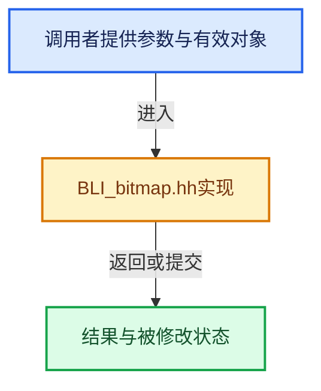

# 实现依赖专题：source/blender/blenlib/BLI_bitmap.hh

[实现依赖导航](../README.md) · [符号索引](../../00-课程指南/02-源码与提交索引/符号依赖与实现索引.md)

本专题从正文实际调用进入，集中保存共享实现。函数有稳定锚点，可从调用处直接跳到对应完整函数；递归与互相调用通过回链组织。

## 本文件的实现关系





<a id="m-6e3426a89e18"></a>

## 宏 `BLI_BITMAP_SIZE`

<!-- annotated:52886bed9551ea -->

```cpp
#define BLI_BITMAP_SIZE(_num) ((size_t)(_BITMAP_NUM_BLOCKS(_num)) * sizeof(BLI_bitmap))

```

<details>
<summary>核对原始源码：source/blender/blenlib/BLI_bitmap.hh · L34—L35</summary>

<!-- original:52886bed9551ea:source/blender/blenlib/BLI_bitmap.hh:34:35 -->

```cpp
#define BLI_BITMAP_SIZE(_num) ((size_t)(_BITMAP_NUM_BLOCKS(_num)) * sizeof(BLI_bitmap))

```

</details>

宏在预处理阶段展开，参数替换、重复求值和条件编译应直接从该定义检查。与普通函数不同，宏不会自动提供参数类型检查；构建配置选择哪个定义需结合外围条件。

<a id="m-77dce9cd8859"></a>

## 宏 `BLI_BITMAP_NEW`

<!-- annotated:150f021d778420 -->

```cpp
#define BLI_BITMAP_NEW(_num, _alloc_string) \
  ((BLI_bitmap *)MEM_new_zeroed(BLI_BITMAP_SIZE(_num), _alloc_string))

```

<details>
<summary>核对原始源码：source/blender/blenlib/BLI_bitmap.hh · L39—L41</summary>

<!-- original:150f021d778420:source/blender/blenlib/BLI_bitmap.hh:39:41 -->

```cpp
#define BLI_BITMAP_NEW(_num, _alloc_string) \
  ((BLI_bitmap *)MEM_new_zeroed(BLI_BITMAP_SIZE(_num), _alloc_string))

```

</details>

宏在预处理阶段展开，参数替换、重复求值和条件编译应直接从该定义检查。与普通函数不同，宏不会自动提供参数类型检查；构建配置选择哪个定义需结合外围条件。

<a id="m-60ea0b4a0a8b"></a>

## 宏 `BLI_BITMAP_NEW_MEMARENA`

<!-- annotated:69ed163403bae6 -->

```cpp
#define BLI_BITMAP_NEW_MEMARENA(_mem, _num) \
  (CHECK_TYPE_INLINE(_mem, MemArena *), \
   ((BLI_bitmap *)BLI_memarena_calloc(_mem, BLI_BITMAP_SIZE(_num))))

```

<details>
<summary>核对原始源码：source/blender/blenlib/BLI_bitmap.hh · L51—L54</summary>

<!-- original:69ed163403bae6:source/blender/blenlib/BLI_bitmap.hh:51:54 -->

```cpp
#define BLI_BITMAP_NEW_MEMARENA(_mem, _num) \
  (CHECK_TYPE_INLINE(_mem, MemArena *), \
   ((BLI_bitmap *)BLI_memarena_calloc(_mem, BLI_BITMAP_SIZE(_num))))

```

</details>

宏在预处理阶段展开，参数替换、重复求值和条件编译应直接从该定义检查。与普通函数不同，宏不会自动提供参数类型检查；构建配置选择哪个定义需结合外围条件。

<a id="m-631c4702a77d"></a>

## 宏 `BLI_BITMAP_TEST`

<!-- annotated:013b8fdfd6ff48 -->

```cpp
#define BLI_BITMAP_TEST(_bitmap, _index) \
  (CHECK_TYPE_ANY(_bitmap, BLI_bitmap *, const BLI_bitmap *), \
   ((_bitmap)[(_index) >> _BITMAP_POWER] & (1u << ((_index) & _BITMAP_MASK))))

```

<details>
<summary>核对原始源码：source/blender/blenlib/BLI_bitmap.hh · L63—L66</summary>

<!-- original:013b8fdfd6ff48:source/blender/blenlib/BLI_bitmap.hh:63:66 -->

```cpp
#define BLI_BITMAP_TEST(_bitmap, _index) \
  (CHECK_TYPE_ANY(_bitmap, BLI_bitmap *, const BLI_bitmap *), \
   ((_bitmap)[(_index) >> _BITMAP_POWER] & (1u << ((_index) & _BITMAP_MASK))))

```

</details>

宏在预处理阶段展开，参数替换、重复求值和条件编译应直接从该定义检查。与普通函数不同，宏不会自动提供参数类型检查；构建配置选择哪个定义需结合外围条件。

<a id="m-c7ffdd0cf0e7"></a>

## 宏 `BLI_BITMAP_TEST_AND_SET_ATOMIC`

<!-- annotated:06f49492515494 -->

```cpp
#define BLI_BITMAP_TEST_AND_SET_ATOMIC(_bitmap, _index) \
  (CHECK_TYPE_ANY(_bitmap, BLI_bitmap *, const BLI_bitmap *), \
   (atomic_fetch_and_or_uint32((uint32_t *)&(_bitmap)[(_index) >> _BITMAP_POWER], \
                               (1u << ((_index) & _BITMAP_MASK))) & \
    (1u << ((_index) & _BITMAP_MASK))))

```

<details>
<summary>核对原始源码：source/blender/blenlib/BLI_bitmap.hh · L67—L72</summary>

<!-- original:06f49492515494:source/blender/blenlib/BLI_bitmap.hh:67:72 -->

```cpp
#define BLI_BITMAP_TEST_AND_SET_ATOMIC(_bitmap, _index) \
  (CHECK_TYPE_ANY(_bitmap, BLI_bitmap *, const BLI_bitmap *), \
   (atomic_fetch_and_or_uint32((uint32_t *)&(_bitmap)[(_index) >> _BITMAP_POWER], \
                               (1u << ((_index) & _BITMAP_MASK))) & \
    (1u << ((_index) & _BITMAP_MASK))))

```

</details>

宏在预处理阶段展开，参数替换、重复求值和条件编译应直接从该定义检查。与普通函数不同，宏不会自动提供参数类型检查；构建配置选择哪个定义需结合外围条件。

<a id="m-7695fe80c8ba"></a>

## 宏 `BLI_BITMAP_TEST_BOOL`

<!-- annotated:187cb8bc8754fa -->

```cpp
#define BLI_BITMAP_TEST_BOOL(_bitmap, _index) \
  (CHECK_TYPE_ANY(_bitmap, BLI_bitmap *, const BLI_bitmap *), \
   (BLI_BITMAP_TEST(_bitmap, _index) != 0))

```

<details>
<summary>核对原始源码：source/blender/blenlib/BLI_bitmap.hh · L73—L76</summary>

<!-- original:187cb8bc8754fa:source/blender/blenlib/BLI_bitmap.hh:73:76 -->

```cpp
#define BLI_BITMAP_TEST_BOOL(_bitmap, _index) \
  (CHECK_TYPE_ANY(_bitmap, BLI_bitmap *, const BLI_bitmap *), \
   (BLI_BITMAP_TEST(_bitmap, _index) != 0))

```

</details>

宏在预处理阶段展开，参数替换、重复求值和条件编译应直接从该定义检查。与普通函数不同，宏不会自动提供参数类型检查；构建配置选择哪个定义需结合外围条件。

<a id="m-6b0abc936749"></a>

## 宏 `BLI_BITMAP_ENABLE`

<!-- annotated:02856b54bd4fb3 -->

```cpp
#define BLI_BITMAP_ENABLE(_bitmap, _index) \
  (CHECK_TYPE_ANY(_bitmap, BLI_bitmap *, const BLI_bitmap *), \
   ((_bitmap)[(_index) >> _BITMAP_POWER] |= (1u << ((_index) & _BITMAP_MASK))))

```

<details>
<summary>核对原始源码：source/blender/blenlib/BLI_bitmap.hh · L80—L83</summary>

<!-- original:02856b54bd4fb3:source/blender/blenlib/BLI_bitmap.hh:80:83 -->

```cpp
#define BLI_BITMAP_ENABLE(_bitmap, _index) \
  (CHECK_TYPE_ANY(_bitmap, BLI_bitmap *, const BLI_bitmap *), \
   ((_bitmap)[(_index) >> _BITMAP_POWER] |= (1u << ((_index) & _BITMAP_MASK))))

```

</details>

宏在预处理阶段展开，参数替换、重复求值和条件编译应直接从该定义检查。与普通函数不同，宏不会自动提供参数类型检查；构建配置选择哪个定义需结合外围条件。

<a id="m-c82ee8e72e2b"></a>

## 宏 `BLI_BITMAP_DISABLE`

<!-- annotated:d0421cea714c67 -->

```cpp
#define BLI_BITMAP_DISABLE(_bitmap, _index) \
  (CHECK_TYPE_ANY(_bitmap, BLI_bitmap *, const BLI_bitmap *), \
   ((_bitmap)[(_index) >> _BITMAP_POWER] &= ~(1u << ((_index) & _BITMAP_MASK))))

```

<details>
<summary>核对原始源码：source/blender/blenlib/BLI_bitmap.hh · L87—L90</summary>

<!-- original:d0421cea714c67:source/blender/blenlib/BLI_bitmap.hh:87:90 -->

```cpp
#define BLI_BITMAP_DISABLE(_bitmap, _index) \
  (CHECK_TYPE_ANY(_bitmap, BLI_bitmap *, const BLI_bitmap *), \
   ((_bitmap)[(_index) >> _BITMAP_POWER] &= ~(1u << ((_index) & _BITMAP_MASK))))

```

</details>

宏在预处理阶段展开，参数替换、重复求值和条件编译应直接从该定义检查。与普通函数不同，宏不会自动提供参数类型检查；构建配置选择哪个定义需结合外围条件。

<a id="m-656e1533cf5d"></a>

## 宏 `BLI_BITMAP_SET`

<!-- annotated:5af06fc8a8da03 -->

```cpp
#define BLI_BITMAP_SET(_bitmap, _index, _set) \
  { \
    CHECK_TYPE(_bitmap, BLI_bitmap *); \
    if (_set) { \
      BLI_BITMAP_ENABLE(_bitmap, _index); \
    } \
    else { \
      BLI_BITMAP_DISABLE(_bitmap, _index); \
    } \
  } \
  (void)0

```

<details>
<summary>核对原始源码：source/blender/blenlib/BLI_bitmap.hh · L101—L112</summary>

<!-- original:5af06fc8a8da03:source/blender/blenlib/BLI_bitmap.hh:101:112 -->

```cpp
#define BLI_BITMAP_SET(_bitmap, _index, _set) \
  { \
    CHECK_TYPE(_bitmap, BLI_bitmap *); \
    if (_set) { \
      BLI_BITMAP_ENABLE(_bitmap, _index); \
    } \
    else { \
      BLI_BITMAP_DISABLE(_bitmap, _index); \
    } \
  } \
  (void)0

```

</details>

宏在预处理阶段展开，参数替换、重复求值和条件编译应直接从该定义检查。与普通函数不同，宏不会自动提供参数类型检查；构建配置选择哪个定义需结合外围条件。

## 完整成员与函数实现
