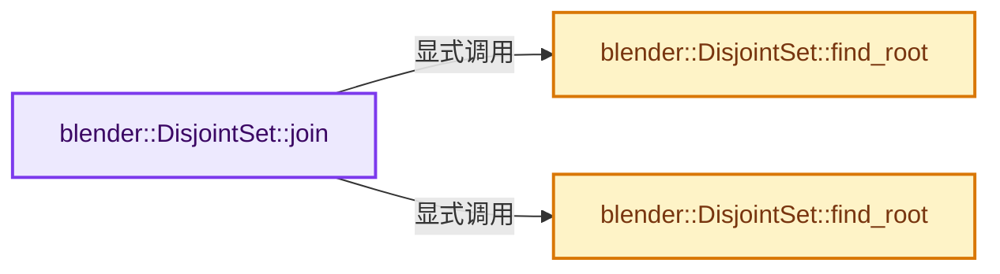

# 实现依赖专题：source/blender/blenlib/BLI_disjoint_set.hh

[实现依赖导航](../README.md) · [符号索引](../../00-课程指南/02-源码与提交索引/符号依赖与实现索引.md)

本专题从正文实际调用进入，集中保存共享实现。函数有稳定锚点，可从调用处直接跳到对应完整函数；递归与互相调用通过回链组织。

## 本文件的实现关系




## 完整成员与函数实现

<a id="f-f2d8d8020d7e147e"></a>

### `blender::DisjointSet::join`

实现位置：[source/blender/blenlib/BLI_disjoint_set.hh](../../../../../../source/blender/blenlib/BLI_disjoint_set.hh) · L39—L60。

接口参数：

- `const T x`
- `const T y`

**教学注释版**

<!-- annotated:a426f5473276a4 -->

```cpp
  T join(const T x, const T y)
  {
    T root1 = this->find_root(x);
    T root2 = this->find_root(y);

    /* x and y are in the same set already. */
    if (root1 == root2) {
      return root1;
    }

    /* Implement union by rank heuristic. */
    if (ranks_[root1] < ranks_[root2]) {
      std::swap(root1, root2);
    }
    parents_[root2] = root1;

    if (ranks_[root1] == ranks_[root2]) {
      ranks_[root1]++;
    }

    return root1;
  }
```

<details>
<summary>核对原始源码：source/blender/blenlib/BLI_disjoint_set.hh · L39—L60</summary>

<!-- original:a426f5473276a4:source/blender/blenlib/BLI_disjoint_set.hh:39:60 -->

```cpp
  T join(const T x, const T y)
  {
    T root1 = this->find_root(x);
    T root2 = this->find_root(y);

    /* x and y are in the same set already. */
    if (root1 == root2) {
      return root1;
    }

    /* Implement union by rank heuristic. */
    if (ranks_[root1] < ranks_[root2]) {
      std::swap(root1, root2);
    }
    parents_[root2] = root1;

    if (ranks_[root1] == ranks_[root2]) {
      ranks_[root1]++;
    }

    return root1;
  }
```

</details>

**沿实际写入检查状态**

- `parents_[root2] = root1;`

**结果出口**

- `return root1;`

**继续追踪实现**

- `this->find_root` → [blender::DisjointSet::find_root · L75](BLI_disjoint_set.hh.md#f-b2db4b94d1f37228)；[blender::DisjointSet::find_root · L98](BLI_disjoint_set.hh.md#f-e3e7d5849d67bf64)。同名重载需按实参类型选择。
- `std::swap` → [外部契约](https://eel.is/c++draft/)：这个边界按实际表达式及所属类型核对参数、返回值、寿命与失败行为。这里提供接口入口，不声称已解释该第三方版本的内部实现。

<a id="f-b2db4b94d1f37228"></a>

### `blender::DisjointSet::find_root`

实现位置：[source/blender/blenlib/BLI_disjoint_set.hh](../../../../../../source/blender/blenlib/BLI_disjoint_set.hh) · L75—L92。

接口参数：

- `const T x`

**教学注释版**

<!-- annotated:8464030da88af9 -->

```cpp
  T find_root(const T x)
  {
    /* Find root by following parents. */
    T root = x;
    while (parents_[root] != root) {
      root = parents_[root];
    }

    /* Compress path. */
    T to_root = x;
    while (parents_[to_root] != root) {
      const T parent = parents_[to_root];
      parents_[to_root] = root;
      to_root = parent;
    }

    return root;
  }
```

<details>
<summary>核对原始源码：source/blender/blenlib/BLI_disjoint_set.hh · L75—L92</summary>

<!-- original:8464030da88af9:source/blender/blenlib/BLI_disjoint_set.hh:75:92 -->

```cpp
  T find_root(const T x)
  {
    /* Find root by following parents. */
    T root = x;
    while (parents_[root] != root) {
      root = parents_[root];
    }

    /* Compress path. */
    T to_root = x;
    while (parents_[to_root] != root) {
      const T parent = parents_[to_root];
      parents_[to_root] = root;
      to_root = parent;
    }

    return root;
  }
```

</details>

**沿实际写入检查状态**

- `root = parents_[root];`
- `parents_[to_root] = root;`
- `to_root = parent;`

**结果出口**

- `return root;`

**继续追踪实现**

本实现没有需要继续展开的显式调用；检查返回表达式、对象转换和调用者前置条件。

<a id="f-e3e7d5849d67bf64"></a>

### `blender::DisjointSet::find_root`

实现位置：[source/blender/blenlib/BLI_disjoint_set.hh](../../../../../../source/blender/blenlib/BLI_disjoint_set.hh) · L98—L107。

接口参数：

- `const T x`

**教学注释版**

<!-- annotated:6f05edbb12465e -->

```cpp
  T find_root(const T x) const
  {
    /* Find root by following parents. */
    T root = x;
    while (parents_[root] != root) {
      root = parents_[root];
    }

    return root;
  }
```

<details>
<summary>核对原始源码：source/blender/blenlib/BLI_disjoint_set.hh · L98—L107</summary>

<!-- original:6f05edbb12465e:source/blender/blenlib/BLI_disjoint_set.hh:98:107 -->

```cpp
  T find_root(const T x) const
  {
    /* Find root by following parents. */
    T root = x;
    while (parents_[root] != root) {
      root = parents_[root];
    }

    return root;
  }
```

</details>

**沿实际写入检查状态**

- `root = parents_[root];`

**结果出口**

- `return root;`

**继续追踪实现**

本实现没有需要继续展开的显式调用；检查返回表达式、对象转换和调用者前置条件。
