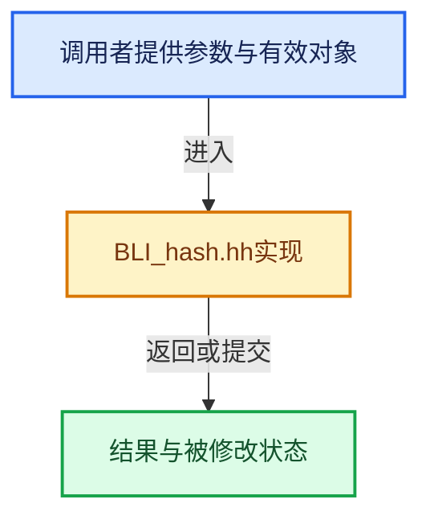

# 实现依赖专题：source/blender/blenlib/BLI_hash.hh

[实现依赖导航](../README.md) · [符号索引](../../00-课程指南/02-源码与提交索引/符号依赖与实现索引.md)

本专题从正文实际调用进入，集中保存共享实现。函数有稳定锚点，可从调用处直接跳到对应完整函数；递归与互相调用通过回链组织。

## 本文件的实现关系





## 相关类型布局与成员入口

<a id="t-c47605fe76aa"></a>

### `blender::DefaultHash`

原始声明：[source/blender/blenlib/BLI_hash.hh](../../../../../../source/blender/blenlib/BLI_hash.hh) · L85—L123。

以下保留类的数据声明与编译条件，成员函数实现通过后面的精确链接阅读。

<!-- annotated:f2a6c975ee02d7 -->

```cpp
template<typename T> struct DefaultHash {
```

<details>
<summary>核对原始源码：source/blender/blenlib/BLI_hash.hh · L85—L85</summary>

<!-- original:f2a6c975ee02d7:source/blender/blenlib/BLI_hash.hh:85:85 -->

```cpp
template<typename T> struct DefaultHash {
```

</details>

<!-- annotated:dd36e703067e14 -->

```cpp

```

<details>
<summary>核对原始源码：source/blender/blenlib/BLI_hash.hh · L113—L113</summary>

<!-- original:dd36e703067e14:source/blender/blenlib/BLI_hash.hh:113:113 -->

```cpp

```

</details>

<!-- annotated:db16ab39f8a4d5 -->

```cpp
};
```

<details>
<summary>核对原始源码：source/blender/blenlib/BLI_hash.hh · L123—L123</summary>

<!-- original:db16ab39f8a4d5:source/blender/blenlib/BLI_hash.hh:123:123 -->

```cpp
};
```

</details>

- [operator()](../../02-哈希表与关联数据结构/01-哈希与相等契约.md#f-6ee983ba28dfb7a8)
- [operator()](../../02-哈希表与关联数据结构/01-哈希与相等契约.md#f-28d94d8c82f04e12)

## 完整成员与函数实现
