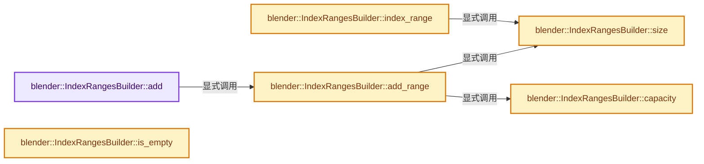
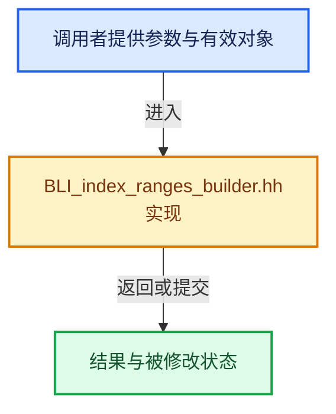

# 实现依赖专题：source/blender/blenlib/BLI_index_ranges_builder.hh

[实现依赖导航](../README.md) · [符号索引](../../00-课程指南/02-源码与提交索引/符号依赖与实现索引.md)

本专题从正文实际调用进入，集中保存共享实现。函数有稳定锚点，可从调用处直接跳到对应完整函数；递归与互相调用通过回链组织。

## 本文件的实现关系






## 完整成员与函数实现

<a id="f-592cace702a5a9c3"></a>

### `blender::IndexRangesBuilder::add`

实现位置：[source/blender/blenlib/BLI_index_ranges_builder.hh](../../../../../../source/blender/blenlib/BLI_index_ranges_builder.hh) · L47—L50。

接口参数：

- `const T index`

**教学注释版**

<!-- annotated:ed9303efb24272 -->

```cpp
  bool add(const T index)
  {
    return this->add_range(index, index + 1);
  }
```

<details>
<summary>核对原始源码：source/blender/blenlib/BLI_index_ranges_builder.hh · L47—L50</summary>

<!-- original:ed9303efb24272:source/blender/blenlib/BLI_index_ranges_builder.hh:47:50 -->

```cpp
  bool add(const T index)
  {
    return this->add_range(index, index + 1);
  }
```

</details>

**结果出口**

- `return this->add_range(index, index + 1);`

**继续追踪实现**

- `this->add_range` → [blender::IndexRangesBuilder::add_range · L56](BLI_index_ranges_builder.hh.md#f-e75c6d8f7f4f3070)。

<a id="f-e75c6d8f7f4f3070"></a>

### `blender::IndexRangesBuilder::add_range`

实现位置：[source/blender/blenlib/BLI_index_ranges_builder.hh](../../../../../../source/blender/blenlib/BLI_index_ranges_builder.hh) · L56—L76。

接口参数：

- `const T start`
- `const T end`

**教学注释版**

<!-- annotated:63cc6ae294da6d -->

```cpp
  bool add_range(const T start, const T end)
  {
    /* Indices have to be added in ascending order. */
    BLI_assert(start >= *c_);
    BLI_assert(start >= 0);
    BLI_assert(start < end);

    const bool is_new_range = start > *c_;

    /* Check that the capacity is not overflown. */
    BLI_assert(!is_new_range || this->size() < this->capacity());

    /* This is designed to either append to the last range or start a new range.
     * It is intentionally branchless for more predictable performance on unpredictable data. */
    c_ += is_new_range;
    *c_ = start;
    c_ += is_new_range;
    *c_ = end;

    return is_new_range;
  }
```

<details>
<summary>核对原始源码：source/blender/blenlib/BLI_index_ranges_builder.hh · L56—L76</summary>

<!-- original:63cc6ae294da6d:source/blender/blenlib/BLI_index_ranges_builder.hh:56:76 -->

```cpp
  bool add_range(const T start, const T end)
  {
    /* Indices have to be added in ascending order. */
    BLI_assert(start >= *c_);
    BLI_assert(start >= 0);
    BLI_assert(start < end);

    const bool is_new_range = start > *c_;

    /* Check that the capacity is not overflown. */
    BLI_assert(!is_new_range || this->size() < this->capacity());

    /* This is designed to either append to the last range or start a new range.
     * It is intentionally branchless for more predictable performance on unpredictable data. */
    c_ += is_new_range;
    *c_ = start;
    c_ += is_new_range;
    *c_ = end;

    return is_new_range;
  }
```

</details>

**沿实际写入检查状态**

- `c_ += is_new_range;`

**结果出口**

- `return is_new_range;`

**继续追踪实现**

- `BLI_assert` → [BLI_assert · L48](BLI_assert.hh.md#m-57a88495704d)；[BLI_assert · L63](BLI_assert.hh.md#m-d07050020cb5)。宏定义由构建条件选择。
- `this->size` → [blender::IndexRangesBuilder::size · L79](BLI_index_ranges_builder.hh.md#f-4ee3c9da988be235)。
- `this->capacity` → [blender::IndexRangesBuilder::capacity · L85](BLI_index_ranges_builder.hh.md#f-d5a3d52ad23c7744)。

<a id="f-4ee3c9da988be235"></a>

### `blender::IndexRangesBuilder::size`

实现位置：[source/blender/blenlib/BLI_index_ranges_builder.hh](../../../../../../source/blender/blenlib/BLI_index_ranges_builder.hh) · L79—L82。

**教学注释版**

<!-- annotated:b6b1e1ea790766 -->

```cpp
  int64_t size() const
  {
    // [讲解] data_.data：返回借用范围的地址。
    return (c_ - data_.data()) / 2;
  }
```

<details>
<summary>核对原始源码：source/blender/blenlib/BLI_index_ranges_builder.hh · L79—L82</summary>

<!-- original:b6b1e1ea790766:source/blender/blenlib/BLI_index_ranges_builder.hh:79:82 -->

```cpp
  int64_t size() const
  {
    return (c_ - data_.data()) / 2;
  }
```

</details>

**结果出口**

- `return (c_ - data_.data()) / 2;`

**继续追踪实现**

- `data_.data` → [blender::MutableSpan::data · L545](../../01-基础容器与现代CPP/06-MutableSpan可写视图.md#f-eb45a6e4d8211efd)。

<a id="f-d5a3d52ad23c7744"></a>

### `blender::IndexRangesBuilder::capacity`

实现位置：[source/blender/blenlib/BLI_index_ranges_builder.hh](../../../../../../source/blender/blenlib/BLI_index_ranges_builder.hh) · L85—L88。

**教学注释版**

<!-- annotated:1a5db481c9d3ef -->

```cpp
  int64_t capacity() const
  {
    // [讲解] data_.size：查询视图长度或生成对应有效索引区间。
    return data_.size() / 2;
  }
```

<details>
<summary>核对原始源码：source/blender/blenlib/BLI_index_ranges_builder.hh · L85—L88</summary>

<!-- original:1a5db481c9d3ef:source/blender/blenlib/BLI_index_ranges_builder.hh:85:88 -->

```cpp
  int64_t capacity() const
  {
    return data_.size() / 2;
  }
```

</details>

**结果出口**

- `return data_.size() / 2;`

**继续追踪实现**

- `data_.size` → [blender::MutableSpan::size · L499](../../01-基础容器与现代CPP/06-MutableSpan可写视图.md#f-1de6a66839c304a8)。

<a id="f-54475d9f2fecbe15"></a>

### `blender::IndexRangesBuilder::is_empty`

实现位置：[source/blender/blenlib/BLI_index_ranges_builder.hh](../../../../../../source/blender/blenlib/BLI_index_ranges_builder.hh) · L91—L94。

**教学注释版**

<!-- annotated:4122dd6e89fecc -->

```cpp
  bool is_empty() const
  {
    // [讲解] data_.data：返回借用范围的地址。
    return c_ == data_.data();
  }
```

<details>
<summary>核对原始源码：source/blender/blenlib/BLI_index_ranges_builder.hh · L91—L94</summary>

<!-- original:4122dd6e89fecc:source/blender/blenlib/BLI_index_ranges_builder.hh:91:94 -->

```cpp
  bool is_empty() const
  {
    return c_ == data_.data();
  }
```

</details>

**结果出口**

- `return c_ == data_.data();`

**继续追踪实现**

- `data_.data` → [blender::MutableSpan::data · L545](../../01-基础容器与现代CPP/06-MutableSpan可写视图.md#f-eb45a6e4d8211efd)。

<a id="f-0e4f8e4a999530d4"></a>

### `blender::IndexRangesBuilder::index_range`

实现位置：[source/blender/blenlib/BLI_index_ranges_builder.hh](../../../../../../source/blender/blenlib/BLI_index_ranges_builder.hh) · L96—L99。

**教学注释版**

<!-- annotated:31c832c69b8c70 -->

```cpp
  IndexRange index_range() const
  {
    return IndexRange(this->size());
  }
```

<details>
<summary>核对原始源码：source/blender/blenlib/BLI_index_ranges_builder.hh · L96—L99</summary>

<!-- original:31c832c69b8c70:source/blender/blenlib/BLI_index_ranges_builder.hh:96:99 -->

```cpp
  IndexRange index_range() const
  {
    return IndexRange(this->size());
  }
```

</details>

**结果出口**

- `return IndexRange(this->size());`

**继续追踪实现**

- `IndexRange` → [blender::IndexRange](BLI_index_range.hh.md#t-caa3466d6776)；[blender::gpu::shader::parser::IndexRange](../08-其他Blender模块/gpu/shader_tool/utils.hh.md#t-82d2bd4ea71c)；[blender::IndexRange](../08-其他Blender模块/makesdna/DNA_node_types.h.md#t-0448cc889d39)。
- `this->size` → [blender::IndexRangesBuilder::size · L79](BLI_index_ranges_builder.hh.md#f-4ee3c9da988be235)。
