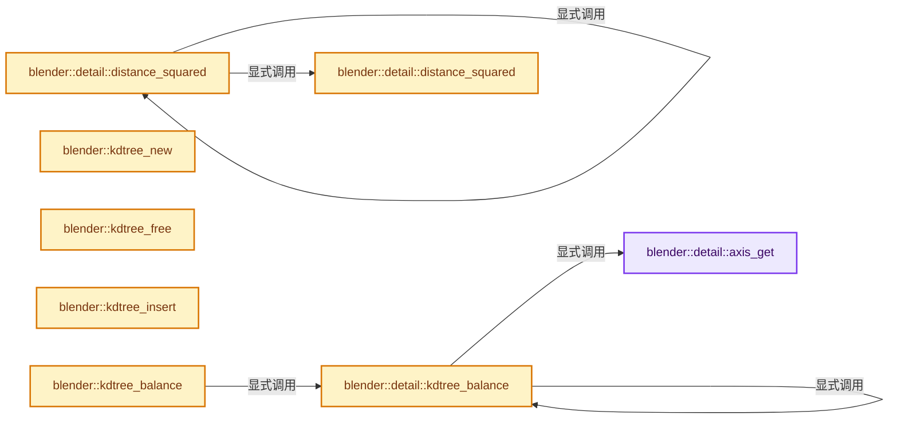
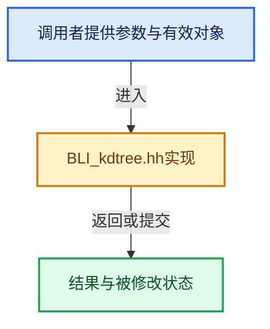

# 实现依赖专题：source/blender/blenlib/BLI_kdtree.hh

[实现依赖导航](../README.md) · [符号索引](../../00-课程指南/02-源码与提交索引/符号依赖与实现索引.md)

本专题从正文实际调用进入，集中保存共享实现。函数有稳定锚点，可从调用处直接跳到对应完整函数；递归与互相调用通过回链组织。

## 本文件的实现关系






## 完整成员与函数实现

<a id="f-9d16beb90aeba78d"></a>

### `blender::detail::axis_get`

实现位置：[source/blender/blenlib/BLI_kdtree.hh](../../../../../../source/blender/blenlib/BLI_kdtree.hh) · L41—L45。

接口参数：

- `const CoordT &co`
- `uint axis`

**教学注释版**

<!-- annotated:040bfd4c2c87cf -->

```cpp
template<typename CoordT>
inline typename KDTreeCoordTraits<CoordT>::ValueType axis_get(const CoordT &co, uint axis)
{
  return KDTreeCoordTraits<CoordT>::get(co, axis);
}
```

<details>
<summary>核对原始源码：source/blender/blenlib/BLI_kdtree.hh · L41—L45</summary>

<!-- original:040bfd4c2c87cf:source/blender/blenlib/BLI_kdtree.hh:41:45 -->

```cpp
template<typename CoordT>
inline typename KDTreeCoordTraits<CoordT>::ValueType axis_get(const CoordT &co, uint axis)
{
  return KDTreeCoordTraits<CoordT>::get(co, axis);
}
```

</details>

**结果出口**

- `return KDTreeCoordTraits<CoordT>::get(co, axis);`

**继续追踪实现**

- `KDTreeCoordTraits<CoordT>::get` → [blender::KDTreeCoordTraits::get · L21](BLI_kdtree_types.hh.md#f-7398b4169a373019)。

<a id="f-569ee51d57b810c2"></a>

### `blender::detail::distance_squared`

实现位置：[source/blender/blenlib/BLI_kdtree.hh](../../../../../../source/blender/blenlib/BLI_kdtree.hh) · L47—L52。

接口参数：

- `const CoordT &a`
- `const CoordT &b`

**教学注释版**

<!-- annotated:d03c89c74425f8 -->

```cpp
template<typename CoordT>
inline typename KDTreeCoordTraits<CoordT>::ValueType distance_squared(const CoordT &a,
                                                                      const CoordT &b)
{
  return math::distance_squared(a, b);
}
```

<details>
<summary>核对原始源码：source/blender/blenlib/BLI_kdtree.hh · L47—L52</summary>

<!-- original:d03c89c74425f8:source/blender/blenlib/BLI_kdtree.hh:47:52 -->

```cpp
template<typename CoordT>
inline typename KDTreeCoordTraits<CoordT>::ValueType distance_squared(const CoordT &a,
                                                                      const CoordT &b)
{
  return math::distance_squared(a, b);
}
```

</details>

**结果出口**

- `return math::distance_squared(a, b);`

**继续追踪实现**

- `math::distance_squared` → [blender::detail::distance_squared · L47](BLI_kdtree.hh.md#f-569ee51d57b810c2)；[blender::detail::distance_squared · L53](BLI_kdtree.hh.md#f-563450b7ee555ea5)。同名重载需按实参类型选择。

<a id="f-563450b7ee555ea5"></a>

### `blender::detail::distance_squared`

实现位置：[source/blender/blenlib/BLI_kdtree.hh](../../../../../../source/blender/blenlib/BLI_kdtree.hh) · L53—L57。

接口参数：

- `const float &a`
- `const float &b`

**教学注释版**

<!-- annotated:d33e7d1e151e6a -->

```cpp
template<> inline float distance_squared<float>(const float &a, const float &b)
{
  const float d = a - b;
  return d * d;
}
```

<details>
<summary>核对原始源码：source/blender/blenlib/BLI_kdtree.hh · L53—L57</summary>

<!-- original:d33e7d1e151e6a:source/blender/blenlib/BLI_kdtree.hh:53:57 -->

```cpp
template<> inline float distance_squared<float>(const float &a, const float &b)
{
  const float d = a - b;
  return d * d;
}
```

</details>

**结果出口**

- `return d * d;`

**继续追踪实现**

本实现没有需要继续展开的显式调用；检查返回表达式、对象转换和调用者前置条件。

<a id="f-46a3316dfd09a49e"></a>

### `blender::kdtree_new`

实现位置：[source/blender/blenlib/BLI_kdtree.hh](../../../../../../source/blender/blenlib/BLI_kdtree.hh) · L65—L82。

接口参数：

- `uint nodes_len_capacity`

**教学注释版**

<!-- annotated:df611fac73e2be -->

```cpp
template<typename CoordT> inline KDTree<CoordT> *kdtree_new(uint nodes_len_capacity)
{
  KDTree<CoordT> *tree;

  tree = MEM_new_zeroed<KDTree<CoordT>>("KDTree");
  tree->nodes = MEM_new_array_uninitialized<KDTreeNode<CoordT>>(nodes_len_capacity,
                                                                "KDTreeNode<>");
  tree->nodes_len = 0;
  tree->root = detail::kd_node_root_is_init;
  tree->max_node_index = -1;

#ifndef NDEBUG
  tree->is_balanced = false;
  tree->nodes_len_capacity = nodes_len_capacity;
#endif

  return tree;
}
```

<details>
<summary>核对原始源码：source/blender/blenlib/BLI_kdtree.hh · L65—L82</summary>

<!-- original:df611fac73e2be:source/blender/blenlib/BLI_kdtree.hh:65:82 -->

```cpp
template<typename CoordT> inline KDTree<CoordT> *kdtree_new(uint nodes_len_capacity)
{
  KDTree<CoordT> *tree;

  tree = MEM_new_zeroed<KDTree<CoordT>>("KDTree");
  tree->nodes = MEM_new_array_uninitialized<KDTreeNode<CoordT>>(nodes_len_capacity,
                                                                "KDTreeNode<>");
  tree->nodes_len = 0;
  tree->root = detail::kd_node_root_is_init;
  tree->max_node_index = -1;

#ifndef NDEBUG
  tree->is_balanced = false;
  tree->nodes_len_capacity = nodes_len_capacity;
#endif

  return tree;
}
```

</details>

**沿实际写入检查状态**

- `tree = MEM_new_zeroed<KDTree<CoordT>>("KDTree");`
- `tree->nodes = MEM_new_array_uninitialized<KDTreeNode<CoordT>>(nodes_len_capacity,`
- `tree->nodes_len = 0;`
- `tree->root = detail::kd_node_root_is_init;`
- `tree->max_node_index = -1;`
- `tree->is_balanced = false;`
- `tree->nodes_len_capacity = nodes_len_capacity;`

**结果出口**

- `return tree;`

**继续追踪实现**

- `MEM_new_zeroed<KDTree<CoordT>>` → [MEM_new_zeroed · L550](../07-Intern运行时与平台/guardedalloc/MEM_guardedalloc.h.md#f-eeb1e2a7f57dd231)；[MEM_new_zeroed · L114](../07-Intern运行时与平台/guardedalloc/intern/mallocn.cc.md#f-e04cf01c64c8b180)。同名重载需按实参类型选择。
- `MEM_new_array_uninitialized<KDTreeNode<CoordT>>` → [MEM_new_array_uninitialized · L608](../07-Intern运行时与平台/guardedalloc/MEM_guardedalloc.h.md#f-b7103eae8eb57b05)；[MEM_new_array_uninitialized · L129](../07-Intern运行时与平台/guardedalloc/intern/mallocn.cc.md#f-bf6ef4ddcfb6e5df)。同名重载需按实参类型选择。

<a id="f-29e79484de22f4be"></a>

### `blender::kdtree_free`

实现位置：[source/blender/blenlib/BLI_kdtree.hh](../../../../../../source/blender/blenlib/BLI_kdtree.hh) · L84—L90。

接口参数：

- `KDTree<CoordT> *tree`

**教学注释版**

<!-- annotated:13e4aeee27bcee -->

```cpp
template<typename CoordT> inline void kdtree_free(KDTree<CoordT> *tree)
{
  if (tree) {
    MEM_delete(tree->nodes);
    MEM_delete(tree);
  }
}
```

<details>
<summary>核对原始源码：source/blender/blenlib/BLI_kdtree.hh · L84—L90</summary>

<!-- original:13e4aeee27bcee:source/blender/blenlib/BLI_kdtree.hh:84:90 -->

```cpp
template<typename CoordT> inline void kdtree_free(KDTree<CoordT> *tree)
{
  if (tree) {
    MEM_delete(tree->nodes);
    MEM_delete(tree);
  }
}
```

</details>

**继续追踪实现**

- `MEM_delete` → [MEM_delete · L400](../07-Intern运行时与平台/guardedalloc/MEM_guardedalloc.h.md#f-9049ffdd1682887c)。

<a id="f-ed9cb6449add9ae9"></a>

### `blender::kdtree_insert`

实现位置：[source/blender/blenlib/BLI_kdtree.hh](../../../../../../source/blender/blenlib/BLI_kdtree.hh) · L95—L116。

接口参数：

- `KDTree<CoordT> *tree`
- `int index`
- `const CoordT &co`

**教学注释版**

<!-- annotated:eb9689a1dcaf18 -->

```cpp
template<typename CoordT>
inline void kdtree_insert(KDTree<CoordT> *tree, int index, const CoordT &co)
{
  KDTreeNode<CoordT> *node = &tree->nodes[tree->nodes_len++];

#ifndef NDEBUG
  BLI_assert(tree->nodes_len <= tree->nodes_len_capacity);
#endif

  /* NOTE: array isn't calloc'd,
   * need to initialize all struct members */

  node->left = node->right = detail::kd_node_unset;
  node->co = co;
  node->index = index;
  node->d = 0;
  // [讲解] std::max：按比较关系选取较大值。本讲解中的增长公式同时满足最低请求和几何增长；若保存返回引用，还需注意实参寿命。
  tree->max_node_index = std::max(tree->max_node_index, index);

#ifndef NDEBUG
  tree->is_balanced = false;
#endif
}
```

<details>
<summary>核对原始源码：source/blender/blenlib/BLI_kdtree.hh · L95—L116</summary>

<!-- original:eb9689a1dcaf18:source/blender/blenlib/BLI_kdtree.hh:95:116 -->

```cpp
template<typename CoordT>
inline void kdtree_insert(KDTree<CoordT> *tree, int index, const CoordT &co)
{
  KDTreeNode<CoordT> *node = &tree->nodes[tree->nodes_len++];

#ifndef NDEBUG
  BLI_assert(tree->nodes_len <= tree->nodes_len_capacity);
#endif

  /* NOTE: array isn't calloc'd,
   * need to initialize all struct members */

  node->left = node->right = detail::kd_node_unset;
  node->co = co;
  node->index = index;
  node->d = 0;
  tree->max_node_index = std::max(tree->max_node_index, index);

#ifndef NDEBUG
  tree->is_balanced = false;
#endif
}
```

</details>

**沿实际写入检查状态**

- `node->left = node->right = detail::kd_node_unset;`
- `node->co = co;`
- `node->index = index;`
- `node->d = 0;`
- `tree->max_node_index = std::max(tree->max_node_index, index);`
- `tree->is_balanced = false;`

**继续追踪实现**

- `BLI_assert` → [BLI_assert · L48](BLI_assert.hh.md#m-57a88495704d)；[BLI_assert · L63](BLI_assert.hh.md#m-d07050020cb5)。宏定义由构建条件选择。
- `std::max` → [外部契约](https://eel.is/c++draft/alg.min.max)：按比较关系选取较大值。本讲解中的增长公式同时满足最低请求和几何增长；若保存返回引用，还需注意实参寿命。

<a id="f-efbe1cb86b4b9dc0"></a>

### `blender::detail::kdtree_balance`

实现位置：[source/blender/blenlib/BLI_kdtree.hh](../../../../../../source/blender/blenlib/BLI_kdtree.hh) · L120—L179。

接口参数：

- `KDTreeNode<CoordT> *nodes`
- `uint nodes_len`
- `uint axis`
- `const uint ofs`

**教学注释版**

<!-- annotated:6010267f697893 -->

```cpp
template<typename CoordT>
static uint kdtree_balance(KDTreeNode<CoordT> *nodes, uint nodes_len, uint axis, const uint ofs)
{
  KDTreeNode<CoordT> *node;
  typename KDTree<CoordT>::ValueType co;
  uint left, right, median, i, j;

  if (nodes_len <= 0) {
    return detail::kd_node_unset;
  }
  if (nodes_len == 1) {
    return 0 + ofs;
  }

  /* Quick-sort style sorting around median. */
  left = 0;
  right = nodes_len - 1;
  median = nodes_len / 2;

  while (right > left) {
    co = axis_get(nodes[right].co, axis);
    i = left - 1;
    j = right;

    while (true) {
      while (axis_get(nodes[++i].co, axis) < co) { /* pass */
      }
      while (axis_get(nodes[--j].co, axis) > co && j > left) { /* pass */
      }

      if (i >= j) {
        break;
      }

      SWAP(KDTreeNode_head<CoordT>,
           *(KDTreeNode_head<CoordT> *)&nodes[i],
           *(KDTreeNode_head<CoordT> *)&nodes[j]);
    }

    SWAP(KDTreeNode_head<CoordT>,
         *(KDTreeNode_head<CoordT> *)&nodes[i],
         *(KDTreeNode_head<CoordT> *)&nodes[right]);
    if (i >= median) {
      right = i - 1;
    }
    if (i <= median) {
      left = i + 1;
    }
  }

  /* Set node and sort sub-nodes. */
  node = &nodes[median];
  node->d = axis;
  axis = (axis + 1) % KDTree<CoordT>::DimsNum;
  node->left = kdtree_balance(nodes, median, axis, ofs);
  node->right = kdtree_balance(
      nodes + median + 1, (nodes_len - (median + 1)), axis, (median + 1) + ofs);

  return median + ofs;
}
```

<details>
<summary>核对原始源码：source/blender/blenlib/BLI_kdtree.hh · L120—L179</summary>

<!-- original:6010267f697893:source/blender/blenlib/BLI_kdtree.hh:120:179 -->

```cpp
template<typename CoordT>
static uint kdtree_balance(KDTreeNode<CoordT> *nodes, uint nodes_len, uint axis, const uint ofs)
{
  KDTreeNode<CoordT> *node;
  typename KDTree<CoordT>::ValueType co;
  uint left, right, median, i, j;

  if (nodes_len <= 0) {
    return detail::kd_node_unset;
  }
  if (nodes_len == 1) {
    return 0 + ofs;
  }

  /* Quick-sort style sorting around median. */
  left = 0;
  right = nodes_len - 1;
  median = nodes_len / 2;

  while (right > left) {
    co = axis_get(nodes[right].co, axis);
    i = left - 1;
    j = right;

    while (true) {
      while (axis_get(nodes[++i].co, axis) < co) { /* pass */
      }
      while (axis_get(nodes[--j].co, axis) > co && j > left) { /* pass */
      }

      if (i >= j) {
        break;
      }

      SWAP(KDTreeNode_head<CoordT>,
           *(KDTreeNode_head<CoordT> *)&nodes[i],
           *(KDTreeNode_head<CoordT> *)&nodes[j]);
    }

    SWAP(KDTreeNode_head<CoordT>,
         *(KDTreeNode_head<CoordT> *)&nodes[i],
         *(KDTreeNode_head<CoordT> *)&nodes[right]);
    if (i >= median) {
      right = i - 1;
    }
    if (i <= median) {
      left = i + 1;
    }
  }

  /* Set node and sort sub-nodes. */
  node = &nodes[median];
  node->d = axis;
  axis = (axis + 1) % KDTree<CoordT>::DimsNum;
  node->left = kdtree_balance(nodes, median, axis, ofs);
  node->right = kdtree_balance(
      nodes + median + 1, (nodes_len - (median + 1)), axis, (median + 1) + ofs);

  return median + ofs;
}
```

</details>

**沿实际写入检查状态**

- `left = 0;`
- `right = nodes_len - 1;`
- `median = nodes_len / 2;`
- `co = axis_get(nodes[right].co, axis);`
- `i = left - 1;`
- `j = right;`
- `right = i - 1;`
- `left = i + 1;`
- `node = &nodes[median];`
- `node->d = axis;`
- `axis = (axis + 1) % KDTree<CoordT>::DimsNum;`
- `node->left = kdtree_balance(nodes, median, axis, ofs);`
- `node->right = kdtree_balance(`

**结果出口**

- `return detail::kd_node_unset;`
- `return 0 + ofs;`
- `return median + ofs;`

**继续追踪实现**

- `axis_get` → [blender::detail::axis_get · L41](BLI_kdtree.hh.md#f-9d16beb90aeba78d)。
- `SWAP` → [SWAP · L76](intern/hash_md5.cc.md#m-563d890521e7)；[SWAP · L50](BLI_utildefines.hh.md#m-5df6b380a0ac)。宏定义由构建条件选择。
- `kdtree_balance` → [blender::detail::kdtree_balance · L120](BLI_kdtree.hh.md#f-efbe1cb86b4b9dc0)。

<a id="f-c4ab209b5302fead"></a>

### `blender::kdtree_balance`

实现位置：[source/blender/blenlib/BLI_kdtree.hh](../../../../../../source/blender/blenlib/BLI_kdtree.hh) · L183—L198。

接口参数：

- `KDTree<CoordT> *tree`

**教学注释版**

<!-- annotated:98ffa4ba574a06 -->

```cpp
template<typename CoordT> inline void kdtree_balance(KDTree<CoordT> *tree)
{
  PRF_scope(ProfileCategory::Default);
  if (tree->root != detail::kd_node_root_is_init) {
    for (uint i = 0; i < tree->nodes_len; i++) {
      tree->nodes[i].left = detail::kd_node_unset;
      tree->nodes[i].right = detail::kd_node_unset;
    }
  }

  tree->root = detail::kdtree_balance<CoordT>(tree->nodes, tree->nodes_len, 0, 0);

#ifndef NDEBUG
  tree->is_balanced = true;
#endif
}
```

<details>
<summary>核对原始源码：source/blender/blenlib/BLI_kdtree.hh · L183—L198</summary>

<!-- original:98ffa4ba574a06:source/blender/blenlib/BLI_kdtree.hh:183:198 -->

```cpp
template<typename CoordT> inline void kdtree_balance(KDTree<CoordT> *tree)
{
  PRF_scope(ProfileCategory::Default);
  if (tree->root != detail::kd_node_root_is_init) {
    for (uint i = 0; i < tree->nodes_len; i++) {
      tree->nodes[i].left = detail::kd_node_unset;
      tree->nodes[i].right = detail::kd_node_unset;
    }
  }

  tree->root = detail::kdtree_balance<CoordT>(tree->nodes, tree->nodes_len, 0, 0);

#ifndef NDEBUG
  tree->is_balanced = true;
#endif
}
```

</details>

**沿实际写入检查状态**

- `tree->nodes[i].left = detail::kd_node_unset;`
- `tree->nodes[i].right = detail::kd_node_unset;`
- `tree->root = detail::kdtree_balance<CoordT>(tree->nodes, tree->nodes_len, 0, 0);`
- `tree->is_balanced = true;`

**继续追踪实现**

- `PRF_scope` → [PRF_scope · L51](../07-Intern运行时与平台/profile/PRF_profile.hh.md#m-9f5e4ea0487b)；[PRF_scope · L90](../07-Intern运行时与平台/profile/PRF_profile.hh.md#m-8fc74ae4419e)。宏定义由构建条件选择。
- `detail::kdtree_balance<CoordT>` → [blender::detail::kdtree_balance · L120](BLI_kdtree.hh.md#f-efbe1cb86b4b9dc0)。

<a id="f-747971373f52eadf"></a>

### `blender::kdtree_find_nearest_cb`

实现位置：[source/blender/blenlib/BLI_kdtree.hh](../../../../../../source/blender/blenlib/BLI_kdtree.hh) · L207—L298。

接口参数：

- `const KDTree<CoordT> *tree`
- `const CoordT &co`
- `KDTreeNearest<CoordT> *r_nearest`
- `Filter &&filter_cb`

**教学注释版**

<!-- annotated:211adc90ea88b0 -->

```cpp
template<typename CoordT, typename Filter>
inline int kdtree_find_nearest_cb(const KDTree<CoordT> *tree,
                                  const CoordT &co,
                                  KDTreeNearest<CoordT> *r_nearest,
                                  Filter &&filter_cb)
{
  const KDTreeNode<CoordT> *nodes = tree->nodes;
  const KDTreeNode<CoordT> *min_node = nullptr;
  typename KDTree<CoordT>::ValueType min_dist = FLT_MAX, cur_dist;

#ifndef NDEBUG
  BLI_assert(tree->is_balanced == true);
#endif

  if (tree->root == detail::kd_node_unset) [[unlikely]] {
    return -1;
  }

  const auto node_test_nearest = [&](const KDTreeNode<CoordT> *node) -> bool {
    const auto dist_sq = detail::distance_squared((node)->co, co);
    if (dist_sq >= min_dist) {
      return false;
    }
    const int result = filter_cb((node)->index, (node)->co, dist_sq);
    if (result == 1) {
      min_dist = dist_sq;
      min_node = node;
      return false;
    }

    if (result == 0) {
      /* pass */
      return false;
    }

    BLI_assert(result == -1);
    return true;
  };

  Stack<uint, detail::kd_stack_init> stack;
  stack.push(tree->root);

  while (!stack.is_empty()) {
    const KDTreeNode<CoordT> *node = &nodes[stack.pop()];

    cur_dist = detail::axis_get(node->co, node->d) - detail::axis_get(co, node->d);

    if (cur_dist < 0.0f) {
      cur_dist = -cur_dist * cur_dist;

      if (-cur_dist < min_dist) {
        if (node_test_nearest(node)) {
          break;
        }

        if (node->left != detail::kd_node_unset) {
          stack.push(node->left);
        }
      }
      if (node->right != detail::kd_node_unset) {
        stack.push(node->right);
      }
    }
    else {
      cur_dist = cur_dist * cur_dist;

      if (cur_dist < min_dist) {
        if (node_test_nearest(node)) {
          break;
        }

        if (node->right != detail::kd_node_unset) {
          stack.push(node->right);
        }
      }
      if (node->left != detail::kd_node_unset) {
        stack.push(node->left);
      }
    }
  }

  if (min_node) {
    if (r_nearest) {
      r_nearest->index = min_node->index;
      r_nearest->dist = sqrtf(min_dist);
      r_nearest->co = min_node->co;
    }

    return min_node->index;
  }
  return -1;
}
```

<details>
<summary>核对原始源码：source/blender/blenlib/BLI_kdtree.hh · L207—L298</summary>

<!-- original:211adc90ea88b0:source/blender/blenlib/BLI_kdtree.hh:207:298 -->

```cpp
template<typename CoordT, typename Filter>
inline int kdtree_find_nearest_cb(const KDTree<CoordT> *tree,
                                  const CoordT &co,
                                  KDTreeNearest<CoordT> *r_nearest,
                                  Filter &&filter_cb)
{
  const KDTreeNode<CoordT> *nodes = tree->nodes;
  const KDTreeNode<CoordT> *min_node = nullptr;
  typename KDTree<CoordT>::ValueType min_dist = FLT_MAX, cur_dist;

#ifndef NDEBUG
  BLI_assert(tree->is_balanced == true);
#endif

  if (tree->root == detail::kd_node_unset) [[unlikely]] {
    return -1;
  }

  const auto node_test_nearest = [&](const KDTreeNode<CoordT> *node) -> bool {
    const auto dist_sq = detail::distance_squared((node)->co, co);
    if (dist_sq >= min_dist) {
      return false;
    }
    const int result = filter_cb((node)->index, (node)->co, dist_sq);
    if (result == 1) {
      min_dist = dist_sq;
      min_node = node;
      return false;
    }

    if (result == 0) {
      /* pass */
      return false;
    }

    BLI_assert(result == -1);
    return true;
  };

  Stack<uint, detail::kd_stack_init> stack;
  stack.push(tree->root);

  while (!stack.is_empty()) {
    const KDTreeNode<CoordT> *node = &nodes[stack.pop()];

    cur_dist = detail::axis_get(node->co, node->d) - detail::axis_get(co, node->d);

    if (cur_dist < 0.0f) {
      cur_dist = -cur_dist * cur_dist;

      if (-cur_dist < min_dist) {
        if (node_test_nearest(node)) {
          break;
        }

        if (node->left != detail::kd_node_unset) {
          stack.push(node->left);
        }
      }
      if (node->right != detail::kd_node_unset) {
        stack.push(node->right);
      }
    }
    else {
      cur_dist = cur_dist * cur_dist;

      if (cur_dist < min_dist) {
        if (node_test_nearest(node)) {
          break;
        }

        if (node->right != detail::kd_node_unset) {
          stack.push(node->right);
        }
      }
      if (node->left != detail::kd_node_unset) {
        stack.push(node->left);
      }
    }
  }

  if (min_node) {
    if (r_nearest) {
      r_nearest->index = min_node->index;
      r_nearest->dist = sqrtf(min_dist);
      r_nearest->co = min_node->co;
    }

    return min_node->index;
  }
  return -1;
}
```

</details>

**沿实际写入检查状态**

- `min_dist = dist_sq;`
- `min_node = node;`
- `cur_dist = detail::axis_get(node->co, node->d) - detail::axis_get(co, node->d);`
- `cur_dist = -cur_dist * cur_dist;`
- `cur_dist = cur_dist * cur_dist;`
- `r_nearest->index = min_node->index;`
- `r_nearest->dist = sqrtf(min_dist);`
- `r_nearest->co = min_node->co;`

**结果出口**

- `return -1;`
- `return false;`
- `return true;`
- `return min_node->index;`

**继续追踪实现**

- `BLI_assert` → [BLI_assert · L48](BLI_assert.hh.md#m-57a88495704d)；[BLI_assert · L63](BLI_assert.hh.md#m-d07050020cb5)。宏定义由构建条件选择。
- `detail::distance_squared` → [blender::detail::distance_squared · L47](BLI_kdtree.hh.md#f-569ee51d57b810c2)；[blender::detail::distance_squared · L53](BLI_kdtree.hh.md#f-563450b7ee555ea5)。同名重载需按实参类型选择。
- `filter_cb` → [调用协议](../../00-课程指南/01-路线与规范/模板宏与动态分派协议.md)：局部可调用对象，须结合其初始化与捕获环境。调用位置L230。
- `stack.push` → [blender::Stack::push · L215](../../01-基础容器与现代CPP/13-Stack与栈接口.md#f-4e2f52822df4658e)；[blender::Stack::push · L219](../../01-基础容器与现代CPP/13-Stack与栈接口.md#f-6eb0d6a78e38b4e8)。同名重载需按实参类型选择。
- `stack.is_empty` → [blender::Stack::is_empty · L310](../../01-基础容器与现代CPP/13-Stack与栈接口.md#f-0dbc636232316093)。
- `stack.pop` → [blender::Stack::pop · L244](../../01-基础容器与现代CPP/13-Stack与栈接口.md#f-6ef6c36a2a0aa986)。
- `detail::axis_get` → [blender::detail::axis_get · L41](BLI_kdtree.hh.md#f-9d16beb90aeba78d)。
- `node_test_nearest` → [调用协议](../../00-课程指南/01-路线与规范/模板宏与动态分派协议.md)：局部可调用对象，须结合其初始化与捕获环境。调用位置L258。
- `sqrtf` → [外部契约](https://eel.is/c++draft/)：这个边界按实际表达式及所属类型核对参数、返回值、寿命与失败行为。这里提供接口入口，不声称已解释该第三方版本的内部实现。

<a id="f-3b06f2cb2fa18fa7"></a>

### `blender::kdtree_find_nearest`

实现位置：[source/blender/blenlib/BLI_kdtree.hh](../../../../../../source/blender/blenlib/BLI_kdtree.hh) · L303—L313。

接口参数：

- `const KDTree<CoordT> *tree`
- `const CoordT &co`
- `KDTreeNearest<CoordT> *r_nearest`

**教学注释版**

<!-- annotated:71f98d76e6004f -->

```cpp
template<typename CoordT>
inline int kdtree_find_nearest(const KDTree<CoordT> *tree,
                               const CoordT &co,
                               KDTreeNearest<CoordT> *r_nearest)
{
  return kdtree_find_nearest_cb<CoordT>(
      tree,
      co,
      r_nearest,
      [](const uint /*index*/, const CoordT & /*coord*/, const auto /*dist*/) { return 1; });
}
```

<details>
<summary>核对原始源码：source/blender/blenlib/BLI_kdtree.hh · L303—L313</summary>

<!-- original:71f98d76e6004f:source/blender/blenlib/BLI_kdtree.hh:303:313 -->

```cpp
template<typename CoordT>
inline int kdtree_find_nearest(const KDTree<CoordT> *tree,
                               const CoordT &co,
                               KDTreeNearest<CoordT> *r_nearest)
{
  return kdtree_find_nearest_cb<CoordT>(
      tree,
      co,
      r_nearest,
      [](const uint /*index*/, const CoordT & /*coord*/, const auto /*dist*/) { return 1; });
}
```

</details>

**结果出口**

- `return kdtree_find_nearest_cb<CoordT>(`

**继续追踪实现**

- `kdtree_find_nearest_cb<CoordT>` → [blender::kdtree_find_nearest_cb · L207](BLI_kdtree.hh.md#f-747971373f52eadf)。

<a id="f-f5ce59b3de3ed9d8"></a>

### `blender::detail::nearest_ordered_insert`

实现位置：[source/blender/blenlib/BLI_kdtree.hh](../../../../../../source/blender/blenlib/BLI_kdtree.hh) · L317—L341。

接口参数：

- `KDTreeNearest<CoordT> *nearest`
- `uint *nearest_len`
- `const uint nearest_len_capacity`
- `const int index`
- `const typename KDTree<CoordT>::ValueType dist`
- `const CoordT &co`

**教学注释版**

<!-- annotated:fde42c67f0c876 -->

```cpp
template<typename CoordT>
static void nearest_ordered_insert(KDTreeNearest<CoordT> *nearest,
                                   uint *nearest_len,
                                   const uint nearest_len_capacity,
                                   const int index,
                                   const typename KDTree<CoordT>::ValueType dist,
                                   const CoordT &co)
{
  uint i;

  if (*nearest_len < nearest_len_capacity) {
    (*nearest_len)++;
  }

  for (i = *nearest_len - 1; i > 0; i--) {
    if (dist >= nearest[i - 1].dist) {
      break;
    }
    nearest[i] = nearest[i - 1];
  }

  nearest[i].index = index;
  nearest[i].dist = dist;
  nearest[i].co = co;
}
```

<details>
<summary>核对原始源码：source/blender/blenlib/BLI_kdtree.hh · L317—L341</summary>

<!-- original:fde42c67f0c876:source/blender/blenlib/BLI_kdtree.hh:317:341 -->

```cpp
template<typename CoordT>
static void nearest_ordered_insert(KDTreeNearest<CoordT> *nearest,
                                   uint *nearest_len,
                                   const uint nearest_len_capacity,
                                   const int index,
                                   const typename KDTree<CoordT>::ValueType dist,
                                   const CoordT &co)
{
  uint i;

  if (*nearest_len < nearest_len_capacity) {
    (*nearest_len)++;
  }

  for (i = *nearest_len - 1; i > 0; i--) {
    if (dist >= nearest[i - 1].dist) {
      break;
    }
    nearest[i] = nearest[i - 1];
  }

  nearest[i].index = index;
  nearest[i].dist = dist;
  nearest[i].co = co;
}
```

</details>

**沿实际写入检查状态**

- `nearest[i] = nearest[i - 1];`
- `nearest[i].index = index;`
- `nearest[i].dist = dist;`
- `nearest[i].co = co;`

**继续追踪实现**

本实现没有需要继续展开的显式调用；检查返回表达式、对象转换和调用者前置条件。

<a id="f-2e1b9eca59fee1ec"></a>

### `blender::kdtree_find_nearest_n_with_len_squared_cb`

实现位置：[source/blender/blenlib/BLI_kdtree.hh](../../../../../../source/blender/blenlib/BLI_kdtree.hh) · L350—L443。

接口参数：

- `const KDTree<CoordT> *tree`
- `const CoordT &co`
- `KDTreeNearest<CoordT> r_nearest[]`
- `const uint nearest_len_capacity`
- `Func &&len_sq_fn`

**教学注释版**

<!-- annotated:d008f36eca35bf -->

```cpp
template<typename CoordT, typename Func>
inline int kdtree_find_nearest_n_with_len_squared_cb(const KDTree<CoordT> *tree,
                                                     const CoordT &co,
                                                     KDTreeNearest<CoordT> r_nearest[],
                                                     const uint nearest_len_capacity,
                                                     Func &&len_sq_fn)
{
  const KDTreeNode<CoordT> *nodes = tree->nodes;
  const KDTreeNode<CoordT> *root;
  typename KDTree<CoordT>::ValueType cur_dist;
  uint i, nearest_len = 0;

#ifndef NDEBUG
  BLI_assert(tree->is_balanced == true);
#endif

  if ((tree->root == detail::kd_node_unset) || nearest_len_capacity == 0) [[unlikely]] {
    return 0;
  }

  root = &nodes[tree->root];

  cur_dist = len_sq_fn(co, root->co);
  detail::nearest_ordered_insert<CoordT>(
      r_nearest, &nearest_len, nearest_len_capacity, root->index, cur_dist, root->co);

  Stack<uint, detail::kd_stack_init> stack;
  if (detail::axis_get(co, root->d) < detail::axis_get(root->co, root->d)) {
    if (root->right != detail::kd_node_unset) {
      stack.push(root->right);
    }
    if (root->left != detail::kd_node_unset) {
      stack.push(root->left);
    }
  }
  else {
    if (root->left != detail::kd_node_unset) {
      stack.push(root->left);
    }
    if (root->right != detail::kd_node_unset) {
      stack.push(root->right);
    }
  }

  while (!stack.is_empty()) {
    const KDTreeNode<CoordT> *node = &nodes[stack.pop()];

    cur_dist = detail::axis_get(node->co, node->d) - detail::axis_get(co, node->d);

    if (cur_dist < 0.0f) {
      cur_dist = -cur_dist * cur_dist;

      if (nearest_len < nearest_len_capacity || -cur_dist < r_nearest[nearest_len - 1].dist) {
        cur_dist = len_sq_fn(co, node->co);

        if (nearest_len < nearest_len_capacity || cur_dist < r_nearest[nearest_len - 1].dist) {
          detail::nearest_ordered_insert<CoordT>(
              r_nearest, &nearest_len, nearest_len_capacity, node->index, cur_dist, node->co);
        }

        if (node->left != detail::kd_node_unset) {
          stack.push(node->left);
        }
      }
      if (node->right != detail::kd_node_unset) {
        stack.push(node->right);
      }
    }
    else {
      cur_dist = cur_dist * cur_dist;

      if (nearest_len < nearest_len_capacity || cur_dist < r_nearest[nearest_len - 1].dist) {
        cur_dist = len_sq_fn(co, node->co);
        if (nearest_len < nearest_len_capacity || cur_dist < r_nearest[nearest_len - 1].dist) {
          detail::nearest_ordered_insert<CoordT>(
              r_nearest, &nearest_len, nearest_len_capacity, node->index, cur_dist, node->co);
        }

        if (node->right != detail::kd_node_unset) {
          stack.push(node->right);
        }
      }
      if (node->left != detail::kd_node_unset) {
        stack.push(node->left);
      }
    }
  }

  for (i = 0; i < nearest_len; i++) {
    r_nearest[i].dist = sqrtf(r_nearest[i].dist);
  }

  return int(nearest_len);
}
```

<details>
<summary>核对原始源码：source/blender/blenlib/BLI_kdtree.hh · L350—L443</summary>

<!-- original:d008f36eca35bf:source/blender/blenlib/BLI_kdtree.hh:350:443 -->

```cpp
template<typename CoordT, typename Func>
inline int kdtree_find_nearest_n_with_len_squared_cb(const KDTree<CoordT> *tree,
                                                     const CoordT &co,
                                                     KDTreeNearest<CoordT> r_nearest[],
                                                     const uint nearest_len_capacity,
                                                     Func &&len_sq_fn)
{
  const KDTreeNode<CoordT> *nodes = tree->nodes;
  const KDTreeNode<CoordT> *root;
  typename KDTree<CoordT>::ValueType cur_dist;
  uint i, nearest_len = 0;

#ifndef NDEBUG
  BLI_assert(tree->is_balanced == true);
#endif

  if ((tree->root == detail::kd_node_unset) || nearest_len_capacity == 0) [[unlikely]] {
    return 0;
  }

  root = &nodes[tree->root];

  cur_dist = len_sq_fn(co, root->co);
  detail::nearest_ordered_insert<CoordT>(
      r_nearest, &nearest_len, nearest_len_capacity, root->index, cur_dist, root->co);

  Stack<uint, detail::kd_stack_init> stack;
  if (detail::axis_get(co, root->d) < detail::axis_get(root->co, root->d)) {
    if (root->right != detail::kd_node_unset) {
      stack.push(root->right);
    }
    if (root->left != detail::kd_node_unset) {
      stack.push(root->left);
    }
  }
  else {
    if (root->left != detail::kd_node_unset) {
      stack.push(root->left);
    }
    if (root->right != detail::kd_node_unset) {
      stack.push(root->right);
    }
  }

  while (!stack.is_empty()) {
    const KDTreeNode<CoordT> *node = &nodes[stack.pop()];

    cur_dist = detail::axis_get(node->co, node->d) - detail::axis_get(co, node->d);

    if (cur_dist < 0.0f) {
      cur_dist = -cur_dist * cur_dist;

      if (nearest_len < nearest_len_capacity || -cur_dist < r_nearest[nearest_len - 1].dist) {
        cur_dist = len_sq_fn(co, node->co);

        if (nearest_len < nearest_len_capacity || cur_dist < r_nearest[nearest_len - 1].dist) {
          detail::nearest_ordered_insert<CoordT>(
              r_nearest, &nearest_len, nearest_len_capacity, node->index, cur_dist, node->co);
        }

        if (node->left != detail::kd_node_unset) {
          stack.push(node->left);
        }
      }
      if (node->right != detail::kd_node_unset) {
        stack.push(node->right);
      }
    }
    else {
      cur_dist = cur_dist * cur_dist;

      if (nearest_len < nearest_len_capacity || cur_dist < r_nearest[nearest_len - 1].dist) {
        cur_dist = len_sq_fn(co, node->co);
        if (nearest_len < nearest_len_capacity || cur_dist < r_nearest[nearest_len - 1].dist) {
          detail::nearest_ordered_insert<CoordT>(
              r_nearest, &nearest_len, nearest_len_capacity, node->index, cur_dist, node->co);
        }

        if (node->right != detail::kd_node_unset) {
          stack.push(node->right);
        }
      }
      if (node->left != detail::kd_node_unset) {
        stack.push(node->left);
      }
    }
  }

  for (i = 0; i < nearest_len; i++) {
    r_nearest[i].dist = sqrtf(r_nearest[i].dist);
  }

  return int(nearest_len);
}
```

</details>

**沿实际写入检查状态**

- `root = &nodes[tree->root];`
- `cur_dist = len_sq_fn(co, root->co);`
- `cur_dist = detail::axis_get(node->co, node->d) - detail::axis_get(co, node->d);`
- `cur_dist = -cur_dist * cur_dist;`
- `cur_dist = len_sq_fn(co, node->co);`
- `cur_dist = cur_dist * cur_dist;`
- `r_nearest[i].dist = sqrtf(r_nearest[i].dist);`

**结果出口**

- `return 0;`
- `return int(nearest_len);`

**继续追踪实现**

- `BLI_assert` → [BLI_assert · L48](BLI_assert.hh.md#m-57a88495704d)；[BLI_assert · L63](BLI_assert.hh.md#m-d07050020cb5)。宏定义由构建条件选择。
- `len_sq_fn` → [调用协议](../../00-课程指南/01-路线与规范/模板宏与动态分派协议.md)：局部可调用对象，须结合其初始化与捕获环境。调用位置L372。
- `detail::nearest_ordered_insert<CoordT>` → [blender::detail::nearest_ordered_insert · L317](BLI_kdtree.hh.md#f-f5ce59b3de3ed9d8)。
- `detail::axis_get` → [blender::detail::axis_get · L41](BLI_kdtree.hh.md#f-9d16beb90aeba78d)。
- `stack.push` → [blender::Stack::push · L215](../../01-基础容器与现代CPP/13-Stack与栈接口.md#f-4e2f52822df4658e)；[blender::Stack::push · L219](../../01-基础容器与现代CPP/13-Stack与栈接口.md#f-6eb0d6a78e38b4e8)。同名重载需按实参类型选择。
- `stack.is_empty` → [blender::Stack::is_empty · L310](../../01-基础容器与现代CPP/13-Stack与栈接口.md#f-0dbc636232316093)。
- `stack.pop` → [blender::Stack::pop · L244](../../01-基础容器与现代CPP/13-Stack与栈接口.md#f-6ef6c36a2a0aa986)。
- `sqrtf` → [外部契约](https://eel.is/c++draft/)：这个边界按实际表达式及所属类型核对参数、返回值、寿命与失败行为。这里提供接口入口，不声称已解释该第三方版本的内部实现。

<a id="f-0873555c54d48d5b"></a>

### `blender::kdtree_find_nearest_n`

实现位置：[source/blender/blenlib/BLI_kdtree.hh](../../../../../../source/blender/blenlib/BLI_kdtree.hh) · L445—L455。

接口参数：

- `const KDTree<CoordT> *tree`
- `const CoordT &co`
- `KDTreeNearest<CoordT> r_nearest[]`
- `uint nearest_len_capacity`

**教学注释版**

<!-- annotated:37d0b7f09fe64d -->

```cpp
template<typename CoordT>
inline int kdtree_find_nearest_n(const KDTree<CoordT> *tree,
                                 const CoordT &co,
                                 KDTreeNearest<CoordT> r_nearest[],
                                 uint nearest_len_capacity)
{
  return kdtree_find_nearest_n_with_len_squared_cb<CoordT>(
      tree, co, r_nearest, nearest_len_capacity, [](const CoordT &a, const CoordT &b) {
        return detail::distance_squared(a, b);
      });
}
```

<details>
<summary>核对原始源码：source/blender/blenlib/BLI_kdtree.hh · L445—L455</summary>

<!-- original:37d0b7f09fe64d:source/blender/blenlib/BLI_kdtree.hh:445:455 -->

```cpp
template<typename CoordT>
inline int kdtree_find_nearest_n(const KDTree<CoordT> *tree,
                                 const CoordT &co,
                                 KDTreeNearest<CoordT> r_nearest[],
                                 uint nearest_len_capacity)
{
  return kdtree_find_nearest_n_with_len_squared_cb<CoordT>(
      tree, co, r_nearest, nearest_len_capacity, [](const CoordT &a, const CoordT &b) {
        return detail::distance_squared(a, b);
      });
}
```

</details>

**结果出口**

- `return kdtree_find_nearest_n_with_len_squared_cb<CoordT>(`
- `return detail::distance_squared(a, b);`

**继续追踪实现**

- `kdtree_find_nearest_n_with_len_squared_cb<CoordT>` → [blender::kdtree_find_nearest_n_with_len_squared_cb · L350](BLI_kdtree.hh.md#f-2e1b9eca59fee1ec)。
- `detail::distance_squared` → [blender::detail::distance_squared · L47](BLI_kdtree.hh.md#f-569ee51d57b810c2)；[blender::detail::distance_squared · L53](BLI_kdtree.hh.md#f-563450b7ee555ea5)。同名重载需按实参类型选择。

<a id="f-6082cb903efb12de"></a>

### `blender::kdtree_range_search_cb`

实现位置：[source/blender/blenlib/BLI_kdtree.hh](../../../../../../source/blender/blenlib/BLI_kdtree.hh) · L587—L637。

接口参数：

- `const KDTree<CoordT> *tree`
- `const CoordT &co`
- `typename KDTree<CoordT>::ValueType range`
- `Fn &&search_cb`

**教学注释版**

<!-- annotated:b7503fe31c4164 -->

```cpp
template<typename CoordT, typename Fn>
inline void kdtree_range_search_cb(const KDTree<CoordT> *tree,
                                   const CoordT &co,
                                   typename KDTree<CoordT>::ValueType range,
                                   Fn &&search_cb)
{
  const KDTreeNode<CoordT> *nodes = tree->nodes;

  typename KDTree<CoordT>::ValueType range_sq = range * range, dist_sq;

#ifndef NDEBUG
  BLI_assert(tree->is_balanced == true);
#endif

  if (tree->root == detail::kd_node_unset) [[unlikely]] {
    return;
  }

  Stack<uint, detail::kd_stack_init> stack;
  stack.push(tree->root);

  while (!stack.is_empty()) {
    const KDTreeNode<CoordT> *node = &nodes[stack.pop()];

    if (detail::axis_get(co, node->d) + range < detail::axis_get(node->co, node->d)) {
      if (node->left != detail::kd_node_unset) {
        stack.push(node->left);
      }
    }
    else if (detail::axis_get(co, node->d) - range > detail::axis_get(node->co, node->d)) {
      if (node->right != detail::kd_node_unset) {
        stack.push(node->right);
      }
    }
    else {
      dist_sq = detail::distance_squared(node->co, co);
      if (dist_sq <= range_sq) {
        if (search_cb(node->index, node->co, dist_sq) == false) {
          break;
        }
      }

      if (node->left != detail::kd_node_unset) {
        stack.push(node->left);
      }
      if (node->right != detail::kd_node_unset) {
        stack.push(node->right);
      }
    }
  }
}
```

<details>
<summary>核对原始源码：source/blender/blenlib/BLI_kdtree.hh · L587—L637</summary>

<!-- original:b7503fe31c4164:source/blender/blenlib/BLI_kdtree.hh:587:637 -->

```cpp
template<typename CoordT, typename Fn>
inline void kdtree_range_search_cb(const KDTree<CoordT> *tree,
                                   const CoordT &co,
                                   typename KDTree<CoordT>::ValueType range,
                                   Fn &&search_cb)
{
  const KDTreeNode<CoordT> *nodes = tree->nodes;

  typename KDTree<CoordT>::ValueType range_sq = range * range, dist_sq;

#ifndef NDEBUG
  BLI_assert(tree->is_balanced == true);
#endif

  if (tree->root == detail::kd_node_unset) [[unlikely]] {
    return;
  }

  Stack<uint, detail::kd_stack_init> stack;
  stack.push(tree->root);

  while (!stack.is_empty()) {
    const KDTreeNode<CoordT> *node = &nodes[stack.pop()];

    if (detail::axis_get(co, node->d) + range < detail::axis_get(node->co, node->d)) {
      if (node->left != detail::kd_node_unset) {
        stack.push(node->left);
      }
    }
    else if (detail::axis_get(co, node->d) - range > detail::axis_get(node->co, node->d)) {
      if (node->right != detail::kd_node_unset) {
        stack.push(node->right);
      }
    }
    else {
      dist_sq = detail::distance_squared(node->co, co);
      if (dist_sq <= range_sq) {
        if (search_cb(node->index, node->co, dist_sq) == false) {
          break;
        }
      }

      if (node->left != detail::kd_node_unset) {
        stack.push(node->left);
      }
      if (node->right != detail::kd_node_unset) {
        stack.push(node->right);
      }
    }
  }
}
```

</details>

**沿实际写入检查状态**

- `dist_sq = detail::distance_squared(node->co, co);`

**继续追踪实现**

- `BLI_assert` → [BLI_assert · L48](BLI_assert.hh.md#m-57a88495704d)；[BLI_assert · L63](BLI_assert.hh.md#m-d07050020cb5)。宏定义由构建条件选择。
- `stack.push` → [blender::Stack::push · L215](../../01-基础容器与现代CPP/13-Stack与栈接口.md#f-4e2f52822df4658e)；[blender::Stack::push · L219](../../01-基础容器与现代CPP/13-Stack与栈接口.md#f-6eb0d6a78e38b4e8)。同名重载需按实参类型选择。
- `stack.is_empty` → [blender::Stack::is_empty · L310](../../01-基础容器与现代CPP/13-Stack与栈接口.md#f-0dbc636232316093)。
- `stack.pop` → [blender::Stack::pop · L244](../../01-基础容器与现代CPP/13-Stack与栈接口.md#f-6ef6c36a2a0aa986)。
- `detail::axis_get` → [blender::detail::axis_get · L41](BLI_kdtree.hh.md#f-9d16beb90aeba78d)。
- `detail::distance_squared` → [blender::detail::distance_squared · L47](BLI_kdtree.hh.md#f-569ee51d57b810c2)；[blender::detail::distance_squared · L53](BLI_kdtree.hh.md#f-563450b7ee555ea5)。同名重载需按实参类型选择。
- `search_cb` → [调用协议](../../00-课程指南/01-路线与规范/模板宏与动态分派协议.md)：局部可调用对象，须结合其初始化与捕获环境。调用位置L624。

<a id="f-909eec991d207e10"></a>

### `blender::detail::kdtree_order`

实现位置：[source/blender/blenlib/BLI_kdtree.hh](../../../../../../source/blender/blenlib/BLI_kdtree.hh) · L645—L653。

接口参数：

- `const KDTree<CoordT> *tree`

**教学注释版**

<!-- annotated:b5207c411bdd12 -->

```cpp
template<typename CoordT> static Vector<int> kdtree_order(const KDTree<CoordT> *tree)
{
  const KDTreeNode<CoordT> *nodes = tree->nodes;
  Vector<int> order(tree->max_node_index + 1, -1);
  for (uint i = 0; i < tree->nodes_len; i++) {
    order[nodes[i].index] = int(i);
  }
  return order;
}
```

<details>
<summary>核对原始源码：source/blender/blenlib/BLI_kdtree.hh · L645—L653</summary>

<!-- original:b5207c411bdd12:source/blender/blenlib/BLI_kdtree.hh:645:653 -->

```cpp
template<typename CoordT> static Vector<int> kdtree_order(const KDTree<CoordT> *tree)
{
  const KDTreeNode<CoordT> *nodes = tree->nodes;
  Vector<int> order(tree->max_node_index + 1, -1);
  for (uint i = 0; i < tree->nodes_len; i++) {
    order[nodes[i].index] = int(i);
  }
  return order;
}
```

</details>

**沿实际写入检查状态**

- `order[nodes[i].index] = int(i);`

**结果出口**

- `return order;`

**继续追踪实现**

本实现没有需要继续展开的显式调用；检查返回表达式、对象转换和调用者前置条件。

<a id="f-1c767e103d6d5e59"></a>

### `blender::detail::deduplicate_recursive`

实现位置：[source/blender/blenlib/BLI_kdtree.hh](../../../../../../source/blender/blenlib/BLI_kdtree.hh) · L672—L700。

接口参数：

- `const DeDuplicateParams<CoordT> *p`
- `uint i`

**教学注释版**

<!-- annotated:bbfceb4b5f506f -->

```cpp
template<typename CoordT>
static void deduplicate_recursive(const DeDuplicateParams<CoordT> *p, uint i)
{
  const KDTreeNode<CoordT> *node = &p->nodes[i];
  if (axis_get(p->search_co, node->d) + p->range <= axis_get(node->co, node->d)) {
    if (node->left != detail::kd_node_unset) {
      deduplicate_recursive(p, node->left);
    }
  }
  else if (axis_get(p->search_co, node->d) - p->range >= axis_get(node->co, node->d)) {
    if (node->right != detail::kd_node_unset) {
      deduplicate_recursive(p, node->right);
    }
  }
  else {
    if ((p->search != node->index) && (p->duplicates[node->index] == -1)) {
      if (distance_squared(node->co, p->search_co) <= p->range_sq) {
        p->duplicates[node->index] = int(p->search);
        *p->duplicates_found += 1;
      }
    }
    if (node->left != detail::kd_node_unset) {
      deduplicate_recursive(p, node->left);
    }
    if (node->right != detail::kd_node_unset) {
      deduplicate_recursive(p, node->right);
    }
  }
}
```

<details>
<summary>核对原始源码：source/blender/blenlib/BLI_kdtree.hh · L672—L700</summary>

<!-- original:bbfceb4b5f506f:source/blender/blenlib/BLI_kdtree.hh:672:700 -->

```cpp
template<typename CoordT>
static void deduplicate_recursive(const DeDuplicateParams<CoordT> *p, uint i)
{
  const KDTreeNode<CoordT> *node = &p->nodes[i];
  if (axis_get(p->search_co, node->d) + p->range <= axis_get(node->co, node->d)) {
    if (node->left != detail::kd_node_unset) {
      deduplicate_recursive(p, node->left);
    }
  }
  else if (axis_get(p->search_co, node->d) - p->range >= axis_get(node->co, node->d)) {
    if (node->right != detail::kd_node_unset) {
      deduplicate_recursive(p, node->right);
    }
  }
  else {
    if ((p->search != node->index) && (p->duplicates[node->index] == -1)) {
      if (distance_squared(node->co, p->search_co) <= p->range_sq) {
        p->duplicates[node->index] = int(p->search);
        *p->duplicates_found += 1;
      }
    }
    if (node->left != detail::kd_node_unset) {
      deduplicate_recursive(p, node->left);
    }
    if (node->right != detail::kd_node_unset) {
      deduplicate_recursive(p, node->right);
    }
  }
}
```

</details>

**沿实际写入检查状态**

- `p->duplicates[node->index] = int(p->search);`

**继续追踪实现**

- `axis_get` → [blender::detail::axis_get · L41](BLI_kdtree.hh.md#f-9d16beb90aeba78d)。
- `deduplicate_recursive` → [blender::detail::deduplicate_recursive · L672](BLI_kdtree.hh.md#f-1c767e103d6d5e59)。
- `distance_squared` → [blender::detail::distance_squared · L47](BLI_kdtree.hh.md#f-569ee51d57b810c2)；[blender::detail::distance_squared · L53](BLI_kdtree.hh.md#f-563450b7ee555ea5)。同名重载需按实参类型选择。

<a id="f-921a28bb9645d7ab"></a>

### `blender::kdtree_calc_duplicates_fast`

实现位置：[source/blender/blenlib/BLI_kdtree.hh](../../../../../../source/blender/blenlib/BLI_kdtree.hh) · L722—L775。

接口参数：

- `const KDTree<CoordT> *tree`
- `const typename KDTree<CoordT>::ValueType range`
- `const bool use_index_order`
- `int *duplicates`

**教学注释版**

<!-- annotated:6fe8d4432954b3 -->

```cpp
template<typename CoordT>
inline int kdtree_calc_duplicates_fast(const KDTree<CoordT> *tree,
                                       const typename KDTree<CoordT>::ValueType range,
                                       const bool use_index_order,
                                       int *duplicates)
{
  PRF_scope(ProfileCategory::Default);
  int found = 0;

  detail::DeDuplicateParams<CoordT> p = {};
  p.nodes = tree->nodes;
  p.range = range;
  p.range_sq = square_f(range);
  p.duplicates = duplicates;
  p.duplicates_found = &found;

  if (use_index_order) {
    Vector<int> order = detail::kdtree_order<CoordT>(tree);
    for (int i = 0; i < tree->max_node_index + 1; i++) {
      const int node_index = order[i];
      if (node_index == -1) {
        continue;
      }
      const int index = i;
      if (ELEM(duplicates[index], -1, index)) {
        p.search = index;
        p.search_co = tree->nodes[node_index].co;
        int found_prev = found;
        detail::deduplicate_recursive<CoordT>(&p, tree->root);
        if (found != found_prev) {
          /* Prevent chains of doubles. */
          duplicates[index] = index;
        }
      }
    }
  }
  else {
    for (uint i = 0; i < tree->nodes_len; i++) {
      const uint node_index = i;
      const int index = p.nodes[node_index].index;
      if (ELEM(duplicates[index], -1, index)) {
        p.search = index;
        p.search_co = tree->nodes[node_index].co;
        int found_prev = found;
        detail::deduplicate_recursive<CoordT>(&p, tree->root);
        if (found != found_prev) {
          /* Prevent chains of doubles. */
          duplicates[index] = index;
        }
      }
    }
  }
  return found;
}
```

<details>
<summary>核对原始源码：source/blender/blenlib/BLI_kdtree.hh · L722—L775</summary>

<!-- original:6fe8d4432954b3:source/blender/blenlib/BLI_kdtree.hh:722:775 -->

```cpp
template<typename CoordT>
inline int kdtree_calc_duplicates_fast(const KDTree<CoordT> *tree,
                                       const typename KDTree<CoordT>::ValueType range,
                                       const bool use_index_order,
                                       int *duplicates)
{
  PRF_scope(ProfileCategory::Default);
  int found = 0;

  detail::DeDuplicateParams<CoordT> p = {};
  p.nodes = tree->nodes;
  p.range = range;
  p.range_sq = square_f(range);
  p.duplicates = duplicates;
  p.duplicates_found = &found;

  if (use_index_order) {
    Vector<int> order = detail::kdtree_order<CoordT>(tree);
    for (int i = 0; i < tree->max_node_index + 1; i++) {
      const int node_index = order[i];
      if (node_index == -1) {
        continue;
      }
      const int index = i;
      if (ELEM(duplicates[index], -1, index)) {
        p.search = index;
        p.search_co = tree->nodes[node_index].co;
        int found_prev = found;
        detail::deduplicate_recursive<CoordT>(&p, tree->root);
        if (found != found_prev) {
          /* Prevent chains of doubles. */
          duplicates[index] = index;
        }
      }
    }
  }
  else {
    for (uint i = 0; i < tree->nodes_len; i++) {
      const uint node_index = i;
      const int index = p.nodes[node_index].index;
      if (ELEM(duplicates[index], -1, index)) {
        p.search = index;
        p.search_co = tree->nodes[node_index].co;
        int found_prev = found;
        detail::deduplicate_recursive<CoordT>(&p, tree->root);
        if (found != found_prev) {
          /* Prevent chains of doubles. */
          duplicates[index] = index;
        }
      }
    }
  }
  return found;
}
```

</details>

**沿实际写入检查状态**

- `p.nodes = tree->nodes;`
- `p.range = range;`
- `p.range_sq = square_f(range);`
- `p.duplicates = duplicates;`
- `p.duplicates_found = &found;`
- `p.search = index;`
- `p.search_co = tree->nodes[node_index].co;`
- `duplicates[index] = index;`

**结果出口**

- `return found;`

**继续追踪实现**

- `PRF_scope` → [PRF_scope · L51](../07-Intern运行时与平台/profile/PRF_profile.hh.md#m-9f5e4ea0487b)；[PRF_scope · L90](../07-Intern运行时与平台/profile/PRF_profile.hh.md#m-8fc74ae4419e)。宏定义由构建条件选择。
- `square_f` → [blender::square_f · L302](intern/math_base_inline.cc.md#f-30f1dde493a37e0d)。
- `detail::kdtree_order<CoordT>` → [blender::detail::kdtree_order · L645](BLI_kdtree.hh.md#f-909eec991d207e10)。
- `ELEM` → [ELEM · L88](../07-Intern运行时与平台/ghost/intern/GHOST_utildefines.hh.md#m-d28724a15928)；[ELEM · L135](BLI_utildefines.hh.md#m-d6572de7cae0)。宏定义由构建条件选择。
- `detail::deduplicate_recursive<CoordT>` → [blender::detail::deduplicate_recursive · L672](BLI_kdtree.hh.md#f-1c767e103d6d5e59)。
