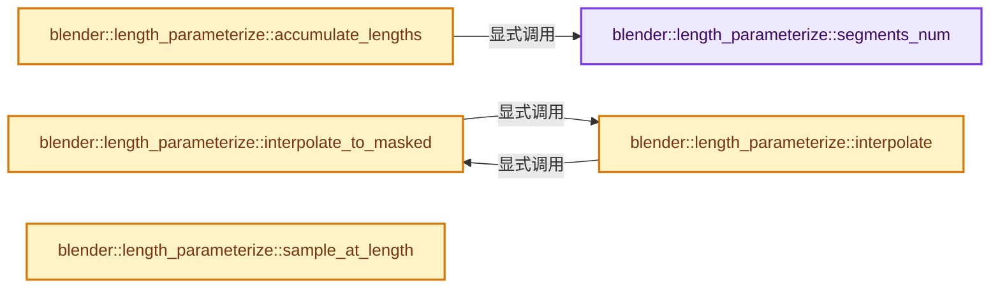
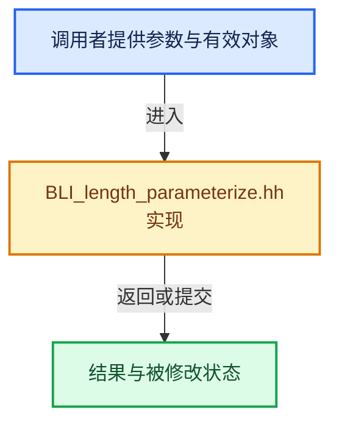

# 实现依赖专题：source/blender/blenlib/BLI_length_parameterize.hh

[实现依赖导航](../README.md) · [符号索引](../../00-课程指南/02-源码与提交索引/符号依赖与实现索引.md)

本专题从正文实际调用进入，集中保存共享实现。函数有稳定锚点，可从调用处直接跳到对应完整函数；递归与互相调用通过回链组织。

## 本文件的实现关系






## 完整成员与函数实现

<a id="f-bc531ecee51e82ce"></a>

### `blender::length_parameterize::segments_num`

实现位置：[source/blender/blenlib/BLI_length_parameterize.hh](../../../../../../source/blender/blenlib/BLI_length_parameterize.hh) · L22—L25。

接口参数：

- `const int points_num`
- `const bool cyclic`

**教学注释版**

<!-- annotated:89d5e8d7cb9629 -->

```cpp
inline int segments_num(const int points_num, const bool cyclic)
{
  return cyclic ? points_num : points_num - 1;
}
```

<details>
<summary>核对原始源码：source/blender/blenlib/BLI_length_parameterize.hh · L22—L25</summary>

<!-- original:89d5e8d7cb9629:source/blender/blenlib/BLI_length_parameterize.hh:22:25 -->

```cpp
inline int segments_num(const int points_num, const bool cyclic)
{
  return cyclic ? points_num : points_num - 1;
}
```

</details>

**结果出口**

- `return cyclic ? points_num : points_num - 1;`

**继续追踪实现**

本实现没有需要继续展开的显式调用；检查返回表达式、对象转换和调用者前置条件。

<a id="f-25cf842433ad08f0"></a>

### `blender::length_parameterize::accumulate_lengths`

实现位置：[source/blender/blenlib/BLI_length_parameterize.hh](../../../../../../source/blender/blenlib/BLI_length_parameterize.hh) · L30—L44。

接口参数：

- `const Span<T> values`
- `const bool cyclic`
- `MutableSpan<float> lengths`

**教学注释版**

<!-- annotated:cd5a9fd43106c8 -->

```cpp
template<typename T>
void accumulate_lengths(const Span<T> values, const bool cyclic, MutableSpan<float> lengths)
{
  /* For cyclic curves with a single point the lengths array is empty. */
  // [讲解] lengths.size：查询视图长度或生成对应有效索引区间。
  BLI_assert(lengths.size() ==
             (cyclic && values.size() <= 1 ? 0 : segments_num(values.size(), cyclic)));
  float length = 0.0f;
  for (const int i : IndexRange(values.size() - 1)) {
    length += math::distance(values[i], values[i + 1]);
    lengths[i] = length;
  }
  if (cyclic && values.size() > 1) {
    // [讲解] lengths.last：按视图边界访问元素。
    lengths.last() = length + math::distance(values.last(), values.first());
  }
}
```

<details>
<summary>核对原始源码：source/blender/blenlib/BLI_length_parameterize.hh · L30—L44</summary>

<!-- original:cd5a9fd43106c8:source/blender/blenlib/BLI_length_parameterize.hh:30:44 -->

```cpp
template<typename T>
void accumulate_lengths(const Span<T> values, const bool cyclic, MutableSpan<float> lengths)
{
  /* For cyclic curves with a single point the lengths array is empty. */
  BLI_assert(lengths.size() ==
             (cyclic && values.size() <= 1 ? 0 : segments_num(values.size(), cyclic)));
  float length = 0.0f;
  for (const int i : IndexRange(values.size() - 1)) {
    length += math::distance(values[i], values[i + 1]);
    lengths[i] = length;
  }
  if (cyclic && values.size() > 1) {
    lengths.last() = length + math::distance(values.last(), values.first());
  }
}
```

</details>

**沿实际写入检查状态**

- `length += math::distance(values[i], values[i + 1]);`
- `lengths[i] = length;`

**继续追踪实现**

- `BLI_assert` → [BLI_assert · L48](BLI_assert.hh.md#m-57a88495704d)；[BLI_assert · L63](BLI_assert.hh.md#m-d07050020cb5)。宏定义由构建条件选择。
- `lengths.size` → [blender::MutableSpan::size · L499](../../01-基础容器与现代CPP/06-MutableSpan可写视图.md#f-1de6a66839c304a8)。
- `values.size` → [blender::Span::size · L256](../../01-基础容器与现代CPP/05-Span只读连续视图.md#f-5f80fa006089c998)。
- `segments_num` → [blender::length_parameterize::segments_num · L22](BLI_length_parameterize.hh.md#f-bc531ecee51e82ce)。
- `IndexRange` → [blender::IndexRange](BLI_index_range.hh.md#t-caa3466d6776)；[blender::gpu::shader::parser::IndexRange](../08-其他Blender模块/gpu/shader_tool/utils.hh.md#t-82d2bd4ea71c)；[blender::IndexRange](../08-其他Blender模块/makesdna/DNA_node_types.h.md#t-0448cc889d39)。
- `math::distance` → [blender::math::distance · L485](BLI_math_vector.hh.md#f-0a0df9b41ececd7b)；[blender::math::distance · L143](BLI_math_base.hh.md#f-45db793191057701)。同名重载需按实参类型选择。
- `lengths.last` → [blender::MutableSpan::last · L695](../../01-基础容器与现代CPP/06-MutableSpan可写视图.md#f-73191eeabe29aab7)。
- `values.last` → [blender::Span::last · L329](../../01-基础容器与现代CPP/05-Span只读连续视图.md#f-a92146c285596891)。
- `values.first` → [blender::Span::first · L319](../../01-基础容器与现代CPP/05-Span只读连续视图.md#f-d8c9bcc3e9757248)。

<a id="f-c27e319179a7ce3e"></a>

### `blender::length_parameterize::interpolate_to_masked`

实现位置：[source/blender/blenlib/BLI_length_parameterize.hh](../../../../../../source/blender/blenlib/BLI_length_parameterize.hh) · L46—L70。

接口参数：

- `const Span<T> src`
- `const Span<int> indices`
- `const Span<float> factors`
- `const IndexMask &dst_mask`
- `MutableSpan<T> dst`

**教学注释版**

<!-- annotated:f63e4d27c580ff -->

```cpp
template<typename T>
inline void interpolate_to_masked(const Span<T> src,
                                  const Span<int> indices,
                                  const Span<float> factors,
                                  const IndexMask &dst_mask,
                                  MutableSpan<T> dst)
{
  // [讲解] indices.size：查询视图长度或生成对应有效索引区间。
  BLI_assert(indices.size() == factors.size());
  BLI_assert(indices.size() == dst_mask.size());
  const int last_src_index = src.size() - 1;

  dst_mask.foreach_segment_optimized([&](const auto dst_segment, const int64_t dst_segment_pos) {
    for (const int i : dst_segment.index_range()) {
      const int prev_index = indices[dst_segment_pos + i];
      const float factor = factors[dst_segment_pos + i];
      const bool is_cyclic_case = prev_index == last_src_index;
      if (is_cyclic_case) {
        // [讲解] src.last：按视图边界访问元素。
        dst[dst_segment[i]] = math::interpolate(src.last(), src.first(), factor);
      }
      else {
        dst[dst_segment[i]] = math::interpolate(src[prev_index], src[prev_index + 1], factor);
      }
    }
  });
}
```

<details>
<summary>核对原始源码：source/blender/blenlib/BLI_length_parameterize.hh · L46—L70</summary>

<!-- original:f63e4d27c580ff:source/blender/blenlib/BLI_length_parameterize.hh:46:70 -->

```cpp
template<typename T>
inline void interpolate_to_masked(const Span<T> src,
                                  const Span<int> indices,
                                  const Span<float> factors,
                                  const IndexMask &dst_mask,
                                  MutableSpan<T> dst)
{
  BLI_assert(indices.size() == factors.size());
  BLI_assert(indices.size() == dst_mask.size());
  const int last_src_index = src.size() - 1;

  dst_mask.foreach_segment_optimized([&](const auto dst_segment, const int64_t dst_segment_pos) {
    for (const int i : dst_segment.index_range()) {
      const int prev_index = indices[dst_segment_pos + i];
      const float factor = factors[dst_segment_pos + i];
      const bool is_cyclic_case = prev_index == last_src_index;
      if (is_cyclic_case) {
        dst[dst_segment[i]] = math::interpolate(src.last(), src.first(), factor);
      }
      else {
        dst[dst_segment[i]] = math::interpolate(src[prev_index], src[prev_index + 1], factor);
      }
    }
  });
}
```

</details>

**沿实际写入检查状态**

- `dst[dst_segment[i]] = math::interpolate(src.last(), src.first(), factor);`
- `dst[dst_segment[i]] = math::interpolate(src[prev_index], src[prev_index + 1], factor);`

**继续追踪实现**

- `BLI_assert` → [BLI_assert · L48](BLI_assert.hh.md#m-57a88495704d)；[BLI_assert · L63](BLI_assert.hh.md#m-d07050020cb5)。宏定义由构建条件选择。
- `indices.size` → [blender::Span::size · L256](../../01-基础容器与现代CPP/05-Span只读连续视图.md#f-5f80fa006089c998)。
- `factors.size` → [blender::Span::size · L256](../../01-基础容器与现代CPP/05-Span只读连续视图.md#f-5f80fa006089c998)。
- `dst_mask.size` → [blender::index_mask::IndexMask::size · L743](../../04-虚拟数组与索引选择/09-分段存储与遍历.md#f-0163b32abc9a0d9c)。
- `src.size` → [blender::Span::size · L256](../../01-基础容器与现代CPP/05-Span只读连续视图.md#f-5f80fa006089c998)。
- `dst_mask.foreach_segment_optimized` → [blender::index_mask::IndexMask::foreach_segment_optimized · L968](../../04-虚拟数组与索引选择/12-重构历史与基准练习.md#f-cf307bcd562186e0)。
- `dst_segment.index_range` → [调用协议](../../00-课程指南/01-路线与规范/模板宏与动态分派协议.md)：接收对象类型依赖auto、返回值或模板实例；不按同名猜测目标。调用位置L58。
- `math::interpolate` → [blender::length_parameterize::interpolate · L72](BLI_length_parameterize.hh.md#f-0fd8cfe6928f9374)。
- `src.last` → [blender::Span::last · L329](../../01-基础容器与现代CPP/05-Span只读连续视图.md#f-a92146c285596891)。
- `src.first` → [blender::Span::first · L319](../../01-基础容器与现代CPP/05-Span只读连续视图.md#f-d8c9bcc3e9757248)。

<a id="f-0fd8cfe6928f9374"></a>

### `blender::length_parameterize::interpolate`

实现位置：[source/blender/blenlib/BLI_length_parameterize.hh](../../../../../../source/blender/blenlib/BLI_length_parameterize.hh) · L72—L79。

接口参数：

- `const Span<T> src`
- `const Span<int> indices`
- `const Span<float> factors`
- `MutableSpan<T> dst`

**教学注释版**

<!-- annotated:9d9cb203b2cae6 -->

```cpp
template<typename T>
inline void interpolate(const Span<T> src,
                        const Span<int> indices,
                        const Span<float> factors,
                        MutableSpan<T> dst)
{
  // [讲解] dst.index_range：查询视图长度或生成对应有效索引区间。
  interpolate_to_masked(src, indices, factors, dst.index_range(), dst);
}
```

<details>
<summary>核对原始源码：source/blender/blenlib/BLI_length_parameterize.hh · L72—L79</summary>

<!-- original:9d9cb203b2cae6:source/blender/blenlib/BLI_length_parameterize.hh:72:79 -->

```cpp
template<typename T>
inline void interpolate(const Span<T> src,
                        const Span<int> indices,
                        const Span<float> factors,
                        MutableSpan<T> dst)
{
  interpolate_to_masked(src, indices, factors, dst.index_range(), dst);
}
```

</details>

**继续追踪实现**

- `interpolate_to_masked` → [blender::length_parameterize::interpolate_to_masked · L46](BLI_length_parameterize.hh.md#f-c27e319179a7ce3e)。
- `dst.index_range` → [blender::MutableSpan::index_range · L676](../../01-基础容器与现代CPP/06-MutableSpan可写视图.md#f-f9a9d59a69ca64b5)。

<a id="f-4f136286e9947282"></a>

### `blender::length_parameterize::sample_at_length`

实现位置：[source/blender/blenlib/BLI_length_parameterize.hh](../../../../../../source/blender/blenlib/BLI_length_parameterize.hh) · L97—L144。

接口参数：

- `const Span<float> accumulated_segment_lengths`
- `const float sample_length`
- `int &r_segment_index`
- `float &r_factor`
- `SampleSegmentHint *hint = nullptr`

**教学注释版**

<!-- annotated:cc3e7f24969af6 -->

```cpp
inline void sample_at_length(const Span<float> accumulated_segment_lengths,
                             const float sample_length,
                             int &r_segment_index,
                             float &r_factor,
                             SampleSegmentHint *hint = nullptr)
{
  /* Use a shorter variable name. */
  const Span<float> lengths = accumulated_segment_lengths;

  // [讲解] lengths.size：查询视图长度或生成对应有效索引区间。
  BLI_assert(lengths.size() > 0);
  BLI_assert(sample_length >= 0.0f);

  if (hint != nullptr && hint->segment_index >= 0) {
    const float length_in_segment = sample_length - hint->segment_start;
    const float factor = length_in_segment * hint->segment_length_inv;
    if (factor >= 0.0f && factor < 1.0f) {
      r_segment_index = hint->segment_index;
      r_factor = factor;
      return;
    }
  }

  // [讲解] lengths.last：按视图边界访问元素。
  const float total_length = lengths.last();
  if (sample_length >= total_length) {
    /* Return the last position on the last segment. */
    r_segment_index = lengths.size() - 1;
    r_factor = 1.0f;
    return;
  }

  // [讲解] lengths.begin：返回借用范围的地址。
  const int prev_point_index = std::upper_bound(lengths.begin(), lengths.end(), sample_length) -
                               lengths.begin();
  const float segment_start = prev_point_index == 0 ? 0.0f : lengths[prev_point_index - 1];
  const float segment_end = lengths[prev_point_index];
  const float segment_length = segment_end - segment_start;
  const float segment_length_inv = math::safe_divide(1.0f, segment_length);
  const float length_in_segment = sample_length - segment_start;
  const float factor = length_in_segment * segment_length_inv;

  r_segment_index = prev_point_index;
  r_factor = factor;

  if (hint != nullptr) {
    hint->segment_index = r_segment_index;
    hint->segment_start = segment_start;
    hint->segment_length_inv = segment_length_inv;
  }
}
```

<details>
<summary>核对原始源码：source/blender/blenlib/BLI_length_parameterize.hh · L97—L144</summary>

<!-- original:cc3e7f24969af6:source/blender/blenlib/BLI_length_parameterize.hh:97:144 -->

```cpp
inline void sample_at_length(const Span<float> accumulated_segment_lengths,
                             const float sample_length,
                             int &r_segment_index,
                             float &r_factor,
                             SampleSegmentHint *hint = nullptr)
{
  /* Use a shorter variable name. */
  const Span<float> lengths = accumulated_segment_lengths;

  BLI_assert(lengths.size() > 0);
  BLI_assert(sample_length >= 0.0f);

  if (hint != nullptr && hint->segment_index >= 0) {
    const float length_in_segment = sample_length - hint->segment_start;
    const float factor = length_in_segment * hint->segment_length_inv;
    if (factor >= 0.0f && factor < 1.0f) {
      r_segment_index = hint->segment_index;
      r_factor = factor;
      return;
    }
  }

  const float total_length = lengths.last();
  if (sample_length >= total_length) {
    /* Return the last position on the last segment. */
    r_segment_index = lengths.size() - 1;
    r_factor = 1.0f;
    return;
  }

  const int prev_point_index = std::upper_bound(lengths.begin(), lengths.end(), sample_length) -
                               lengths.begin();
  const float segment_start = prev_point_index == 0 ? 0.0f : lengths[prev_point_index - 1];
  const float segment_end = lengths[prev_point_index];
  const float segment_length = segment_end - segment_start;
  const float segment_length_inv = math::safe_divide(1.0f, segment_length);
  const float length_in_segment = sample_length - segment_start;
  const float factor = length_in_segment * segment_length_inv;

  r_segment_index = prev_point_index;
  r_factor = factor;

  if (hint != nullptr) {
    hint->segment_index = r_segment_index;
    hint->segment_start = segment_start;
    hint->segment_length_inv = segment_length_inv;
  }
}
```

</details>

**沿实际写入检查状态**

- `r_segment_index = hint->segment_index;`
- `r_factor = factor;`
- `r_segment_index = lengths.size() - 1;`
- `r_factor = 1.0f;`
- `r_segment_index = prev_point_index;`
- `hint->segment_index = r_segment_index;`
- `hint->segment_start = segment_start;`
- `hint->segment_length_inv = segment_length_inv;`

**继续追踪实现**

- `BLI_assert` → [BLI_assert · L48](BLI_assert.hh.md#m-57a88495704d)；[BLI_assert · L63](BLI_assert.hh.md#m-d07050020cb5)。宏定义由构建条件选择。
- `lengths.size` → [blender::Span::size · L256](../../01-基础容器与现代CPP/05-Span只读连续视图.md#f-5f80fa006089c998)。
- `lengths.last` → [blender::Span::last · L329](../../01-基础容器与现代CPP/05-Span只读连续视图.md#f-a92146c285596891)。
- `std::upper_bound` → [外部契约](https://eel.is/c++draft/)：这个边界按实际表达式及所属类型核对参数、返回值、寿命与失败行为。这里提供接口入口，不声称已解释该第三方版本的内部实现。
- `lengths.begin` → [blender::Span::begin · L224](../../01-基础容器与现代CPP/05-Span只读连续视图.md#f-415883b512284f46)。
- `lengths.end` → [blender::Span::end · L228](../../01-基础容器与现代CPP/05-Span只读连续视图.md#f-a7d8b9e494c291a7)。
- `math::safe_divide` → [blender::math::safe_divide · L341](BLI_math_vector.hh.md#f-ab8c82f9a578f2d4)；[blender::math::safe_divide · L351](BLI_math_vector.hh.md#f-0d22d4b64f9b5c0e)；[blender::math::safe_divide · L107](BLI_math_base.hh.md#f-a81537b8ea4660b0)。同名重载需按实参类型选择。
